# UCB《大语言模型智能体｜UCB CS 194 294-196 (LLM Agents) 2024》中英字幕（Claude-3.5-sonnet翻译） - P2：Lecture 2, Shunyu Yao.zh_en - GPT中英字幕课程资源 - BV1RsZPYsEtE

Cool， hi， my name is Shen Yuu， I'm super glad to be here and talk to you about Ireland agents。

 brief history and overview。So today's plan is very straightforward。

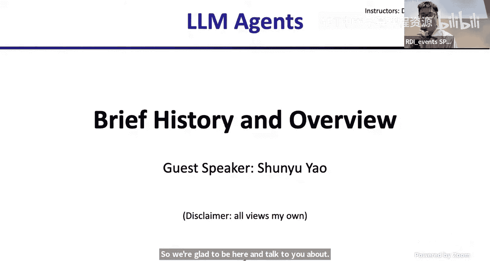

I want to talk about three things， so first what is LM agents to start with？And then second。

 I want to talk about a brief history of LM agents。

 both in the context of LN and in the context of agents。And lastly。

 I want to share some ideas on some future directions of agents。So as you know。

 this field is a moving piece and it' very big and messy。

 So it's impossible to cover everything in agents。 So I I just try to do whatever is in the best of my。

And you can see there's a PR code and you can scan scan it and give me feedback and I can improve the talk accordingly。

😊，Okay， so let's get started。First， what is agents。Do anyone know。

Do anyone think they know the answer if so， raise a hand？Like。

 do you have a definition for what this AH is？Okay， there are like， let three people。

 So that means this field is really a moving piece。😊。

So I think if we want to define what is LM agent， we want to first define the two components。

 what is LM and what this。And。Does everyone know what is alienN？

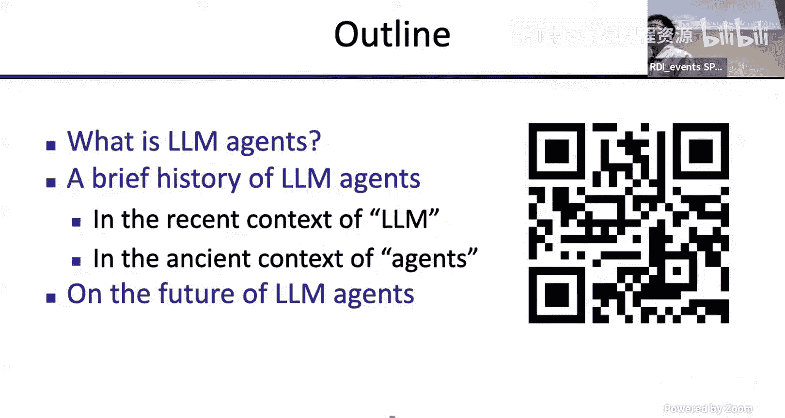

Okay， so， so， so really left what's left is we need to define what's agent。

 And if you search on Google image， this is， this is agent， right。😊。

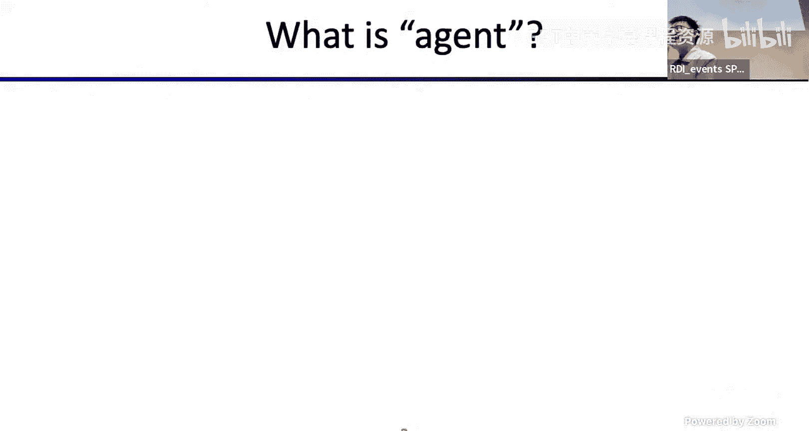

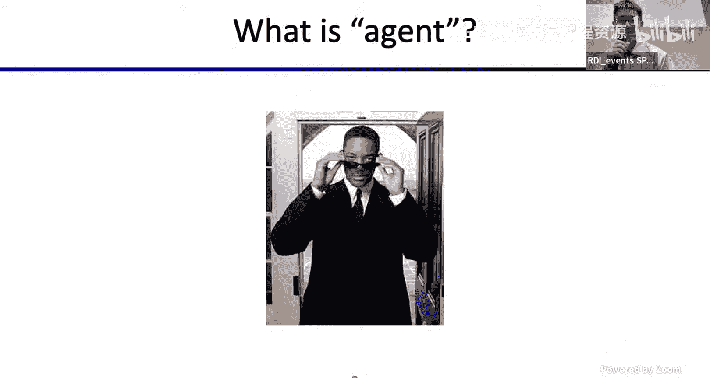

But in the context of AI， obviously we know it's a notoriously broad term。

 it can refer to a lot of different things right from autonomous car to setting goal to play video game to chatbot。

 So first， what is that as an agent。 So my definition is that it is an intelligent system that can interact with some environment。

😊，And depending on like different， you can have different agents。

 right you can have physical environments such as robotwater， autonomous。

 and you can have agents that interact with digital environments such as video games or iPhone。😊。

And if you become human as an environment， then chatbo is also some kind of agent。

And if you want to define agent， you really need to define what is intelligent and what's the environment And what's really interesting is that throughout the history of AI。

 the definition of what's intelligent often changes across time right So like like like 60 years ago。

 if you have a very basic chatbot using like three lines of rule and it can it can be seen intelligent but right now even chatGT is not surprising anymore So I think a good question for you all is like how do you even define intelligent。

😊，Okay。So necessarily we have some definition of agent， then what is L agent？

So I really think there are three categories or three concepts。

So I think the first level of concept is what is a tax agent。

And I think test agent is defined as So you have this agent interacting with the environment。

 And if both the text and observation is in language， then it's a text。

So obviously you can have tax agent that's not using LLMs， and in fact。

 we have tax agent from the beginning of AI like several decades ago。

And I think the second level of definition is LM agent。

 which is agents that are text agent that are also using LMs to act， right so。

And I think the last level is what I call reasoning agents。

 and the idea is those agents use LMs to listen to apps。

And so right now you might be confused what is the difference between the second level and the third level。

 which I will explain later。

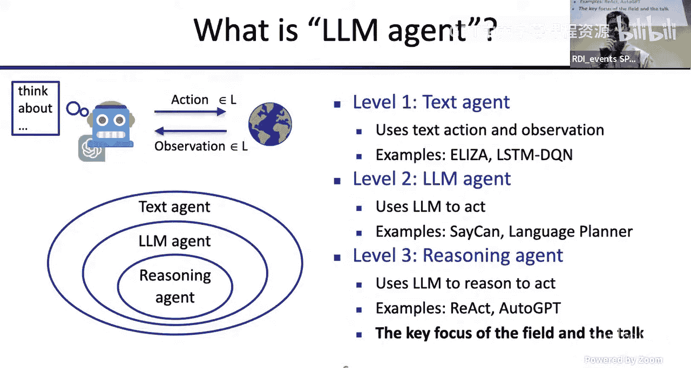

So like I said， people have been developing text agent from the beginning of AI right so for example。

 like back in 1960s there has already been chatbos so Eliza is one of the earliest chatbots and the idea is really simple you just have a bunch of。

😊，And what's really interesting is that using a bunch of rules。

 you can already make a chat out that that's quite human right。

 And what it does is keep asking you questions or repeating what you said and and people find it very human and。

😊，But obviously， like there are limitations to those kind of rub based ages。But as you can see。

 like if you want to design rules， then it often is very task specific。

And for each new domain you need to develop some new rules right and lastly like those rules not really work beyond a simple domain right suppose you write many rules to build a chatbot but then you need to write many rules for a video game agent and so on and so forth。

So。

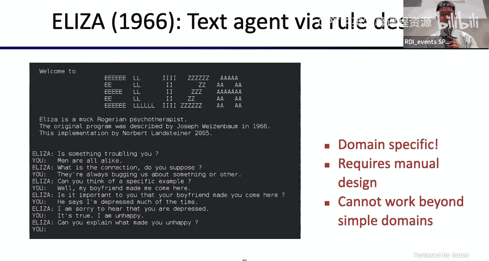

Before ILMs， theres another very popular paradigm， which is to use RL to build taxation。

And the idea is I'm sure everybody have seen video games right。

 so you can imagine text games where instead of pixels and keyboard youre using can text observation and action and you similarly have rewards you can similarly use reinforcement learning to optimize a reward and the idea is you can just optimize the reward and you exhibit some kind of language intelligence。

😊，But again， these kind of methods are pretty domain specific right for each new domain you need to train a new agent and it really requires you to have skill reward signal for the task ahead。

 which many of the task don't and lastly it takes extensive training which is a feature RL。

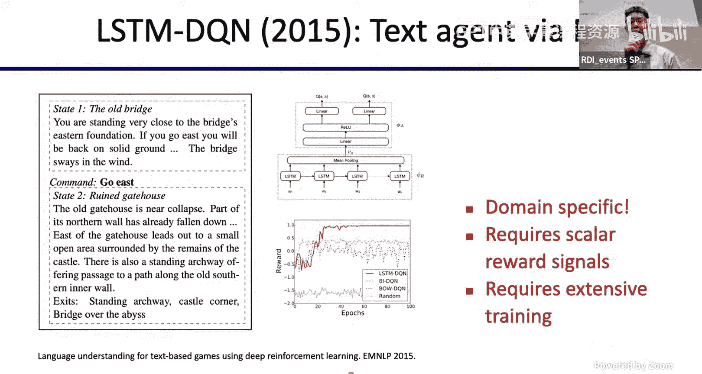

So really， if you think about the promise of LLMs to revolutionize tax agent， right。

 those LMs are really just train on next to prediction on massive tax opera。😊。

Yet during inference time， it could be prompted to solve various new tasks。

So this kind of generality and future learning phenomena will be really exciting to build agents。

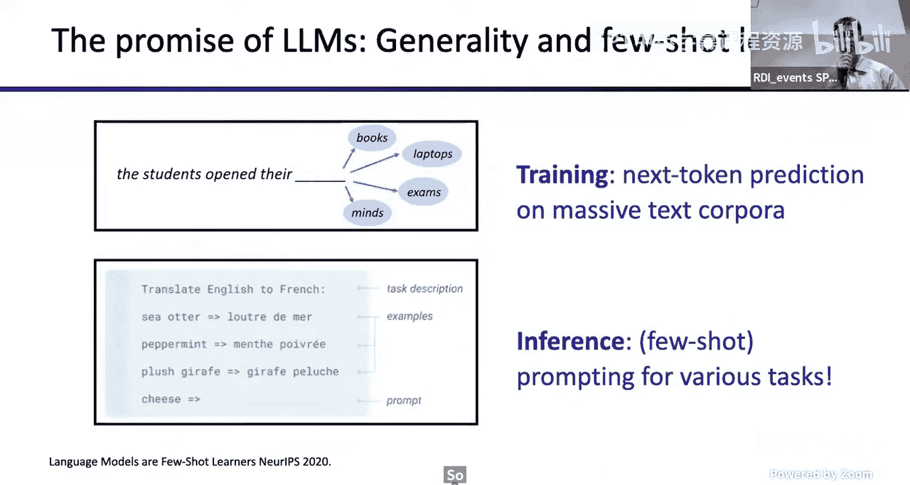

So next I want to give a brief overview of airline agents and it's also like a historic view。

It's obviously very simplified。😊，I think what's happening is so first we have something like ILM in 2020。

 I think the beginning of ILM is G3， and then people start to explore that across different tasks。

And some tasks happen to be listening in tasks。Such as symbolic question answering as well。

And some tasks happen to be what I call acting tasks。

 you can think of games or robotics and so on and so forth。

And then we find that this paradigm of reasoning and paradigm of acting are start to converge。

 and we start to build what I call reasoning agent that's actually quite different from all the previous agents。

And from recent agent， we start to explore on one hand。

 more interesting applications and tasks and domains such as web interaction or self engineering。

 or even scientific discovery and so on。And on the other hand。

 we start to explore new methods such as memory or learning or planning or multiage and so on。

So first， I want to。Introduce， you know， what I mean by the paradigm of reasoning and what I mean by the paradigm of acting and how they converge and what is this paradigm of reasoning agent。

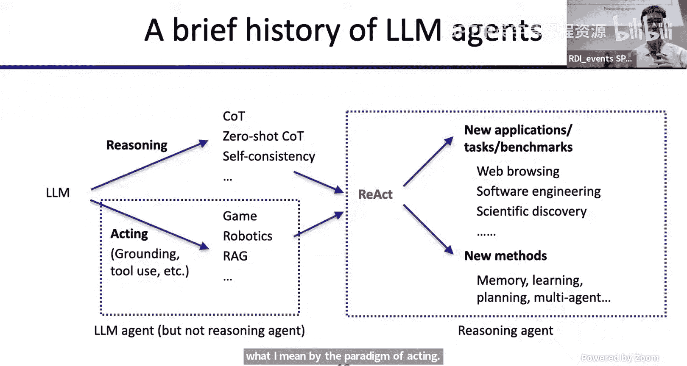

And history is always messy， so for now let's just assume let's focus on one task。

 which is quest answering， which can simplify our history discussion a little bit。

And then we'll come to more tasks。So question answering is a very intuitive task， right。

 so if you ask。Language model， what is one plus two， it will tell you three， right。

 that's question answering， is's very intuitive。So it also happens to be one of the most useful tasks in anLP。

Right so obviously people try to use language models to do question answering。

And then people find a lot of questions， or problems when you try to answer questions。Okay。

 so if you have some question like this。It would be very hard for the transformer language model to just output the answer directly。

 right， So it turns out you need some reasoning and d covering the desktop like channels out listeninging and so on and so forth。

There has been a lot of people investigating how to do better recently with language models。

You can also imagine like language model can you answer something like this。

And it will probably get the answer wrong because for example。

 if a language model is trained before 2024 and the prime minister of UK change often a signal level。

 so it might get the answer wrong right so in that case you need new knowledge and people are working on that。

And for example， like you can ask something that's really mathematical and really hard in that case like you cannot really expect transformer to give the answer right So in some sense you need some way of doing computation beyond beyond the naive auto regression of transformer。

😊，So as you can see， like there are many types of question answering task and people find many problems when using language model to answer those questions and then people come up with various solutions。

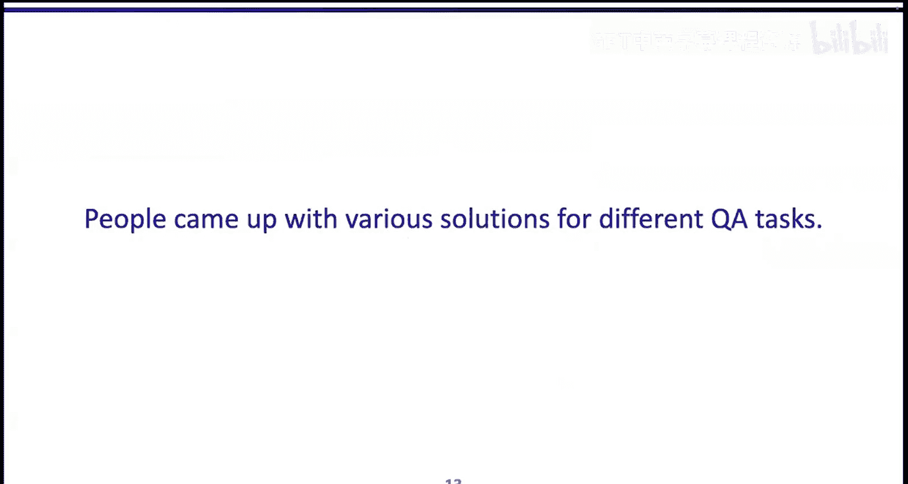

So for example， if you are trying to solve the problem of computation， right。

 what you can do is you can first use the language model to generate a program and then this program will run and give you a result。

That's the way you can answer， you a question about prime factorization or what it a 50s fibrilaia number。

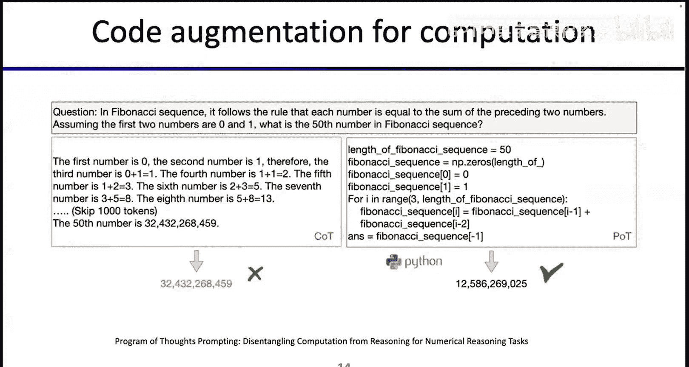

So for the problem of knowledge， there is this paradigm of retrieval augmented generation right and the idea is very simple right you assume you have some extra cora。

 for example， Wikipedia or this Copora of this company， for example。And then you have a retriever。

 whether it's a BM 25 or DPR or so on and so forth。

 you can think of retriever as kind of a search engine right So what it does is given a question。

 this retriever will actually just pull the relevant information from the Co and then append that to the context of the language model so that is much easier for the language model to answer the question。

😊，So this is a very good pattern， however， what if there's no Cora for the knowledge or information that you care about right。

 for example， if I care about today's weather in San Francisco。

 it's very hard to spread any existing Cora to have that， right？😊，So诶。

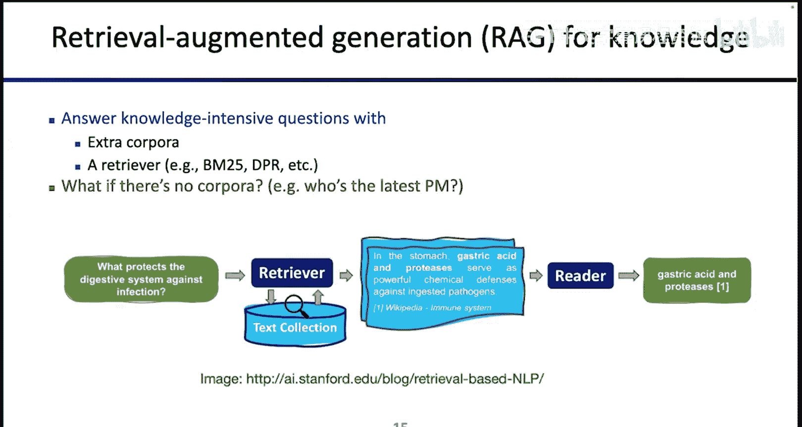

People also find this solution called to use and idea is。

You have this natural form of generation which is to generator a sentence。

But then you can introduce some special tokens so that it could involve tool cost， right。

 for example， you have a special token for calculator or a special token for a Wikipedia search or a special token for calling a weather API。

😊，诶。So this is very powerful， obviously you can augment language models with a lot of different。

Lowledge， information， and even computation。But if you look at this。

 this is not really a very natural format of text right there's no like blog post or Wikipedia passage on the internet that looks like this。

 so if you want that language model generate something like this you have to fine tune that in this very specific format。

And it turns out very hard to call that more than once across the text。

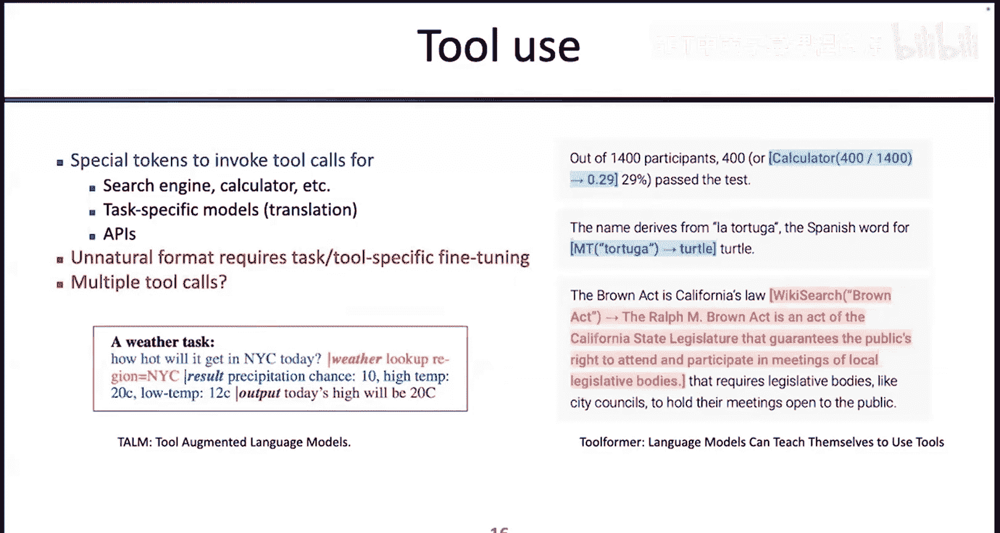

So呃。Another natural question come right what if you need both reasoning and knowledge and people actually come up with a bunch of solutions for different tasks right。

 for example you can imagine interleaving the channels out and retrieval or generate follow up questions and so on and so forth。

But we don't need to get into the details of other the masses。

 I just want to point out like the situation at the time was a little scattered， right。

 So you have this single task called QA， but it turns out to be more than a single task。

 You actually have like。😊。

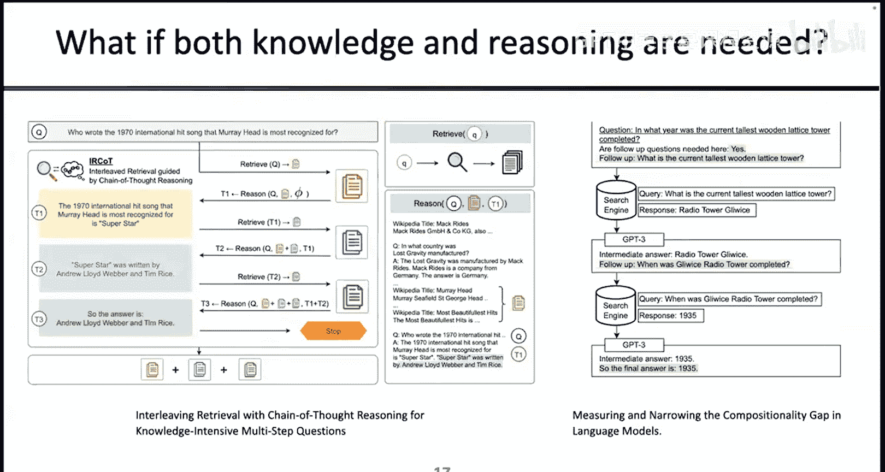

Turons of different benchmarks， right， And they happen to challenge language models in very different ways。

And people come up with solutions for each of the benchmark。

So it feels very peaceful at least for me right， and at least for me at the time， the question is。

 can we really have a very simple and unifying solution？And I think if we want to do that。

 we really need abstraction beyond， you know， individual task methods。

 we need like a higher level abstraction over what's happening。So the abstraction that I find。

 at least for myself， is the obstruction of reasoning and acting。So what is reason？

Hope you already know that from Dennis talk last time。呃。So chain of thought right。

 it's very intuitive and it's just a very flexible and general way to augment and test on compute and to think for longer during inference time to solve more complex questions。

 right？However， if you only do chain of thought， you don't have any。

External knowledge or tools right even the biggest smartest model in the world does not know the weather in San Francisco today。

 so if you want to know that you need external environment and knowledge and tools。

And what I have to is like rag or retrieval or code or twous and so on and so forth。In some sense。

 it's just a paradigm of acting because you're just。

Assuming you' are having an agent and you have various environments， whether it's retrieval。

 search engine， calculator， API or Python， right？嗯。

And the benefit of interacting with an external environment is that very。

 it's like a flexible and general way to augment knowledge and computation and feedback and so on and so forth。

However， it doesn't have reasoning， and we will see later why that's。Tublesome。

So the idea of this word called reactact is actually very simple， right。

 so you have this two paradigm recently en actinging。And before react。

 like language models are either generating reasoning or acting and for react。

 the idea is to just generate both。And we will see that it's actually a great way to synergize both in the sense that reasoning can help acting and acting can help reasoning。

And it's actually quite simple intuitive。 You will see later， it's actually。

You can argue that's how like I solve the task or you solve the task。

 it's a very human way to solve the task and it's very general across the domain。

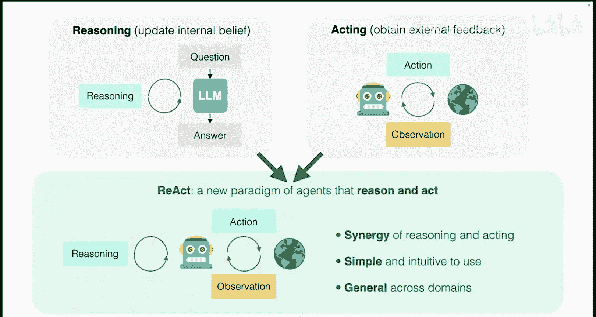

So the idea of react is very simple， right， Supp you only solve a task。

And what you do is you write a prompt and the prompt consists of a trajectory that looks like this。

 so you give an example task。And as a human， you just write down how you think and how you do what you do to solve the task along with the observation along the way right so if you're trying to answer a question using Google Engine。

 you just think about some stuff and do some search and then you write down that and then also write down the resolve Google and you keep doing that until you solve the task。

You can give this one example。And then you can give a new task。And given this prompt。

 the lung model will generate thought and action。And this action is passed and fit into the external environment。

 and then that would trigger some observation。And then the thought action observation is appended to the context of the language model。

 and then language model generate the new salt and new action and so on so forth。

So obviously you can do that using a single example that's called one shot prompting。

 you can do that with few examples that's called few shot prompting。If you have many， many examples。

 you can also fine tune language model do that， so it's really about a way to use language model rather than prompting or fine tuning。

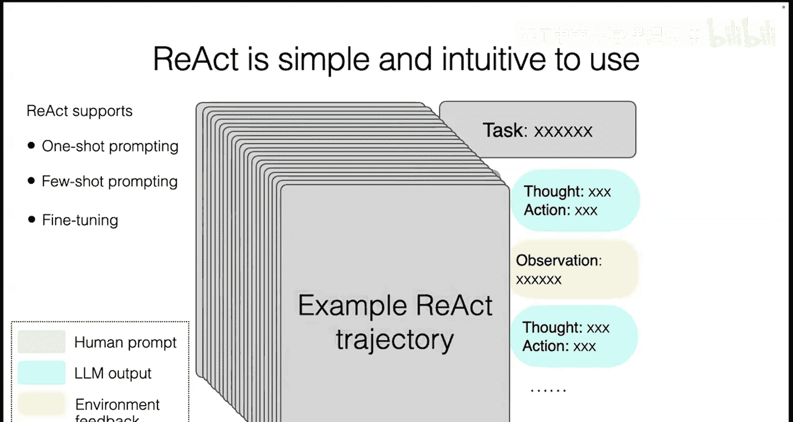

So as a concrete example， let's say you want to answer a question， right， if I have $7 trillion。

Can I buy Apple， NVdia and Microsoft， I make this slide back in March。

 and that was a trendy topic at the time。呃。So you can write down a prompt like that。 You just say。

 okay， lunch model， now you're agent and you can do two type of actions。

 You can either Google or you can finish with an answer。😊。

And you just need to write on the solid action， Okay， so that's very intuitive。

And let's say what language model do right so this is what GB4 does back in March。

 so refer first generate a thought right so first I need to understand I need to find what is the market cap of those companies and then add them together so that I can determine if $7 trillion can buy all three companies。

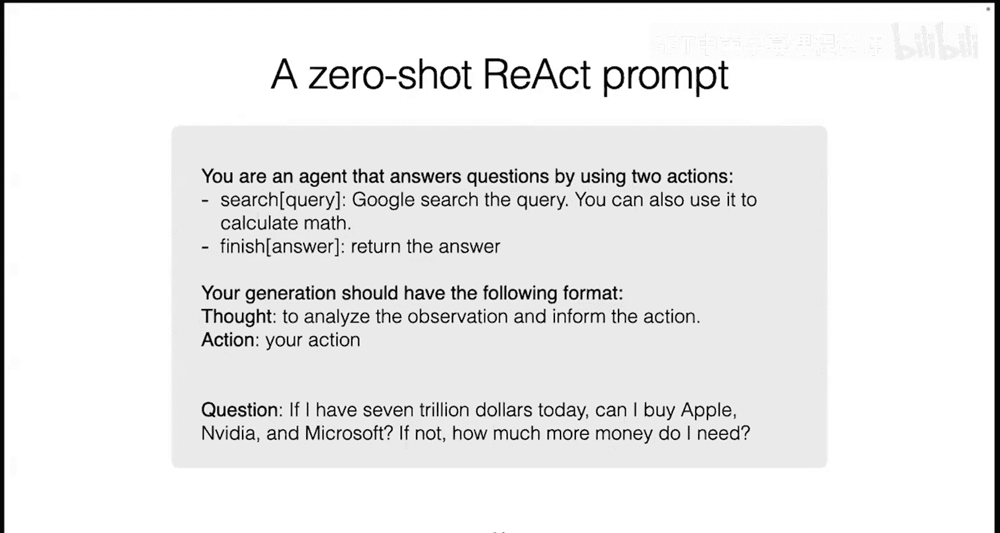

And then this triggers this action to search on Google and this Google search returns to s it as a result。

Unfortunately， like it just contains all the market caps you need。

So the way I acknowledge that and now I have the auto market tab。

 all I just need to do is to add them together， so it uses search engine as a calculator。

 add them together and get a result。And theyll think， okay， so$7 trill0 is not enough。

 So you need additional money to buy that。 I think if it's us today。

 then it's even more money because the media is much higher now。Yeah。

 so that's how reacts solve the task and you can see it's a very intuitive way。

 very similar to how humans solve the task right， you think about the situation。

 you do something to get them more knowledge or information and then based on the information and you think more。

呃。And then I try to be a little more adversarial。 so instead of finding all the market caps。

I inject this adversarial observation， right， nothing is fine。

And here comes the power of reasoning right so reasoning actually finds a way to adjust the plan and guide the action to adapt to the situation right because research is not result is not fine maybe I can search for individual market right so I can just search for the market of Apple。

And then I try to be adversarial again， I give the stock price in South market。And here。

 reasoning helps again， right based on the common sense。It figures out right。

 this is probably the price， not a market。So if you cannot find the market tab。

 what you can do is you can find a number of shares and then you can multiply number of shares market and a stock price to get a market cap。

 and then you can do that for the all three companies and then you can solve the task。

So from the example。You can see that it's not really acting and helping reasoning right。

 obviously acting is helping reasoning to get real time information or doing calculation in this case。

 but also reasoning is constantly guiding the acting into a plan situation and replan situation based on exceptions。

So you can imagine something like this to solve various questions during tasks。

 all you need to do is to provide different examples and provide different tools。

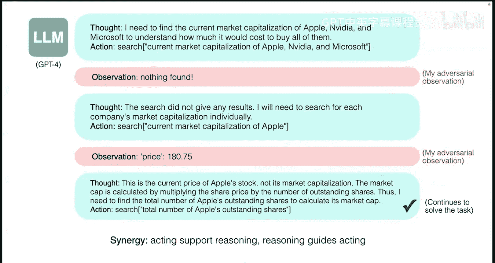

So okay， this is good， we're making progress。The thing what's really cool is。

Like this paradigm goes beyond Q A， right So if you think about it。

 you can literally use it to solve any task。

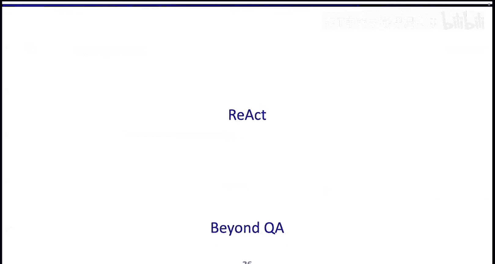

And to realize this， all you need to realize is。Many parts can be turned into a tax game。

So imagine if you have a video game。What you can do is you can assume you have a。You know。

 video captioning or image captioning model， and you can have some controller that can turn language action into a keyboard action。

 and then you can literally turn many of the tasks into a text game。

And then you can literally use react to solve them。So it goes well beyond。

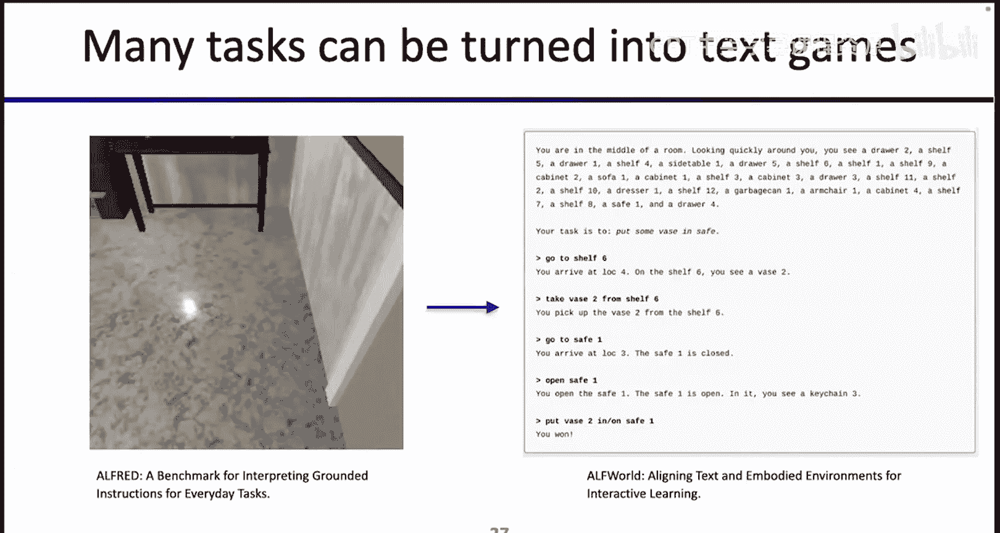

呃啊。So。After know the invention of that model， obviously another part of the history is。

There are people from race and learning， robotics， video game so on and so forth they're trying to apply this technique and there are many words I'm only list one for example and the idea is。

Very intuitive， like I said， you can try to turn all the observation into text observation。

 and then you can try to use language model generate tax action。

 and then you turn the tax action into some。Original format of action， and then you solve the task。

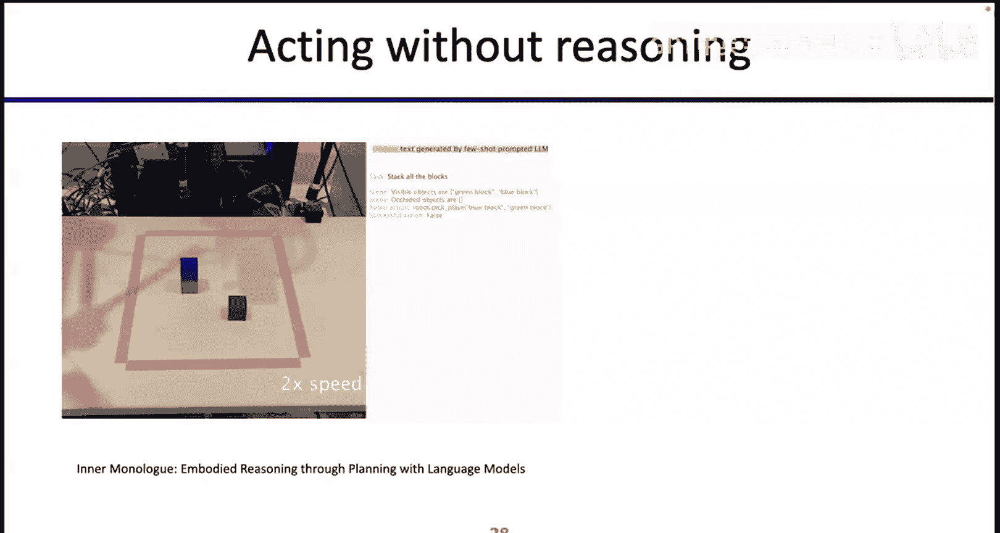

But what what's the issue of this right so this is an example from a video game where you're trying to do some household task in your kitchen。

 right？And the problem really is sometimes it's really hard to directly map observation into action because。

For one， you may have never seen the domain。Second， like to process， you know。

 like from the opposition to actually you need to think。But if you don't have this thinking paradigm。

Like all you are doing is just trying to imitate the observation to action mapping from the prompt or from the future example。

 so in this case in a think basin one there is no paper shaer， so nothing happens。

But because it doesn't have the capacity to sink， it will just keep doing that and keep feeling because like it's not language model。

 it's just trying to imit it， so it's not really trained to solve the task like Asian。

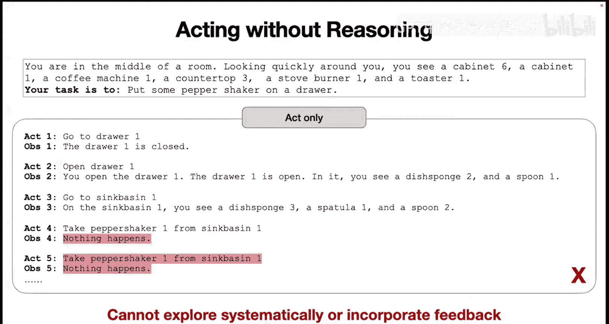

So what real ideas is actually something very simple， right， You're literally just adding。

Another type of action called thinking。And thinking it's a very interesting action because you can think about anything right so in this video game you might only be able to go somewhere or pick up something that's the action space defined by the environment。

But you can think about anything。And you can see that the thinking action is very useful because they help you plan the situation。

 they help you keep track of the situation， they help you plan withland if something wrong happens。

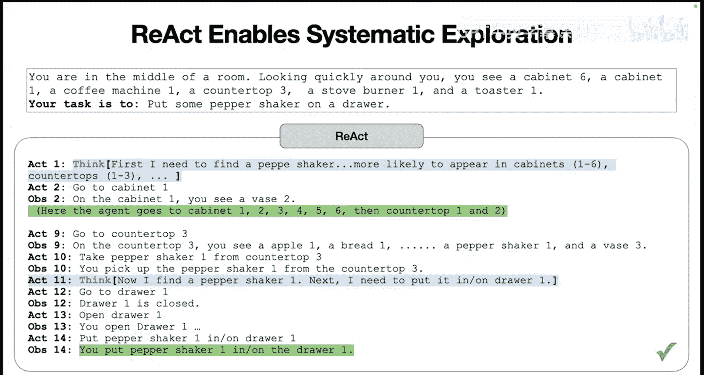

So as you can see， like react is a general pattern that helps across various task and it's systematic better than if you only do reasoning or only do acting。

So呃。This is interesting right and I just want to point out why this is interesting from a more theic perspective。

So。Again， abstraction。 So if you think about all the agents that you have everything， right。

 from video game to Alphago to。Autonnoomous car or whatever， like all the agents。呃。

Like one common of feature is that。You have an action space that's defined by the environment。Right。

 so。Assume you are solving video game， say your tower game。

Then your action space is left right up down。Like you can be very good， you can be very bad。

 but your actual space is fixed。And what's really different for language agent or IM agent or reasoning agent。

Is that you have this augmented action called reasoning。And what's really interesting about this。

Agumented action is that。It could be any language， right， You can think about anything。

 It's even in space。You can think about the paragraph。 You can think about the sentence。

 You can think about the word。 You can think about 10 million tokens。

And it doesn't do anything to the to the world， right， no matter what you think。

 it doesn't really change。The earth or the video game you're playing。

All it does is it changes their own context， right， it changes your memory， and then based on that。

 it changes their fold off actions。

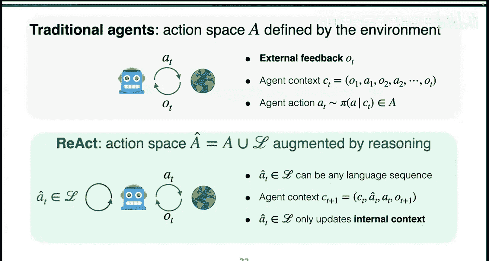

So。So that's why I think this new paradigm of risk Asia。It's different。

 it's different because reasoning is an internal action for agents and reasoning has a very special property because it's an infinite space of language。

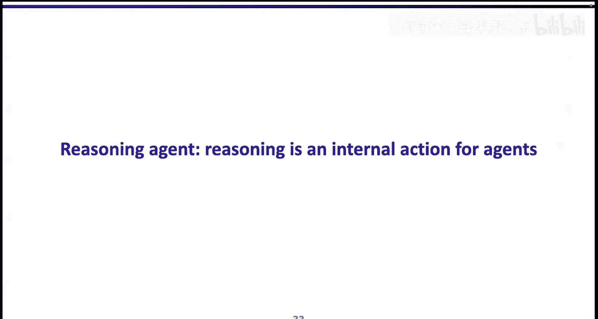

酷ol啊。So we've covered the most important part of the talk。呃。

I think the history goes on right so from now on we have the paradigm of reasoning agent and then we have more methods。

 more tasks。And there's a lot of progress， obviously， and I cannot cover everything。

So on the method side， I just want to cover one thing today。Which is。Lunong term memory。

So we just talk about what is resilient agent and the idea is you have an external environment。

 be it video game or Google search engine or your car or whatever。

And we just talk about the difference of reasoning agent is that the agent can also think， right？

Another way to think about this is。呃。You have an agent。That has。A shorthor term memory。

 which is the context window of the language model。And。

It's interesting that you can app interesting thoughts and actions and observations to this context。

But呃。If you look at this kind window of the lymph model。First is append only， right。

 so you can only append new tokens to the context。And you have limited context， right。

 So it could be a southern token two years ago， it could be a million token。

 now it could be 20 million tokens。Next year， but you have a limited size of context。And even I said。

 we have a2 okay window。You might have limited attention， right。

 so you can have a lot of distracting things。If you're like doing a long horizoning， right？

And lastly。It is a shelter memory because。This kind of memory does not persist over。

Time are over new tasks， right？So you can imagine， let's say this agent solved re hypothesis today。

Which is really good。But then unfortunately， if you don't find too a language model， right。

 it doesn't change right So next time you have to solve from scratch again and there's no guarantee whether it will solve tomorrow right So I think an analog I want to make is it's kind of like a golden fish right So folk wisdom is a golden fish only has three seconds of memory right so。

😊，Like can you can solve something remarkable。But if you cannot remember it。

Then you have to solve it again and it's really a shame， right？So。

Hope that's motivating enough to introduce this concept of not memory， right。

 So it's just like as a human， right， you cannot remember every detail in the。In every day right。

 but you maybe you may write a diary right that's kind of like a long memory you read and write important stuff for your life。

 for your future life， like important experience important knowledge or important skills。

And hopefully that should persist over a new experience， right？

So you can also imagine a mathematication writing a a paper。How to improve remain hypothesis。

That's kind of like a long of memory， right， because then。

Like you can just read the paper and you can prove it。You don't have to solve it again。So。

Let's look at a very， very， very simple form of non memory in this work called Ref。

 which is a very simple follow up from react。So let's say you are trying to solve a coding task。

This is a task。And you can imagine you can write some program， you can run a program， you can reason。

 you can do whatever。呃。But at the end of the day， right， you test it。And let's say it doesn't work。

 right， some tasks failed。So if you do have a lot of memory。Then you just have to try again， right？

But what's different now is if you have a long term memory， what you can do is。

You can reflect on your experience， right。You read a program and it failed some tests。

You can think about it right it's like， oh I feel this task because I forget about this color case。

 so if I write this program again， I should remember this。

And what you can do is you can persist this piece of information over time。

I like when you write this。A program again， you can literally read this long term memory。

 and then you can try to be better next time。And hopefully it will improve。

So this turns out to be working really well for various tasks。

 but in particular coding right because recording coding you have great feedback which is the unit test result and you can just reflect on your failure or success and then you can keep track of the experience as a sort of not memory and then you can be better。

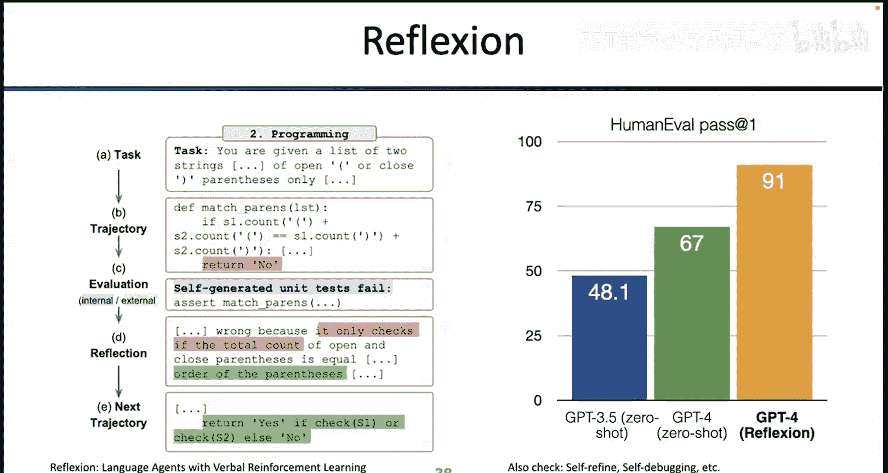

Another way to think about this is。It's really a new way of doing learning， right。

If you think about the traditional form of reinforcement learning， right， so you do something。

And then you get a skillary reward。And what you do is essentially trying to back propagate reward to update the width of your policy。

And there are like many， many algorithms to do that。If you think about ref on， right， it's really。

A different way of doing learning because。First， you're not using。Skillary word。 you can use。

Anything， right you can you can use。A code execution result， you can use a compiler arrow。

You can use the feedback from your teacher， which is in text， so on and so forth。

And it's not doing learning by gradienting descent right。

 it's learning by updating language right by language I mean a lot of memory of task knowledge and then you can think of this language as affecting the future behavior of the policy right？

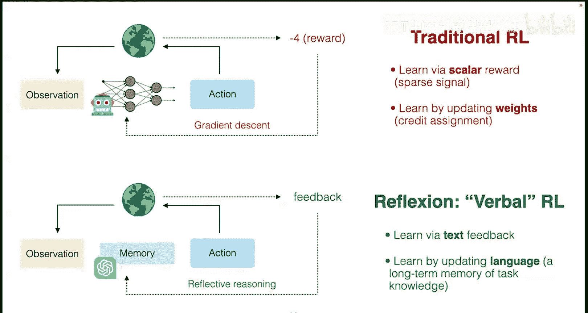

So this is only a very simple way simple form of La memory and I think followup work did more complicated stuff。

 you will hear about Voyager from Jim later I guess where you have like a memory of code based skills right and ideas。

For example， you're trying to play Mincraft and you learn how to build a sword in this kind of API code。

 then you can try to remember it and next time if you want to kill a zombie you can first pull the skill of building a sword。

 you don't have to try to try it from scratch right？

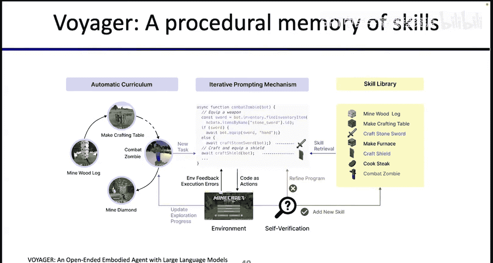

And for example， in this work of generative agents。呃。

The idea is you have like 20 human like agents in this small town trying to keep be human。

 you know they have jobs， they have life， they have social interactions so on and so forth。呃。

You have this。Episodic form of long term memory where you literally each agent keeps a log of all the events。

That's happened right every hour right that's like a most detailed possible diary you can possibly have and you can imagine like like later if you want to do something。

 you can take a look at the log to decide what you work on right because if you like drop off your kit at this place you want to retrieve that piece of information and then you pick it up。

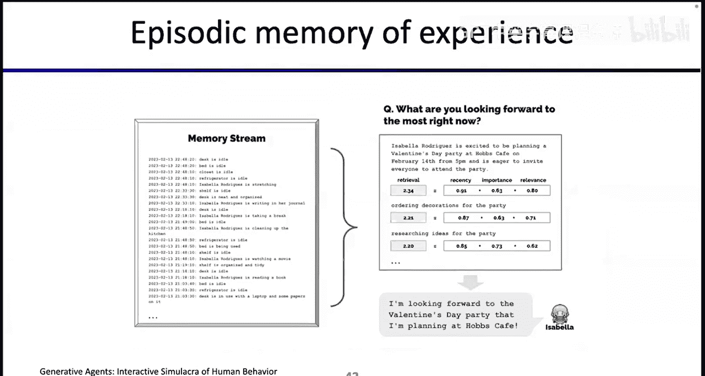

You can also have this form of semantic memory where you can look at the diary where and you can draw some conclusions about other people and yourself。

 you can realize you can reflect on that and you can say， okay， okay。

 Jim is actually very curious guy and I actually like video game and this kind of knowledge can actually affect your behavioral movement。

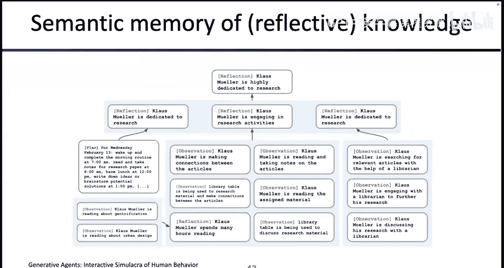

呃。Yeah， so this is a lot of memory and。😊，And I think another the final step to finishing this part is to realize that。

呃。You can actually also think of the language model as a born of long term memory， right？

So you can learn。But learn， I mean， improve， you can improve yourself。

Or you can say you can change yourself by either changing your。Pyme is the neural network。

 which is to find your language model。Or you can write some piece of。

Code or language or whatever in your long memory。 And then you can retrieve from it later， right。

 So that's just two ways of learning。But if you think of both neural network and whatever text Cora suppose a form of long memory。

 then you have a unified abstraction of learning。And then you have an agent that has this power of reasoning over a special form of short term memory called contest of length model。

 and then you can have various formal of long term memory。And in fact。

 you can show that this is almost just sufficient to express any agent。

So I have this paper called Kooala， which I don't have time to cover today。

 but I encourage you to check out。Where the statement is that you can literally just express any agent by the memory。

 which is where the information is stored。The action space， like what the agent can do。

And the decision making precision， basically given the space of actions what。

What which action you want to take right， you can literally express any agent with is three pause。

 So this is a very。Clean and sufficient way of thinking about it。Any agent？And。呃。

I want to lift two questions。For you to think。And I have answer in this paper that you can try to retrieve。

So the first question is。What makes external environment different from internal memory， right？So。

 imagine。If the agent opens up Google Doc and write something there。Is that a form？

Long term memory or is that like some kind of action to change the external environment？

Or like imagine if。The agent has a。Arive of internet right and it tries to retrieve some knowledge from there。

 is that a kind of action or is that a kind of retrieval from a long term memory？

I think this question is interesting because。If you think about physical agents。

 like humans are autonomous cars， right？It's very easy to define what is external and what is internal。

First， like what's outside our skin is external， what's inside our skin is internal or it's very easy to define。

But。I want you to think about for digital agents， how can you even define that？And lastly， like。

 how do you even define。Long term memory versus shorter memory。I suppose。You have a。

Language model context of 10 million organ can that still be called long memory？

KNotnow that those terms are defined from kind of human psychology and neuroscience。

Think about these two questions。So okay， so we have covered some brief history of animations。

 I also wanted to talk about， you know。The history of LM agentss in a broader context of agents。

 right we have talked about how we start from LM to derive various things and all the developments of language agents。

But if you look at a more Asian history， how is recently agent different from all the previous paradigms of Asian。

So here I want to give a very， very minimum。History of agents and it's definitely wrong。

 so it's just for illustration， right， don't take that too seriously。

But I think if you want to write a very minimal history of Asian in one slide。

At the beginning of AI right the paradigm is called symbolic AI and you have symbolic AI agency and the idea is kind of like programming right you can program。

All the rules to interact with all the different kind of environments and you can have expertise and stuff。

呃。And then you have this period of AI winter， right？

And then you have deep learning and you have this very powerful paradigm of RL agent。

 and it's usually a deep RL agent。And where you have a lot of amazing miracles from Atari to Alphago。

 so on and so forth。And only very recently， we have our majors， right？So this is obviously wrong。

 but if I have to put things in my slide， this is kind of the perspective。

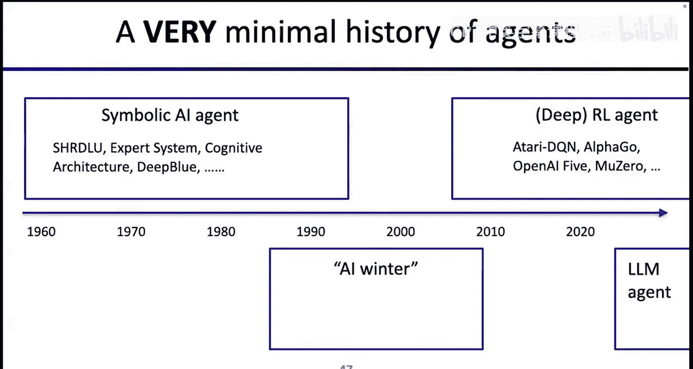

And remember the examples we look at at the beginning of the talk， right。

 this is like a very typical example of a symbolic data agents。

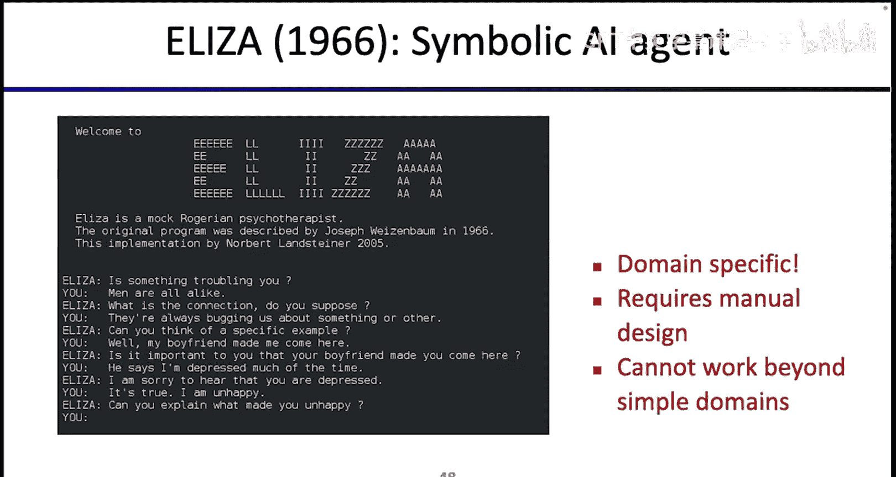

And LTM DQan is a very like typical example of a deep RL agent in the text domain。呃。

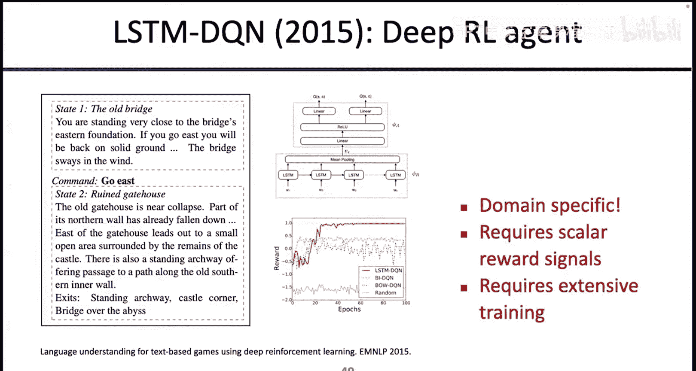

And I think one way to think about the difference between the three paradigms of agents is。

The problem is the same， right， so you have some observation from the environment。

And you want to create action， right， you want to take some actions。And the difference is。

What kind of representation what kind of language？Do you use to process？

From the observation to the action， right？If you think about symbolic AI agents。Essentially。

 youre first mapping all the observation into some symbolic state， right？

And then you're trying to use a symbolic state to deriveise some action。

You can think of if else rule， essentially you're just trying to map all the possible complex observations into a set of logical expressions。

 right？And if you think about all the deep RL agents。

Like a very abstract way of thinking of this is you have。

Many different possible forms of observations， where it could be pixel， it could be text。

 it could be anything， but。From a deeper IL perspective， it doesn't really matter because。

It's map into some kind of embedding really， it's processed by a neural network to some。

Reectctorors or matrixes， and then use that to derive some actions， right。呃。And in some sense。

 what's different for language agent or reasoning agent is that。

You're literally using language as intermediate representation to process observation to action work。

Like instead of this near embedding or this kind of symbolic state。

 you're literally thinking language， which is。Kind of the human way of doing things， right？

And the problem with symbolic state onnuing data is that。If you think about it。

 it takes intensive efforts to design those kind of symbolic agents， right。

 If you think about how Venmo is built as a。Autonnomous car， right， you probably write meaning。

Of lines of rules and code， right？And if you think about。All those deeper R out agents， most of them。

 it takes millions of steps to explain them， right and the problem is。Those are kind of ask specific。

 right if you write a millions of lines of code for。Autonomous car， right。

 you cannot really reuse that for playing video game。Similarly。

 if you train an agent using DL using media steps to play a video game。

 you cannot use that to drive cars， right？嗯。Language is very different because。First。

 you don't have to do too much right because you already have rich price for LOMs。

 that's why you can prompt to build IOM agentss， it's pretty convenient。And。It's very general， right。

 You can think about how do drive a car。 You can think about how you play a video game。

 You can think about。呃。Which all stood by， right？Considering mortgage rate and stuff。

And thinking is very different from symbolic state and deep because。

The symbolic state and the deep I vector， right， they usually have a fixed size。

But you can think arbitrary long， right， you can think about a paragraph you can think about a sentence。

 and that brings this whole new dimension of infant on scalingating。And。呃。

And that's why fundamentally recently agentging is different。

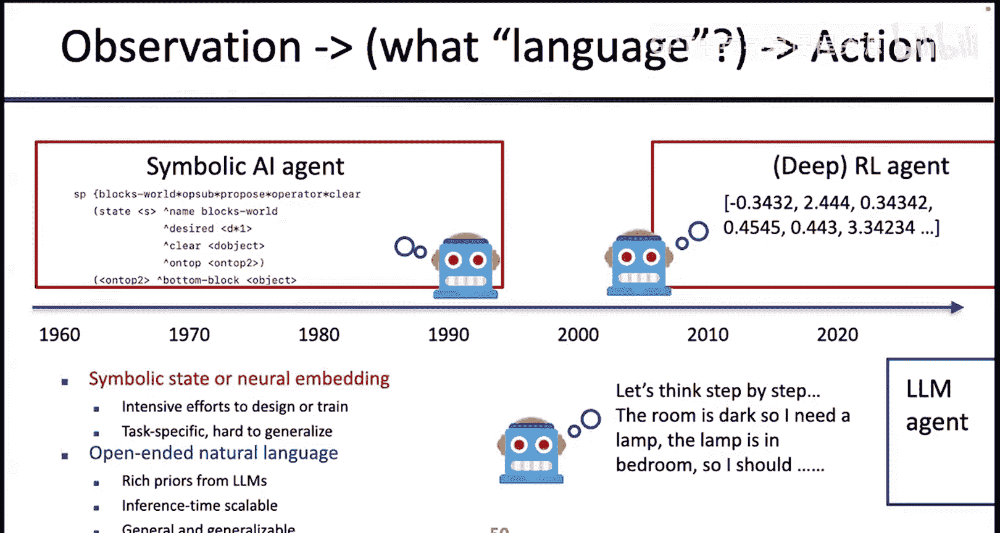

Okay， so。I just realized I just covered half of the later half of the brief history of M agents。

 where we talk about long memory and why the methodology is fundamentally different from the previous agents。

 I also want to briefly talk about the new applications and tasks that IM agents enabled。

So as you can see in the beginning of my talk， the examples are basically questioning and playing games。

And that's pretty much， the if you think about it， that's pretty much the predominant paradigm of P and RL。

 right？But I think what's really cool about language agents is that it really enables much more applications and in particular what I call digital automation。

 right？

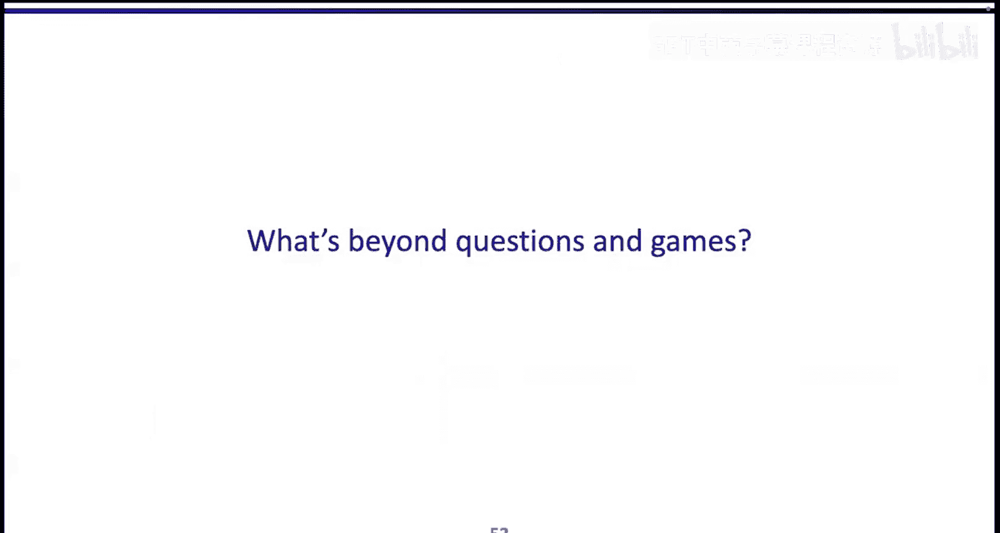

So what I mean by digital automation is。Imagine if you have an assistant that can help you file。

Reimbursment reports。Or help you write code， debug wrong experiments。Help you find relevant papers。

 help you review paper， help you find papers that are relevant。Right。If all of can be achieved then。

Everybody can graduate undergrad in two years or PhD in three years or。呃。

Or like get heing three years， like everything can be speed up。But if you think about it。

 like before Chaji Bea， right？There's literally no progress if you think about Siri， right。

 which is the state of art， digital agent。Before she had a VT， right。

 it literally can do nothing right and why is that？I think the reason is that。

You really need to reason over real world language right if you want to write a code like this paradigm of sequence to sequence mapping is not enough。

 you have to think about what you write and why you write it and you have to make a decision over opening actions over long horizon。

 right？

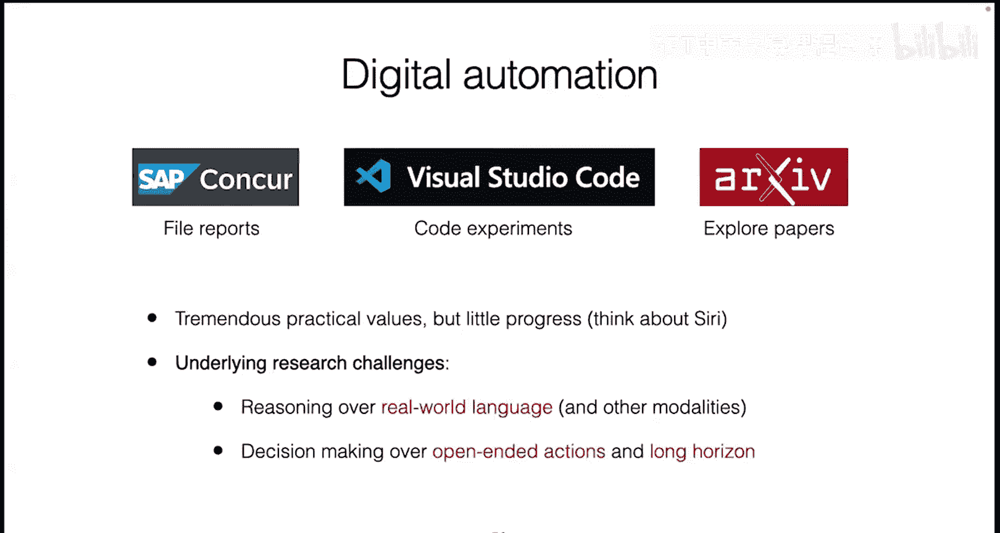

呃。But unfortunately， if you think about， you you look at all the alien benchmarks before。

Before the existence of LLMSs or our agents。They often look something like this。

 right so they usually they are usually very like syntheticed class， very small skill and。

Not practical at all。And that' that's been limiting for the history of agents because even you have the best agents in the world。

 if you don't have the good task。Like。How can you even show progress， right？

let's say we solve this weird game with 100% accuracy。Then what does it mean， right？

So I think the history of all agents on one side is all the masses getting better and better。equally。

 if not more important side of the history is we're getting more practical and more scalable tasks。

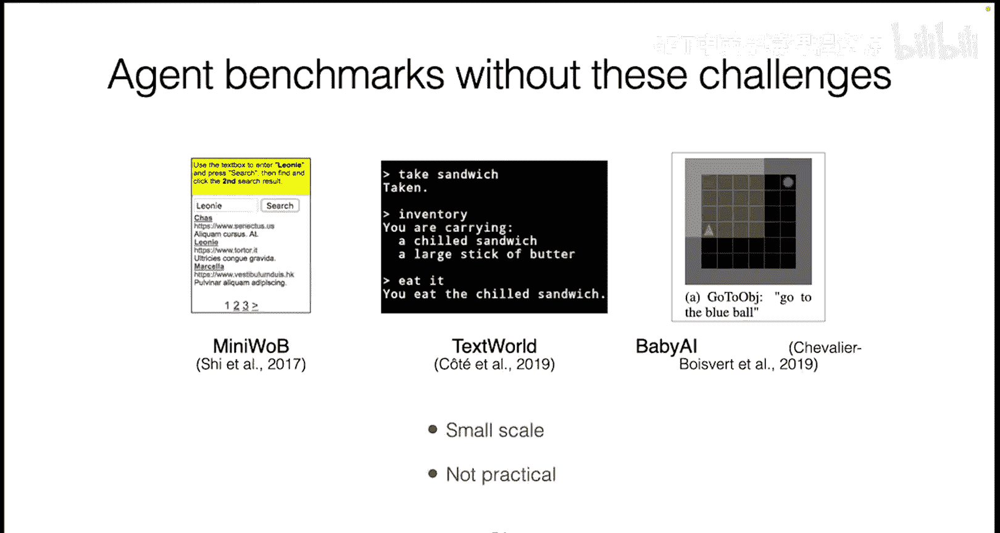

So to have a flavor， right， this task is called webshop and I created with my coausors in 2021， 2002。

And the idea is you can imagine L agents to help you do online shopping。

 so you give the agent an instruction to find a particular type of product。

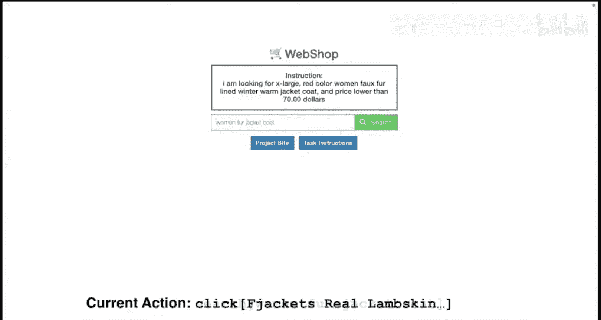

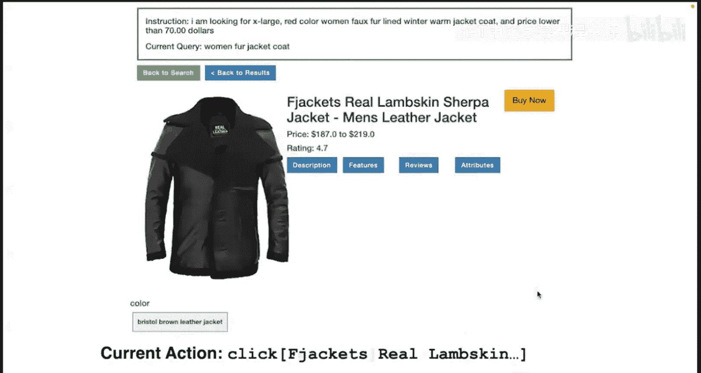

It could just browses up like a human right it could click links， it could have search priorities。

 it could check different products and go back and search again and if it has to search again it has to explore different items or think about how to。

Re formula to query， right okay？You can immediately notice， right。

 the environment is much more practical and much more open ended than great work。

And。呃。Let I say you find a good product you can just。

Click all the customization options and you can click by now and。

You you can also give a reward from the one indicating how get yourself in the task。

 So it's really like a very standard paradigm of reinforcement learning environment。

 except that the observation and action is in text。

And it turns out to be a very practical environment。

And web is interesting because it's the first time people built。Large scale， complex environment。

Based on。Large scale real internet data， right， So at the time。

 we scrap more than a million Amazon products and we build this。呃， websitebs。

And we build some automatic reward system to。To tell， you know。

 if you find a product and here's the instruction， then how can you give a reward to indicate how matching are the two things。

And you can clearly say it's perhaps harder than the Great word task because you need to understand not only the images and language in real world domains。

 but you also need to make decisions over long horizon， right like you have to maybe。

Looks like explore 10 different products or 10 different search queries to find the perfect match。

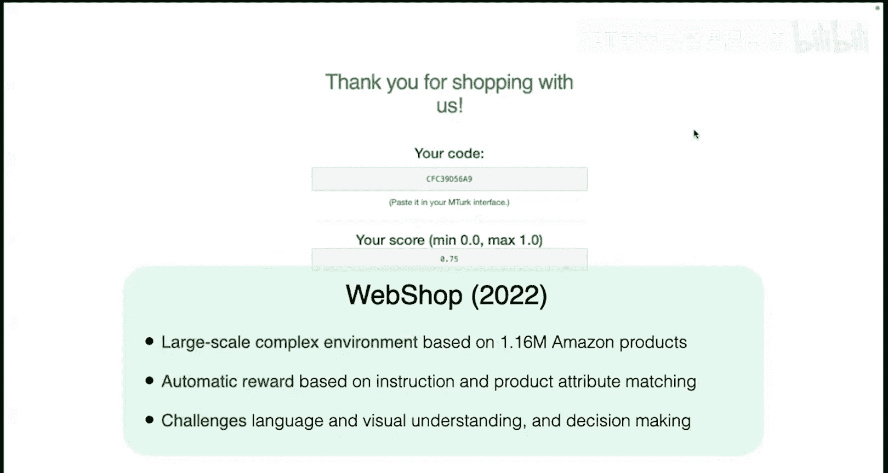

And for example， on this direction of web interaction， like full up work has made progress。

 great progress， you know。Beyond shopping， can you can actually sell various tasks on the web and。

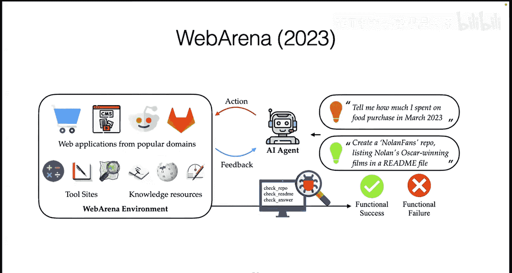

You can also try to solve other practical tasks。For example， software engineering， right so。

In this example， Swish is a task where。You are given a GiHub reppo and an issue， right。

 so you are given a bunch of files in your repository， right？And you're given an issue， right。

 this thing doesn't work。Help me fix it。And you're to output， you're supposed to output the fileal。

That can resolve the issue right so it's a very clean definition of the task。

 but it's very hard to solve right because。Because if you want to solve it。

 you have to interact a sort code right you have to create unit tests， you have to write it and。Okay。

And you have to。You have to track various since just like a self engineer。

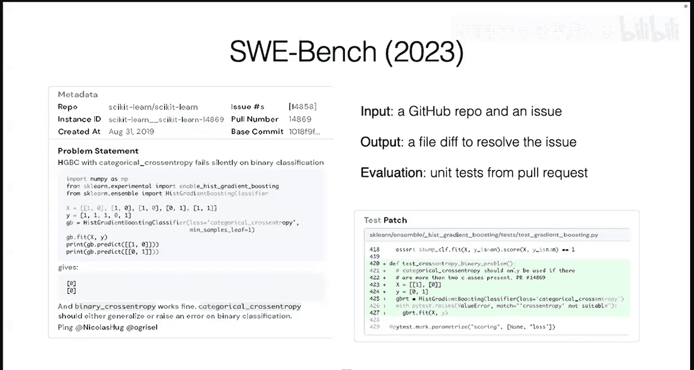

So。Another example that I think is really cool is。Like I think the current progress is well beyond digital automation right。

In this example from Checro， a work that I really like。

The idea is they're using reasoning or ion agents to try to find new chromopfles。

And what's really cool is that you give the agent a bunch of data about some chemicals and you give them access to use tools like Python or internet or whatever。

And they could do some analysis and try to propose some kind of。New chemical。 and also the the。

Action space of the agent is somehow extended into the physical space because。

That the action or the suggestion from the agent。It's then synthesized in the web lab and then you can imagine you can get feedback from the web lab and then you can use that to improve yourself and stuff like that。

 so I think it's really exciting that you can think of language agent not only as operating in the digital domain but also in the digital domain。

 not only in solving like tedious tasks like Bokimia Dodash， but also。

On more intelligent or creative task， like self engineering or。Senttic discovery。

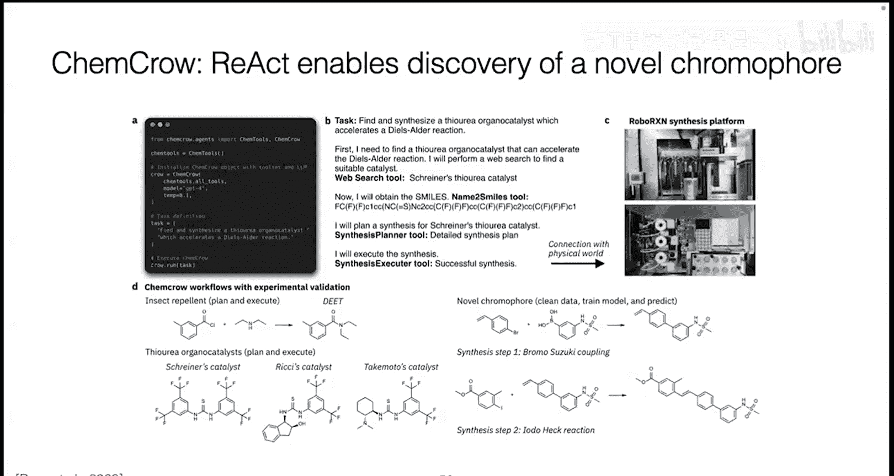

Okay， so great， so we have covered this slide finally。😊，In summary， I have talked about。

 you know how。We' start from LN。We have this reasoning， we have this paradigm of acting。

They converge and that bringss up。Mll diverse tasks and vice。And we have also covered。

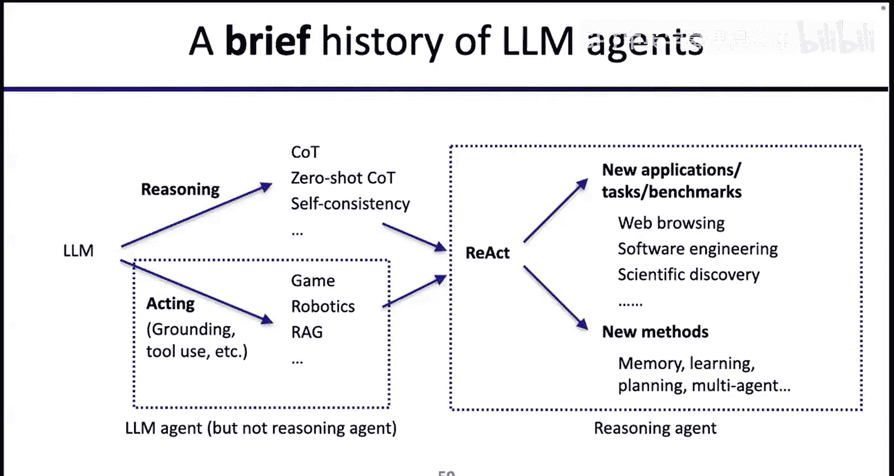

In a more broader time scale， the paradigms of agents and why this time is different。

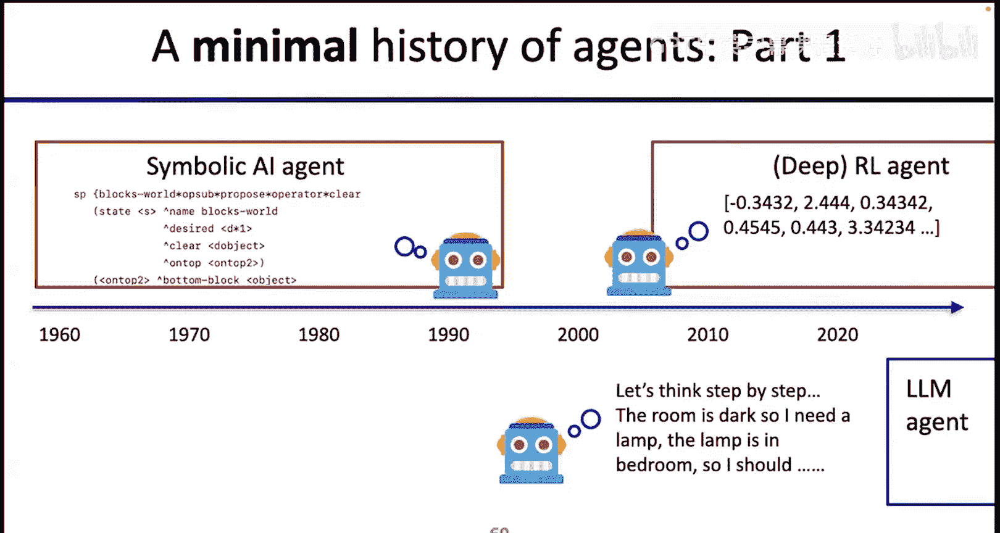

And also from a past perspective， right？The periods paradigm of past， if you think about in AI。

 you can think of games， you can think of simulations， you can think of。诶。Robotics， but really。

L agents bring up this new dimension of task， which is to automate various things in physical world。

So we have covered a lot of history， and。

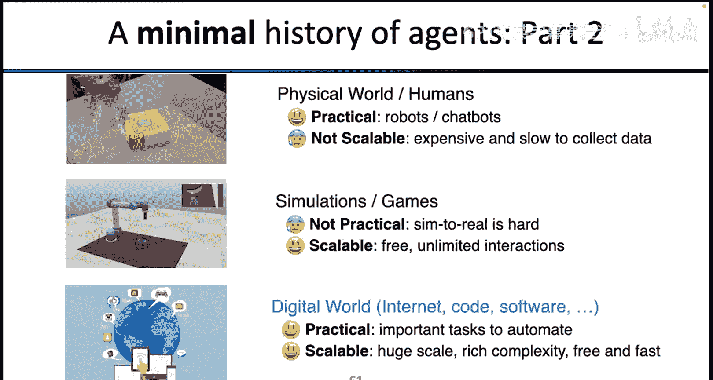

呃。I just want to summarize a little bit in terms of lessons for doing research right so I think personally as you can see。

 you know it turns out some of the most important work。It's sometimes the most simple work， right。

 you can argue a chain of salt is incredibly simple and react is incredibly simple and。

And simple is good because。Simple means general， right？If you have something extremely simple。

 there you have。Probably something extremely general and that probably is the best research。嗯。

But it hard， it's hard to be simple， right？If you want to be simple in general。诶。You need to both。

Like have the ability to do think in abstraction right。

 so you have to jump out of individual tasks or data points， you have to think in a higher level。

But you also need to be very familiar with。The individual task， the data。

 the problem you're trying to solve， right？So。Note that you can actually。

 it could actually be distracting to be very familiar with all the tasks specific methods， right。

 So remember in the history of Q A， I covered all this。😊，A lot of like task specific masses。

Like if you are very familiar with them， then you might end up you know。

 trying to create an incremental solution after that。But if you're familiar with not only QA。

 but a lot of different tasks and you can think in abstraction。

 then then you can propose something simpler and more general。And in this case。

 I think really learning the history helps and learning other subjects。Holse。

Because they provide you some priors for how to build the abstractstruction and they provide ways to think in abstraction。

Okay， so this is mostly the talk， I think I will just briefly talk about some thoughts on the future of our agents。

 right？Everything before the slide is history and everything after the slide is。

Kind of the state of art or the future。呃。Obviously， the future is very multidimensional。

There are many directions that are very exciting to work out。😊，呃。I talk about。

 I want to talk about five keywords that I think are truly truly exciting topics that are first very new in the sense that if you get to work on this now。

 there may be a lot of low hanging food or you might have a chance to create some very fundamental。

Results， and second is somehow doable in the amemia setup。

 so you don't have to be open AI to do this。But it's still good to be open air。嗯。

So these five topics actually correspond to three recent work。

That I did and I will only cover them briefly and if you have more interest you should check out those papers yourself。

So the topic says first training。 How can we train。Models for agents。Where can we have the data。

 right？呃 second。Interface， how can we build the environment for our agents。S， robustness， right。

 how can we make sure things actually working the real life？Force human。

 how can we make sure since actually working in real life with human， right？And lastly， benchmark。

 how can we build good benchmarks？So first training， right？I think it's interesting to note that。

Like up until this year。诶。Language model and agent are kind of disentangle， in the sense that。

 the people that are training models and the people building agents are kind of the different people。

 right。And what is the paradigm is at？The model building people build some model， right。

 and then the agent building people build some agents on top of it using。Some fine， some prompting。

 mostly mostly prompting。However， those models are not trained for agents right so if you think about the historical route of managed model it's just a model that's trained to predict a text。

Like people can ever imagine it's when they used to。So like。

Chemical discovery or self engineering right so that brings the issue of discrepancy of the data right so it's not trained to do those things。

 but then it's prompted to do those things。So the performance is not optimal。

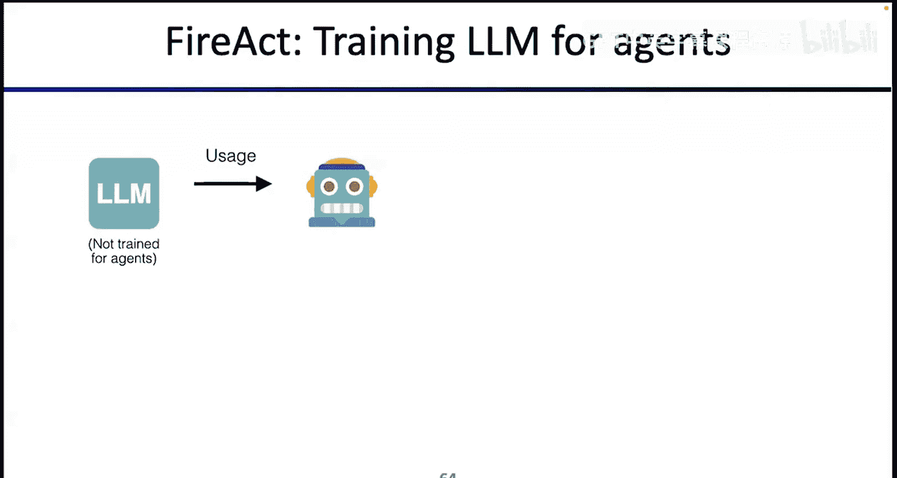

And one solution to do that is。One solution to fix this is you should train models。

Targeted for agents and one thing you can do is。You can use those prompted agents to generate a lot of data。

And then you can use those data to fine tune the model to be better at agents。

And this is really good because first， you can improve。All the agent communities are not covered in。

Internet， right， so you can imagine on the internet。

 which is the predominant source of language model training。

There is not a lot of like self evaluation kind of data， right， People only give you like。

 a well written。bloglock post。But no one really releases all the thought process and action process of how to write the blog。

 but that's actually the what matters for agent training right。

 so you can actually prompt agents to to have those strategies and you can train models on those things。

😊，And。And that's， I think， really one way to。Fix the data problem because we all know internet data is running out and how can we have the next trillion dollars to train models？

呃。This is very exciting and I think a very。Like maybe not best analog is you can think of the like the the synergy between GPU and deep learning。

 right， because GPU。First was now designed for deep learning。

 right it was first designed to play games。And then people explore the usage I find。Oh。

 it's very good for deep learning。And then what happens is that not only people use existing interview use to build better degree learning algorithms。

But also， the GPU builders free better GPUus to fit the GP algorithms， right。

 You can build a GPU that's for transformer and so on and so forth。

I think we should also establish the synergy between model and agent。

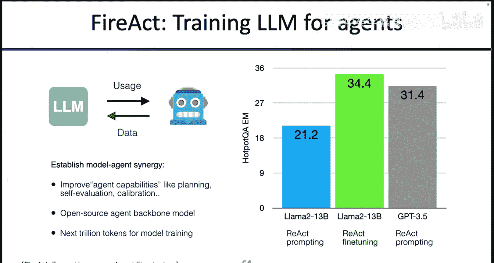

And the second topic is interface and in fact， human computer interface has been a subject for decades right it has been a great topic in computer science and really the idea is if you really cannot optimize the agent。

 you can optimize the environment right because。

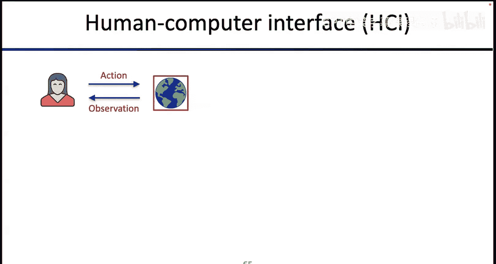

If you're right trying to write a code， right。Even if you're the same person。

 it makes a difference whether you are doing that。In the text edit interface or the VS code interface。

 right？You're still the same you， like you're not being more smart。

 but if you have a better environment， then you can solve the task better。

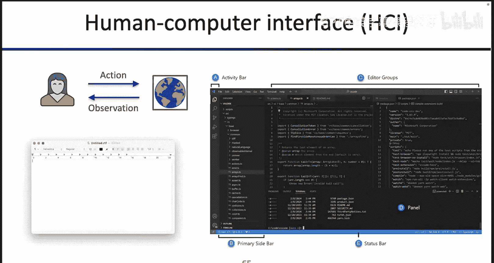

I think the same thing happens for agents， right？So as's a very concrete example。

You can imagine how can the agent？Like say search files in your OS， right？So。

The human interface in criminalal， as we all know is to use L and CT and so on and so forth。

It works for humans。It's not the best interface for agents。You can also do something like， you know。

 you can define new command search。And then it will give a result。

 and then you can use this action column next to get the next result。

But it's probably still not the best for language model。So in this research called agent。

 what we find is that what turns out to be the best way to help agents。Search files。

Is to have this specific command called search。And instead of giving one result out a time。

You can just give play results at a time and then use let the agent decide what's the best file to look at。

Right。And。You can actually do experiments and show like you can use the same language model。

 you can use the same agent prompt， but the interface matters or for downstream tasks。

So I think this is a very， very exciting topic and it's only getting started and it's a great research topic for academia。

You don't need to have a lot of GPU to do that。And it's interesting because models and humans are different。

 so social their interfaces， right you cannot expect language models to use VS code to be the best code interface。

Right so there must be something different and we need to explore that。And in this case。

 you can think of the difference as being that。Human， we just have a smaller， shorter memory， right。

 If I give you 10 results at the same time， you cannot just read them。 That's why。

For human interface， you have to design that。In an intuitive way， right， you have a next button。

 right， if you do control F， you can only read one thing at a time。

But actually for models it's worse because models have a longer content window right。

 so if you control F， you should just probably give everything into the model right？

So if you designed better into interface， it could help you solve tasks better with agents。

It could also help you understand agentss better right。

 it could help you understand some of the fundamental differences of humans and models。

Lastly， I want to point out this topic of humming the loop primaryossmith。

I just want to point out there is this very big discrepancy between。

Existing benchmarking and what people really really care in the real， real world， right so。

You can think of a very typical agent task or AI task， say coding with unit test。

And this is a plot from Alpha code2， and basically the idea is if you sample more times。

Then the chance that you have a right。Sation increases， right， that's very intuitive。

And if you have a unit house。Then then you can sample many， many times， obviously。

And what you really care is what we call pass。At K， right。

 what you really care about is can I solve it one time out of10 times or thousand times or a million times。

 right？It's kind of like so room hypothesis。You just need to do it once， right？

What you care about is if you sample 10 million times， can you solve it once。

But this isn about all the most of the。Jobs in the real world。It's more about robustness， right？

Supposely you're trying to do customer service， right？嗯。

Like L agents already deployed for custom savings， but sometimes they houcs and there are consequences right and if it may does something。

 the company might have composition and stuff like that， right so。Arguably， you know。

 custom service is much easier than。Coding or proving human hypothesis at least for human， right？

But here it really presents a different challenge because what you care about is not can you solve it one time out of a thousand time。

 what you care about is can you solve it a thousand times out of a thousand time， right？

You care about what I feel it one time out of seven time。Because if you fail one time。

 then you might lose a customer， right， So it's more about getting simple things done reliably。

嗯。So I think really that calls for a different way of doing benchmarking and we have this recent work called Toppch and idea。

嗯。First， you have a very practical task， which is to do customer service。Second。

 the agent not only interacting with some kind of environment like digital environment。

 it's also interacting with a human， but it's a simulateimd human。Right， so。

The idea is the customer service agent， just like a human customer service agent need to interact with both。

The backend API of the company and also some kind of user。And。

The agent really needs you to every both to solve the task。

 and the trajectory might look something like this， right， So the the。

 the human might might not give you all the information at the beginning， right， which is。

A predominant paradigm of all the tasks right now， if you think about self engineering and so on and so forth。

 might say something like change flight。 and then you you might need to actually prompt the user Oh。

 can you tell me like which fly are you changing and you need to interact with the user over multiple terms to to figure out what they need and to and to help them right。

 and this is very different。And also， it makes the metric that you care about different， right。

 So you can imagine for the same task， right。You can sample the chat multiple times with the same user simulation。

So if you look at the dash line， it's called pass at K， which is measuring， you know。

If you're sample，10 times。Can you solve it at least one time and obviously as you sample more。

 the chance that you solve at least one time increases， right？But here。

You don't care about whether you can solve it one time out of 10 times。

You care about whether you can solve 10 times out 10 times。Because otherwise， you will lose client。

 you might lose customer， right， So so the solid line measures。you simple more。

 what's the chance you can always solve the task across all possible tasks？

And what we'll see in today's language model is that。Obviously， they have different starting points。

 meaning like。Obviously， they have different capabilities， but。

What's really concerning is they all have this。Decreasing trend， right， So if you sample more。

 the robustes always go down， like from the small model to big model。

 they all have the similar trend。The ideal trend should be something more flat， right。

 So if you can solve something， you should be more re of the same thing over time。

 So I just want to point out that。I think we also need some more efforts in picking more real world elements into benchmarking。

 and that requires new settings and metrics。

嗯。So we have this blog post that talks about， you know some thoughts on the future of language agents。

One way to think about that is you want to think about what kind of jobs。

They can replace right and if you think about。It right， Maybe the first type of task is。看到。

Not that intelligent right but really require robustness right it think about simple debugging or doing customer service or doing simple assistance over time and time and second you need to collaborate with humans。

And third， you might need to do very hard task， right， You might need to do。

Like write a survey from scratch or discover a new chromaraho and that requires some new type of ways for the agents to explore on its own。

But I think it's in general， very useful to think about。What jobs。

They can replace and why they're not replacing those human jobs yet and what are missing and how can we improve it？

嗯。Lastly lastly。This is a like limited time and we're going to have a EMN tutorial on language agents。

In November and it will be three hours， so hopefully it will be more comprehensive than this。

