# UCB《大语言模型智能体｜UCB CS 194 294-196 (LLM Agents) 2024》中英字幕（Claude-3.5-sonnet翻译） - P3：Lecture 3, Chi Wang and Jerry Liu.zh_en - GPT中英字幕课程资源 - BV1RsZPYsEtE

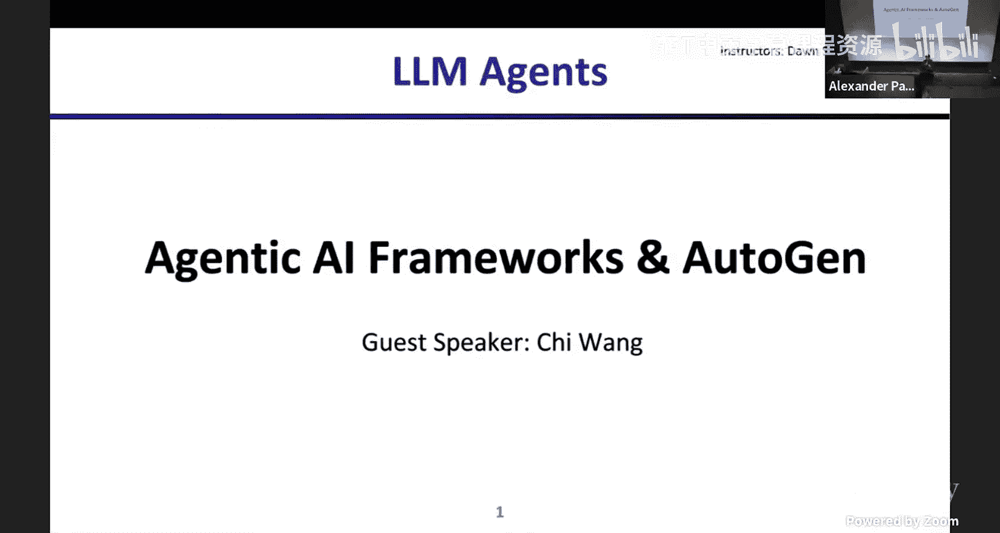

Okay。So yeah here's the agenda it's very simple you have two part as a general and then well dive into the autoGN framework part for both parts。

 there are two big motivating questions I want to cover number one is what are the future AI applications like and number two is how do we empower every developer to build them。

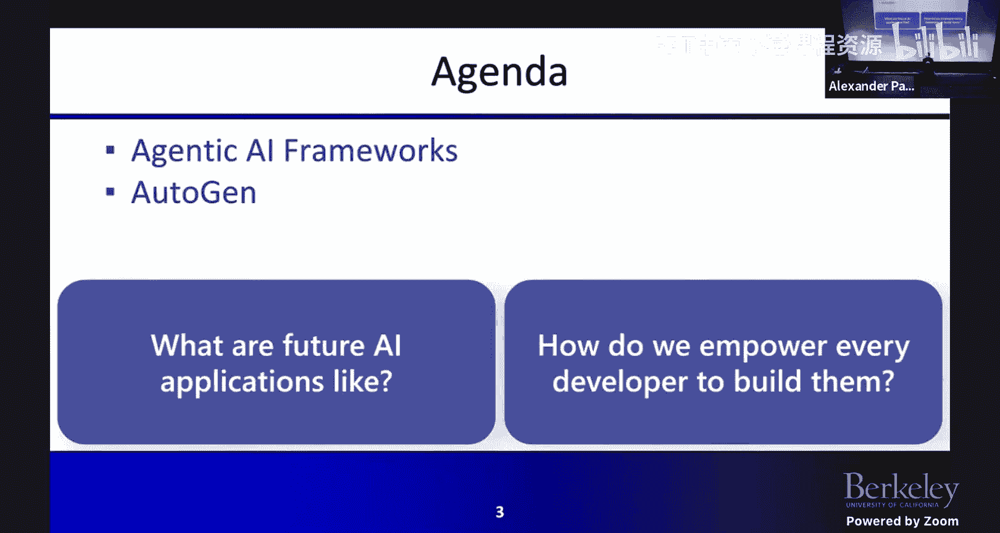

So let's start with the first question what are the future AI applications like so starting from around the year like 2022 we see the big power of the language models and other generative models。

 so the gene AI people have seen a superior capability of generating content like text and images。

They are much better than generative techniques like 20 years ago or 15 years ago。

 where I was doing my PhD and studied like topic modeling and other older generative modeling techniques。

 Apparently， these days， the new tech has passed the bar that we can think about more creative applications。

 higher level of AI capabilities。 And so what's the next。

 What what are the best way to leverage these gene AI techniques。

So starting from last year early last year we started to think about that question and we made a lot of technical bets along the way。

 the most important bet would be that we think the future AI applicationss can be agent and the agents can be a new way for human to interact with the digital world and help us execute more complex tasks along behalf a human and get to higher and higher level of complexity and we got a lot at that time many people have still have doubts about whether AT AI can be a available notion but as time goes by we are seeing more and more confirmation and evidence including earlier this year there's article published by Berkeley talking about how how we observing more and more。

AI results shifting from using a simple language model to building compound AI systems。

 So that's one of the similar observations and technical bias made we we made。

So if you think about the examples of agent AI， you'll notice that building A AI agents like personal assistance。

 spots or gaming agents。 there's the notion of agent AI is not new。

 But what was new is that with the power of the new generative AI techniques and library models。

 for example， we're able to build some of the old agent applications is much easier and much more capable。

 And at the same time， we' also seeing some very new novel agent applications。😊。

That over go beyond the imagination we had before， such as some science agents that can do science discovery automatically。

 web agents that can automate some web browsing and web automation tasks and also software agents that can build even software from beginning to scratch。

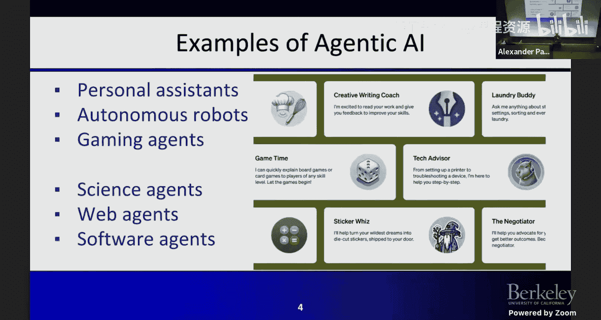

I bet you have seen a lot of thems before， but today let me show you a very recent demo I just got this this morning from a Ser called Zindi。

 this is example of building a website to extract the models from hugging face and download automatically。

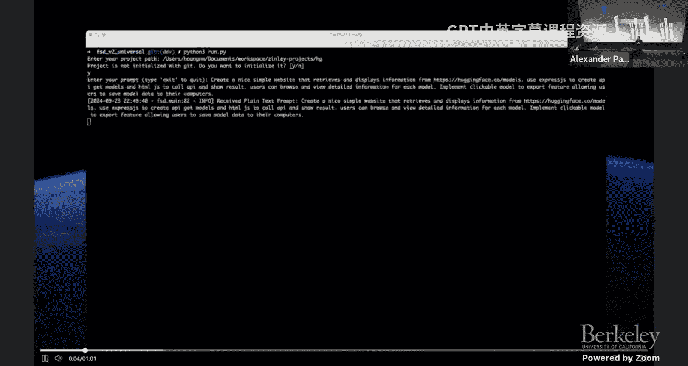

So after you give the request to the AI， they started working on them automatically。

 starting from analyzing the task。

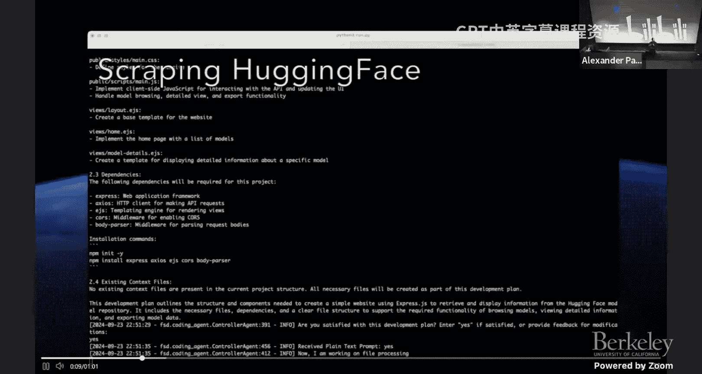

Looking for information and exhausting the necessary dependencies。

They are they do use a multi agent framework to have agents of different roles to finish the task and can do multi step of tasks。

Now we're seeing that AI is creating different files。

All the reasoning and between the agents are done automatically using both language models and tools。

是。The A agents are talking to each other now they are developing the website。

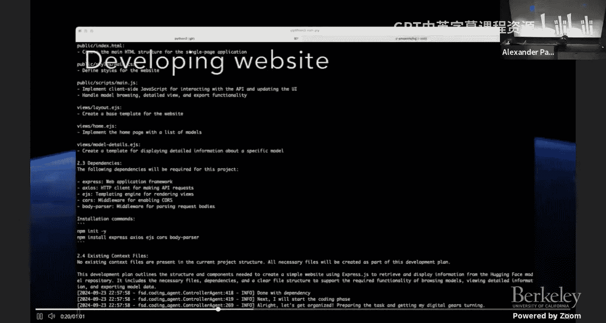

And finally， they are trying to build and compile the website。

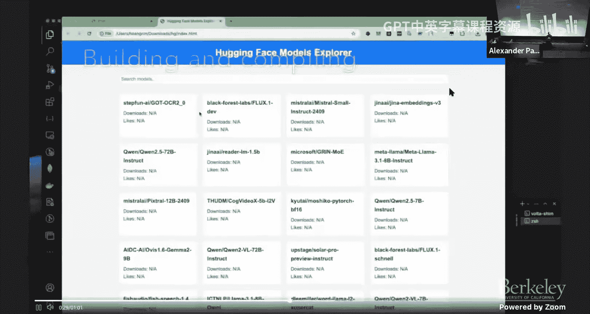

Okay， here we go， This is the website built by the AI。It looks like functioning。

 there are many models already listed in the website and users can search model and export model data。

And download the data， download the models。But it looks like the video is。

Taying in the slower speed than normal。

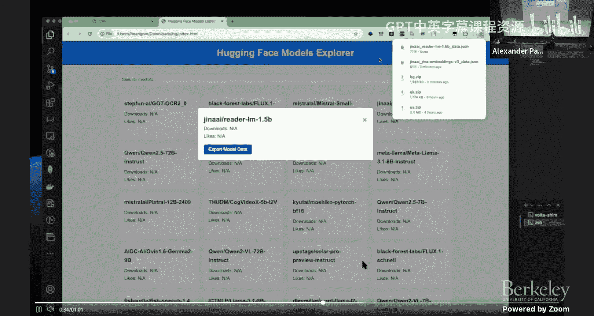

I'm not sure if that's because of the Internet issue。

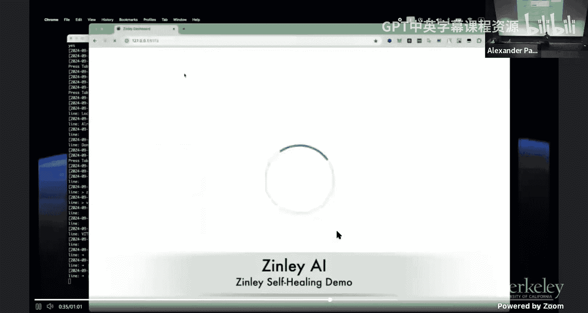

And further， if you happen to make some mistakes， for example。

 if you remove a very critical line of code from the files that are rec， let's see what happens。

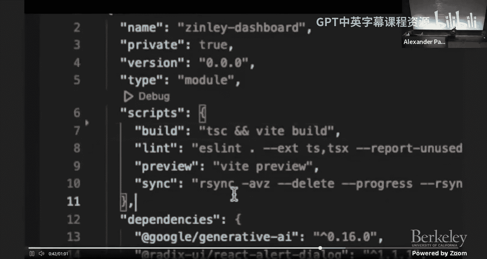

So we are running the AI again for executing the same task。

 so this time the AI is able to as trying to also perform the same task。

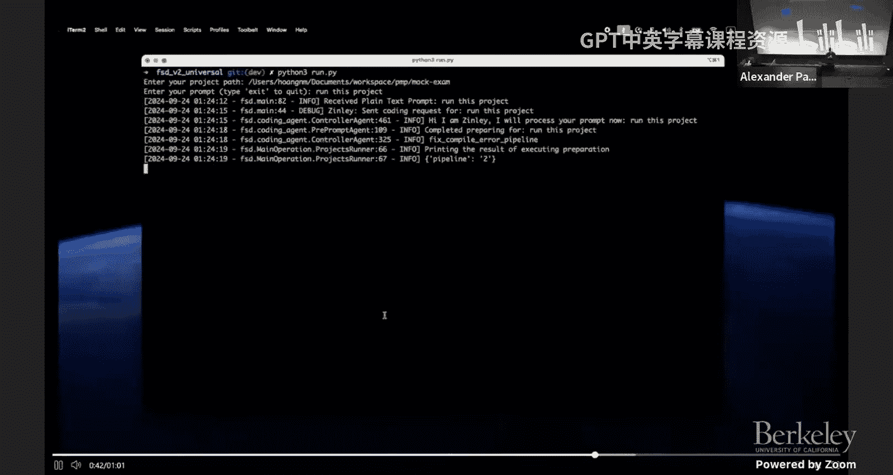

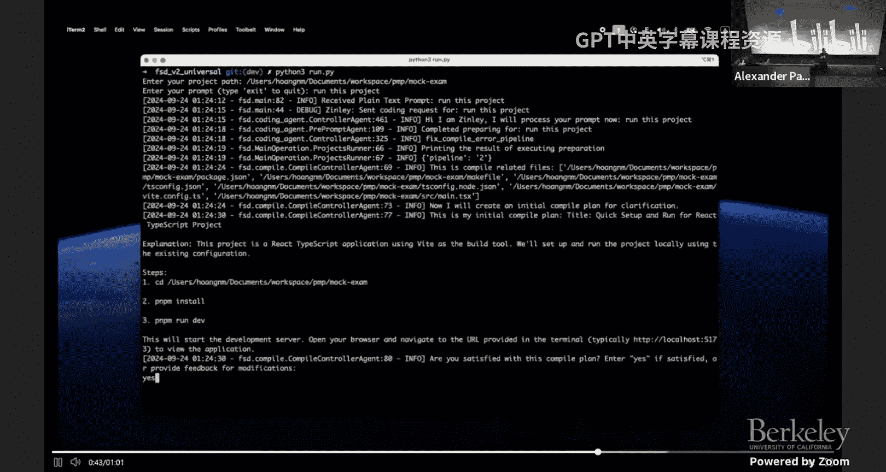

But because of that removal of the critical lines of code， we're supposed to hit some error。Yeah。

 so we see your error message there。 missing script。So let's see what AI will do。

So just within a few steps the AI is able to correct the mistake and finish the exact line which is removed so complete the task so that's shows some self healingal and self recoverycover ability of the AI agents so who that to give us idea about the potential kind of promise the AI agents can give us in future we may build the software in a totally different way。

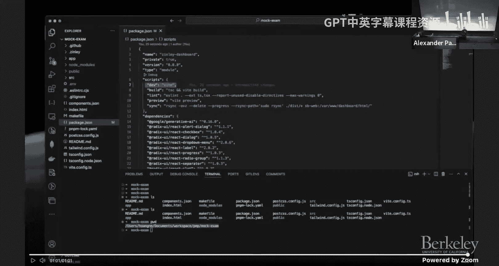

So to summarize the key benefits of aic AI， number one is many people understand that AI is able to use a more natural interface to talk with humans so you can tell them what you want exactly in this case to just tell them we want to build a website with certain requirements and then you can iterate over the natural language。

And also by giving the agents more capability， they are able to operate and finish more contest tasks with minimal human supervision。

 So that has tremendous value in terms of automation。😊，And the third point。

 I think it's less talk about among people， but I have a strong emphasis that is agent AIs can be also a very useful software architecture to enable us to build software in a totally different way。

So that you can have multiple agents working with each other and to finish much more text in a recursive way。

 So I will use a simple example to go over these benefits。

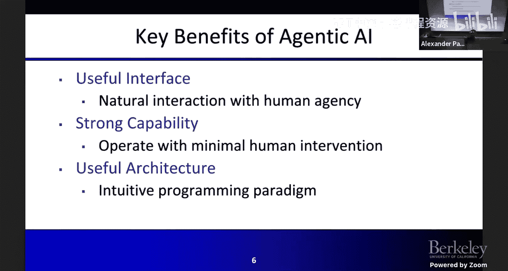

So let's look at one particular example application about solving some scratching optimization on cloud。

This application is built by my former colleague from Microsoft Research which allows users like coffee shop owners to answer questions like what if we change the shipping constraints。

 what how would that affect my operating cost So this is difficult question they can't get answers from likeGBT because the AI needs to understand the user specific data constraints and even some optimization tools to be able to understand the question and get the answer but with in this case use autogen to build three agents that can solve its question very nicely The three agents are commander writer and safeguard。

So let's see how that works。So initially the user sends a question。

 what if we prohibit shipping from supply one to Ro 32 the commander received that question before it tries to answer that question it will hold the current conversation and initiate another message chat between the commander and the writer。

The writer in this case is using a large angle model at the back end。

 try to understand the question and propose some code that can be used to answer this question in this case it just some python code of adding a specific constraint into the opinion problem。

And the returns that call to expander。The commander sees that code again。

 holds the conversation with writer and starts another message chat between the commander and safeguard the safeguard is another agent using language model to check whether the code is safe。

So in this case， it turns safe， the commander will finish that conversation with the safeguard and start executing the code。

So here's that code execution result it runs the Or program with updated constraint and check the new result so the commander will then go back to the previous conversation with writer。

 send the execution results back to the writer here are the execution results and after the writer see that it's try to come up with the final answer。

This is a simple example of like using multiple agents and in multiple steps to finish the task in general。

 there can be all sorts of problems like the code can be unsafe。 In that case。

 the commander will not execute the code and in case there's an execution error。

 the commander will return the execution error back to the writer and writer needs to rewrite the code。

 So in general there can be multiple turns back and forth to finish the complex task。

 but here we' are just showing one simplest case that is at the smooth trace。

And you can tell how the end user now is able to still use a relatively simple user doesnt know there are multiple agents running at the back end。

 they just ask a simple question and then can answer in natural language back the user doesn't know understand any any knowledge about the coding or opinion so this is an example of using multiple agents we allow the end user to achieve tasks at much harder than before。

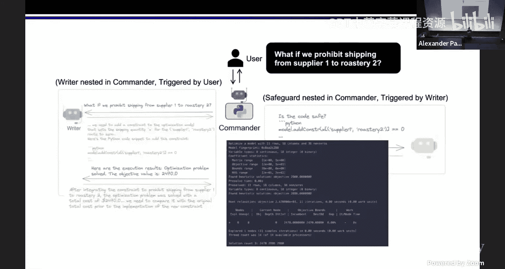

Now if you look at the programming protective how do they construct such a program the way they do this is also very different from traditional programs there are several steps。

 the first step is to create these several agents so in this case they're creating the writer safeguard commander and user using one line for each。

And then they need to define the interaction patternss among these agents。

 so here they register the school message chat to the commander for each density chat。

 when you define who are the agents involved in the chat。

 what the sender and was the receiver and what's the summary additional message from that conversation。

And then their behavior patterns are defined this way and finally。

 we just initiated this chat from the user proxy agent to the commander agent。

By sending the initial task requirement。And then every other steps also follow automatically。

 so the framework will handle all the steps and message chats and eventually return the result back。

So hope that gives intuitive the idea what the agent programming means。

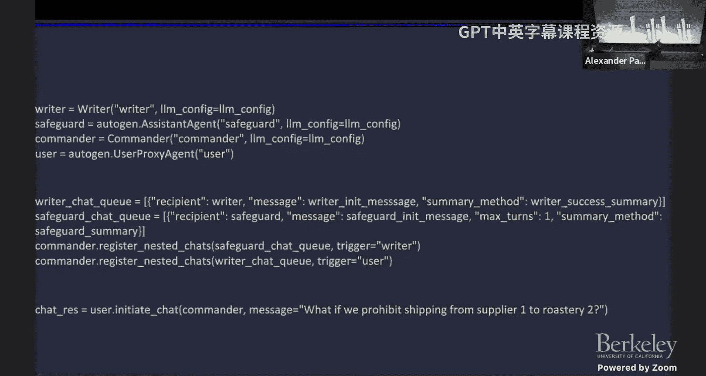

And also I'm using two slides to summarize the benefits。

 the one number one is to enable us using these multiple agents to handle more comp tasks and improve the response quality。

For multiple reasons， you see that the multiagents talking to other can be a very natural way to make improvement over interactions and we can divide and conquer a comp task to decompose that to smaller tasks and have more quality result for each step and finally we can define agents that not necessarily depending on language models。

 we can have special purpose agents that perform grounding or validation using knowledge outside of the agent sorry outside of the models so that we can address the weakness inherent in the models。

If you look at the chart on the right， it's an experiment result about if we decompose the task into two agents for the writer and safeguard versus if we put all the instructions in one single agent。

 how is the performance on the safeguard side？So if you compare the performance， we see that for G4。

 the multiag setup has a 20% higher record than single agent setup and for G3。5。

 the difference is even higher so this indicates that for certain scenarios it's beneficial to decompose the tasks and have agents to perform relatively simple tasks and compared to just adding the agent to do too much work in one try and this is especially depending on the task complexity and more model capacity right so in general。

 the more complex the task and the weaker the model。

 there's a stronger need to have these multiagent workflows。

And another perspective is from the programming perspective， so in general it's easier to understand。

 maintain and extend the system。If you have a modular design， for example。

 if you want to keep most of agents unchanged， but just change for example。

 how you change the safeguard behavior， if you want to switch from using language model to using tools or using human。

 it's easy to do that with a modular design。And this allows natural human participation because human can take over any of the agent in the system and by having natural conversation with other agents。

 there's no need to change how human interact with other agents。So combining these benefits。

 we see that the agent programming has has a promising potential to enable fast and creative experiment and build novel applications。

But it's not easy to design a framework that can meet all these promises in general。

 we need to consider several factors to design such a framework。

We want to have a unified agent abstraction that can unify all these different types of entities。

 and we want to accommodate all the flexible needs for multi agent orchestrations and satisfy all the different application needs。

And we also need to make sure we have effective im of all all the agent design patterns。 Let me。

 let me use the next few slides to explain them。

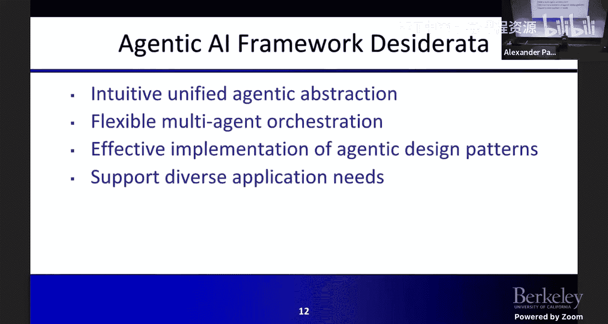

So first of all， for agent abstraction， we want to unify the notion so that we don't need to have a hard time to reason about all these different type of entities such as humans of different roles。

 tools or language models from different providers。In general。

 these are all needed for building a common AI systems。

But if we can have a single concept to think about them。

 it will greatly make it easier to reason about them。

 So let me explain more in the in the rest of the talk one immediate benefit of that is now we can use multi agent orchestration for building actually complex applications of common AI systems。

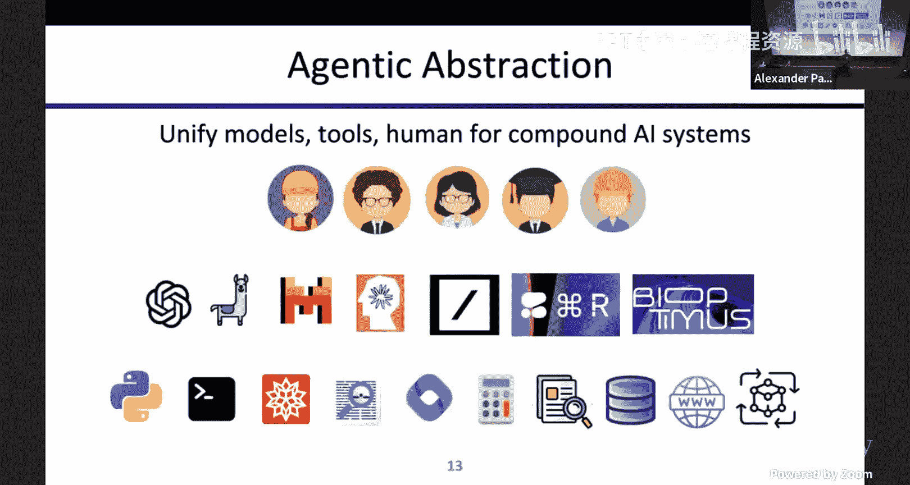

And but to do that， we also need to think about all the different requirements of different AI agent patent patents of interactionsions。

 for example， sometimes the developer want a more static over workflow so that they can clearly find each step and the order of agents from the tasks。

 but in other cases， if it's hard to know all the possible situations。That agent need to handle。

 then we want to give the agents more autonomousity and enable them to create more dynamic workflows。

And similarly， sometimes they want to use natural language to tell the agents to perform the task and at other times they want to use program language to have a more precise control。

 so there's a tradeoff between the flexibility and the controllability。

And there are many other tradeoffs you to consider， for example。

 when do we share the context among agents and when do we isolate them have a hierarchical setup。

 for example。And when do， do we want the agent to cooprate。

 When do we want them to compete to finish。Task better。

 And there's also consideration about centralized versus decentralized and automation versus intervention。

So a good framework should be able to accommodate all these different requirements。

And also as people develop agents more and more， there are all sorts of like good good design patterns emerging and we need to also check whether a framework can meet all these design patent requirements。

There's a conversation。 We want the agent to be able to deal with flexible conversations。

 There's also promotinging and reasoning techniques like react reflection。

 chain off out the three of and so on So more of such emerging reasoning techniques。

 including like Montelo research based methods to using the very important part of the agent design patterns and so is planning and integrating with multiple models。

 modalities and memories。And it looks like a lot right so it's hard to have a framework that can consider all these different factors in the beginning。

 but if you think about this from the first order principle。

 you may wonder like is it possible to have a single kind of design point to start with and have all the other patterns to be able to so that we can derive all the other patterns from that？

So yeah， so can anyone think about among of these different different patterns。

 Can you think of using just one single different panel of them to accommodate all of all of the others。

Yeah I believe that different people will have maybe different ideas and started from the different part can you may pick either one of them so here I want to mention one personal kind of design point of view that is a conversation So this has a like longtime history back in college I learned that conversation a group way of making progress in learning and theors and that's a takeaway and when I see the power ofGBT I immediately read that back to my personal experience and decide okay let's consider trying to use the multiaging conversation and the central mechanism and see how far we can go So it turns out we can go very far So here I'm listing some examples of a AI frameworks like Autogen as I mentioned is based on this multiageent conversation programming and it turns out to be very comprehensive and flexible。

That's able to integrate with all the different design patterns I mentioned and also other frameworks。

And you will hear more from Jerry about Lama index and there are also some other like La based frameworks such as Landgraraft and C AI。

 they focus on different also starting reasoning points like LandGraft， for example。

 focused on providing some graph based control flows and crew AI focus on providing some high level static agent task workflows。

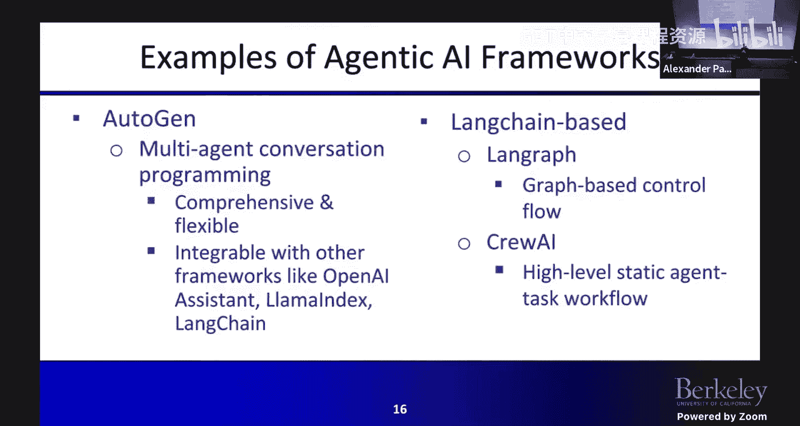

Yeah， so that's a very brief overview of the AI agent sorry agent frameworks in general。 Next。

 I will go into the specific autogen。 I will try to explain more about that。

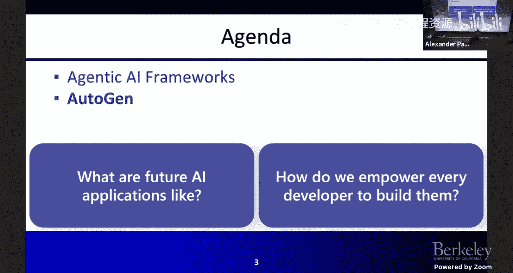

So Autogen is a program framework for Age AI， it was initially divided inside another open source project called Flammo。

 Flammo is for Auto machine learning and hyperpar tuning and later we spin off the standard Raple and this year recently we also created a stand Github organization to have an open governance structure so everyone is welcome to join the contribute and here's a brief history about the journey early last year we started prototype typing this agent frameworks and initially we just built a multigen conversation framework with the capability of code execution。

And in August， we published the first version of the research paper。In August。

 sorry in October we moved this report standalone Gi up ripple and it's got a lot of recognition from the community。

And such as this year， we got also a best paper at theL 2024 RM agents workshopshop。

And we were seeing more and more interesting use cases from community。

 including both enterprise companies and startup companies。

W recently also offered an online course on De。 AI about AI agent exam patent with AutoG。

So that's just very brief history about it in general。

 Autogen has very rich features about all the different design patterns。

 but today I mainly want to focus on the most essential concept because this is a key to understand all the other patterns。

So we wanted any developer to reason about a very complex workflow in simply two steps。

 The first step is to define the agents and the second step is to get them to talk。

So here there we see two key concepts， one is a conversible agent， another is conversation program。

So the agent concept in Autogen is very generic can abstract a lots of different entities。

 you can choose to use the language model as a backend for the agent or you can use a tool or human input at the backend and you can also mix multiple types of entities together。

And furthermore， if you use this multi agent conversation patterns。

 like you see on the right hand side， you can build agents that can contain other agents inside it。

 have inner conversations and and then。wrap them up as an interface to talk to other agents。

 So in this way， you can nest multiple chats inside a agent。

 have inner conversations and build more and more complex agent in a recursive way。

And the examples of conversion patternss include the sequential chats， N chat and group chat。

 I will explain a few of them in the next few slides， the simplest one is a two agent conversation。

 even though this is a a very simple conversation content it already allows us to form some advanced reasoning such as reflection。

For example， we can construct the writer or a writing blog post and another critic agent to make suggestions to the blog post。

 and you can have these two agents iterate and improve the quality of the blog post in this way。

And now if you think that's not good enough， we can add more other reasoning advanced reasoning techniques using this NA chat。

 for example， instead of using a single language model to do the credit， we can use the message chat。

 and in the NA chat we construct a sequential chats that contain multiple steps of chats。

We first send the message to the SEO reviewer and then we send it to a legal reviewer。

 ethics reviewer and so on and finally you can have a meta reviewer that summarizes all the review comments in different areas and gives the final comment。

And from the writer's point view， it's still talking to a single writer， a single critic agent。

 but underneath a critic agent uses multiple other agents。

So that's idea how we can use a message chat to potentially extend the agent capability using conversations。

And thing about two using how do we enable two using using conversations here's the example of building a game of conversational chess we want the AI to be able to play the chess while cheatchatting with each other and making fun of each other So if you just ask two language model agents to play the chess directly they often make mistakes and form like random moves on the board which are not legal so the game is not watchboard at all Now the solution can be that we can add a third agents called chessboard。

 This board agent is a twob agent it uses some Python tools Python library to manage the chess board and provides the tools to other language model agents so language model agents can only make legal moves and otherwise they need to be iteratively refiner moves until the moves are legal。

In that way， we can make sure the game can carry on nicely。And again。

 we're using message chat between a two proposal agent using language model and two execution agent that's using two as a backend and having them talk to each other to finish that two execution functionality。

And there can be other more complex workflow patterns and solving more Com tasks using planning and using a more dynamic way like group chat in the group chat。

 the users only need to define agents of different roles and then can put them in the group chat and they can automatically decide which agents to speak next depending on the current progress of the task。

There'll be a group chat manager which can monitor the progress and make the selection of the speakers。

And furthermore， you could add more constraints or finance machine transition logic about what others should the agents follow。

 you don't have to make a very strict order you can just give some candidates about like agent A after agent A speaks only agent B and C can speak on other agents。

 things like that so there's still some decision made by the language model and some autonomousity there but you can add certain constraints to to make sure at least the selections within the scope and you can further add some transition logic to tell the agent when you see certain situations you should go this route。

 otherwise you do say the other parts and you can use either natural language or programming language to specify that。

Yeah， in general， there are many other type of conversation and applications enabled by these conversion patterns。

 first to check our website for more notebookbook examples。

 they are nicely taxed so we can search for anything question for example and search for how to integrate autoG with La index and their notebookbook examples like that。

And and in the paper we just showed a few like very simple examples using simple conversion patterns。

 but in general we can build many more complex tasks using this building blocks I've seeing developers building all kinds of sorts of complex tasks。

 so here's an overview of like the categories of domains that we are seeing from the community the top two categories are software development and agent platforms。

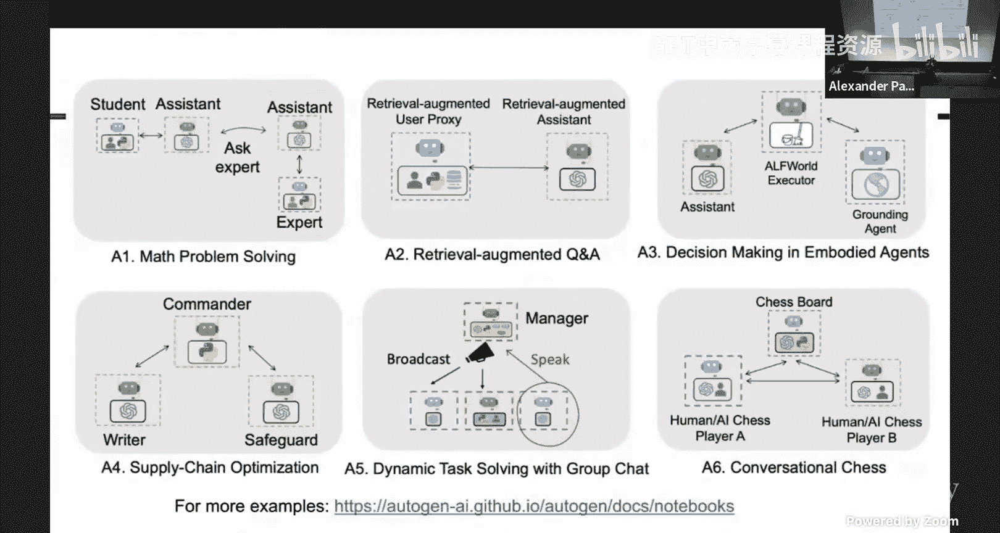

Hing， research， data processing gave a long tail。 There's a web browing task， finance。

 healthcare care， education， and even blockchain， which is not shown in the list。

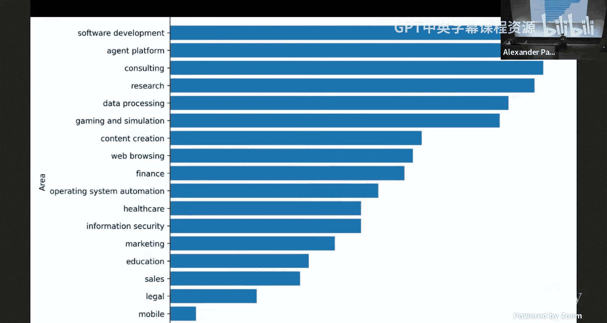

And here I want to select a few interesting examples the first one is in the science and engineering domain this Professor Mark Doer from MIT has has done multiple work in different science domains including protein design a material design using autogen to build teams of agents that simulate the behavior of a scientific team or engineering team all the way from like collecting the data generating hypothesis and then conduct experiments and verify hypothesis they have also built a very recent work called sign agents which can use ontology knowledge graph reason about any scientific domain and make interesting connections and do advanced reasoning using that knowledge graph they contract a team of agents of multiple roles and they can start from understanding ontology and then make multiple science and critics to finish the very complex work flow。

I generate all the different concepts and possible hypothesis and then select the best of them so this is a very promising and use case I see that in future has a potential to accelerate our sign discovery and maybe soon after we'll have some AI designed medicine or AI designed architectures and so on。

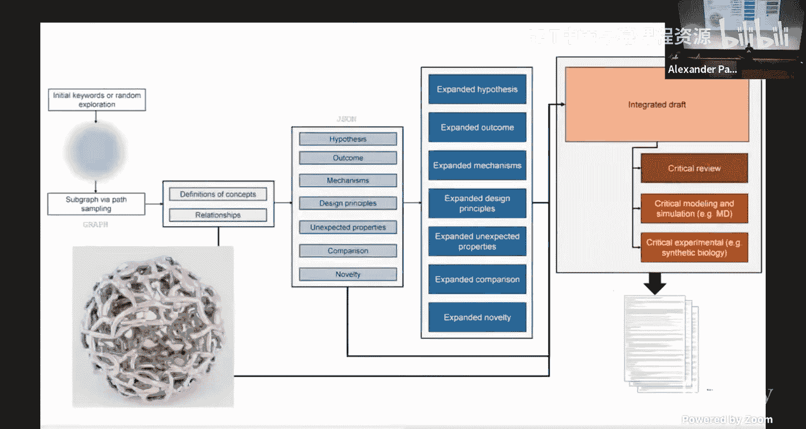

interesting all and materials Here's another domain of web agents。

 This is a agent called agent E developed by a startup called Em AI。

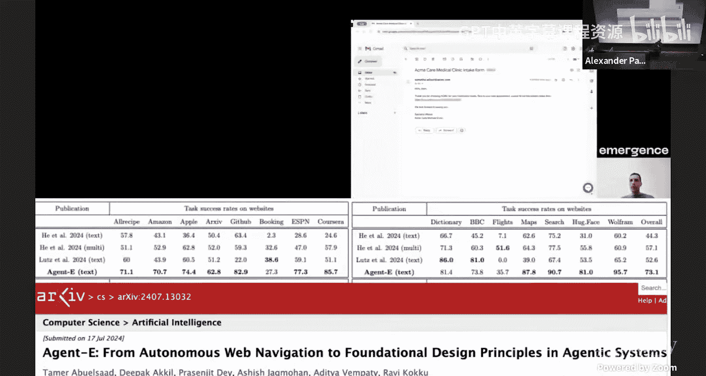

They use Autogen to build a hierarchical agent team so that they can perform some very complex tasks on the web。

 like automatically book a flight tickets or automatically dis fill form for a medical clinics。

This leverages some planning agent， some web browsing agent and has some deeper understanding of the content from HTML Dom。

They haven't used any multimodal models， so they're only leveraging the HTML of content and not leveraging the images and vision models。

 but they already achieved the sale of the art performance on this webvo group benchmark and outforms the previous techniques using multimodal models。

There's still a large room for improvement， you can see the overall success rate is just a 73%。

 so by combining multimod models and more agent workforce there's a potential to get it higher even higher。

But there's some very good foundational design principles we can learn from network。

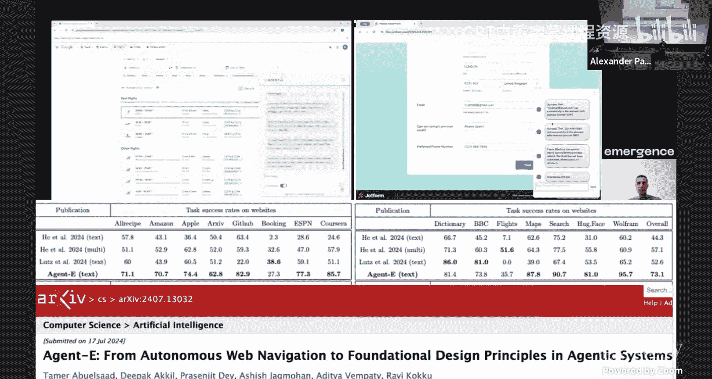

And I also want to share a very recent quote I learned from a company doing construction。

 they're trying to use autogene to help the users without the special knowledge expert knowledge to be able to finish their construction projects。

 and they mentioned the benefit of autogene as being able to rapidly explore many different agent design patterns。

 configurations and conducting experiments at scale。

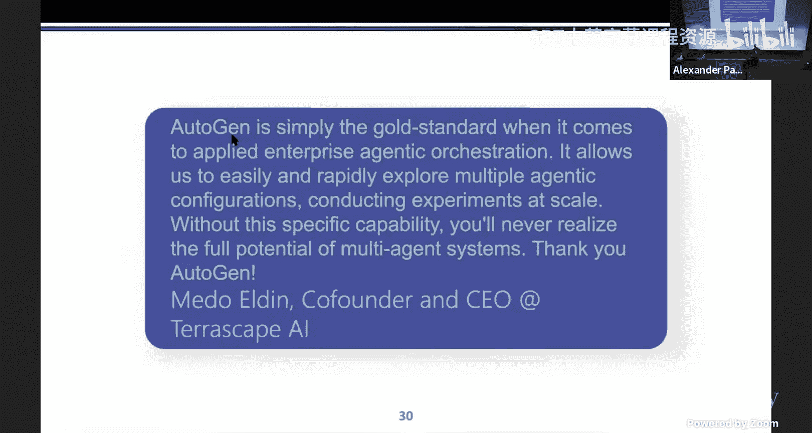

嗯。And that to summarize， we have seen big enterprise customer interest from pretty much every vertical domain and got contributors or users from universities。

 organizations or companies from all over the world。Including some contributors from Berkeley。

There's a work called MGBT created by Berkeley students and they also have integration of Autogen of B's work。

So we see that theres still a lot of like changes and progress in autogen and here are just a few examples in several categories。

 including evaluation， interface， learning， such cheating， such optimization。

In the evaluation category， we're building agent based evaluation tools to help developers understand how effective their application is。

 how good their agent are， it's a really difficult task because there are a lot of text generated and it's hard to understand what is that is going on。

 but using agents theyre able to automatically come up with success criteria based on the application and task and then suggest the scores for each dimension。

And furthermore， we can extend that idea to improve agents over time。

 right by providing the feedback to the agents themselves and have agent based optimizations or learning or teaching capabilities。

One center piece of audiogen is still to improve the program interface to make it even easier for people to build all sorts of a applications。

 so I want to talk about one particular research that excites me。

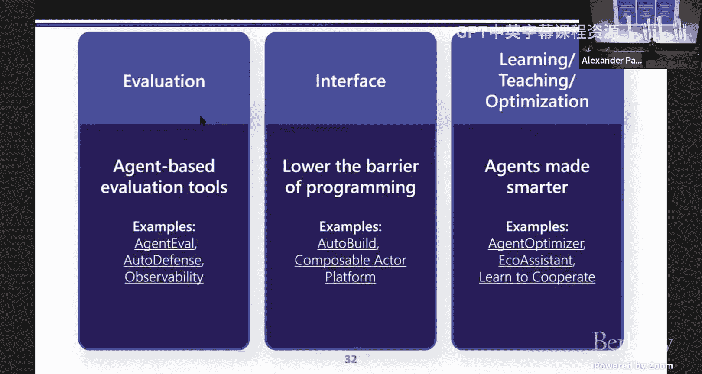

This is called autobu so one remaining question for many developers is what is the most effective multi agentent workflow I should use。

 what agents should I create for my particular task so autobu is designed to address that issue as an initial attempt。

So it works in this way， the user first provides a task to describe the high levelve requirements and the system will suggest agents of different roles automatically。

 and these agents can be put together in the group chat to solve the task and for a new task a more specific task user tasks we can review these created agent teams to solve that without users need to specify which agents we use。

And we can further extend that idea from static agent team to adaptive agent team。

 so there's technique called adaptive build and in this case we can first decompose a comp tasks into smaller steps and then for each step we propose a specific agent team for it。

 we can either choose from existing library of agents or decide to create new agents that don't exist exist before and after finishing one step one step we now check what new agents do we need for the next step so these agents come in dynamic success。

And as we create more agents， we can also add them back to the library to improve overall system over time。

And we make experiments on several different benchmarks， including mass programming， data analytics。

 and so on， and find the very promising result out formss previous techniques of similar time。Yeah。

 this is just one particular example of research we're doing。

 there are many more challenging questions， we still need the community to work on them together。

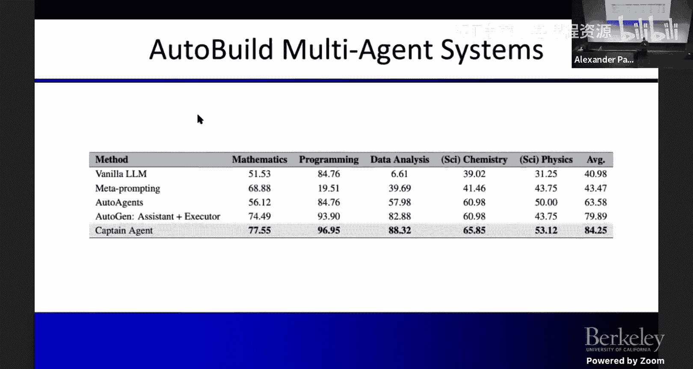

The biggest question is how to design optimal OTH and workflow for any application and considering multiple factors like quality。

 the monetary cost， latency and manual effort。In general。

 we still want to improve agent capability from the reasoning， planning。

 multimodalities or learning capabilities。And we also want to ensure like scalability and make sure human has a good way to guide their safety and so on。

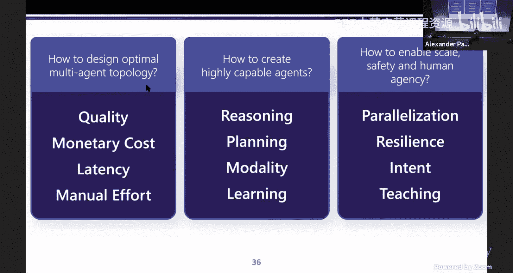

Yeah so that's that's the end of my lecture so I want to college all the open source contributors and you can find our discard community。

 We have rather large community on thisor and define this new kit organization and I'm happy to follow up with with questions Thank you very much everyone does a great talk by byre from Autogen and yeah。

 you know I hope to build up on that I think I think this is this talk is a bit less like generic I guess like in terms of covering a lot of the different agent architectures and stuff this is actually quite about like a specific use case around building multimodal knowledge assistant and so it's really focused on maybe some principles around like RaG and how do you actually extend that。

😊，Building like a research agent and it's like a use case that we've been exploring pretty deeply as a company。

 but of course， you know there's plenty of agent stuff out there。

 you should definitely check out Autottergen check out Win try building stuff on your own and then see we can come up with so let's get started And first if you're not familiar with Windex Loinex is a company that helps any developer build context augmented LM applications from prototype to production so we have an open source toolkit。

 the open source toolkit is a developer toolkit for building agents over your data different types of LLM applications these is there's a lot of people building agents we start off helping people build like ragg systems and now we're going into territories where people are building slightly more advanced stuff where you're using LMs for multistep reasoning as opposed to just like single shot synthesis and like generation we also have an enterprise product which I probably won't talk about too much today's。

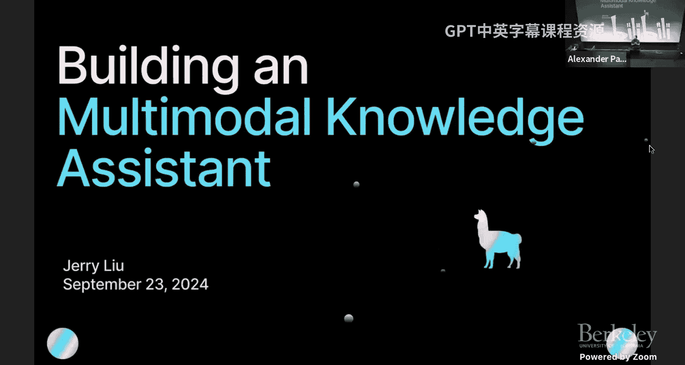

like a managed service to help you you know offload your data indexing and rag and all that stuff。

 I'll talk a little bit about one specific piece of this。

 which is document parsing or you know data parsing and we think this is like a pretty important piece in any sort of like context augmented pipeline。

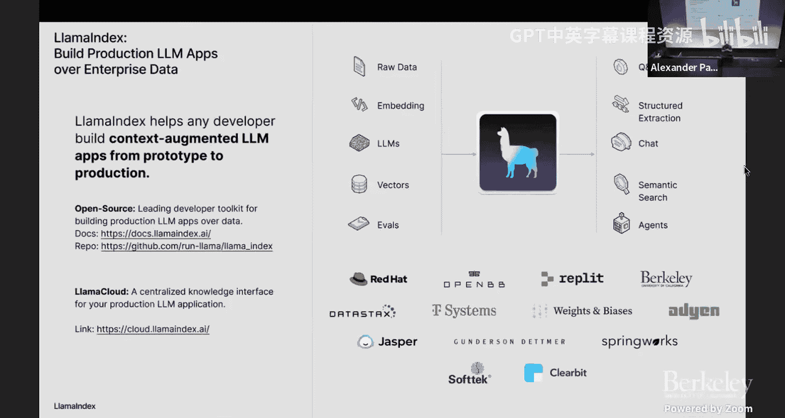

So let's get started， how many of you know what Ra is？Yes。

 so one part of RAG is you have a database and so a database of some knowledge and the way it works is you first want to do retrieval from that database to return and basically just a bunch of text to chunk it and then you know given the chunk context embed it and put it into for instance。

 a vector database and we'll talk a little bit about that as well So this overall goal of building a knowledge assistant is that you know a lot of companies have these types of use cases where they have like a lot of data they have like a million PDFs they have a bunch of PowerPoint presentations they have Excel files and you want to build some interface where you can take in subtask as input and give back an output that's really if you think about a chatbo that's basically a chatbot so you have a lot of data you want your LLMs basically understand that data and then you want you the LLM to do stuff with that data an example could be generating like a short answer。

 it could also be generating like a structured output a research。Or it could take actions for you。

 like send an email， it could schedule a calendar meeting， write code， do a lot of these things。

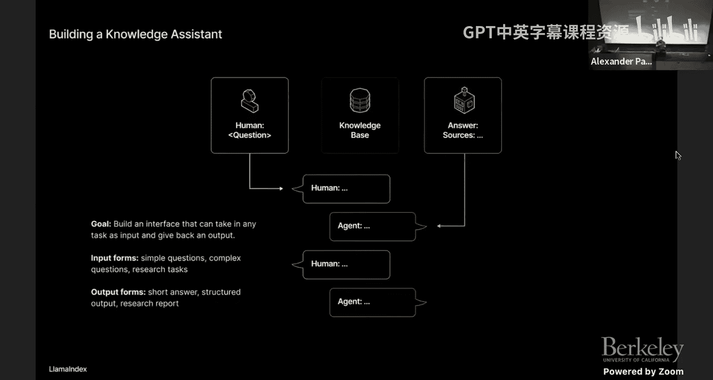

We talk a lot about like RaG as a company and especially if you're just getting started。

 if you follow like RaG 101 on how this works， we call that basic rag and so what is basic rag basic rag is you take like your unstructured data you load it with some you know standard document parser and then you chunk it into you know every thousand tokens or so you just slice that text up into a bunch of slices and then you stuff each slice into an embedding model like open AI embeddings and then you put it into a vector store。

Then when you return stuff or you do retrieval from this database。

 you typically do semantic search or vector search to return the most relevant items from this knowledge base and stuff it into the L and prompt window this entire pipeline gives what I call like a basic rag pipeline it will work kind of and being able to answer basic questions that you have over that data however there's a bunch of limitations and the four limitations we list here is one is the data processing layer is pretty primitive when you do the chunking you're not really doing or taking into account all the different elements within that data you're not really taking into account are there tables or images or weird sections and you want to semantically preserve different chunks together。

 you're only using the LLM for synthesis and so you're not using it for any sort of reasoning or planning and so if you think about all what like you just talked about with respect to agententic coordination and stuff you're doing none of that with a basic rag pipeline。

So it's kind of a waste of LM capabilities， especially with the latest models like 01， 3。5。

 like Clyde and whatever， like a lot of these models have much greater capabilities and just be able to summarize over a piece of text and so you want to figure out how do you actually use the model capabilities to do you know more advanced reasoning or planning。

The other piece is you know standard bag pipelines are typically one shot so they're not personalized it's just like after you ask a question it's going to forget about it and so every new like interaction will basically be stateless This has certain advantages but you know if you're building a personalized knowledge assistant ideally you're able to add like a memory layer to that。

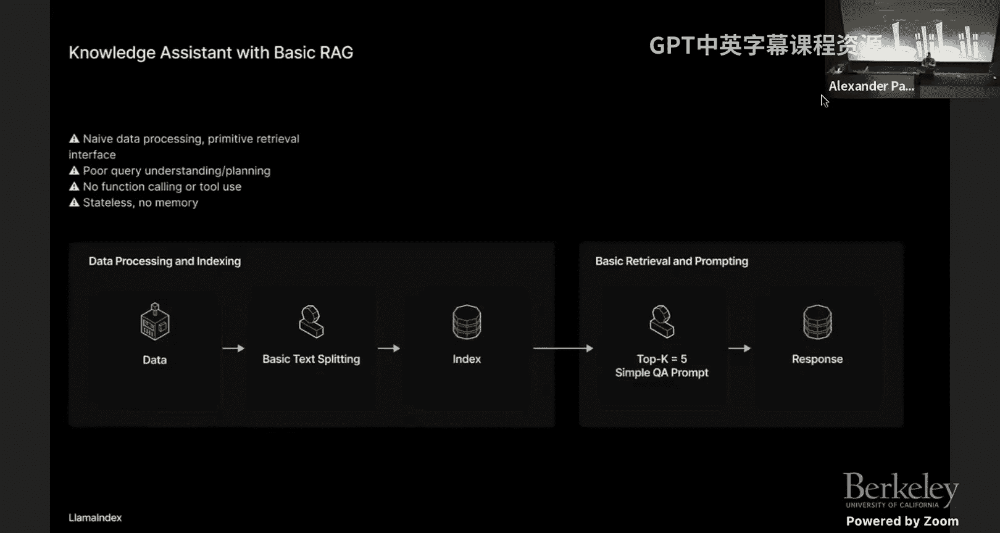

So a lot of what we asked ourselves is can we do more than a basic rag pipeline there's a lot of like questions or tasks that a naive ragG pipeline can't give an answer to this leads to hallucinations for the end user like doing like having a chatbot where I can't answer like like 80% of the questions you might want to ask it is kind of like a limited value add and so how do you you know build this more generalized knowledge assistant that can take in questions of like arbitrary complexity and answer that over arbitrary amounts of data。

We think a better knowledge assistant has four main ingredients so and actually specifically the focus of this talk is on like how do you take in like a multimodal or build a multimodal knowledge assistant so instead of just you know reasoning over like a like standard text file。

How do you reason over like an entire research report with a lot of diagrams and pictures images。

 How do you like basically reason over all the visual data that exists you know on the Internet in addition to just text So the first piece is we need a core high quality multimodal retrieval pipeline we want to then maybe generalize the output and think about something that's a little bit more complex than your standard chat bo response So generating a research report doing data analysis taking actions。

Three is agenttic reasoning over the inputs so this is where you know instead of just you know taking in the user question and only using the LM for synthesis。

 like applying chain of thought tool use reflection。

 all that fancy stuff to try to know break down the question。

 do some planning and actually step by step work towards an overall goal。

And last is deployment we'll see how long I have I plan to probably talk for 15 20 more minutes so just cover some of the high level details and for some of the actual like like the examples。

 though they're basically linked in the slides in case you want to check them out。

The first piece is setting up multimodal rag if you're familiar with RaG you might be familiar with RaG over text data。

 but what we're really interested in is having RaG actually operate over just like visual data and by visual data I don't just mean like a JPG file I mean even if your PowerPoints for instance like or like a research like archive paper it's going to have like charts diagrams it's going to have like weird layouts and the issue with a lot of standard ragg pipelines is they do a terrible job at actually extracting out that information for you and so like like I mentioned any LLM or rag or agent application is only as good as your data processing pipeline and if you're familiar with the garbage and garbage out principle and traditional machine learning I think for LLM application development it's no different so you basically want to have good data quality as a necessary components of any production LLM map this ETL layer for LLMs consists。

Basically you want to do some parsing from the document。

 you want to figure out a smart way to chunk it， and then you need a smart way to index it and put it into the L1 prompt window。

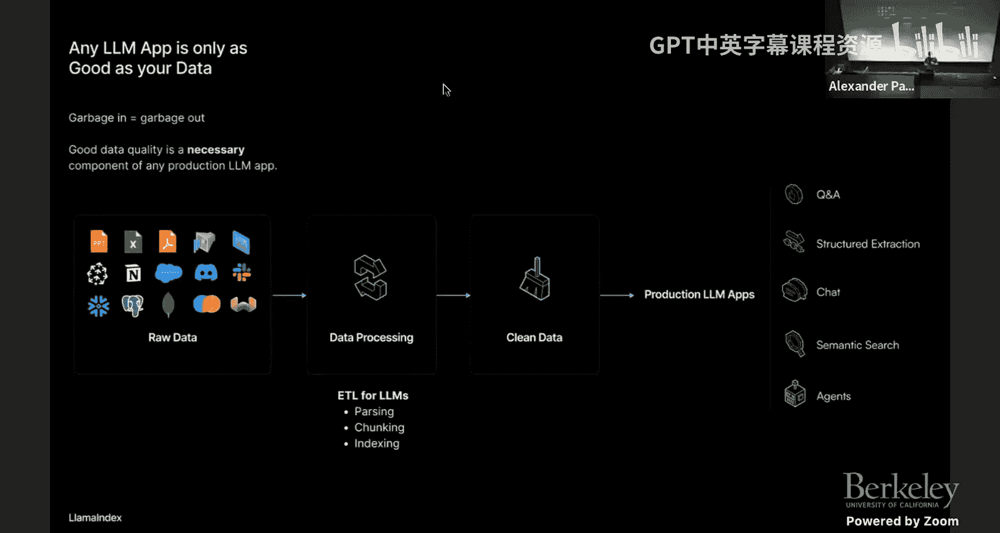

This data source that I talked about， like this case study of complex documents is a pretty common data format that we see across a lot of different companies and so a lot of documents can be classified as complex like embedded tables。

 charts， images there's like irregular layouts， there's like headers and footers。

 and a lot of times you know when you kind of apply like off thes shelf components to parse a lot of this data it ends up in a broken format and LM hallucininates the answer。

Users want to ask different types of questions over this data so you have a bank of like say PDFs you want to ask questions over it。

 it could be simple pointed questions， it could be multidocument comparisons。

 it could be longer running like research tasks a research task could be you know given these 10 archive papers around like you know like an LM quantization or something generate like a condensed summary or like a survey paper right and so that's something that's a bit longer or higher level in nature compared to something that's just a simple search retrieval task。

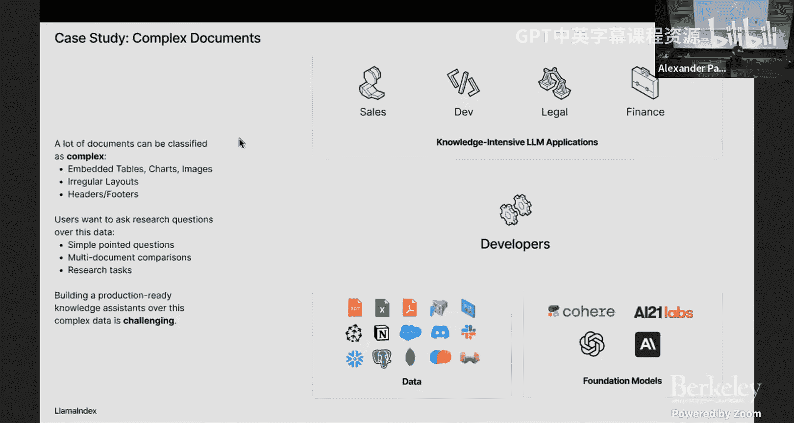

So we'll start with the basics， which is just parsing ideally document parser can actually structure this complex data for any downstream use case I won't talk about it too much because the goal this is really about agents but really like without needing to know the internals of like document parsing you need to have like a good PDF parser basically because if you have a bad PDF parser then you're going to load in some PowerPoint or PDF it's going to not really extract out the right text from that PDF and then when you feed in text that's been hallucinated by the parser the LLM is going to have really hard time understanding that no matter how good the LLM is so ideally basically want a parser that can parse out like text chunks tables。

 diagrams， all that stuff into like semantically consistent ways that is one of the things that we do is we make pretty good DNAi powered PDF parser where at like 30000 plus users right now and。

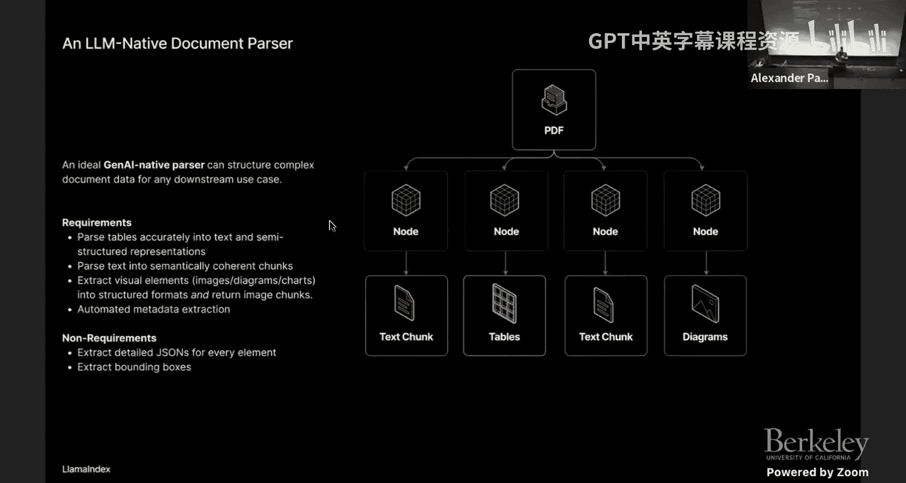

yeah， I mean， if you're interested in trying it out。

 everybody gets like a thousand credits for pages per day。

 and so it's used at you know different small companies to large enterprises。

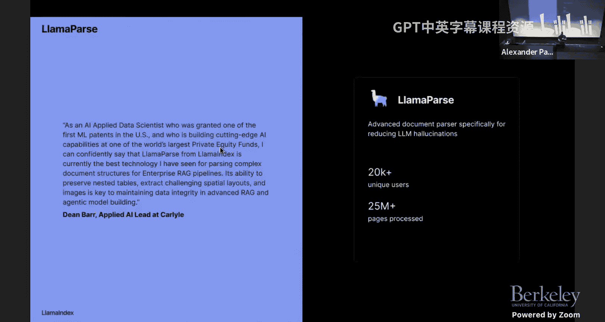

So you want to have a good parser and what this enables is it's actually an important piece in being able to structure your data in the right way if you think about different types of data so here's like maybe like an investor slide deck here's a 10K annual financial report here's like an Excel sheet here's a form having that parsing and extraction step to extract out stuff in the clean formatted data gives like it's just much easier for L items and retrieval processes to understand that。

Afterwards， once you've actually parsed out a PDF into its consistentsent elements in a good way。

 you can then leverage like hierarchical indexing and retrieval to do something more fancy than your standard rag pipeline so given this like structure or document structure of like text chunks tables and diagrams for each of these elements you know a standard rag pipeline will basically directly try to embed each of these chunks but we found。

 for instance a better approach is you actually extract out a bunch of different representations that point to the source chunk so for instance。

 for a table you might want to extract out a variety of different summaries that point to that table for a picture I mean a picture you can't feed into a text embedding model anyways。

 and so you need to maybe use some model to extract out a variety of different summaries that point to that picture for bigger text chunks you might want to extract out like smaller text chunks that feed to that bigger text chunk。

Once you extract out these representations， we call these nodes because these are the things that will be embedded and indexed by the vector database that you're using。

 so if you're using a vector database like Pine cone or whatnot。

 you know you can basically extract an index this metadata that is associated with the source element but is not like the direct source element itself。

Then during the retrieval process you know given a user question。

 itll first retrieve the nodes and because the nodes have a reference to the source document。

 you can basically dereference it and then feed the resulting element into the model noticeice that most models these days are multimodal in nature if you' look at 01 GP40 clo like 3。

5 sonnet the latest Gemini models by Google they can take in both text and images and so the nice thing here is that you can still use text embedding models or represent the element itself。

 but then like you know when you actually feed stuff into the LM you're able to feed in both text and images and so what I just outlined to is a basic way of like you know of building a multimodal rag pipeline。

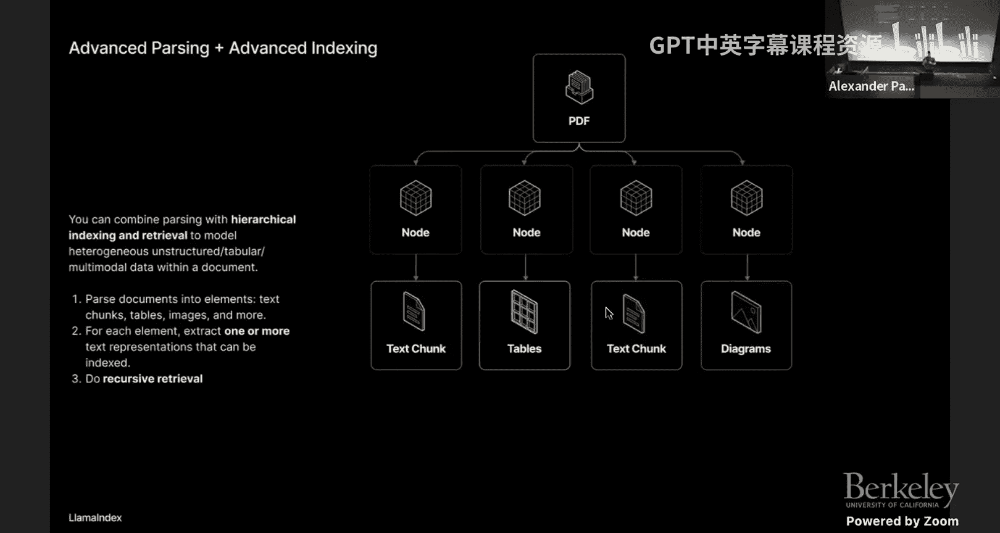

So a multimodal rag pipeline can take in you know any sort of document。

 it could have different types of visual elements in that document and it will store both text and image chunks and so in order to index the image chunks you could use like clip embeddings or you could do what I said which is like you know use a model to extract out text representations and link the text representation to the image chunk and so when you set this up then during retrieval you feed in or you return both the text and the image chunks and you feed both to a multimodal model。

I'm going to skip this example， but here is like a basic example here that shows you how to build like a standard multimodal ride pipeline。

Notice up until now you know haven't really talked about agents yet this is just like setting up the basics of you multimodal rag and so you don't get the benefits of like chain of thought or reasoning or tool use quite yet all this is doing is saying you know given a specific question you have about maybe a more complex data set like research reports or slide decks you're able to ask questions and get answers over you know the visual elements on the page。

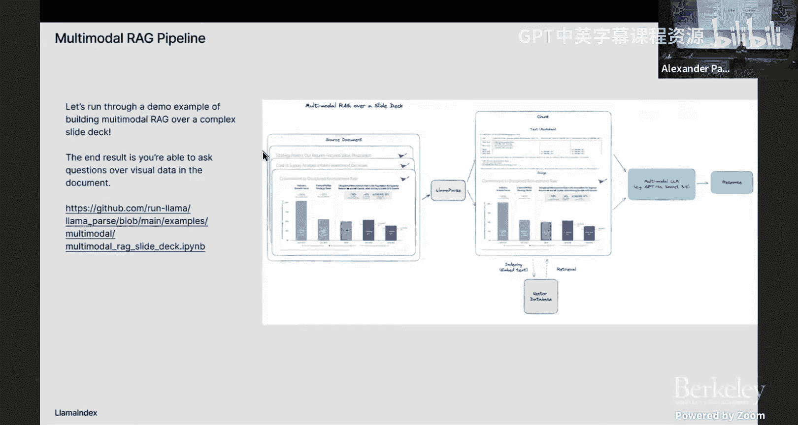

So the next piece actually I might skip this just due the time。

 but basically the high level idea here is you know a lot of the promise of agents is that it's not just going to give you back a response in the form of like a chat response but actually generate entire like units of output for you so producing like its own PowerPoint or PDF or taking actions for you or do you guys use anybody use Claude like instead tragedy anyone use Claude you know how like when you ask it to write a paper for you for your Berkeley essay that it'll actually generate like an entire thing on the side that's an example of like report generation it'll actually give you like a thing that you can just directly copy and paste into something that you then later at it so for instance like this is like a pretty common use case we're seeing in the enterprise too so a lot of consultants like knowledge workers are interested in basically like generalizing beyond the capabilities of just like giving you back unformated response but giving。

Use something that you can just directly use on its own so whether that's code whether that's like reports it's all very interesting and i'll probably skip some of the like architectures of how you actually build this for now and now we talk about ari reasoning over your inputs so this is a third section so we have like you know multimodal rag pipeline in place now let's add some layers of ari reasoning to basically build ari rag。

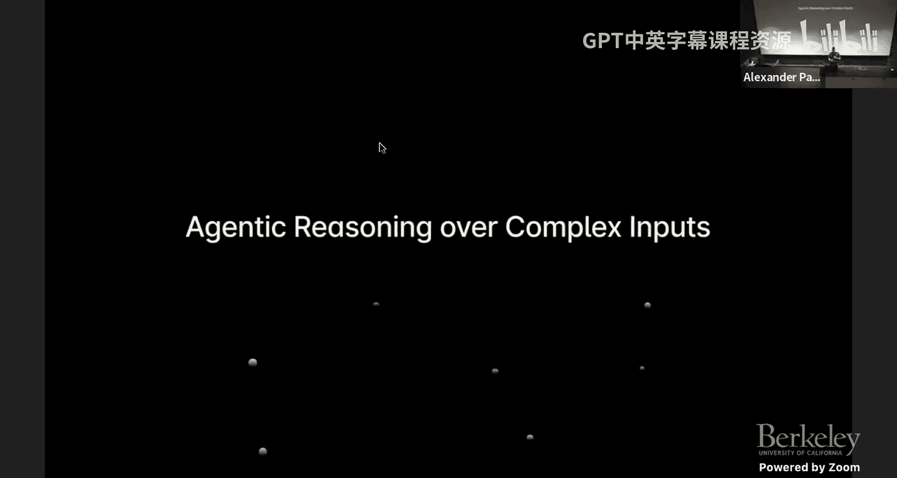

Nive RaG works well for pointed questions but fails on more complex tasks and again this is due to all the reasons I mentioned above right you were just retrieving a fixed number of chunks。

 you're not really using the LLM to break down the question in the beginning。

 and so if you ask a question like summarization questions where you need the entire document instead just a set of chunks comparison questions where you know you actually need to look into two or three or more documents。

 multipart questions same thing or a high level task you don't really get good results if you use a standard RaG pipeline。

So theres a wide spectrum of different types of agentjutic applications you can build and I think she probably gave much better architectures of like how multiagents can collaborate with each other and achieve very advanced things the way we think about it is like there's kind of both like simple to advanced agentta components at the right you basically have entire like generalized agent architectures and so this includes like you know a react loop for instance which is like one of the most common agent architecture these days came out like about two years ago almost and basically just uses some chain of thought plus tool use to basically give you some generic agent architecture you can plug in whatever tools you want and it'll roughly try to reason over them to solve the task at hand this also includes compiler which is Segu's paper and so this basically generalizes a little bit beyond react into doing some preplanning so instead of just planning the next step at a time they'll actually plan out a dag off。

Howize it run it and basically replan periodically。

What we actually see a lot of people these days build is some people do use react。

 it's a pretty easy architecture to get started， but other people just like take some of the existing components and build more constrained architectures and far this is just due to the desire for reliability even though it's less expressive even though it can't do everything some people are still building up that trust towards AI and so they're trying to solve a specific use case in the beginning and so by solving this specific use they can leverage more specific components and try to you know maybe solve in a more constrained fashion。

This includes， by the way， like tool use， like maybe leveraging a memory module。

 like function calling， we see at a lot of places， people are very interested in like structured output generation tool use。

 being able to call like an existing API and then also doing some basic like query decomposition。

 whether that is chain of thought or like parallel， like given a question。

 break it down into a bunch of different sub questions。

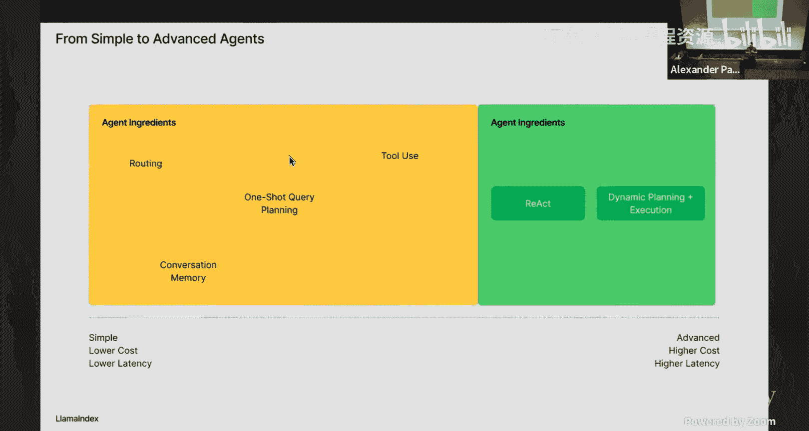

This overall thing we call agent gentic rag because it really is just like an agent layer on top of Ra if you think about like rag or retrieval or you know retrieval from a vector database as a tool you can think about an agent that operates on top of these tools so instead of like giving a query directly feeding it to the vector database first passing it through this general agent reasoning layer and this reasoning layer can you decide to do a bunch of things to the query and also decide what tools to call in order to give back the right response end result is that you're able to build a more personalized QA system that can handle more complex questions and this is an example of what I mean by unconstrained versus constrained flows so for instance a more constrained flow might just be you know you have a task and you just have a simple router prompt a router prompt is just a LLM prompt that just selects you know one option out of end and。

All it does is given this task， feed the task to one of the you know downstream tools based on you know the decision in the router prompt and then feed it to maybe a like reflection layer and then give back a response there's no loops in this orchestration all that happens is you know it'll hit the router go through a tool go through you know another prompt that just reflects and tries to validate if it's correct and then generates a response。

This I defined as more constrained because a lot of the control flow is actually defined through humans you know。

 through you guys versus through the agent， and typically the programs that you know are more constrained look like F statements and like while loops that you actually write instead of the agent。

嗯。If you're using like a more generalized agent architecture like if you're using like react or A and compiler or treea thoughtt or whatever。

 then it's a little bit more general because you're basically saying I don't actually know what the specific plan I want the agent to follow is I'm just going give the agent a bunch of tools and let it figure it out and so this is more expressive because it can technically solve a greater variety of different tasks than you trying to hardcode that flow beforehand but it's also less reliable it might veer off and call stuff like call tools that you really didn't want it to call it might just repeat get stuck in infinite loop somewhere and never converge and it's also more expensive typically these types of agent architectures use bigger prompts。

 you're stuffing in more tools at once and so the marginal token costs are much higher and so we see a little bit fewer architecture is being built with very wide unconstrained flows but a good rule thumb。

If you're interested in you know using react or something try try to stuff in like four or five tools and try to limit it like to less than like 10 with the current models we have core capabilities in La index basically help you build workflows so we call all these things like workflows they're basically all agentic in some nature the very rough definition of an agent。

 everyone has a different definition you guys might disagree with me a very rough definition is just a know program like a computer program that has non-zero LLM calls that's like a very general definition and we basically help you write those types of program so whether you try to you know define a very constrained program where you're writing the FL conditions or you're letting an agent handle that task we basically have like an event- drivenven orchestration system where you know every step you can listen for a message you can pass a message to a downstream step you can pass messages back and forth between two different steps and。

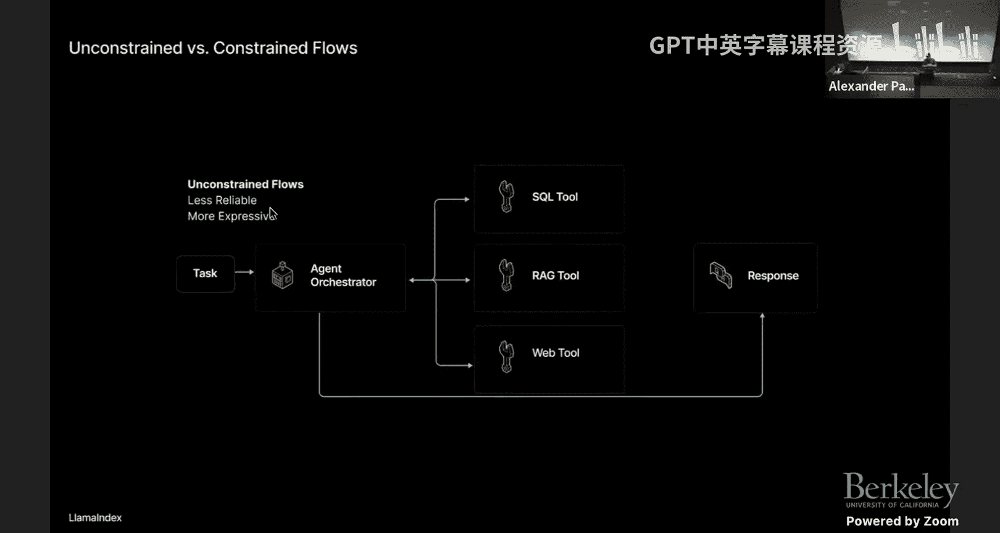

Basically at a certain point you know these steps can be just like regular Python code。

 they could be LLM calls， they could be anything you want at a certain point the program stops and it gives you back a response and so we're building out this like very fundamental lowlevel orchestration because we believe that there's some like interesting properties among like ariic behavior where it is fundamentally a little bit event driven and this also provides like a nice base to help like users deploy workflows to production in the event that you want to translate your program into like a Python service so check it out I mean I think I guess there are some links here but you know this stuff is all linked in the docs。

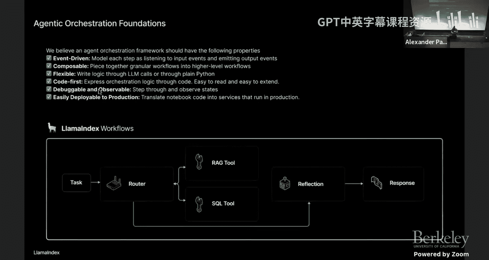

I'm going to skip this piece and then。

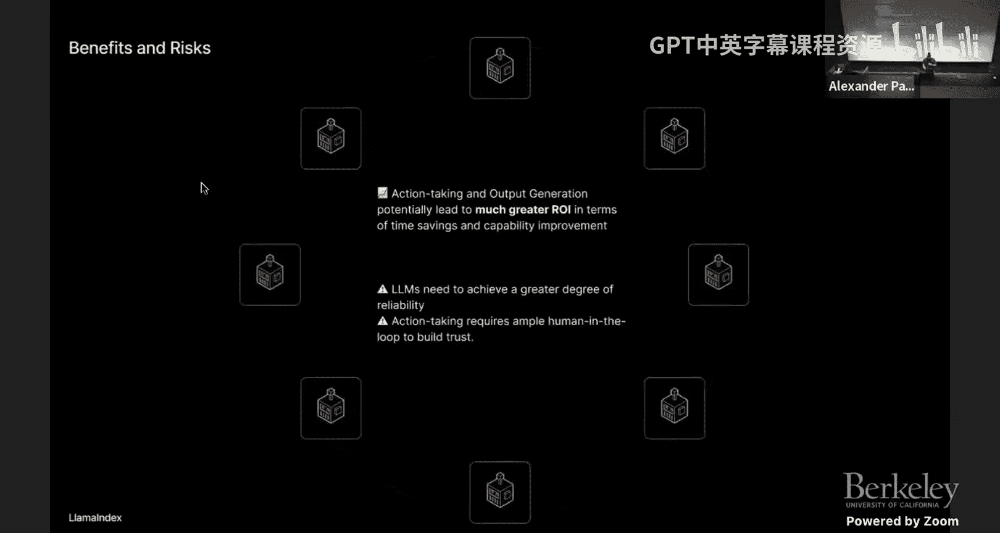

Yeah， some use cases that maybe are interesting to cover which you know I think the links are basically here in case you want to track it out is like we're very interested in like report generation use case so this is again something that we see pop up across a lot of different companies and basically given a bank of data you want to actually produce some output from that data an example architecture for this is you have like a researcher and a writer and maybe like a reviewer as well and you could think about this as like a multiagent system depends on how you define it but basically you have like a researcher that you know does a little bit of rag it retrieves relevant chunks and documents from some database and maybe like given a task like make sure that basically it's like going on the internet and fetching stuff like in storing it in your notes itll put that stuff in a data cachely basically this contains all the relevant information you need to you know generate the report。

The second step is like a writer and this writer might use this data cache to then make like an LLM call that will then you know generate this interleaving sequence of like text image box tables and give you back a full output so you have an example architecture here and you know we also have some example repos where you generate like an entire slide deck instead of just a report。

Another use case by the way， which isn't in these slides but is very interesting is customer supports I think if you look at just practical enterprise use cases of agents customer support for external facing use cases is probably number one this is you know basically like there's like just a lot of automation that could be baked into the decision flow to basically increase your deflection rate and basically ensure that like the user ends up having like a much better experience and going through like you know there automated phone values and so we see that popping up in a lot of different places too。

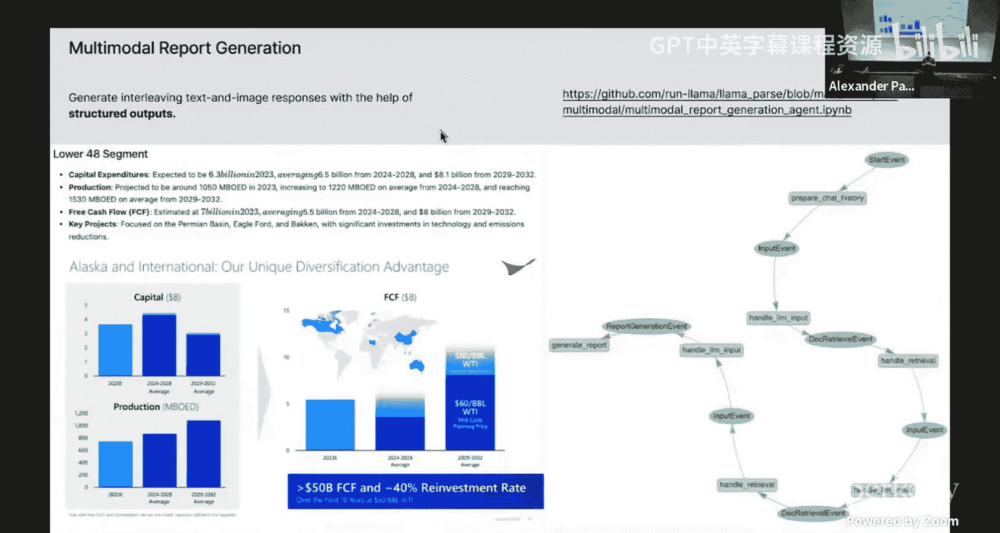

And then the last bit is really around running agents in production I think you know so far if you start off like building a lot of these components you're probably going to start off in like a Jupipyter notebook and that's totally fine you know when you start off building a prototype it makes sense to do something that's very local that's very narrowly scoped and you basically see if it works over test data。

An interesting design exercise is to think about what like complex multiagent architectural looks like and how we can leverage like existing production infrastructure components to like achieve that vision of like you know multiagents in production ideally you know if you think about agent one agent two agent three every agent is responsible for solving some task and they can all communicate with each other in some way so you ideally can encapsulate their behavior behind some API interface and then you can know standardize the way they communicate with each other through some sort of core messaginging layer you can easily scale up the number of agents in this overall system to add more to this like multiagent network and you can also take into account you know a large volume of client request with different sessions。

So。This is basically what we're building and you know it's like a work in progress。

 but we've made a lot of progress in the past few months is like how do you actually deploy you agent tech workflows as microservices in production so you model every agent workflow as like a service API we allow you to spin this up locally and also deploy this on for instance like Kubernetes all agent communication happens via like a central message queue you can have like human in the loop as a service So for instance like you know if like this agent actually needs your input。

 it'll send a message back to you await your response and then you give it you an input before it resumes execution how many of you have seen like the Devin demo like the cognition labs Devin。

 you know I'm talking about how many of you know what like Devin is。

All right so like half of you I think if you took a look at the demo one example that does is like this coding agent will just generate an entire repository for you。

 but sometimes it will stop right sometimes it will say I don't actually have enough clarity to basically kind of give you the response can you actually tell me what to do next and so if you played around with Evan that's basically what it does and that's an example of the human in the loop this like kind of interesting back and forth like client server communication where the server is actually waiting on the client to send like like a human feedback message。

So that's basically it all these components， I think are kind of like step by step towards this idea of building a production grade multimodal knowledge system over your data and yeah。

 thanks。

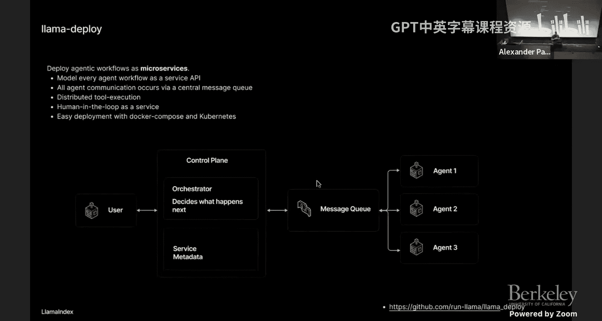