# UCB《大语言模型智能体｜UCB CS 194 294-196 (LLM Agents) 2024》中英字幕（Claude-3.5-sonnet翻译） - P4：Lecture 4, Burak Gokturk.zh_en - GPT中英字幕课程资源 - BV1RsZPYsEtE

well look at the trends of at pursuing enterprise。 I think today's lesson。

 I look at briefly the first three lessons that you have。

 It's going to be less about going real deep in algorithms， although we will do a little bit。

 especially when we talk about the key blocks for building agents。

 but it's more about what we are saying in the in the markets today， I'd also give you a few hints。

 like if you're looking into the rest PhD， some of the ideas that you might track。

 if you want to do a startup again， some of the interesting ideas that you might we might pursue as well。

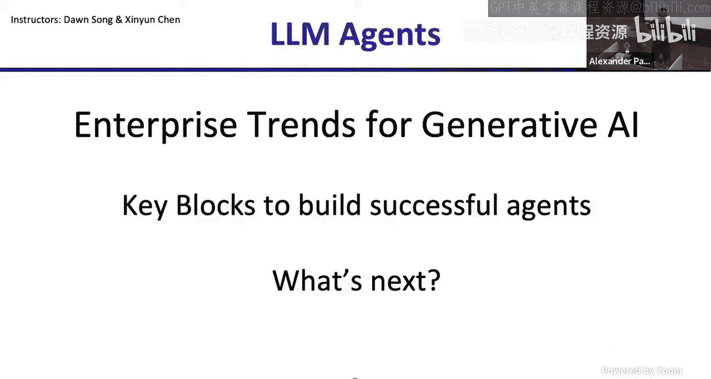

So let's start with some of the trends that we're seeing and I'll maybe go very quickly on some of the things that you over this in and you know。

I'll try to keep it quick， so。Maybe if you look at a little bit of the history and if I even go to my time of PhD and。

All of my peers， my friends， my classmates， we were talking about。

 why is neural networks even in these textbooks， at the time support reping machines， decision trees。

 more or less older the regression algorithms were working quite better。And we were thinking well。

 neural networks would just be odds， like it was really perform horrably。And actually my office mate。

 Ggo， who used to play lots of chess， by the way。And if you're looking into learn your masters and PhD in a limited amount of time。

 don't play chess all the time， that's maybe the lesson2 of today。He and I were talking about okay。

 we should really take tip out， but we were both wrong at the end of the today day and what is it that changed and how come neural networks became so much better than anything else？

G， I think from architecture point of view。It's much more easily realogniizable compareds to other algorithms that we've actually been working at the time。

Second。Beyond， beyond that， we need the training set， right like to be able to paralyze things。

 you need lots of lots of data to be able to make paralyzing really know something。

 something useful to give context。 at the time， I was looking at detectducting some cancer from various C images。

And I believe I had access to about 50 patients data set。

 so every time I did training it was taking roughly 42 seconds and I was like， oh my God。

 it's taking so much time every time I click on restart 42 seconds of wait time。

Now it's pretty crazy， right， like if you look at some of the large models and how much they are taking today。

😊，It's sometimes taking days， sometimes weeks and sometimes months。

 depending on the size of the model。By the way， as a side note。

 one of my worriesies is that we're not learning fast enough。

And there was something good about that 42 seconds。😊，Every 42 seconds I was changing something。

I was learning what it did to the training and it was at the time mostly to support vector machines。

 everyone was using support vector machines， okay if you change this parameter this happens if you change that parameter。

 okay this other thing happens， you get intuition very， very fast。

Now imagine being a researcher working on large language models and then you change something。

 click on start training and you get back the results about four weeks from today。So of course。

 that's one of my worries sometimes。Many of us don't know why it works。

But getting intuition faster and faster。But as a side note。

 like of everything that's happening in the world， like our pace of getting intuition is much slower than what it used to be。

Now let's talk about the data sets I said， okay， neural networks are very parallellyzable。

 so that's great， but what about these data sets now imagine getting it's not really all the books but you know taking that aside for us all the books in the world or all the websites in the world。

😊，There's a lot of data right， but how do you create the training set and you've probably seen this in some of the prior classes as well。

 this technique called masking。Which is。You take a sentence。

I love running or any and start masking the words。And you're trying to predict those words now if you have the web and or the books all the books in the world。

 this can create lots and lots of training data so now we solve the training data problem we do not need to deal with only 50 patient data sets anymore where we can we can work with you know a huge amount of data set。

And combined with you really great improvements in GPUs in TUs and like especially in hardware and chips。

 all of a sudden neural networks have started and with the transformer structure， of course。

 you know there is lots of improvement in some of the algorithms as well。

 but with the transformer structures all of a sudden it started working really great and we're getting all all those awesome results now。

那。Again， looking at history， I think one of the moments that really， especially with enterprises。

 changed the moment was B at GT launched in November 2022。After that。Everyone realized， oh my God。

 AI actually works better than we thought it does。I believe lots of companies， including Google。

 had lots of internal tools that showed no chat GT like。You know。

 chat experiences and outdoor experiences， you know internally。

 but making it public A was a brave move， but B， I think it's changed the mindsets with everyone in the world。

Now， going through some of these other things that we are seeing。

 and you'll see some of these problems right you give an image and you detect a label out of an image or you give some speech and you recognize what that speech is。

Translation， lots of AI problems we are seeing。Lots of improvements。

 especially in the last one decade。And more than that， it Geneative AI。

 you can actually go the other way around as well， like now while it used to be output。

 you can give input and it generates you know all these images or speech， etca， videos。

 you see all of that or some text。No， poet， et cetera。そう。Just again， give more context。

 so this is image classification on imageNe。And you see when it started in 2011。

 like this graph at least started in 2011。About 50% accuracy rate in some of the algorithms。

And this graph at this is showing until 2022 and we've already reached almost 91% and actually it's advanced even more with large models in general。

This is huge amount of advancement indeed when I look at。

The time when me and my classmates were doing our master's or PhDs。

 we were making some predictions about where AI would be。And I think we are where we are。嗯。

We thought we would be here about in00 years or so。

 whereas we arrived there in 15 years or so something like that。

 so it's moved so much faster and the last few years that acceleration has even increased further。

You see it everywhere， speech recognition， so in this data set it moved from 13% in 2016 to this a measurement in 212 house percent and nowday it's actually much better。

Both open AIs products， Google's products， Anthtroic， like when you look at some of their systems。

 they're working so much better than some of this， but compared to what we started with and this is only 2016 only eight years ago。

 it's a day and night difference。Now I think I mentioned about this it's neural networks that transformer structure。

 of course， there's lots of advance an algorithm as well， and I mentioned this。

 okay how do you generate lots of training sets， this concept of next token prediction。

 you take any sentence and you start masking the keywords and that's how you and lots of keywords。

And at the end， I think what happens is you get something that's versatile and effective in handling lots of different use cases anywhere from a technical discussion or kind of a friend to friend conversation。

 they're very versatile in their capabilities， and I don't need to tell you because you've been trying this you all over。

 I'm assuming。And now when you look at。Some of the main algorithms or approaches to be able to either build the base models or start improving on them and I think you agents is an overloaded term but like building an application or agent that's specific to your use case。

 what you would usually want to do is get lots of expert responses like give a prompt and here's the output from an expert。

You do this many times， actually many， many times。The issue is that's。Well， first of all。

 let's talk about the good part， it actually works like once you do it many times。

 tens of thousands of times， it works。L getting an expert to be able to give you that much training sets is not easy。

So although the supervised fine tuning is very effective， it requires lots of training sets。

 but also it requires like finding those experts and be able to spend lots of time on them as well。

そう。The more practical approach that we've seen is you know。

 usually reinforcement learning from human feedback essentially you can have。

The your your base algorithm。Generate multiple options。

And let them in front of a human that says and hopefully an expert that says thumbs up when it thumbs down giving a thumbs up and thumbs down is significantly faster in no process than providing a very expert op。

 sometimes you can do both of both of those and then you can feed these inputs into your loss function for optimization of your large language models。

So these are some of the main approaches we are seeing I'm going fast in here because I know in some of the other classes you've seen this and at this on Google sites you've seen Gemini and this is a project and I'll go very fast on this one and this is all public data but this was released in December and I take February there was another version that's already released I think。

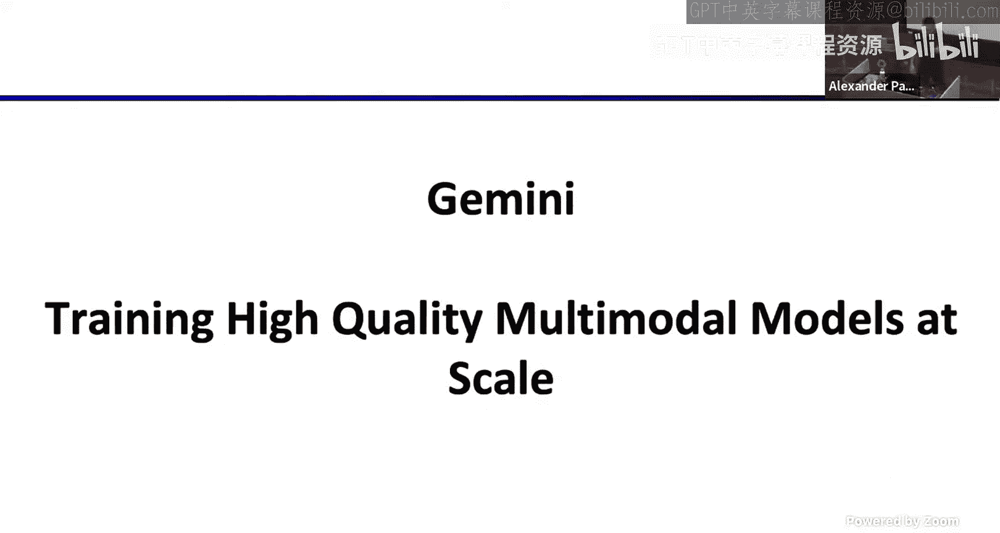

A few interesting things is multimod from day one。And second。

 it has the ability to be able to provide a very large context。

 indeed internally we are trying 10 million and evolve and we're getting really interesting results and good results as well。

Now， maybe one interesting idea for for you is a PhD Tsis or master's thesis or a startup。You know。

 search is very fundamental to our lives and the search algorithms are very fundamental to our lives。

 indeed you will see even to make a large language model work well。

 search is fundamental to that as well。One question is。As the input context。Is growing。

With a large language model。With a huge amount of input context， be able to replace search。

Like the search algorithms， traditional search algorithms either keyboard matching or embedding matching or deep preable techniques will it be able to replace essentially traditional search algorithms in future so I think that's you know something because the foot foretold。

But this is I think， a very interesting， interesting problem and lots of interesting research is going to continue happening in that area。

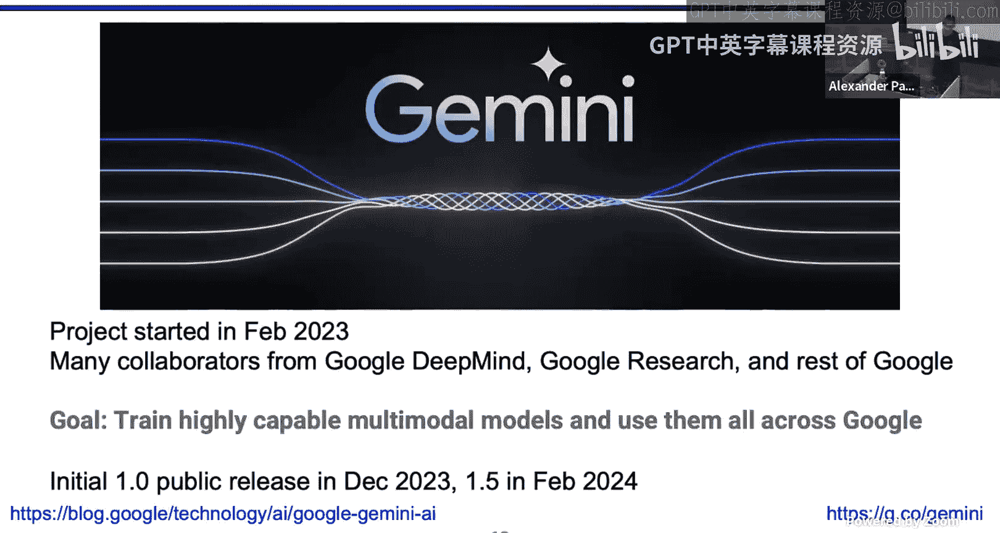

So as I said it multimodel from start， you could input images， text， audio， video。

 and we actually get really interesting interesting results and here's one example in this example you'll see a physics problem and then you do actually an image。

And then you continue with your text and it's able to provide a pretty good pretty good response and you can try on AI Studio or many of many of this and as I said large context is really interesting and。

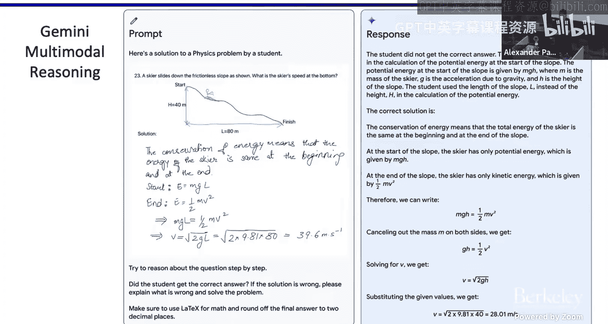

If you want to try with videos or with very large amount of text。

 I think it's very interesting to experiment with those。

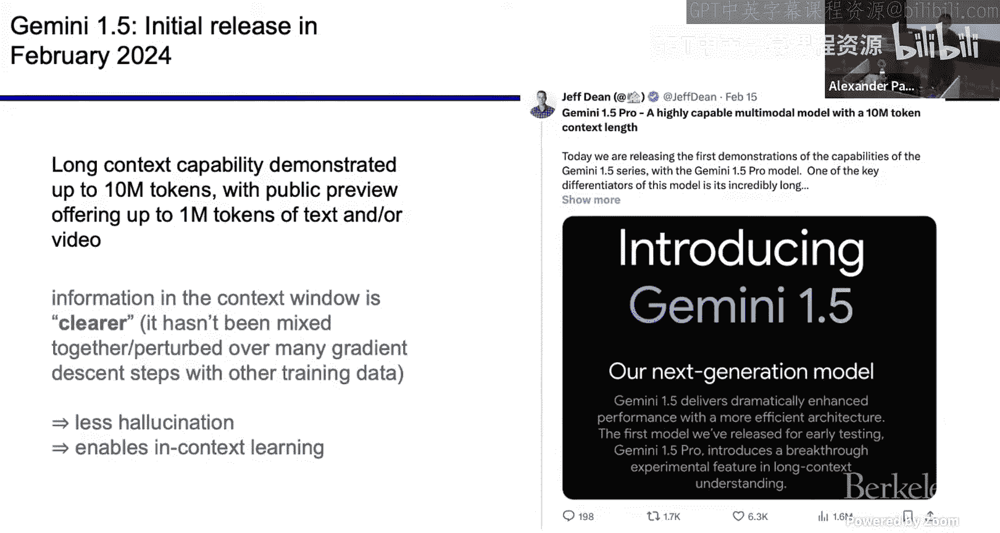

It's again， available at this link in AI Studio。😊。

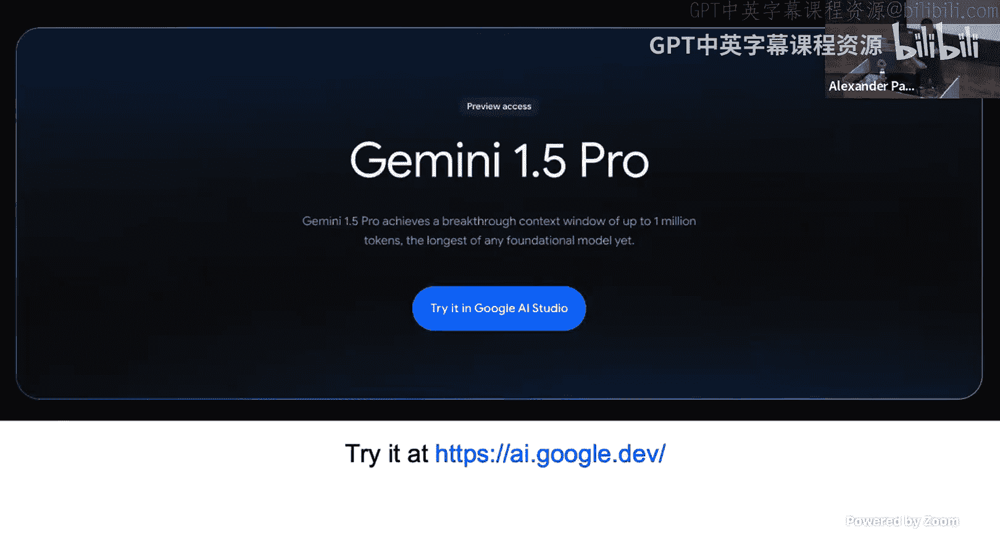

And I think this was one of the reading materials that I mentioned， it's a needle in haystack test。

For any retrieval algorithm time or for large language models with a larger context。Let's drop a。

Pece of sentence or a piece of a video or piece of an image or something， which is called the needle。

In a large amount of text and see if the large language model is able to extract that。

So if you especially want to do more research on that idea about okay how do I build a search engine using just large language models。

 this test becomes really relevant for you， but also to be able to test all these large language models as their input context increases this test is a very interesting test and in the case of Gemini I think green means on the needle and red means is missed it。

 the results were very， very promising and I think in some of the reading material that I sent their results from other algorithms as well。

 it's less about the specifics of those results is more about this test and learning it and using it in your research when appropriate。

And then this is Li's leaderboard I think gemmin I made it to number one in August now it's not then it became number two then it changed again it's constantly changing and that's maybe one of the。

Artifacts of what's happening in the world right now， if you look at 18 months ago， first of all。

 there was more or less one model that was available to anyone through open AI or at least one really high perform model。

Nowadays that's changing quite a lot and I think that's actually going to be bringing some of the trends that we're seeing in enterprises as well and you will see that in a second。

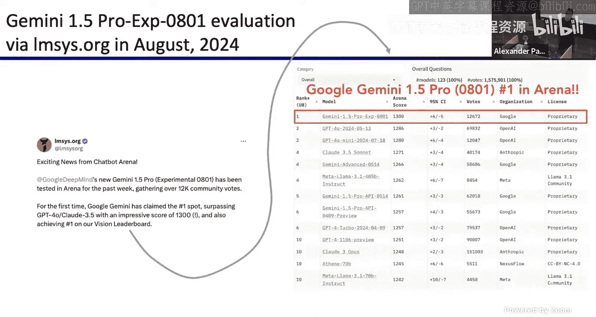

All right， so let's look at some of the enterprise trends now。Now。

 the very first one and maybe the obvious one。Is that。AI is moving so much faster。

 it's not a surprise， right， but all the enterprises。😊，Are all about AI right now。

So I've been doing this job for a while now， let's say 2 and a half years ago or three years ago。

 when we have a new product in AI。We would usually barely be able to find one or two customer。

 enterprise customer to pilot it and we would be like， wow， this is great。

That has completely changed。Now for every feature that we are putting immediately。Thousands。

 if not tens of thousands of enterprises are like holding glass and wanting wanting to throw and this is probably correct for any of these any of these companies。

 so that's a big trend change and a mindset change when it comes to enterprises and how they're looking。

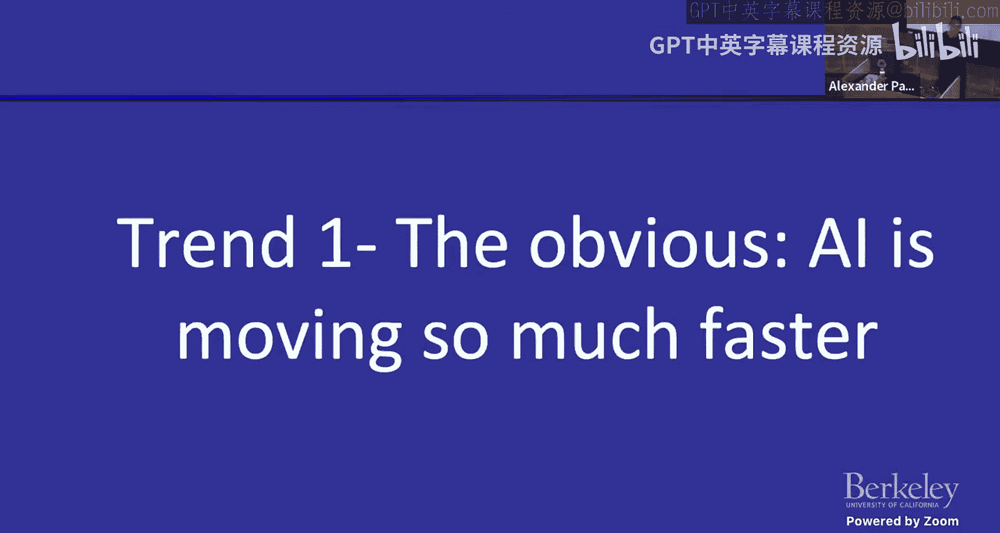

But there's also like， I think， theoretical reasons as well。I mean， one of them， as I said。

 people under suitable AI could work。But another one is the amount of data needed to get started。

Has come down very， very significantly。So before large models and large language models。

A typical enterprise needed to collect some training set。And那另 to。you know。

 clean it up and then usually something went wrong。

 they would go back and redo it again and then it would take months and I've seen cases of taking it years for them to be able to collect all the training set and then feed it into you know their you training algorithm or machine learning algorithm of their choice。

Now that has changed because all these large models and large language models are already trained with a huge amount of data。

 vast amount of data。So what it means is。Many enterprises just can take one of the base models and can use it in their application。

Or if not。Like they can just add， like they say， you have a very custom application that you want to work on。

The amount of additional data that you need to provide is very significantly less than what it used to be before。

So this I think is really expatiting things now people can you know start things and try things within days as opposed to sometimes within years。

No， second。And I think this is also a big culture change in the world as well。

It used to be that to be able to develop any AI algorithm or application。You need to be an AI expert。

 a data scientist， someone who's traineds like either a master's PhD or lots of courses in AI。

That has completely changed。Noで。Any they will occur。And we see lots of middle school students。

 high school students are doing this。Can start building AI applications using large language models and also reading a little bit about。

 okay， what do I do to fine tune these models？So that's a big change and indeed that's a big culture change for for all these companies who have been working on AI as well indeed one thing that I tell to my teams is that。

Because all of our team members were essentially producing or developing products。For。AI experts。

So that's a culture shift that I think is happening in the world for the producers of these large language models。

 they're also trying to focus much more on developers， you see that's why like。Open AI， Anthtroic。

 Google， Microsoft， everyone is doing developer events because any developer。

Can provide and produce AI applications nowadays and that was much less the case a few years ago now if you think for a second。

 the number of AI experts or data scientists versus number of developers in the world。

Maybe there's more than 00 scale that's also partially why we are seeing an exponential growth everywhere。

 like all companies that's working on AI nowadays is seeing a big exponential growth and this is one of the reasons now literally anyone can go there and start producing AI。

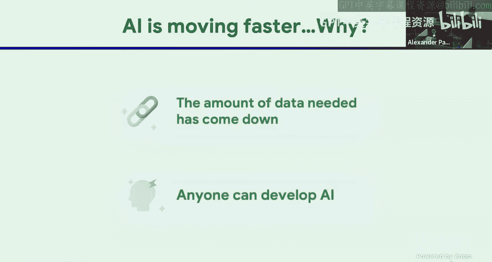

Now， a few of other technical trends。

And I was partially wrong on this one， I thought we would have a separate model for different let's say。

 at least domains like for healthcare you would have a different model and for finance。

 you would have a different model， etca， etc ce。But what is happening is the pace of improvement in the base large modelss。

I so large that you can produce a base model a domain specific model。

 and by the time the new base model comes it's usually already better than that domain specific model。

 so we've seen it a couple of times it。And the approach I think many of the at least larger companies are taking right now is produce a large model。

That is very good in reasoning。Now again， another idea for you there is a master's student。

 PhD student is a thesis work undergrad project or a startup。How do you get？

You know these large language models and be able to customize it perfectly。

For a specific use case and you know potentially domain as well indeed just healthcare model is not enough you need to like healthcare has thousands of different use cases and you might need a different model for different use cases。

 but if you're looking for another idea to go pursue I think the world can use more research in that area right now I think many many people already have already started but that's at least another another idea for you to look into。

Another trend is it started all dance models， and essentially which means that during inference time during running your large language model that you're trained and you learn。

You would go and execute every node of your transformer that's also changing now we're going more and more into efficient sparse models。

So you do not maybe necessarily need to go through every node。

 you can be much more efficient about it and maybe execute 10% of the paths or pathways。

And this is showing。A transformative effect， because that means a。

 your latency could be much less and B， your cost also much much less as well。

 So I think at least that's a trend that we that were seeing among other things。

And I think I mentioned this， I personally thought there will be single models。

 there will be one for image， one for video。It's all getting combined into one thing。

 we're seeing models that are able to understand all kind of modalities and probably they'll be able to produce all kind of Modelities as well。

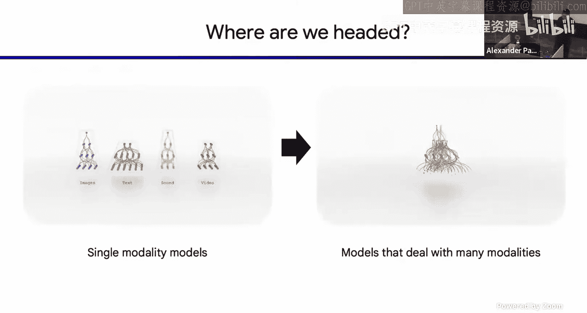

Now， this is an interesting trend， again，18 months ago。Especially for enterprises， it was all about。

 okay， which model do I use， what is the latest model， what is the largest model？

And that was the main。know parameter for choosing what to use。And we're seeing that change now。

 were seeing that it's really the choice of the platform。Rather than than the model。

 one of the reasons is that。Every other the week， there is a new model。All right， so。

Regardlessgard from which weever company， but you start now you expect to see another model every few weeks。

 every month。And especially enterprises are seeing that and for that they really want to be in a place where they can try many models altogether indeed。

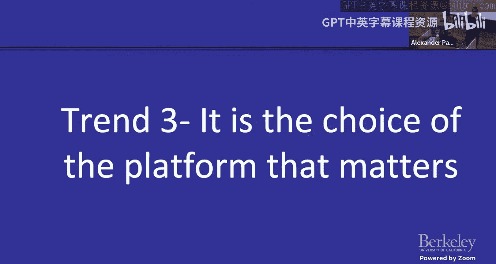

And again， this is alarmes。 and you can see。You know this is different this is more recent it's not yesterday but I think it' a few weeks ago you see there are several companies that are producing really great large language models they head to head again very different from 18 months ago what it meant is。

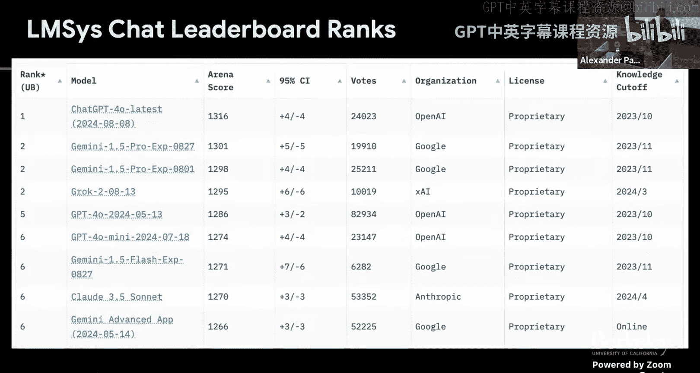

When you talk to enterprises and we did talk to maybe thousands of them and。

Some of these attributes are accessing a broader set of models。Became very important。

And then able to customize these models。On top of these base models has become very important。

And similarly， choice and flexible at every level is very important。

 I'll show a diagram of how we did it in vertex AI。

 I think you would see similar kind of diagrams everywhere， but typical architecture or architecture。

 whatever you want to call it， where you build on some of these success models for success factors for generative AI。

And of course， especially for enterprises being able to manage these models is very important。

 so it needs to be able to return results not 98% of the time， it needs to be able to return out 99。

9999% of the time so of course that becomes very important as well if you're building an actual production algorithm and application。

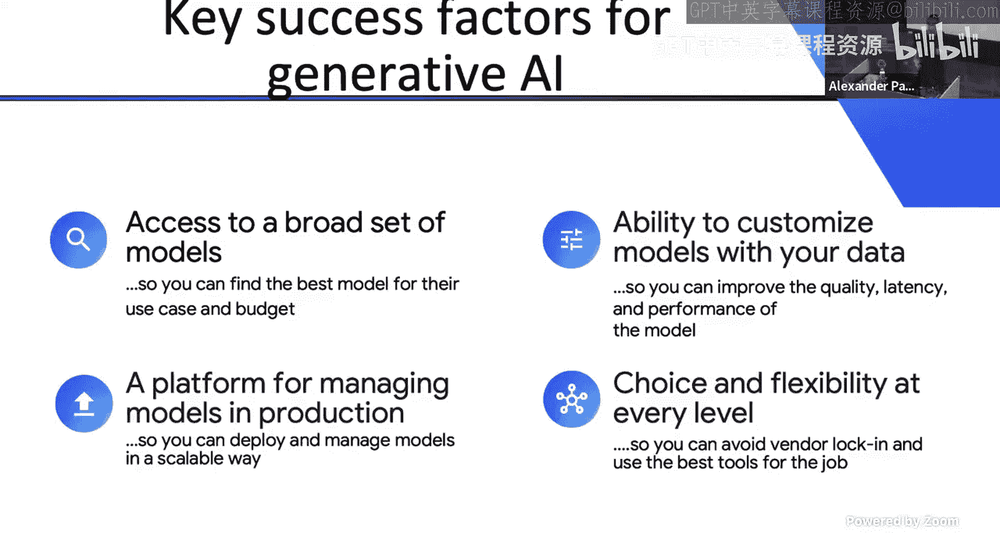

Another trend， I think the cost of API course is approaching zero。

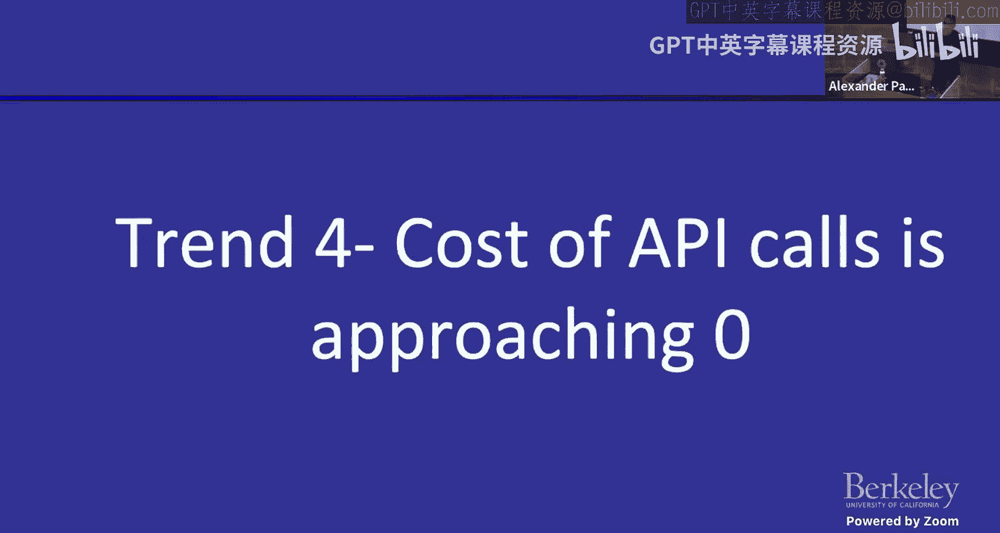

Which is also very interesting I think I mentioned some of the reasons like dance models versus the sparse models there are many reasons beyond that there's lots of improvement in the chip space GPUs are getting better TUs are getting better。

And you I'm not sure how much more you will see this trend。

 probably you would likely to continue to see one interesting fact is for instance。

 the flash model running that versus some of the open source models。We've done lots of calculations。

 it was cheaper to run a flash model which is supposed to be not free than an open source model because you still need to figure out the hardware and chips yourself and you need to have some cost of management so maybe the trend might slow down a little bit because it's come to a place where running open source actually is almost more expensive than some of these paid models but I think that's a trend that we have seen I think the prices have come down。

At least probably one a half order of magnitude since how things get get started now good news is usual the latency went down with it as well。

And that's very important because。The smaller latencies。

 the broader set of applications you can do that fits that latency requirements of your applications。

 so we are seeing that the scale also go up as the latency of these models are going down。

 that means。You can build more latency sensitive applications as a result。

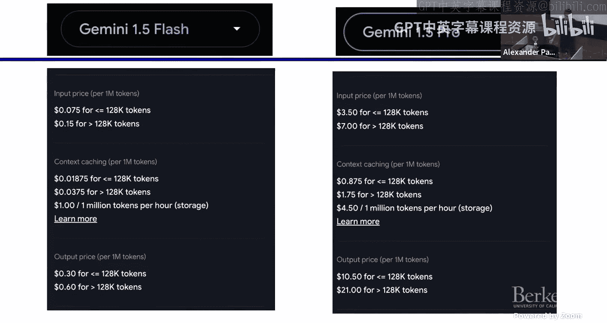

Okay， another huge， huge huge strength。Its search， and。

We see I think every other customer that I meet。

Probably every other use case。Is starting to use large language models and search together。

Some of them just make a call to large language models and search separately。

Some of them they like they use grounde to be able to do it。But this is a big trend that。

Wasn't there a usual。So there are multiple reasons for it， if you think about it。

 large language models are great， but they're typically trained in the past。

Sometimes it's two weeks in the past， sometimes it's two months， sometimes it's six months。

 but sometime in the past， so if you're asking the score for the game last night。

 you're not going to have much success with large language models。Another one。

I I think you all know this， but large language models houseinate。

 even the best of the best ones still houseinate several percent of the time。

 so essentially they're lying to your face。But they're very confident about it because they don't know what they're lying。

And for many of the applications where factuality has become more important。

 we see people are going more and more into， okay， I need to also retrieve some data through search and triangulate between what large language model is doing and what search is doing。

And third， large language models， I think you all know there。Great in reasoning。

They're able to they're great in answering questions。And that is coming and maybe combined。

10 different sources and be able to design an answer for you the issue they cannot tell you which exact source。

That answer is coming from。And again， search has been pretty great in citations。

And that creates for many applications， the level of authority that the application needs to be able to say。

 hey， I'm saying this because here's the exact blurb from exactly this document that's saying this。

 and I think especially enterprises in many of their use cases have been have been using the archive so this is a huge trend。

 every other application and use cases as I said， seems to be somewhere on it。

 especially healthcare finance。😊，Any kind of。Now， customer service。How much is my bill， okay。

 let me alternate about that like things like that。

 so it's like you really need search to be able to you know make the large language moves much more factual。

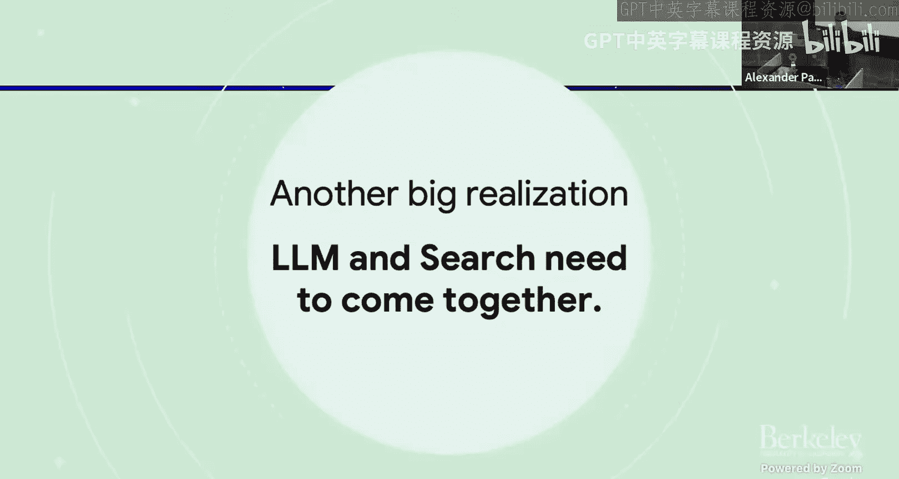

And another maybe last trend is V see。That。Many enterprises are interested in also their own employee productivity。

 so we see lots of companies coming out there with tools that are specifically targeting employees of a company and the companies are very interested in those tools as well I think Google is coming up with something as well but other examples gle you seen chattyP enterpriseter all about making you know the employees more productive as well。

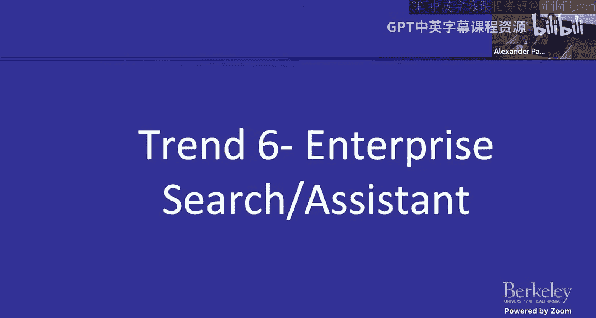

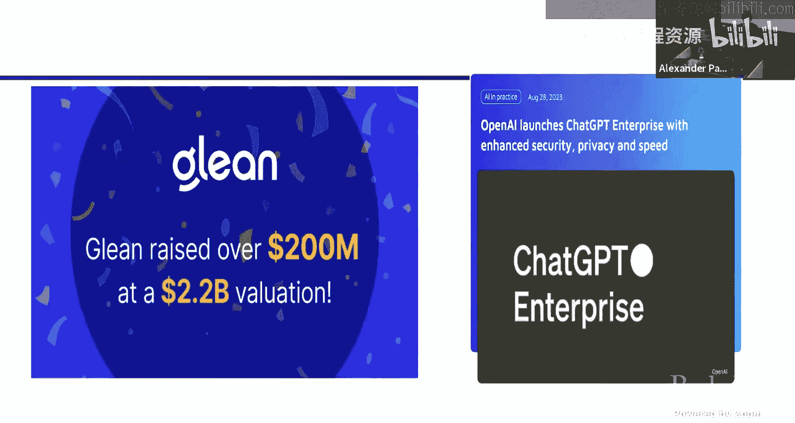

Now， I think we summarize some of this， but we've talked to many。

 many companies to be able to come up with some of these trends。

And I mentioned like the success factors for generative AI now has really come along these other factors like accessing to a broader set of models。

 choice and flexibility and to customize now with as I mentioned let's look at you one possible architecture know of course vertex AI is the one that my teams algorithm I'm most familiar with but I think many companies have similar architectures so choice and flexibility at every level I think that's very important to provide to enterprises like that's probably all the way to chips。

That's why in the case of verortex AI， we can use GPU or TU and it's very important because。

At this time there is a huge chip shortage in the world。

 I would say probably the demand is 16 to supply right now。

 so being able to have a choices there is quite important， again。

 models like being able to provide models from you know whatever company you are the first party of your models。

 your own models， other company models， as well as open source models in one place。To your customers。

 to the enterprises， I think becomes very important。And then model builder and agent builder。

 which are really the tools to be able to customize based on these base models。

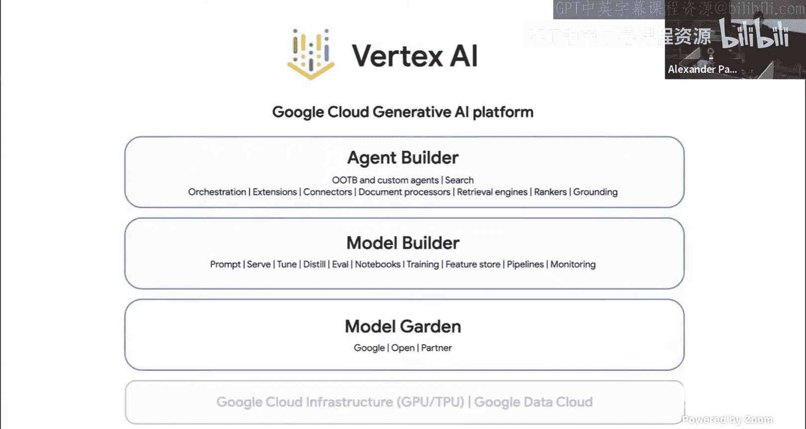

As I said， like at least on vertex A， lots and lots of different models， including Gemini models。

 you know Gemini Pro at least now actually with 2 million context window。

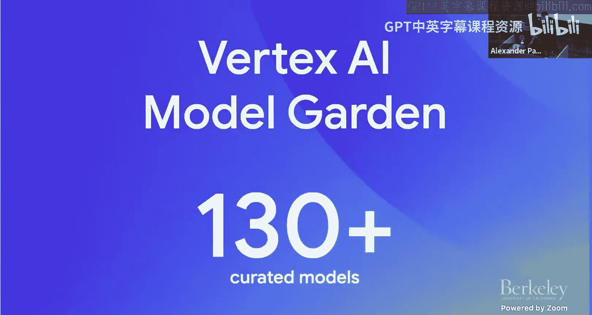

And all kind of models， you know， not just for text generation， but English generation。

 speech to text and text to speech as well as embedding the generation as well， but the key is。

You need to provide the choice。And then I think especially in Vertex AI。

 and I see it in other platforms as well， being able to provide open source models as well at the same place。

 because depending on the use case， I think different enterprises looking for something else and being able to compare them and evaluate by evolution tools become really。

 really important as well， becomes very valuable to the enterprises。Same。

 and not actually we have three and a half sonnets on Vertex AI as well。

 actually providing other providers， other companies models as well so that again。

 your customers can compare。そ。And then I think once we have these base models， I another the choice。

Model builder and agent builder。Is how you get into customization and how you get into building successful agents and applications。

And then maybe like in the next part of this lesson I'll focus more on these。

 which is tuning on distillation， grounding extension and function function calling as well。

 but if I were to give an overview because I think given time I'll probably go fast in the next section and have time for questions as well。

Tunning is as you might you know guess， you get your own use case， you get your own data with it。

 how do I get the base model be able to perform specifically for your use case thisel is usually this base model are super large。

And and they're able to answer all the questions in the world right and for many use cases。

 especially use cases of the applications， you do not need that indeed you'd rather have a smaller model that is great in your exact specific use case and thislation essentially is the the concept of going from large language models or generating smaller models that are。

😊，As good as a large model in that in your specific use case and test data。Grounding。

 essentially I mentioned it a bit combining it with search and making your large language models much more factual and you might want to do it with the web search or web data or you might want to do it your own enterprise data as well。

 but essentially combining it with search like that's what you should remember when it comes to ground and that function calling or extensions。

And。I sometimes call this as I think you probably have watched this show who wants to be a millionaire。

 but I think one of the things is okay， you need to call call like we have an option to call a friend to ask a question。

And there are two key that are pretty tricky here， one you need to know that， oh， okay。

 that's a question that I do not know and I need to call a friend。And second。

 you need to be able to choose the right friend to call when you know you do not know the answer。

 so I think function calling is like that a large language model for us is not going to be able to book a flight ticket for you or look up flight schedules。

But with a function calling， like let's say， Expedia has an extension for that。

 you might have your large language model be successfully be able to do that。Again。

 it's tricky because it needs to still know that oh， I can't do this。

 I need to call an extension and second， like for the case of the flight booking。

 it needs to call the Expedia extension， not for instance the MA extension， which is great in MA。

 but not necessarily in flightbook。So I think this next section。

 which we will go a little bit faster， is going to really look into this four areas， fine tuning。

 distillation grounding and function calling。And when you look at fine tuning。

 I think you see lots of different algorithms here and as you go from left to right for anywhere from prompt design。

 which is not really a training， by the way， it's essentially you're just changing your prompt to all the way to a full fine tuning。

And maybe this table shows some of them a little bit better。In the case of full fine tuning。

 you're changing the weights of all of your nodes in your transformer。In the case of prompt design。

 but for that you also need less and less of training set in the case of prompt design you're typically just adding one or two or up to 10 examples on。

What you would expect from the large model or large language model。In the case of prompt tuning。

 so there was prompt design and the case of prompt tuning。You can give much more inputs as say， okay。

 let's say it's a classification task， let's say it's a classification task of finding the brand from a description of a product。

And then you would give maybe thousand examples， and instead of giving them one by one。

 the algorithm would learn an embedding space and an embedding vector that it can prepared the large language model almost as an instruction to be able to do that。

One thing to my surprise， I would say I would have expected that to work much more broadly。

 not many people are using it because prompt design is just like you give a few examples。

 much more easier， much more practical， we're seeing people just doing prompt design in practice。

And we'll talk about disillation in the next section actually。Again， conventional flight tuning。

 you get a p model checkpoint， any one of them。And you're a new data set， a new task。

 and with your loss function， you're updating all of the ways or most of the ways。

It requires lots of computes， so in practice， especially for enterprises， we're not seeing。

Many customers doing this actually， we are seeing much more of the customers doing other types of training。

 which I will talk in a second。I think I mentioned conventional prompt tuning from many examples you learn an embe vector to be able to pre your large language models。

 I don't see much of the use right now in practice and that was a surprise to me。

Now I think this is what I see many people are doing， you probably have done it as well。

 you have a question that you want to give to your large model or large language model and you provide one to five examples you can provide no example which is called zero shot。

Or one shot is you providing exactly one example of a similar question and an answer you were getting？

And then large language models typically get so much better in answering the questions as you give even a few questions about your use case。

 we see lots of people going in this path。And then I think one thing that you should know about is parameter efficient fine tuning。

 so when I was talking about the conventional fine tuning。

We talked about updating all of the parameters of your neural network。

Here you would be updating you know certain set of parameters or you might even be adding a layer of a network on top as well。

 so we're seeing this becoming much more effective and much more commonly used in practice and I think there are many reasons for it I think you see some pros and cons in general but it works with much less you know amount of compute because you're not trying to。

Update all of your neural networks， but select parts of it。And。

Typically might require a bit less data as well。And we're seeing lots of customers choosing to go this pad and of course。

 lower rank adaptation or lowerra tuning is one of the most common ways of doing it。啊。

I think you can read the paper for the details as well， but in general。

 maybe a few things to remember here it's quite efficient because it's holding the base model and then almost having an addition component to it and learning just that component which is mentioned by BN a mattresses and as you will see in the paper because of the way it's handles the B mattresses it also becomes pretty efficient from storage point of view as well and that's something that many enterprises care about when they have a fine tuning。

 they want to be able to store it。All you need to do here is you're not changing the base model。

 you're only changing just a set of mattress， and you need to just store that part。

 which is called an adapter。And that becomes very effective for many reasons。

 like less data stores or very storage efficient， but also because of that security privacy。

 everything just follows and enterprises have been really liking that and of course。

Both in terms of inference as well as in terms of performance， it's worked really well。

 many research papers show that Laura and then IQ Laura， which is a quantized version of Laura。

 have worked very well。You probably have read those papers if you haven't please go go back and and read those。

 you'll now move on to other topics but at least that's you know as a trend in enterprises。

 we see a lot of usage of Laura and I know。Other platforms also see the same。Disillation， I think。

 as I mentioned， for many of the use cases， you do not need these huge models。

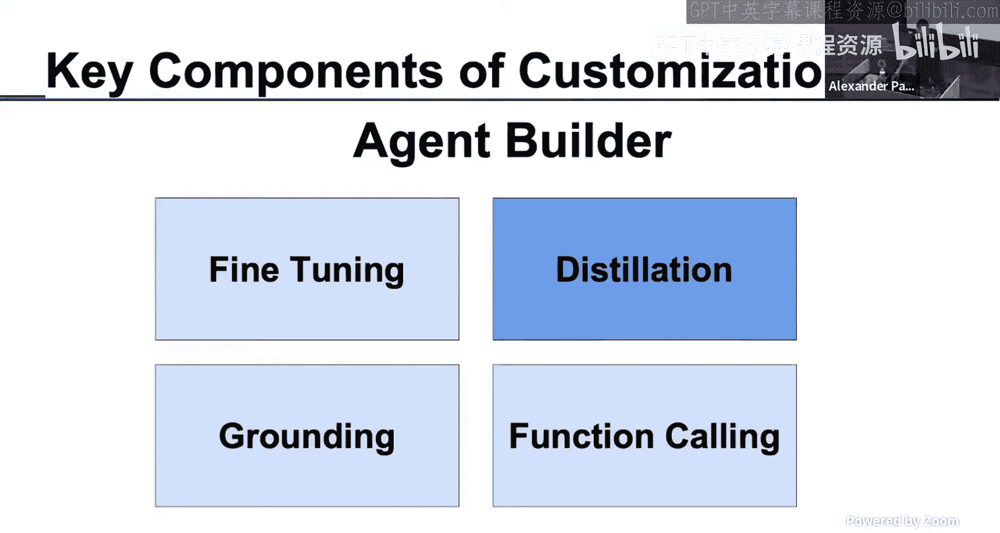

Indeed， huge models usually mean higher cost and higher latency。

 so for many applications actually you want less latency。

So thislation usually comes to your help here and we'll look at one algorithm here。

 I'm not going to go into like some of the you know historical other advancements。

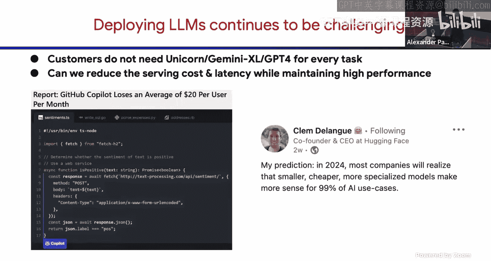

But a typical approach that people use here is a teacher and a student model。

And the teacher is trying to give you answers on a set of training data that you have。

And and the student model is is learning from from that。 The alternative would have been， let's say。

You have a classification task and you have。Millions of data samples。

You probably would have needed to label them。Which we call hard labels。

 a human usually would need to do that， and then you can probably train a student model。

Based on that， it could be a small model as well。As you might guess。

 it's actually pretty closely just to label。Instead。

 a typical approach is you might still label a few or some。

But you will typically give that training data to a teacher model， a very large model。

Which is great in reasoning。Assume it's good， and it essentially helps generating labels。

And there are various techniques for it and I will mention just a few thoughts about that as well。

 it could be even soft labels。😊，And then you get your predictions from a smaller model。

 you start a smaller model， and you start tuning or changing the weights of that smaller model based on your loss function of how much you're able to guess the answers from the teachers teachers's answers。

But when I describe it that you realize immediately， oh， I do not need to create lots of labels。

 the teacher model is doing that for me。So that's why we see many people use this technique when it comes to distillation or generating much smaller models。

And。I think one approach， let's say this is a similarity problem or classification problem。

 let's say it could be an image similarity， and with the salt Max activation function。

 you turn the output players outputs of potentially similarity between。

 in this case images into probabilities。Now this function is very common。

 the issue is that as you see in this example it put almost all of the probability into the first one。

 so many people have used various techniques and one of them is a temperature and in this function as you increase the T temperature you would actually smooth an art that probability more and more and the idea is you're really creating soft labels and if I go back to the algorithm that I was verbally explaining is that the teacher model is getting this soft labels the student model is getting these soft predictions which is again a vector of potential matching and the loss function put them back propagate into changing the weight you could also do that with the heart predictions by the way it's just that you need to get the labels。

 you need to get the heart predictions which which is a timely process and sometimes you do both。

All right， so let's maybe look at a little bit on grounding too。

 I think I mentioned this why grounding is needed lumps being trained in the past。

 hallucination and ksite sources。And we've seen many approaches being taken here。 So first of all。

 making sure you provide the right context to the large language models and through a retrieval algorithm。

You could， for instance， use the web search to be able to imp parallel to the LLM to be able to get the data。

 and then you can potentially use a search engine which meta enterprises private data as well and then combine the combined tool。

嗯。With hallucination and factctuaity， another approach that we see many people take。

 and we sort looked at Google as well。Is looking into generating better models that are getting better in factuality。

And this comes in a little bit expensean of reasoning capability as well。

 but I think many enterprises would prefer that。And then user experience actually becomes important as well。

 you want your results to be authoritative， you want to be able to show where the sources of the data is or the results that you're generating。

So in the right context， as I said， could be anything。Anywhere from private documents。

 anywhere from fresh content of in the on web or other authoritative documents as well。

 and this could be from。Tur party sources that are making their data available。And then it's typical。

Of course， people refer to some of this as RA as well。

 a typical way to do it is you would get a query or a prompt。

And then you would convert that into a query that you can it into a retrieval engine or a search engine。

You would get the results。And then you will。Tell your large language model， hey。

 here is the result that I'm getting。😊，When I ask a search engine about this， and here's the query。

Now taking also this results into account， what would you say？

So that's a typical approach that we we're seeing， of course。

 lots of details like how do you take a prompt and convert it into a query like a query to a retrieval engine research engine and then。

Once we get to results， how exactly create a new prompt to be able to give to the large language models as well？

And I'm not going to go into the details of this as we're running out of time。

 but you might also want to get the results and do another post processing to really check the citations one again and be able to really be sure about your answers as well as you're combining search and large language models。

I mentioned about better models。Very typical people would to use reinforcement learning with human feedback and potentially AI feedback as well。

 like we could use a very large model to do the thumbs up and thumbs down as well。

 designing a reward model to highly punish ungrounded responses。

And creating a loss function to be able to feedback and I will I think I'm guessing a bit cr from any large language model producers to go more and more into factuality in the next few months。

 maybe six months， 12 months because many use cases you definitely want to be in the you know more on the factual side than a reasoning or creative side。

 there is usually a little bit of a cost or tradeoff between the two。Allright。

And then I think user experience， depending on the use case。

 we see lots of customers using the various tools all the way from， okay， like in a response。

 looking at the sources， how many supporting sources there are。

 how many you know contradicting sources there are， and based on that。

 maybe refining the refining the answer as well。But in general， being able to cite the sources。

Has been something that many enterprises have been asking for again and again。

And I think even on Vertex AI， we took this approach where you have grounding with Google search。

 grounding on an enterprise data， grounding on movies or Thompson Reuters like third party data。

And having a model that's like we call it grounding with high fidelity。

 which is it's actually a model not even combining with a s， but much more factually trained。

And of course。On top of all of that， and this is an interesting concept。

Remember I mentioned the cost of alarms are going down。

 we do not see that trend as much in search in general。

 like there are lots of search engines out there where the cost of an API call has been constant for a while for years so。

This requires a concept of dynamic retrieval being able to really understand intelligently when you want to combine with a search engine versus not so that's also another trend that we're seeing again if you're looking into ted work startups。

This was another idea being able to intelligently understand。

What to do based on an LLM response like a dynamically understands you need to call a search engine。

 but as we will see the next section on function calling being able to call a function。

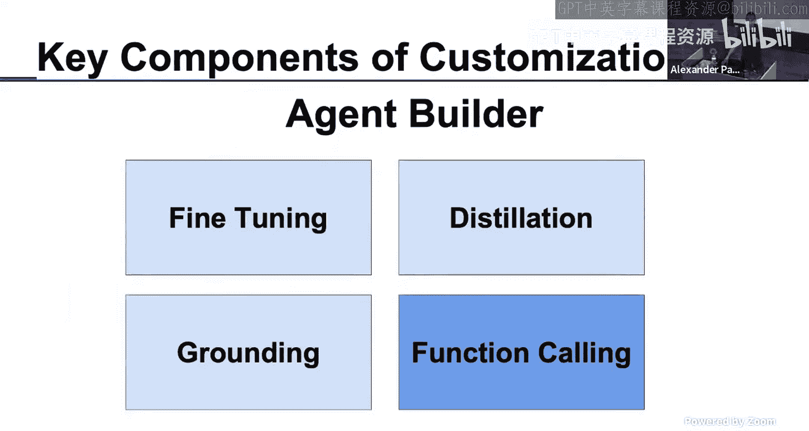

All right， you probably have all used large language models。

 you come across many things where you're not getting the results that you want。

 or especially if you want the large language models to do something。Give the schedule of trains。

 give like maybe buy a product。There are many things that you just cannot do change something in an health record of a patient。

 change something in an employee record。Those are the type of things a large language model cannot do large language model is great in getting information。

 but it's not great in taking actions， we call it real world actions with them。I would say。

Punction calling as well as grounding combined like helps with many many of those。啊。

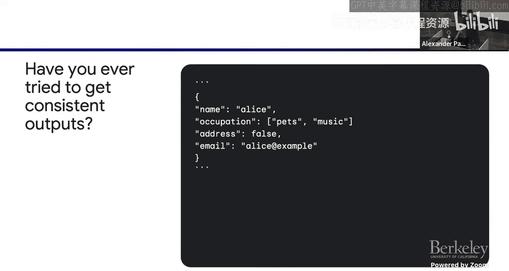

But。Some of these limitations we have seen， when it comes to function calling。

 I think the biggest limitation I would say of large language models is being able to take these actions and for many applications you would need to be able to take these actions。

And I think you've got into some issues and you've done lots of workaround。But maybe in this slide。

 I'm going fast now because I want to have some time for questions as well。

I think there are multiple steps， like three easy steps， I would say。Defining your functions。

 first of all， like let's say you're a travel company。Creating an extension or a function that does。

 you know， looks at flight schedules， looks at flight bookings。Hotel bookings， et cetera。

 and you can have a different function for each one of them。And then。

You like either Gemini or an anthropic model or an open AI model。There's lots of work going on。

To make large language models understand that， okay， I cannot do this。

And then be able to choose from the functions， the available functions。

To be able to call them when needed。And then I think in the inference time。

 that's exactly what the large bridge model would do， there is something that I cannot do。

 I cannot book a light， or I need to find an extension。

 here's my extension library with 10 different extensions。

 okay expedias the right one to call to be able to do this。

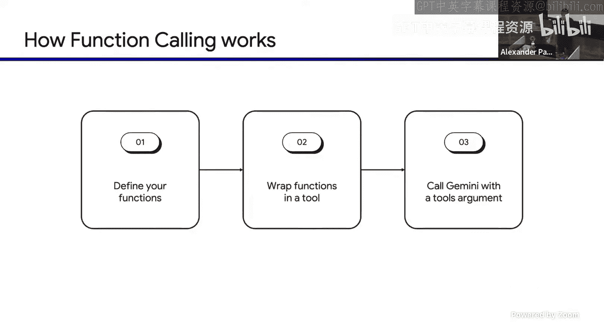

And I think this roughly describes what I said in a bit more technical terms。But诶。

Like this is also how it works with Gemini as well。

 I think as a tool provider it's important to be able to provide the ability to your customers to provide your extensions and functions so that your library of extensions are constantly growing。

 but at the same time you need to constantly put on work on your large language models as well to be able to get better in understanding when it needs to call an extension and also you know which extension to call it only becomes more challenging over time because people are adding more and more extensions。

That means now the library of extensions is extending and you need to be even smarter to be able to choose the right extension for the things that you want to do。

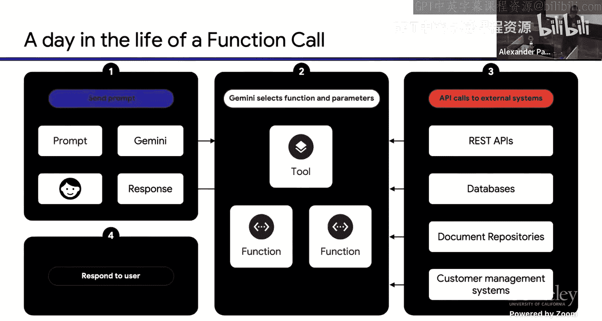

All right， I think with that you can do lots of things all a sudden like you could say get structured outputposts。

 you know， real time information retrieval。You can you can get， for instance。

 if you're a customer agent， you can get your customer's data， you can get a customer's bill。

 you can have you know tools for your employees， you can book a hotel or a flight or buy a product。

 you can do lots of things once you have function calling enabled。

Essentially the function calling extensions。Make large language portals。 be able to。

Many more things in life and in applications， rather than just being able to provide you the data and information。

All right， now I mentioned many tools， but there are many other tools that you really need to be able to build successful agents and applications like you need to。

Be able to have a great prompt management system like store da， have a revision history。

 even being able to convert a prompt from one large language model。

 potential to another language model as well。And I think I mentioned as you give more choice and availability to these large language models。

Something very important is evolution。And I will mention a very important trend that we are seeing here as well。

 which is providing evaluation tools for for。Lge language models or other tasks。

 and in Verertex AI we have multiple of them but I think the auto side by side is a really important concept and you will see a growing trend and this might be another idea for you again for your Tsis work etc。

 to use larger models like the largest model possible for rating purposes。Indeed。

 there is a shortage of human in the world right now for all the rating classification work that needs to happen。

 and we're definitely seeing a trend towards doing some of it with。

You know actual large language models that that are large and have very good reasoning capabilities。

 the other side by side tool that that we also have has exactly that you can run multiple large language models and then you can ask a very large model。

To rate them and decide which one is better interestingly enough。

 you're seeing a significant correlation and I think there's lots of work going on across many companies as well with these large models assessing these tasks and a human assessing these tasks as well。

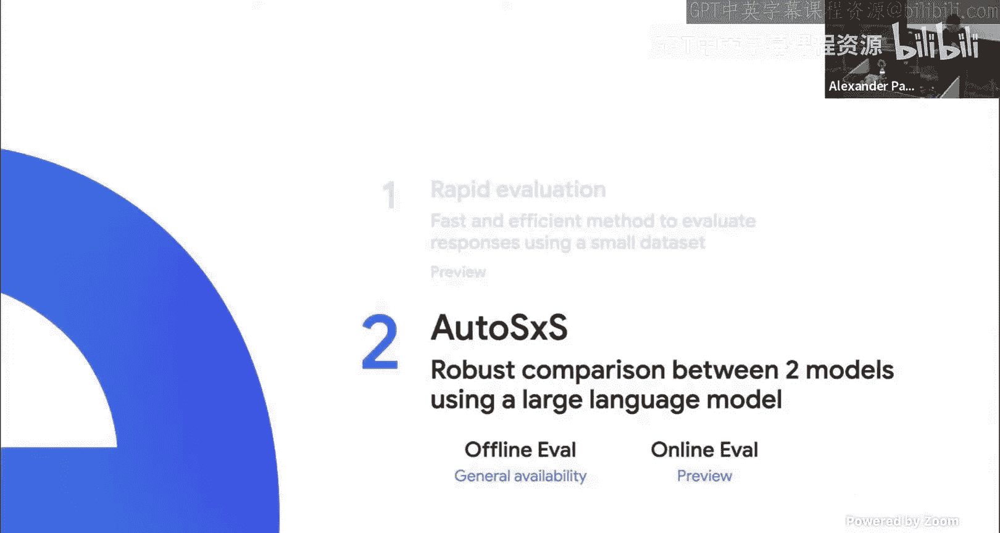

So， with that。Maybe I mean these are some of the announcements that we've done actually last week。

 these are all public announcements and I think different companies are seeing a very similar trend。

 maybe one thing to remember is that we're seeing a huge exponential growth everywhere in AI in the world right now。

Just a few numbers that we published last week is。Just this year in enterprise world only just for companies。

 I think from January to August， about 26 times growth。On the API course。

Or a business it usually takes between five and 10 years to get this type of a growth。

 this is not even one year， half a year， and then you would say， wow。

 this was a very successful business。So the amount of growth that I think all of these AI companies are seeing is just something that no one has seen before。

 I think if you want to remember one thing a， you're in the right place right now because you have a huge interest in this。

嗯。And B， I think the trend is is going to continue and like try to be as involved with AI as possible。

 but alsoed like many students come to me， okay， what should I study， in addition to AI。

 maybeed components of you know， other sciences or humanity art。

Something also that brings in some creativity as well to your mind too。

 I think that's going to be really important， even how the program a few years from now is going to be very different than how we are doing it。

 how we are doing it today and creativity and forcing your creative part of your part of your brain is going to be super valuable for you as well。

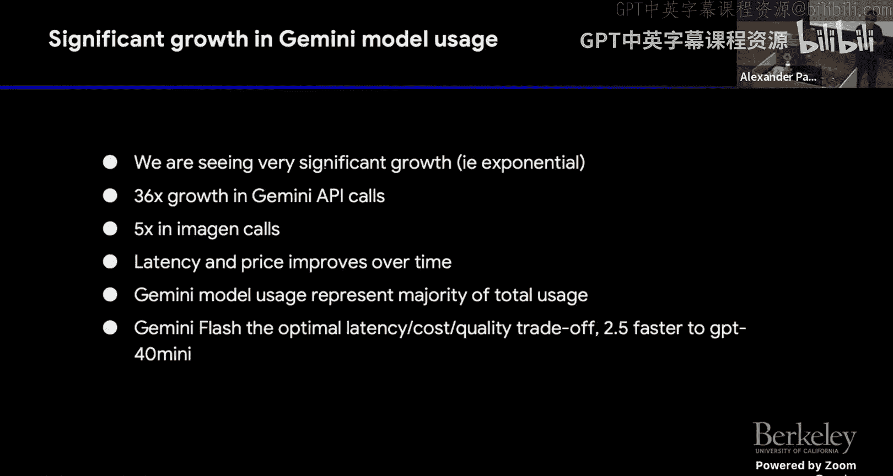