# UCB《大语言模型智能体｜UCB CS 194 294-196 (LLM Agents) 2024》中英字幕（Claude-3.5-sonnet翻译） - P5：Lecture 5, Omar Khattab.zh_en - GPT中英字幕课程资源 - BV1RsZPYsEtE

This is work with a very large number of people over 200 contributors and I include a lot of slides adapted from a couple of these folks。

 Krista and Michael so the context of this lecture is that it's never been easier as we're all aware to build really impressive AI demos and pretty obviously one of the best examples of this is none other than chatd GT is this one interface where you can ask just about any questions that come to your mind and not only will the system find answers that suit your questions it will synthesize them on the flyaw conversationally now we're all taking that for granted but let's just marvel how amazing that is now what makes it really cool and a big step forward compared to before is that it could also help us with tasks so I have here an example of me asking chatd GT to help with a piece of code I'm asking it to parallellyze sequential Python loop I had。

No， you know， and it does exactly as I ask。Now at this stage we're all extremely familiar with the primary weakness of these language models。

 which is in some sense precisely their key strength。

 which is that they are so fluent in fact that when they make mistakes they can be incredibly to incredibly hard to detect so Stanford was not founded in 1891 although it's close maybe using that example at Berkeley's weird but anyway and the whole reason I asked for help with this piece of code was that you I wanted to avoid data races。

 so when I was given a piece of code that simply naively parallellyzized the code and had a bug in it。

 I was glad I didn't trust that model and you didn't simply plug in this code into my code base。😡。

So the big picture here is that even though it's incredibly easy to build impressive demos。

 turning monolithic language models into reliable AI systems remains really hard。

 and that's what the rest of this talk will focus on。😡。

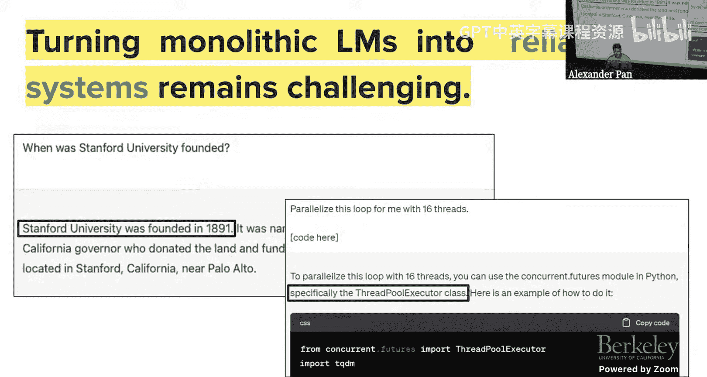

Now these are not just problems， you， you see in your kind of personal interactions with a chat bot。

 these have real implications all over the place and that's just one example of this happening in practice。

😡。

Now I'm not saying Chad GPT is bad or language models are bad because it made a mistake or two what I'm saying though and that's because every AI system and everything we'll talk about today will always make mistakes what I'm saying though is that fundamentally the monolithic nature of language models makes them particularly hard to control when we are building systems to debug when they do make mistakes and to improve when we want to iterate on the development of our systems and increasingly the way people are tackling this as we had in the title of the lecture is by building compound AI systems so if you haven't heard of this term before。

 it just means modular systems or modular programs in which language models are not serving as the user facing endto- end system but they' actually playing specialized modular roles inside this bigger architecture。

😡，So， you know， a very familiar example of that that I'm sure sort of prior talks discussed a lot in this class is retrieval augmented systems。

😡，So， you know， instead of building a system that takes a question like this and just gives it to your monolithic language model。

 just a black box deep neural network， and basically hopes that the system does the right thing。

 you might break it down into smaller pieces where you have a retrieval model。

 consult a massive corpus with the question as a search query， retrieve the top K。

 you most relevant results， feed those as context to the language model。

 and then basically prompt the model to use the information there and cite it in its answer。😡。

Now there are lots of reasons that might be attractive， one of those is transparency。😡。

This system might still make mistakes or it might say the right thing。

 but either way we can always inspect sort of the trace of the system behavior。

 see what it retrieved and see why it generated you know the information it did that would help us see when it's right you know it says something justified based on a citation that's factual it could also help us see when it's wrong for example it made an incorrect inference based on a relevant piece of information or maybe it simply retrieve something irrelevant and extrapolated in a weird way。

😡，There's another reason this is really attractive which is that you a system like this can be a lot more efficient。

 it has more steps for sure， but now the language model does not necessarily need to know everything about all topics because we've sort of offloaded that knowledge and a lot of that like basically step bystep control flow either to a knowledge base from which we're retrieving or to simply a program that is executing these steps so we've gained a lot from having these sort of this compositional approach。

😡，Another example of a compound AI system beyond drag and something slightly more sophisticated is taking that to the next step and asking。

 well， one of the biggest sort of powers of language models is that they are not limited to answering questions they've seen exactly before。

 they can sort of synthesize or compose information or at least that's us the hope。😡。

So this is exactly what a compound I system system that does multihop reasoning or multihop retrieval augmented generation would do。

 it's the fact that we can now take questions and instead of simply giving them to a dumb search engine we can ask our language model itself to act as a module that breaks down this question into little pieces finds information about HP and then basically returns that to the language model whose job is to then take you know whatever got retrieved and produce answers that maybe synthesize information in a more holistic way。

😡，What's really great about sort of company I systems continuing that line of thought is that we have a lot of control as the people building this system。

 you know you're not sort of bottlenecked at the next release of a language model。

 whether you're the one building it which might be unlikely or not。

 you actually have a lot of control over the development of your architecture and that allowed you to iterate much faster and to build systems like this system here。

 Baen that I built near the start of my PhD that do things that your individual language models at that time absolutely couldn't do。

😡，Another example is to take this and even another step further and to basically say could we have these systems generate longer reports like maybe articles with citations like a Wikipedia page and that's where maybe you could say something like write me an article on the Colbert retrieval model and a system like this which is storm from Stanford。

 could then basically have a lot of modular components that are at a much finer level of granularity so it could brainstorm it could generate outlines。

 it could revise these outlines， it could then basically ask a model to generate questions about each part of the outline retrieve sources synthesize information in a much more systematic way。

 than a simpler architecture would。😊，And what should agree here is that because we have sort of this ability to compose better scoped uses of our language models we can really it on the quality we get out of these systems。

 so it's much easier for the language model to take information that's given to it and synthesize something reasonable as opposed to maybe tackle a bigger problem of trying to sort of remember facts。

 for example， so by being able to manage all of these little compositions。

 we can do a lot more in terms of quality。😡，And lastly。

 the sort of final advantage of building these types of systems is inference time scaling。

 so basically if you have the language model， it's pretty clear at this point that if you intelligently spend more compute at test time so you have a question and you're trying to sort of leverage the language model maybe to search over a large space of potential paths。

 for example that that's something that can really help so an example of a compoundingI system where this really helps here is alpha codedium which basically is a system that is targeted at generating code。

 but instead of simply asking a model to produce a piece of code。

 it has all these steps in which it would for example reflect on the problem。

 reflect on public tests maybe exists for a given task that you have generate various solutions rank them based on their performance and then basically iterate from there and it's not unintuitive that this type of decomposition。

😊，which reflects the way you might instruct an intern or a friend or something to approach a task like this。

 it's not unintuitive that that can really help quite a bit and that's what this type of work shows and this something that keeps popping up in many。

 many， many applications in many cases also in task agnostic form in the form of methods that basically can scale compute independently of a particular task。

😡。

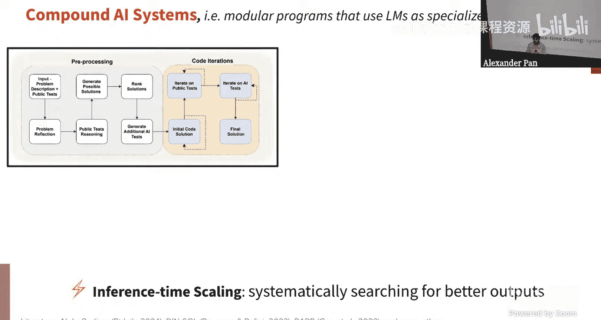

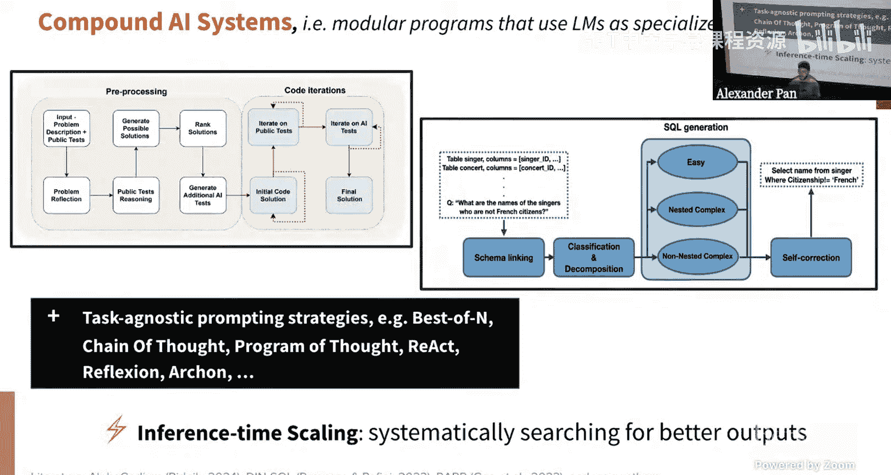

So we talked about how amazing compound AI systems are and how sort of they give us these five things from quality to control to transparency to inference time scaling。

 so they're awesome， but the problem is unfortunately we're working with highly limited modules at the end of the day our language models themselves are extremely sensitive to how you asked them to play these roles of these little things you're trying to compose and because of that under the hood these really beautiful diagrams we looked at they're typically implemented know and we're all guilty of this myself included。

 they're typically implemented with thousands of tokens of English or some other natural language trying to coerce a language model to play that role of each of these modules。

😡，And so this is something we see across all types of tasks where we're writing sort of tens of kilobytes of strings in J files。

 trying to define our language model systems。😊，And of course。

 if we could just do that and then succeed in a way that is sort of highly portable and in a way that's highly general。

 maybe it's fine， maybe it's a fine price to pay， but the problem is that it's not something that will generalize or sort of will systematically allow us to compose these systems。

😡。

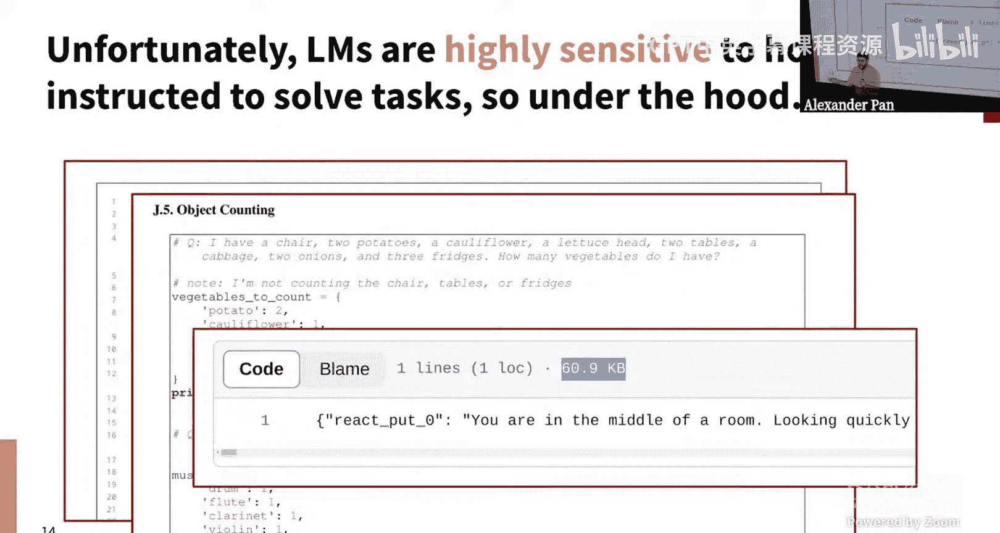

So the problem here at a high level is that each of these prompts implementing each of the modules we looked at is sort of coupling five different roles。

😡，So first role it's sort of trying to cover is the role of a signature。

 the role of like I want a function that's playing this module。

 and essentially it's just a specification of here are your inputs and here's what they mean and here's the transformation I want you to make to give me the outputs。

😡，It's also specifying the computation sort of that tries to specialize this signature with some kind of inference time strategy。

 so you might tell the model hey please think step by step or you might tell the model hey。

 you're an agent and you have these tools and you should call these tools and when you call them I'll intercept it I'll give you back the response or you might say something like you know I'll generate 10 different things and explore all of them with some kind of reward model for example so in all of these cases we're sort of expressing a lot of that in the prompt and in the code around the prompt。

😡，The prompt is also trying to sort of couple with all of that。

 the computation that's well formatting all of the inputs we want to give to this sort of function or the signature and is also encapsulating the logic for how we want to get several things and sort of parse them and cast them to the right types and maybe retrive they're not really formatted properly and all that stuff。

😡，It's also on top of that expressing， well the objective， you know you're not just telling。

 you know， you're not simply describing what the inputs and output behavior is。

 you're really also trying to encode and your' prompt a lot of information about do's and don'ts and basically what you're trying to maximize。

 you know be factual or don't hallucinate or you know don't cite pages that don't exist or whatever。

😡，And so you know that's essentially a different notion from simply declaring what that module is doing as we see in the diagrams and lastly for any given language model as we said they're super sensitive and these pipelines are really complex so you're going to see and practice that people work really hard to sort of coerce the model to basically do the right thing through a lot of trial and error in English or in some natural language and maybe there's also sort of fine tuning of the weights around that if you're doing a you a more advanced application。

😊。

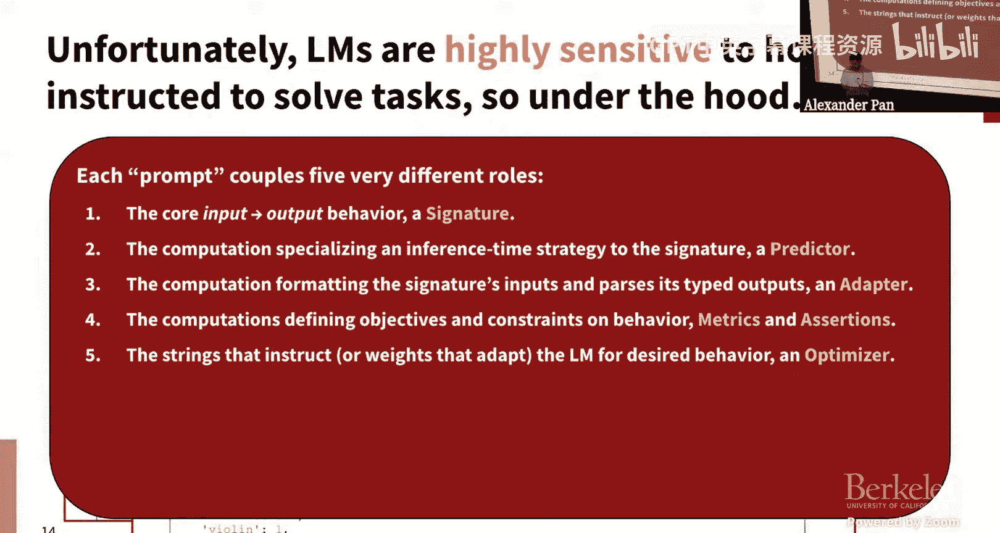

So the bigger picture here across these five roles is that existing compound AI systems are awesome。

 They have a lot of potential to be a linear modular and to sort of solve problems we can't solve with neural networks alone or with language models alone but the problem is theyre too stringly typed if you will they couple the fundamental architecture of the system design that the developer wants to express which nicely is the thing we see in the diagrams we saw of compound AI systems they couple that with incidental choices that are super specific to the specific pipeline you have or the language model choice you've made which are things that change all the time。

 So you have a pipeline that has five pieces you go in and you want to slightly change the objective or introduce a six module or maybe change the language model to a cheaper thing that just came out that is supposed to be as good good luck your entire sequence of thousands of words of prompts are basically irrelevant at that point and this is something that really blocks adoption in practice as well as portability of a lot of the cool systems we covered where people in。

for example， could approach you and say， well， we really love that paper。

 but it's clear that the prompts there were tuned sort of and developeded with a particular data set or benchmark in mind。

 that's not our use case， we have no visibility or clue how you decided to arrive at those prompts so we're basically practically unable to use the stuff you built。

😡，So an argument I'll be making today and I'll be relying on in the rest of this lecture is that we do know how to iteratively and controllably build systems and improve them in a modular way and that sort of elusive concept is called programming。

😡，So a lot of the rest of the talk will be about sort of this ambition of what if we could build compound AI systems as programs？

😡。

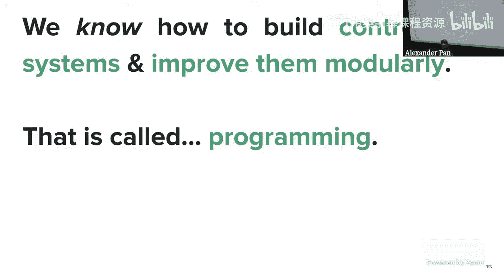

Just computer code， standard Python， but with fuzzy natural language functions or natural language modules that can learn their behavior from data so you're basically thinking of just writing code and then inserting these little pieces that are supposed to represent the boxes we saw earlier that are sort of exhibiting intelligent behavior and then you specify an objective and you have the system try to learn sort of behavior around the natural language specifications that you're putting around these modules if we could do that we could lose a lot of the problems that we saw with existing compound AI systems where you're not going to have to be writing these prompts you're going to be building a general design that could sort of be ported from a language model to another language model and in this analogy。

 the portability is sort of like working with with hardware if you write a piece of code in C on a certain CPU architecture and you move to a different CPU architecture a good compiler is going to take your same highlel C highle between codes and then compile it to potentially very different lower levell machine code on different。

😡，tectures that make sure that it works so here we want to sort of the ambition that we have is that we want to write code in higher level abstractions that are sort of independent as much as possible of these lowle details of how to get a language model to do the thing you wanted to do and then we're going to build compilers or optimizers that take that and spit out specific sort of strategies for working on a given in a given infrastructure which in this case means a language model or other things so these are some of the systems we saw earlier and so the approach that we will take sort of to where this is called DSpi someone said I think Alex said data science Python it has nothing to do with data science a long story but DSs is declaratively self-imping declaratively self-improving Python so it's Python but it's smarter。

😊。

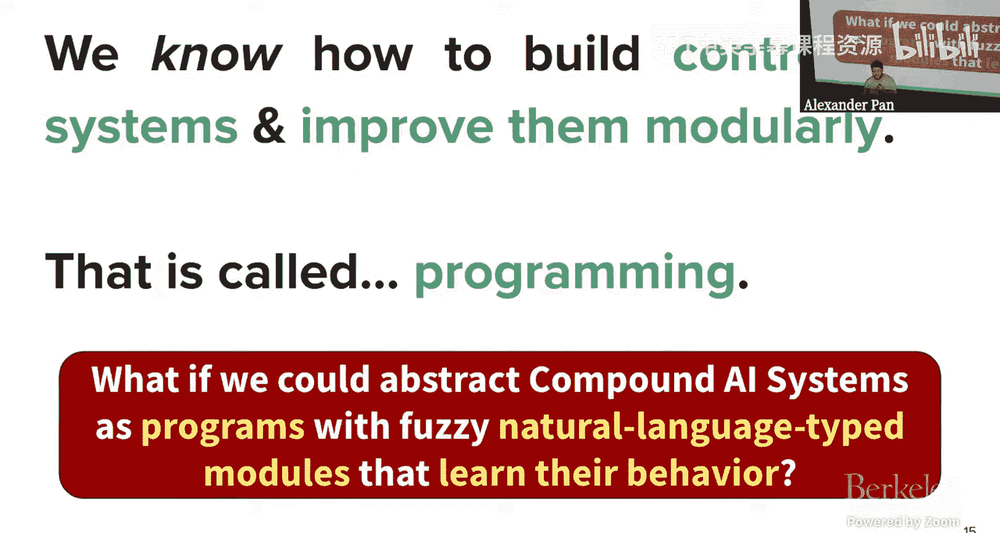

And the way in which we're going to do this is we are going to say， well。

 let's define this thing called the language model program。

 which is just a Python program just a Python class or function and in that function you know it's going to take it's a function that takes inputs in natural language maybe a question that we want to answer or maybe like a report we want to summarize or a topic we want to generate I don't know an email about or something and the output is also a natural language。

 maybe the answer or the report or the email or whatever it is and maybe the output could be several pieces of these and what makes this interesting as a function is that in the normal course of its execution its just kind of loops and exceptions and goto statements and all the things you shouldn't use and all that stuff but in the course of its execution it's calling these functions that are modules that are fuzzy so it's basically making calls like hey generate a search query for me or turn this natural language into SQL or whatever it is it's making these kind of like highlevel natural language claims which look like problems but they are sort of。

Much more structure than much shorter， because they are only expressing of the stuff that you need to declare。

 like what is the actual behavior， not how should the model do it。😡。

So we have this function in which it's a course of execution。

 it's calling these modules and each module is basically defined by simply a declaration of what it should do。

 what inputs it takes and what outputs it produce， it produces。

 usually it hass one liner basically in many cases。😊。

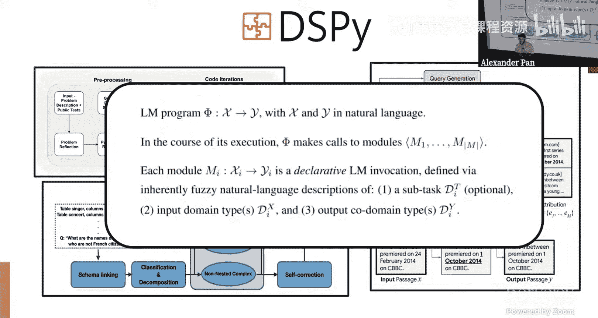

So here's an example of an actual sub sort of simple DSpyy run I put before the talk。

 so basically you can say I want the fact checking module。

 you know before that there might be like loops and exceptions and。😡。

Commented out code and all sorts of mess and then you have basically you know I want to apply a chain of thoughts strategy over this function signature that says I want you to take a set of claims and give me a list of bulloleans that is the verdict of are these claims true or not and then I get a module that's this function I can give it a list of claims and it can basically think and then I can tell me well the first one is true and the second one is false right so so far this is basically just kind of an interface of a function that is declared you with natural language types we're basically just saying you know the keywords here are not special but I can understand them because I understand English as a language model and I can sort of see that okay the verdicts here is going to sort of suggest that probably until I optimize this or learn somehow you know this is a true statement and Python is not a compile language and standard usage so this basically defines for us an optimization problem under the hood which is basically you're given this set of module。

in our program that your program calls and for every module。

 our goal is going to be to sort of basically decide how should we take this call and actually call the language model。

 which means coming up with the string that goes into the model。

 which might be a lot more you so or just very different from how it looked at the specification level we saw earlier in the signature the other thing we also can control in some cases。

 although we're not cover a lot of that today is well you know what are sort of the weight settings that we want to assign our language model。

 you know in the sense of if we want to fine tune the model to sort of perform better at our task。😡。

So you the idea is now we have this function with all these modules and if you can give me a training set of inputs to that function。

 and maybe some kind of hint or find a label or some kind of metadata。

 I should be able to basically try to find the settings of the prompts and the weights such that on average or an expectation some kind of metric of calling the program with modules assigned in this way is maximized。

😡，That's the optimization problem that we will be dealing with you know once someone writes a program in an abstraction that could support this type of behavior which is DS expY Now you know the problem here is that this is really hard so we don't have and we're not asking anywhere for you know gradients across the system system might generate code and execute it it might call external tools it might run a calculator so we don't necessarily know how to optimize a system like this certainly not not directly with gradients and we can't sort of like cheat and trying to optimize each module on its own because we are not in general asking for labels for every step of the system if we were to ask for labels for every step of the system the whole argument about iterative development and modularity would collapse because I added a module and now you're asking me to go labels some data whereas the ideal sort of development cycle that we want is that you're building a system you notice a need you notice a need to add a module of some。

or you want to experiment， you just inject it， you decompile。

 you see what happens and see if your system is better or not。

 so basically we can't assume the existence of labels for each of these modules。😡。

So that's a problem because it's not obvious how to go about sort of optimizing this。

 and that's one of the things we'll talk about in the rest of these slides。😡。

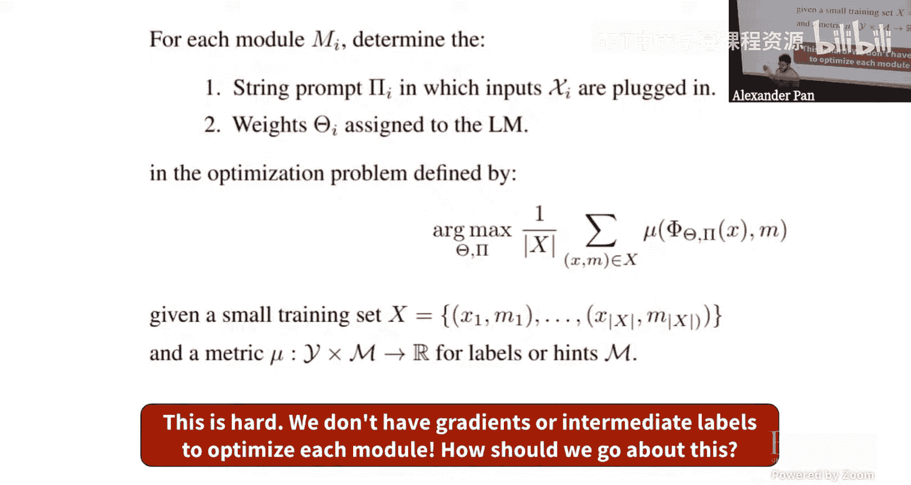

And let's take a concrete example here so that the rest of this sort of is developed in a way we can we can follow。

 So suppose that。We wanted to build this simple multihop retrieval augmented generation pipeline and have it in visual form here。

 although the DSP code is basically the same you know it's a function that takes a question which is a string and it's going output an answer which is also a string and in that function the last step is this question that we got with some context we want to give it to a language model in some way and basically have it generate our answer but the question is how do we get this context so the multihop thing here is that we will have a loop maybe the loop would be smarter it could like decide to stop or something but for now we're just hard code that it goes twice and in every iteration will ask our language model to take whatever context we built up so far which is empty at the beginning。

 generate a search query， take this queryie dump it into the context。

 maybe aend or something and then basically we can loop again so that the system is generating  queryries to seek things that we haven't found so far so a question that would come up in in the scope would be something。

😊，Like I don't know how many floors are in the castle that David Gregggory inherited an example I like to use so the first queryie you might ask is well who is David Gregory and then you might learn that he's a Scottish guy from I don't know the 1600s or something and that he inherited the castle called Kennadi Castle then you might ask well how many floors are inkenarddi Castle given that the original question who's trying to seek that and sort of that gives you the behavior that we're seeing here in terms of the multihop behavior。

😡。

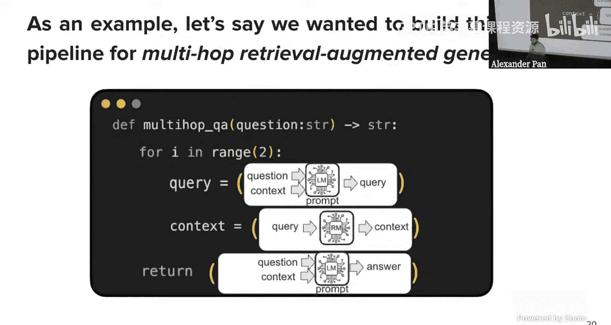

So that sort of visual function can be written in DSP code like here。

 we're not going to look at too much code， but this is just a module。

 if you're familiar with something like Pytorch or just keeping our networks in general。

 we're kind of borrowing some of the syntax but in this module we're going to have an initialization sort of method that just declares the submodles that we have in our compound AI system。

 so we're going to have a sort of a chain of thoughts strategy。

 express our sort of signature that says you take some context。

 you take a question and we generate the search query and all of these are strings so we're not telling you their strings because that's a default。

😡，And then there's another module that takes the same inputs or same types of inputs and generates an answer now the sort of part of your code that is the actual sort of program logic is here where you are simply just you know the loop we saw that in the last slide can sort of be expressed。

😡，So that's the forward method can define the program logic that we have。

We talked about signatures so they are telling the system what the module should do as opposed to working really hard with a certain language model as to how it should express that behavior。

😡，And the modules， as we said， you know， there are many sort of strategies to。

Spend compute you know given the language model to sort of define a general sort of approach to take a signature and actually express it in terms of course to a language model and those sort of help you know improve quality in many settings so they are sort of heuristic that you can apply very similar to layers in neural networks so i'll go sort of an attention here and say like。

😊，You could， if you want， and this is sort of like if that's this is not essential to understanding the rest of the talk。

 but sort of intuitively， you could think of this as。😡。

These are normally chain of thought or other things。

 just conceptual things that you can't actually compose because the chain of thought in the original paper。

 which is super cool， is basically just a bunch of prompts they wrote for individual tasks So for answering math questions you write some examples and you ask them all to do stuff You can apply to a different task you got to write different prompts。

 but we're saying here is why can't we borrow from layers and neural networks where you give them dimensions that sort of just describe what types of types of tensors they can accept and what types of tensors they give you and then have that behavior be expressed So in a neural network architecture you could say I want attention that takes the following sort of。

Vectctors and gives me those other vectors and sort of you could have that or you could have an rN do this or a linear layer or convolution or whatever。

 So similarly here， we're asking why can't we take these sort of inference strategies and make them general in a sort of meta programminggram sense and sort of define define them over these signatures and have them express that behavior in a general way that can be composed awesome So the question here is this is the abstraction。

 This is how you write the program， how do you actually sort what are we supposed to do so this actually works as a system because it looks pretty to me it looks pretty。

 maybe not everybody， but to me this looks really elegant But the question is how do we take this and actually sort of give you a system that you could actually deploy and that you're happy way and it on and all that So iterating on it is easy because you could come in and like add one more module at if statement throw an exception and catch it and you could do all kinds of things But the question is really how do we sort of translate these strategies with signatures into actual prompts under the hood。

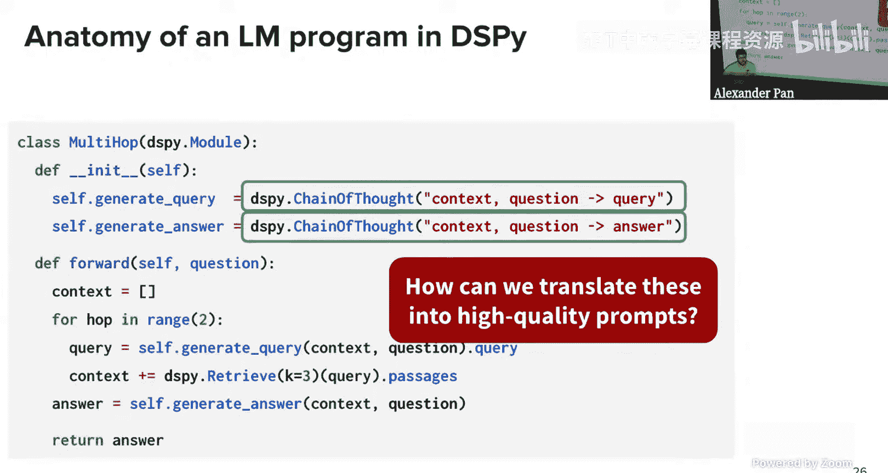

So you can take this here and the very first step is pretty trivial。

 although it's important to do it right， which is that sort of internally we can sort of translate this into a basic prompt one that will not necessarily work really well or anything there's no guarantees about it through sort of built in adapters and predictors so predictors are just this guy which is basically another module that has some logic inside and really what it does。

😊，Fundamentally is it adds one more outputs here， another field here that asks for reasoning。

 but the adapter is going to take this guy and is going to say well depending on how you implement it or which one you choose or whatever。

 it's going to say， well I have a model here that's maybe a chat model or maybe it's an instruct model and I want to sort of format these fields in a certain way just to kickstar the process。

😡，So it's going to basically give us a basic prompt under the hood that's something like hey。

 give a field context and question， you know give me a query and here's the format you want to follow because I want to be able to parse the stuff that you give me nothing about this is going to work particularly well。

 but it's going to get us started。😡，Now the role of optimizers on top of this。

 which is sort of a different component， many algorithms will discuss is to take this initial prompt and to take the whole program in which there are many of these modules。

 many of these prompts， and to sort of look at them as parameters or look at them as like having a lot of variables that we can tinker with and figure out how to maximize sort of the metric that we saw in the objective we wanted to maximize a few slides ago。

😊，So we might start here and maybe the system would perform I mean at 37% accuracy on a given strict metric。

 so the actual quality might be a bit higher， but let's say this is something that has you know we're trying to sort of have a metric that's highly precise but has somewhat lower the and we might then basically just ask hey。

 I like the Mi Pro V2 optimize it in DSP much the same way as in a neural network sort of situation you might say I like Adam or I like I don't know RMS Pro。

😊，You give it some data， you give it the program， you give it a metric。

 and you ask it to do a good job， and it spits out a better prompt。

 maybe fancier instructions and gives it some examples。

 sort ofs them into the prompt of one of the modules or several of the modules such that the quality is substantially higher。

😡。

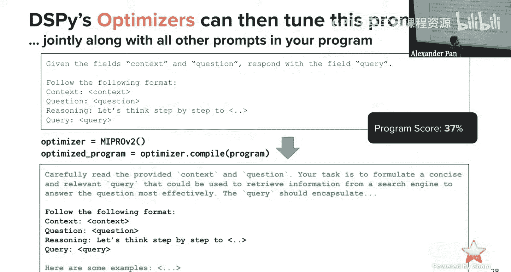

So you know， on a certain real task sort of， instead of tweaking you know。

 2000 tokens of prompts that look something like this and you know at the end of the day。

 sort of getting an accuracy like 33% with a certain model from open AI。

We can sort of explore a much larger design space and get higher scores in interesting ways you know through these compositions。

 so let's look at sort of a results table here on the multihop question answering tasks that we've been sort of using as a running example。

😊，The simplest thing you could do in DSPI or sort of just when you're thinking about a compounding I system is trivial is the trivial compounding I system that's not actually compound in which you just asked the system to take the input and just predict the output and you don't bother optimizing it so if you do that sort we did this a while back this is exactly a year ago this result you can get GPT3。

5 to perform you sort of at this level and a Lama2 model sort of is a little bit behind。😡。

But you could say， well， we know that a decomposition like RA could help。

 especially that this is a factual task we're answering questions。😡。

So you could do a right system and the interesting thing is well we could also try running one of the optimizers that we'll talk about in a minute and what you start seeing is the cool thing that already a small model can start to perform better than a larger model with a sort of simpler architecture or even with a sophisticated architecture without optimization。

 but the large model can preserve a lot of its advantage here as well。😊。

Now you could iterate on your program and build a multihop compounding I system and there you can see that with optimization。

 you can boost the quality quite bit with large models as well as sort of with open models and with more recent models all these numbers are substantially higher nowadays。

😊，Now what's really cool， although we're not going to be able to spend a lot of time on that is the very same program that we wrote here。

 which is giving us all of these results across models and across sort of optimization decisions that we can make we can also use optimizers that sort of update the weights that do fine tuning。

 essentially a whole space of reinforcement learning is open in front of us and we can get very small models so sort of imit these bigger ones and we can have like a model beneath a billion parameters that's like many years old T5 is I don't know 2019 score competitively in fact better than close sort of at that time frontier models sort of on。

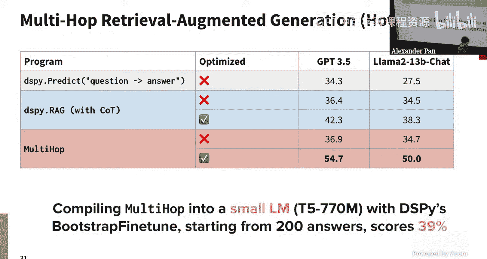

On the given task so question is that we will be looking at over the rest of the lecture is。

What are the what is the space of optimizes like and what are the interesting choices we can make and what works and what doesn't so in general there are too many ideas by optimizers to discuss today they vary in how they tune the prompts and weights in a program。

 but there is actually kind of a general pattern that you can see in many of them in most of them。😡。

The first thing is in general， as we saw earlier， are you going to for every module just guess an initial prompt and this is actually something in DSpi happening outside the optimizer in general is's happening through what we call the adapter that just sort of like takes your signature and makes a sort of a deterministic construction most of the time deterministic sometimes with the language model of what the initial prompt should look like。

😡，And then the next thing we'll do is rejection sampling。

 so we're going to take the inputs that you gave us sort of in your problem specification。

 maybe we'll raise the temperature of the language model。

 maybe we'll plug in a large model maybe we'll just keep the system simple and then we'll basically run through your program with these basic prompts to sort of try to collect trajectories throughout all of these steps that lead your metric to sort of assign high scores so you've basically given us this program。

 you've given us a bunch of inputs and you've given us a metric that can assess when things are good or bad maybe it's just checking if the answer is correct。

 or maybe it's asking a language model or maybe asking a DSI program to sort of evaluate the system on the rubric or any number of other design choices that you're allowed to sort experiment with so we're going to use those in order to basically start to collect traces of every module or examples of every module of its inputs and outputs when they're chained together sort of lead to high scores through through your metric。

We can then use these examples in a bunch of different ways to update the modules of your program The simplest thing you could think of is if you have examples of every module that have sort of proven to work in the past。

 it doesn't mean that they're correct， but it means that maybe there's some hope that they're useful the simplest thing you could do is try to stick them into the prompt as demonstrations as examples to just say hey when I got this input and I did this behavior it seemed to work pretty well in the past and know once you do that maybe you can actually start exploring well which of the examples and can we try to be intelligent about this or not which of these examples that we just built can be useful we actually taking this module plugging it into a program and getting the program to work better on a bunch of other examples。

😡，Another thing you can do is you could try to sort of induct instructions。

 you have a lot of examples of a module， you have a better sense of understanding of what the module should do and when that leads to good behavior and when that doesn't lead to good behavior and you can give those to a language model and ask basically you know what is the thing that we're trying to ask here and the thing to keep in mind is that in all of these cases language models are being used to build these components but we're not assuming that language models are good at it。

😡，Language models are going to give you 20 different things and you know 19 of them are going to suck。

 but because we can try so many and we can explore that space to varying levels of intelligence。

 we can basically strike gold fairly often and find the combination of these pieces that leads to better prompts in a way that is basically independent of a particular setup that you have so you could adjust your program or your language model choices。

 read on the system and have optimization happen。😡，And then of course， you could run， you know。

 once you build these examples， if you have enough of them， you。

 you could basically fine tune the model on them or do reinforcement learning。

 depending on how you're sampling or do preference fine tuning and other approaches there as well。So。

 you know there are various papers that we have that explore these types of strategies。

 the two ones I sort of requested in the suggested readings where sort of the one introducing Mipro and the one introducing a strategy for combining prompt optimization and fine tuning and the rest of the talk will be about。

😊，The Mi Pro， the Mi Pro paper。 So before we discuss Mipro。You know this stuff。

 this is sort of we discussed a sequence of abstractions and then sort of at a high level how a set of algorithms that we call optimizes take programs written with these abstractions and sort of give you compound AI systems that work well but you're expressing in a way that is sort of more portable and I think a lot more elegant but what's cool here is that these things actually work pretty well in practice so a few months ago University of Toronto researchers participated in this me competition against 15 other you schools and industry groups and whatnot and they won the competition in sort of building question and setting systems for medical domains by 20% by 20 point margin against the next best system and you one of the biggest differences between their approach and others is they use DSP to sort of express their system and they use DSP prompt optimizes they used an early version of Mipro in fact to achieve this result on three。

sort of won， three different settings of that competition， which had three settings。A month later。

 folks at the University of Maryland who also sort of whose lead author sort of is responsible was leading this prompting guide with I think like tens of thousands of users or more sort of worked on a suicide detection task that I believe he got from industry。

 the wrote really nice paper about it， he worked for 20 hours。

 they documented all of the sort of prompting strategies that he explored for building this system for suicide detection。

 basically it's a glorified classifier and you know he documented all the approaches he tried。

 the prompts he explored and then in his words he applied DSP in 10 minutes and it sort of outperformed his best system by 40 to 50%。

So they have a really nice paper about this from the University of Maryland and you know it has enabled sort of a lot of state of the art systems from Path for training retrieval models where we're optimizing prompts that synthesize the data that sort of is used to train small models under the hood。

 I think there's a lot of sort of interesting ideas there to Irera。

 which is a system for classifying with language models when you have like 50 labels but 10。

000 classes， which I thought was an impossible thing just didn makes sense for language models but Carl built this in DSP and sort of showed that it's possible and then storm which generates Wikipedia articles from a topic that you give it。

😊。

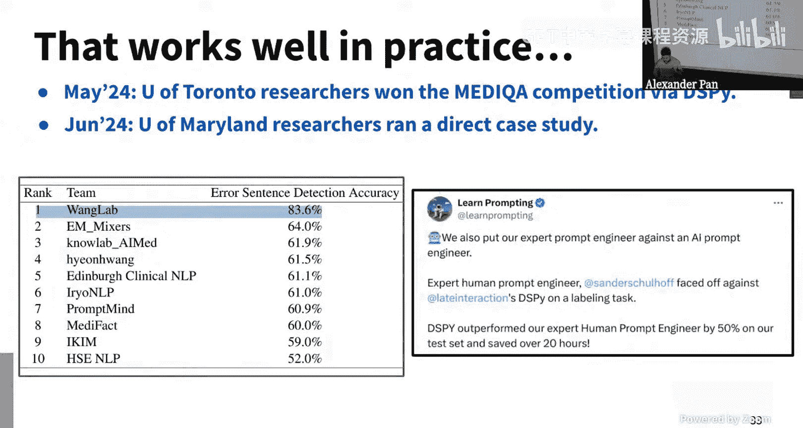

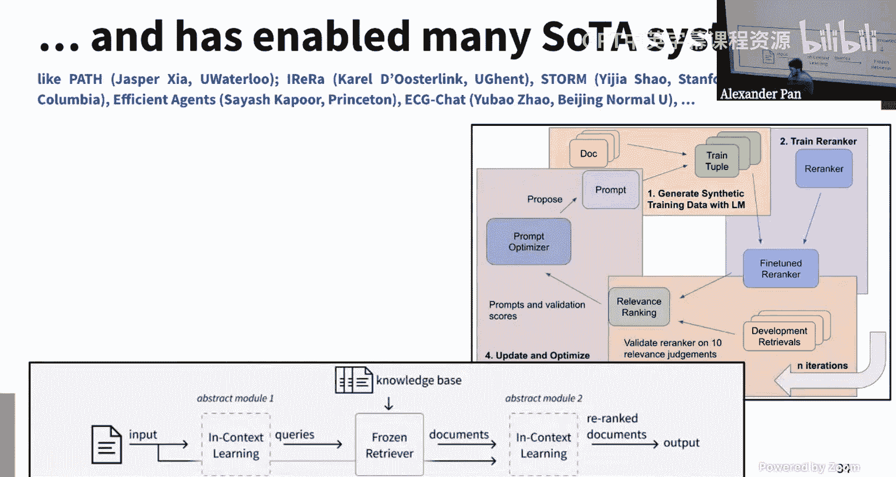

So now sort of having seen some of these examples， let's sort of look more closely at the paper optimizing instructions and demonstrations for multistage language model programs by Co first authors Krista Obselong and Michael Ryan at Stanford and a lot of the slides that I have next sort of are sort of borrowed from Krista and Michael。

You know， in the DSI work。So the problem setting just to rest it is we are given a bunch of inputs。

 examples of a task。😡，So maybe questions， let's say and we are given that you know the developer built language model program of the sort we discussed earlier just a function with a bunch of modules expressed in natural language and you know each of them might look like this so we looked at the content question give me an answer and it's kind of just trying to do this behavior。

I don't know if for example it's very useful at that point。

 but the Victorians is a documentary series written by an author born in what year？So， you know。

 maybe you want to answer that in 1950 by looking at context that you' had received in the earlier loop that they would have here。

We're also asking for a metric。Some metrics you know by nature require labels like for example here。

 if we know that the answer is 1950 we don't need labels for the whole thing but if we know the answer is 1950 evaluation is easy other times maybe the metric is like I don't actually know what the answer is but I want to get answers that are grounded in the context that got retrieved because I trust the context and if the answer is grounded in it and is relevant and that probably means it's correct that's a different metric that does not need labels so that are sort of a very large scope of things but it's really important that you're sort of explicitly defined what is it that you're trying to maximize and once you've done that you don't do this sort of as part of your prompts you do this in a way that's independent of your program so that you can explore sort of along both axes pretty modularly so that's something important that you should keep in mind and that abstract sort of really forces you to do that yeah so the goal is to give us an optimized language model program P prime by in the case of the the optimizes we look at next we're going to keep the weights frozen in fact we would assume we don't have access to them。

Instead， we are going to optimize instructions， so like the descriptions of the task that goes to the model as well as the demonstrations。

Wwhichch are sort of these few short examples to just show the model in the prompt。

 you know here are some inputs and here's the corresponding behavior we saw in the outputs that seem to work well in the past。

😡。

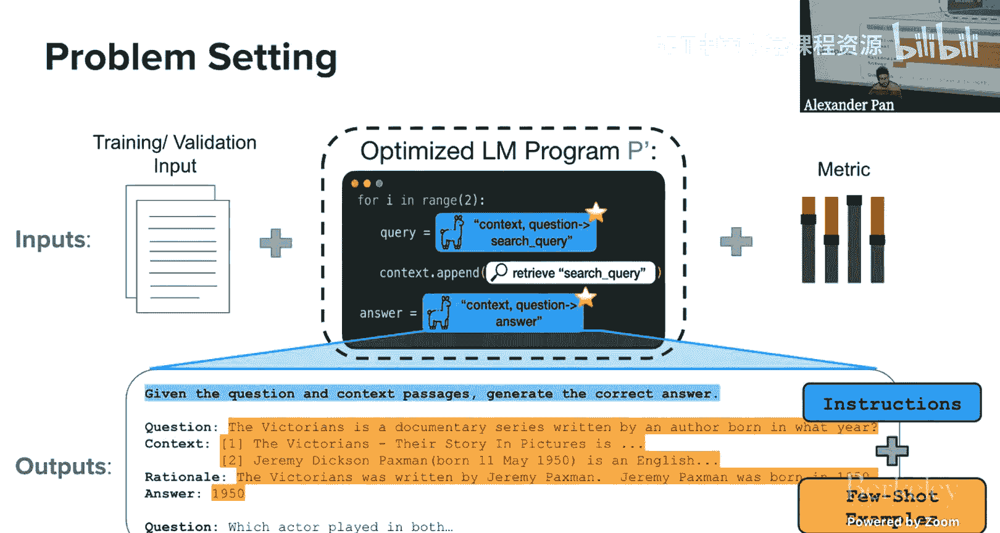

Some assumptions that we're making is that we don't want to。

Assume any access to you log probabilities or model weights because you want to iterate sort of fast。

 you want to work in natural language space with APIs that are high level we have a lot of work where we relax this assumption and we look at into fine tuning but that's sort of you know and actually we have work that shows you really need both to get the best performance in many cases。

 but if you had to pick one prompt optimization tends to be more powerful。

We also assume no intermediate metrics or labels as we said earlier。

 and we want to be very budget conscious， so we want to minimize two things we don't want to ask you for a lot of example inputs of your task because it's hard to create inputs although technically inputs is the easiest thing to scale because you can build the demo and then put in front of your friends and then you have a lot of inputs when they ask questions you know if your privacy policy allows you to do that but we don't want to sort of ask for a lot of inputs so maybe want 50 or a couple hundred know not tens of thousands for example and we don't want to call the language model too many times because it takes time where expensive etca。

 so these are the assumptions that we want to sort of or the constraints that we have on this problem。

Now there are two types of problems we want to tackle in general the first is that well what's a prompt like guess this long sort of combinatorial string and it's you know anything really goes it's all valid so how do you even explore the space especially if you don't have gradients and if you don't want to call the model too many times seems basically hopeless and the second problem is well if you have so many modules which is really this is kind of I think and even worse one when you combine that two together is you have so many modules you know and you're changing things all over the place how do you know what is leading to improvement or what's sort of hurting because these pieces interact you might improve the prompt in one part locally but actually hurts because the other part made an assumption about the output of the first part and now you sort of have to account for these types of。

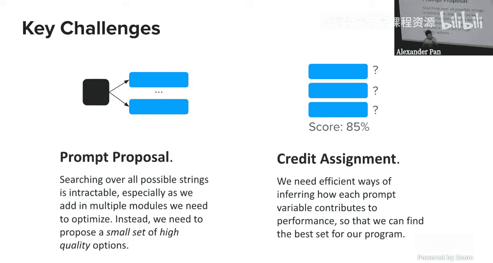

Blame assignment。So I'll sort of cover three methods。

 which is not exhausted by any stretch of the imagination， but these three are sort of like。😊。

Really good sort of different methods of tackling this problem So the simplest thing you could do in my opinion know is at least at least for the value it gives you is to sort of bootstrap or self-gene few short examples by running a dumb version of your program to build examples and then to plug them in and to search over that space and the cool thing is you can iterate that you can take the better program。

 build even better examples， you know build ensembles of them use larger modelss to build examples it's a very sort of large computationalal space but in a sort of simplest form you have the program you take a training input。

 you basically say like I'll execute the python in here some of these are just normal python return statements or loops or I don't know like you call codeexcutor or whatever but some of them are modules and so we sort they are special we're sort of tracking them and tracing their inputs and outputs and basically we say well you these things are generating search queries and generating answers and metric at the end ends up。

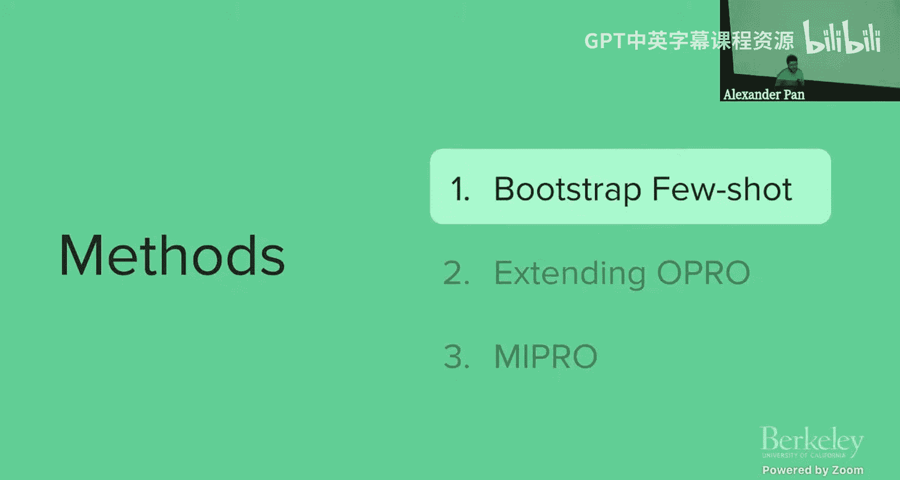

ing the answer and tells me that's good， well， that whole trajectory of like inputs and outputs seems interesting enough to keep it around。

😡，Now this can be a sort of a set of demonstrations of all our modules and we can simply basically say what if we take those。

 we plug into them， we plug them into the modules of our program and then we could do in the simplest case。

 just a random search， take a kind of a bag of our subset of these demonstrations。

 plug them into the respective three or four prompts and take that run it on a small validation set maybe could try to be smart about sort of how you're doing that evaluation and then basically look at that score and try to maximize that score。

 so that's sort of like you know I think the simplest successful thing you could try。

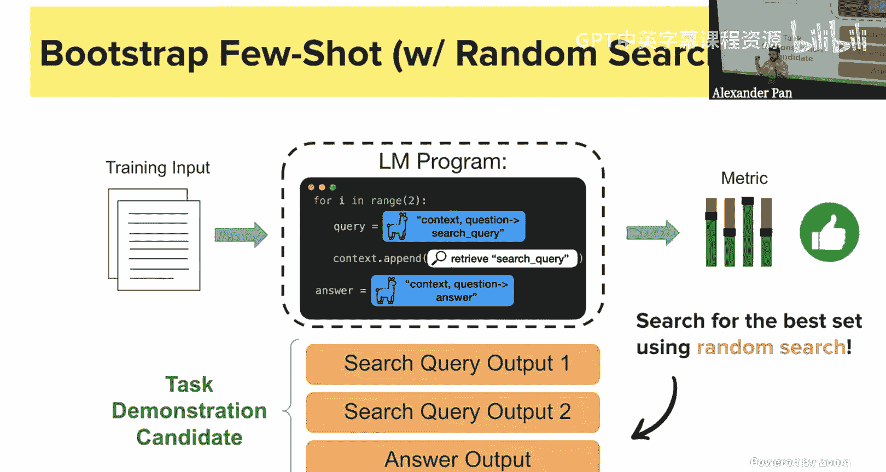

A different approach is to look into the prompt optimization literature not for language model programs but for language model calls and those folks sort of have a lot of rich sort of you know concurrent sort of research but under much stronger constraints so in the prompt optimization literature which is you know I mean these things are sort of of course morph and closer together but theys sort of pretty separately you are assuming that you have labels so you have inputs and outputs and it's one prompt that's the whole system there's no like program involved and you're assuming that sort of there's this little part like you know one liner somewhere that you want to search over and the space of this sort of exploration is very large people do all sorts of things from you know gradient- based exploration to other sort of forms of reinforcement learning and all types of stuff but one approach that's really cool and really high level is called optimization through prompting。

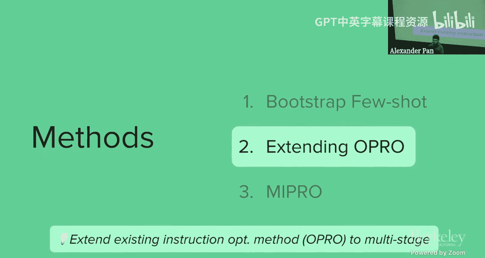

From Deep mindd and the way that works is basically they want to plug in a little prefix at the end of the prompt sort of to just get the model on the right track and so you know they start with think step by step but they want to end up at the end with like I don't know take a deep breathth and think step by step and they show that that could actually help some models do a lot better it's a much smaller sort of scope but it's an interesting space of what to explore and we want to sort of see if we could take this and apply it to language model programs with the weaker assumptions we have so you know the way Oppro works for a single prompt is they basically go to a model and say here is the original thing give me 10 variants or 100 variance and let me basically just evaluate all of them on a little sort of evaluation set and let me basically look at which ones worked best maybe the top 10 go back to the model and say here's the top 10 here is how well they perform give me more and the idea now is the model might be smart enough to say I see some patterns between the successful things and the unsuccessful instructions that I can sort of do。

Essentially a form of you know you might call that， I don't know。

 you basically mut mutating these instructions and I can basically try them again and repeat this process。

 so that's the Op approach。So how could you take sort of opra and naively apply it to a language model program well the simplest thing I think is coordinate ascent so what that means is and we're not gonna to spend too much time here I don't know if the figure is big enough but you let's say you have two modules the simplest thing you could do is basically go to the model generate a lot of these proposals plug one at a time keeping the other one sort of fixed keeping the other modules fixed at the initial instruction evaluate all 10 approaches and then basically see which one worked best and maybe freeze it and sort of repeat for optimizing the next stage and you can sort of loop through this process of optimization the problem is this is horrendously expensive because you know every time you're exploring optimizing one module you're sort of running the whole program while freezing the other modules and you're making this big greedy assumption that the best sort of choice at any given stage is going to。

😊，Be useful once you freeze it and try to optimize the rest of the parts。

 so you're not co optimizing these pieces。😡。

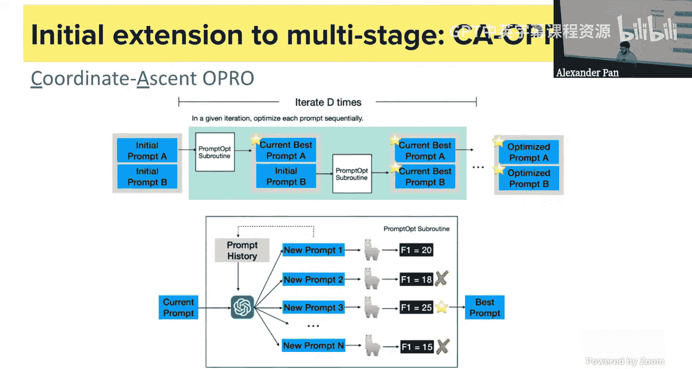

It's very expensive， it actually doesn't even work that well。

A different approach here would be to give up。😡，An assumption or to sort of make an assumption so you could give up on the assumption of explicit credit assignment。

 you don't really care to figure out sort of fixing all variables and changing one at a time。

 you could just ask the models to generate prompts for every stage all at once and sort of hope that that process converges in a nice place。

Or you could go to the model and say actually it's a bit of a harder task。

 it's a bit of a harder ask， but here is a sequence of all prompts of all modules and I want you to propose new prompts for all of the other modules and you could try to do it jointly which of course have the risk of potentially confusing the model it's a much harder task。

 but you is something that let's say you know。😡，with an oracle language model it's strictly more powerful by far now if you want this whole thing to work well in a language model program。

 it is really important that you're not myopic about optimization so you don't just look at the signature just generate a search query and you know the user didn't say search query it is just set queryie is it a SQL  query a search queryie for Google for retrievetrieieving model that is you have offline these things are different and sort of you are at the mercy of the quality of the proposals you're getting so you might as well try to make sure that they're contextualized sort of appropriately with respect to the program you have so that's this notion of you want the proposals to be grounded。

😡。

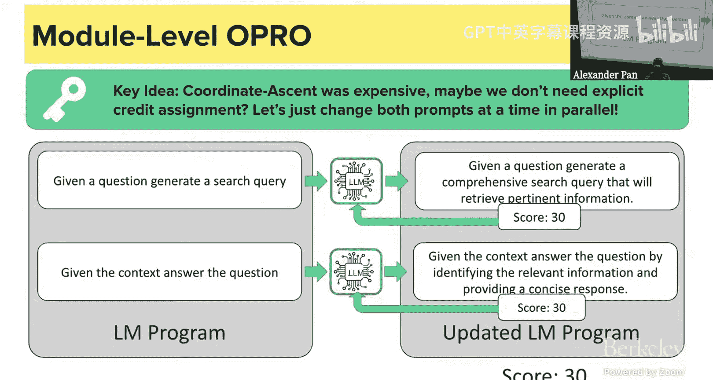

So sort of in a traditional prompt optimization setting， is the history of the prior steps。

 how we got here， what things we tried， how well they performed。

 and then there is maybe a training set of explicit examples that you sort of got from the user because your whole system sort of doesn't have any missing pieces it's just input and output。

So you know if you have this intuition that to take this and to sort of generalize it to language model programs。

 it would be very useful to provide a lot of contextual information about the program setup that we have and so the first thing is because we don't have these training input output labels for every module in general or for any modules in many cases we can start plugging in the bootsottrap demos that we looked at earlier so you know they're basically as good you know for all we know and it seem to be successful when you're doing bootsottrap you shot so maybe we could just plug them in as the examples that we use for constructing these problems now that by itself is gives you a lot because you could sort of see what works and potentially what doesn't but and here's sort of you an example of a question you want to generate a search query and sort of the reasoning that the model generates when it's building the search query that it produced that eventually sort of led to a trajectory that was successful on a certain question。

😊，The other thing is， well， you know you want to give the model sort of an understanding of the whole task。

 so it would be useful if the model building your instructions could see a summary of the data that we're playing with and so this is you know sort of an example of that where the model basically says looks like this is on the multihub dataset。

😡，Consists of actualual media style questions across a wide range of topics， et cetera。

 So you basically have a component that builds up the summary by， you know， essentially some sort of。

😊，You could think of it as a map produced over the data set with a language model。

And then an interesting thing that you know you might want to ground your system in is well。

 could it actually see the whole pipeline so it understands the role of every module in it and this basically works by literally taking the sort of inspecting the code that you have for a program and then giving it to the language model that understands the syntax and basically it builds the representation of the the program here in natural language that says。

 hey， we have a program that appears to be designed to answer complex questions by retrieving and processing information from multiple sources in this case it's set up for twohs。

 etc。😊，And you know the module in this program is responsible for generating a search quickly exception。

😊，And you might also sort of try to maximize sort of the diversity of the stuff here by just sampling your end of instruction that's。

 you know that from the standard of literature and just kind of。

Plugging those in for your proposal so like hey don't be afraid to be creative or all these things we could just take them out of the loop you know you don't have to write them we will write them once and then we can basically reuse them for building these these systems so we just discussed sort of extending optimization through proposing with language models so we've covered sort of two general strategies for optimization here one is building examples and searching over them。

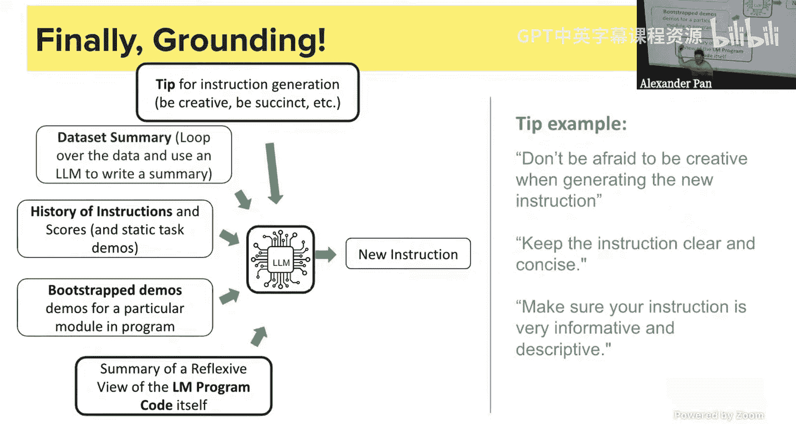

The second is giving the model as much grounding as possible in the language model program and。😊。

askking it to propose instructions that we can sort of iterate over you know through learning from the previous attempts and then the last approach here is going to be a little bit different where our goal is to optimize both the instructions and a few short examples。

 but in an efficient way of dealing with candidate assignment。😡。

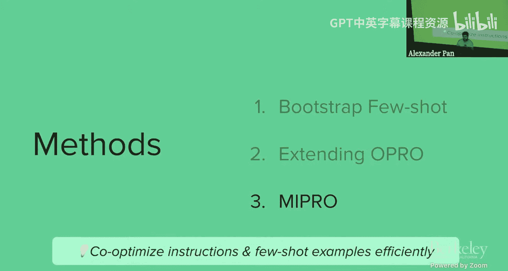

The intuition here is language models that are not particularly good yet at sort of dealing with assignment themselves。

 but because we're working with all of these sort of spaces of discrete proposals。

 like a lot of instructions or a lot of examples that we're building。

 we could actually borrow a lot of intuition from the literature on hyperparameter optimization。

 and we can sort of build what is called the surrogate model。

 a model that is basically optimized to predict the quality of any configuration possible of our system and that we can use to sample sort of proposals for the entire system that we can actually test。

😊，So Mipro the mepro optimizer works in three steps first thing is it bootstrap demonstrations of the task we' explained what that means it builds candidate instructions。

😡，Using a language model program inside the optimizer that had all these pieces we looked at earlier。

 like the dataset sumr， the language model program， describer all all these little pieces。😡。

And that handles this form of credit assignment here by relying on just a simple probabilistic model from the hyperparameter optimization literature。

😊。

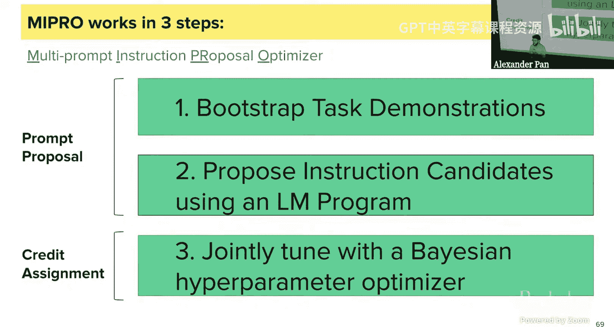

So what we have here is a language model program with two modules and in every module we have essentially two bulky parameters。

 one is what's the string describing the task， which is the instruction and we get a basic one from the adapter that we discussed earlier。

 and then no examples at first， but this is the list that we can learn sort of as a bunch of these input output examples。

😡，And the fact that we've done the bootstrapping and the candidate proposal in a grounded way means that we can basically start exploring this discrete space of what is the right combination across these modules of instructions and of sets of examples or lists of examples in each module that would lead to the highest quality。

😡，And of course we cant try all of them so we're going to rely on this Bayian optimizer to sort of basically help us give us an acquisition function that allows us to sort of like make good guesses as to which combinations we should try once we pick a combination we can plug it into a version of the program and then basically evaluate it on a mini batch of the data set that we have on the validation set that we have so maybe the data set have like 200 examples we could sample 30 of them get a score and then go back with that score let's say 75% 50% whatever and feed it back to update the surrogate model that we have so it's like hey if this is the set of combinations I chose that gets me I think 50% I think because well depends on the random sample in the mini batch so in the future we're trying to sort of get an acquisitions function that sort of has one let's say a property like I would like to get the most promising improved。

In future proposals and then are of course， many sorts of such choices you could make。

And we can sort of repeat this process and trials until we sort of find a really good combination。

At the end of the day。And what's happening here is that this thing gets smarter over time。

 so the combinations it proposes tend to go up sort of over time as opposed to say random search where you're just trying combinations。

😡。

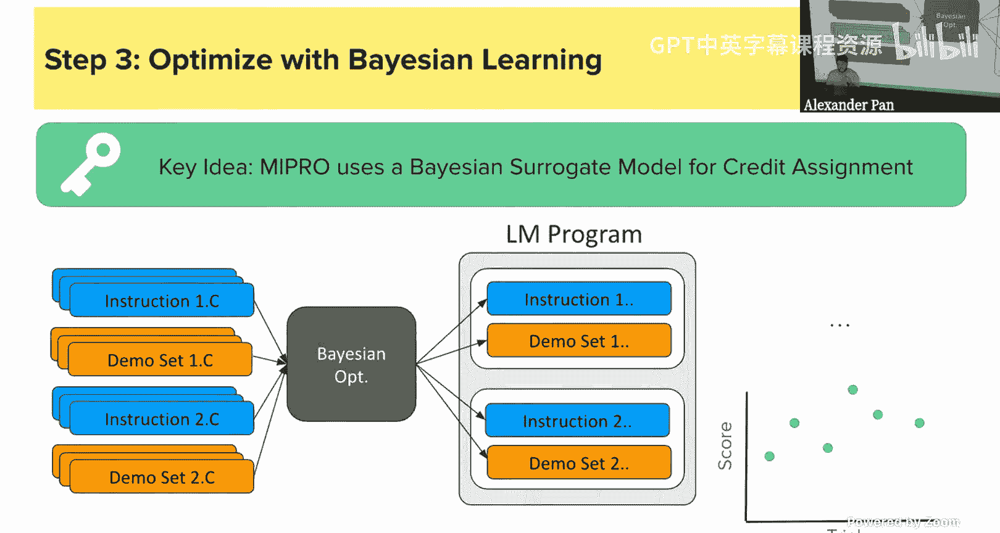

So how do these things compare we looked earlier at a slide that had the results sort of with like pretty powerful optimizers with like yes optimizing or like just using the off the shelf thing we also looked at the results sort of with people writing prompts by their own hand but it's also sometimes instructive to try to think of like ways of benchmarking these different optimizes against each other it's actually really hard and it's a place where we need more contributions because you want to build tasks that are representative tasks that are hard not overfit by given language models but where you also can sort of build interesting and realistic compounding I systems that we can sort of optimize and explore so an attempt at this is language probe language model program benchmark that sort of has these tasks so like multihop stuff classification inference。

 whatever。😊。

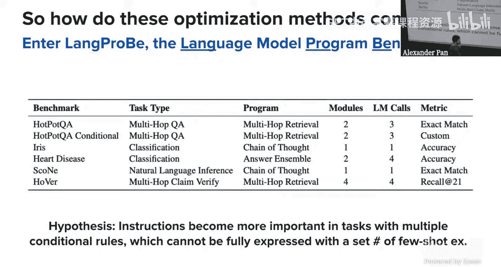

And you know， some of them have two modules， some have four modules， some have one module。😡。

So here are some sort of initial kind of part of the test set results on a bunch of these tasks and we're looking at optimizing instructions only through we looked at sort of module level oppro we discussed before without grounding and with grounding and then zero shot me Pro that's not allowed to use examples but only uses instructions and the first thing that jumpet you is that well you know on average optimizing instructions compared to like using you a basic kind of adapter can help quite a bit so you you can get a few points here or a bunch of points there can get some nice bomb there sometimes it overfis to the training set if it's really small and it's actually worse。

But in general， it really does struggle with a lot of these tasks to optimize prompts alone instructions alone。

😡，And it's not really obvious which of these wins。😡，If you look into optimizing with demonstrations。

 that picture is pretty different， like you can already get you know 10 point jumps。

 several point jumps here， several here as well， know it overfits here and it seems that instructions are actually quite powerful and here you can get very large gains as well。

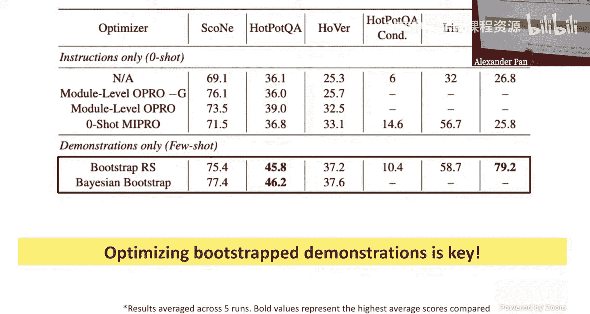

And the interesting thing is when you look under the hood at sort of this process of just random search over bootstrappped demonstrations that the system generated。

 it's wild how much they vary， you have stuff that's worse here than the initial sort of zeroshot approach。

 but you have stuff sort of on the frontier it's way better and it's really interesting what you know all of these were generated in the same way by running the program and basically doing a rejection sampling。

 it is interesting to see like how big of a difference sort of they can make when you plug them into the program。

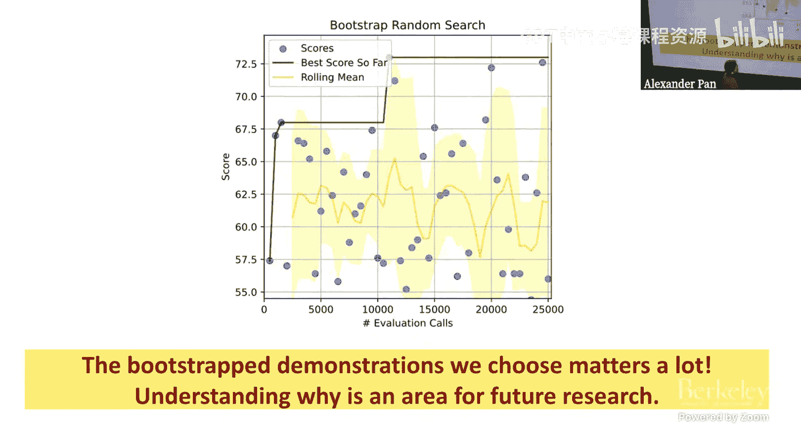

And the last thing is， well， you could take Mi Pro。

 which does few shot instruction optimization both together。

 and you can get sort of the best results。😡，You know， quite often most of the time。

With some nice jumps across various species of these。An interesting thing is， well。

 you know optimizing examples tends to be a winner。

 but there is sort of patterns where you can spot that focusing on instruction optimization is actually leading to more visible improvements which is basically cases where the original basically cases where the task has this property of like a conditional。

 you pattern where seeing one example doesn't actually teach you the whole pattern or seeing two examples doesn't teach you the whole pattern because there are sort of more cases than you can cover with just examples。

 or the kind of the precise threshold or the precise kind of region in which a rule applies is not clear from examples by themselves。

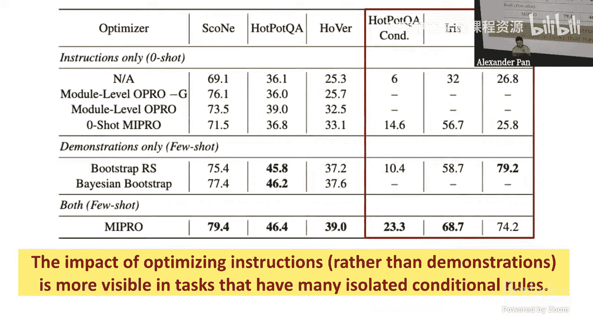

So kind of concluding here and maybe opening for questions more explicitly since they're open anyway。

 sort of just some set of lessons on what you might call natural language programming。

 which is sort of what this set of abstractions in DSPI allow us to do， a big lesson。

 not to forget Con AI systems is that programs can be a lot more accurate。

 more controllable and more transparent than using deep neural networks alone models alone。😊。

And we sort of just need the collaborative programs if you don't need to sit down and write sort of 10000 token sequence of five prompts。

 you can really write 10 lines of code， just express an objective and pick an optimizer and understand this staying on your favorite language model and the highleve optimizers can bootstrap examples for prompts or proposed instructions and explore that space and that they're pretty bad at any individual proposal on average。

 but you can sort of run a large scale search on this that does actually find things that in some cases in many cases sort of outperform the stuff you can do by hand。

 but the real power here is because you're freed sort of from the choices of how do I tune each module you can explore the space of component I systems more directly where getting a lot of value from iterating on the modules you're building how they're connected together you know what is the exact right objective that I want to maximize in many cases it's not obvious etca。

 etc。So DSP makes it possible to approach this sort of natural language programming by sort of yanking out hundreds and prompts and giving us these the notion of signatures。

 throwing away prompting techniques and inference time strategies that are sort of really fuzzy and you you what is I don't know what is a chain of thought really。

 and giving you actual sort of predictors you can compose as modules that can take your signatures and sort of apply in a metaprogram sense。

 the strategy on top manual prompt engineering， you throw that away and you sort of work with optimized programs where you're tuning the instructions。

Or the weights sort of in a given strategy。And this is something that's sort of being widely used in production and in open source。

 everything is that DSP AI including links to all the papers I discussed or didn't discuss so it's used a Jebl Data breakricks salmer。

 DMmware Replet， haze laps， you Sephora Moy's and other stuff you can sort of find a nice list of public facing use cases people that are sort of find going on the record sort of to learn what people are actually doing with this and it's a really great way actually to learn of like。

😊，Not just what people are doing with DSP， but like what kinds of companyI systems are getting actually deployed and sort of who's deploying them and how are they optimizing them。

 many of these folks sort of go on podcasts and describe how they're optimizing their systems for It law firms or other things。

Yeah， so this is sort of a nice great folks in the open source community。

 cool collaborators that sort of make all this stuff possible and you know you could dip install DSP and get started right now。

😊，Just to conclude key lessons on optimization in natural language in many cases in isolation。

 nothing seems to be building good examples of the task automatically what we call bootsrapping seems to be this notion of show don't tell but on tasks where there are these conditional rules that are sort of scoped and hard to detect ways optimizing instructions seems powerful and I should make it super clear that the biggest coolest thing in DSpi is that we've isolated signatures from optimizes from adapters from metrics and basically and from inference time strategies and that you can iterate on any of these four or five things independently and compose with everyone else so all of the programs that exist right now if you decide to build an RLbased prompt optimizer or if you decide to introduce an inference time strategy as a predictor everybody could just like change one line under their code and then you could see boost across the entire set of use cases that exist out there if you do it well。

And you know there are sorts of tricks that make this work that we've discussed here all right so actually I had this slight and I like to use this slight I you know but。

Right before the talk or the lecture， someone told me。

 you know many of the other lectures and maybe I'm counted with that， you know proudly but。

sortrt of are from sort of large closed labs that don't publish they're certainly not academics certainly not anymore and they seem to be leading all the progress and whatnot and so I really want to say that like you a big goal of DSP and sort of a meta goal is to enable open research to again lead AI progress and open research here has a lot of advantages for us in terms of like why we' want that to be the case it's not part of the scope of this talk but I'll tell you how this DSP really makes a difference in this space and it's to basically show that that progress is really going to come through modularity so we're not asking people to sort of figure out sort of how to fund billion dollar runs in isolation or these ad hoc tricks that sort of apply and then two weeks later the model changes and it's not really very relevant anymore but instead sort we sort of outline this space that I hope I convince you is of basically how do you scope out。

Programs well， how do you develop general inference time strategies that act as predictors that anyone could apply to their signatures and how we can devise new optimizers that could apply to any of these programs that sort of give us systems that are stronger than sort of sum of their parts if you will and through that I hope that a lot of open research and optimizers。

 predictors， modules and whatnot can sort of lead to the type of progress we saw with neural networks where different people developed attention。

 transformers， convolution and other things in a way that is highly distributed and it was obviously incredibly successful as opposed to maybe the way in which maybe we iterate on large language models in a closed way now。

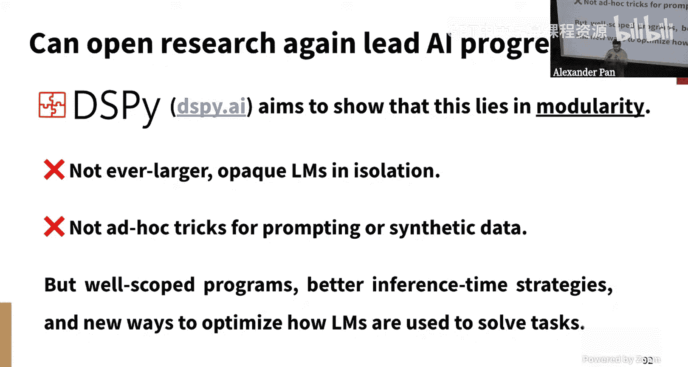