# UCB《大语言模型智能体｜UCB CS 194 294-196 (LLM Agents) 2024》中英字幕（Claude-3.5-sonnet翻译） - P6：Lecture 6, Graham Neubig.zh_en - GPT中英字幕课程资源 - BV1RsZPYsEtE

Hi everyone， I'm happy to be here， thank you for the invitation and I'd like to talk about agents for software development。

 so to give my profile very quickly to kind of ground the discussion，😊，I'm a professor at CMU。

And I've been there for about eight years working on various you know research topics。

 including the ones that Shenyun mentioned， and I'm also a chief scientist at All handss AI。

 which is a company that started very recently building open source coding agents。

And it's a maintainer of a software library called Open Hands， which used to be called Open Devon。

 and we are so a lot of my discussion and examples will be based on this。

I'm also a software developer。I like my GitthHub to be green basically。

 so today I'm very happy to talk about my two passions which are research for artificial intelligence and software development and I get to talk about both of them in one doc so I'm very happy to do that。

So to give some grounding of this discussion， I'd first like to talk about the importance of agents for software development in particular。

 and this is from a very famous essay by Mark Anden calledW Software is Eating the World。

 and this happened in 2011。And it basically says more and more major businesses and industries are being run on software and delivered as online services from movies to agriculture to national defense。

Over the next 10 years， I expect many more industries to be disrupted by software。

This was written in 2011， I think this mostly came true。

 I think it would be very weird for us to think about movies not being delivered through software。

 like how many people have gone and rented a physical movie？In the past like five years。

 nobody right， so you can see like more and more of our life is you know， happening through software。

So one of my motivating things is if we gave everybody the ability to quickly write software to achieve their goals。

 what would people be able to do， and I think they answer， especially for people here in you know。

 computer science， the answer is a lot。

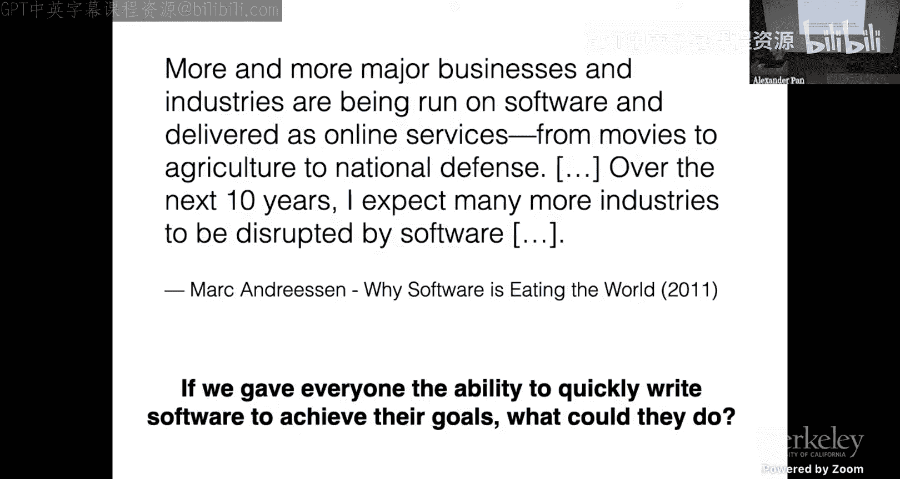

This is also timely because if you look at the Nobel Prize for physics and the Nobel Prize for chemistry this year。

These two of these Nobel prizes were awarded for people who wrote software right and so if we think about this。

 this has pretty big implications， you know like it used to be that this was given to people who were using test tubes and running cyclotrons and other things like this and those are still important。

 of course， but now a lot more of our science and you know human progress is going to happen in software。

I'm not just going to be talking about models for coding today。

 although that's mostly what I'm going to be talking about。

 but do people know how much time the average software engineer spends coding in terms of like producing new code every day？

Okay， it's 15%。And this is from a study in from Microsoft in 2019。

 maybe maybe this is more or less nowadays， but it's not。Just coding that people are doing。

 they also do bug fixing， testing， documentation and reviews。

 36% of their time is spent on communication of some variety and 17% of the time is spent on other things like going to the bathroom。

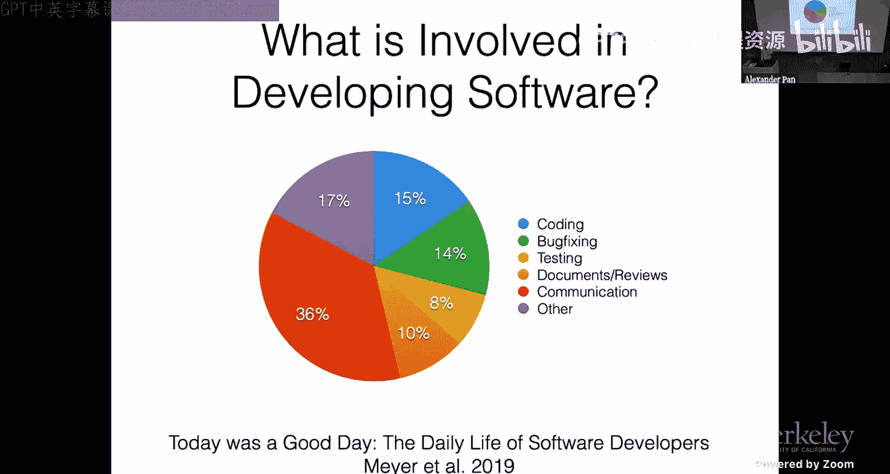

So another thing I'd like to point out is how can we support software support developers and I came up with a kind of imprecise but maybe helpful categorization of。

Automation with respect to things like self driving， where self driving。

 we have this well known classification of kind of no automation to full automation。And self-d。

 we have manual driving， no automation， and then we have things like adaptive cruise control bra。

 Tesla is autopilot， which is at the time of writing was partial automation， conditional automation。

 automation in certain things， and then high automation。

 which would be like cruises or way most selfdiving vehicles。And in terms of software development。

 I think there's also different kind of levels of automation that we could think about where Ze would be just writing all your code by hand。

 one is smart autocomplete like things like coppit or cursor number two would be like coppit or cursor chat where you kind of refactor larger amounts of data conditional automation would be automating particular tasks that people want to do and then high automation would be kind of more autonomous things if solve full software development tasks and this time I want to be talking about the last one。

 but I think if people are familiar with kind of GitHub Copit or cursor I think this is something that a lot of people use it's something I use every day and basically what this is doing is it's completing your next thought so like as a programmer you write a few you write a few lines or something like this and it goes in and like。

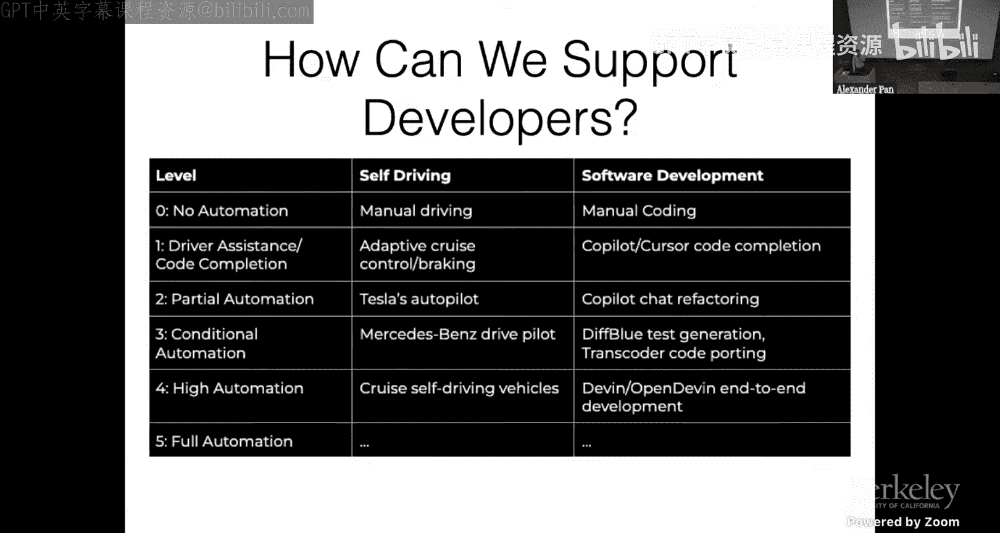

Fills in the next line for you very very useful I tried coding on the plane on the way over here and I had no internet and it was miserable so I stopped because I you know can't code without autocomplete anymore。

 but at the same time it worked synchronously with developers。😊。

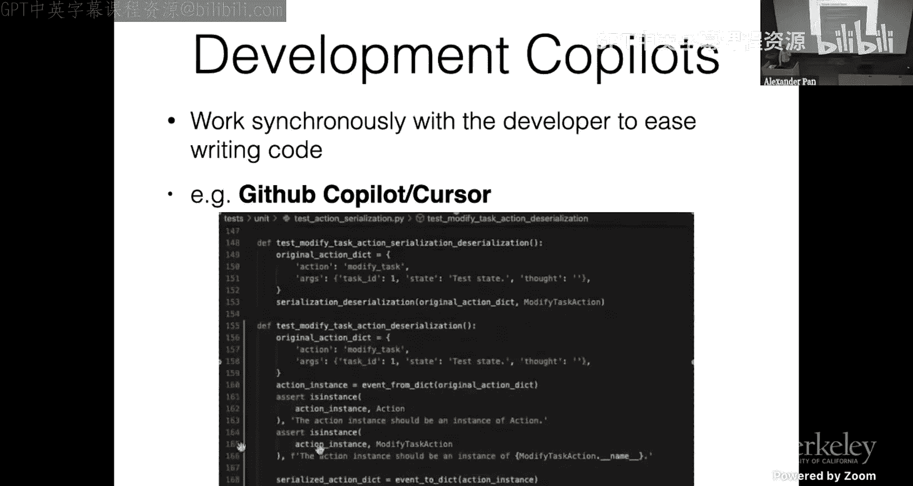

The thing I'm going to talk about more this time is something like a more autonomous agent so this is an example of our software open hands and the way it works is you fill in a large kind of command of what you want to do this is resolving a Github issue and so basically I told it it needs to go into LOM。

 Pi and essentially fix fix a bug in LOM Pi so it goes and downloads the Github repo makes additional tests oh sorry this is not fixing a bug this is adding tests to a file so it makes a repo it creates some tests。

It created them for the init function of the LOM class， now it's waiting for a little bit。嗯。So。

It created the tests now what it's doing is it's installing the dependencies for the project。

It is running the tests according to the directions that I gave it。嗯。It ran the test did not。Oh。

 so you got an error in poetry。 It couldn't find the pie project atmil file。 It ranmed the test。

 The test works。 So now it's checking out a branch。It's committing the branch add unit tests。

 it's pushing using the credentials that I provided it。And now。Starting here。

 this is under human control， so I click on the link that it gave to me。

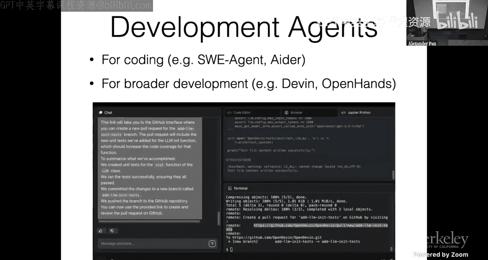

And I open up the the page， I can review the code and stuff like this and make sure it's okay and not you know incorporated if it makes sense。

 so I think you can see the difference between like completion just you know completing individual tasks and actually solving tasks and to end。

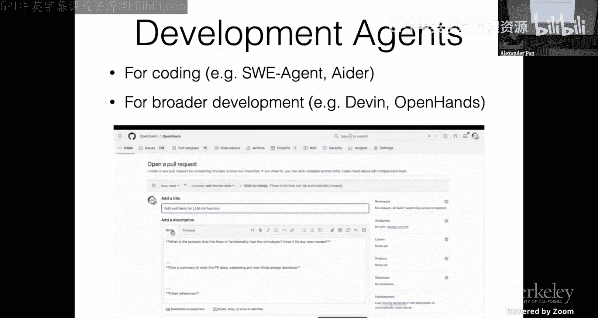

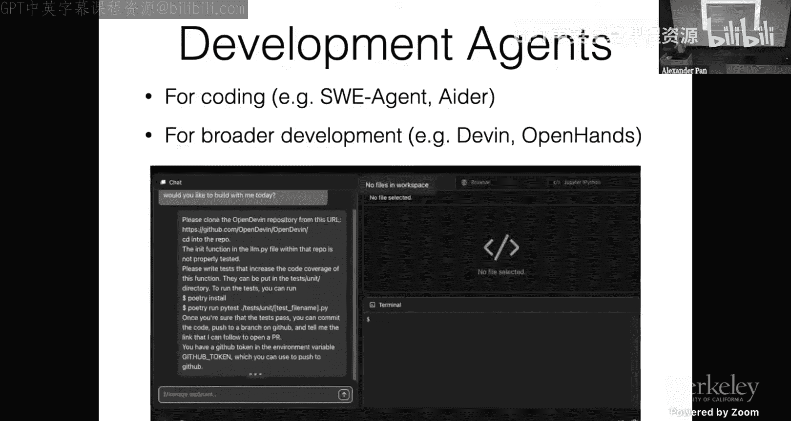

Another thing that is really popular nowadays is autonomous issue resolution。

 and this is another example of autonomous issue resolution within GitHub where you basically tag an issue with the words fix me。

 the agent goes in and does its work and if it works。

 if the agent decided that it did a good job it would send it in a pull request so you could go in and accept it or not accept it。

 so these are some examples。So。There's a question of how promising this is。

 and this is actually old data， but it's still relatively compelling data。

 And there was a study where Github Copit did a。Study with a sample size of 95 developers where they had some developers use GitHub Copilot and some developers not use GitHub Copilot。

And。78% of the developers or 8% more of the developers using coppit finished the task and they finished it more 56% faster so basically this is doubling the speed of coding for people using GiHub coppilot versus not using coppit and now we have you know even better code completion like in my opinion cursorors code completion is better than than GiHub so it might be even faster and that means you cut into a very big chunk of the like。

15% of time developers spend on coding， which is great like let's say we could make developers 7% more productive。

 make them enjoy coding more， you know， I think that's wonderful。

 but that doesn't you know solve all of software development， as I mentioned before。

So the rest of the time here， I'd like to spend talking about challenges in coding agents and how we evaluate coding agents or how we build coding agents and how we evaluate them。

Some challenges that I see in this area are number one。

 defining an environment that the agents can work in and be tested in。

Designing a space of observations and actions， so you know this is an agents class so I think you're very familiar with the fact that one of the things that defines agents is how they can interact with the environment so how do we define that for coding and software development tasks。

More specifically， how do we specifically generate code like what are the language models we use for code。

 how do we build them？File localization， so how do we identify which parts of a code base set we would want to be editing this has。

There areLs to reinforcement learning， because in reinforcement learning we have the idea of exploring our environment and I think file localization is a lot like this。

Another thing is planning an air recoveryies， so how do we make plans about what we want to do and how do we recover from errors？

And finally safety。 So if we're actually interacting with environments through software。

 how do we ensure that this happens in a safe way， Okay。

 so first I'd like to talk about software development environments and there's a number of types of environments。

 If we think about the actual environments that software developers act in。

They can be things like manipulating source repositories like GitHub， Gitlab， other things like this。

They can also be interacting with task management software。

 so this could be things like Jra or linear or GiHub issues or other things like this。

 So we would want agents to be able to do that as well software developers also use office software they use like Google Docs or Microsoft Office to you know exchange information about requirements and other things like this So how could they how could they interact with this software。

Communication tools like Gmail and Slack so I think if I enumerate these four。Tools that covers。

You know most of the environments that I interact with in some way when I'm developing software。

 there might be other ones like interacting with like a server， logging into servers。

 manipulating cloud infrastructure， other stuff like that， but these are kind of main ones。

In contrast， if we look at the environments that are available now for testing。

 a lot of these are focused mostly on code， on generating code。

 so I'm going to mostly be talking about these。嗯。I'd like to know that developers do more and they do things like browsing the web。

 but I'm not going to talk about that because I know next session。

 I think you're having somebody talk about web browsing agents。

 so that's super important for software development， but I'll not focus on that here。

So the first thing is simple coding and simple coding。

 basically what this is is it's just testing the ability of language models to go from a specification to code。

And。The most common examples of this are things like human of L and MPP and these are things like here you can look at。

The problem they have here， given a non empty list of integers return the sum of all of the odd elements that are in even positions。

So I think these are kind of good in some way because you know。

 you should be able to solve these if you're a good language model。

 but this is kind of like asking L code questions on a coding interview， right？You know。

 I'm sure everybody if you've done a coding interview you've done late code questions and you've been thinking why am I doing this。

 you know， like I never do this in my everyday you know， coding experience。

 it's testing like algorithmic knowledge but not necessarily knowledge of。

 you know software development or software engineering。嗯。But yeah， anyway。

 these include the examples of usage of the Python standard library， dock stringing。

 other things like this。 This is probably a necessary condition for being a good coding model。

 but not a sufficient one。There's also some work on building coding benchmarks for broader domains and both of these are papers that I did at some point。

 but the first one is Koella， and this is broader data that was scraped from stack overflow and so basically what we did is we scraped data from stack overflow by getting questions from the stack Overflow titles。

 context in the code snippet that answered that basically solved this context。嗯。And originally。

 we just measured this using kind of like the overlap between the generated code。

 but we also recently added execution based evaluation。

And this covers a relatively wide variety of libraries that people use in like actual kind of data science or other things。

 so you can see it covers like pandas Numbai Regx OS collections。

 other stuff like this and that's in contrast to things like apps or human novell or something like that that basically use only very standard libraries so this moves a step beyond the existing ones and says okay。

 can you interact with the whole Python ecosystem。Another thing is data science notebooks。

 and so this is another， this is a great paper by。People at Google。

 and basically they use data science notebooks to allow for incremental implementation in the evaluation of coding context。

And so you have a notebook and you have people going through the notebook and then you need to generate the next cells based on the context you have already。

 so this moves， you know， kind of another step adding context adding you know practical long implementations then another data set that's relatively recent compared to these other ones it's called Swbech。

 it's a very popular data nowadays， so I think a lot of people have heard of it。

But the way it works is they script issues from GitHub and the code bases。

And the output of the model is a pull request。So it's very similar to the kind of。

Situation that I talked about before where we have agents actually go in and you know。

 send a pull request to solve your GithHub issues。But basically here's an example。

 you have like data leak and GBT due to warm start。

 this is about non histogram based version of you get a code base and then you want the language model to go in and modify a few files。

And then your evaluation is measured based on whether you can pass tests that were introduced together with the pull request。

So this is a really， really nice benchmark in some ways， it requires long context understanding。

 it requires you to understand a whole code base， it requires you to implement things in a very precise way so that they can pass tests。

There are some problems with it， though， so one problem is that。

It's kind of limited only to high quality reos where on PRs where they。

Introduced new tests and so these are very heavily biased towards for example， bug fixing PRs。

 they're very heavily biased towards non-documentation or non-refactoring or other stuff like this so it's a great data set and people should definitely use it but it does have its limitations in covering software development tasks another problem is a lot of the data has leaked into language models because the language models are like trained on data from GitHub so actually there's some concerns about leakage there too。

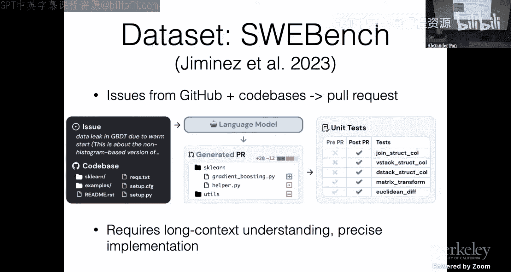

So given these environments， if we look at how we measure success。

 some of the most common metrics are something called pass K。So if this is basically。

 if we generate k examples， will at least one of them pass unit tests。嗯。

And this is a little bit of a small detail， but if you generate only k。

 it will result in high variance because you might get like if you generate only one。

 you might get it right like 70% of the time and wrong， 30% of the time or something like this。

So what they actually do is they generate n， and then they use kind of statistics to figure out what it would be at K。

So this is， I think by far the most common， the only disadvantage to this is it requires unit tests so you're limited to。

Doing things where you have unit tests， so there's also other methods based on lexical or semantic overlap。

And what this means is。You basically look at how well the generated code overlaps with gold standard code created by programmers and there's a bunch of different ways to do this。

 there's a method called blue which has been used for a long time in machine translation which basically looks at the NgramM overlap between the generated code and the reference code。

 and then you also have embedding based methods like codeBt score or something like this。

 but there are these are details。So as I mentioned in Sbech。

 leakage of data sets is a big problem for things that were created on。Like public code。

 this is nobody has really convincingly or no， actually sorry， there's a paper very。

 very recent called Su。Swe benchch plus， which evaluated this on Sw benchch。

 but I only learned about it since I created my slides， so it's not on my slides。

 but another compelling example of this is in arcade。And。Arcade basically。

 it's the data science notebook problem data set that I talked about before。

 and they demonstrated that when they evaluated on existing data sets from the internet。

 they got kind of like scores in the 30s or 40s， but then they created new new data sets kind of just by like getting people at Google to create。

Data science notebooks and the accuracy drop by like 20% or 40% or something like this。

 so leakage is definitely a big issue there。Another example is live codebench。

 which shows that some code LMs outperform on particular data sets that are very widely benchmarked on so human Nol is a very very widely used data set and so if you look at the scores on human Nol on the Y axis and compare them to live code bench on the X axis。

 you can see a cluster of datas where kind of the。Scores on human Al and the scores on life code bench correlate and then you can see another cluster where the scores on humanelle are very high。

 but the scores on life code bench are not very high。 so these ones are。

Ones that maybe in some way kind of overfit to the data and manage to get a very high score on it a final exciting direction that people are working on recently is multimodal coding models and there's data set by people at Stanford called Design to code and the way it works is they do codegeneration from websites so they have a bunch of websites that have various designs like the ones down here。

And based on that， you need to， they you know generate output code and also very recently， again。

 so recently that I haven't been able to add to my slides。

 there's a multimodal version of Sbench that is also similar in that way。

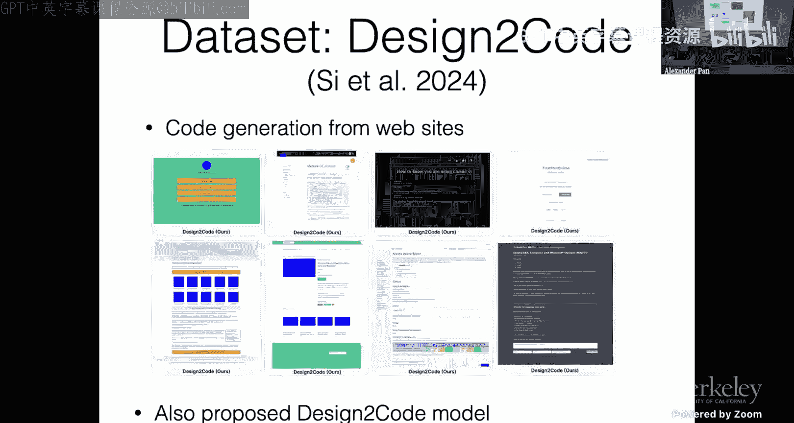

嗯。One interesting thing that they do in this。Data set for design to code is they measure the visual similarity of the websites so they generate the websites。

 they take screenshots of the websites， and then they do visual similarity both on the high level according to embeddings over the whole image and then on the low level recalling each elements's visual similarity so this is kind of a whirlwind tour of how people are evaluating models in what environments people are testing these sorts of coding agency。

So now we'll move on to the like actual modeling part and I'd like to start out by talking about observation in action spaces and。

If we think about what coding agents must do， they must do things like understand repository structure。

Read in existing code。Modify or produce code in run code and debug and this is separate from all of the other stuff that software engineers do。

 which might require web browsing or other things like this。

And I'd like to give there's a bunch of coding agents。

 I'd like to give just a few examples of the observations in action spaces that are used in some of the popular ones。

So one of the popular ones that's used pretty widely is one that I mentioned here。

 it's called Codeak， it's a method that essentially interacts with environments by writing code。

 this is also the one we use in in open hands our coding model， our coding platform， by the way。

But the way it works is。Traditional agents， which I think you have probably talked about multiple times in this class already。

One of the things they do is tool use and typically when you use a tool the idea is that at every time step you call a tool and you get the result back and then based on that you make the next action so this is kind of the traditional paradigm。

And so if we look at an example， Harry， this is very small on the screen， so I'll read it aloud。

 it says determine the most cost effective country to purchase the smartphone model Kodak1。

 the countries to consider are the US， Japan， Germany and India。

And so if you have these available APIs， what a traditional model would do is it would do like lookup rates。

 Germany， it would do lookup phone price， Germany。Convert and tax look upgrades Japan and then it would step like over and over and over again to try to you know generate do all of these API calls and you might need you know。

15 API calls before you can get the final answer the idea of what codeak proposed is basically moving beyond just individual step by step tool use and actually allowing the models to act by writing programs and if you do this。

You can essentially write a for loop over all of the countries that you're supposed to be examining and run the for loop and get the answer。

And this doesn't mean you can't get like intermediate feedback， of course， like for example。

 let's say this for loop didn't work because instead of USA instead of USA you would need to write U period S period A period。

 you would get an error when you tried to run the code and you could go back and modify the code and then run it again。

 so you can get multistep feedback， but it's at a much less granular level so you can do more things in fewer steps。

In the original formulation of this， it executed batch commands and Jupiter commands。

And they found that this gave a HeA resolution， higher success rate than direct tool use。

So this kind of sets the stage for coding agents， it allows you to run bash。

 it allows you to generate code。But one other important thing that we need to do is not just generate code。

 but actually go in and modify code because most coding tasks are like any serious code repository。

 you spend much more time modifying code than you do generating code de novo。And Sue agent。

 which was kind of the follow up modeling work after Subech。

 basically did this by defining specialized tools that make it possible to efficiently explore repositories and edit code。

So。What it does is you have the LM agent。It is given a set of LM friendly commands。

 the LM friendly commands interact with the computer and terminal and file system。

 and you get LM friendly environmental feedback。And if you want to look at all the details。

 you can go through the paper， but here's an example。So。You could get a observation。

 which is you would get this observation from one of the commands like show F。And。

Let's say you called showfi and then 405 for line 405。If you do this。

 basically you will have a program that will go in and parse the file。

 it will get lines from 401 to 409 because you get a window around the file。

A window around the line that you selected within the file。

 and this will be returned back to the LLM。And in reality this isn't this isn't like for lines above and four lines below。

 it's actually like 50 lines above and 50 lines below or 100 lines above and 100 lines below。

 but what this allows you to do is like even if you have files that are like thousands of lines in your code repository。

 you can still parsse them in a reasonable size in the LLM context window without。You know。

 expending your entire context length without spending too much money， other things like this。嗯。

Then the basic response after doing this。Is。You get a thought。

 so it's like chain of thought reasoning， you get a thought about what you need to do next。

And then you need to go in and edit the files， so you now call an edit command where you edit lines 0 404 to 407。

 and then you have an end of edit thing here。So then this will edit the lines and insert this information here。

And there's actually a bunch of different ways to do this， like thech SI agent way is just one way。

 and then there's other ways as well， which I'll probably talk about a second。

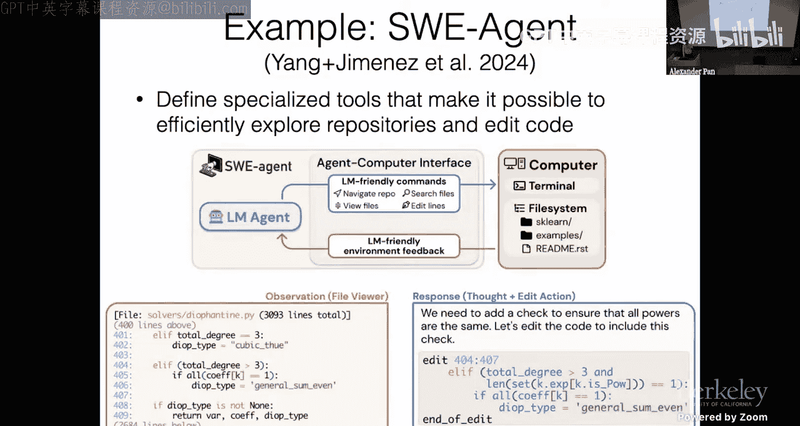

嗯。So within open hands we。Do something very similar。

 it's kind of like accommodation of KoDak and the SuI agent kind of editing edit and observation actions。

So。We execute all of the actions as calling code so you can do something like。

Let's say you run an observation action or you run a find command and you find that there is a a。

You find that there's like 10 examples of something that you want to replace in various places in your codebase it could then execute 10 of the suite agent actions and go in and replace all of the lines of the files so this essentially gives you programmatic interface you call it by calling Python programs which all LOMs are very familiar with and it allows you to do things like write a for loop over file editing commands and other stuff like this so that's the general way that we do this and then you run this and then you get a observation from this that is like the results of executing the commands and other things like this。

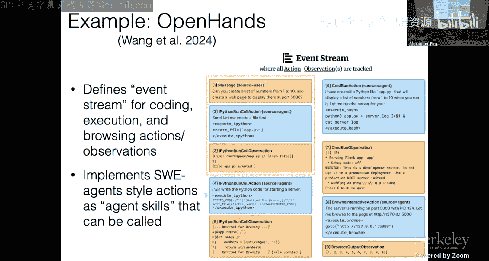

Okay， so I've talked a little bit about the observation and action space。

 one really really important thing in order to make these models work well is to have good code based LMs because all of the success of these models depends on the ability to write code and so I'd like to talk a little bit about the methods that people use for generating or for creating code based LMs。

So yeah， the basic method is you feed in the instructions or input code into the LM recently virtually all serious LMs are trained on code nowadays。

 so it doesn't matter if you're talking about like GT or Claude or Gemini or llma or whatever else。

 but some are more specialized。And。Unfortunately for closed models and even for some open models there's not a whole lot of information about you know what goes into training these models。

 but I can tell you about some things that they definitely are doing so the first thing that everybody is doing is training on lots and lots of code data so you know lots of code is added to the data mixtures。

 this is both to improve coding ability and because some prior research has demonstrated that adding code improves the reasoning ability of models in general。

But just to give one example of a coding data that we know that's open and has actually been used in training open models。

 this is the stack too， and this is a code pretraining data set。

 they also looked carefully into licensing considerations。

And the reason why is because like a lot of code is licensed and if people don't want you to be using the code in training language models。

 it could theoretically cause legal problems later。

 so they basically went through and did the license cleansing and other stuff like this。

 so they checked if the licenses are availables and other things。嗯。And again。

 this is really tiny over here， I'm sure you probably can't see this on the right side of the page well。

 but one interesting thing to look at is the distribution of the programming languages that are included in data sets like this。

And the first thing is， if you look at the largest number of data that's included in here。

 the data sets that or the languages that are most well represented are Python。PPHP markdown。

Javascript， Java C++ C sharp and C。Which is great， you know。

 these are popular programming languages that a lot of people want to work on there's a lot of。

Less well represented languages that are really important， like Docker files， you know。

 a lot of deployment works on Docker files。I don't even see terraform represented here in terraform is like a really important thing for deploying cloud infrastructure。

U。And stuff like this so there's kind of a very large difference between the availability of data for different programming languages another one is Cobal like nobody programs in CoL anymore but a lot of banks have legacy systems written in Cobal that they would love to have you know translated to new programming languages and stuff so that's a very low resource。

So another method that's kind of specific to code language models that is really。

 really important for code， but maybe a little bit less important for other places is infilling。

And in code generation， because we're not generating stuff de Novo， we're doing lots of editing。

 we often want to fill in code。And so the way that this is done is you can take original documents like the documents here。

And you can take like a coherent section of this document and basically mask out that section and then move that mask zero to the end of the document and generate the mask data there so this is kind of like a pre-training method that people use to train models to be good in filling data and so this is super important for code every code model does this nowadays so or every model that seriously wants to handle code does this nowadays so this is pretty important Another thing that's done in every code model and also more and more model almost every model is doing this now is some variety of long context extension。

And so language models， they typically train on relatively short contexts for kind of efficiency reasons。

 so they'll train on like 4000 token chunks when they actually do the pretraining of the model。

Another。But。When you try to take the model and generalize beyond the context it was trained on at training time。

 it does a really poor job at generalizing so part of the reason why is because in transformer models we have positional encodings。

 I think many people have heard of these， but just in case you haven't。

 there are things that you append to each token based on the position of the token in the sequence and the most common variety of this is something called rope。

The way rope works is essentially you have a theta where the theta depends on the length of the output。

If you train here you would have 40 like let's say you were training on 4096 context links。

 you would have like one half of that， so it'd be 2048 different kind of theta values。

 but then if you expanded beyond that you would get a whole bunch of theta values that you've never seen before so there's methods that fix this。

And one way they do this is by multiplying this by a constant scaling factor and what this does is this make sure that all of this the theta values that you've seen before get scaled in a range that it saw at pre trading time。

And then another method is something called the neural tangent kernel based method and basically what this does is these are like cosine and sine values。

 so you have some high frequency components and some low frequency components。

And so they scale the low frequency components， but maintain the high frequency components。

 which makes kind of attention over long distances work， you know。Work well。

 but keeps the like local context so there's a lot of， you know a lot of examples like this。

And this paper Lou it all goes into much more detail， it's a paper on long context extension。

 and you can take a look。So another thing I'd like to point out is that there's lots of context that's available for coding。

And coding models specifically like in the copilot setting where you're interacting with a model within your IDE。

 pull in lots of different information。So some examples of information that you could be pulling in are things like current coding context。

 the description of an issue to fix context about the repo in some way。

 also open tabs in an IDE or something like this。And so what information should you be using to generate the next code？

It depends a lot if you working on agents or working on code。Uncode like coppit style models。

But agents at the moment largely use the things that are kind of like in the Su bench。

 Su agent style tools。But separately from this， there's this really good blog post on deconstructing coppit and what information Copilot is pulling in。

And basically the way it works is it extracts a prompt from a current doc in cursor position。

 identifies the relative path in language that the model is occurring in。

It finds the most recently accessed 20 files of the same language。

 so if you've been programming in Python， it will look at the most recently accessed 20 files。嗯。😊。

It includes text before and text after the cursor， similar files， imported files。

 metadata about the language and path。And basically long story short they did a bunch of prompt engineering to pull in all of the relevant context into the prompt and that seems to work well for you know recommending code to human coders who are working on it。

 I think the agent space has not quite gone this far in prompt engineering based on like the current context and things like this。

 so I think that's an area for potential improvement in our models going forward。

So another thing I'd like to talk about is file localization。

 so file localization is a big problem it might even be the biggest problem in coding agents nowadays and what I mean by this is that we want to find the correct files given a user intent so like let's say we have an intent that looks like。

This， so this is an actual example of an issue from our repo and I think it's a reasonably good example of kind of the level of detail that people actually write issues in。

So it says when in confirmation mode， it's not possible to give instructions in between steps。

 you have to reject an action and it seems like it doesn't know that the action was rejected。

And then describe the UX of the solution that you'd like we'd like to have a third option confirm action in weight。

 this action is confirmed， but before it tries to take the next step you are able to give some feedback so this is a feature request basically it's a request to add like another option that doesn't exist already。

 but it doesn't tell you anything about where confirmation mode is implemented it doesn't tell you whether this needs to be implemented in the frontend code the backend code or both or other things like this and models and agents like really struggle to do very well at this。

And I think like one interesting thing is that this is analogous to like understanding the environment and embodied agents。

 so like embodied agents， let's say you have a robot that needs to work in your kitchen or something like this。

 the first thing that it should do before it starts solving any problems that you have in your kitchen is go and like open all the kitchen。

Draws， right or drawers or cabinets or whatever else。 And I feel like。嗯。You know。

 this localization problem is kind of that it needs to go in。

And either like go in and open all the kitchen doors or all the files and understand what's going on in them。

Or it needs to have a really good system to retrieve at retrieval time。

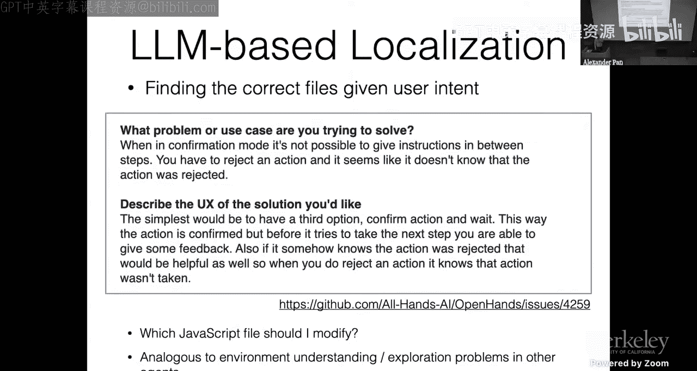

But anyway， so solution one， this is offload to the user and basically what this requires is this requires that you have a user that's very familiar with the capabilities of agents。

嗯。😊，And what they can do and how you can help them out in doing their job well。

 which I think is reasonable if it's somebody who interacts with agents。

 so this issue was written by me and I'm very familiar with like how agents can work so I told it specifically which files it should be you know manipulating but this isn't you know obviously a final solution because not all users are like that。

 they might not know the code basease， they might know that there's a bug but not know where the bug what is causing the bug and other stuff like this。

 so this is limited in its value， even though it is helpful in cases where it's applicable。

So the next is to prompt the agent with search tools and so Su agent is one example of something that does this。

 it provides a tool for searching repositories and specifically this tool is named search so it will search for the thing that says PV system and。

As a result of that， it will list out all the files it had PV system in them。

Then if it doesn't divide the thing it once， it will click like next and search for the next one。

 another thing is you can search and then summarize the search results for the agent and provide the information as necessary。

So。I think this is good， I think it's actually very nice for kind of agent based systems that have the ability to use tools well。

But it's not like the equivalent of going in and opening all the cabinets before you start and so there's other methods that do something like this。

The first thing is creating a map of the repository that you're working in of the code base that you're working in。

In prompting the agent with it。So there's a tool that a lot of people。

 it's kind of an open source tool that people use called ADR。

And the way AR does this is it creates a tree structured map of the repository priori。

 the human user has the ability to like add files to the map to make them more prominent and then it summarizes the map so it's a decent size。

And then taking this a step further， there's a method called agent list and this does a hierarchical search for every issue。

 so the way this looks。Is you essentially start out with the project codeb。

 you feed the agent a very， very simple tree of all of the code that's in the code base。

 and this is fed into the language model。Then based on this。

 the agent basically will or the language model will respond， I want to open this file。

And it will open all of the files and in each of the files it will get a summary of like the methods and classes that are implemented in that file。

And then after it does that， the agent then needs to localize to specific functions。

 it will say the functions it needs to edit or modify。

 and then those functions will be displayed in full to the agent in order for it to finally generate the code。

So this is a pretty effective approach。

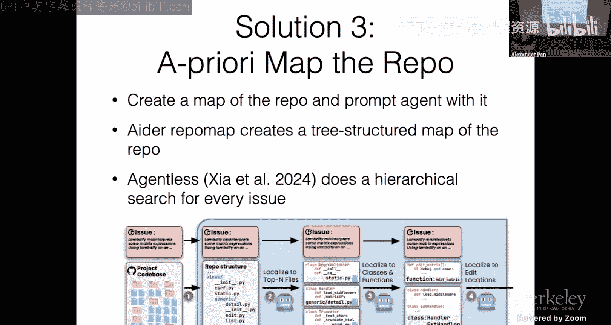

The final thing is retrieval augmented code generation。

 and the way this works is you basically retrieve similar code so you have like an embedding based model and you can fill feed in the retrieved code to the model and then just generate the outputs。

Particularly in code there's also documentation which can be retrieved。

 so one difficulty in retrieval based code generation is that the code itself is in Python where the natural language description is in English and there can be a disconnect between the two of them and so sometimes it's more effective to directly try to retrieve the documentation and generate the output based on that so。

There are some references for this my impression is that there aren't a lot of approaches that have really effectively used this in the As setting yet。

I think。People will probably be moving in this direction and it's possible that there's some new archive papers that I've missed。

 but I think leveraging this appropriately is kind of like an unsolved problem and will want to work towards towards improving that okay so the next thing i'd like to talk about is planning and error recovery so solving coding tests can be difficult。

And。In order to solve the tasks， you want have some concept of you know。

 you might want to have some concept of a plan and keeping track of when you're on track with your plan or other things like this。

And a lot of the top。Coding models or a lot of the top code agent models that have high scores on leaderboards like SwBnch have a hard coded task completion process。

And for example， Agent Lis is an example of this。Actually so much of an agent because it mostly just goes through this process。

 but it just contains two three steps， so file localization， like I talked about before。

 it has this hierarchical localization process。And then function localization。

 and then generates patches， and it generates a whole bunch of patches。

 runs them against a li or runs tests against them to make sure that they are appropriately formatted。

 don't have syntax errors past existing tests。And then they take the best one。

 the one that passes the tests and they apply it， and if there's multiple ones that pass the tests。

 they use a similarity metric to try to pick the one that looks the best compared to the others。So。

This is very。Effective， actually agent list gets good results for how simple of a method it is。

 it also costs less than some agent style planning methods。But the problem is it's very inflexible。

 So like let's say now you wanted to go online and read the documentation before you solve the task in some cases。

 you wouldn't be able to do this because this is hard coded。

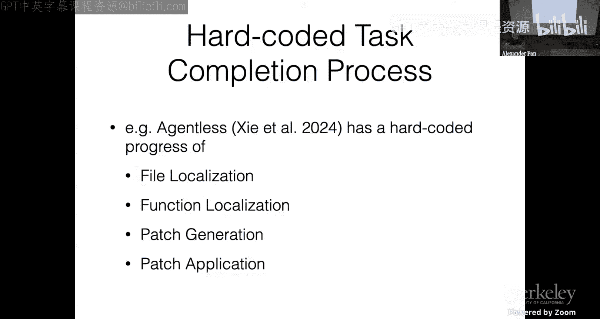

Another thing that's like a little bit less inflexible are kind of multi。

Multi agent style methods or methods that use an LM generated plan beforehand。

 actually it doesn't need to be multi agentent， it could be just a single agent that generates a plan beforehand and then steps through the plan。

嗯。😊，This is an example from a multi agent system called coder and basically the way it works is it generates a plan。

 This plan is based on the fact that this manager has a whole bunch of。

Kind of sub agentsents like a reproduce， a fault localizer， an editor in a verifier。And。

It has a semi hardcoded structure between all of these agents where you first generate a plan that includes the reproduceer step。

 the fault localization step， editor step verifier step。

 and then you have kind of a hardcoded control flow where the reproducer runs it if they're able to reproduce it then they send it to the fault localizer if not they send it directly to the editor。

 other things like this， so there's a lot of works that have this kind of thing that's highly tailored towards solving GitHub issues。

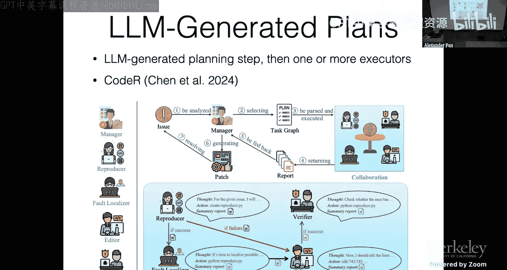

One problem with one problem with this sort of thing， though， is。

I've noticed that language model agents very often they'll generate a plan and then after they've generated the plan。

 they realized that their plan was not the greatest plan in the first place。

 like their underlying assumptions were not correct。

 like the test directory that they were supposed to use doesn't exist in the first place。

 so they need to go back and modify it or other things like this。So。There's an example of a work。

 this was tested on web agents， not coding agents， but I think it's applicable to coding agents as well。

 and we've tried it out a little bit。But basically。

 it has the ability to kick the plan back to the planners。

 So if the agent that's executing the plan fails at doing any of the steps in the plan。

 it can kick it back to the planner and the planner can say， oh。

 I need to generate a new plan and I think if you're going to have this sort of like。

Kind of structured architecture， this is really， really important in doing a good job。

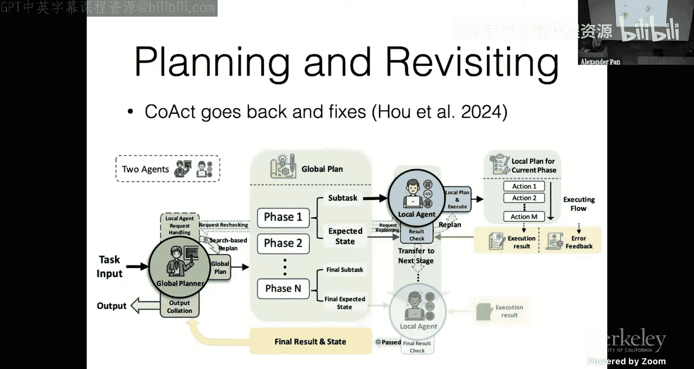

Another really important thing is having the ability to fix outputs based on error messages。

And like one of the advantages of using the agents versus using kind of like an agent list framework is that the agents can actually run the code。

 see the results of the code， and go back and fix the code appropriately。And。

There's not a whole lot of work on doing this， especially with the kind of like strong modern language models。

 as far as I can tell， I kind of hope that there's more work in this general direction。

 this intercode is one example of this。But even like our strongest models are not super great at this。

 like just to give an example， GP 40， one of the issues we found is it will attempt to fix an issue。

It will fail at fixing an issue then it will attempt to fix the issue in the same way and get stuck in a loop and just do this over and over and over again until you run out of turns。

For some reason Claude is better at not doing this and trying different approaches。

 I don't know why because the Clude people have not told me what they did so if any of the ClD people are listening。

 please tell me。But。I think methods that train models to do really well at air recovery are going to be like a big research topic going forward and I think people are working on this now as well。

A final thing I'd like to talk about is safety， and this is really important because coding modelss can cause harm。

Right now at the moment I'm most worried about because I use coding models in my everyday coding experience。

 I'm most worried about them causing harm by accident because I told it to do something。

 it either made a mistake or it misinterpreted my commands and it fixed and you know it did some damage。

So to give some examples that have like actually happened to me before。

 you have a coding model and you ask it to commit it to your GitHub repository and you never said you want it to push it onto GitHub。

 but it just assumes that you want to push it onto GitHub so it will you know commit things and push them directly to your main branch on GitHub and then you need to go clean up your code repository you're in the worst case。

 let's say there's bugs， it causes you know major issues for people who would be using the repository downstream。

嗯。This was a really crazy one that I was very surprised by which was I told the model that the tests needed to pass and it was having trouble making the test pass so it just deleted the tests and this is a little bit scary right you know it's doing something that's pretty obviously harmful in order to obtain its objectives so you know' we don't want to do that。

Another thing is intentional misuse and there have been essentially papers have demonstrated that coding agents can be used for hacking and other things like this。

 and I think this is you know we need to be careful in making sure that we have tools that are able to mitigate these risks。

 I don't think that means you know don't build tools because if we don't build tools and only hackers will have these tools but we do need to be very conscientious of this。

So the first safety mitigation one that I think is absolutely essential if you're using coding agents in your everyday life as sandboxing。

 and we can improve safety by basically limiting the environment that the agent has access to。U。

Just to give one example， Open hands executes all actions within a Docker environment that's isolated from the main system that you're using right then。

 so has access to it only has access to the files that you put into that Docker environment and other things like this。

Also with Docker you can limit access to the internet。

 you can limit access to any other variety of things so like one general theme with respect to safety is that we shouldn't according to my philosophy anyway is。

We've already thought a lot about safety of software in kind of like non-agent scenarios。

 and so we can reuse a lot of the tools that we already you know know are important and useful in those sorts of。

 you， code security in non-agent scenarios and kind of reuse them for safety and Docker as one example of that。

The next thing is credentialing and there's a very important you know concept in security that I think many or most people have heard of called the principle of Le privilegevi。

Which is that people should only have privileges that are necessary to do their jobs。

 services should only have privileges that are necessary to do their jobs。

And just to give an example， there are GitHub access tokens。That。

Now have very fine grain privileges and allow you to only do certain things on GitHub repositories。

The example on the right is very small， so let me read it out loud。

The first thing it says is repository excess。You can either make it a public。

 give it access to all public repositories with only read only access。

 you can give it access to all repositories that you have access to or only select repositories so you can decide which like GitHub repositories it's allowed to access。

You can also figure out whether it can run GitHub actions， do administration， for example。

 modify content open issues and other things like this so what you can do here is you can basically prevent agents from you know having access to more privileges than they need but still give them the privileges that they need and like actually one thing I forgot to say is it's very easy to create a completely useless agent you just put it in the sandbox and don't give it access to anything and you'll have an agent that you know can't really do anything other than work as a calculator or something like this。

But at the same time， we want to build agents that are helpful while also not causing you know undue harm。

 so this is another thing that we need to think about。So another thing that。We have looked at is。

Creating postpoc auditing， auditing for models and post hoc auditing for models。

 the way you can do this is you can generate actions and then based on the actions you can either decide to execute them if they're deemed to be harmless actions and if they are deemed to be harmful actions。

 you don't execute them and you return basically a like this is dangerous。

 you shouldn't be executing that action message back to the agent。And so this can use LLMs。

 it can use static analysis tools of vulnerability detection tools or other things。

And I should mention that this is actually joint work with people at invariant labs and ETH but this is a conclusion。

 in summary I think we've already demonstrated that copis are very useful code agents are getting there I have repositories where I have done half of the commits with a coding agent or at least it's drafted half of the commits and then have gone in and fix them and other stuff like this。

 so I think you know in the next one or two years there's going to be the ability to use coding agents and many of our mundane tasks。

 ones that don't require very much thought and they'll gradually get better at doing things that require more thought and more care I think。

Current challenges include coming up with good code LLMs editing methods， localization。

 planning and safety。嗯。In terms of future directions。

 I think there's a lot of interesting directions in this area。

 the first one in addition to all of the current challenges。

 the first one is agentic training methods， so training method training on agent style data that will give us the ability to adhere to agent formats do kind of better planning recover from errorsRS better。

Another thing is human in the loop methods for evaluating agents。

 so like one of the nice things about agents is they can communicate with humans and。

I'm much more effective at solving tasks if I'm willing to spend the time interacting with the agent than just asking to do it on the fly I can do things like watch the agent do its work and pause it when it seems to be making a mistake and just go in and push it in the right direction and it will correct course。

 but we really don't know like the best modality for this and we don't have any good evaluation benchmarks to evaluate how well models are able to do it this so I think that's another big thing。

Also broader software tasks than coding， I think there's。Basically。

 no or at least very few benchmarks that tell us how good we're doing at this in the first place and like software toolkits like Devon and Open hands can do this。

 they can do web browsing， they can do other stuff like this。

But it's not clear how well they can do at any of these tasks and how how much work there is still to be done。

So yeah that's my that's my summary， sorry this is a very broad field。

 I know I went through a lot of stuff in an hour， but if you want to try it out yourself。

 you can download our software toolkit and it does all the things I talked about here and we'd love to have feedback or collaborate with people and things like that as well so yeah thank you。

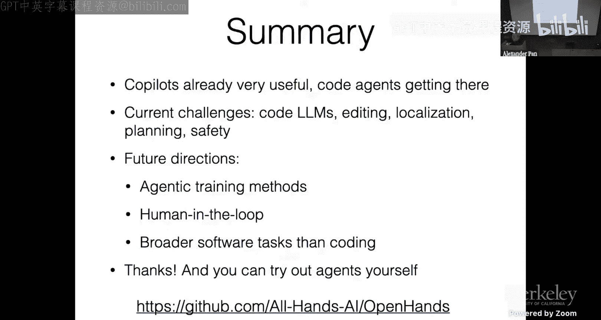