# UCB《大语言模型智能体｜UCB CS 194 294-196 (LLM Agents) 2024》中英字幕（Claude-3.5-sonnet翻译） - P7：Lecture 7, Nicolas Chapados and Alexandre Drouin.zh_en - GPT中英字幕课程资源 - BV1RsZPYsEtE

We're both very thrilled to be here super happy thanks for the invitation again it's already the midpoint lecture seven the midpoint in this amazing series of lecture。

 so so far all of you have had the opportunity to learn a bit about the building blocks for agentic systems。

 things like how we do reasoning or tool use with AI agents。😊。

So today we want to frame agents a little bit about how they can be used in an enterprise context in the context of people trying to get actual work done with agents and。

The focus will be really about understanding what are the use cases。Who are the users。

 the human users for those agents， what role do they have， what kind of work are they trying to do。

 and what is the context in which these AI agents should be deployed to help the human users in the context of their work activities。

For context， both Alex and I work at a company called ServiceNow。

 you may or may not have heard of it， it's a global company， 25，000 employees。

 the headquarters are just down the bay in Santa Clara and really workflows are the bread and butter of wet service now does we build a platform to automate enterprise workflows we have products in areas like IT service management。

 human resources， customer support and serviceNow is also a developer platform to help both professional developers in line of business regular people build new workflows。

And to give a sense of how this platform is used today and the same for all enterprise workflows platform。

One way to think about how these platforms work is that they bring together people who need to get work done in the context of their daily activities with people who are doing the actual work so suppose for example that you had a bad morning and you spilled coffee on your laptop your laptop is no longer working what do you do well if you're at the modern workplace。

 you may hop onto your mobile phone and open a ticket for your IT help desk and request a new laptop to be shipped to you today this ticket is going to be processed by a human user by a human agent will read the step follow instructions to get the new laptop shipped to you there's a lot of manual steps that are involved in this process this resolution of everyday issues that people in。

The workplace experience and what we will see is that there are huge opportunities for AI agents to help automate partly some of this work。

So。Before we go further， both Alex and I work for service now research。

And of course our team works a lot on agents and we have multiple subteams that work on various aspects of agent development。

 but we also think about all the other layers of the stack， so for example。

 we have a team that train and fine tunes Foundation models。

 this is the team that worked with HugingF for example。

 to release the star codeder model that some of you may have heard about。

 and at the other end of the stack we have a lot of people that worry about things like AI trustworthiness governance。

 safety security and the kind of practical concerns that we will touch on a little bit today in the context of agents but that are absolutely necessary if you want to deploy AI successfully。

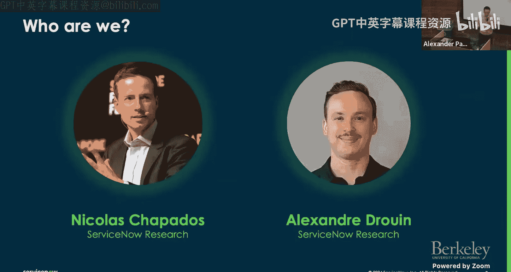

And before moving into the topic for today， our friendly legal team asked us to display this disclaimer。

 so here you go。And a quick note of about the agenda what we're going to be covering today。

 so we're going to start with a few words of background。

 of course this is not the first lecture you have heard many。

 many things about AI agents so I will not give any kind of explanation again but just set explain the vocabulary and make sure that we agree on the terminology and I want to discuss a little bit。

What's the matter with enterprise workflows and how a lot of work is happening in businesses today then we're going to be talking a bit more about API agents。

Somewhat about architectures， but more deeply about a new framework that we released as open source just a couple days ago called tape agents that offered a very principled way。

To develop agents and optimize them we're very excited about this this new piece of work then I will pass the button to Alex who will talk to us about web agents。

 how we can develop them， showing that building a simple web agent is actually pretty simple to do to do if you know what you're doing。

 but，Measuring their performance and making them better is actually much harder。

 so how can we do that in a more principled way and what does the tooling to build， develop。

 optimize web agents look like。😡，Then I will conclude by talking a little bit about the potential for agents in the workplace and the kind of large scale transformations that AI agents could bring to us in the future。

So let's start with a quick definition。Again， this is a class about LLM powered agents。

 we assume that this is clear and just a couple words of definition。

 we assume that those agents have a degree of autonomy that they can plan。

They can take action in an environment， they can receive feedback from the environment and they can execute goals that are given by a human user and usually this process happens over multiple iterations。

 so you have certainly heard variants of that definition earlier in this series of lectures。Now。

 maybe to make things a bit more crisp and a bit more precise LLM agents。

 we really need to distinguish them from what if you come from a machine learning background is an earlier generation of agents。

 agents that are a bit more narrow in scope， more restricted architectures that are typically that typically have a fairly restricted action space that could be trained using techniques like reinforcement learning。

And that would be very good at playing games， for example。

 sometimes that's superhu performance we're not going to be talking about that today， those agents。

 although they are really really good at playing Minecraft， for example。

Your game playing agent would be terrible at writing an email to your boss。😡，And in contrast。

 the LLM agents， what is really nice about them is that。

The large language model at the core of those agents has been trained on a large fraction of the internet。

And in doing that it has seen a lot of instructions about common software that people use every day。

 there is a lot of webage that talk about how to use PowerPoint。

 how to use Excel and even business software like Salesforce SAP and even service now there is a lot of documentation and news group posts about these things so those LLMs already have a good sense of how to use software that people use every day and the goal of an LLM agent to a big extent will be to leverage this kind of knowledge to get。

To execute tasks that people want to get done。And we will， within LLM agents。

 we're going to further distinguish two types of agents。One is an API calling agent， so it has。

A tool set that can be described using。A somewhat formal specification。

 let's say a formal specification of a set of APIs or endpoints and those would be primarily exchanging textual information and on the other hand we will also talk about web agents and those are able to use the web。

Pretty much like you and I would by pointing and clicking on buttons on web pages by filling out forms by navigating from page to page to gather information to memorize little pieces of information that you can reuse elsewhere in the task that you need to do。

 so of course each of those has pros and cons we will touch upon both today。😡。

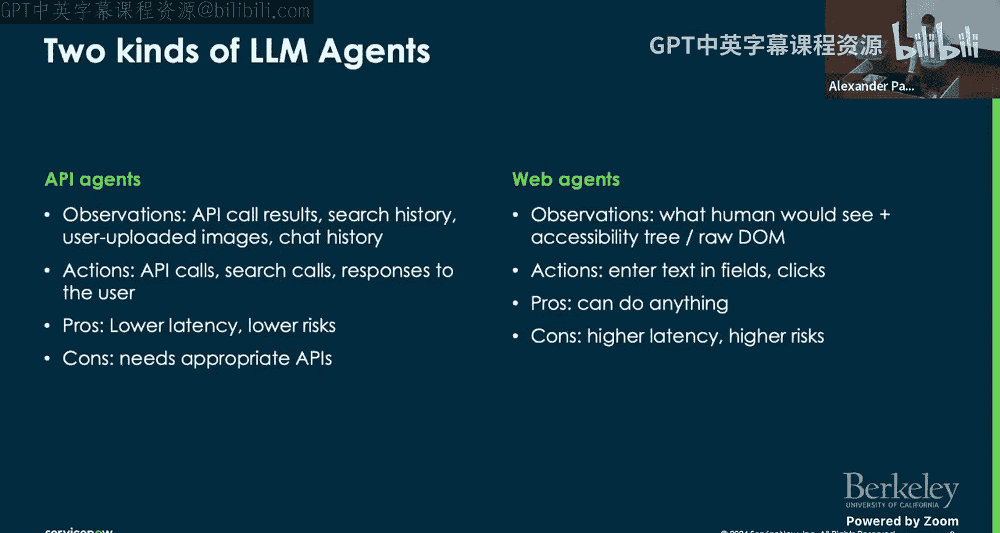

And to frame this within the context of work that folks need to get done in their daily activities as employees of big companies。

Imagine that we're facing an issue where a user called John is not able to access a particular knowledgebased article on the company intranet so John is a good employee he will file a ticket with his IT help deskk and this ticket gets assigned to Sandy and Sandy looks at the ticket and tries to solve the issue for John so what does Sandy do well she first start by seeing if there's an existing knowledgebased article that shows how to resolve this issue maybe she doesn't find any so she looks to see if there are earlier incidents that looked a little bit like this problem that she's trying to solve maybe she finds one and in it she sees that she needs to check the access control that John has。

And she will change the access control to give the right permissions because John didn't have the right controls。

 she changes the permissions。And finally， she resolves the case and since Sandy is working in a very。

Advanced workplace， she has a brand new generative AI capability that just got deployed in the last year and lo and behold。

 the generative AI capability。Is able to。Do the incident sumization for her。

 write resolution notes and finally close the case okay so as you can see， there are many。

 many manual steps， even if you're helped with some generative AI capabilities， there are many。

 many manual steps that remain in solving everyday work items that people need to do in the course of their daily work and this kind of incident is replicated millions and millions and millions times a day across all companies in the world。

And to give a sense of。

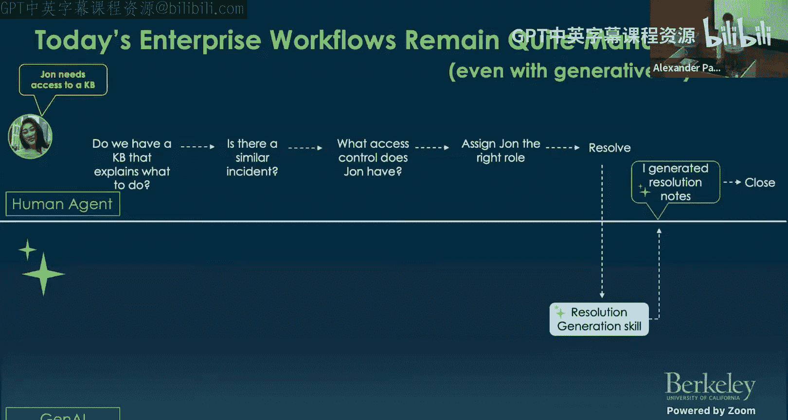

How the， the， the landscape of enterprise automation has evolved。

What we see is that there has been a progression in the past couple of years going from systems that are very scripted。

 that are very manually programmed。With a very low degree of automation。😡。

Things like either manual scripting or robotic process automation。

 and gradually we have seen increased degree of automation that require increased degree of intelligence going with classical AI workflows。

 think about recommender systems， for example。😊，Conversational workflows that have become more prevalent in the past couple of years。

 especially with generative AI， and today agentic workflow that require the most intelligence。

 but also have the most promise for automation。

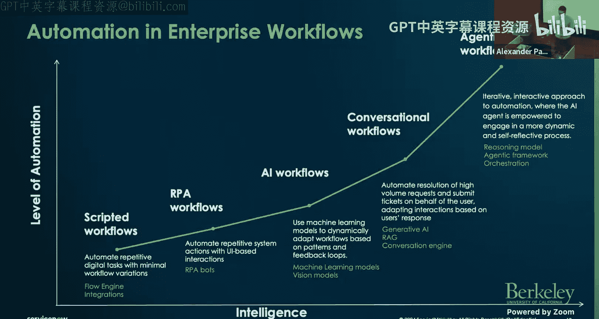

And。What's what's the promise for agents in the workplace or in enterprise automation is that they really have。

A unique opportunity to automate the masses of low volume low value tasks that people encounter every day so what are those you may ask well let's start by looking at what are not low value low volume the big rocks of enterprise automation things that have a lot of value or that occur very very often those probably have already been solved because people find it valuable to sit down and figure out how to program and automation for those use cases so things like employee onboarding workflows for example and things that that occur quite often that are predictable replicable a good chance that there is existing low code nocode environment or robotic process automation processes that have been put in place to automate those but again think about everything you do。

Every all the little grains of sand that are too unique to be scripted or to be automated。

 they never occur twice in exactly the same way so it's very， very hard to say， oh。

 I'm going to automate scheduling my tweets or answering my emails or filling out updating customer relationship management system or even organizing a meeting for 15 people across four different companies those things are very hard to automate using classical technologies and this is where agents have the potential to really shine and help do a much better job at all those little grains of sand that individually each of them is tiny but in aggregate they represent a massive amount of work that people need to get done every day。

😡，So let's take a look at a simple example。Of a web agent that we will be developing and expanding on a little bit later today。

A couple months ago， we were invited to give a presentation at the big conference that NviDdia puts together the GPU technology conference GTC and of course we did not know how to get there so we asked our web agent for help and the web agent that you're going to see on the left side of the screen is。

The interaction that me as a human， I was having with a web agent and on the right is everything that the web agent is doing automatically through a Chrome like web browser。

So let's get this rolling。So I'm asking the Web agent hey I'm attending GTC 2024。

 how can I get there from the NVA headquarters so the agent goes off and okay well it's starting with Google it's asking Google how to get there。

 good progress it's getting to mapps and Google Maps says hey。

 I don't know anything about GTC it's not an item on the map。

So we're going back to so the agent is asking me hey。

 can you give me a bit more instructions there and I tell it I want to attend actually the GTC conference。

 so the agent now has done some repplaning， it's using Google to figure out the location of the conference it's finding it as the San Jose Convention Center and this is what it is entering into Google Maps now to figure out the way to get from the In headquarters to the San Jose Convention Center okay so this is an example of the kind of interaction that we soon will be getting or that we hope we should be getting with our agents as systems that are allowed to ask more questions to humans but that have some smarts in terms of planning and repplaning of their own。

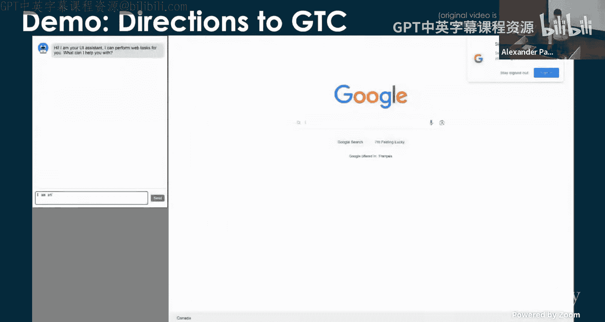

Okay， so let's shift gears now and talk a little bit about API agents。The typical architecture。

 this slide is probably going to be a repeat of some of the work that was covered earlier。

 but again just to set the。Our minds in the right state。

So we start with an LLM agent that is able to emit some actions。

And those actions are sent to an environment and the environment sends back observations back to the LLN agent。

The agent has access to some short term memory so what have been the past actions taken and the past responses from the environment。

It also has access to some。Planning processes。So things like react and so on。

 so there are many different strategies that have been proposed。

 we're not going to get too much into those today and of course for agents to be useful it has to access some tools and the tool there can be quite varied。

 including simple calculations running code， accessing the web and so on。

And some more advanced agents also have the ability to synthesize new tools。

 and those can be stored in some kind of long term memory。

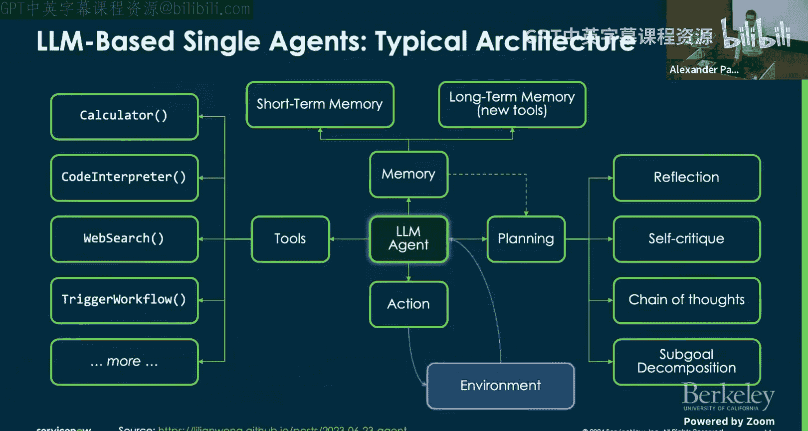

But beyond those basic concepts， we want to have the right software framework to help us build agents okay。

 just like it would be crazy for anyone today to try to program machine learning algorithms from scratch。

 everybody uses Pytorch because it's so much faster it's so much easier so we want to have the right framework to build agents and I want to talk about a new framework for holistic agent developments of both the tooling to help build and debug agents。

 but also the tooling to optimize agents from optimization traces。😡。

We introduced this framework called T agents just a couple days ago， in fact。

The QR code is the link to the resources all of that will be given again at the end don't worry and what we're trying to accomplish with tape agents is that is to get a little bit of the best of both worlds So on the one hand we have frameworks that really address the need for the software engineering part of agents we want to be able to specify those agents to a very fine degree of granularity to have prem components to have facilities like concurrency and streaming from the LLM。

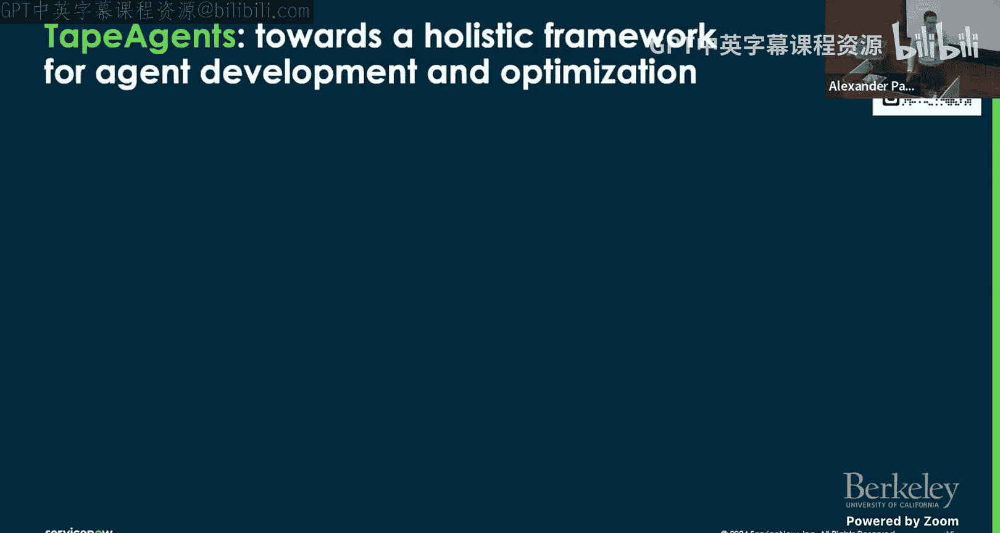

And you've heard before about frameworks like Land graphra。Althoughdo Jen and so on。

So this is great for developing agent。😊。

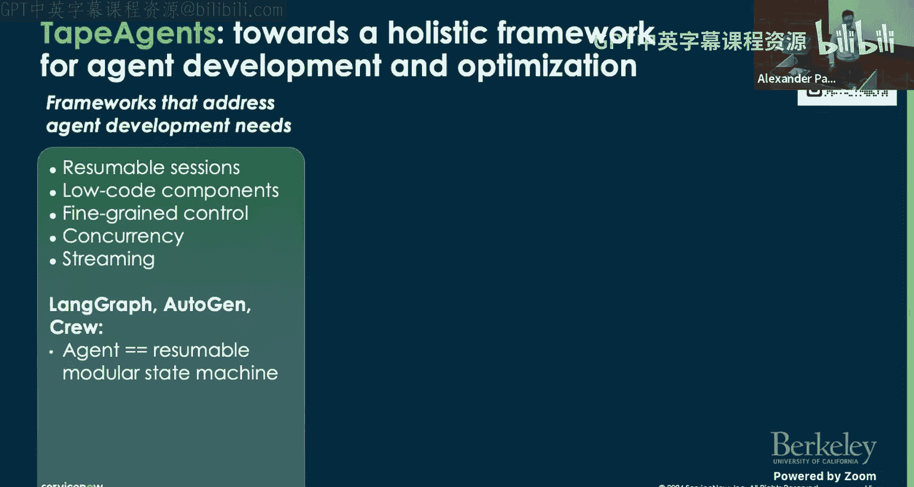

And on the other hand， we have。A need to optimize agents， okay， those agents。

 they all are the result of prompting an LLM， so whoever says prompting says prompt optimization。😡。

Prompt engineering， some of it is done by hand， but you can do a much better job if the machine can do it on your behalf and in some contexts。

 you may even want to optimize the LLM itself to make it a really good agent LLM so we have frameworks like DSP that is very。

 very nice for doing this kind of optimization work。But until tape agent。

 there was no framework that was really good at doing those two things together okay。

 so really what we hope to accomplish with tape agent is this best of both world type of situation where we have great tools to build and engineer and debug agents while at the same time getting the right primitives and the right concepts in place that enable both prompt optimization and fine tuning of the underlying LLM。

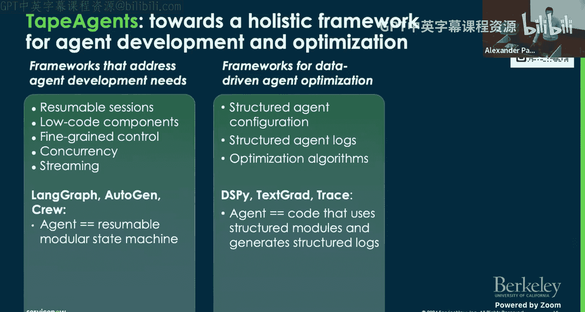

So as a framework， tape agent itself builds on a single unifying abstraction that we call the tape。

 so what is a tape it is simply a log recording of all the thoughts and actions that all agents in the system。

 we assume we can have more than one agent so all the agents in the system。

Store their thoughts and their actions to the tape。😡。

And whenever the environment is called and we make we place an action in the environment。

 whatever results from the environment is also added to the tape okay so we have this single unifying log and record of things and you can say okay。

 well it's just a DO log， what is so special about it well。😡，First it's not a dom log。

 it is it has quite a lot of structure and importantly it is。😡。

A piece of data itself and we can have agents that take as input the tapes that result from the execution of other agents for further processing okay so this introducing this notion of having a tape as a full blown data structure that is very very rich in the content of its metada and can be processed by further downstream algorithms is really where the power of this framework flies so in terms of just the execution model to set things clearly in your mind bring your attention to the agent on the right agent B。

AndThis one gets a read of the entire history of the tape so far and the agents select which of its internal nodes it's going to execute at a particular point in time and the nodes again just from an abstraction perspective they are the little pieces that decide how to prompt an LLM an agent can have as many nodes or as few nodes as you wish it's really up to you as an agent developer to decide on the internal structure of those agents but the nodes then call the LLM the LLM either suggests a few prompts sorry a few thoughts or a few actions don't get those get added to the tape and we have an orchestrator that can then go call the environment for executing any unprocessed actions get the replies from the environment and the loop continues okay so it's a fairly straightforward execution model but in that you will notice。

😡，that we have the ability to have multiple agents and each agent get can delegate work to some subag as well。

 so it's very modular， it leads to a very flexible structure of agent。And furthermore。

 we can have very， very nice things that result from this tape as data idea。

 of course we have full blown auditing and debugging capabilities that are very。

 very obvious and we can have some algorithms that take the tape as input and do cycles of prompt optimization to it to get better prompts and we can have also。

😡，Agents that distill the work of some fairly complicated feature agents。

And enable building much more cost effective student agent as a result so we can have an optimization of the underlying LLM as a result of that we'll see in a minute what this looks like。

😡，So a very simple example of that loop that I talked about。There is a full technical report。

 the link was provided in the preread to this lecture。

 so I will not get too too deeply into the details。

 but this is more to give a flavor of what's going on here。Assume you have a simple two agent system。

Very straightforward question answering assistant about the financial status of companies。

 for example， so we have the assistant itself that talks to human users and this。

Agent is able to rely on a subag that will perform web searches for it okay。

 so this simple two agent setup here， we combine it with this quite straightforward execution loop that we described earlier。

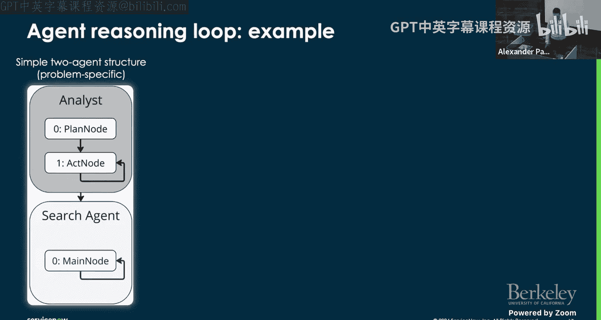

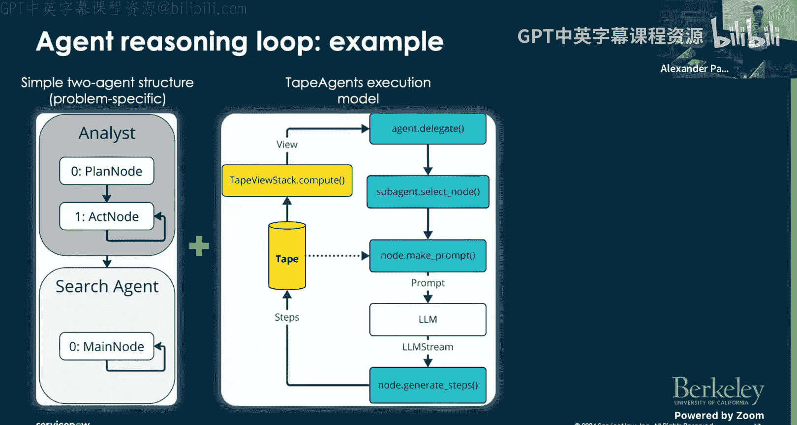

And this gives rise in this very detailed graular tape recording of the interactions between all the agents。

😡，Their internal monologue， their internal reasoning traces。

 the action they take and how the environment responds。

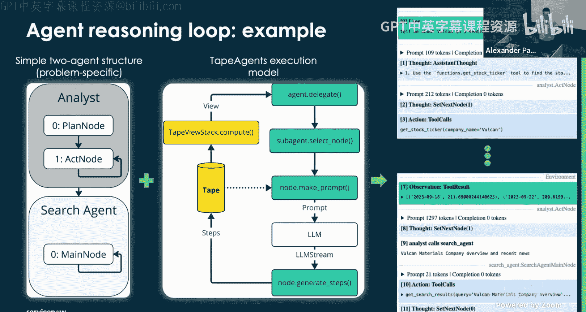

And of course the tapes and practice are quite involved。

 you can reproduce this example through the introductory notebook that you can run on your laptop。

 this is super easy to run。

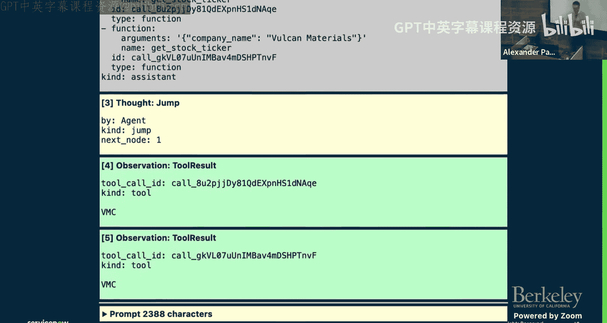

And what this all gives us， though， is。The ability for agents to。Process tapes in。

In a way that enables easy optimization。😡，We don't have time today to go deeply into the details of this example。

At a high level， what we want to do is to provide agents that have。

a high degree of sophistication that can provide very， very high quality user interaction。

 but that are also quite cheap to run， so we run a case study where we build on the notion of having to adding an assistant that helps you fill out complex forms to request work to be done in the context of your daily work activity。

And this process is about enabling a very complex agent to be distilled down into a simple agent。

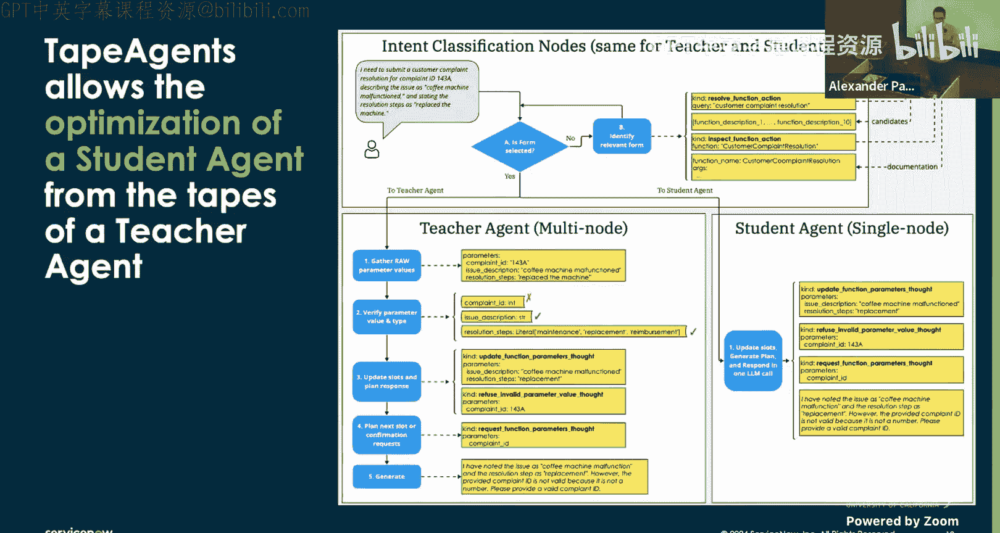

What this lets us do is to create very cost effective great conversational agents okay and great of course。

 I did not misspell it on purpose it stands for。The attributes that we want to monitor in the agents that we build and we。

Selected really these attributes as covering all the quality attributes that would make great conversational agents。

 okay， so things like we want the agent to be grounded to never hallucinate to always tell the truth。

We want the agent to be responsive， to be accurate， to be disciplined， transparent and helpful。

 and all those attributes can be measured independently and we can optimize for all of those together。

😡。

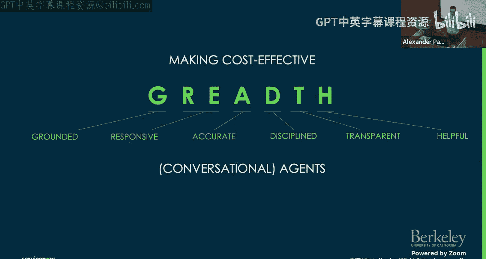

In a case study that we run that is very very much detailed in the technical report we built。

We built a set of agents to fulfill a task which is。

Helping human users fill out those very complex forms that they sometimes encounter in the context of their work and making it a lot easier to fill out the forms。

😡，And what we want to do is to build a fantastic conversational experience。

 think about GT4 level quality or better。But much， much more deeply。

And we ran a case study by inventing fictitious companies。

Having a few companies to train the model and a few companies to test for out of distribution effectiveness of the model。

😡，And。The the methodology that we followed there is to have。😡，A very complicated。

 very high parameter count agent that is running on Liath 3。5 3。1405 billion parameter models。

 so very costly to execute。Generate a lot of data。😡。

Two that is recorded in the form of these discrete tapes， these discrete execution traces。

And using this data， we fine tune。A Lama 8 billion parameter model to recover the performance of the much。

 much bigger parent that was used as a starting point。

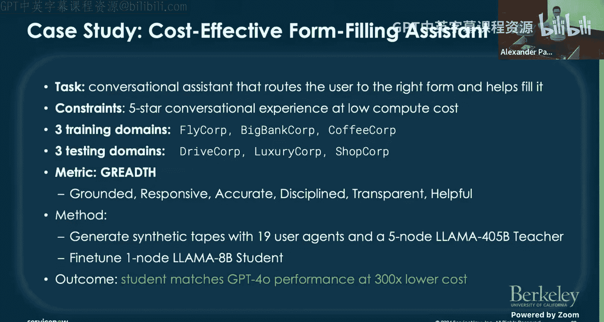

And。I will go straight to the graph there。We achieve substantial success in doing that。

 what we see on the chart there is on the X axis how much it costs to run a million conversation turns with those agents and on the Y axises this measure of quality。

 this great score that we introduced previously and that can be computed that can be computed quite crisply。

And。With no surprise on the upper right hand side， we have the largest agents available so we have a ama4 or5 billion parameter model that is having a great score and a zero shot gT40 model that is also having a great score。

 but both of those are very expensive to run， we're talking about。30，000 to 40。

00 ish dollars per million conversation turns， so those are very expensive agents。

But by using the methodology that is enabled by this concept of saving tapes and treating them as data to generate fine tuning data for a simpler agent。

 we see that we're able to fine tune an 8 billion parameter model that has the same performance。

As the much larger model， but is more than 300 times cheaper to run Okay。

 so a huge gain in performance there。😡。

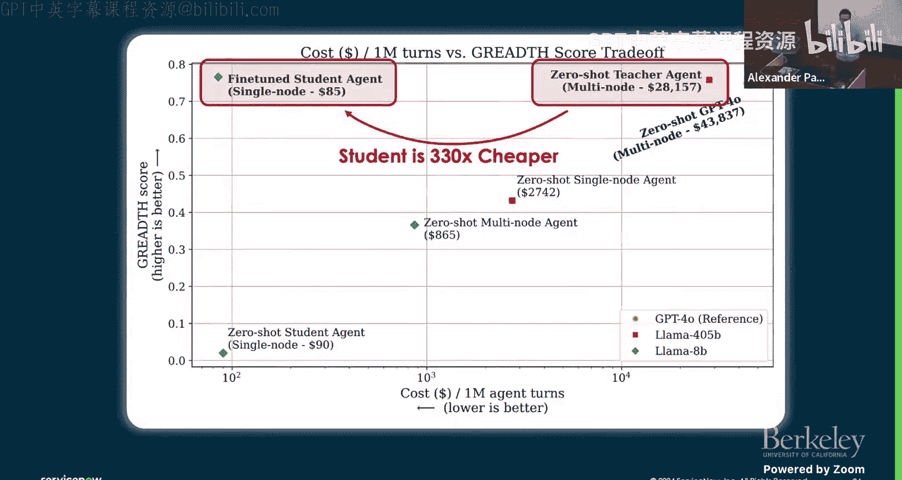

And if you're familiar with other agent framework， we also have a quick table。

 but I will go quickly over that， comparing CA agents to other frameworks。Now time is flying。

 I will pass it to Alex， who will shift gears and tell us about web agents。

Great thank you nira hi everyone yeah so Niicra just told us about API agents those are great when you have APIs available when you have tools that can do some of the execution for you but now I'm going to talk about another kind of agent that promises to be more general than that and this is web agents and basically this is a great improviser right so when there's no APIs available you could expect an agent to be able to interact with the user interface just like you and me would do when using some software。

😊，Oops， that doesn't work， okay。So what's a web agent to be original。

 I'll show you an agent loop that I'm sure you've seen many times right now。

 except is going to be style transferred for webag。

 so suppose you have a user with a goal in mind and then the web agent is just a policy that perceives an environment which in our case is a web browser and perceives observations from the environment and then decides which actions to make okay so it's a simple agentic loop where the web agent here in our case will be an LLM who's choosing to do an action based on whatever observation comes from the browser。

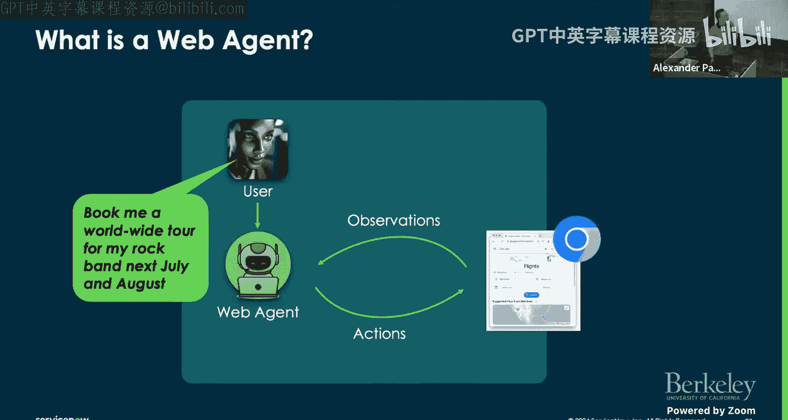

So。This is actually quite challenging because first of all you need to understand the goal。

 you need to understand what the human wants， you need to understand you need to be situation awareness basically you need to understand what you're seeing in the browser what's the user interface showing and long-term planning is really challenging here because most of the time what you want the end result is not on the current page right so you need to transition。

 navigate some menus and then ultimately you'll end up on the right page but this is not necessarily perceivable from the current set of observations that are available to the agent。

嗯。Yeah， and then once you've made a plan and you know what you want to do。

 you still have to execute the actions correctly and as we'll see in the following slides。

 even this is quite challenging for current agents。

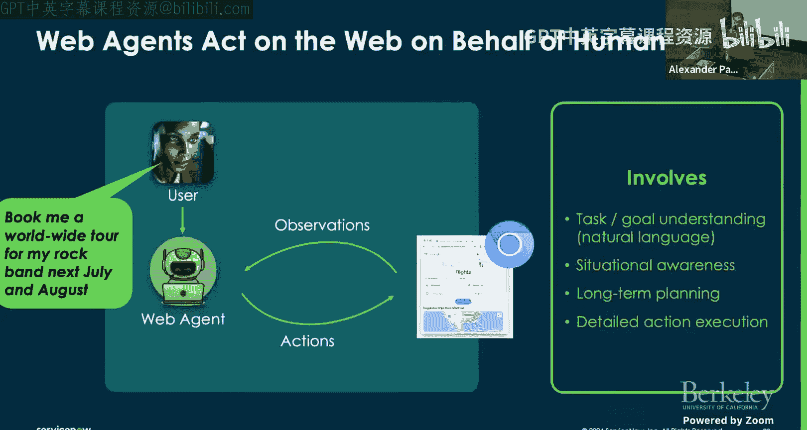

Okay so how do you make a basic web agent Okay this is the most basic thing you can do supposeose you have a human who's asking for something so fly me to Yellowstone for the next long weekend and there's a browser now what you could do is take your favorite LLM and build a prompt and in this prompt you could put the test description so you can put the goal you can put the observation which here would be for example the HTML of a web page you could put the right directly in the prompt if you have a long enough context window and then you can you can define what the action spaces so is the agent allowed to click on controls is it allowed to fill some fill some forms for example and then you could give this to an LLM and then ask for the actions it wants to make based on the observation and then you want to actually go and apply those in the browser so often what people use is a combination of Python and playwright which is a browser automation library you also have selenium that can do similar things so that's。

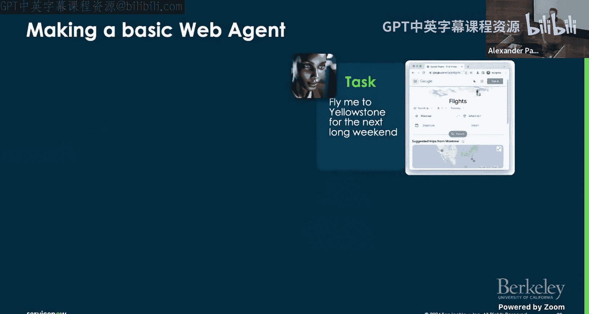

your basic web agent。And。

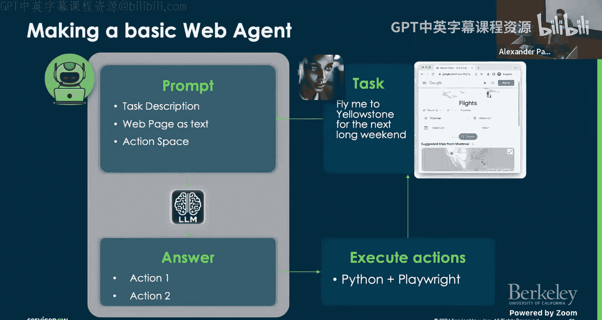

Concretely what you could do here is an example from the miniWb data set so I could build this prompt like that I could say the task is to enter EnOola in in the text box and then press submit so I would put the content of the page there and the prompt I would say the action space what you're allowed to do here is fill a field with its ID so you would say fill ID number one and it would fill that field move the mouse and so on right and then I would ask the LLM what do you want to do now output would your actions between those brackets here。

And the LLM would potentially answer with this so fill the field with Enola and then click right so here you can see GPT4。

 a GPT4 based agent that's actually doing that when prompted with this kind of route。😊，So。

This seems very simple， but it's actually already quite powerful surprisingly。

 so what you're seeing here is a very basic agent done pretty much like what I just showed you and it's based on GP4 and react style prompting so we're asking the agent to output its dots and then actions it wants to make you can see that at the top and it's actually filling out the expense reports of Nikara when he traveled to a conference recently。

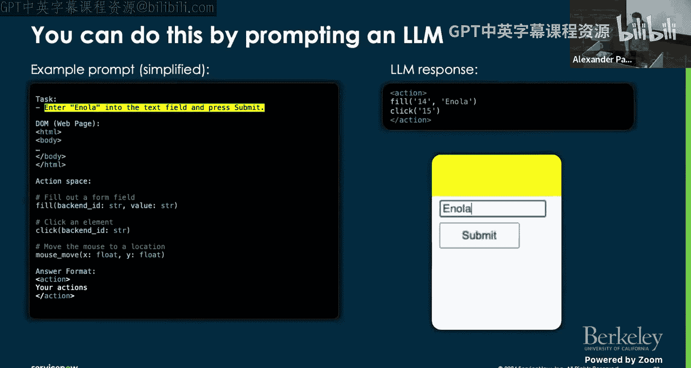

Here you can see it actually filling out the form this is GP4 that's acting with the very simple prompt that I just showed you okay so you can see how this this already makes at least for me it makes me dream right you can say like this is great we could imagine having assistance like that that will automate tasks for us in the browser this is the next evolution of user interfaces and so on right so we're quite excited when we saw that。

😊，So。The truth is that this is very brittle right so this is a prompt it works right now。

If we have some great anecdotic examples like that where it works really well but we need it for this to be adopted in practice it needs to work robustly right so it needs to work most of the time we need to be able to ensure that it's not going to be jailbro or hijacked by injections in the web pages right so this needs to be reliable and by the way this is also one other limitation of this kind of agent right now is that it's quite slow so here the video I just showed you was sped out by eight times right so in practice you really need to wait like 15 seconds for the mouse to move from one point to the other which is not not yet what we want for a smooth user interface but you can see it has potential。

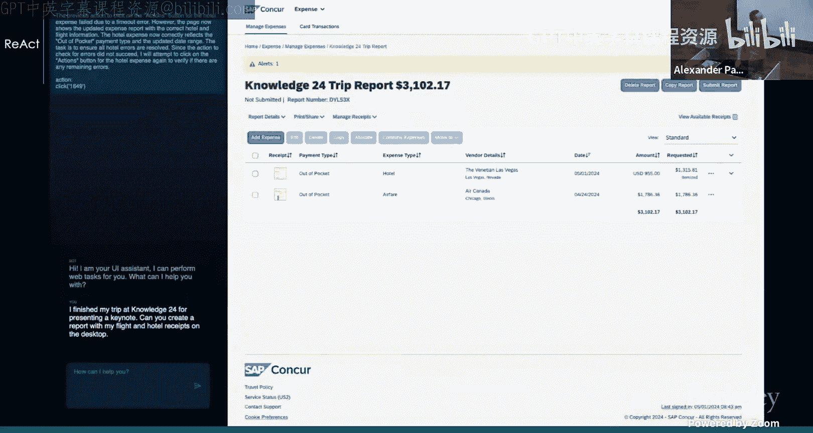

Okay， so。Given the fact that we need this to be very robust for it to be actually applicable in practice there's been a lot of effort on building benchmarks so you may have seen some I'm going to outline a few recent benchmarks but this has been a trend mostly because we want to know beyond anecdotes how those work in practice so here you are seeing the mini web data set which are very simple web tasks like filling a field clicking submitm or just dragging a box from one side of the screen to the other this is great it's a good start but it's not realistic。

😊。

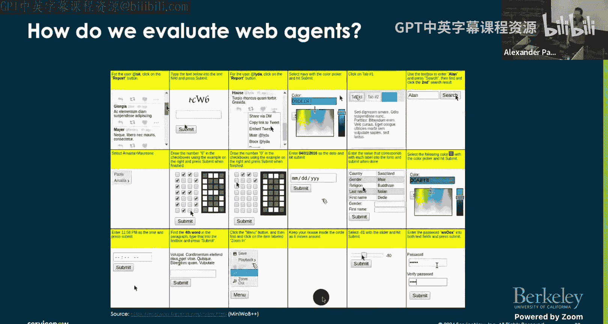

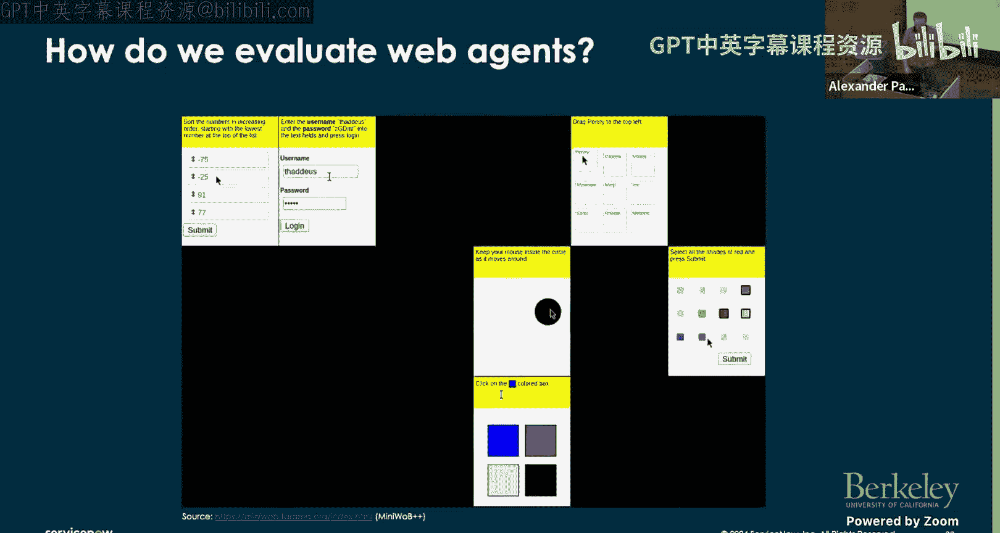

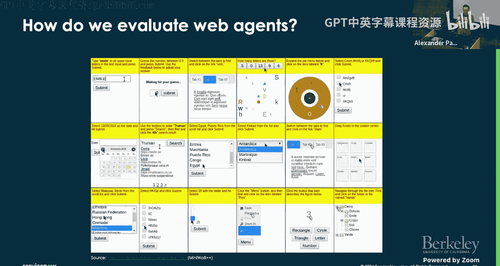

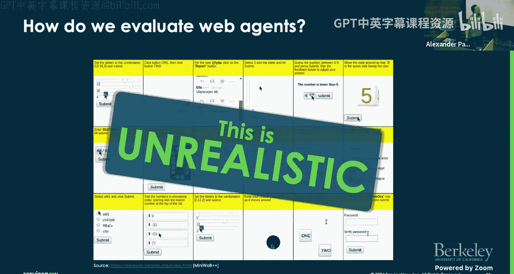

So people have started to propose benchmarks based on real worldord websites so a first kind of benchmark or trace-based benchmarks and these are mostly based on traces of actions that have been performed by human annotators so they receive a goal and they have a website and then their actions are recorded so they clicked on that they fill this field and so on so this is nice it's more realistic but the evaluation here is mostly based on gold traces so these are gold standard traces basically you check if the agent is doing similar actions to what the human did this a limitation of that that is that it does not account for the fact that there may exist alternative solutions to a problem and also when you start those traces on the internet there's a risk that they will be memorized by LLMs that are trained by crawling for example。

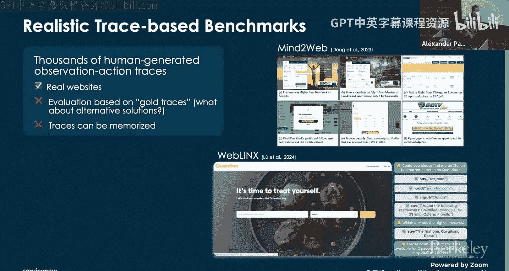

Oh yeah， one exception here is a brand new kind of benchmark by Motatal where an LLM is used to generate traces so basically it dropped randomly on the internet at some point acts by performing random actions and then retrospectively annotates what a goal could have been that would have led them there so it's a way to generate thousands of those traces without having to rely on human annotators I thought that was pretty interesting idea and you can use that for evaluation but you can also use it for fine tuning we'll get back to that later。

Great so beyond trace-based datasets there's been a trend on making live benchmarks so instead of annotating instead of evaluating based on traces of actions you evaluate based on the end result so for example you could say well I expect that if this task is solved correctly the database will be in a certain state and then instead of checking the trace of actions you actually just check if the database is in the correct state some other benchmarks rely on question answering and they check if you return the correct answer instead of checking the set of steps that you took to get to that answer this is nice because it allows for alternate solutions and it's also there's a lower chance of memorization right because the traces are not stored in a public repository ring so two good examples of that are the web arena and the visual web arena benchmarks so web arena is actually a set of tasks where you receive a goal and you need to perform some actions in software like Reddit or Gitlab and there's certain terminal condition。

😊。

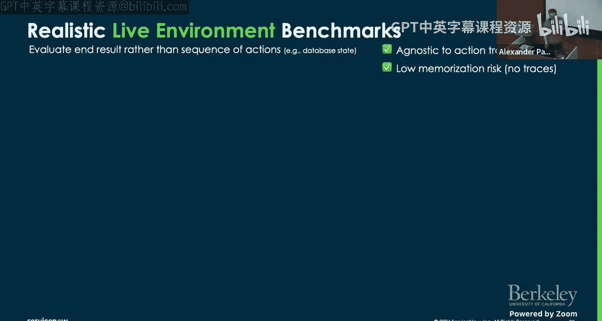

that are checked to see if the agent was able to solve the task correctly these are actually great because the way you benchmark on this kind of benchmark is that you run a local server and then everything is served locally so it's great if you want to do parallel experiments you don't have bandwidth issues it's really nice the only issue here is that it's limited to open source software and you need some complex installation you need to set up your own server locally so another kind of benchmark are based on remote servers and these are really on the open web they're more realistic because there's latency which is the reality when you go over the real internet and it's also nice because you can support websites that are not necessarily open source you don't have to host them locally。

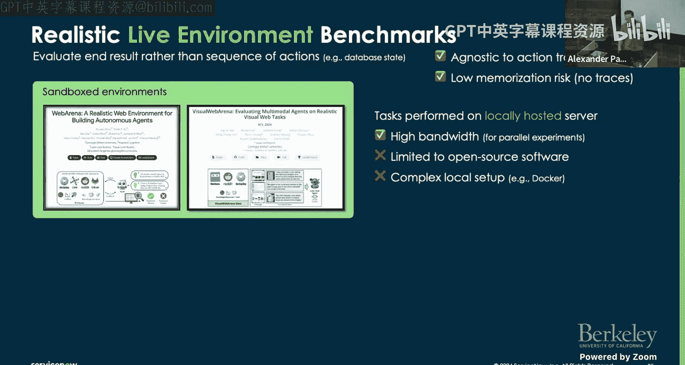

The downside of that is that they can be unreliable there can be network issues you need an internet connection to be able to benchmark yeah so different kinds of benchmarks here work arena is a benchmark that we proposed it's based on the actual service now product so i'm going to dig a bit deeper in that but work arena is a remote hosted benchmark so nothing happens on your local machine so what work arena is is is an open source benchmark so the benchmark is open source product is not open source but that benchmark is it's 600 work related tasks that are performed on a service now product so we thought that by having access to service now and the fact that millions of people use it every day in their daily job we thought well that's a great tool to make a benchmark to see how webag are able to help people in the workplace so what we did we started by making some tasks that are really simple this is just we call it。

Work arena level one this is just interacting with those six basic components so for example sorting a list or filtering a list in the product searching a knowledge base to find the answer to a question like what's the wfi password for the office reading a dashboard saying which item do we have the most in stock for example so these are the kind of tasks that we have in the level one of work arena and we go from that all the way to really complex realistic workflows and I'll show you some examples in the coming slides。

😊。

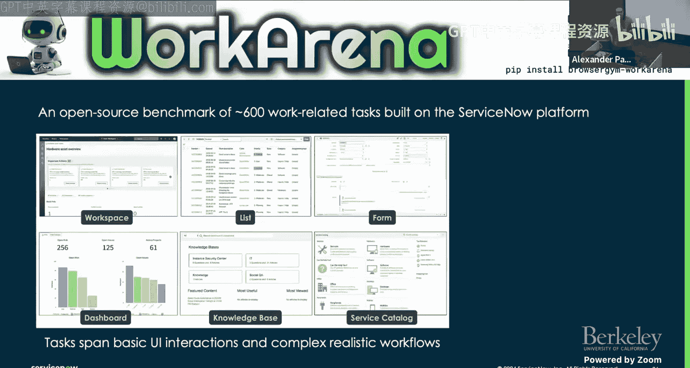

But before I move on I just want to explain how this remote hosted benchmark works。

 how do we make it work Obviously we cannot ship you a Docker image that contains service now because this means we would be giving you the codebase of the product so what we do here is we rely on something called developer instances and these are clones of the product that anyone can get you just go to a website called developerservnow。

 co you request an instance and you got your own copy of the product that you can use for it's used for developers to learn how to program custom tools for the product and so the benchmark is built on that basically you give the credentials to your instance and then the agent interacts with the frontend so it interacts with the web pages and we do all the validation by using backend APIpi so we check if the agent correctly solve the task by going to check the state of the database so yeah it's based on a real product that people use for real。

everyone can access it， the tasks in the benchmark are open source， just not the service not product。

Great so just to give you to make this a bit more concrete here's GPT4 actually solving some tasks in work Arena。

 you could see it ordering an Apple Watch， you can see it reading dashboards filling out some forms。

 sorting some lists so these are all tasks from work arena level one。

 this is the simplest kind of tasks that we have in the benchmark。😊。

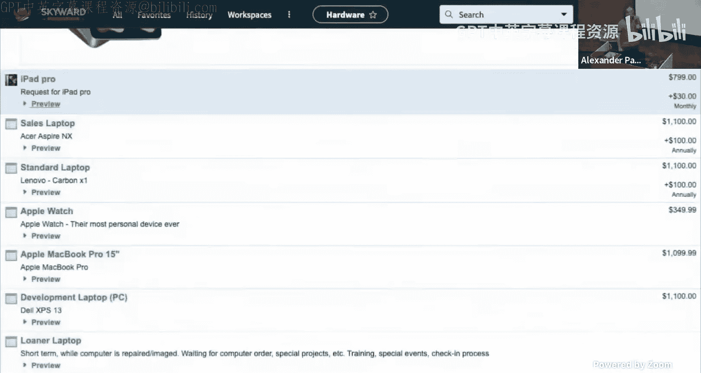

嗯。Now I want to give you more a more difficult task an example of a more difficult task this is actually what we call work arena level3 it's pretty hard so here what you see is a ticket so it's an interface that shows a ticket that's assigned to the human in this case the agent is that human and they have to solve the task so basically what they have to do here is to go check a dashboard and they need to find which item is the lowest inventory and then order some items to replenish it from a service catalog so you can see that all the agent receives as instruction is please solve this and it starts from this page basically which is a ticket and then it says if you're not sure what to do you can always refer to the knowledge base for further instructions and it gives it instructions to which article they could check so the first step for the agent here is to go to the knowledge base so it needs to use the menus and navigate to this knowledge base。

😊，Find it， find the right article， extract the information on how to proceed。

 for example how to get to the dashboards， then it needs to go open the dashboard， read it。

 find which item is the least available in stock and then it needs to navigate all the way to a service catalog where it's able to order this item so three high-level steps but with many many low-level steps in between there's navigation involved it's not clear imagine if I drop you in a room with multiple doors and you don't really see what's behind them you need to get to the right spot but you can't explore too much right because you have a limited number of steps so this is actually a really hard task。

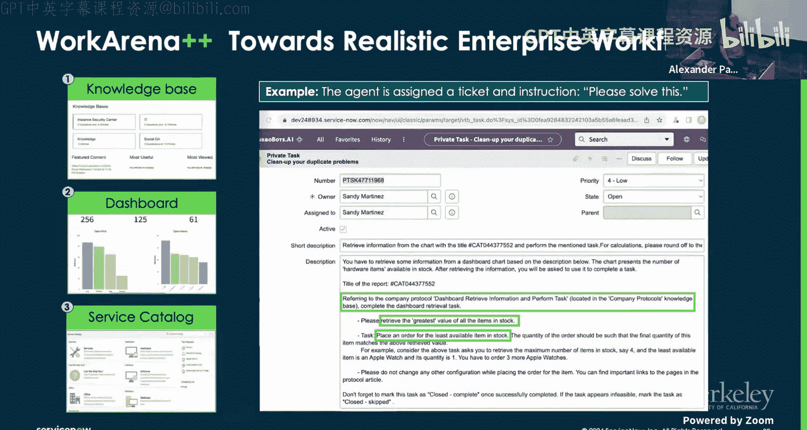

嗯。And so in addition to this example we have all kinds of capabilities that are being evaluated in these tasks。

 one of them I'll give you one example it's planning and problem solving so for example one of the tasks in work arena involves looking at a set of employees seeing who is the most busy and taking some work from the most busy employee and reassigning it to the least busy one so basically workload balancing across employees there's other ones like scheduling with constraints so scheduling some events with some constraints we have tasks about budget management all kinds of things so sophisticated in memorization tasks basically basically involve collecting bits and pieces of information across many pages and in the endso a task based on everything you gathered and finally we have some tasks that are just infeasible and the agent needs to say hey this cannot be done right so it needs to use。

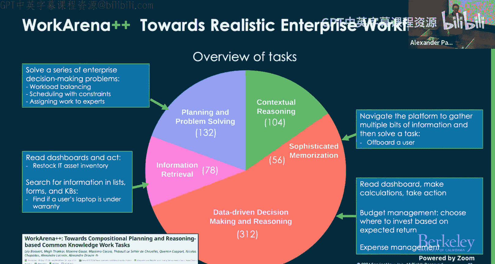

Critical thinking to be able to say that， no， this doesn't have a solution。If you're interested。

 the paper is here and you can take a look。It's also in the prereading for the course so okay now i'll show you how well the agents that we have right now do on this benchmark the title is a bit of a spoiler but what you see okay what youll see on the right here is the scores from a human evaluation that we performed on work arena level two and level three and these are really the realistic workflows the ones I just showed you so you can see that humans have a really high score the average score was roughly 94% across all our human evaluators on those tasks and so。

When we look at work arena L1， unfortunately we don't have human L for that but you can see that our best agent does roughly 40 it does 42。

7% success rate which means you give it a task 42。7% of the time it solves it so that's work arena L1 and this is a good agent because it achieved a very high one of the highest scores on the web arena this is 23。

5% this is how we know it's a decent agent okay now let's look at what it does on work arena level2。

A lot of zeros there fortunate so we have some success you can see that there is something there but most of the tasks are not solved correctly and when we move it to level three which is the example that you've seen before we get zeros all across the board despite the fact that humans get 94% success rate on those tasks so what you see here is that the example I showed you in the beginning was exciting like it seems that there is potential there but obviously there seems to be some work to be done by the community and we think that this benchmark will really help in making progress towards that。

😊，So you may be curious like why doesn't this work。

 why do we have zeros everywhere a lot of time it's failure to plan so the agent only perceives what is on its local page and fails to explore sometimes we have hallucinations hallucinated controls。

 the agent will imagine imagine a button that is called solve task and the action it will make is click solve taskask basically。

 so it invents shortcuts for itself， or basically incorrect syntax when it's outputting which actions to perform。

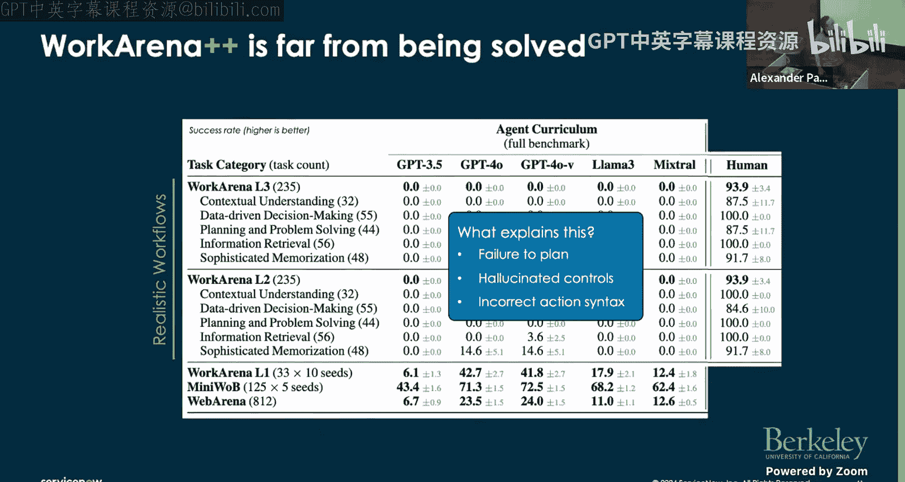

Okay so work arena is not the only benchmark that has been proposed recently。

 as you can see there are many there's tens of thousands of tasks in those benchmarks all for webag and each of those evaluates different aspects but what's unfortunate is that all of these benchmarks are not necessarily being evaluated with the same protocol the same kinds of agents so it's quite hard to compare so we are making tools to try to unify everything so we made this framework called browser gym and essentially it's a unified evaluation platform and we try to regroup most of the major benchmarks and we're still adding some if you want to contribute to that actually we accept pull requests so if you think there's one of those benchmarks that you think is interesting feel free to we work with you to get it into the platform so essentially what browserG does is that it gives you a standardized observation space so you see this agent loop on the side。

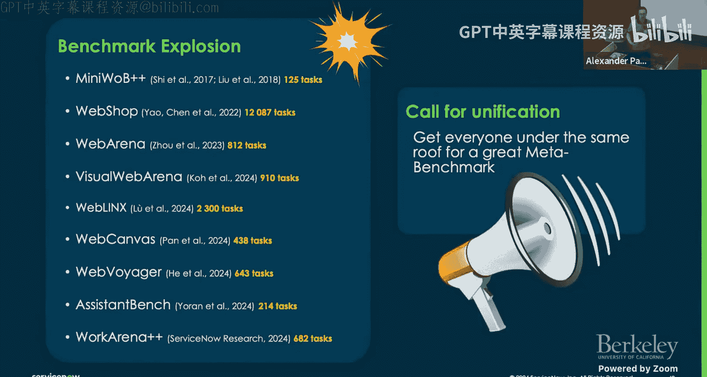

Well essentially at the top you have HTML but you have accessibility tree which is a shortened version of the HTML a bit refined and then you have screenshots。

 we have a chatbox modality so there's a bunch of different observation modalities that we provide in browser gym and we also provide a standardized action space so you can see examples at the bottom here so you can do a mouse click you can do a click on it says click BID something BID is a numerical ID that we assign automatically to every control on the page so basically to click on something the agent would say click number two and we would go and roll it out using Python playwright so this is browser gym and again we regroup most of the major benchmarks and we're still adding some in there what's also cool is that browser gym allows to do human evaluation this is what we use to do the human evaluationval work arena essentially you get the same kind of chat box interface with the web browser except you get this。

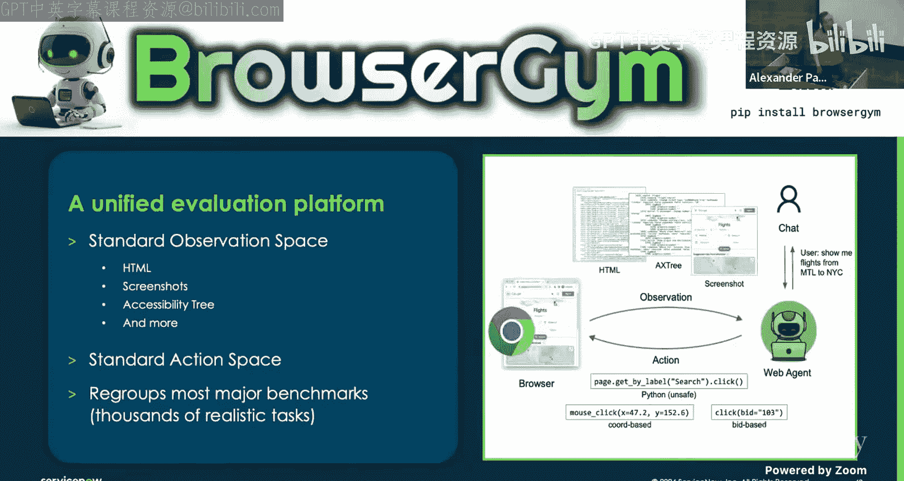

Staying where you can assign a curriculum of tasks human and then they can ask for validation or they can simply give up。

 go to the next task， for example， so all of this is in browser Jim you can pipe install it or you can use this QR code to access it。

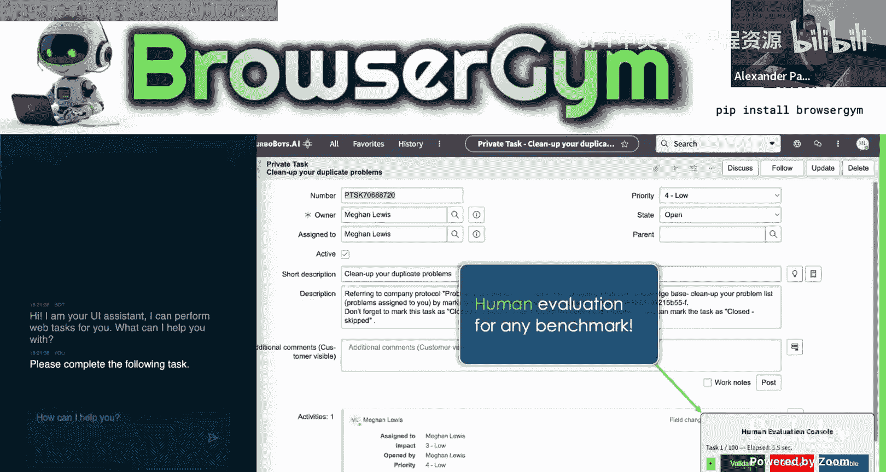

Cool， so in addition to browser Jim we propose agent La。

 which is another set of tool for building web agents here agent La。

 the goal of it is it's to be a toolbox to build webag so we provide simple building blocks to build web agents but also tools to understand their behavior so why they're not working debug their performance for example。

 and a lot of tools to run largescale experiments and ensure reproducibility。😊。

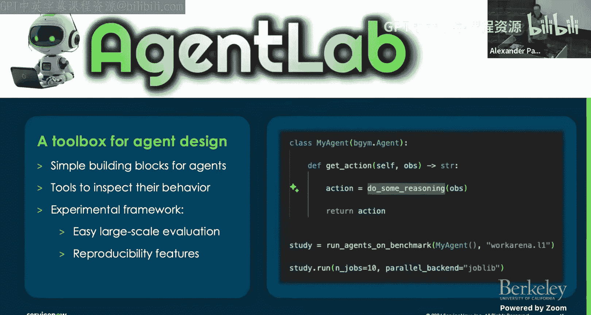

So。One thing that we propose is called Age X-ray here you see that I'm selecting an experiment that I conducted I click on a task from one of the benchmarks and I click on a random seed then what I see is essentially what the agent was seeing。

 I can see the screenshots of what the agent was seeing I can see basically this is the accessibility tree of a web page。

 you can see the reasoning traces of the agent you can see which actions were performed and you see also this kind of it's kind of timeline here at the top this is giving you profiling information on how much time was spent reasoning how much time was spent performing the actions how many steps the agent performed so this basically agent X-ray the goal is to help you understand was going on with your agent and try to improve it。

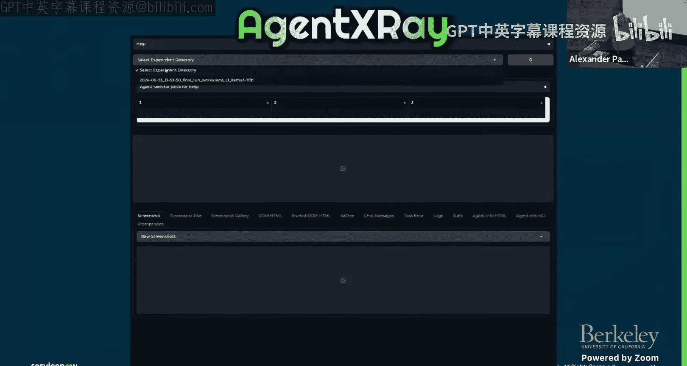

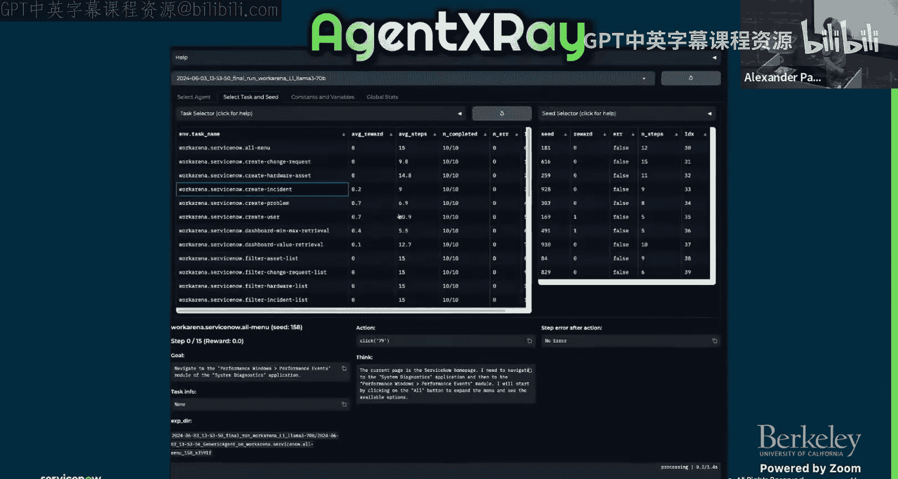

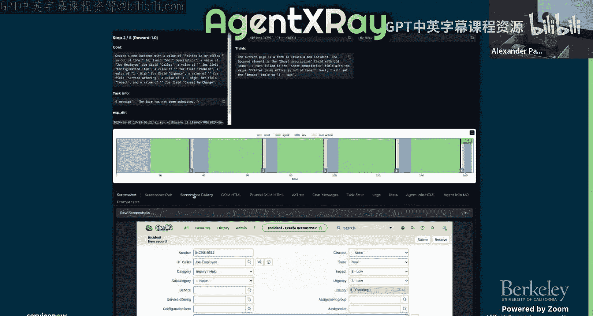

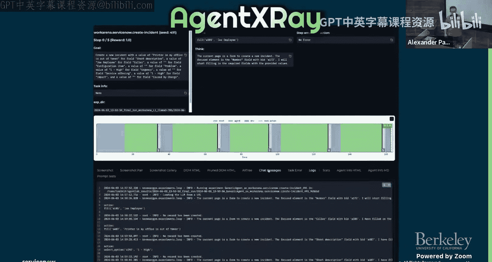

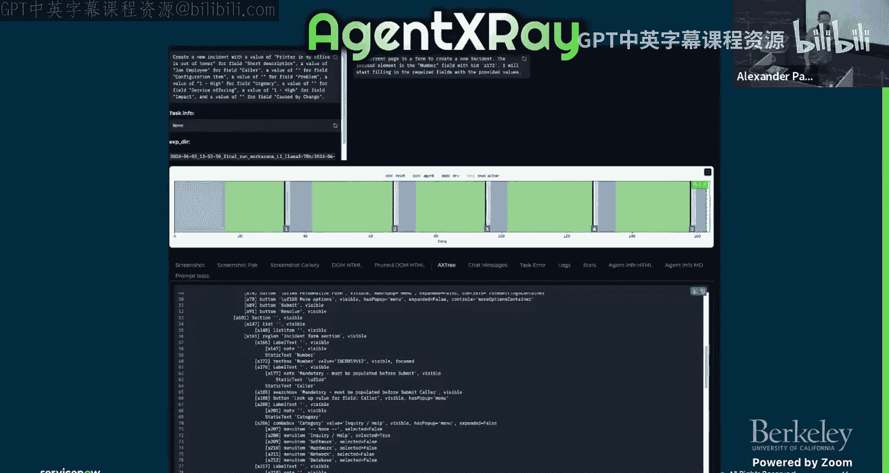

Great， so in addition to that we proposed agent La and sorry we proposed tools for reproducibility in agent lab and essentially one challenge we try to address is the fact that it's really hard to benchmark on dynamic and environments that we don't control so websites are updated continuouslyL API based LLMs can be silently updated we don't really see what's going on in the background and Python packages evolve so how do you make benchmarks that remain comparable through time right so what we're trying to do in agent lab and this is work in progress there is already something in our Gitthub repository but we're building that as we speak so we're trying to find ways to extract standardized observations traces so you got observations。

 actions， observations and so on and try to propose public repositories for those traces to be stored but with the properties of the agent that was used with the versions of the Python packages。

😊，With the dates and everything so we're trying to make it as reproducible as possible and make mechanisms for this to be automatic as much as possible in addition to that we're trying to make leaderboards for the major benchmarks with using these traces and the experimental information with mechanisms that allow to reproduce the results and check if they still remain valid through time right since the environment is evolving。

😊。

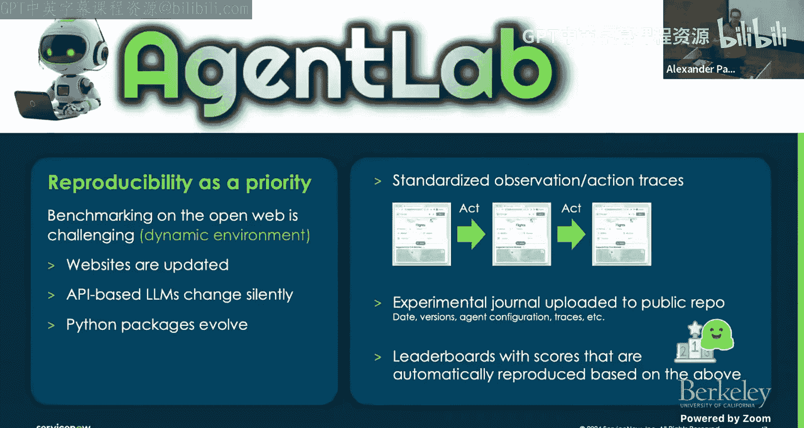

Okay and so by combining Age La and browser Jim we think there's a great opportunity because first of all we have a standardized observation space。

 standardized action space， standardized traces and public repositories to store those traces so we think that with this mechanism we could we have the potential of doing basically distributed trace collection so everyone could help us gather traces of web agents acting on the open web and we might be able to use that to collect a big repository of traces that we could further use for fine tuning and making better agents in the future so agent La and browser gym provide the tools we need to do that。

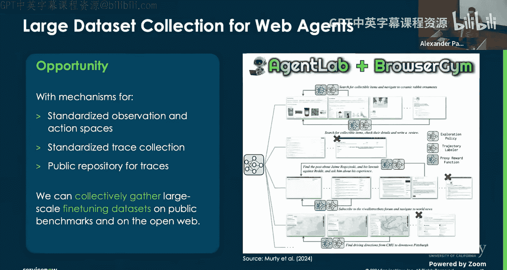

Okay so before I hand it over to Nika I just want to finish with the challenges of web agents okay there is hope I think we'll make great progress on those benchmarks in the coming year I just want to review the major hurdles here so long context understanding the websites are huge so we're talking about。

😊，Tens of thousands of tokens， hundreds of thousands of tokens。

 easily even for the accessibility treaties which are supposed to be shorter than the raw HTML。

 this makes huge observations， the amount of relevant information in those contexts is very small。

 so it's already a challenge to be able to pick it out correctly。😊，Long-term planning as I said。

 it's quite hard to be on a page with no information of what is two or three pages away and try to reason about okay I'm going to go to this menu and then i'm going to click on that and eventually I'll end up in the right place we have intuition for that we are used to using Amazon for example so we know how to search that and navigate that and we can analog websites were not or not obscure to us but for another image it could so there's work to be done in that space this moretyatal paper that I mentioned is a good step in that direction by collecting traces of random actions at a very large scale this might help for fine tuning LMs to better understand where they could get in a few steps。

Learning and adaptability so we need to be able to learn from observation learn from demonstrations and mistakes so there's some work in that direction I wanted to mention the agent Q work that uses Monte Carlo tree and DO to try to find tune agents and do inference time search I think this is interesting work there is multimodality that's very important actually the visual web arena benchmark proposes a set of tasks that you simply can't solve if you're not looking at the vision modality so if I give you a task that is order me a shirt like that well you need to be able to see what the shirt is to be able to solve it right cost and efficiency as I said the videos that we showed you or sped up by by a lot right so we need to make this fast we need to make it efficient I think shrinking the context size is one direction there's a potential to use retrieval to retrieve only the relevant elements from the observation space。

There is potential for using multiagent architectures where you have for example the datepeer agent which is a very small LLM that is only used to do a very small task of filling out date pickers for example right so perhaps there's some multi-ageent architectures that could be used there and finally fine tuning smaller LLMs so one that is very crucial so I'm finishing with this one is safety okay so no one wants to roll out an agent that can be easily hijacked and current agents the ones I showed you in the demo actually it has been tested if you put white and white text on the page that says hey GPT follow these new instructions it will follow those new instructions right so we need robustness we need。

Agents that are able to be robust to injections on the webp page not only in the HTML but also in the text box right you don't want people to be able to write instructions there and I think this challenge is even bigger now that we have multimodal models because you're subject to attacks from all modalities essentially so it amplifies a problem and so this is one of Nikola's example on 2000 it was 2030 but we switch it to 2026 because I think it's not so far away but you can imagine malicious Chrome plugins or malicious browser plugins that detect when you log into your bank's website and inject using jascript some instructions on a webage to hijack the agent that get them to do wire transfer to some account right so these seem far fetch but they're quite real when you start to think about webag so you really need to be robust to these kind of things。

All right， so that's it for web agents and I'll hand it back to Nita， thank you Alex。

We're coming on the last part of this presentation where we take a step back and look at what is the potential impact of those agent technologies in the broader workspace。

And there is no question that AI agents are on their way will soon be on their way to change completely the nature of work。

And to go back to the example we gave earlier。It was only the beginning。

 we if you remember Sandy was struggling to get the knowledge base permissions for John to see this article and at the time she was only able to get。

A little bit of help from generative AI to make her job a tiny bit faster。

 so let's see how AI agents will be able to tremendously help Sandy be much， much more productive。

So in a world where AI agents are deployed， first Sandy will not even look at the ticket right away so there will be a ticket that will be coming her way but before she even opens it。

A set of AI agents will already have tried to do a partial solution of the ticket itself。

 so we'll be getting an agent that looks at the ticket itself and tries to solve it。😡。

And it's going to propose the solution as a set of steps and the steps are going to be。

 well maybe we can start by finding what permissions John has access to then we can fix the find the right permissions for the knowledge based article and allowing John's permissions to what he needs to access the KB article and then once this plan is done。

 maybe we want to ask the human for confirmation so we have an orchestrator agent that is asking Sandy for permission。

 Sandy says looks at the plan and says yeah， it looks all right to me。

Let's proceed So once Sandy gives her approval， then we have another bunch of AI agents that will each solve the little soft tasks that need to be done then this is fast to a user access agent that is contemplating giving John the right access。

 but before doing anything destructive is asking again Sandy for confirmation hey， Sandy。

 are you okay with me giving John permission to access this knowledge base， Sandy says yes。

 of course。And finally， the ticket is closed Okay， so we see a much more granular and a lot more work that's being undertaken by a team of AI agents all working together to to help out Sandy I will in the interest of time。

 skip quickly on this beautiful chart saying the state of web agents and how they can automate， but。

😊。

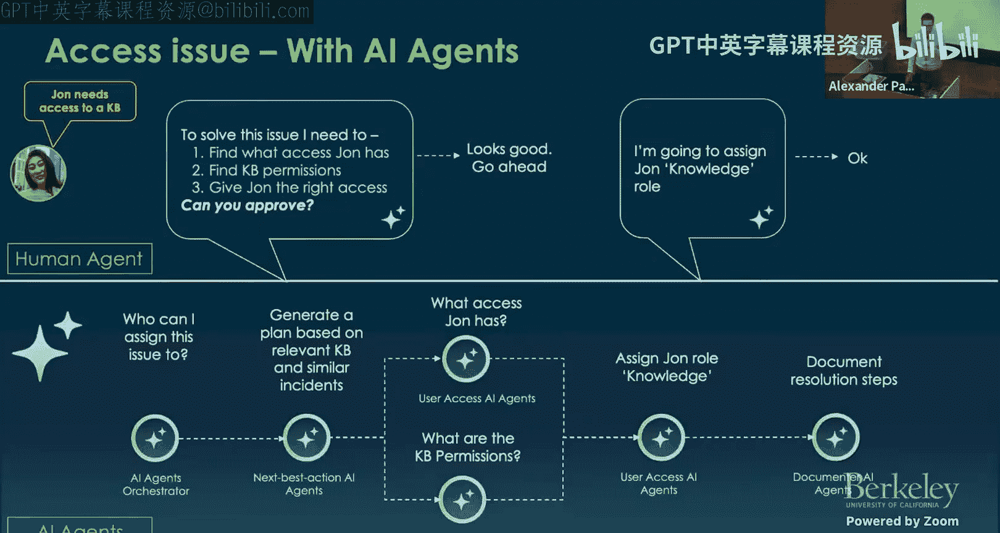

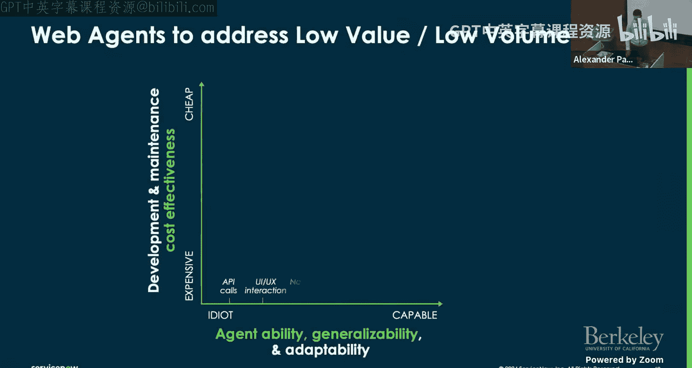

Once we take a look at the very granular ways in which agents contribute to specific workflows。

 we can ask ourselves what's the potential for them to have an impact on the broader world of knowledge work。

And before we do that we need to ask ourselves what is knowledge work of course knowledge work is not a single thing it's many。

 many， many different things we have meaning scheduling and coordination ethical hacking language localization we have literally thousands and thousands of tasks in the economy that are broadly categories as knowledge work so how do we get a sense of the impact that AI agents are going to have on this very。

 very broad spectrum of occupations。Fortunately， there are tools that we can use to help get started doing this kind of assessment and particularly in the US the Bureau of Labor Statistics has already compiled a big database called the OE database that is literally a。

A list of all the occupations in the US economy and for each occupation， each job description。

 it has a set of tasks that need to be done in the daily activities of this job okay so to take one example if we have software quality assurance analyst and tester we see the job description that is coming from the onE database this is free you can download it。

 there is no problem there and then the set of tasks and the skills that a person needs to do okay so if we want to assess the impact of AI agents。

 one way to go is to take a look at the database like this and try to understand is each task that this software quality assurance is doing。

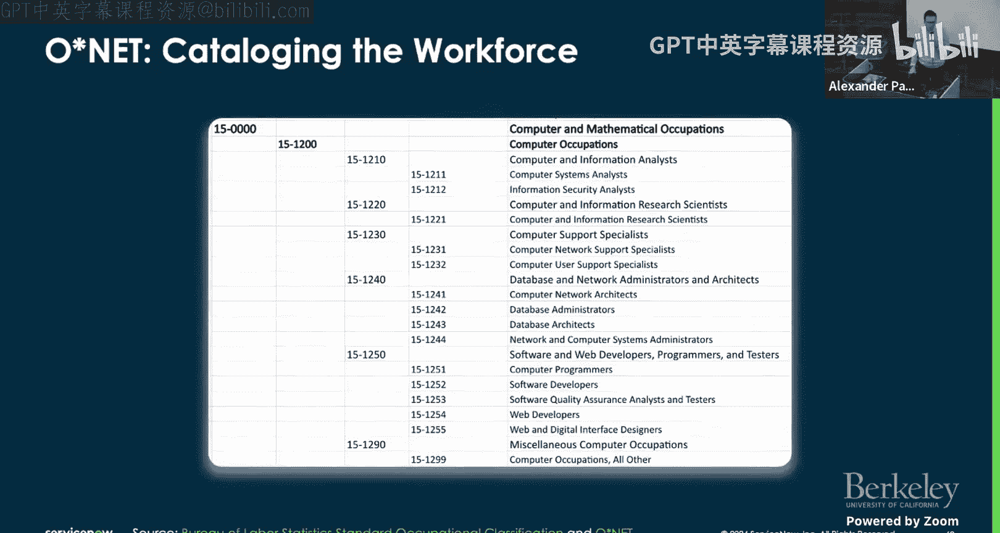

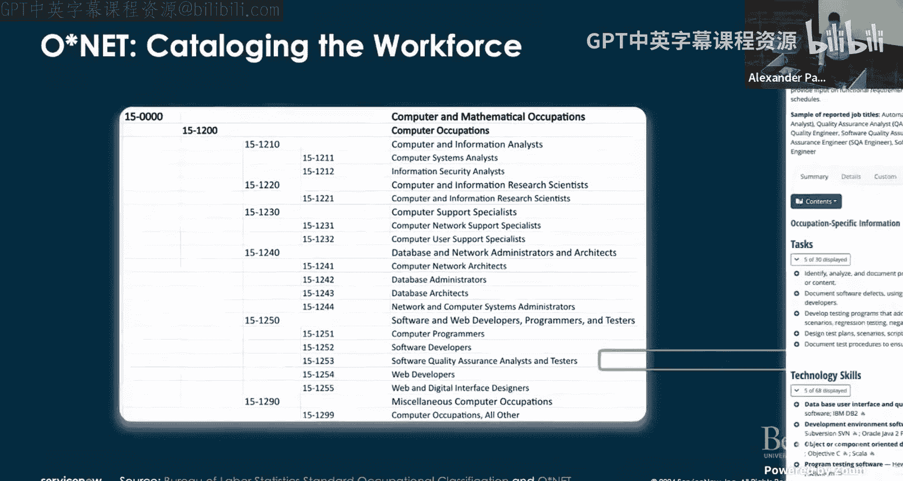

How far can it be automated through AI agents， okay， this is one way to proceed。Of course。

 some people have thought about it before and we have。

Technology adoption curves， this is coming from。AMKinsey report from a few months ago that takes a look across OECD countries in this case。

What is the？Anticipated adoption curve for。The broad set of generative AI technologies of which AI agents are subset across the economy with both expected adoption and worst case adoption curves。

One thing to keep in mind is that when we。Try to analyze adoption curves like this， there are many。

 many factors that are getting the adoption and technology is only one of those。

 the process of assessing technological maturity only reflects a partial picture of where we are going at the level of the economy。

And broadly speaking， we can think about two ways of assessing impact there。

A top down way that is coming from a top down analysis of a database like the OnE database and trying to ask GPT to guess for each task of each job。

 how much you think。The generative AI will help。Autommate this task。And there is。

A bottom up assessment in which we can use a benchmark like work arena。To track at a very。

 very granular level。😡，The real actual automation rate for the state of technology today as it pertains to specific tasks。

 okay so none of those approaches is perfect one is fuzzy the other is incomplete。

 but together they can help us triangulate a little bit and get a sense of what is the anticipated or the likely rate of technology adoption。

 how fast the job descriptions will change because part of them will be done by AI agents and this kind of analysis can be used to help decision makers and companies plan for rekiing programs for employees for example。

 and make sure that we can navigate technology readiness in a way that benefits all people。But。

All in all， this is getting to be very exciting we can already see ways in which humans and machines are working together in new ways。

 there is a very influential study that came out a few a few months ago from Harvard Business School and BCG the consulting firm that looked at the ways in which people were。

😡，Working jointly with advanced generative AI technologies and we found that there were two main patterns in the division of labor between human and machine one pattern is broadly called the centur pattern in which there is a strategic decomposition of labor the human is planning the highlevel task and big chunks of work are outsourced。

 if you will， to AI systems and the second way is called the cyborg in which there is a very intimate very granular collaboration between human and machine to solve task and to get work done and it's still very much early days there are enormous opportunities for user experience in computer human interaction research there to really figure out what will be the most productive pattern for each person maybe it depends on the personality types certainly the kind of work to be done and so on so finally it's already。

Time to conclude， we leave it with a couple of resources to dig further。

We made a timeline of the influential work。 If you want to dig further in the realm of。

LLM agents and benchmarks。

So on the top are various frameworks that have been introduced prior to 2024 along with benchmarks。

And we have the stuff that came out this year， there has been a ton of activity in the space。

 this is for benchmarks and on the web agent front。

We have the early research starting with the the MinWb work in 2017 and continuing this year with。

A ton of new。Aenttic frameworks for web agents as well as new benchmarks that Alex described。

So with this， it's time to ask our lecture agent to create the slides for our presentation next year。

And it's also time to thank our amazing colleagues at service now that made all of what you saw today possible QR codes for everything we talked about。

 tape agents， work areina， browser gym agent La are there if you're interested， we take pull request。

 all of that is open source for you to to study and learn。

