# UCB《大语言模型智能体｜UCB CS 194 294-196 (LLM Agents) 2024》中英字幕（Claude-3.5-sonnet翻译） - P8：Lecture 8, Yuandong Tian.zh_en - GPT中英字幕课程资源 - BV1RsZPYsEtE

My name istian。 I'm a research scientist director in my AI fair。

 today I'm going to talk about our recent work on the AM reason and planning domain and also agent domain。

 So the title is towards unified framework work of neural and decision making so we all know that large model being used very extensively in many different scenario so here I'm basically list a few possible applications that larger models has only proven to be super useful right So people have been using large models for conversational AIs to generate content right and also use that to play against each other to do role play and also AI agent as well。

 and recently larger model has also been used for reason and planning and we also see that by using for channel thoughts the reason credibility of larger model actually become much better。

 and at the same time we also see issues。😊。

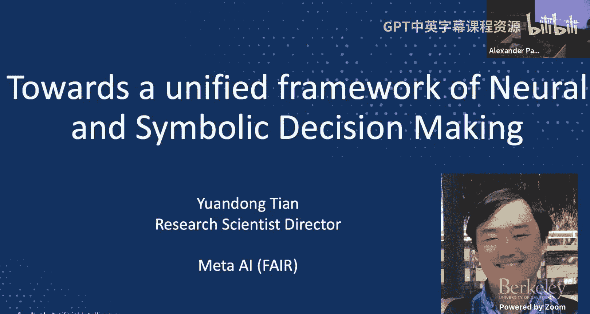

With larger models when we are trying to leverage that in different planning tasks。

 so if you are in in this lecture， I'm going to be focused on the learning and planning component since like in manner I have been working with a bunch of very creative and very talented people together working on larger model with using and planning and try to find a way to make their planning and learning technique and strength become much stronger to the next level。

So let's see what are the interesting components that we can do for re planning。😊。

So one thing that we're want to think about is that in order to improve existing reading planning capabilities。

 of course， we want to understand what is weakness and how can we overcome how can we like overcome such weakness with different approaches here's one example that I probably use it for many different scenarios for showing that large model really does not plan very well in different scenarios。

 especially in scenario that is common in our day life right so when is the example is the travel planning problems right so for travel planning the task is super simple right we just ask the large model about a travel plan so I want to say I want to go to Hawaii I want to go to Seattle I want to go to California at some specific date with some specific budget and then I want am to give you give me a very clear。

😊，Excutable， feasible and even optimal itinerary。 So this is the task we want to go right so and in order to achieve this task。

 then people may still start to think about like some agent behaviors right So of course you first want language model to query a few informations a lot of information from out from internal word right So for example。

 you can ask like model to do like a search right so and it will give you some of the possible directions。

 a possible destination on to go right you also want to ask like model to do a flight search or a hotel search and you get multiple entries of possible hotels as basically and also the flight informations as well。

 So once you have all this information putting together then of course you want a language model to plan right So give all this information。

 hopefully the model can figure out a pass。😊，An itinerary that will connect all the editing formations together into a clear path or itinerary that it can be executed。

😊，Right， so the figure to the bottom right basically like the the figure the the the basically the the the real plan that we want to use in order to execute the plan。

😊，Okay， so but interestingly， what happened is that if you actually use the current language model to do this planning task。

 it's actually not doing very well so this is a paper that we published in DCs IM as a spotlight in in newspaper paper this is the main table that we put to show the incability of language models for solving this kind of problems。

😊，RightSo first of all， the top chunk of the table basically shows that even with the G4 turbo。

 which is the model that is the strongest at that time。

 we actually see that the final pass rate of the entire travel itinerary is only 06% so here if have percentage here whether we don't show in the top right so but even if like we give the language model。

 the ground truth information of the tools， then we ask the model to directly plan the travel。

 then the final pass rate is also only like 4。4% so the pass rate definition is very simple given the itinerary。

 you really want to see whether every stage of the travel satisfied the constraints we see the constraint means that you might have a criteria that you don't want to be in no smoking in a smoking room right so you might want to say oh。

the cannot exceed some fixed amount of numbers et cea。

 so you can basically have some code to check whether the travel itinerary really pass all these criteria。

 but unfortunately the final plan quality is not great and you have to really have human involved in order to find a plan that is really executable。

😊，Of course， I mean people will say okay， this is like a paper that only that basic paper that is being published early this year right so and you know like in lecture model era。

 every month counts every week counts right so and people publish the paper publish like half a year ago basically means like it's like an ages old and people don okay anymore so how about like using all ones always like the current seven models for the reason and planning。

😊，And thanks for the courtesy of the first author for this paper。

 we also get some over numbers with this short planning benchmark。😊。

And what happened here is that you still see that the overall pass rate is not great for OM mini and also OM preview。

 They are even worse than the model that is fine tuned to that particular task。

 So it's not really solving you the problem for the child planning problems。😊。

And you can actually see the same thing for the A plan and in other inner scenarios。

Right so you can see that so the figure to the left is actually from the defined Gemini team。 right。

 So in that paper， what they show here is that for planning problems like trip planning and also meeting planning you you see that the performance actually jobs potentially with more complexity in terms of the number of variables and also the scale of the problem for the planning task right。

 So while like Gemini is still is doing like great in this benchmarks you could see that this a worrying trend all the way down to0 where you have more and more cities or more more people showing that the problem skill goes up right Okay。

 so the figure to the left basically shows the performance before O release。😊。

But the figure to the right I should show what happened after long release。 Of course。

 you see that O is actually doing a very great job right。

 so you see super high performance when for when this are apply to kind of a smaller scale problems。

 like big gap between O1 and also existing models。 However。

 if the scale of the planning problem goes goes up right。

 so the plan is from going from two all the way to like 14 or 16。😊，Then all of a sudden。

 you see that the curve also drops to0 right， So this is actually from OSU。

 The paper is called AM cannot plan as a study on that。

 So this actually basically give you the kind of sense that while you can see the bias term of the curve is moving up substantially the trend of the entire curve still goes down substantially and it the trend does not change over time。

 right， So this is actually in something the very worst kind of curve that even the best model that we have encountered have have not solve this kind of problems。

😊，Of course， like the next slide will be what is the solution， what are solutions？😊。

So in this lecture， I'm going to talk about three possible different categories of solutions。Right。

 so and they are listed there。 So the solution one， of course， is the scalingating law。 Okay。

 and well say with small data， more compute and larger models。 And hopefully in one day。

 then you're going to see a better performance and going to eventually solve all these problems without these bigger models。

😊，RightSo of course they are very expensive and then this also involve like a lot of engineering challenges。

 but may not necessarily involve like a new kind of thinking and thoughts about this。

 how we solve these problems。😊，That's definitely one pass。

 I know to comment on like how good or bad of this comment of this pass。

 but this is just the one option， something that you can think about。😊。

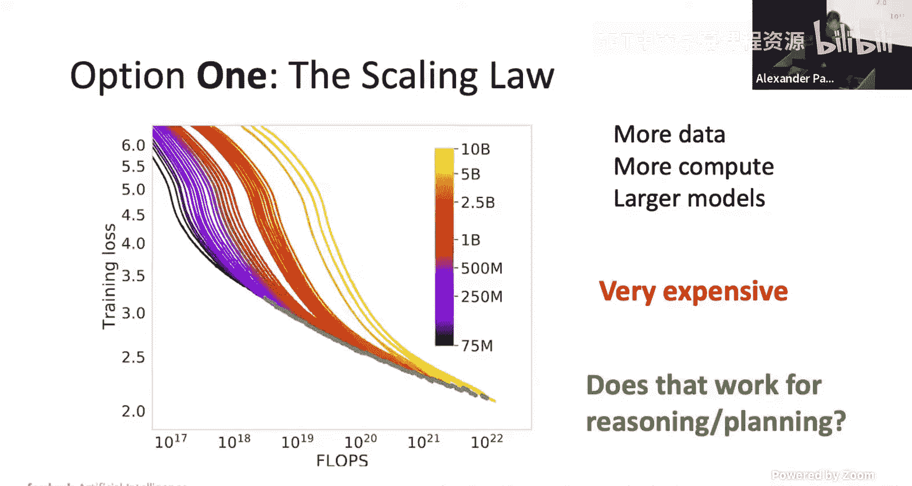

There's a second option that's called hybrid systems。In in that option。

 what we can think about is that okay so we can see is very clear that theres are two complementary path。

 if we use deep models like foundation models they are very good understanding the natural language instructions but they are not doing very well in doing like very good planning tasks right so they will have like a better solutions the solutions not have high quality etc cea。

 right So on the other hand， there's another word called combatorial solvers or symbolic solvers So these solvers are basically can give you optimal solutions in many different scenarios and will have guarantees and often run super fast compared to neural networks and do not require GP in many cases。

 right so and these are basically like a very good solvers for complicated planning problems but at the same time these solvers don't understand natural language。

 They don't understand user' request。 they don't understand。😊，flexible scenarios， right。

 so maybe we should combine them together into the same system。

 then you're going to see that these two can be put together and you can give you something that is stronger than both of the side。

😊，RightSo on these options， there were。 There are like a several different way of combining them。

 So which are you going to talk about in the following slide。

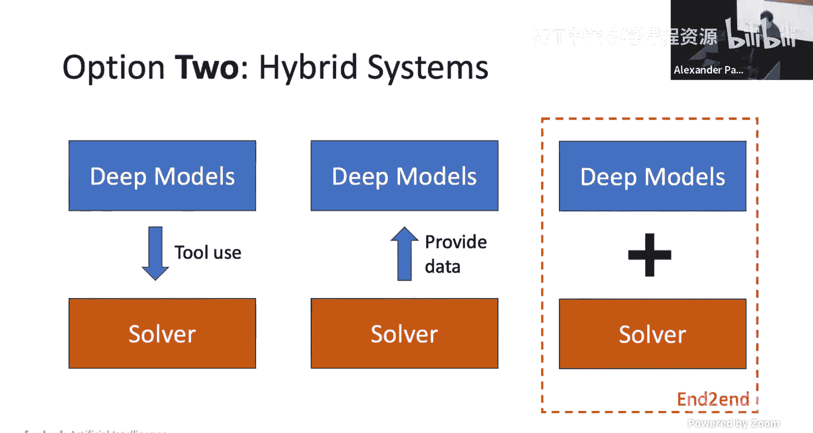

And that's actually option  three， which is actually say that there is actually a way to understand neural and find that there's a symbolic representation that emerges automatically from the green descent of position。

😊，So that's something that could be super interesting。 And recently。

 this is something that we have found in our very recent research。

 But I'll going to talk about that later after the option，2。 Okay， so let's start with this one。

 So there's a different ways of combining the models with server。 of course。

 the first one that we can do is the tools。😊，So for this。

 we actually have a full of work for the travel planner about how can we leverage mixture inger linear programming and neural to work larger models together in order to solve the travel planning problems。

😊，Right。So here instead of asking the language model to directly give you the optimal itineraries。

 which is very hard and even inible given the current problems of issues of language models。

 how about that we can ask the language model to first convert the natural language input into J file so here's J file and given the J file and give you all the scenario presentation of the request for the for the user and given this request combined with the hotel information you can actually call a solve here we are using mixed inter linear programming solve。

😊，And thatover will give you some symbolic description of the optical itinerary。😊。

And you can use the opt materialary and you can convert that back to the actual sentences。

 and this will be used as the response of the agent。😊。

RightSo you can do this instead of like do a direct pass。

 You can take the tool through the symbolics server。

 and that tool will give you some solution that is guaranteed to work better。😊。

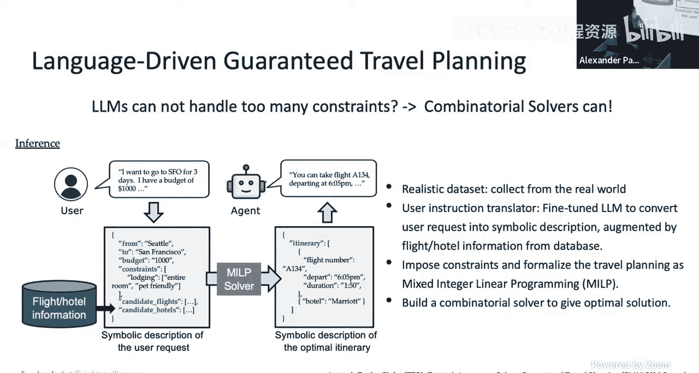

So we actually build a demo on top of that and our demo actually was just accepted in this EMP demo session holding to be held in Miami。

 If you are interested and people are joining EMMP， please go ahead and take a look。😊。

So this entire thing can be a demo because it's in real time。

So here is like this a breakdown of the speed right so you we actually find tune an instruction translator and that will take like two seconds 2。

5 seconds to translate from natural language all the way to the J file and then we also have MIRP solver engineer a programming solver that will basically solved problem and solving is actually sufficient very very fast。

😊，It takes0。5 seconds，7 seconds to solve problems so that this will make the entire demo real time and people can actually play with it and we also have human evaluations and basically like a human ask human subjects are asked about these questions the system is useful whether itten the requests whether they offer a good amount of value for the money and whether this is sufficient or efficient and youre can to see that most of the human subjects they are inect positive on our system compared to the baselines okay so that's actually quite interesting。

😊。

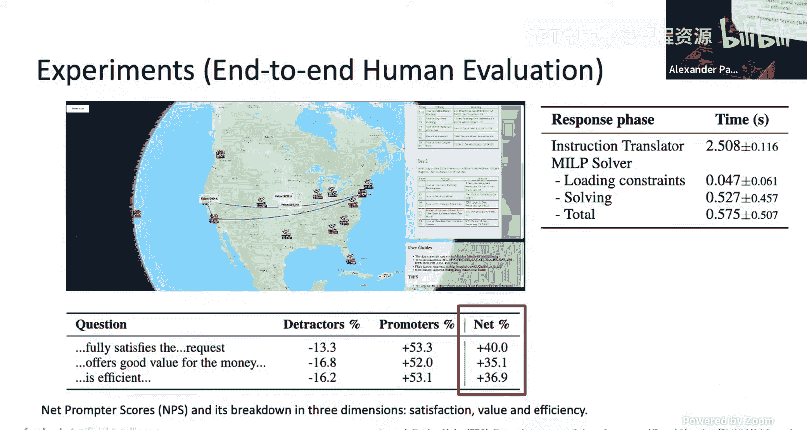

Of course， the next step will be motor on dialogue。 right， So here in the previous systems。

 what we do here is that the the agent basically take the single。😊。

round dialogue take the user request at one single round of the request and send this request to the to the new network to the large models and you convert to Json file。

 But in practice， People are not doing that， right People always start with some rough idea about travels。

 I want to go to Hawaii。 I have no idea what else， but I' go Hawaii。

 But then agent will try to ask a little bit more about details。

 How much budget like are you are you people who really care about money or are you people who care about experience。

 right So there are actually a lot of detailed questions。 You really want to figure out。

 And this is actually a natural scenarios for motor round dialogues and discussions。

So in order to achieve that， we actually train an agent。

Then that can basically like proactive ask questions。😊。

To the to the agent to the travelers and traveler will answer these questions accordingly。

 and the agent is aiming to efficiently get all the information with the minimum round of dialogue and then convert them into Jason and compare this Jason with the ground truth Jason that's been created privately from the de generation process。

😊，Right so and how we achieve this agent is that we actually design our agent constitution in order to allow the agent to follow these instructions right so the constitution that we develop is called APEC constitution so it consists of three four different component right so firstly you want agent to be super accurate。

😊，And second， you want agent to be proactive。 means that you want agent to ask a question proactively to get answers。

 You don want agent to ask written questions。 That is not interesting。

 you you also don't want agent to be very press， right。

 So I want agent you to find what are the interesting question want ask and then answer them。😊。

And we also want agent to be efficient， which means that agent don't want to waste time and efforts to evaluate questions。

 but most important questions， the agent also need to be adaptive to different different types of the travelers so we actually set like 50 different person of the travelers each person of the traveler will deposit different behaviors and this traveler will have private hidden spreadsheet of most critical information they really want to get it correct right so and then we want to compare whether the agent can actually get all this informationform in a short amount of time and finally we also want agent to be credible。

 which means that less hallucination， less inconsistency etca。😊。

So we can use all these constitution and we can fine tune models and we can see that after several fine tuning using DPO。

 our models actually become a bit more efficient in basically like two categories when it's called overall overall means like all the entries and critical means that critical entries for particular persona of of the travelers out of like 50 personas and we also want to optimize the agent scores involving practically clarification and cea and we see that after a few rounds of DPOs the performance actually goes up and the system also doing good job here right so it's interesting showing that if you use like agent constitution it's possible that we can improve agent performance along different access。

 simultaneously ten with very simple techniques。😊，And this can be also better than existing approaches。

 like if you just use Lama super 1 B 18 billion models。

 the performance is actually not great because it's not been fine tuned along these directions。😊。

So recently there's a separate paper that is also is also like involved like multiple like meta authors。

😊，Is that alternative we might also use agent as a judge instead of having humans as a judge right so in this paper what we do here is that traditionally we basically use larger model as a judge to judge the behavioral agent and we may only check like the final results of agent given all the outcomes but in this paper we are trying to use agent as a judge and the agent we try to check like every steps of the of the target agent and to see like whether where they are doing very well or not。

😊，And doing that， we were able to give you more refined and more rich feedbacks for the main agent to improve。

 okay。😊，Okay， so we are finishing this first part of using deep models to call the server in order to finish the task。

😊，So let's proceed with the second part， right， So second part is that maybe there's a different ways of combining agent combining the models with solve。

😊，The second part is like， how about we use the software to provide data to the models to trend better。

For this one we actually have a bunch of direction tasks a bunch of research directions that are actually are showing this is also a very interesting and nice trend to follow right so for this we're going to introduce these search for results。

😊，And for such For what we do here is that the goal is to basically predict the outcome of the planning task so here is a very simple planning task you have a mace。

 you have multiple walls and you want to find what is the shortest path between the starting point and the goal point。

😊，Okay。So here the maze is 3 by 3。And shortest pass is very simple。 Now。

 you just go all the way down and to the right。 sorry， and to the left。

 and then you go to destination， very simple。😊，SoBut if before you actually get to the destination。

 get to the optimal plan， if you execute symbolic solve here the symbolic software is a star search so A star search is a very seminar work that trying to use a heuristic function to find what is the optimal pass。

😊，From the beginning state all the way to the end state。

 it' being used very extensively in many different scenario here。

 we are just use the use this approach to find the shortest pass。😊。

So if you think about how HS solve the problem。Before it actually give you the final optimal plan。

 it also give you all the intermediate steps in order for you to reach the optimal plan。😊。

RightSo for example in this particular case， what happened is that A search will start to create a new node doing the search and explore different part of the maze and to see which path can lead to the destination。

😊，So this entire procedure will create this intermediate steps which is shown in purple and also the teal colors so this basically is internal steps of the search after the search procedure was finished then we actually find what is the optimal plan for the entire problem。

😊，Okay。So the idea of a search for is that instead of a train model that directly predict a plan。

 given a prompt is basically the description of a problem。😊。

which is this is something that people often do right so we have some prescription of the problem then we directly predict what is the outcome optimal plan of the problem。

😊，In our approach， what we do is that we start on an initial prompt。

We can actually first predict the trace， the search trace of the problems。

 and then given the search trace， we can predict the final output plan。😊。

So that's called the search augmented model， that's the model that we propose in our paper as a first state of models。

So，嗯。If you check like how many tokens we are using， right， So for these two settings。 So of course。

 like the search social only models， typically we only generate maybe 410，400 tokens。😊。

But the search augmented model may generate much longer tokens number of tokens。

 because it will also output the trace。 How you do the search and then plan。😊，Okay。

But people may wonder， okay， now you have some kind of prediction problems that need to take a detour to the fair destination。

😊，Do you think that's a good idea。The answer thing is yes。

 you can actually find that's a very nice scale law curve that associated with research augmentary models。

😊，So first， let's check out here the solution only curve。

 So this is basically the model that that can be used in many cases， but also you see。😊。

A skating law curve is not so perfect， right， So for this curve this curve what happens is that you need to have like a million number of training sequences in order to reach something that is super high in terms of the performance on the test set。

 right， And this basically is used 175 million parameters in the solution only models for 30 by 30 main navigation。

😊，Okay， not great。 However， if you use search augmented models。

And you check the basically the curve and you see that the curve is actually very different。😊，Right。

 so all of a sudden， what do you see that with a search orbit model of only 15 million parameters。

10 x smaller。原告形是欧的。You see a training a curve that is much better than the original social only models。

😊，Right，So with only like a 50 k samples， then what you see that the performance of the final score is already like around 80%。

😊，Compared to the 20% with the social only models， right。

 So when you have more and more training sequences， the performance is getting even better。

 So now what you will see here is that this third model become much more parameter efficient and much more dataient It give you approximately same performance with a 10 x fewer number of samples。

100 k versus 1 million and 1010 x fewer number of parameters， like 15 million versus 175 million。😊。

Right， so with this simple trick by adding this the search trace。 all of a sudden。

 the format actually getting much， much better。😊，You can also do the same thing for the for the So game。

 So this is a game called So榜。 The game is very simple， right。

 So you have one agent and you want to push the boxes to different destinations。😊。

And the only action you can take is to push the block forward。

So you cannot pull the box back from a corner or from a wall and you have to basically start over from the beginning so then this problem basically requires a substantial planning because you cannot just do randomly if you push the box to the corner then there's no way you can put the box back later and this will basically conclude a failure stage of the game you have to basically restart and you basically see a very clear also similar trends for the solution only versus the search augmented models。

😊，Okay， so now we can see like the scale all of the two kind of models are very different given that we first predict the search trace and then we predict the final plan。

😊，Then people may wonder how can we go beyond right so what we did is just limitation learning So we start from server search trace and then we use the search trace to train the transformer use teacher forcing to get a search of mental model and this is already data efficient。

😊，不全 efficient的所요。But we can do further is that given the search augment models。😊。

Which is already end to end， deferable models。What you can do here is to find you this model to achieve shorter trace。

But still leads to optimal plan。Okay， so this is basically in some sense。

 a very typical reinforcement learning learning task。

 And that is a search former model that we end up with。😊。

So what we going to say is that we don't do really a reinforcement task。

 but what we do is very simple， we just do expert atuation。😊。

What it does is that once you have this search augmented model。

 you can actually sample this model many many times。😊。

With some diversity and this sampling actually will lead to many different traces and many different plants。

 You pick the plan that is optimal。😊，And then given all the optimal plans。

 check the associate's search。😊，And want to find like a searches is the shortest。

You basically get all the shortest trace with option plan and use these data。

 use subset of data as a training set for the next generation of the search form。

 you can do this intuitively。😊。

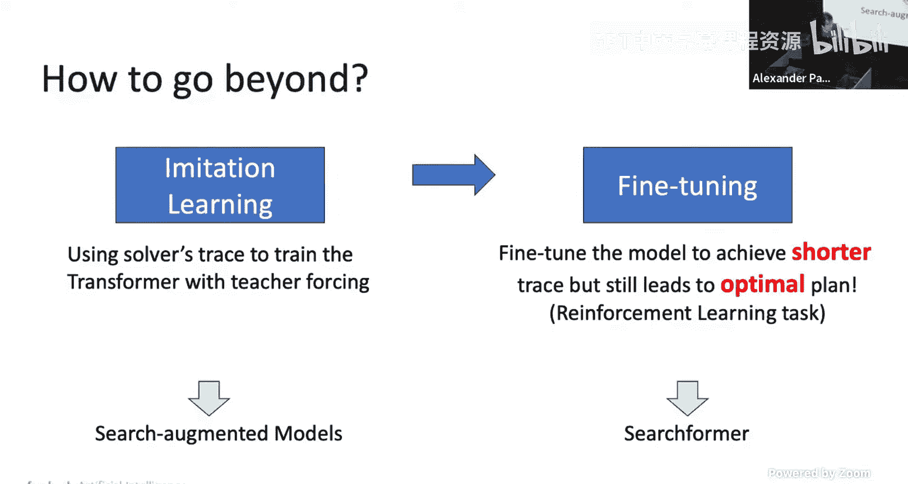

Then what happened is that you still keep the same or even better opt rate， but at the same time。

 the distribution of the sequence lens per test task now actually become shorter and shorter。😊。

Right so okay see you can see that at the beginning of the top of the figure。

 you you see that the search augmented model and a star。

 they are sharing a similar distribution of the sequence less average per task。

 because the search augmented model is im learning results of the original a star search So this is not surprising but once you have done multiple step of this boost driving。

😊，By it by like creating a lot of traces and their plans and picking the trace that is shortest。

 but still needs to optimal plan and put them back into the training set and returntrainer model。

 a refineing the model， then you can see that over time the distribution of a sequence less average per task and actually shrink to the left means that it's become shorter and shorter。

😊，That's why this paper is called beyond a star， which means that we are able to find shorter trace lens while keeping the openity of the final solutions so and in of numbers we actually also see improvements right so here we define a metric called IRR。

 which is the improved lens ratio， that's the length ratio of the optimal of the a star search trace divided by the trace that is discovered by the neural earth what you see here is that over time the improved length ratio actually become higher and higher。

 which means that the final trace that is output by neural networks become shorter and shorter over time when we go through a step of boots drivinging。

😊。

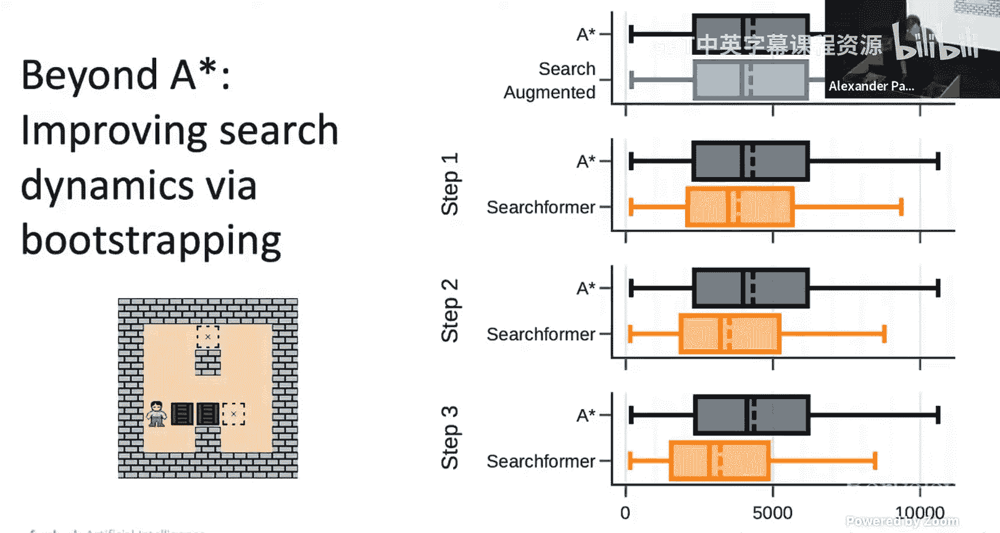

And then people may ask about like， okay， what happens if you if we check the augment rate right。

 it's possible that the trace for the optimal optimal results， optimal solution is shorter。

 but it's also possible that maybe the number of optimal also goes down。😊，But actually。

s not the case。 you see the numbers and you will see that the abnormality actually goes up a little bit every time when you do it steps oftuitions。

 which is something that's kind of mysterysteries but it's still interesting to see。

 So after this number of steps attuitions， you see the optimal rate goes up。

 at the same time the is is become much more efficient。😊，And you see that this number of parameters。

 the performance is actually comparable when you use this search fortuition procedure with 24 million parameters compared to the solution only models that has like a a lot large parameters right so 700 millions and you can see that the automatic rate become comparable after this busrapping process。

😊，Yeah。So let's actually show that this is interesting steps and our search former performance。

 surprisingly after these kind of bootsrap steps， actually doing very well。😊，So recently。

 we also have a forout paper called a dealform。😊，That paper is a V2 version of search forers。

 so what we do here is very simple。😊，So one of the weakness of a search form is that the trace is often very long。

It might basically like takes like a thousand tokens or maybe a 10 of thousand0 tokens before it actually give you the final outcome of the solutions。

😊，So what should we do？So in the dual forward paper。

 we what we do here is that we are trying to reduce the length of the search trees。😊。

By dropping randomly， some portion of it， right， So we define different level of dropping。

 So we can say like maybe the close course in a star search is not important。

 so we can get rid of them。😊，Maybe the cost tokens in the credit center。

 the credit clause is not important we drop them。 We can also drop the entire credit course， right。

 So we have a。😊，Different level of the dropping。 And we also define the。

 the final level the level 4 is basically drop the entire trees。

 and we just use the solution only data to train models。😊，Okay。

 so then what happened is that if you train the model with all different combinations of these levels of traces。

😊，Then what happened is that the performance is actually getting better compared to the two cases that you train with only solutions and you train with compatris。

😊，That's very interesting。 So we actually test this on may still of different sizes and also the robot tasks that we used in the previous slides。

 We actually see much better performance compared to these cases。😊，And at the same time。

 the diversity of the the outcome of the traces is also getting much higher。😊。

So diversity basically defined as how many clusters you see out of number of 64 number of rollouts that you have generated from the models。

Dity is important， especially for the test time compute。

 because if you have high diversity during doing during the generation。

 then if you still up your test time in compute， then the performance will also getting much better。

😊，Right， so in a newspaper， it looks like it's very simple。 this simple approach。

 and will automatically give you high diversity because the inator is also very diverse。😊。

And more interestingly， there's a finding that is also very surprising is that this approach。

 this final result called Deformmer， it will automatically switch between fast mode and slow mode by itself。

😊，Depend on the problem specifications， it will work better for delicate mode in either in the situations。

😊，So we all know that usually people will talk about the system on the system， too。

So for system one settings， what happens is that the model will directly predict final solutions without any thinking。

😊，And for system two， usually the model will first think around。

 or what should we do as there's some search process and then come up with other final solutions。😊。

So usually for system system2， we think like there are two different discrete mode of operating and we want two different models to deal with these two kind of thinking separately and we can basically try to control on top of that to ensure which one to use。

😊，But now， with the dualform， we actually see the supply behavior that when the model trend on this mixture of data。

😊，In an automatically case， switch between system1 and system2。

So sometimes the dualform will output for example the gray token。

 so when the dualform output the query token which means that the model will start this kind of slow thinking process until will give you the actual plan。

😊，Sometimes the model will give you a plan at the beginning。

 which means that the model will directly give you the answer。😊，That's actually quite interesting。

 So basically， you see that this kind of behavior automatically emerges from the journey。😊。

And without basically having human giving like explicit evaluation， explicitly like signals there。😊。

So here you see that for the dualform bracket auto， this means that this model is doing an auto mode。

 we are free to let the dualform output any kind of tokens it might output a plan token。

 which is the system1 settings， it may also output a create token which is system two settings。😊。

And in the same time， you see that the performance is getting better than if you model only train system 1 and model only train system 2。

😊，But more， it's interesting to see that we can actually control。How the dealform is operating。

 I can only control the first tokens right， So if you say the deformer is forced to generate the first token called create。

 then dualform is forced to be entering the system two settings， which is slow settings。😊。

If the geoformware is forced to create a token called up plan。

 then it will basically give you a system1 output。😊，And interestingly。

 we we compare this geoform fast， which means that uniformform is forced to operating in a fast mode with the the dedicated fast models that is notified by social only。

 You see the performance is also getting better。😊，If you compare the general format which is forced to be in the slow mode。

And you can to see that its performance is also better than other than the baseline that is train on computer。

 which means that it is force to the most to slow mode。😊。

RightSo it's interesting that the model can switch to both modes。 And at the same time。

 if the model is forced to use， one mode is also still better than the dedicated models train on particular data。

😊，And we also try this idea in math problems。 So this problem is more realistic。😊。

RightSo for math problems， what we do here is that so we start from this or mass data set。

 which has a very long explanation about how we arrive at the answers and then we can basically randomize randomly dec sentences from the from the from the channel of thoughts and then trend models。

😊，And the reality model is actually quite interesting。 It give you much shorter and concise steps。😊。

At the same time， you still give you a little bit better performance。

So here' are the examples of the performance that you get。 right。

 So you see that in the in the previous work， people already discovered that by augmenting the chain of thoughts with existing language models。

 we created set called augment mass。😊，Which is our baseline。 So this。

 this organize already give you better performance compared to the original message set。😊。

But with our approach with different ratio of droppinging we actually see even better performance and the same time the trace lens is also shorter so in end we have this this kind of any fair comparisons between a dualform and also the O right so you actually will see that the deform will give you the correct path towards the destination with all export states as the show in the red in the O without any training does not really understand what's going on inside disma settings and we only give you path and basically break all these situations with all the walls right so in this case we show that after the training this deform is able to do good planning and the planning is reasonable and it's better than the O preview in the particular problems but I would say this is not fair comparison because ideally。

😊，There should be find to the version of preview on that particular set and see how good performance is。

Okay， so now I can conclude the second part of the option too。So let's go to the option。

 the the last part of the option， too， how we can try the models and solve at the same time in enter that manner。

😊。

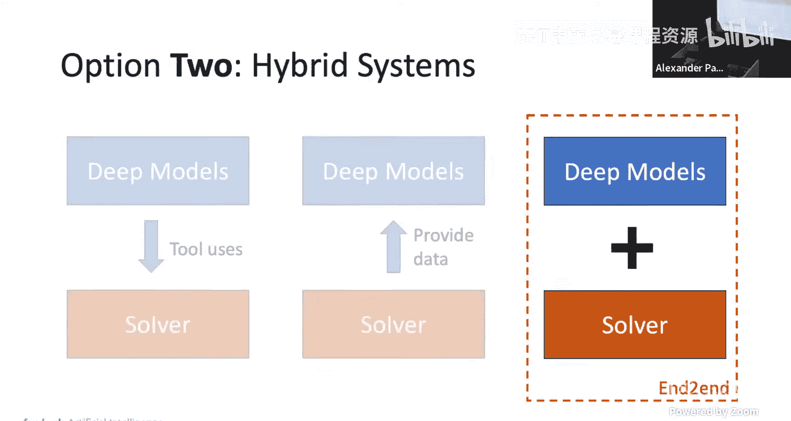

So for this for this one， we're talking a little bit about a little bit different settings these settings is also using combatorial solvers。

 but it's applied to kind of real world problems that requires optimization。😊。

So think about like you want to optimize very complicated functions。😊，They are deferable。

But at the same time， we also need to subject to the comminatorial constraints， right。

 So you have some commatorial constraints and the objective is nonlinear。😊。

There are many different rural domains that will actually cover film to these categories， right。

 so for example， you want to optimize some computer systems。

 you want to optimize some antenna designs， optimize some sometimestime devices in physics。😊。

So all these problems， usually you cannot write down the optimization problem in linear form。

 And this would this basically prevent you from directly calling a combial solvers to solve problems。

 right， So here's one example that we actually encounter in our productions。😊。

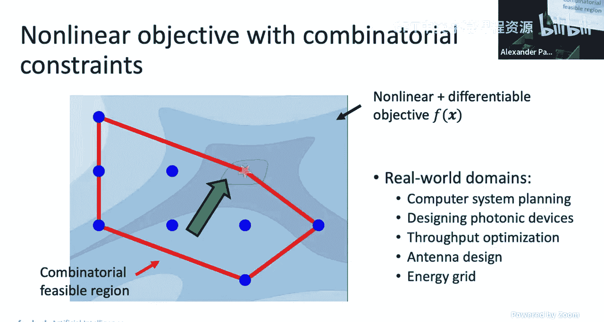

So this problem is like inviting table placement。😊，So suppose like you have K tables。

 they are event tables。😊，And they have an identical devices。 here， devices means deep use。

 And then you want to raise these key tables to an identical devices such that each device will have a lot of tables。

 but does not exceed the memory capabilities， capacities。😊，And the goal is to minimize the latency。

 which is estimated by neural。😊，So if you want to formulate that problem in a mathematical way。

 you actually end with the formulations。Right， so here X is a binary variable representing that this table I table I is being place to device J。

😊，Okay， so of course， like for each table I， you want to want this one to be placed to device J。

 some device J。 So that's why you have some J X I J equals one。😊。

And the another constrain is that for all the device J。

 you want to basically you do't want the final memory consumption exceeding any memory budget。

 that's why you have this sigma I X IJ M I smaller than equal to MJ。😊。

So you have these three strength because each XI is binary way。

 just make this entire problem combinatorial and at the same time the loss function is not nonlinear。

😊，Because of system issues， right， So there's a batch in communication that assume that will leads to highly nonlinear operating functions that is pretty hard and tricky to deal with。

😊，For example， if you use any kind of optimization technique， for example， genetic algorithms。

To solve this problem， it may take forever to even find feasible solutions。😊。

So then another question is that maybe you should still find us get a good optimization problems。

 optimization solutions and at the same time， leveraging the existing combatorial server。😊。

So then what we can do is to itself solve the original problem in the original space that is not nonlinear。

😊，We can actually find a lighting space such that the problem become a little bit linear in the lighting space。

😊，So what do we do here is that。You first basically like try to learn so cause C。And basically。

 this circle called C is a function of the problem description。 Y。

 So why is some description say like， maybe how many GPU do you have。

 What are their memory capabilities， right？ So these are basically the problem descriptions。😊。

So you first predict take some serrogate cost。And then given the summary cost。

 you want to solve a linear problem which is shown on the right。😊。

The linear problem will give you a solution X star， which is the function of y。

 we this linear problem the final solution to optimize the original nonlinear optimization problems as much as possible。

😊，So have this kind of粉。So how有 going就说的 time了。😊，It's actually very simple。

 You can just like a leverage grid optimization。😊，So here's basically a computational graph of a goodness of relations。

😊，Like， so you first start from the description why。😊，And that one。

 first get into the C equals to Cy， and this will basically give you surrogate coefficient C。😊。

And that see will be plugging into a solve。And last server will give you a solution。

 That solution will be plugged into objective， which give you the last function。😊。

So in order to find what is the best way to represent the soet coefficients？😊。

And what we can do is that we can develop better pro。 so our goal is to find， okay。

 what is the best way to minimize the loss。And I don't care about all the intermediate stages。

 but I just want to find what is the best way to minimize the loss。😊。

Subject so that the the entire pipeline will be working right in order to do that。

 you want to find what is the best way to specify the confiency。

But what we can do is we can back it all the way down and you can actually find the optimal weights for that associate C equal to CY privatizations。

😊，Okay， so we actually try these ideas in this inviting table shining。

 And this actually doing quite a well。😊，So what we have what we can see here is that。

 So here there's a two tables two figures。 The that figure basically showed the solution quality。

 right， So you want the solution to be as as low loss as possible。😊。

I do you want them to be zero that will be the best one and on the on the right you also want to care about the deployment run。

 you don't want the deployment to be too slow， so you also want to also reduce the deployment run。😊。

So in that case， we can actually leverage multiple variations of our approach。😊。

RightSo we have these three variations。 one is called circle0。

 We should basically do the by progression on the test time， which is slow， of course。

 but it will give you good solutions。😊，We also have the circle prior。

 which is another variation that directly learned is C equal to CY mapping and use the mapping to directly predict the C and call the solve once then you get a solution。

😊，You also have a hybrid version of it， which means that you first call the the prior module to find the optimal the initial value of C and continue optimizing the C over time。

😊，So then what we do what we see here is that our three variations actually give you a very good tradeoff between the solution loss and deployment time it's actually much better in solution loss compared to the existing approaches right so this includes domestic heuristic greedy and also the dream shot this is a kind of one approach that use reinforceally to optimize this learning optimization problems。

😊，On the other hand， in terms of deployment runtime， our three approaches is also doing quite well。

 especially for the circle prior because you only need to predict the coefficient C in once and it's actually much。

 much faster and at the same time the performance is also really good。😊。

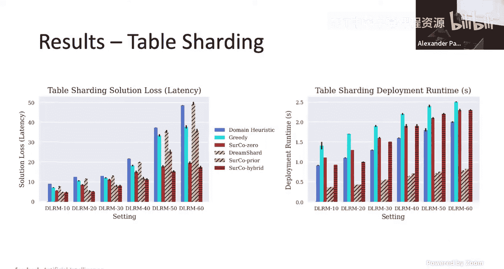

We also apply the same idea to other design problems。

 So when industry design problem is called in for software design。😊，So for that problem。

 what we do here is that you have this kind of a very small from 80 by 80 grid。

 So this is shown on the top top middle。😊，So this grid is super small as in the nanometers。😊。

And the goal of this design is that once you send the lights from the top， you want the design to。

 to change the trace of the light so that it will lens on different part of the bottom。

 depend on their wavelength。😊，So the reason why this can be done is because once you put design it is a very small an nanometer scale plate。

 then we can actually the light will basically behave like waves and their waves will interfere and diffraction at different places so that the light will go to different places at different frequencies。

😊，Right so the real why we're not using any mirror to do that is because the place is so small that you cannot place all the mirrors there。

 you have to use a diffraction and interference in order to make this happen we guidelinesize two different routes。

😊，Then the optimization problem obviously is very complicated。 right。

 So the is optimization loss functions。 you want to optimize。 You have to first do a simulation。

 given the current setup of the design and given the simulation。

 you want to compute frequency response。 then compute cut off frequencies and compute all these equations to find overall loss quantities。

😊，O，才能力。😊，AndBut at the same time， the design spa is caatorials。😊，Because at every entry of this 80。

 80 grade。You can choose either to put one or put 0 into this grid。And this is a binary problem。

 of course。 but also you have linear constraints， which means that you want to find a feasible solution。

😊，So the design has to be implemented by a brush， right， So when you manufacture the object。

 you have a brush to move these things around in order to carve all these designs onto a plate。

 So the size of the brush become a constraints。 Now you don't want to have one single dot out of nowhere to be to be manufactured。

 This is not manufurable。So this actually could give you a different constraint that can cannot be can be written as a linear constraint。

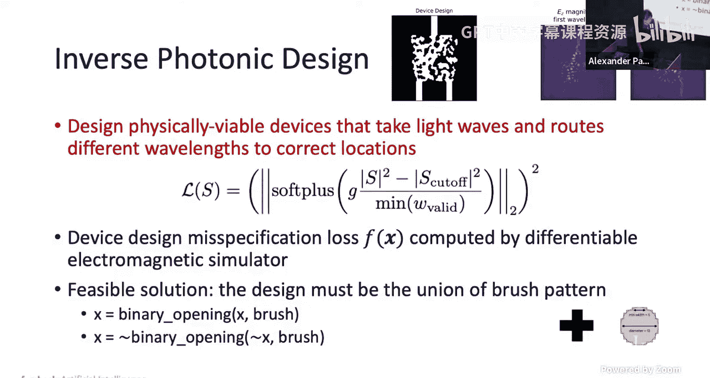

But then the entire problem actually become quite complicated。

So there are several different benchmarks that people are thinking about right。

 so you can try to bend the light from top all the way to the left by using these kind of very specific and nice aligned patterns。

😊，You can also basically like a split a light into two different streams。 It's called a beam sp。

 right you can also do other kind of works like the wavelengthplex。😊。

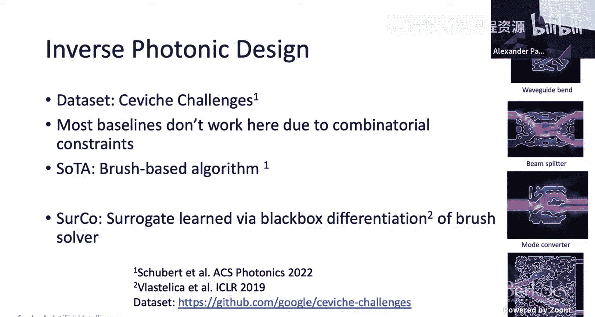

So then we are actually using our approach where we are able to find good designs using this optimization technique and basically this curve basically show that our our approach called circle0 and the circle hybrid have a much smoother。

😊，Basically convergence curve compared to existing approaches， which called a pass。

 So this is also a good based approach。 But there's a no real involved。

 And this the the curve looks very unstable and takes a long time to converge。😊。

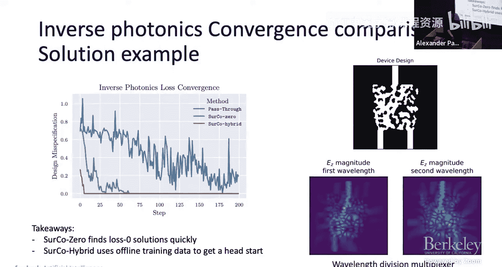

你看。Of course， there are some limitations of such approaches。 Right， So first of all。

 if the function F is not differentiable， what should we do。😊，And also， doing the training。

We are sure we actually need to call the solve every time。

So which is slow and then youre also quite a service developer readable。😊。

For this tool we actually have several full outlook in order to achieve these problems due time limitation。

 I won't be able to tell you the details， but if you are interested please feel free to reach and feel free to reach out feel free to read these papers and code is already online。

😊，Okay， so this conclude the second part， which is basically hybrid systemss。

 the hybrid system that can use both the neural network。

 the larger models and also and also the server。😊，And in the last part of the lecture。

 I'm going to talk a little bit about option 3。Wellal deep models can actually converge to anything symbolotic。

So this is actually something that can be very interesting because we all know that there's actually two different conflicting narrrations in in our daily debates in Twitter or EX right so there's one part of the people who have to say oh large model can do everything when the parameter of the models become larger what do you see is you're going to see so many emerge behaviors with more and more parameters so when you have more and more parameters then we will enjoy all these capabilities without too much worry then we can just sit down and do our neural work and the model we do emerge here AGI later that's one way of seeing the entire situations。

😊，There's another different directions， different kind of opinions， right， So and you actually。

 people actually also think about otherwise， because from many experiments。

 what people actually see is that maybe leisure model is not doing anything are really intelligent。😊。

RightSo then negative model is basically just doing retrievals。

 The reason why it is doing reasonably reasonable well is because in training sets。

 you already see good examples right， So instantly in Apple。

 Apple actually have one paper called GSMAK symbolotic that paper actually give you this kind of examples that by adding irrelevant topics in relevant sentences into the GSMAK data set all of a sudden you see a huge job。

😊，Of all the models， performance on data set， right。

 So it's actually very surprising because the final answer is not supposed to be changed after the this random sentences being inserted。

😊，But unfortunately， all these models will experience huge performance drop。😊，Okay。

 then like how can we actually address these problems， Right。

 How can we understand better why and what kind of representation language model is used to do the reason and planning。

 That's one of the core problems that people may want to ponder on doing the the career and the studies。

😊，So in order to achieve that， so here I give you one example about how we should analyze and understand the representation that is learned by by the natural language sorry by the training of the large models。

😊，Here is one simple case， which is called a model edition。This is a very simple really task。

 It's very simple， right， So you basically get even A and B。 You want to predict what is see。😊。

So basically predict the answer of addition。But the addition is the modular。

 which means that theres a mode D here。 So if the C is too big and you will run back to the smaller number of that is in between 0 and d minus-1。

😊，O。So for this task， one day it's very simple right。

 So there's only D to the e square number possible inputs。😊。

So this should be give you something that's super simple。

 There maybe the network after train this model will have implicit tables。😊，To do the trick of this。

But actually， it's not。So what happened here is that people actually discover the representation of such a simple problem is a flu basis。

😊，So there's a many papers that already show that large model once you train on this addition task。

 they will actually show these very nice sign curves。😊，As think representation for different numbers。

The question is why， or it's very simple why you can see that。😊。

So in order to explore what's happening。In in， in the very similar look that I did。

We actually just use the two neural networks to understand that behavior better。

So we have two networks， bottle layer and top layer。

 and the bottom layer basically takes 10 plant of A and B。😊。

And they are basically be sending to the two weights matrices， and they add together。

 and then they send to two different hidden nodes。It was qualitytic activation。

And then this activation will be sent to the top layer and it will give you an10 plant。

 as it will give you the output。 The output will be compared with the10 plant of C。😊。

very simple settings。 And surprisingly， you actually also see a floor basis that is emerging from the training。

😊，So you order to understand what's going on。 Let's convert everything to Florida domain。 right。

 obviously， we should do that。 And then will make things much easier to an analysis to to analyze。😊。

So we basically do the for transform。 and you get Z， A， Z， B，Z， C。

 You have all these complex number coefficients。😊，Because this original WWWC点5。

So there are some additional conditions I need to hold which the conditions for the associate complex numbers the A Z B and。

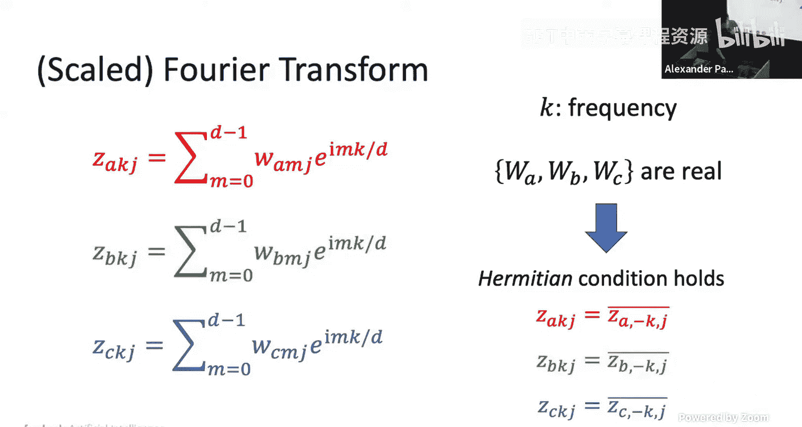

Okay， so give all these settings。 Let's look at at how what gradient sense solution look like。

It's actually very regular。So here that the figure is too dimensional。

The X axis is a hidden node index X。 So here you have a very simple settings。 You have D equals to 7。

😊，And Q equals 20。So Q is the number of hidden girls。RightSo2 neurons index from0 all the way to 19。

😊，And for why axis as the frequency after flow transform。对。

So what you see here is that for each frequency。Yes， actually。

 a few hidden neurons that will show strong frequencies at that particular frequency K。

 strong response of that frequency K。😊，So if you check how many neurons are showing strong。

Crespons strong like a response for that particular frequency。

 you can see that the number of that number of neurons is having like a very interesting structures。

 So if you check for each frequency K so for frequency K equals to one， you see that  one，2，3，4，5。

66 neurons。😊，That I show super high response of that efficiency。Well equals 2， you also get 1，2，3，4。

5，6。 Okay， you get all all those six solutions。😊，Of course， you also will see all the four solutions。

😊，So this is another example， right， So for page equal 2， you see 1，2，3，4， as's for the solution。

 But you also see some bias terms across the other other neurons。😊，And so far。

 you have C all six out four。

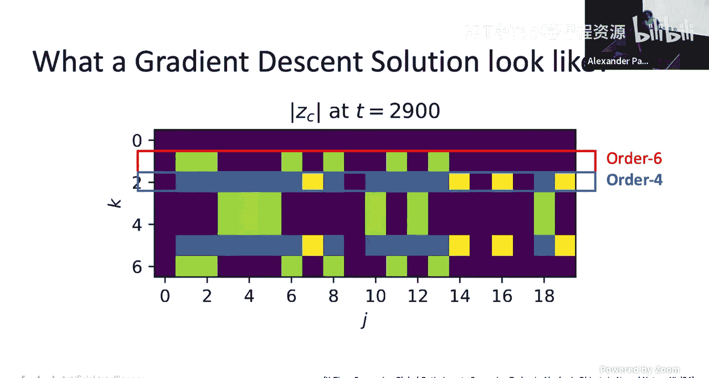

there any other。 also it's interesting， no。If you check the more statistics on grid and solutions。

 right， So here the statistics is on D equals 23。😊。

So the figure to the left shows and all the training curves right so and the right shows like distribution of the orders at different frequencies and you see very sharp peaks at46。

4 and6 right so in these figures very clear。😊，And what happened to your larger setups。

 Now we have like a student settings， right， So D equals to 23 D equals 71 D equals 127。😊。

And also with different way to case。So you see that most of cases， you still see two peaks。

order6 a of four。Unless that you have a very strong way decay in which like all the solutions collapse into all over zero。

 which means that there's no solutions， or everything is0。😊，Right， so in other than that。

 you see like a strong peak there。O， so why。So in this paper。

 what we see is that we actually come with， we'll find a nice structure of the noise function solutions。

😊，That structure can be useful for general explaining what's happening there。So first of all。

 you want to rewrite this M laws into this form。It has quite complicated terms， right。

 has one minus term and also three terms that are some of squares， okay。😊。

And this time is representing in this way。 So you have the red one and the the blue one sorry。

 and the blue one。If may wonder， okay， why I want to write this M A C loss into such an ugly form。

 That does seem to be interesting。😊，But interestingly， given these forms。

 we first can come up with a sufficient condition。😊，Of the global optimization， global solutions。

 right， obviously， if you set this R T T K to one and all these sum of square terms to 0。

 you get a global optimization， global solutions。😊。

But then a question is like why and how to achieve that。The objective is high能。RightHowever。

 in order to achieve that， you can actually leverage some very nice at structure that is happening in the two layer network。

😊，First of all， we consider all the spaces of two layer networks。

 but with different number of hidden nodes。😊，So this space is big Z。

 it actually have nice structures。😊，That's structure called semi restructure。

If you define a ring addition to be like a c of two hidden neurons。😊。

And multiplication be a chronic product along all the hidden dimensions。

Then this same entire structure becomes summer rain。

And what makes things interesting is that these two terms that is happening in the previous loss functions。

😊，They are actually the really homomorphificence。So what is rehomorphism it's actually very simple it basically you you want that basically this function is a rehomorphism if that particular function respect the addition and multiplication across ring and normal addition multiplication。

😊，Then they are rain home offices。So what what does that implication is that you actually will see you can start with partial solutions。

 so suppose Z1 is that part solution that only satisfy one single term of your loss functions and z2 is another part of solution that only satisfy another single term of your loss solutions。

😊，Okay， they are part solutions。 They are not in part solution。But interestingly。

 because of the ring structure， if you multiply these two together。😊。

Then the the resulting Z will satisfy both of the constraints at the same time。

So what does that mean。What does that means that you can actually start with some power solutions that are very partial only satisfy some part of your constraints。

 but you can gradually construct more and more complicated solutions with your multi。

 In your addition， and then it will actually give you the global optimization。

 global global solutions to your original loss functions。😊，Right。

 so the entire process set does not require gradient ascent。 You can construct this algebraically。

AndThen you will give us， you will get a solution that is global optimal to the original loss functions。

😊，So you can construction时候 in this way。You construct a solution like order6 by multiplying all the three and all the two solution together and add over all the possible frequencies。

😊，You can also construct all the four solutions。It also can shock solutions that correspond to the perfect memorization。

 which is actually all the D solutions。😊，So these control solutions are nice， but people may wonder。

 okay， how is this related to the real world， This is in some sense a symbolic and abstract word created by mathematicians。

 and we have nothing to do with the real world。😊，Actually。

 what happened here is that if you compare the greenness sand solutions with the solution that constructed previously。

 you can actually see an exact match between the two。😊，So first什么。😊，In these particular settings。

 you can see many almost basically all the solutions。 there are all the four or six。😊。

Wch is already show in this his one。And also， if you pick this order six and order four solutions。😊。

And you try to factorize them according to the previous defined remification。

 and you realize that 95% of the solution， they can be factorized into either two by3 or two by two。

😊，Which is the same as the construction that I previously did in our experiments in our theoretical construction。

😊，And the fluctuation area is small。😊，And finally， if you check every entries out of factorization。

 what you see is that 98% of solutions actually can be factorizable into the constructed forms。

 they actually fall into the form that we constructed previously。😊。

So which means that the gradient sand solution match very well with the construction from the theoretical side。

😊，That is quite interesting。And also， if you check distribution of the parameter in the solutions。

 you actually see very nice regular structures rather then sharp peaks in different angles that correspond down to the higher symmetries。

😊，So this is something that's quite interesting that haven't been explored yet。

 but that can be a nice follow of papers to understand better。😊，So what are all these implications。

 So first of all。😊，So it's very kind of surprising that neural。

 if you run gradientcent on top of that， it will give you a solution that is very simple。

 very similar to symbolic representation。😊，Right， so maybe in general。

 the neural network or maybe large models we also convert to some solution that is symbolic that。

 but we don't know about。 We haven't concern that yet。

 But here we just give you an example that a reason task will give you a solution that is symbolic after the training with gradient accentcent。

😊，Right， and second， it will give you a pass。 alternative pass was the solution other than gradient%。

😊，RightSo you can think about green then can give you a solution。

 but you can also have some advanced algebraic operation that is also give you the same kind of solutions。

 So maybe in the future， we don't need green spend anymore。

 We just need algebraic constructions to combine a small solution to the larger solutions。😊。

And then maybe Green sense will become obsolete， eventually。😊。

So that's why I want to introduce this part of work。

 So this might suggest a different path compared to the existing path that we have。😊。

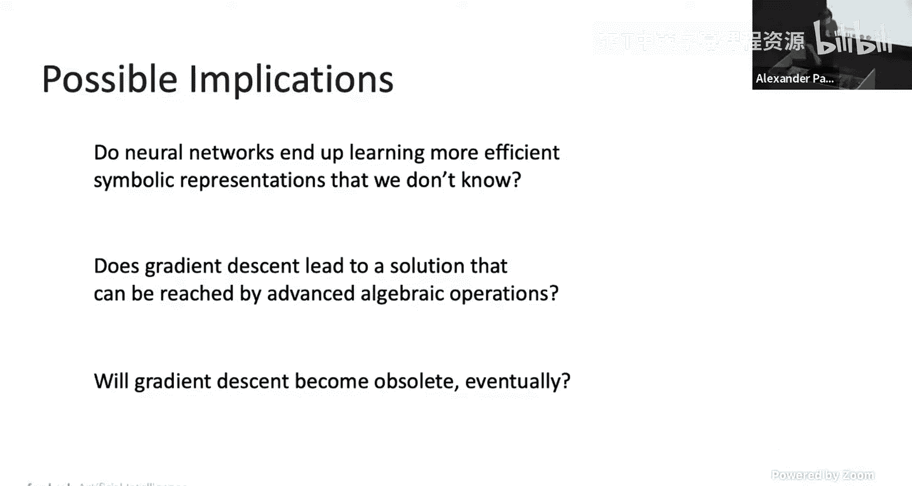

In the future， instead of having people praying about the distributed system not working well。

 we can open the black box and have a physical approach to do this。😊。

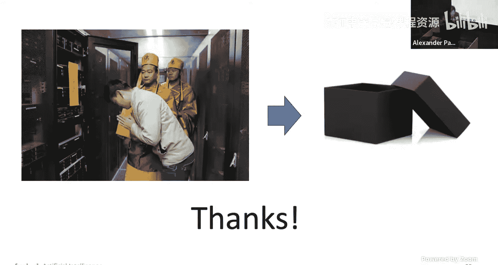

Thanks for your attention。