# UCB《大语言模型智能体｜UCB CS 194 294-196 (LLM Agents) 2024》中英字幕（Claude-3.5-sonnet翻译） - P9：Lecture 9, Jim Fan.zh_en - GPT中英字幕课程资源 - BV1RsZPYsEtE

You're in the right room。 This is the right title side。A tale of two kittens。

I want to share a story that gave me a lot of inspiration during my own PhD time。

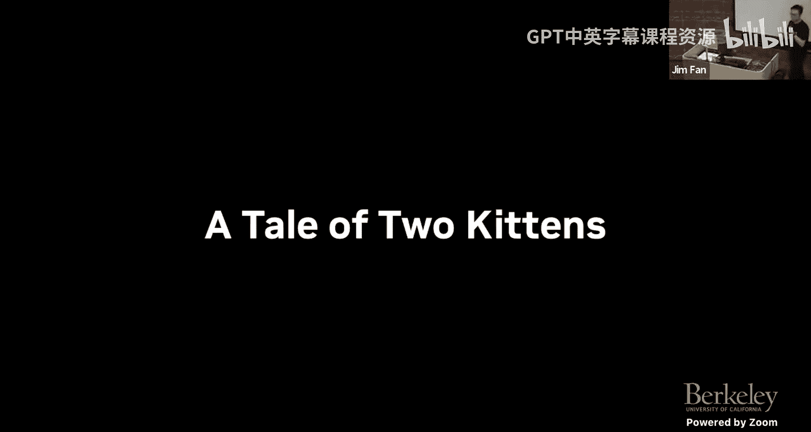

In 1963。Two scientists held in high。 They did an ingenious experiment。

So what they did is they put two newborn kittens in this device that looks like a marig round。

And these two kittens have not yet seen the visual world。

 and it's just kind of their first moments in the world。

So what happens is the active kitten on the right hand side。

 it can move freely while the passive kitten is constrained to this basket while the motion is transmitted over this little hinge between the active and the passive kitten。

And the difference is。The active kitten can move around freely and observe the world。

 while the passive kitten can also see the world， but it does not control the body。

 It cannot control its own motion。And then after a few days。

 the scientists test the kittens visual system， and they found that only the active kitten developed a healthy visual motor loop。

 and a passive kitten was not able to respond to things like visual cliff or you know avoiding obstacles。

And no that。Both kittens experience the exact same visual sequences， right。

 The data is same and mirrored， but the only difference is the agency that the kittens2。

And these days， we have a very powerful passive kitten， and its name is ChaGBT。😊，But for us， humans。

 or human babies who are born， we don't go to Wikipedia and read terabytes of text from the internet。

We play with objects， we touch them， taste them， break them， we experiment， we fail。

 we try something new again。So people call baby scientists in the crib。

And embodiment and active agency are what make us human。

So I believe the future belongs to embody AI here。

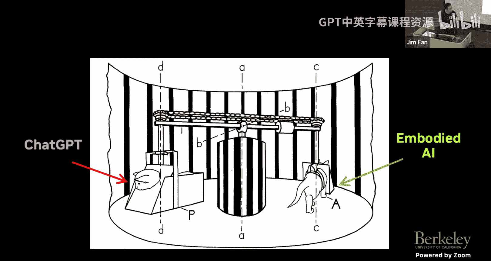

And today， let's talk about Nvidia's big plan on building embodied AGI。Project group。

And my name is Jim Fan。 I am leading the G Group， which stands for Journals embodied Asian Research。

So。In March this year， this is a scene from GTC N video's biggest annual conference。

And here on stage， we have。And humanoids，9 of them are electric or mechanical。

 and there's one biological humanoid in the middle。 And his name is Jensen。

So this is the announcement of project Group。Which is envidious goal to build。

The AI brain for humanoid robots。So you have a very natural question right。

 like why are we doing humanoid？Well， because we know it works。

RightThe human form factor that you and I are in body right now is what produces all the economically valuable physical labor。

And the second reason is we're entering an age where humans and robots。

 they need to work hand in hand。And for humanoid robotfo factor， it's much more socially acceptable。

It's much easier for humans work alongside robots to predict what humanoid will do compared to some spider robot that is super unpredictable。

And the third reason is a bit more pragmatic， right。

 Because the world that we live in are designed for the human form factor。

All the public facilities like hospitals， restaurants， supermarkets。

All the tools and equipments that we have are designed for two hands， two legs。

 and five fingers for each hand。So it's just easier for the humanoid to use all the tools and blending the world that we already built。

And the second question is。

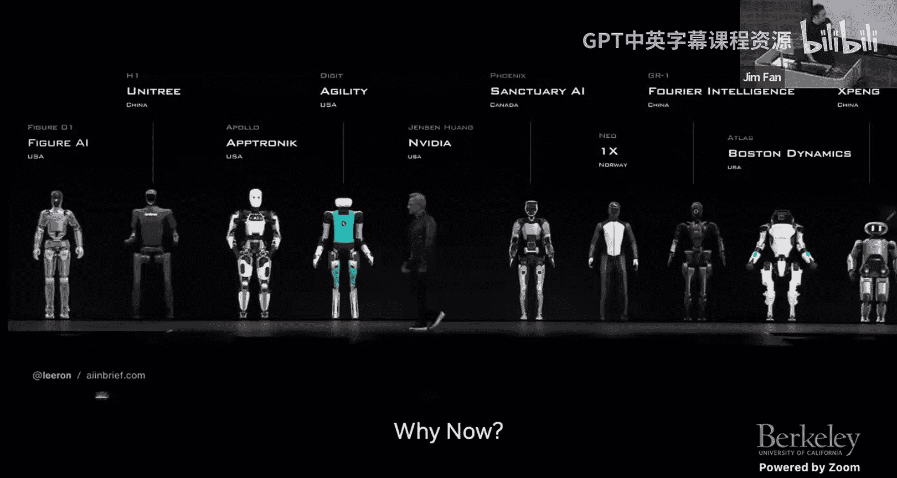

Why are we doing this now？Actually， towards the end of 2023 beginning of this year。

We have seen a search instead of yard hardware for humanoid robots。

 and just to name a few and this is by meanss exhaustive， there's Tesla optims， do and dynamicsmics。

 E Atlas where this robot kind of does some crazy you know moves like 360 degree joints that's kind of breaking a brain and then figure of 02。

And also， we see this trend。Of the price of the humanoid and the cost。

Trading towards a very low value。Actually， humanoids have been around for a while， right in 2001。

 NASA has built something called a robotauut that costs north of $1。5 million to build。

And just a couple months ago， Unire announced G1 that costs about 30K。

Which is the price of a regular car that most of the households will be able to afford。

And it just so happens that there's a general pattern where the manufacturing cost of a mature product will tend to the cost of its raw materials。

And a humanal robot only takes 4%。Of the raw material that's needed for a car。

 So it's possible that this exponential decrease in cars will go even further。

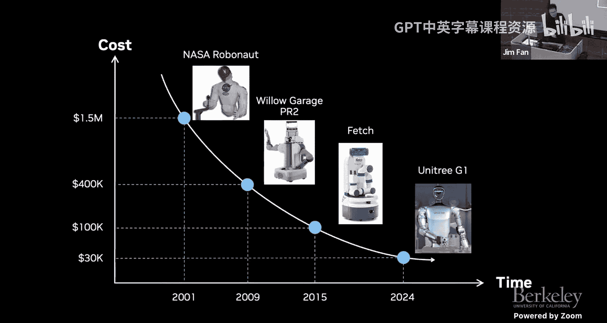

And that makes now a good time right to enter this space。

So Project group that is envidious Mengshot by building the AI brain for human or robots。

And I cannot take all of you to our lab， which is about 50 minutes drive away in Santa Clara headquarters。

 but let me take you on a virtual tour。This is in our lab in Endor building。Headquarter。

During March GTC， where we had four different types of humanoid robots from partner companies。

So know that NviDdia doesn't build own robots， we rely on the hardware from our partners to develop our AI on。

 so during GTC time we had four different types of humanoid in this lab and at that time it was the most number of diverse humanoid species per square feet anywhere on earth。

And。If you wonder， where does the name Project Good come from。

 it actually stands for journalistist robot0， zero technology。

So we're putting serials here because it looks like Star Wars， right。

 it's a serial code for the robot。And the keyword here is journalist。

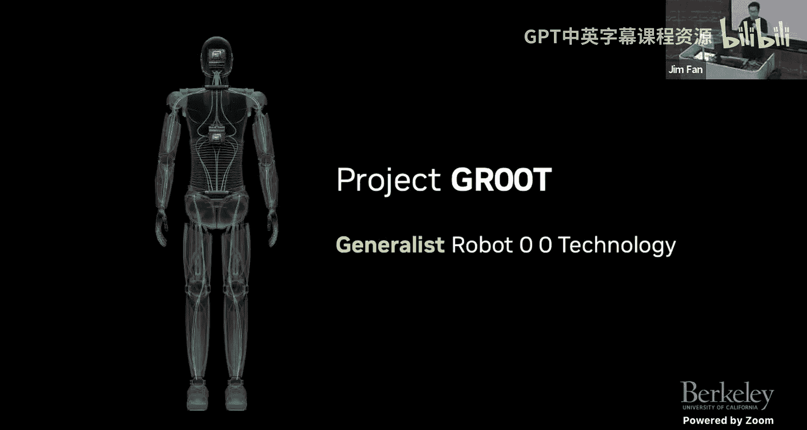

And that is the strategy that we' are taking。Right。So there is one successful field of AI。

 and that is the field of NOP。Before。2019。An OP has been around for a long time。

And there are a lot of specialist systems like sentiment analysis， recommendation system。

 summarization， information retrieval， and all of these will require different training pipelines。

 data pipelines， evaluation and so on， it's a very complicated field。And then in 2021。

 ChadGBT came and just blew everything out of the waters。

It is one robot journalist model that you can prompt。And tell it the task that you need to do。

And then。Once you have this journalist moment， you can specialize it back。By prompting it。

 fine human it， distilling it down to smaller models that once again are domain experts。

And we call that the specialist， the specialized journalist。

And it's almost always the case in the historical trend that the specialized journalists are way stronger and much easier to maintain than the original specialists。

And that is the success story from NLP。

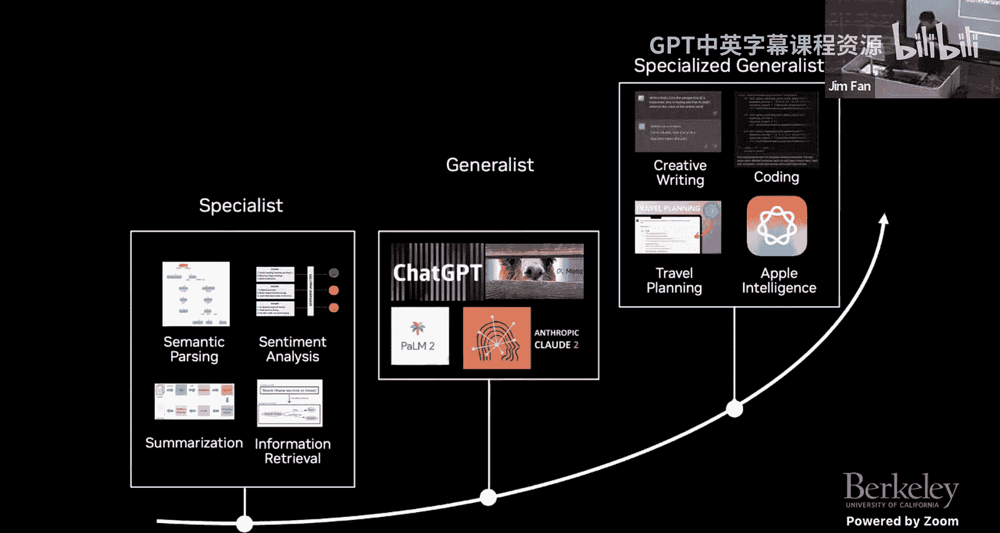

And for robotics， we're kind of still stuck here。As we speak。

All the most of the robot systems these days are specialists。

 They require special hardware and special algorithms。😊。

That may or may not even be learning algorithms， may or may not involve machine learning。

 specialized data pipeline for every use case。So what we do， we copy homework。

We copy homework from the field of NLP。And we hope that Project route will be the journalist moment。

 the foundation model moment for robotics。And then after that moment。We specialize it back。

By prompting it， distilling it， fine tuning it。Back to the special use cases。

 And we hope that the specialized journalist robot。

Will will be much stronger than all the robot systems that we have today。

So this is a guiding principle that we operate on。 But how do we。

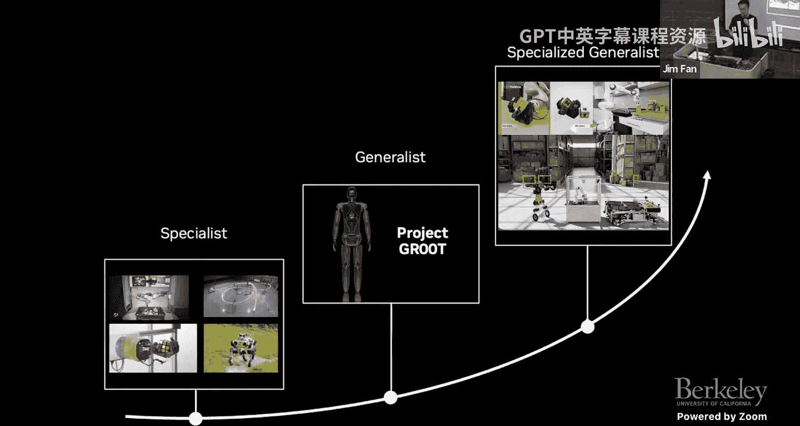

Really， make this a reality。So today I'm going to talk about some blueprints。Three principles。

If you take home anything from today's talk， just three things。The data pyramid principle。

The matrixtrix principle and the foundation Asian principle。And all of my daily work。

 our team's research adhere to these principles that I'm sharing today。

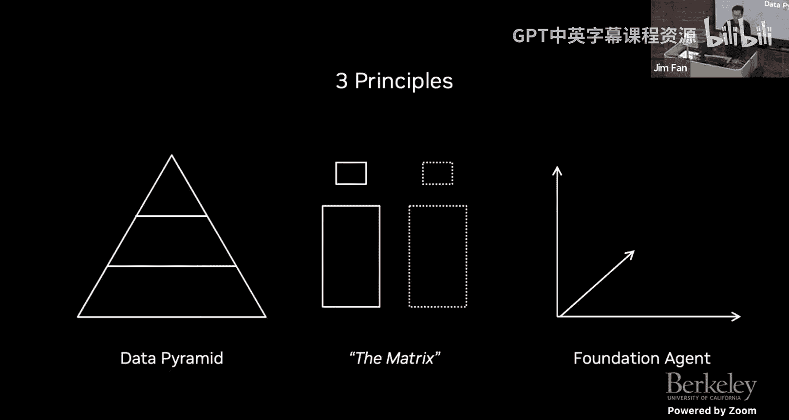

The first is data permityramid。Have you wondered why robotics is so hard？Why is NLP solve first。

 but we still don't have Germans robot？Well there's one thing called the MoraVX paradox。

 which says that things that are easy for humans are actually really hard for machines and vice versa。

But have you thought about why？And I would say the culprit is on the data side。

Because you can download terabytes of high quality text from the internet。

You cannot now download motor control signals from internet， I wish。But it does not exist。

So for robotics， we need to build our own data set。And what does the data pipeline look like。

It's much more complicated than just training。Text foundation models。

So let's work our way downwards from the top。And the top is obvious， real robot data。

Right you just collect some human demonstrations on the real robot hardware。And。Unfortunately。

 you are limited by a fundamental physical limit of 24 hours per robot per day。But still。

 this data is super useful， it's a gold mine because it's directly aligned to the real robot hardware。

So how are we collecting that？How do we make data collection as intuitive and easy as possible？

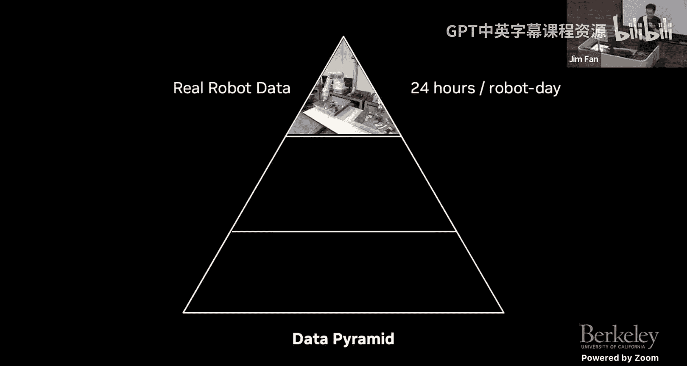

Are there this year？Apple announced Apple Viion Pro。

 and then we have these really kind of cyber punk moments。 you know。

 this is on New York subway and someone just kind of typing randomly in the air super weird。

 but but these days， this is a norm。So we see Applevis Pro。

Using this way and without thought how about we apply this to robotics？

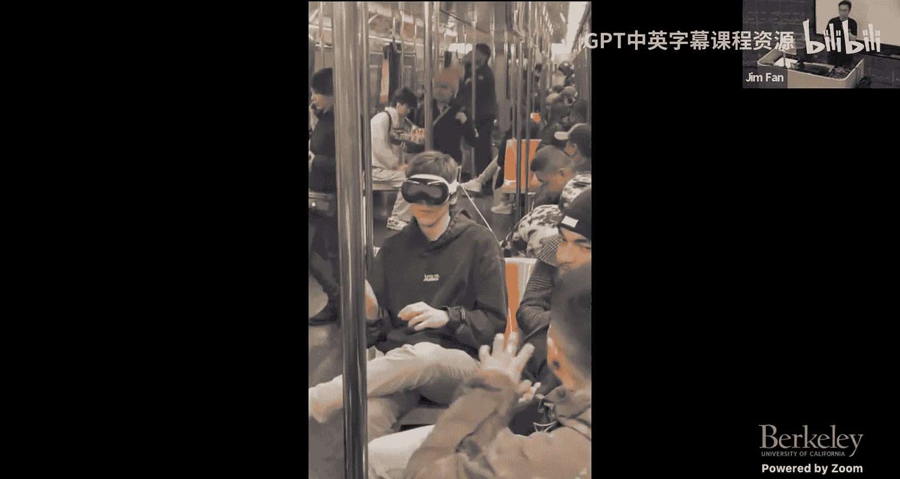

So we built a system。Where a user wears Applevis Pro。And you can tele operate。

Both a robot in simulation and also in the physical world， simulation here。

 And this is a physical robot hand from humanoid。And the idea is very simple。

Vision Pro is tracking your pose， your hand pose。And then retargeting it in real time to the real robot。

And additionally， you can also。Operate a robot in simulation。 And in this way。

 you can tele operate anywhere。 So this is what Ivi build the omniverse cloud。 And on this cloud。

 you can connect any X device and entirely operate a virtual robot there。

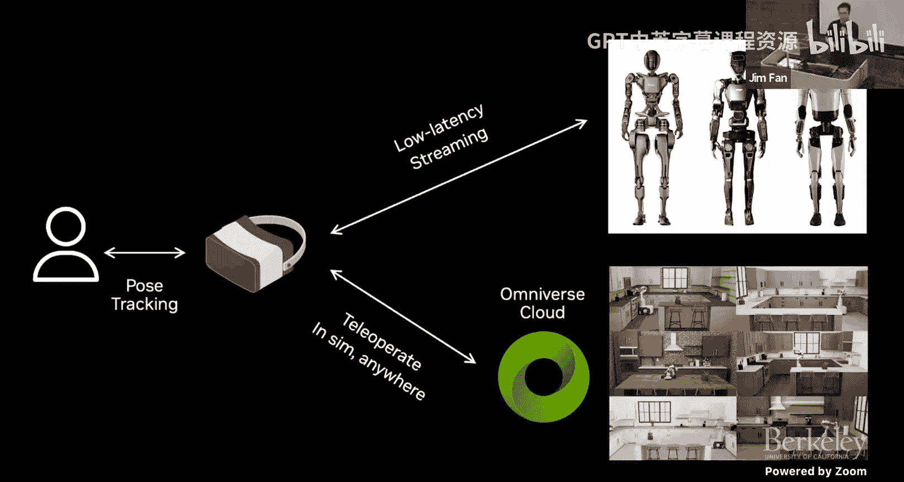

And the result is that we have a very intuitive interface to collect data。

 and this is where on the right hand side is the user sees through the first person camera。

Of the Applevis Pro。So you can think of it as kind of like the movie avatar， where by wearing this。

 you are actually now transported to a different embodiment。

 You are now in the body of the humanoid robot。 and that's also another advantage of using humanoid because you have five fingers。

 The robot has five fingers。You don't need much training。Right， anybody come here in 10 minutes。

 you'll be able to collect data for us。So here are some more videos from our lab where a user is tele operatingerating and the motions are transmitted in real time to the humanoid。

And we can also do things that are a bit more complicated， like， you know， washing dishes and really。

The limit is the humanoid hardware， whatever the hardware is capable of。

So that's how we are collecting the real robot data， but you're limited by 24 hours per day。

That is not enough because we know that foundation models are extremely data hungry。

 We're talking about we need trillions of tokens to train any reasonable transformer these days。

So how do we scale this up， how do we get more data？

And the second part is what I believe to be the most interesting。

 which will also carry to the second principle I'm going to talk about， and that is simulation。

And why are we' doing it here on the video？You know， before NviDdia was an AI company。

 we were a graphics company。GPU stands for Graphics processing unit。

And what does a graphics company do？Game engines and simulation。

And just so happens that simulation is also going to be super useful for robotics。

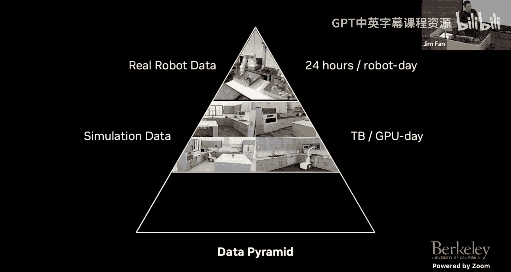

So。AndVdia has built a set of tools。And this is called IsAL。

What it does is it runs physics simulation in parallel on GPUs。Basically。

 one GPU card can let you run simulation at 10000 times faster than real time。And in this way。

 you break the physical limit of 24 hours per day。 You are now just limited by computer。

And just as one example to put this number in perspective。

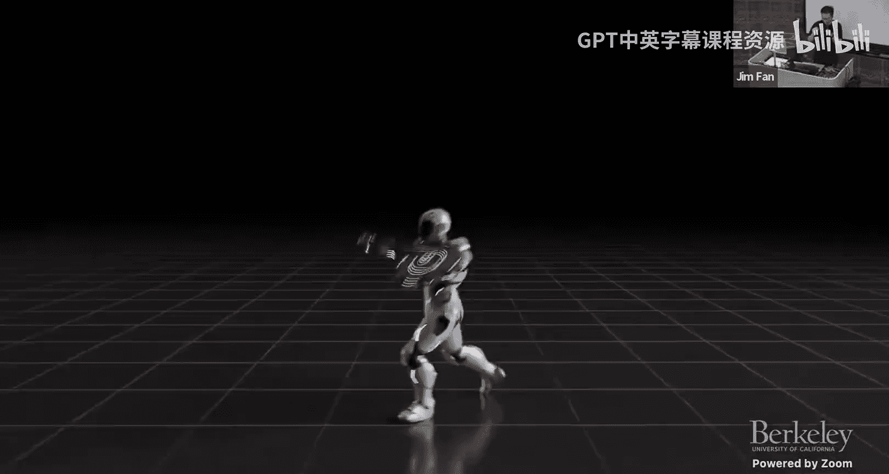

This character learns the impressive。All of these impressive on martial skills。

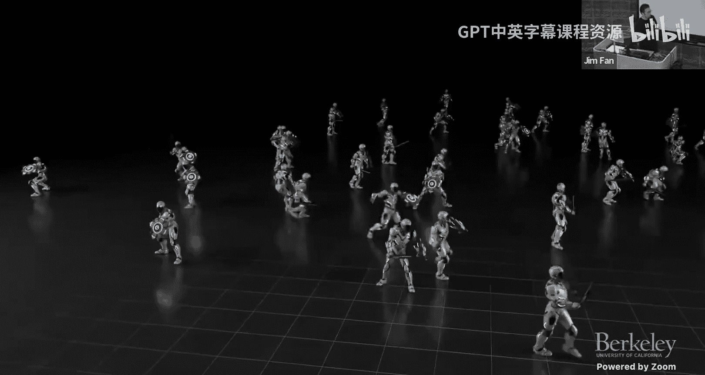

By going through 10 years worth of intense training in only two hours of compute time on a single GPU。

So it's very much like the sparring dojo， right in the movie matrix， where you learn kung fu。

In maybe five seconds of real world time， but you feel like you trained for many years。

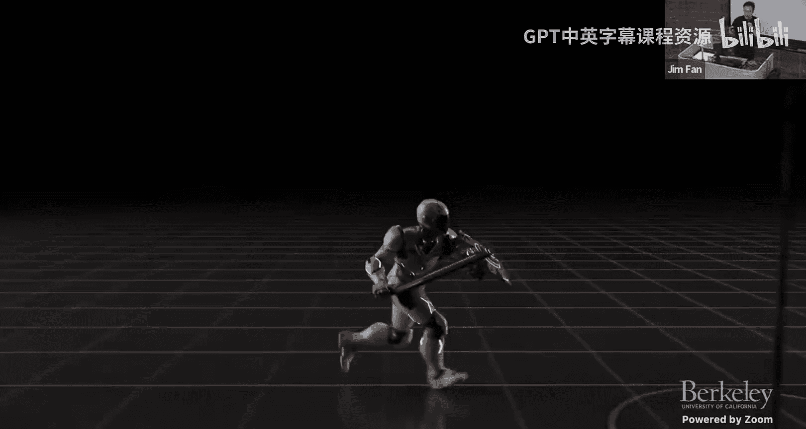

And this is the omniverse platform。And here this race car scene is where simulation has crossed the Oncanny Valley。

You know， thanks to hardware accelerator rayxing。So in this video， not a single pixel is real。

All of these are rendered in real time。Using ray tracing。

And because we can render very complex walls with these breathtaking levels of details。

That means we can also use simulation to train computer vision models that can be much more accurate because you can also query the ground truth states of every objects。

 every segmentation mass in a simulation， and we can use that to be the perception module for robots。

And once we have the simulation and the real robot and data。

 we still need all the data from the internet， and that is just the regular foundation model。

 you know， training GP for all multimodal foundation models。

 you have you will collect a lot of text and videos from the internet。

And the robots will still need to learn。Like physical common sense from lots and lots of videos online。

So this line。Is the most amount of data I'm talking about exercise and probably more than that per day。

 But this is also the most noisy。And then for simulation。

 we're talking about perhaps terabytes per GPU per day， and it comes with not just the pixels。

 but also the actions。

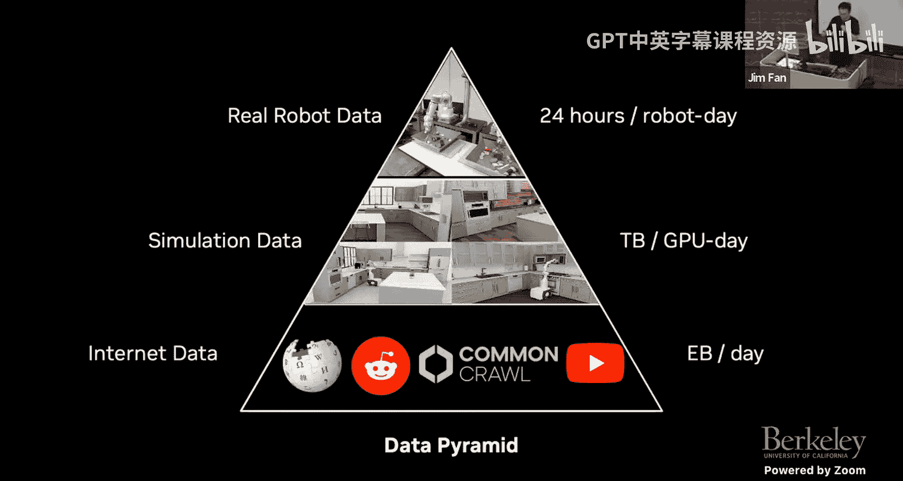

And that goes to principle number two。How are we thinking about building robotics？

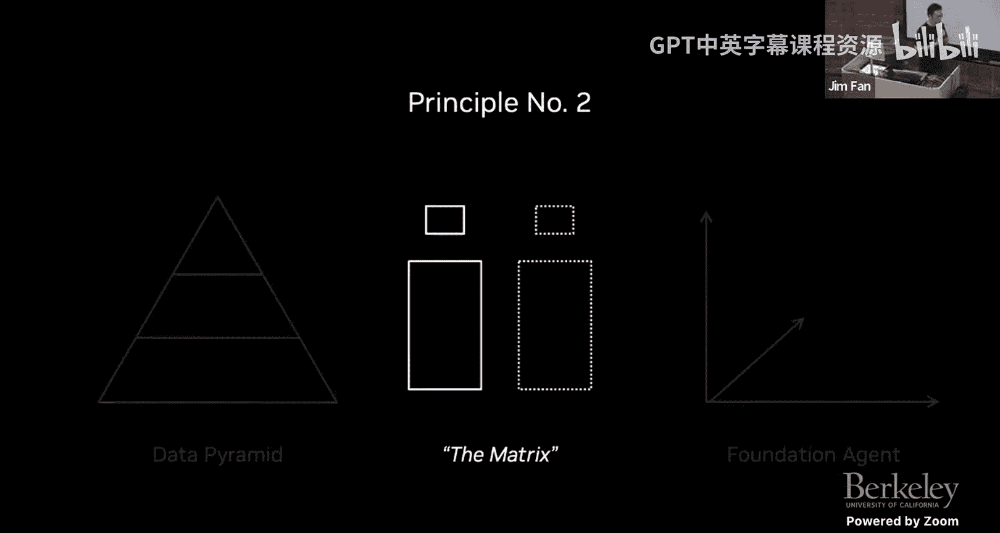

And I'm calling this the matrixtri principle。And two questions first。Do we live in assimilation？

There's this very interesting argument that all of us right now are living in the matrix assimilation。

And all the human intelligence is actually some emergent behavior。

That an alienN civilization runs on their supercomputer right there。

 And video is not symbol to all of us here， right。Well。I don't know if this is true or not。

 but there's one thing I know。Is the future of robotics will live in simulation。

The robots will spend most of their lives in simulation。

 and that's the only way that we can collect trillions and trillions of high quality tokens by breaking the barrier of 24 hours per day。

And why does simulation work for training robots？And again， just。One sentence take away。

That's because it's easier to simulate a problem than to solve it。Let me repeat。

 it's easier to simulate a problem than to solve it。And this。

Here are some very compelling examples from the past literature of AI， right， This is Alphago。

In 2016， the moment when Alphago beat Liidor of Do at the game of goal。

 and the first time ever AI beats a human champion。

The entire game of goal can be simulated in perhaps 500 lines of Python， that's a rule of goal。

 extremely simple to simulate extremely hard to solve。

And another favorite example of mine is Minecraft right。

 a very simple game Minecraft is like what a few hundred megabytes。Of anexecutable。

But there are all the emergent behavior， all the interesting things that you can do。And， you know。

 going online and look at those Mincraft channels， just absolutely insane things like people built the entire Hos Casle block by block in Minecraft。

And someone even built a functioning CPU circuitrc in Mancraft because apparently the game is touring complete。

So you can build ass simulationimilation within assimilation within my。

So if any of you are interested。Before I started Project Group， I had this work on Min Dojo。

And that is a framework for training generally capable agents in the game of Minecraft。

 where we provide a simulator as an API for AI and we also provide lots and lots of data from the internet。

 So if you're interested， check it out It's minddojo。org。

 but basically simulation always fascinates me。It's easier to simulate a world than to do anything interesting in it。

So given the ass， what can we do？As AI scientists， we need to ask。Right。

 how do you generate the data？And I will say two ways。The self generating data。

And then multiply data。And these two corresponds to two learning paradigms。

 reinforcement learning and imitation learning。And let's look at how to leverage simulation for these two。

 and we'll start from reinforcement learning。You know， reinforcement learning， what does it do？

You give an AI a reward function。Basically， the reward function tells you what behavior is desired。

 what behavior isn't。And then the agent will do a lot of trial and error to maximize that reward。

And a prime example is Paavlo's dog， right， like you kind of give it some conditioning and it will respond to that reward after a while。

So reinforcement is very good at training things。That we don't even know how we do。

So here's a question。How many parameters in a neural network do we need to build？A cerebellum。

You know， it takes a lot of subconscious processing for us humans to exist。Right。

 like you sitting in the chair。Or maintaining balance， standing， walking。

 it actually takes a lot of neural processing power that you don't think about。

And for humanoid robots， this problem is called whole body control。And if you're using reinforcement。

 it's called neural whole body control。

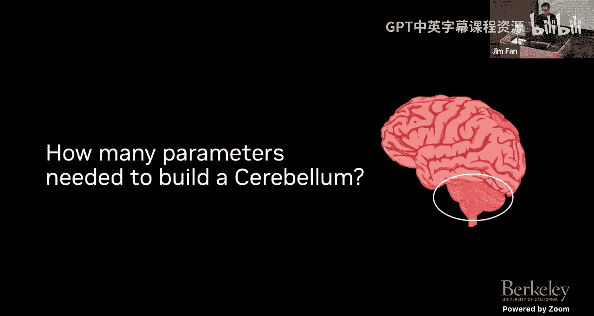

And what are hobaric control useful for？Quite a few things like this is test optimus walking。

 so navigation requires ho body control。And this is shot in our lab using Applevision Pro。

Doing tabletop manipulation using your two hands require whole body control。

And this is a latest video from Boston Dynamics where the whole robot is manipulating objects while standing balance at the same time。

 and we call this whole body local manipulation and again that requires whole body control。So。

The answer to the previous question is， actually， to build a cerebellum， we need 1。

5 million parameters， not billion，1。5 million parameters。So we trained this network called H。

To control the body of a human robot。Baically， what this model captures is this subconscious processing that we humans do。

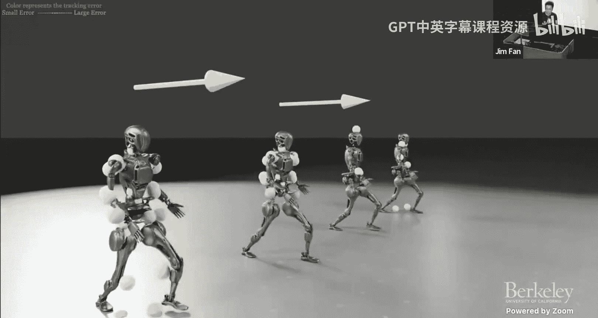

So we have a single model that learns how to coordinate。

 you know the motors of human robot like arms and legs。

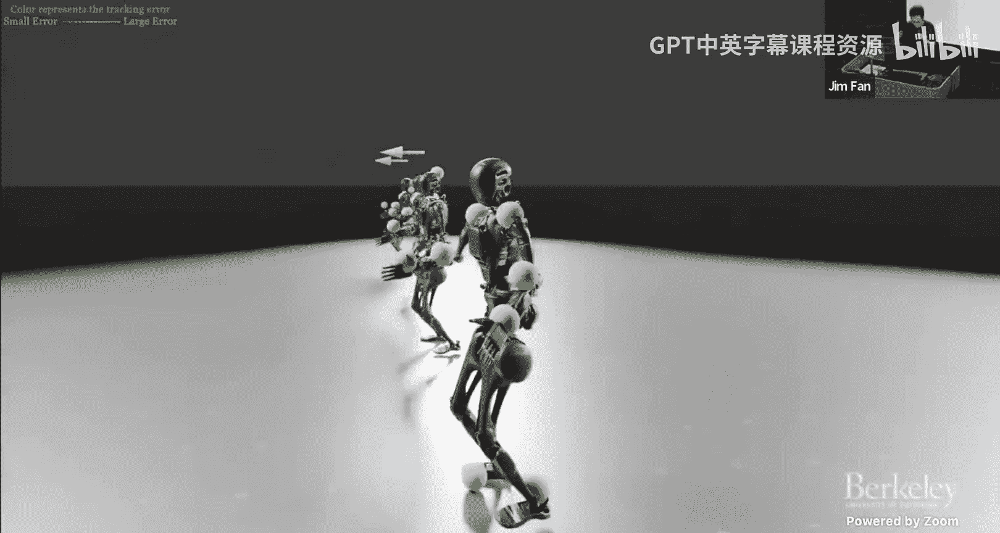

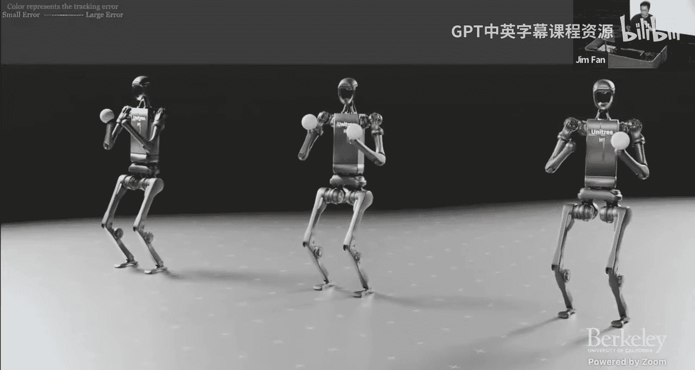

To support locomotion and manipulation。And here is roughly how this neural network works。

I will send the links to the papers， so if you're interested。

 there are a lot more details in the papers， but today we focus on intuition。

So what the neural network takes is that it's able to support different command format like kinematic position tracking。

 like all the position of your joints。😊，Local joint angle， right angle between your arms。

 for example， and a rule tracking where there's a velocity that you need to move forward to。

These are different ways that we can use to control the robot。And you can think of them as prompts。

And what Harvard can do is you can prompt it in arbitrary combination of these things。

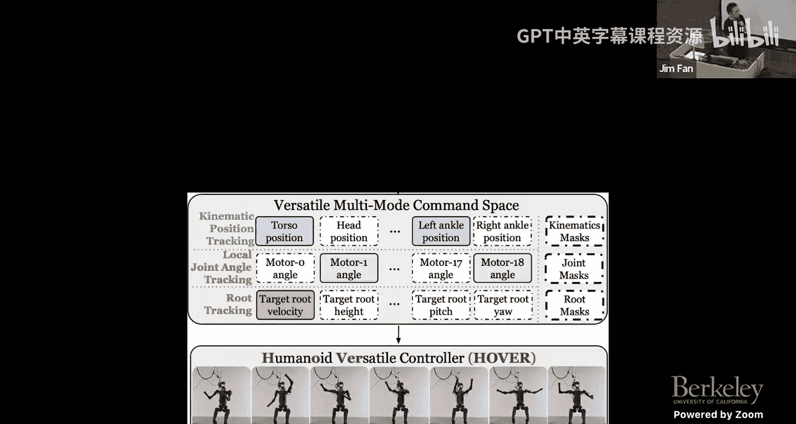

And that enables us to use different devices to capture these commands and to teleoperate the robot。

And just as a few examples for the VR device you just saw right Apple Vision Pro。

 this is basically head and hand post tracking， So if you want the robot to stay balanced while standing。

 you use Apple Vision Pro， you track three points and the rest Harvard will figure out how to make the robot stand balanced。

And for RGB camera， if you have an RGB looking at you and you're using some computer vision models to recognize the pulse of the human。

 that would be whole body post tracking。And if you're wearing an exoskeleton。

 that's a more advanced way to do tracking super precise。

 that would be the whole body joint tracking。And if you just， if you only have some joysticks on PS5。

 right game controller， then you can still control the robot。

 but you can only specify the rule command。So hover enables very versatile control interface。

To tightly operate a robot， to collect data and also just to control it in general。

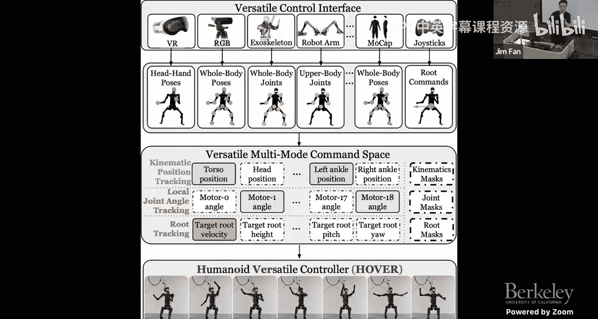

So here's how we train this model。Very simple。 All the ideas I talk about all the papers today are super simple。

 You don't need to be a roboticist to understand it。So basically， I talk about these control modes。

 right？So in simulation， you pass all of this information and then what we call privilege information。

whichhich are the information that you can query in simulators。

 but you cannot query in the real world， like you can know the exact location and velocity of every joint every atom of the robot。

 but you don't have that information in the real robot so that's what we call privilege information。

And given all of these， it's relatively easy to train reinforce learning to get an oracle policy that controls robot。

But this policy cheats because it queries things not available in the real world。

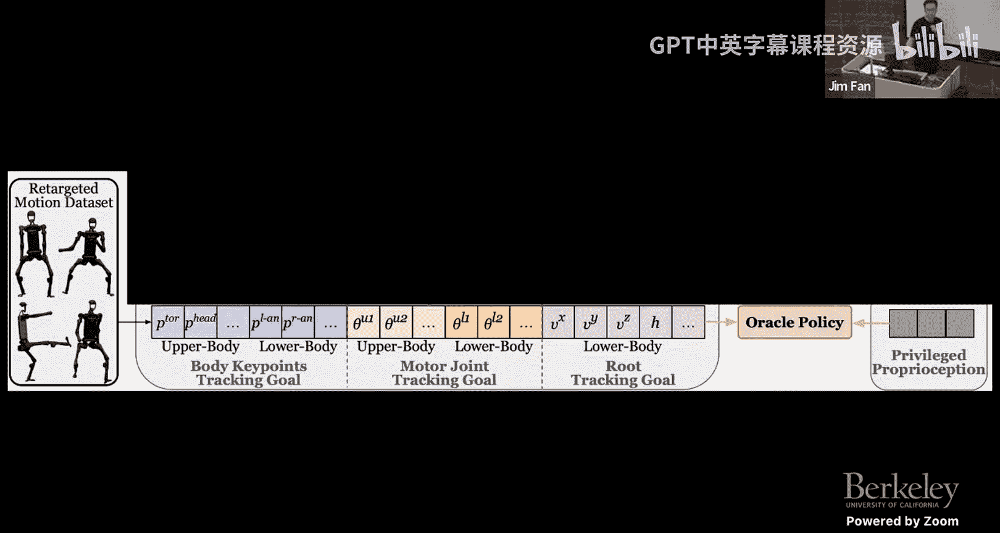

So we simply mask out different control modes， we also remove these privileged propoception。

 privilege information， and then we distill it into a student policy using supervis learning。

And this two stage process is very simple。And very effective because if youre train this directly using reinforcement learning。

 RO tends to be unstable， so you want to train RO in an easy way and then you do supervised learning on a harder problem。

And this is a two stage dissolation。And once you do that， by masking out different information。

Then hover becomes profitable because it can take any arbitrary combination of the inputs。

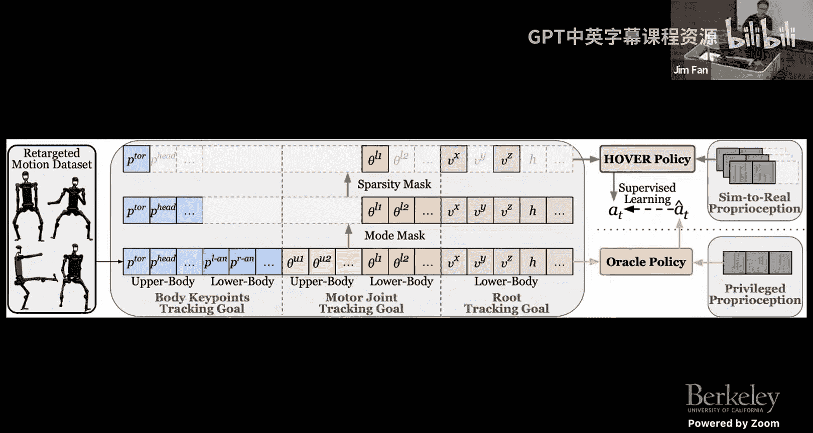

And here are some examples like you can have the head tracking or like， you know。

 these whole body tracking or simply tracking the three points for the robot。

Or you can also do like you know tracking with root velocity So it's both tracking the post and also moving forward like zombies I hope you know in the next version we're training it in in a better more natural post。

 but right now this is what we get。

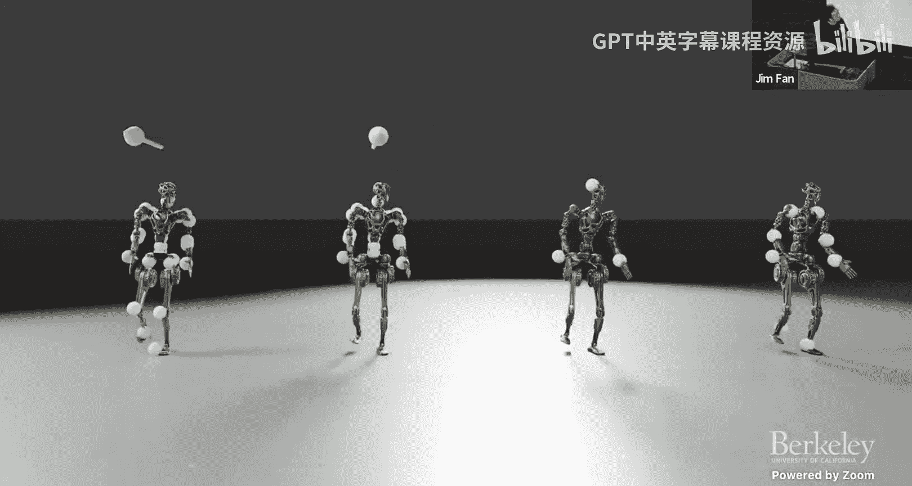

And you can also vary the terrains， right， It doesn't have to be flat。

 You can vary all the terrains and obstacles in Iac lab。

The GPU accelerated parallel simulator so you can run tens of thousands of human noise in this environment。

And it's also not limited to just one type of robot， anything that can be simulated in Iac。

 you can plug it into training。And then what comes out is whole body control policies where you can have the robot kind of follow certain pose and walking while you know。

 maintaining balance。And in the future， we plan to deploy it to many more robots。 So in this video。

 this is from GTC， not every robot is running a neural network here， some are just classical control。

 but。Harover is embodiment agnostic。All right， so that's reinforcement learning。And the second type。

And the second use case of simulation is to do imitation learning。So once again。

 this is the Applevision Pro I was set up to collect human demonstration。While it's quite intuitive。

 it's still really slow to collect these demonstrations， right， you can see it's not that easy。

 it's a lot of effort。And let's say given one human demo， which is very expensive to do。

 like perhaps can take you need to take a few minutes to collect one and over an hour。

 you can only collect 20 demonstrations， that's very， very little data。

How do you multiply that into more data？And that's the second use of simulation。

And to understand how we do this， first， we need to look at what is in a robot simulation。😊。

I always say three main things， right， there are handmade objects。That typically creative artist。

Handpro Ss and hand design tasks。And if you do that， this is what you get， right。

 it's a really simple scene。😊，If you want anything more complicated。

 you need artists to create those assets。But how about we ask AI models to help us automate some of this process？

Like for the handman objects。There are text or 3D models these days that are really good。

So can we ask AI to generate lots of assets for us？And we instantated it。In the simulation。

And for handcraft it thingss。Ultimately。It is the USD format。

 the universal seeing description language， the USD format。Which has two parts， right。

 the texture and some code that specified thing layout。For the texture。

 let's just use stable diffusion。😊，We call an AI， and it can swap out all the textures that we want in a reasonable way。

No art is needed。And then because USD is just some code。

There's a video called chat USD that's basically fine tuning LM to generate USD。

 and you can generate all different layouts。For the simulation。And for the task。

It's a bunch of code in Python， so just prompt GB4， cloud 3。5。

 whatever your favorite LOM to generate the code， and we get a diverse set of tasks specified in the simulation。

There was like making coffee and some kind of， daily tasks around。And putting all of these together。

We present Robbo Casa。Which is a generative simulation framework。

Where every part of it or at least as much as possible， are generated by different AI models。

 you know， from the objects to the task。To all the textures and layouts of the kitchens。

And in the matrix， we can have 100，000 different kitchens， right。

 the simulation doesn't care as long as there's enough compute that goes into it。

So this is Robbo Casa generative simulation framework。And given Robbo Casa。

 we take one human demonstration from the real world and we can replay it。

And multiply it into N different demonstrations。So here are some results from the paper。Where。

We train a policy using the real world data only。And this is the important part， the takeaway。

If you're mixing the simulation data augmented by Robbo Casa with all these variations。

 right the division model， all the variations。You will get a lot better performance out of it。

Just out a box。And this is just preliminary results， and we hope to scale this up massively。

 so we really take advantage of the 100，000 different kitchens that you cant afford to have in the real world。

And if we apply this to humanoid， this is what it looks in omniverse rendered， right。

 humanoid is doing one motion， but I can do it in 100，000 different places。

And that helps us train really， really strong perception models。So that's step one， right。

 Rob casta what it does is some kind of visual augmentation。Well。You see that the motion itself。

 right， it is still really hard to collect。And how do you augment not just the visuals。

 but also also the motion trajectory。

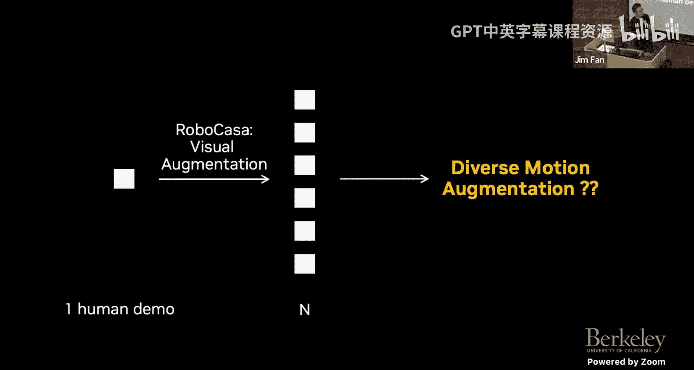

And here is a system that we built to address this problem。

So on the left hand side is what a human collected in asimilation。So basically。

 the task is just to kind of pull these two pieces together， that's it。

This is one human demonstration。And we can edit this human demonstration by varying the position of these objects。

And also， varying the gripper。With respect to these objects。 So once you replay this demonstration。

 it will still be successful。But it will be a machine generated double。Right。

 why do you have a human tele operate that and demonstrate 1000 different configurations when you can use machines to generate that。

 right， Let machines teach the machines。And this system we built a set of algorithms is called mimicmic Cha。

And Michan is a very。General Ppa's framework。

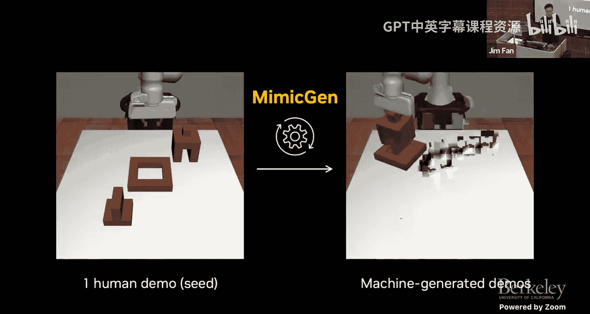

So it can be applied to many different tasks。And here they are like making coffee， you know。

 insert square， three cube stacking， so maybe it can varies all the object configurations and generate new motion trajectories that are successful。

 so you get this data for free without demonstrating over and over again。

And if the gripper and robot hardware are close enough。

 you can also generalize even across the robots that you don't have right。

 we've all been poor PhD students before right we only have one panda arm what to do。

 you call mimicgen and you also get data on other robot arms that you can't afford。

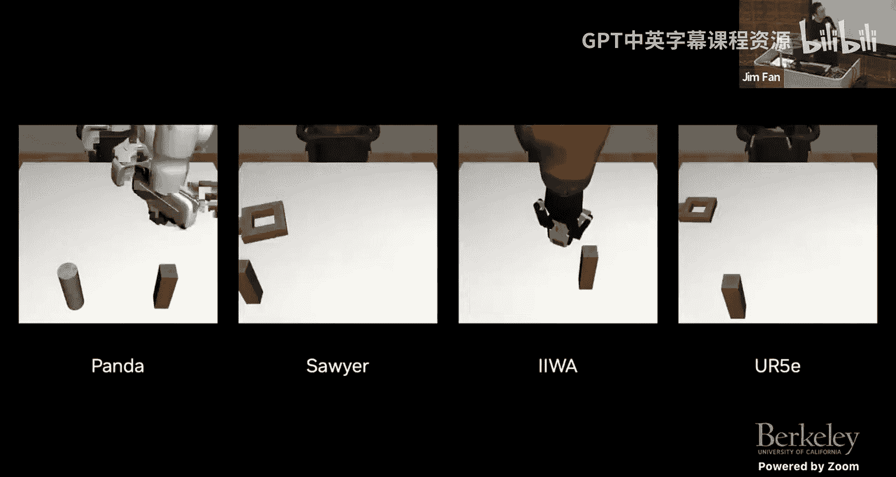

And it also works on long horizon tasks， where it's multistep like preparing a coffee。

 you need to take you know some pod out of a drawer and then place it in the coffee machine and kitchen chairs and you know sorting the bins。

 there are tons of variations If you want a human just to keep tele operatingating that。

 you need thousands of trajectories to learn any good model。

 but you can use Migen to generate the data for it。It can even do very precise tasks like this one。

 which requires a bit of kind of wiggling to make sure that you know。

 all the nails and these holes all line up very well。And you know。

 these very precise factory tasks that you need to put a gear on it。

And using Migen you can generate lots and lots of data for it。

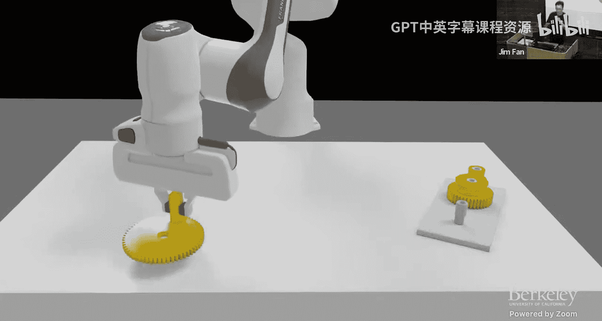

Also works in the real world。We want all the data to be useful in the real world as well。

And this is a figure that shows the scaling of the image and generated data and the trained the performance of the trained policy。

And we it's obvious that the trend is moving up， but there is also some kind of diminishing return where if you use 1000 imagegen generated demos and then you scale to 5000。

 it doesn't buy you too much because one the task is relatively simple and second。

 there's also some limit in the system that what's a maximal for its diversity。

So this was the original imaginggen work that we applied to a single robot arm。

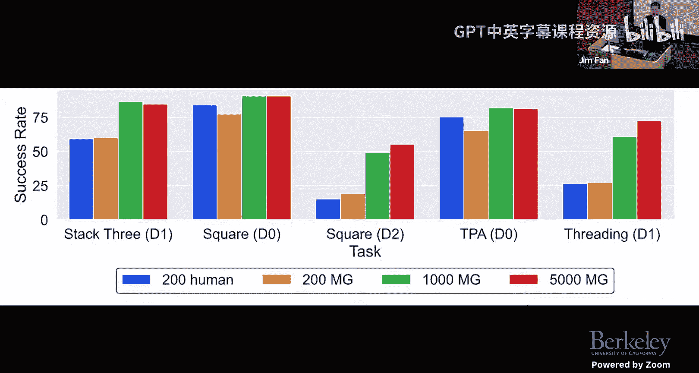

Well， the next obvious thing is to apply it to two hands， right？And for this task， again。

 it is run by Mi Genn， it is a bimanual task。And we call this parallel subt， because these two arms。

Can execute the pickups in parallel， while at the end， then you do it a bit more sequentially。

So this is one type called parallel subts。And the nest is called coordination subtask。

 where you have the two hands that need to coordinate it precisely to pick up to lift up the tray at the same time。

 right to lift out the lid and put it on a box at the same time。

And that requires the transformations to be applied to the hand correctly。

 so you know everything once you play the trajectory is still correct。

And then there are also sequential tasks where there's a pretask and a post task and the next task cannot happen until the pretask conditions are met。

 so here the humanoid robot is pouring a ball into pouring a ball into the bowl and then place it onto the green block。

And again， if you want to use Apple Vision Pro to teleop this。

 it's going to take forever to do all these variations， but you shouldn't have to do。

You can also mix a match， you can do the parallel。😊，Generation， and then do a two arm coordination。

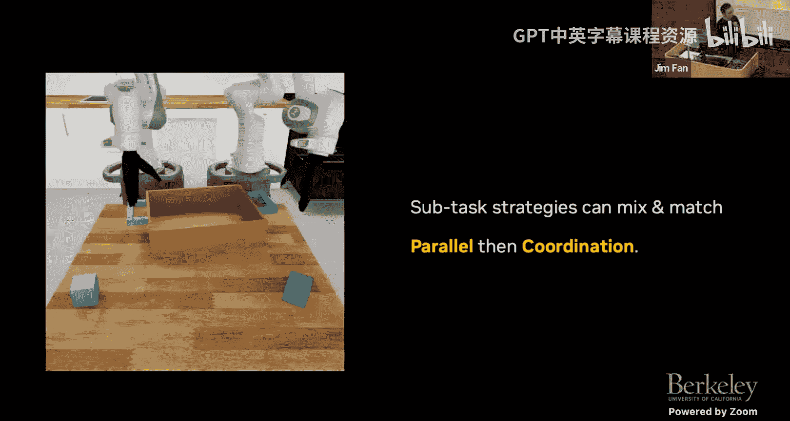

And we can't apply this。To hand by manual system to a set of different embodiments。

 like a two gripper setting。To hand setting。There's tray lifting， you know drawer cleanup。

 and of course humanoid is setting as well， where the humanoid is able to make coffee， sorting cans。

 doing the pouring， and we can generate lots and lots of data from it。And just zooming out。

This is text imagingmogen， our follow up to the minigen work that focuses on textrous manipulation。

And once we have this data， we can train policies， we can also study the differences between different neural network architectures now that we have a much bigger data set。

And we see that diffusion policy， a specific type， is the best across all of these。

And because the tasks are much harder， we also show a much better scaling as you run the imaging pipeline。

If you start with， let's say， 100 demonstrations that a human collected。

The success rate is not great。But you can use AI， right。

 You can use Migen to generate 50 times more data。And then magically， the task starts to work。

And we can also transfer X image into real world， that's what we want to do。

So we have a human tidy operate。And then we have this real to Sim pipeline。

Where the real trajectory is replayed in simulation。

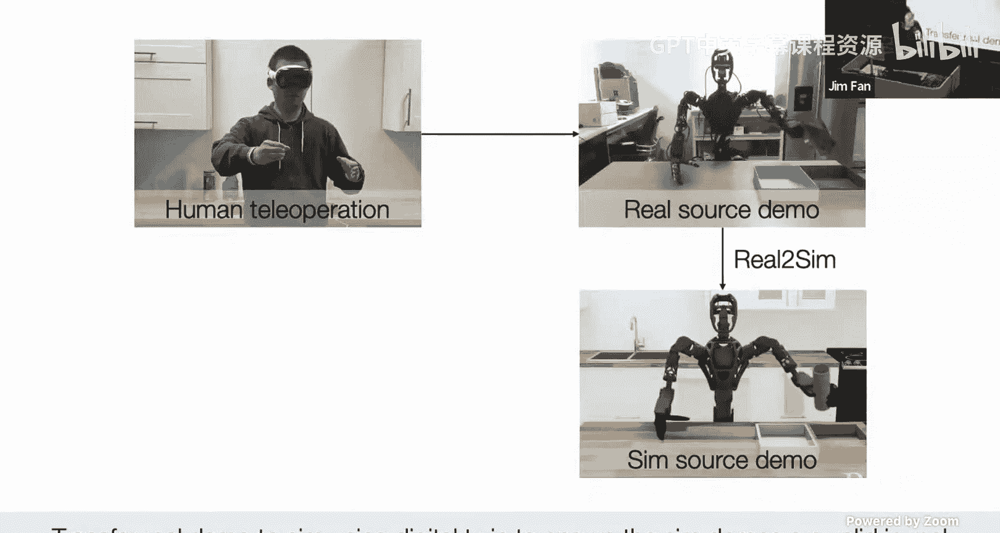

We capture it in a digital twin of the real world， and then we run D Mimogen to generate a huge data set。

And then we apply that back to real， so this is a real to Sim to real pipeline。

 you collect something in real， you replaying Sim， you multiply。

 you do everything you want in Sim and then it transfers back to real and improves the real performance。

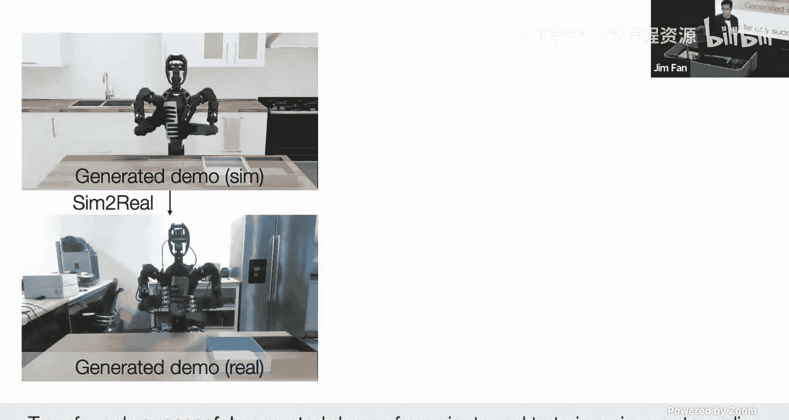

And this is one way to use simulation in the loop。So to put it together。😊。

You have robot Casa that takes one demonstration and multiply to n。And then you have my agenda。

Gives you N times10。More trajectories。 and I promise you this is the most complex math we're going to do today。

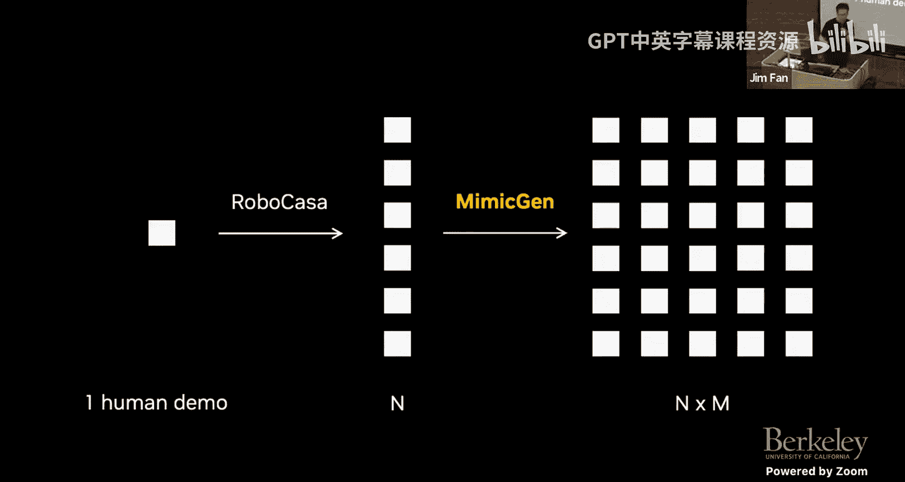

And run it in omniverse on humanoid， this is what we see。

 we have really good rendering and also very high quality motion actually generated。

I want to show that this is a clip that Elon showed on Tesla Opimus。

 where there is a big farm of humans serving their robot overlords。RightBy kind of teleoping a robot。

 it's kind of dystopian。AndAnd the humans do the same task over and over again。Actually。

 for one of those like battery packing tasks， it may take thousands of demonstrations for a human to collect enough data to train a model that works。

So if we can run simulation to multiply the data， we can save all of these humans from this destiny。

And next， and the final principle I want to talk about is the foundation Asian principle。

That's also how we think about building。The group Foundation model。

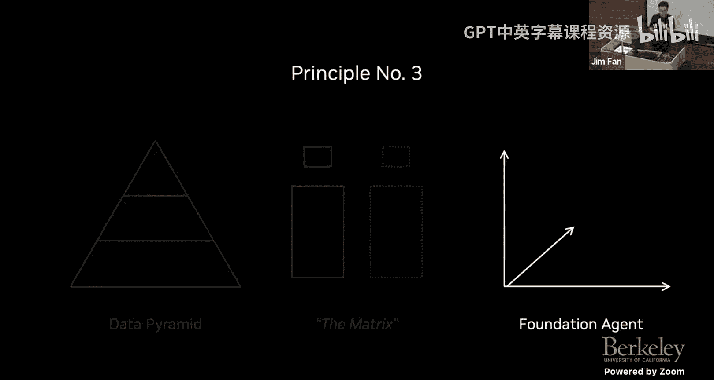

So most of the research。Our robotics can be mapped on these three axes。

The number of embodiments became master。The number of skills it can do and the number of realities that it can work with。

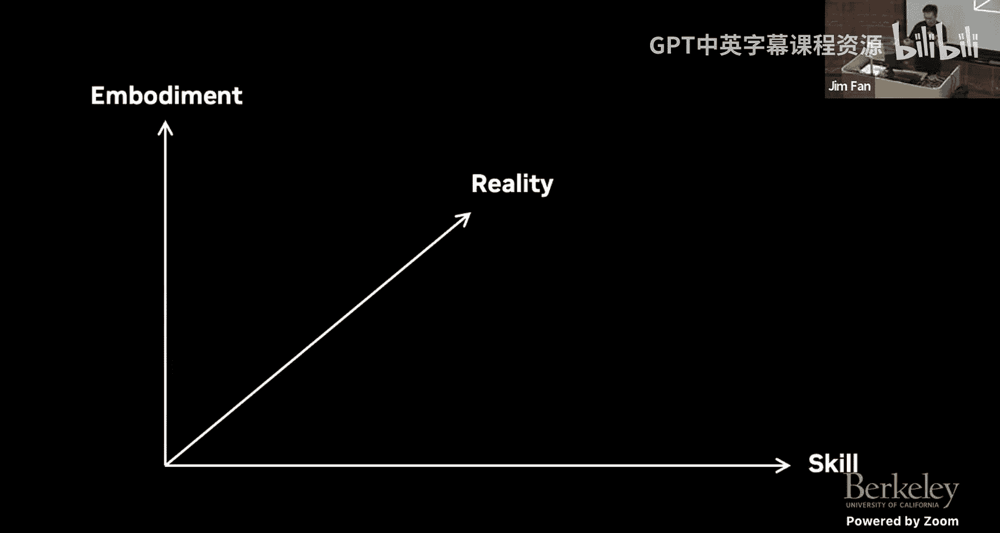

And。This is what I mean by embodiments， you know， in Star Wars。

 there are so many different types of robots。And my question is。

 can we have a single neural network that can control all of them so we don't need to develop a separate pipeline for each robot？

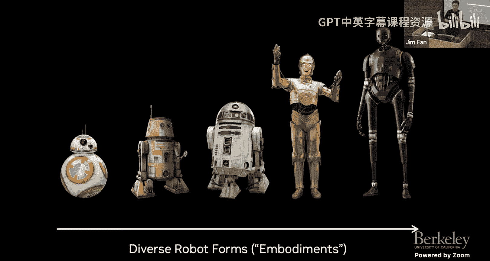

And like two years ago， we had proof of concept work called Metamorph。

 where we train a single neural network that can control thousands of different robots。

And here all of these robots are procedurally generated， they're quite simple。

 so this is a proof concept， but you can use one set of neural network ways to control them。😊。

And here the idea is also quite simple， right， you take each robots and they are basically a graph of joints and we call that ktomatic tree。

And you do a depth first search。That first traversal through this body of the robot。

And you will be able to flatten it into a sequence of tokens。

Where each token has some physical properties attached to it。So what does this look like， right。

 It looks like a sentence written in a new grammar where the grammar describes the morphology of the robot。

And if you have lots of robots。You can convert them to lots of sentences。

 and each may be of different length。And you tokenize them。And this is just screaming transformers。

 right， sequence models， screaming transformers， and that's what we do。

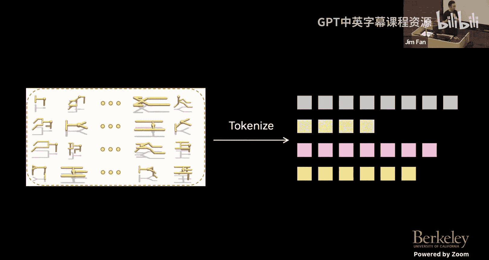

We train the metamo transformer that maps the sequence to the actions directly。

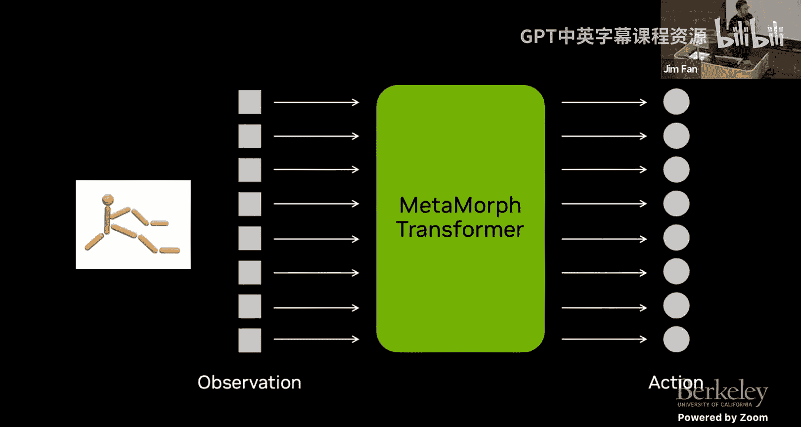

And you have variable length sequences， but they are just like English sentences and apply you map them to variable length of actions。

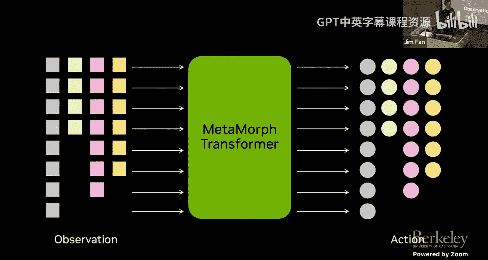

And we train these robots on a few different tasks like fluttering， walking， complex terrains。

 or avoiding obstacles。

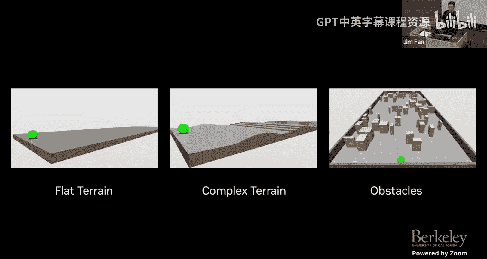

And we show that using a single set of neural network weights plus reinforcement learning and accelerate simulation。

 we can train one neural network that rules them all。And at GTC。

 Jansen showed all the different humanoid robot bodies。So that's where we're going for minimum of 2。

0， we want a single model that can control all the humanoid robot bodies。

 even though they are slightly different from each other。

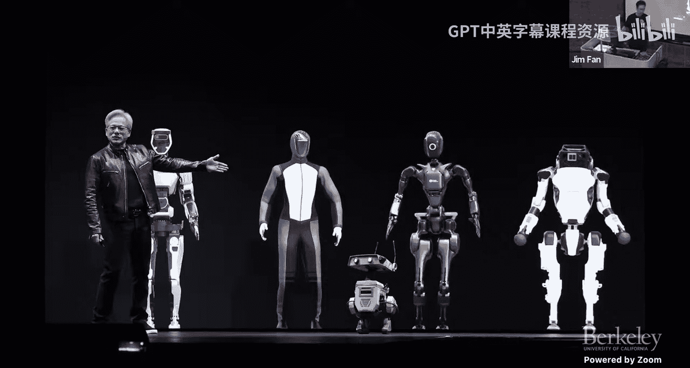

And the second access is the normal skills that a robot agent can do。

And we show that minimogen is one way to kind of。You know， have the robot master more skills。

 but can we automate some of this process？And that is the eureka work。

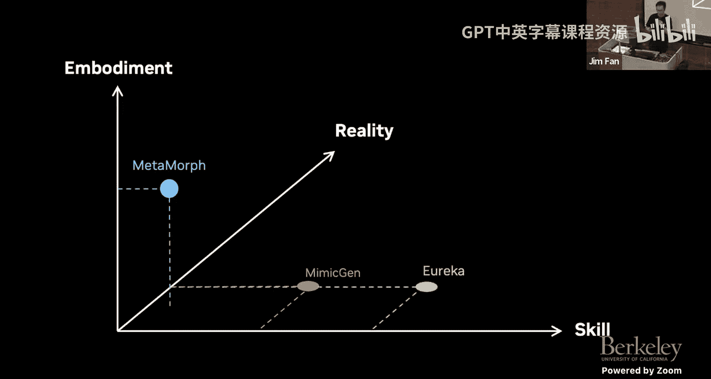

So we train an agent that can achieve robotic austerity at a superhuman level。

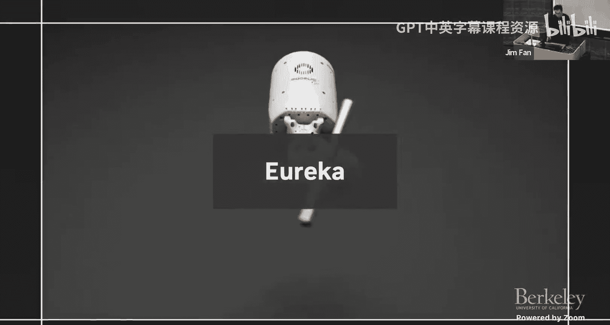

Well， maybe not all humans， but definitely with respect to myself because I'm never able to do pain spinning like that。

 I have given up long since childhood， so now my AI can avenge my poor skills。

 but I am a support human here。And how are we doing this right。

 it's actually a very complex skill to learn here and it's not clear how to even specify the reward function for it。

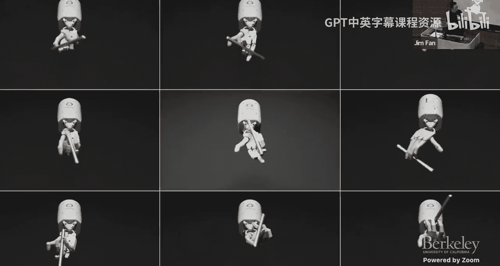

And what we found is basically the reward function is just a bunch of Python code， right。

 like in the ISac lab simulator， all of the robot simulation is written in these Python APIs。

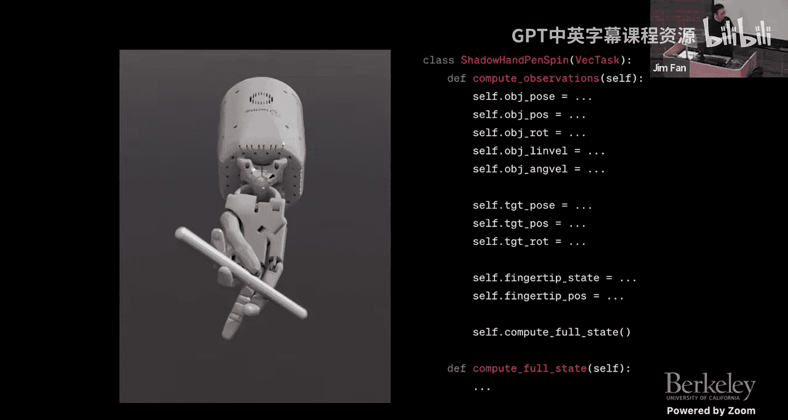

So what we can do is we just ask ChGBT to do the hard work for us。We give the LN。

App prompt saying that please find a reward function that can make the shadow hand do pen spinning。

And you're pass in some context， which is basically the ISAC Lab simulator API as code。

And to our surprise， GD4 or really any of the frontier models is able to implement the reward function correctly。

For most of the time。And it's actually really surprising because these reward functions actually take trained robotices to do。

 you need to be very familiar with these physics simulators to even be able to write that。

But models like GTs， they learned all the text in the world and they probably read all the papers that I wrote before as well。

 so they're able to do this。

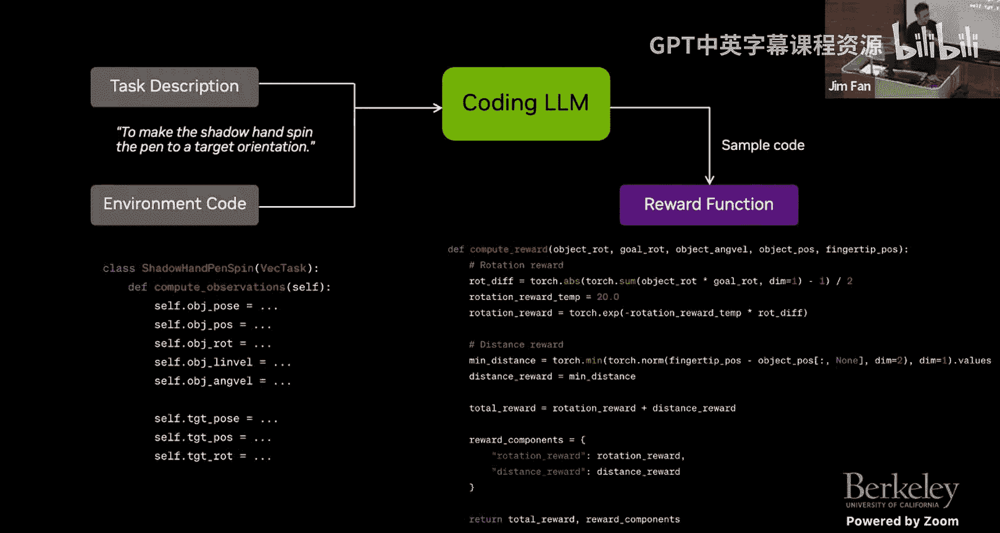

And we take the generated reward function and we pass it to 10，000 copies。

Running parallel on single GPU。And we're able to quickly get results by running a reinforcement learning loop on this reward function in let's say。

 15 minutes。And that completes a loop， right with sample reward functions。

We call a massively parallel accelerated training。And then we can report the results back to G。

And these frontier models are actually very good at self reflection。

 so they can debug and they can kind of find their own problems。 and sometimes they'll。

 they'll apologize to you and then write a better function for you。 and you just。Repeat this loop。

 so it writes better and better reward functions。

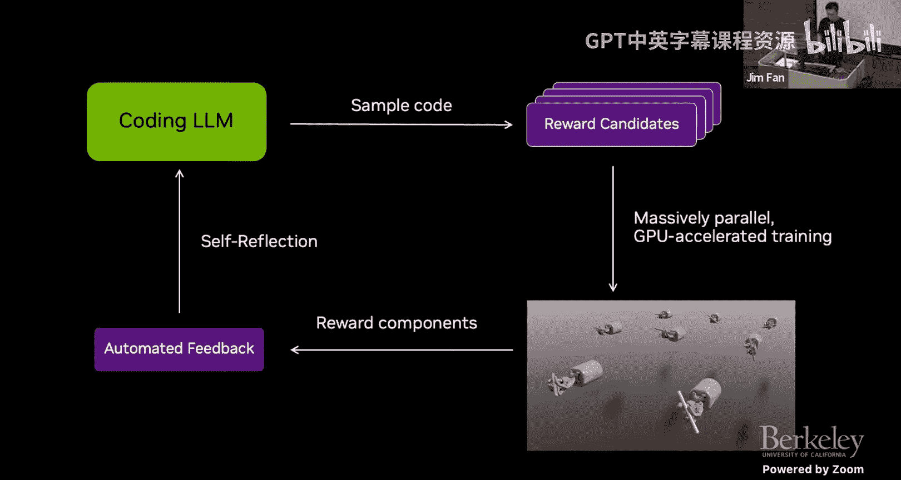

And here are some examples of what types of reward function edits that GPT does。

 and it's quite non trivial， sometimes it's as simple as just changing the hyperparameter。

 but sometimes LOM decides to change the functional form of the reward function completely。

And occasionally， it adds completely new components to let's say， track the angular velocity。

 make some penalty on the you know different joint angles。

 it's doing something very complicated here。But all of this code is edited iteratively by an LOM。

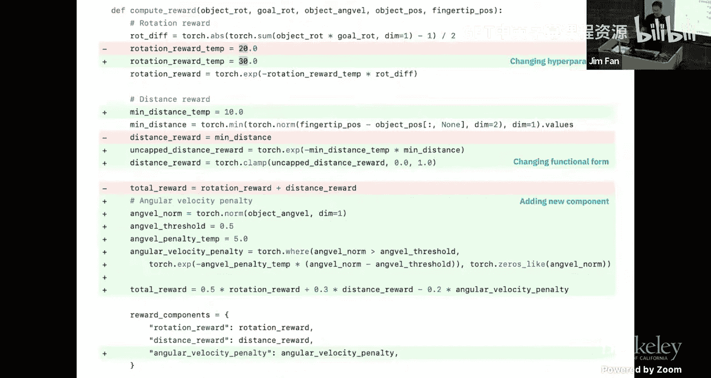

And if you do this iteration a couple of times， we see that Eureka gradually becomes superhuman with respect to expert written reward functions。

And this is a very general framework， any skill you can prompt Eureka to do it。

In fact， for these pen spinning along different axes。

 you actually need different reward functions to do it。

And OOM has no problem figuring this out。And for some of the tasks like。

 this is actually spinning pen against gravity and it's able to write reward function to solve it。

So that's Eureka。

And when we were doing Eureka， it was a work purely in simulation。So the next question is。

 how can we transfer from the Sim to the real world？And that goes to the third axis。

 the reality access， where here reality means simulation plus the real world。

And we see the hover work here because for hover， we need to transfer the policy to the real humanoid。

But hover is hand tuned。But can we automate it。

So we introduce Dr。 Eureka。And to understand Dr。 Eureka。

 first you need to understand DR domain randomization。It's actually a very simple technique。

In simulation， you will vary the physical parameters like gravity， friction， you know， weights， size。

And all of these parameters。Because in simulation。The physics is not going to be as realistic as the real world。

 right， like no matter how good a simulationilation is， it will never be there completely。

There will always be some imperfections in the simulation。

So what you do is instead of creating the absolute most accurate simulation。

 you trade compute for it。You just run many， many different types of reality where the gravity is not the same。

 friction is not the same。And here comes to catch， right？If you have an AI model。

That can master 10000。Different physical problems。Then it may very well generalize to the 10。

001 reality， which is the physical world that we live in。

And that is the principle of symptom of domain randomization。

 a super simple idea that works super well。So again， this is the Eureka loop， right。

 we ask GT to do the reward function。Well， how to do the domain randomization。

Typically what people do is you rely on your expertise， right domain randomization。

 all the parameters， you need a lot of experience you know， from your past papers or whatever。

To implement。But we're very lazy。 So we just ask GT to do it for us， right。

 because domain randomization prim are ultimately still just Python code。And two our surprise。

OOMs know how to do it。They know how to do it， they can also iterative improve it。

And once you have this loop。

That's transferred out to the real world。So here on left hand side is a simulation on the right hand side is the real deployment。

 so we train the robot do to walk here， have Dr。 Eureka write some parameters。

 and then it transfers zero shot without fine tuning in the real world。

And this is the allegro hand manipulating a cube and again， a transfer zero shot to the real hand。

And finally， we decided to do something crazy， right？

We want to have a robot dog to walk on a yoga ball。

But the issue is the yoga ball is bouncy and it's extremely hard to simulate。In fact， very。

 very few similars can do this correctly。😊，And here we just have a rigid ball like this ball isn't even bouncy。

 it's rigid in simulation， so the physics is completely off。And then we run out to Eureka。

And then we just ask。For it to transfer to real world。 And that's what we get。

Well we have our students just walk their dog， robot dog casually on the street on a yoga ball。

So when I shared this with the public， I got a comment， so someone actually after seeing this work。

 they tried it on their real dog and their dog is not able to walk。A yoga ball。

I wouldn't call this superhu， but I think this is perhaps some super dark level intelligence。

And that's Dr。 Eureka。So to kind of take a step back， right， like what do Eureka does。

Is you have an LOM。And then you have it code in Isac API to generate reward function， right。

 This is one loop， and this loop involves a huge foundation model。And given this reward function。

 you have a second loop that does reinforce learning to produce a small neural network that basically simulates you know the dogs and the hands and all of those。

 so Eureka is a dual loop system。You have an order loop that does reasoning。

And an inner loop that does motor control。And Dr。 Eureka just take this one step further， right。

 in addition to reward function writing， it also writes a same material real configuration for it。

And my question is in the future， for Eureka plus plus。Why can't we just write more things。

 Why can't we just ask OOM to do more work？Can we have it right new task？

New simulation completely or perhaps even new training algorithms that I don't know how to invent。

And just have the loop running。So my dream is someday。If we implement Euroure++ correctly。

All of my team will take a one week vacation， and then we come back。

 and Jansen wouldn't even notice because were still reporting updates to him。And that's the goal。

And once you have all of these access。And you push。To the top right corner。

 this is where we want to be。Well， we have a single foundation agent。That。

Can master all kinds of different bodies。And do lots of different skills automated。

And also generalize across different simulations and ultimately to the real world。

This is how people train chargeGBT， right， It's a sequence model that you take texting。

And then you output text。Be it Python writing or you know， poetry， summarization， reasoning。

 it does not matter。And ChGBT trains this by scaling it up across lots and lots of internet text data。

And I believe this is what the group model would look like in terms of the phone factor。

Where it takes as input an embodiment specification telling you what you're controlling。

 any instruction in natural language， any outputs actions。

And you train Gro by scaling this up over lots and lots of realities。And how we're doing this。

 we need a computing platform to do this。So this is what Jenen proposed。

To be the three computer problem for Nvidia。The first computer is called OVX。

 and that's basically the graphics computer。And what it does is generate tokens。

 right If you are using the transformer terminology， it generates tokens， and Rob Casa。

 maybeja Eureka， all of these works in simulation I talk about fall on the first computer。

And the second computer is the DGX system， and those are the H hundreds， AR hundreds of the world。

 and they learn tokens， right， they take the generated tokens， they compress them。

 learn them in a transformer， and these are the foundation Asian models。And finally。

 we deploy tokens， and that is the AGX system， the Jesson Ser series of chips that will run on board the humanoid robots。

So those are the computers that deploy tokens from all of these intelligence。

And then you can validate the performance of this again in a digital twin inside the matrix。

 and that completes the three computer problem。And there is this software orchestration framework called Osmo that we use to schedule all the heterogeneous compute workload。

So if you fell asleep， don't worry， this is the one slide that you need to take home today。

We talk about three principles。The data pyramid。And a matrix。That。

Supply the data to train the foundation agent。And then we talk about the three computers。

As a computing platform that enable all of these research to happen。

Three principles and the three computers。I think it's going to take a while for us to solve robotics right this is perhaps the last AI problem。

 the hardest AI problem。And on our way to solve the Grood Foundation agent。

 we hope that we'll build all the tools and research that will inspire the community。

 lift up the community， lower the barrier of entry。

 right to access all of these advancements that we have built。

And I believe humanoid robots will be a trillion dollar business。

 I don't think this is very controversial because we're talking about the entire labor market to be automated once we have these journalist robot foundation models。

But using Jensen's word， right now， it is a $ zero trillion dollar business because things don't work。

But precisely because it is0 trillion， is zero today and trillion tomorrow。

So we need to start working on this right now。

And I believe AGI cannot be achieved without embodiment。You know， one day， hopefully soon。

 we'll build our active kitten。In silicon。And embodied AI is our north star。

 and I believe Gro holds the key to this future。

And please join us on journey to theble， thanks。