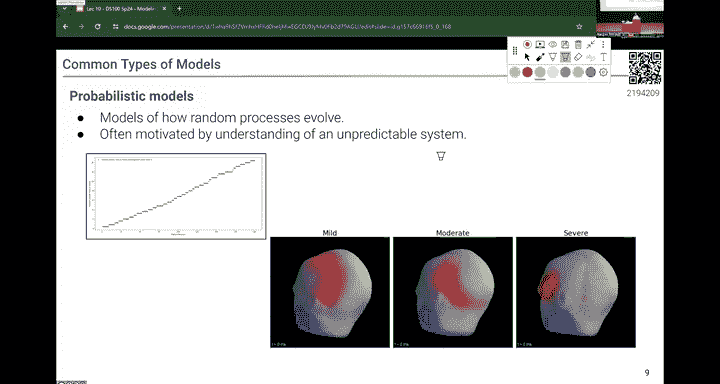

# UCB《数据100数据科学原理与技术｜Data 100 Principles and Techniques of Data Science 24SP》中英 - P10：-10-Data 100 Spring 2024 Lecture 10.zh_en - GPT中英字幕课程资源 - BV1Bc2dYCEbc

All right。Good morning Data 100。 Welcome to another data 100 lecture today is going be a very fun lecture。

 This is going to be a transition point。Previous we spent a lot of time in data science lifecycl talking about the data talking about the sampling。

 talking about the tools that we have but from this point and on we're going to go a little bit deeper into either modeling or advanced tools so we're going to see SQL and we're going to see dimensionality reduction as advanced tools。

 but in terms of the modeling。 we're going to start seeing the first types of modeling。

 That's kind of a review of what you've seen in data8。

 but we're going to talk about that from kind of the perspective and the notation of data 100 today So that's the plan for today you see modeling one introduction to modeling simple linear new regression and then in the next lecture I'm going to come back next weekend I'm going to talk about additional considerations about modeling so we're going to talk about。

😊，functions and different considerations in the modeling pipeline and on Thursday of next week is going to be our third modeling lecture where I'm going to talk about multiple linear regression。

 meaning that what happens if I have multiple different attributes that I want to combine them together in order to do a prediction。

😊，So let's dive right in， I want to talk about the outline of the today's lecture a little bit。

 I will do a quick housekeeping surereya reminded me of that so today we're going to see a review of linear regression from data aid we're going to see what modeling means and we're going to see the first modeling pipeline and modeling process in terms of the data 100 kind of notation and guideline that will be using the reminders are one of them is that for each one of the lectures we're now releasing a lecture thread on Ed which technically is a summary of all of the questions that you're asking during the lecture so that if you're watching it asynchronously or if you want to rewatch a lecture afterwards you can kind of see what kind of questions the students had and then what kind of responses did we give so we'll keep updating those we're going to also announce the top trick the student contributors to those responses so if you respond to each other's questions。

😊，And responses are correct we're going to count them and then we're going to release the names of the top three contributors about office hours there were several changes to office hours with all the power outages and you have requested more online office hours so we made a number of changes make sure that you check the website for when we have online office hours when we have inperson office hour we're going to use the office hour online virtual office hour queue system so you need to basically log in and you need to create a ticket saying whether you're online or whether you're in person again depending on what time it is and whether we have in person office hours or online if you are in the room in warrantren hall make sure that you were name tags so that's how we're going to find you and then come to you and our Ts are also going to where name tags as well is that all。

All right， wonderful so let's go in and talk about what is a model for today A model is an idealized representation of a system or word there is a famous statistician George B which famously said that all essentially all models are wrong but some are useful I'm going to give you an example to tell you why this is how we're thinking about the model think about the model of falling of an object on earth subject to gravity so when we're saying that when an object falls on earth we're considering that the gravity is 9。

9。81 meter per second square that basically is an estimation we're not considering for example other the local variations to gravity we're not considering for example air resistance and things like that so that's why we call this model or this way of phrasing how。

😊，The relationship between like the gra gravitational factor as kind of an idealized representation of how gravity works。

 but in reality this approximation or this idealized representation is good enough that we're using it in daily system or it's kind of a concept that is being used in other systems that do rely on modeling something about gravity so this is why we say that。

😊，All models are wrong because there's always noiseis involved。

's always variations involved there's always other factors that we're not considering in the modeling。

 but they're also useful because they are simplifying our understanding about the environment and the system that we're dealing with。

 So that's why we do modeling。😊，There are three reasons why we do modeling and I'm going to walk you through each individual one of them and it's kind of important for you to make a distinction between what we refer to as machine learning but we refer to as deep learning and what we refer to as causality and inference analysis the first reason is that we want to for example understand a complex phenomena and then we want to be able to explain it so for example take into account that I want to take a look at how bear parents average heights are related to the children's average heights so what I want to do is I want to do an estimation or have an approximation of what would be the average of children's heights given the various parents heights and then I want to be able to explain it so that's very explainability and accuracy they are going to really work together in this reason one say for example if you want to take into account that you want to model objects model understanding how objects velocity。

And acceleration into how far it would travel so that's also another model its a physical model that you're trying to estimate and then you want to explain that for every for different values of velocity and acceleration how far the object is going to travel so that's the part that it's going to be interpretable so in this reason one the model needs to be simple and it needs to be interpretable and we also consider that it needs to also be semi-accurate or accurate enough for us to be able to use it so we don't want an inaccurate model because if the model or any prediction that you're doing it is inaccurate we're not going to be able to use it or not want to use it in the first place。

Reason two is there are some more complicated concepts or models that we'll need to deal with and generally those models are models that are dealing with models that are based on deep learning frameworks in the concept of data 100 in the concept of data science if you think about them。

 sometimes also a little bit of machine learning a little bit of deep learning。

 but these are the models that need to be highly accurate， your modeling is sophisticated phenomena。

 but then the issue is that the models are going to be a little bit of a black box because of their complexity because there are different moving pieces and various number of parameters that we can't explain the dynamic between a million number of parameters。

 so that's why those models are black box or uninterpretable compared to the reason one category that we had examples of those could be for example。

 say you want to do you want to perform a spa filtering in your inbox。

So you have a bunch of emails and you want to go ahead and classify emails in terms of As spam and not a spam this is something that you will do in your very last project in data 100 there is a spam versus ham project which is going to be very fun we want to be able to really accurately classify。

😊，Different emails into different categories， but probably it's not as important for you to know why an email went to your spam folder。

 you just want it to be accurate so that you don't miss an email a relevant email that's now forwarded to your spam folder or vice versa having a spam email landing into your inbox other more complicated stuff could be anything that deals with natural language processing such as for example。

 you have a document， a lengthy document that you want to summarize and in those cases， again。

 it's very important for us to be able to capture the gist or a summary of the document as opposed to knowing how it did the actual work and。

Again， explaining why this specific item was captured from this 10 page document and so on and so forth。

There is a third category that we're not going to touch in data 100 which is causality if we want to。

 for example， look into how one variable is going to influence another variable。

 so for example looking into whether smoking is going to cause cancer。

 not correlation but causation here， this will require causal inference which is not going to be a topic that we're going to touch on in data 100 but more advanced courses are going to talk about causality。

 but we'll keep referring in today's lecture， to different concepts as I'm going through correlation and reminding you of what correlation was but keeping in mind that correlation is not causation and when we're doing any kind of regression analysis。

 we are not talking about one variable causing another variable we're just talking about their association and linear association from the perspective of linear regression。

So what I said also briefly as I was going through all of these different reasonings was that we really want to strike the balance between interpretability and also accuracy。

 we don't want an inaccurate model， but at the same time if a model is a very black box that you don't know how it's developed。

 you don't know how to interpret it and you don't know how to evaluate the output it's really hard to justify its use it generally in data science for different types of a stakeholders assuming that you'll have models that will be deployed in hospitals or different domains that really people need to trust those models so there's always this kind of balance that you're trying to make between interpretability and accuracy。

In the next two slides I'm going to just show you different examples of the types of the models that youll see and I'm not going to explain them in detail but I'm just going to put it out there so that you see a variation of different variations of modeling and then compare it with the model that we're going to talk about today the first category of modeling is deterministic physical or mechanistic models these are the models that generally govern how word works so for example the Kepler's third law of planetary motion or Newton's laws of motion and gravitation so all of these laws are generally physical laws that these are deterministic there is no probabilistic modeling that goes on during the understanding of each one of these equations or each one of these frameworks but they also show you how the word evolves and then how how word works and how different elements are related to。

It other。There is another category of models that are called probabilistic models so we're going to see one type of probabilistic modeling towards the end of data 100 when we're going to talk about classification but generally knowing what probabilistic models are these are the models that are going to model some kind of some kind of random processes so let me give you an example of a random processes a random process can be some signal or some variable that evolves over time and then at each given point in time you're trying to understand it and quantify it and make some deduction about it so an example of a random processes could be for example brain waves so brain waves or random processes that are going to basically distribute in your entire brain and then you will be able to study the interaction between different random processes that are going on in your brain in order to figure out at any given point in time what is the。

uration of those brainwa activities in different regions and what did that correspond to right for example。

 when we were trying to understand anxiety level of subjects。

 we would be able to just have measurements of these brain waves and these signals over time in brain and then we will be able to put a hitm on it and then able to figure out which area in the brain is more activated and depending on those activations over time or at one given point we can be classifying subjects anxiety level This is also something that can be used the same process can be used for predicting the onset of seizure and also localizing seizure but just know that the underlying model is technically going to be random process that is basically based on brain waves and all of those brainwa their location and their activation and did。

Different characteristics of them is going to be random and changing over time and we require kind of a probabilistic modeling in order to be able to understand it and figure out what is the probability distribution of what is the probability of having an activity in this part of the region or this part of the brain。

 for example， 10 minutes from now so that you can predict an onset of the seizure so those are the types of kinds of application of probabilistic model and this image is from one of my papers so if you just take a look on my website you should be able to see one example of a very simple probabilistic model on brain wave signals。

So now let's get into the review of what we know about the determinist kind of modeling which is linear regression。

 what you have seen in data aid， how can I translate what you learned before into the language of data 100 and then what is this entire pipeline of modeling that we're going to spend in the second half of the lecture talking about what is the pipeline and what's the significance of each one of those steps in the pipeline that we're going to see together so hopefully this should be a familiar kind of figure from data aid remember that the plot that you see here on the righthand side is the scatter plot and the line plot corresponding to different chapters in the little women novel this data is again from data aid what's plotted here is the number of periodss in each one of those chapters versus the number of characters in each one of those chapters and this linear regression is going to try。

To predict the number of characters in a chapter， given the number of period punctuations， right。

 So what we have in the regression line right here in data8， if you learned that the regression line。

Is a unique。It's a unique line that is a straight that passes through all of these points and the significance of this regression line is that it minimizes what mean squared error what do I mean by error all of these deltas right here are errors so we're going to calculate all of those errors we're going to calculate a square of all of those individual errors will calculate average of all of those square of the errors and then this regression line should be the line the unique line that minimizes the mean squared error across all of the possible lines that you can have so if I go ahead and pass for example another line and you can kind of visually inspect and calculate visually what should be the errors for all of these scatter points that you have and mentally calculate the minus squared error and compare it with what you had with the previous light blue line you will be able to see that the light blue line was a better fit in this a specific example。

So what were the equations that we saw this is the regression line So the equation for this regression line is that for at any given line I need to have an intercept and I need to have an slope so this slope is just telling you how steep the line should be and then the intercept is going to tell you when x is equal to0 what should be the y value and that's basically the y intercept that we're getting So the equation for this slope from data1 data 8 you'll learn that this slope is equal to correlation times the standard deviation of y over a standard deviation of x so we will try to derive all of the equations that you'll see and this is slide together in today's lecture but this is just a reminder the slope is equal to correlation times the standard division of y over x we know that intercept is equal to average of y minus the slope times average of x we also know that if we have the equation for a slope and intercept then we can calculate the regression。

Prediction so we will say that the regression estimation is going to be equal to just plugging your value into the equation and then it will give us that okay。

 this is my input value x， I'm going to multiply it with the slope and then I'm going to add interest set on top and that's going to give me the regression estimation。

And then there was the concept of residual which is very important and we're going to reuse it residual defines as defined is defined as observed value minus the actual minus the regression estimation so therefore residual can be a positive value and can be a negative value right so for the points that are above the line here so actually let me go ahead。

And it would。All of these here so for example， for this point right here what is the actual value the actual value that we have for y is going to be this value what is the predicted value the predicted value is that you project x onto the line right and then you see what value evil well projected to so this is the projected value so we say that this is y I and this is I'll write it here this is y I and this is Y I hat for data point I the actual value is why Y I and the predicted value is y I hat and if you look at the calculation of the residual then you're going to get a positive residual in that case so the points that are above the line are going to have positive residual the points that are below the line because of the way that is defined are going to have a negative residual so that's how the general trend of the line is going to basically。

Break between or break through all of the lines and then have some of them above it and some of them below it and some of them hopefully on the line exactly。

Okay。So before I move on to data 100 this stuff， I want to remind you of the correlation。

 so it's generally a little bit of a complex concept that I want to remind you and then see few examples of correlation。

Again， the definition from data8， we said that the correlation is always shown by R so this is your correlation and the value of the correlation is calculated as the average product of x and Y when both of them are measured in a standard unit。

Okay， this is a little bit of a complex task， but let me break it down into understanding how this equation is going to correspond to the data set If I have in my data set a bunch of data points and think about two columns being x and y and then I have multiple different rows if I take a look at one of those rows and I say that in row1 I have x1 and y1 so the input is x1 and the target value that I want to predict is going to be y y1 and then I basically look at all of the samples that I have in a data frame going row by row I have x1 y1 and then I have x to y2 and then I have x and y and all the way to the end of this entire data frame that I have and just looking at x across the X I calculate the average I refer to that as x bar I look at the average of all of those y values I refer to that as y bar and then I calculate also a standard division of x and y refer to them as。

SigmaX and Sigma Y， what we're technically going to need to do is we need to say that what is a standard unit？

What is the standard unit of X and Y， So standardization technically means that。

We want the mean of the distribution or the mean of the column to be exactly equal to 0 and the standard deviation of it be equal to one。

 So the way that we do it is by a process that we pass each one of these data points。

To this equation， which removes the mean and then it divides it by a standard deviation。

 If you pass all of the data points in x through this formula and you pass all of the data points in y through this same formula。

 the standardized version of both of these columns is going to have average of zero and then the standard deviation is going to be equal to1 and that's what we mean by a standard unit。

 there is variation or a standard deviation is equal to1。 and then again the mean is equal to0。

 So if you take a look at what we did， I'm going to say that okay standard I'm going to go ahead and a standardized all of the x values and all of the y values。

 I'm going to go ahead and calculate the product between the standardized version of x and a standard version of y So taking the product between them。

 and then I'll go ahead and average over all of these data points。

 That's exactly what this definition is reading the definition one more time it says that。

Correlation is equal to the average， which is what we're doing with the first。

Dividing it by one multiplying it by one over n， again， dividing the entire summation by n。

 summing up over all of those products。 And then it says that the product of x and y both are measured in a standard unit。

 which is exactly that。So there are some kind of other ways of referring to this correlation。

 we refer to this sometimes this correlation is also referred referred to as a Pearson's correlation coefficient so if you hear about Pearson's correlation coefficient that's basically a similar thing and a similar concept。

If we go ahead and say that I don't want to remove this standard deviation。

 I want to keep this standard deviation to be a standard deviation of x and the standard deviation of y for both of the columns。

 but I just want to remove the mean so that the mean of both of the columns is equal to zero then this will basically help us get the covariance so the covariance is calculated in a similar way is just that it's not normalized with the standard deviation。

 so that's why here we would say that the covariance is equal to r times the standard deviation of x times the standard deviation of y。

So let's take a look at some of the properties。Correlation and in data A， they try to really kind of。

Take the point home that the correlation talks about the linear association。

 so the higher this correlation value is the more you can argue about the linear association between these two variables it's always a value between negative1 and1。

 you can go ahead and prove it yourself， but technically by removing the mean and dividing the dividing the products by standard division of x and y。

 you can kind of put the range to the R value and the range is going to be limited between negative one and1 and technically when R is close to one or close to negative one when r is close to one that's a positive linear association。

 positive is strong linear association， when it's close to negative one that's a perfect negative linear association between x and X and Y。

When r is close to zero， either a positive value or a small value， but close to zero。

 we would say that there is a V or there is no linear association between the two variables and we would say that they are uncorrelated with each other x and y are uncorrelated if r is equal to zero。

One more time， the correlation just talks about linear association。

 it just doesn't talk about causation， it doesn't tell anything about nonline association。

 you might have a very small correlation value but the relationship between the two variables can be nonlinear but they can still be related in a nonlinear way but we're just measuring the linear association in this case I mentioned when r is equal to zero we can say that they are uncorrelated when theyre uncorrelated it doesn't mean that there is no linear there is no relationship between them it just means that there is no linear relationship between them but they might be higher order or nonlinear relationships between x and Y and we'll take a look at example of that。

In the next slide here， so。We talked about this R being the absolute value of R being less than one。

 so meaning that R is between negative  one and1。 and here I brought some examples。

Of different scatter plots with different correlation values。

 so what we're seeing across the board is that in the first plot what we're expecting is a very low correlation because you don't see any trend between x and y but the second one we see a positive correlation meaning that there is a positive linear association。

 how do we tell apart positive versus negative the relationship is positive and by increasing x Y is also increasing。

The vice versa and by increasing x， your y decreases in this case that you're seeing in this trend。

 This is a negative relationship or negative linear association。

 So we're still expecting that the correlation should be as strong， but it should be negative。

 a strong value。 And then the last piece is kind of a nonlinear relationship that we'll see what the correlation is going to be。

So looking at the actual correlation values， so we see that the correlation value for the first one is very close to zero it close to saying that these two values are uncorrelated in this case there is no linear relationship between them but it' also not clear whether there is aline relationship between them or not in the second one we said that there is a positive linear association that is captured with the 0。

95 correlation value for the third one we said that the linear relationship is a strong but there is a negative linear association so that's why this relatively high value but it's negative on the third the scattered plot。

 but comparing the linear association between the second one and the third one you see that the third one is a little bit more scattered and it's not as a strong as the second plot that we saw that's why the absolute value of the correlation and。

Her plot is a little bit smaller than the absolute value of the correlation on this plot。

 which was very close to one。The last one， what should be the correlation？

It seems to be some strong relationship is going on between x and y right in fact that's a quadratic relationship a strong quadratic relationship between x and y。

 but what we're concerned with is only linear association with correlation the linear association is very weak and that's captured by the correlation of very close to 0 which is 0。

05 in this case。Okay， so that was all about correlation。 Now。

 let's take a look at what we had with the。With the regression line definition in data8。

 we said that in data8 that if you basically go ahead and move your data set into a standard unit right moving to a standard unit technically means that the average of x is equal to0。

 the average of y is equal to0 and there is no baseline and then therefore there is also the correlation that you you were defining based on there a standard units between x and y。

 So the regression line in data 8 was defined as a line that passes through origin here because the baseline was removed。

 the average of x and y was removed and then it says that by every one unit increase in x。

 there is R unit increase in Y and therefore if you're looking at the standard unit。

 this was a regression line that data8 was proposing that y hat or the prediction that the model is providing is equal to r times x when both are measured in the standard unit。

Okay so if we just go ahead and put the equation for a standard units for y hat and also for x for x。

 what we're going to get is this one， which I can go ahead and simplify and derive the exact equation for a slope and interest up for you in this case so again this is nothing but moving this equation right here and moving away from a standard unit to the actual unit of the data。

 so the standard unit of y was calculated based on getting y hat minus mean a y or y bar divided by a standard deviation of y and then also the same thing with that for this second term here by just moving the data x into the original units instead of a standard unit。

Okay。So what I'm going to do is I'm going to take this equation。

 I'm going to move it to the next slide and I'll try to simplify it so that you can get some equation like this reasonably in the same unit of the data。

 which is calculated which has the slope term and also intercept term separate and in data a language we said that a hat was the best estimate for or the estimate for the intercept and B hat was the estimate for this slope。

So let me go ahead and do that here so what I'm going to do is I'm going to say that I'm going to simplify this equation right here and I'm going to write it in a form that y hat is on one side and everything else is on the other side organized by a factor that is multipied by x plus a second term which is going to be my a hat in this case that I need for that regression line so what I'll do is I'll go ahead and multiply both sides by sigma of y right and then I'll move y bar to the other side so that I can isolate and I can have y hat in one side of of the equation so let me go ahead and do that y hat minus y bar is equal to r times x minus x bar divided by standard division of x and then I'll go ahead and multiply it by a standard division of y。

Okay， so taking one step further， I'll say that y hat is equal to r times x minus x bar。

Divided by a standard deviation of x。And times the standard deviationvation of y plus y bar。

So this is kind of getting close to what do I want。

 but now I'm going to go ahead and simplify the right hand side so that it's like one coefficient multiplied by the X term plus a second intercept term that I can use to represent a hat and B hat so let me go ahead and do that Y hat is going to be equal to。

R times x times the standard deviation of y divided by a standard deviation of x。

 that's just the first term right there， and then what I've left from the first term is going to be r times negative of x bar divided by standard deviation of x times the standard deviation of y。

 which I'll do here， which is going to be r times x bar times the standard deviation of y divided by standard deviation of x。

And let me clean this up。The standard deviation of x。

 and then what I've left is technically only y bar。Right so I'm getting close。

 so what you're basically seeing in this case is that when I want to get my slope。

 what was my slope my slope was this term right here。

 it's the coefficient that's multiplied by x and looking at the equation that I have here。

 my slope is basically these terms right here， r times the standard deviation of y divided by a standard deviation of x。

 which I'm going to go ahead and right here， the slope is equal to r times a standard deviation of y divided by a standard deviation of x。

But what is my intercept in this case， my intercept looks a little bit messy。

 but let me simplify that a little bit further， So I'm going to take these two terms right here。

 and I'm going to say that these two terms together if I reorder them is going to be equal to y bar minus。

R times the standard division of y divided by a standard division of x times x bar。Okay。

What do we see here， Notice here that when I had a slope being equal to r times the standard deviation of y divided by a standard deviation of x。

 this is reappearing here， right？ So technically， my entire inter step， which was。Actually。

 let me change the color to something else。 My entire intercept term here。

 which was the entire combination of these two terms， is going to be what I have right here。

 which I'm going to rewrite it as y bar minus a slope。Times x bar。

 which is exactly what you had seen in data8 so this is kind of showing you what happens when you move from the standard unit to the actual unit of data and then you basically reorganize everything and then that's how you're going to arrive at this slopean intercept that we had and obviously we know that the residual or the error that we have for the I data point is equal to whatever the true value was the observed value minus the predicted value and how do you get the predicted value you just plug in into this equation you have a hat you have V hat and then youll you'll be able to calculate what your prediction is。

One thing that I want to remind you of is these hat values。

 so here when I say why hat and here when I don't have any hat。

Not having had that means that's an actual value and I have had on top of why that means that means that that was the production that I had right that's how you can tell or distinguish between these two values right here so the goal for today's lecture is to actually go ahead and derive all of these things mathematically as opposed to just visually saying that oh we did change the scale of the data and this is how we're arriving at this equation I'm going to actually define a nice pipeline for the modeling and then we're going to drive it using optimizing a certain function that you're going to see today so the slides that you will get is actually going to have nice animation walking you through all of these steps into the final phase but I'm going to start writing in the lecture because that's a little bit more intuitive。

But let's get into the modeling process this is the very fun part every time that in data 100 we're going to do modeling we're going to go through exact same set of steps that you see on this slide so I'm going to introduce you to what a modeling is in data 100 which is technically defining a mathematical function and we're trying to define this mathematical function that shows you the relationship between two variables that we have。

Every time we're going to start with a data set， so in this example in today's lecture for simplicity。

 we're going to only assume that we have two columns。

 one input column and one output column and then we have a number of data points and that's how the index each one of those data points we said that for the first row the input is x1 to output is y1 and then going into the second row you have x2 y2 and then all the way to x and YN。

Each one of these values pair of values in the rows is called an observation。

 an observation has two parts， the input part or the independent variable part that is given to you as an input and or we can also call it as feature or call it as attribute I kept saying that there are different features or attributes that we can use from our data set to do modeling that's what we meant。

 but then there is also a target value or a dependent variable or output or outcome or response that we're trying to predict so the technically this mathematical function is that define a function of x。

 a parametric function of x that is as closed that is going to give you values that are as close as possible to these Yi values so we're trying to mimic those Y values and every time that we're measuring the distance or the delta or the error in our prediction we're technically measuring the delta between a vector of all of those production values versus the actual。

Conrous values that exist in this second column in the y column in this case。

So the different models that we'll be using in today's lecture is going to be simple linear regression I showed it in the first line。

 So simple linear regression means that my why I hat for every given data point。

 my prediction is going to be based onteta zero or this is intercept plusteta1 times X I I'll take in the input in row I I'll multiply it with this slope。

 I'll add the intercept and then that's going to be my prediction。

 that's simple linear regression in Tuesday's lecture next week we're going to come back and see a different model that we're going to call it a constant model and then in the last lecture we're going to go a little bit beyond the scope of the first two lectures and we're going to take a look at what happens if I have multiple different attributes because in this case you only have one column as input What if I have multiple different columns that I want to use a combination of them in order to make a prediction So today we have a simplifying assumption that。

I only have one one column as my input all of these models are called parametric models and why do we call them parametric because all of thoseteta values are parameters that we're going to learn and once you have those parameters you have a model so when I say that there is a simple linear regression and these are the two parameters such as youteta1 you'll have the model you have everything that you need in order to do production so that's what we mean by that's what we mean by parametric model。

So parametric models are models that are parameterized byteta I values， so we setteta 0。

 we setteta 1， and these are the parameters that we're deciding on them based on the inputs based on the two columns that you saw the column of x and y。

X and y by itself are not parameters。 They inputs that are going to inform us about what the parameters for the model should be。

 And then we basically consider defining a mathematical function based on the parameters。

 And then we'll go ahead and find the optimum set of parameters。 And we refer to them as theta hat。

 Remember that we said in simple linear regression in data A。

 they were telling you that this is the single unique line that passes through all of the points that minimizes the minus squared error。

The parameters for that simple line or that single unique line are going to be shown by Teta hat parameters because they are the unique optimized set of values that you can use for your modeling。

So here again， I want to draw your attention to two places that I'm using hat。

 I'm using hat on top of Ys， and I'm using hat on top of Teta。When I put hat on top of why。

 what do I mean by that， I mean that that's a prediction。 That's not a ground truth value。

 When I put hat on top of Teta， I mean that this is a value that I predicted and I calculated。

 not predicted that I calculated。 This is the optimum value that is going to be the unique set of values that should be used for this regression test that we have based on the data that is given to us。

So looking into the distinction between them， we will define a general form of a model。

 we say that okay， this is a parametric model that is defined based on ateta vector or a set ofteta values。

 and this is a general form of simple linear regression the general form is that there is a parameter here。

 there is a parameter here that I can combine them into a vector again。

 the reason that we moved away from a and B and A head and B hat of data8 intoteta0 andteta 1 Greek letters in data 100 is not that we want it to be fancy。

 not that we're not fancy but it's mostly because we want to aggregate all of those parameters into one vector and we just treat treat a model as just one vector of parameter right once you have one vector you have everything that you need in order to understand in order to understand one model。

So this is the general form think about a mathematical function that you can keep changing the values ofteta0 andteta 1 and depending on thoseteta0 andteta 1s you'll keep getting different estimations this is kind of equal to me passing multiple lines through all of those scatter points that I have not all of them are optimum but the optimum one is the vector that is shown byteta hat based on the data I say that the optimum set is these two exact values ofteta0 hat andteta 1 hat that I can plug in and this is going to be my bestfi linear regression model that's going to give me the best model。

RightAgain， those best parameters， I can still combine them into a vector。

 and I can say that my best model is this Peta hat vector that has two values。

teta 0 and Peta 1 hat that I can use for modeling。That's a lot of notation。

 but you'll see it once it make sense for the rest of the data 100。

Note that we are now dealing with parametric models。

 but not all models are parametric you have seen Kener's neighbors in data 8 that's an example of nonparmetric model you've seen kernel density estimation that's a non-parmetric process there was no parameter that I was optimizing I was choosing a hyperparametertry that we're going to come back to that in the next four lectures and talk about it。

 it was not that we were learning alpha or the bandwidths of the kernel based on the data we've been tweaking it ahead of time and then were applying the kernel density estimation based on that the specific alpha so that's why it's a nonparametric model or process in terms of the kernel density estimate。

Okay， so let's get into the fun part and actually talk about the modeling process。

 I said that there are four steps into the modeling process。

 The first step is that we need to decide about what kind of model do we want to use remember that I was talking about probabilistic model and I said there is a statisticalistic a statistical model sorry Probabilistic model and deterministic model So we need to decide about what kind of data we have and what kind of modeling do we want to do What kind of output do we want。

 I it a regression test that we want to quantify something or is it a classification test So we'll keep changing the model that we see in the first level or the first decision part of this modeling process in different lectures and you'll see what the result is going to look like depending on different models that will plug in in step one。

A step two。We're going to define some kind of a loss function or cost function。

 which technically is the objective function that we're trying to optimize。

 What was the objective function for simple linear regression in data 8。

 Remember I was saying that the unique line that we found was minimizing。

The mean square error that was the objective function that was loss so how was I how did I understand the error that I had or incorporated the error that each one of the data points was giving me I was calculating the error is scoring those errors and I was calculating the average of the squares of the errors across all of those data points that's what we mean by loss and we're going to revisit this concept of loss one more time in today's lecture and we're going to formally define how what the loss function is going to look like。

Once we have a loss function so we have a framework。

 we have a loss function we know how we want to penalize our data points for being misclassified or there is going be like miscalculation of their prediction values we need to use these two processes together in order to fit the model so we'll find out how can we go from having the general form of the equation in terms of Teta into Teta hat values and that's going to be my best model and then afterwards I'll sit down and I'll evaluate the model and we'll decide what kind of metrics we want to use in terms of evaluation and what are the important criteria that we have after the fact we want to evaluate the model and take a look at the model performance so remember these four processes or four steps we're going to go through them every single time that well do modeling and I'm going to start by the first thing that the first step of simple linear regression was choosing a model or any modeling was choosing a model today。

Simple linear regression， so I'm just going to go ahead and use this notation that we had from from data 100。

 which is kind of a sister version of what you had in data8 I'll say that the general form of the model is going to be that the prediction why hat is going to be。

A linear combination of two terms。 These two terms are going to be one is going to be intercept orteta 0。

 The other one is going to beteta1 times x or a weighted value of the attribute x that I had。

So this is my parametric model， my parameters are theseteta0 andteta 1 think about that as a vector or a machine or a black box that once you pass X。

 then you will automatically go ahead and apply this equation that you have and then the output of this box is going to be your Y hat so this is the entire modeling phase that well have and then technically what we want to do afterwards is we want to make sure that these estimations are going to be as close as possible to the target values or the observed values that we have which are going to be my YI's。

The first is step done so in the modeling process we know what we're doing because we are going to teach you simple linear regression today。

 so the first phase is done now we need to go through the next steps so the next step was to how to quantify the loss function or how to quantify loss for miscalculation of the values that we have。

So which is going to again help us to go from the general form into the specific form that is going to give us thete to zero hat and also theteta1 hat that we were looking for so let's see what is this loss function that we can choose and why we care about this loss function so going back to the same example that I was showing you with the little women novel and you're seeing that there are different lines that we're passing。

The loss function is technically going to help us to quantify how good or bad each one of these lines are mathematically you can put a number next to each one of these lines。

 and then you should be able to order them based on that number that you have for each one of those models and then obviously you'll go ahead and pick the model that has the smallest loss or the smallest cost value for you。

So what youre seeing again and the legend is that I have three different lines， I have blue red。

 and I have yellow， and the first slide the question of the day is which one of these lines matches the data better？

As you're going through， like answering this， think about。

How in your mind you're going to put a number next to each one of those lines and then how you're doing the sorting and then finding out which one is better。

Hopefully this is simple enough and I've shown you that blue line multiple times that now you know that that blue line is the best fit。

 but technically what was happening behind the scene is that you know that you have to measure the error。

 you have to average the error across all of the data points and do that for every given single line and then you'll basically figure out the line that's better is the line that has that average error to be as as small as possible。

So formally defining what was happening there was that you were calculating the estimation of the model versus the observed value and where the delta was high。

 you were going to assign a high value to the loss or to the cost value to the cost kind of function that you were defining and then there was a close estimation y hat was close to y then you were saying that there is a low loss value so think about this loss function as a function that takes in that takes in two values y and y hat and then it's going to again。

 depending on what happens between the delta between y and y hat is going to give you a low loss or high loss depending on whether the delta is a small and whether the delta is large and technically this loss function is the function that's going to measure the cost or error so this is something thats think about it as something that we want to avoid and we want to minimize。

This cost on average over the entire data set as much as possible What I'm showing you here。

 this definition of loss function is for one data point for one data point。

 there is one why there is one there is one y I and there is one y I hat and I'm going to calculate the delta between them and I'm using that delta in order to decide whether the cost should be high or the cost should be low there are different types of loss functions that we can define today I'm going to show you too later on we'll see additional versions of the loss function。

 but the reason that there are different types of loss functions is because there are different objectives that we're trying to optimize so for example。

 if you have a regression task there is like a single value that you're trying to optimize and you want your regression regression estimation to be as plus as as possible to the observed value but there are sometimes that you want to do classification and you have multiple classes how do you want to measure the error in case that you have a classification tasks。

There are sometimes that we care about outliers and our data has large outliers or very like different outliers than the general trend how do you want to minimize the effect outliers there are some loss functions that are good at handling outliers in a data there are cases that we care about false positives and false negatives and we would say that not all errors are equally are equally bad and there is more cost in for example missing a patient that has cancer and say that you don't have cancer in those cases we're going to revisit those cases later but generally we say that not all all errors are equally costly and we will be able to quantify it and use it into our cost function。

So the simplified version of these cost functions or the simplest ways of measuring the delta is that we calculate the distance between those values or calculate the absolute value between y and Y hat。

 so I'm going to refer to them as absolute lu which is taking the absolute value between y and y hat and e lu as the square delta between y and y hat。

So there are certain kind of characteristics between absolute loss and a squared loss a squared loss is referred to as L2。

Absolute loss is referred to as L1 the degree of the loss that we're basically considering we're going to take a look at what this L1 and L2 means a little bit later。

 but technically what happens is that both of them are measuring loss both of them are a measure of the distance between y and y hat In one case we would say that okay if the predictions are good when your y hat is equal or close to y I'm going to give you a small loss because you're very close the delta is a small I'm going squared a small delta and make it even a smaller so a small value that is raised to the power is going to get even a smaller and then that's going to be the loss that we're going to assign to the case that y is very close to y hat in the case that y hat is far from why in that case we're going to calculate the delta and then we're going to squared and amplify the delta so that means that then technically on average we have a sense of how we want to penalize。

Those errors that the model is making small errors are going to be penalized less and larger errors are going to be penalized more proportionally right in the absolute loss case you're just taking the absolute value whatever delta that you have that's going to be that loss that you have if you're very close you're going to have no loss or a very small loss if you're far away from the actual target value。

 you're going to have some loss but we're not going to score it we're just going to give you that delta is the cost that we have。

If you just go ahead and plug in Y hat with the simple linear regression equation that we had。

 we would say that y hat is equal to this equation and then technically your loss for L1 and L2 is going to be equal to。

Either the score of the y minus， whatever the estimation of linear regression is going to be。

 or the absolute value of y minus the estimation from the simple linear regression。

Notice that each one of these is the loss per one data point so we have one data point Yi we have one data point Y I had and we were calculating either L2 loss or L1 loss in this case let's think about a little bit about the properties of L1 versus L2 the question that I have is that why didn't we use the actual residuals itself remember that residual was defined as observed value minus the predicted value why didn't we use the residuals directly and we're calculating the absolute value or we're calculating the score of those residual values。

Amplifying differences in case of L2 loss or squared loss is one thing。

Cances cancel out that's the general team right remember that I was showing you that some residuals can be positive。

 some residuals can be negative so technically what happens is that if you don't take absolute value or if you don't disc it so that you don't consider the sign then in those cases if the sign is still part of this calculation。

 positive and negative losses can cancel each other out and that can be misleading so taking a look at this example and this example。

 if these two residual values are in magnitude similar and you just sum of those values they can cancel each other out and give you a loss of zero。

Now， next question， if you want to penalize larger losses or larger misestimations of values。

 proportion less than a smaller residuals， which one of these loss functions is more appropriate？

Based on the definition that I gave you is squared loss or absolute loss。

So there is a question about why does absolute loss penalize as large values less。

 it doesn't penalize large values less proportionally those large values are not going to be penalized more。

 meaning that if I have， for example，00 as the delta between for example。

 Y and Y I and Y I hat the absolute loss is going to just give you 100。

 but a squared loss is going to give you 10，000 right so proportionally is going to penalize it more。

 which is going to be the answer to this that a squared loss is going to be a better loss in that specific case。

Okay， so let's move on now that we know kind of the gist of what's happening with this loss function。

 you know that with the loss function we're technically putting a cost on top of each individual prediction that the model is doing。

 but then technically at the end what we're interested in is looking at how it does on average on the entire data set。

So we are defining the average loss or the empirical risk as technically the average taken over all of the data points that we have so whatever loss function that you want to use you can basically say that you're going to take the average of those loss values for all of the data points and then you're going to calculate that as a cost function or as a loss function overall for the model and what you're noticing here is that this function is parameterized by TeEta so for different values of TeEta that you have then why IHt is going to be different and when why Iha is going to be different you're going to have a different value so think about this cost function our average loss as a function that is parameterized or can change based on different theEta values and then based on differentteEta values will get different values of cost and generally the goal is to find out the combination of theEta values that minimizes the cost function for us。

On average for all of the data points。So if I go ahead and basically optimize this function or this cost function and find out the optimum set of parameters that gives me the minimum cost function。

 this is going to be the parameters that are going to do well on average for all of the data points on my sample and hopefully on the population if my sample is representative of the population。

So if I plug in in terms of instead of loss， I plug in the L2 loss or calculating the squares of the residuals。

 the equation is going to turn into this equation， so the summation and the average is exactly the same is just that the loss function is now a scored loss in this case so why I minus Y I had the square and we're going to refer to this as mean is scored error so you've seen you've heard this term one more time before in data8 we were saying that the regression line was the line that's minimizing mean is scoredd error technically telling you that what you've been using there was you were optimizing or under the hood the model was optimizing this objective function under the assumption that the loss pure given data point is going to be calculated based on L2 loss and so and then the entire loss function for the entire model is going to be calculated based on mean is scored error or MSC。

If I substitute loss with L1 loss or calculating the absolute values。

 then the only thing that's different is this middle part that I'm taking the average over those absolute error values or absolute residuals that I'll get and it's called MAE or mean absolute error。

 so this is the entire objective that we're trying to optimize and this is an objective function that our model is going to minimize and willll find out that Teta0 andteta one value that gives us the minimum value for MSC or MAE that is going to be again optimized across the entire data set that we have。

So let's take a look at where we are we define the model we define the loss function and how we want to quantify loss。

 say for simple linear regression， we're assuming that we are going to use a squared loss per given data point so this is a squared loss equation and then we say that our objective function overall in the entire data set or our average loss is going to be taking the average over all of these residual values is squared so y I minus Y I hat which we're getting Y I had from the model here up and then scoring that and this is the objective function that we're trying to optimize。

The simple linear regression with L2 loss is also referred to as least squares regression that's why you heard about leasta squares regression in data8 and that's what it was referring to so technically under the hood what we're going to do in the next step is moving on to the step3 that now I have an objective function and this is my objective function that I need to find out what is the optimum set ofteta values that minimizes this function this is just purely mathematics that this is a function ofteta that I want to findteta values that gives me the minimum minimum part of this function and this is something that the simple linear regression is going to optimize。

So let's see how we can do that。From calculus what you know is you can when you have a function that you want to find out the minimum point of that function。

 what you do is you go ahead and take the derivative of that function。

 set it equal to0 and solve it so that you can find out the optimum value right so what we'll do exactly in this is a specific case of least squares regression is exactly the same so my objective function is MSc parameterized byteta but I have twoteta values I have the intercepted to0 and I have a slope。

 which is myteta 1 and then this is the entire this objective function that I have which is familiar to taking the average over a squared differences between Y and then here right here is my Yi hat。

In order to find out those optimum points， what I can do is again taking the derivative with respect toteta 0。

 with respect toteta 1， setting both of them to be equal to0。

 and then solving those final equations in order to find out what is the optimum value of theta0 and what is the optimum value ofteta 1。

 so the result here is going to give meteta0 hats and alsoteta1 hat。

 but I just need to take those derivatives and solve it forteta 0 andteta 1。Okay。

 this sounds a little bit complicated， but it's kind of the first time that you're seeing the beauty of like how you can use your math knowledge in terms of building an actual model and why we say that machine learning requires a little bit of a good mathematical background and understanding those mathematical concepts really will help you understand what's going on under the hood in all of these foundational models that we're dealing with。

One thing that I want to make sure that we're all on the same page is this derivative thing。

 what is this if you don't know a reminder this is partial derivative instead of a normal derivative because I have two variables here。

teta0 andteta 1 this is a two variable function and when I want to take derivative with respect to only one of them I take partial derivative so I'm assuming that only the terms that haveteta0 are going to in in the first case are going to be the terms that I'm going to take derivative of everything else is going to be constant includingteta 1 is going to be treated as constant。

So let's dive right in， this was my objective function if you remember estimating the first thing that I had to do was to take the derivative with respect to theta0 and then find out what that value is and then set that value。

 set that equation to be equal to zero and then solve for theta0 and then see what's going to happen in that case。

So let me go ahead and do a couple of reminders here so we did the reminder on partial derivative thing with compared to just a normal derivative there is a notion that if I have a constant factor multiplied to a function or a value。

 the derivative of a constant multiplied to a value is equal to that constant multiplied to the derivative value so for example。

 if I have if I'm taking the derivative of two times x with respect to x。

 this is equal to two times derivative of x with respect to x right so any constant I can factor it out。

And also we know that if have if I'm taking the derivative of with respect to x for， for example。

 two times x plus x is squared， this is equal to taking the derivative of two times x with respect to x。

 and then adding to the derivative of x is square with respect to x， so the summation。

 the derivative of the summation is equal to the summation of the derivatives。

And we also remember the chain rule so the chain rule basically says that if I'm going to calculate the derivative of x to square with respect to x。

 this is equal to two times derivative of x times derivative of x with respect to x So I'm going to give you like a simple example。

 but just know that this is the chain rule or the way that we were applying the chain rule so you can change x to squared to be like f or whatever function that you want。

 but the just is going to be the same。 So what I see in this example of the combination of all of those things。

 first of all， what you're seeing here is that I'm taking the derivative with respect to tta0 the only term that has t to0 is this term right here。

 everything else I can treat it as constant but the other issue is that this term is actually raised to the power of two so I need to use also the chain rule in that example There is also the third thing that there is this summation and this constant that is multiplied。

To this term that I need to basically figure out how I want I handle it。I'll do the pink part first。

 so the derivative of the summation is equal to the summation of those derivatives and then we know that I can factor out the constant the outside of the derivative。

 so I'll go ahead and do that I'll say that this is equal to saying that1 over n times the summation of I from 1 up to n of partial derivative of yi minus theta 0 minus theta1 times Xi is core with respect toteta 0 right that's the first piece。

So far， so good， right？What do I do next so that's sumation that was complicated and one over n factor is out。

 but now I have to actually go ahead and take the actual derivative and here with picking the derivative I can apply the chain rule which you remember from here that I can just directly deal with this function that I have right here because this is my derivative this is where I'm going to deal with the chain rule。

So let's go ahead and do that so I'm going to write this as one over n times summation of i from 1 up to n of so since I'm taking only the partial derivative with respect toteta 0。

 this is the only term that I'll be concerned with right everything else is going to be constant and this term is raised to the power of2 so then technically I'll say two times the function itself。

 the entire whatever is inside the parentheses is going to be y I minus theta 0 minus theta1 times X I。

And then the derivative of whatever that was inside the parentheses， which in this case。

 the derivative is only going to be concerned with negative theta 0。

 which the derivative of that with respect to theta 0 is going to be。Negative one right。

 So I'm going to put multiplied by negative one right here。 I'm going to simplify it a little bit。

 I'll say that this is one over n。Times， actually， this is。Negative2 over n because there's two here。

 there's negative1 here， so I'm taking all of them outside of the summation。

 negative2 over n of the summation of i from 1 up to n of Yi minus Peta 0 minus theta 1 X I that we see here。

Okay， so what's happening here， so let me simplify that one more step。

 negative2 over n of the summation of i from one up to n of Y I minus Y I hat。

RightThis part right here， is my Y I hat， so I can just replace that。

So this is the derivative with respect toteta0 simple。

 so following three rules that we know from calculus。

 I just went ahead and took the partial derivative with respect toteta0。

 I'm going to go ahead and do exactly the same thing with respect toteta 1。

 but I'll do that a little bit。Quickly， applying the same sum the derivative of the summation is equal to the sum of the derivative thing。

 so this will give us。1 over n times summation of i from one up to n of。

Y I minus theta 0 minus theta 1 X I a squared。Right this time actually I have been yes and this I need to do partial derivative。

 obviously right so the next thing that I need to consider is that now I'm taking a derivative with respect to Tta 1 and now this is the term that I'm concerned with everything else I can treat it as constant。

So I'll go ahead and now apply the chain rule in the exact same way。

 but this time I'm just only going to look at this term that I have。

 which is going to give me one over n times summation of I from1 up to n of Yi minusteta 0 minusteta 1 Xi。

Times2 right， so two times the function and then now taking the derivative of the function itself。

 what is the derivative of this term with respect toteta 1？Negative X， I。That's a eye。

 so I will say negative。X I is going to be the derivative of that function with respect to theta 1 directly。

 So then the only thing that's left is just simplifying things again。

 So there is a negative sign there is two here。 I'm going to factor them out negative2 over n of the summation of I from1 up to n of Y I minus theta 0 minus theta 1 X I times X I and simplifying it one more。

A step this is negative2 over n up the sum of i from 1 up to n of Yi minus your familiar Yi had times Xi。

 so this is kind of similar to the previous case but now I have the Xi factor because I was taking it derivative bit with respect toteta 1 instead ofteta instead ofteta0。

Okay， cool， so let's see what's happening here。 These are the two equations that I had at the end。

 What I'm going to do next is I'm going to set both of them to be equal to0， right。

 setting them equal to0， these are estimating equations I need to solve these two equations in order to get the to0 and theta 1 two equations to unknown。

 I should be able to solve it and this is specific case。

 So this is what we had from the previous slide。 remember that y as the summation of y I minus y I had and then the same thing。

 but now we have X I multiply to the term as well。 So simplifying this factor of negative to。

From both of the equations， this is going to tell me that the average of the residuals should be equal to0 and then it would tell me that the average of residuals times X should be equal to0。

 so I'm going to refer to these as estimating equations and then we're going to again solve them and then in order to find out what is the theta0 valueteta0 hat andteta 1 hat for us。

So I'll do the first part quickly and then we'll take a look at the second part The first equation was that the average of the residual should be equal to0 so what I can do is the first step is that I'm going to put replace why I had with the equation for why I hat so I'll say that when I set those equations should be equal to0 the resulting parameters are now my optimum parameters so I can replace theta0 andteta 1 withteta 0 hat andteta 1 hat when I solve it then I haveteta 0 hat the optimum values instead of the general formteta 0 andteta 1。

So let me go ahead and simplify this and then see what we have at the end。

 So I'm going to separate out these these terms， these three terms from each other。

 So this is going to give me one over n of the summation of I from one up to n of Y I。

 then it's going to give me negative petta0 hat。The summation of this actually。

 let me point this out。This is going to give me negative1 over n of the summation of I from 1 up to n ofteta 0 hat and then negative1 over n timesteta 1 hat of。

The summation of I from one up to n of X I。 so I just factored that x1 hat from that last term So what do we have as a result this term is equal to y bar and this all thing is equal to zero The first term is equal to y bar average of y。

This term right here becauseteta 0 is a constant value，teta 0 hat is constant value。

 this is equal to n timesteta 0 hat， and then multiplying that by one over n。

 this is going to give me justteta0 hat itself and then the last term is going to give me what。

Teta 1 hat times average of x， soteta 1 hat times average of x setting this equal to 0 and then solving it forteta 0 hat。

 this is going to give me movingteta 0 hat to one side。

 this is going to give me y bar minus theta 1 hat times x bar。This should be familiar to youPrevious。

 we were saying that intercept is equal to average of y minus is slope times average of x。

 I just need to find out what that slope variable is going to be。

So let's take a look at what that slope variable is going to be This is a little bit of an algebraic trick I'm not going to write it out。

 but instead I'm going to show you that I can combine those two equations together and I can say that I'm going to calculate equation 2 minus equation1 times x bar and because each individual equation is equal to0。

 this transformation should also be equal to0。So let's take a look at the process and how we can get theteta1 out of this process。

 so writing out equation two right here， so this is equation two and writing out the equation one that we have and then multiplying x bar and then setting it equal to zero。

The only thing that I'm doing in this step is just to combine those summations into one summation and then factoring out Y I minus Y I hat。

 which I'm going to do in this next step， so because y I minus Y I hat was common between them I'm factoring it out and then the second term here is going to be X I minus X bar that I have。

 which is now I'm going to set it equal to zero。So a couple of more steps。

 I'm going to substitute why I had with the equation for why I had because now I want to move to the case that I'm dealing withteta 0 hat andteta 1 hat and I want to get what the value ofteta 1 hat is going to be so everything is the same except for here why I hat is now replaced with that equation value。

😊，ok。😊，One more step， I'm going to replaceteta1 hatteta0 hat with the equation that we we came out with in the previous slide we said that theta0 hat as y bar minus a slope times a slope which is nowteta 1 hat times x bar and then we set it equal to0 and we basically go ahead and get this final simplified version which has all of those values known except forteta 1 and what I can do in a couple of the slides is to show you that if I go ahead and simplifyim the top equation and I write the entire equation with respect toteta 1 being in one side and use the equation for correlation and use the equation that we have for the variance of x what you see here is that this term right here is going to be equal to your correlation times the standard division of x and the standard division of Y which is what we see on right on the left hand。

And the right hand side here is theteta1 hat that we had multiplied with the variance of x and then the only step that I need to do is I need to calculateteta1 hat in terms of those terms which is equal to correlation times the standard deviation of y divided by standard division of x which is exactly what we had seen in data8 so I'll leave you with these two equations we're going to revisit these two equations in the next lecture and actually a couple more times in next week and this is the final lifecycl that we went through in today's lecture Thank you for coming we're going to go over more modeling and modeling concepts in the next lecture going into constant model and going into multiple linear regression next week。

Hey sure， let me pause the recording for a sec。

