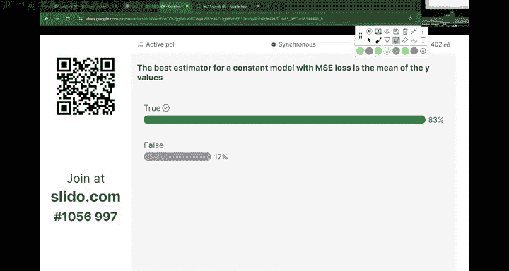
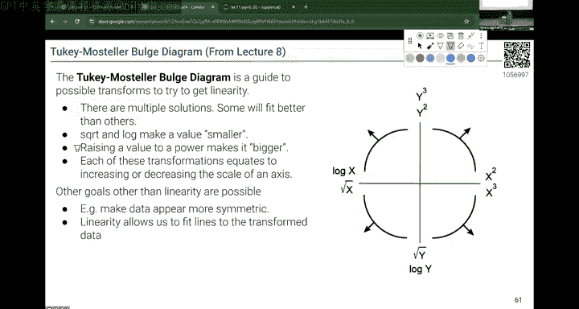
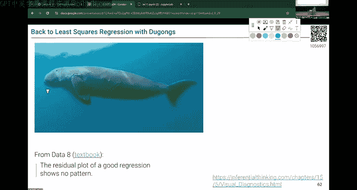
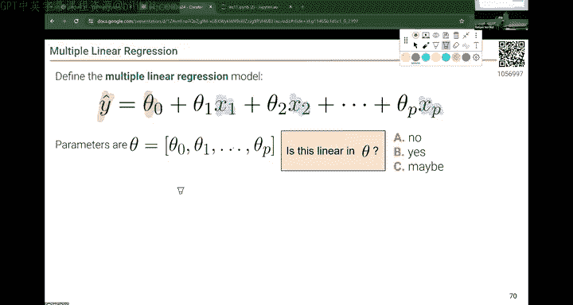

# UCB《数据100数据科学原理与技术｜Data 100 Principles and Techniques of Data Science 24SP》中英 - P11：-11-Data 100 Spring 2024 Lecture 11.zh_en - GPT中英字幕课程资源 - BV1Bc2dYCEbc

Yeah。Good morning everyone。 Welcome to another data 100 lecture Today。

 our lecture is going to be on constant models loss and transformation。

 So in a previous lecture we saw a little bit about the first modeling lecture of data 100 and today I'm going talk a little bit about a different kinds of model and different types of loss functions My goal for today is to show you how the entire process of modeling is a moduleized process that we can plug in different pieces together and then we want to get comfortable in terms of fitting the parameters of the model given the data that we have and then how can we how can we find out the optimum set of parameters for our model。

😊，So that's the plan for today the next lecture is going to be on multiple linear regressiong so I suggest that you watch both of the lectures that we had last week and also this week like today's lecture before again coming to the next lecture the next lecture is going to be kind of the toughest lecture in data 100 as kind of a warning to you all One more thing as kind of on housekeeping is that the lectures that we have this week by the end of this week are going to be all the lectures that you need for midterm there's going to be a separate announcement on how to get prep for for the midterm what are the resources and what's going to be the process for us before the midterm that's going to be on March 7 but just know that by the end of this week all the lecture topics that we wanted to cover for the midterm is going to be covered so it can really go ahead and do all of those midterm questions and also work on the homework and。

😊，So the next discussion to really get prep for the midterm with all of these topics that we're going to cover in the modeling。

So let's dive in， as I said， the plan for today is I'm just going to walk you through different kinds of examples of modeling I want to start by talking about the last piece of the modeling process the evaluation we're going to see how we can evaluate a model and then we're going to see two simple examples of different kinds of model。

 a model that's going to give you constant predictions every time that you want to get a prediction or you want to get a from the model and then we're going to plug in different types of loss functions to see how the model is going to react and then it's going to give us an intuition about which type of loss function is suitable for a given task that we have and then at the end it's kind of appropriate for us to revisit the linearization that we have seen individual visualization lecture since now we have we are in the linear regression kind kind of so we're going to revisit that one more time with one example and then we're going to also motivate you into the next lecture。

😊，So what happens if we have multiple different features。

 how can we combine all of those features together in order to make a prediction。

 which is going to be the topic for the next lecture？😊。

But let's start with a review and also kind of seeing what is the last piece of the modeling process remember I walk you through the modeling process in the previous lecture I said that the modeling process is always going to be these four steps that you're going to see so the first step is for us to decide about the type of model that we want to use so is your model as simple linear regression is your model'm going to use multiple different features is not going to be multiple linear regression which is what we're going to see in the next lecture or is it like the model that we're going to see today which is going to give us constant production every time that we want to get a production the second phase of the modeling was choosing a loss function remember the loss function that we define last time we said that we can look into the loss or the cost of the production or inaccurate productions in terms of the absolute loss meaning that the absolute delta。

😊，Betweent what the prediction is and what the target value that we wanted it to be or we are looking at a squared loss so looking at the residual is scoring the residual so that we consider all of those squares of the residuals in the entire data set that we have in aggregate in order to fit a model once we have the loss function and we have a model then we have an optimize path right we defined empirical risk or the cost function for the entire model and we said that we can use different types of techniques we used calculus last time in order to optimize for the optimum set of parameters that we can have and that process is called fitting a model fitting a model means that I have kind of a framework for my model I know what the equation is going to look like my equation is for example going to be a simple linear regression y equal to y hat equal toteta0 plus thatta1 times x and then the only thing that I。

😊，To do is going ahead， writing the entire cost function and then optimizing that entire cost function by taking the derivative of the function with respect toteta0 and with respect to Teta 1。

 which is what we had done in the previous lecture。😊，And then afterwards。

 after we optimize the entire framework， we haveteta0 hat andteta1 hat or the optimum parameters that then we can go ahead and do some evaluation on which is something that I'm going take a look at what you in today's lecture about how can we evaluate different regression models so this is a kind of a summary of the previous lecture simple linear regression was our choice of our model so with the simple linear regression the template for the simple linear regression was that we were we were saying that y hat is equal toteta0 parameter plusteta1 parameter times x which x was our input right so this is the general template and then we said that okay now that I have this model to give me all of these prediction values and the prediction values here are shown by Y hat hat always shows you that this is the prediction that we've done for a given data point we can define the last one。

So we defined the loss function as the delta So this is the loss function。

 the delta between the target value and the prediction value that we had。

 and then we said that okay what if I go ahead and use a squared loss so squared loss looks at the squares of the distance between these two values that we have and then this is only for one data point we need to look at the entire data set that we have and in order to look at all of the entire data set we said that okay let's go ahead and take average of all of those squared residual values that we have and this is where we're technically taking average by multiplying the entire summation of all of those squared losses by one over n so that we have the average is squared loss so this average is squared loss or mean squared loss was the loss that we were using in the simple linear regression in a previous lecture so this was my。

😊，Objective function。That is parameterized by Teta。 When I say it's parameterized by Teta。

 this technically means that for any given choice of values forteta 0 andteta 1。

 And remember here that Teta， when I refer toteta Teta here is a vector that hasteta 0 andteta 1 inside it right So it's a vector that when I changeteta 0 andteta 1。

 I'll get different models， when I get different models， then I get different predictions。

 then therefore the loss function is going to be different or the cost function is going to be different。

 That's why this cost function or empirical loss is a function ofteta that as I change theteta values。

 then the cost is going to be different。 and my goal is to optimize find the optimum point of this cost function。

 that that optimum point is going to be the minimum， When I find that minimum。

 that minimum is going to be my estimated parameters or the best set of parameters that I'll have。😊。

Which here， I'm going to color them， but。This for you to see that Teta0 hat and Teta1 hat are the optimum estimated parameters。

 So these are the best case scenarios across all of thoseteta values that we have。

 Not the difference between all the notations that I'm using on this slide。

 I'm using Teta I'm using Teta hat。 what does that mean Teta is just the general form of what my model is going to look like。

 What are different value that it can take。 But the Teta hat is always going to be the optimum set of parameters。

 And then I'm also using the terminology here or the notation here。

 a y hat when I'm using hat on top of Y that means that that's a prediction。

 and the prediction can be optimum prediction， or it can be suboptimal prediction。

 It's just that every time that there is a prediction and that's not a ground truth。

 I'm just going to put a hat on top。 So that's the difference between all of these notations。

When we were trying to optimize the simple linear regression using the minus squared error。

 then technically we were trying to find the least the squares fit。

 meaning that were going to look at all of these residual values we are scoring all of these residual values and we're saying that okay compared to all of the different models or different lines that I can have which one is the least the square fit。

 which one has the minimum of the averages squares of the errors that I'll get and which ones which other ones are going to be the suboptimal fit which visually can compare and see that the suboptimal fit is going to generally have larger residuals and those larger residuals are going to lead to a larger value for are hats ofteto which is technically my empirical risk or my cost function for the entire data set so this is all summary of what you' had seen in the previous lecture。

 one more time emphasizing the difference between estimation。😊，And prediction。

Estimation means that I have a data set， so I have a bunch of different inputs and target values Ys。

 and I want to use my dataset in order to find out what is the optimum set of parameters， Teta。

 meaningteta hat values that is going to give me the best prediction across all of the all of my data on average right So therefore when we are saying that we're doing an estimation here。

 estimation means that go ahead and find outteta0 hat andteta1 hat for me When I say that I want to do prediction。

 that means that irrespective of what parameters you're going to use just plug in those parameters give me a prediction a prediction can be。

😊，The best case prediction， or it can be subopmal prediction。 And in those cases。

 we would say that every time that were predicting something using a set of parameters。

 we're going to call that a prediction。 So that's also a distinction that we have here。

 That hat here on top of Y is referring to prediction hat on the parameters refers to estimation and there are different things。

Okay， so this is where we're kind of overloading this kind of notation of hat on top of parameters and on top of y or the target value that we're trying to predict。

Okay， so so far so good we've seen the entire flow of the first three steps of the modeling process before now I want to talk about the last piece how do we evaluate the model and how can we look into whether the model is is performing well or not so let's take a look at the first step every time that we want to train or fit a linear regression model we need to first take a look at our raw data and visualize the data calculate some summary statistic to make sure that our model that our data is showing some kind of a linear pattern for us to start doing any kind of modeling This is the very first step that is really required for us to do。

😊，What happens if we visualize the data and we don't see a linear pattern。

 remember from visualization lecture？Yes。Which the answer is that if we visualize the data and we don't see a linear trend。

 we'll try to linearize the data， linearizing means that we will apply some kind of transformation and remember that we had the Pge diagram in order to figure out what kind of transformation should we used。

 we'll use those transformations in order to linearize the data to the extent that we can。

We might not be able to linearize a data no matter how we try to come up with different combination of transformations。

 this is just one technique that we'll try to linearize the data， but again we might be successful。

 we might not be successful because the underlying trend might not be might not be as simple as like linear transformation that we can apply to the X axis and to the Y axis There was a question there。

So the question is if if we know that there is a linear trend in the data we can just directly go ahead and fit the linear regression model and just do some kind of linear modeling we're going to see number of lectures including also tomorrow's lecture that will tell you how you can combine different features in order to find out a linear pattern in high- dimensional space so in lower dimensional space it might be a little bit trivial and then we'll also have another lecture called feature engineering so we'll see that sometimes when we try to linearize our data we might not be able to linearize it to the extent that it's really usable because again we're in a very high- dimensional space with multiple features that that are working together in order to do a prediction for us in those cases we might need to go back and do some more sophisticated versions of transformations which is what we're calling it feature engineering or creating different features for us so it's a little bit kind of outside。

How did this go for today's lecture， but I promise you're going to see all different versions of how to come up with features so that those features with respect to the target value that you have are going to have a linear relationship。

😊，The bottom line is that we need to have some evidence of a linear trend between whatever it is that we're using as the input of our model and the prediction that we're trying to do。

 which again， we can do plotting in order to find it out or we can also calculate the correlation。

 remember the correlation was showing us the strengths of a linear association between input and output this can also give us some good indication about positive or negative linear association between inputs and outputs。

Let's say that we pass the first case now we train or fit a linear regression model and we have some predictions one way of quantitatively looking at whether our model was good or not is a metric called root minus squared error or RMSE RMSE is nothing but just the square root applied to the cost function that we had under that you're seeing that there is MSE function that we had mean squared error right so we're just taking a square root of that and the reason for us to do that is that we we're trying to figure out that on average how far off the predictions are from the target values in the same unit of the data why do I say the same unit because remember that when we were looking at the mean squared error we are looking at the squares of the distances so when we're looking at the delta then we're not comparing them in the same unit so it will probably tell you that。

On average， your estimations are of x like for example。

 200 degree of Celsius score and it might not make sense for you to look at the units in this core kind of in the scored unit because of that we take a score with and we bring back the RMSE to the same unit as the entire data that we have so that we can have a sense of okay。

 what happens with my error in the same unit of the data this is rootmin scored error。

In addition to calculating this redmind error， there is also another way of looking at the result。

 which is by visualization。 so we'll go back， we'll apply apply the model well get all of these prediction values that we have and then we'll go ahead and calculate the residual values once we have those residual values。

 which residual is is equal to target value minus the predicted value we want to plotted with respect to the input feature that we have and what we're expecting is that the residual plot is going to show no pattern at all。

 and we are hoping that all of the values that we have are going to be EI is very close to zero So either we're going to have a slight overproduct or underproductction。

 but we're expecting that all of the EI values e sub I values are going to be close to zero。

 This is what we're going to see。I'm going to show you an example of why all of these steps are necessary by showing you a data that's called Anscom quartet the Anscom quartet dataset set is a data set that includes four different types of data sets underneath and the important fact about this Nscom quartet data is that all of these four data sets they have the same mean across x and y same standard deviation they have the same correlation and therefore they're going to have the same optimumteta0 andteta1 value orteta0 had andteta1 hat and they're going to have the same regression line but not all of them are going to show the similar linear trend and that's why we'll see that the initial visualization is very important for us to take a look at so I'm going to go to the code you do have access to the code I will show you some helper functions that I have so these helper functions are based。

😊，ically that everything that I need to calculate for a linear regression model。

 I have a function for it。 So taking the data to a standard unit， for example。

 calculating correlation， calculating a slope calculating intercept calculating fitting the least scores model which is going to give me theteta0 and theta1 hat and then also making a prediction once you have an input and you have a bunch of different theta0 and theta 1 values。

 what's going to be the prediction， which prediction is equal toteta 0 plus theta1 times x which you know it already and then there is also this function that calculateals minus squared error。

 which is going to just pick the mean of these squared distances that we have between y and y hat。😊。

I'm going to run it， this next one was basically some visualization functions that we want and this is kind of the entire four sets of data data sets that I have in in the AnCO quartet data set so you see that I'm creating data set1 which uses x and y what is x and y sorry it uses x and y1 so x and y1 a data set2 uses x and y2 so you see that the input or the x is the same but the target values are changing so x and y2 and this is the y2 list that we'll see and then the third data set is using x and y3 so all of the first three data data sets have the same x but different y values and then the last one or the force one is going to use a different input x and a different output。

Why， and we're creating that in。In a data frame， so what I'm going to use here is I'm just going to show you that what if I go ahead and fit this simple linear regression or at least the squares and get these optimumteta0 and theta1 hat。

Because the correlations and all the mean values are the same and the standard deviations are the same。

 all of these theta values are the same for all of these data sets。

Which sounds a little bit suspicious here， so let me run it。

And I'm going to go ahead and take a look at all of those metrics that I said。

 So I said initially you need to visualize the data。

 you also need to look at some summary statistic in terms of mean standard deviation correlation。

 and that's where you're going to identify that okay， all of these mean values， standard deviations。

 correlations are the same and that's why you're getting the same Teta0 hat and Teta 1 hat。

So I'm just a scrolling， you can kind of double check that all of them have high correlation and you might think that okay with high correlation。

 there should be a strong relationship between x or the input and the output that you're trying to predict。

 so linear regression might be a suitable option。But， in fact， if we go ahead and。

Lo all of these data points you're seeing that not all of them are showing a linear trend so data one shows a linear trend。

 there is a little bit of a weak association， there is a little bit of a noise but it's still not too bad in data2 it's not a linear data set it's a quadratic function X is a quad Y is a quadratic function of X which is kind of also showing a positive association but again the relationship is not linear data set tree。

 so there is really a strong linear relationship here but then there is this significant outlier sitting aside and then the same issue here that all of the x values are the same for a number of data points and there is this outlying data point that sits far so that's why all of these data point all of these data sets they have the same correlation but not all of them show the same kind of relationship。

In these two bottom two， we need to remove that outlier， or if we keep the outlier。

 then the line is going to be a line that's not a great match for majority of the data points that will have。

So what if I go ahead and do least the score estimation and then take a look at what happens with my residual plot so what you're seeing right here is that this is the line of EI equal to0 or the residual is equal to0。

 meaning that Y I is equal to Y I hat the prediction is equal to the target value so what we're interested in is in linear regression which I think you've seen in data8 is we're looking at all of the points to be as close as possible to this line of the residual equal to0 or y I equal to Y I hat and then the points be randomly distributed across x and also across the Y axis or across the residual axis so that it doesn't show any kind of trend which is what we're seeing with the data set1。

 but if I go ahead and take a look at the data set 2 you see a clear pattern here。

 this is not not a correct residual plot that you're。

You're expecting any time that your residual plot shows a pattern。

 that means that you didn't linearize your data before fitting a model and that's why you're seeing some kind of pattern in the output。

Looking at the third data set you're seeing that there is also this same trend looking at this other one you're seeing that there is also this trend of all of the x values having different different types of residuals and that's why visualizing the data beforehand and visualizing the residual plot afterwards after you do the modeling is a very important step that you have to follow every time that you're going to do a modeling tasks this is the summary of so all of the description is on the demo slides I'm just going to skip them but now you know that there is visualization before visualization after you're calculating some summary statistics before doing the modeling so that you see that oh is there a strong correlation between X and y values。

And then you're fitting the model and calculating also root mini error after you fit the model as well as visualizing the residual plot。

Okay， so far so good。How are we doing， thumb up， sideways comes down。So far。

 it was really a quick summary of。Everything that we've seen in the previous lecture and all the entire steps of this modeling process end to end from from deciding about the model。

 choosing a loss function， fitting the model and also evaluating the model。

 So we have done one pipeline in end to end。😊，So the next thing that I want to do is that I want to go ahead and show you a different kinds of model。

 and then we're going to play with this model with different types of loss functions and so that we can get some practice with actually fitting the model because that fitting piece is the most important piece for us。

😊，This next model that we're going to see is called constant model。

 Let me tell you what this constant model is by an example。

Let's assume that you work at the boba shop and you basically record record how many bobas do you sell And for example。

 if you look at the sample of the past five days of how many bobas you sold。

 you basically take a look and you see that you sold 2021。

2 to 29 and 33 different bobas and the issue is or the question is。

 if you wanted to decide how many bobas will you sell tomorrow， what that answer is going to be。

And that's the first slide of the day。If your information is only these target values of how many bubblebas you solve and you have those five values and you just want to do a random production for tomorrow or any other day。

How many bubbles do you think you will sell？Where is Sya。No。就这么来 okay。We're doing okay on the slido。

Great。I'll wait for 400 before moving on。Creating line。38， okay，401， okay，25。

Fun part of today's lecture is I'm going to show you that there are two correct answers here。

 There's 25 and there is 22 depending on how youre thinking about your loss function。

 So let's get into what this model was what were you doing So you were looking at all of those target values。

 Everything that you looked at in this data was they were all target values that you had in your data and all you were doing during the prediction was making a constant prediction I didn't give you any information about for example。

 whether data or any information about which date is tomorrow so that you can use that as input in order to decide what kind of prediction you want to do。

 It was just a constant value that irrespective of which day tomorrow is you were going to do is the same prediction regardless and that's called a constant model。

So a constant model is also called summary statistic。

 meaning that we're looking at the trend in the data and we're calculating some summary statistic。

 which is what we're going to take a look and see how we can calculate it and looking at this summary statistic。

 we're going to always predict the same constant value， that's why it's called a constant model。😊。

With a constant model we're always making simplifying assumption again I said that I'm not going to give you any information about what day is tomorrow and I'm just going to simplify that assumption and think that every day there is going to be there is not going to be delta between the number of bubblees that you will sell on given days and there is no dependency to the weather to whether it's Cal day or not and then you're going to sell the same number of bubblebees and that's called simplifyiming assumption so you're assuming that there all the days are the same and therefore you can make a constant prediction for any given day。

😊，Because I'm making simplifying assumption and there is no input to my model。

 So every time my prediction is going to be equal to this constant value that I'm showing it withteta0。

 I'm borrow this notation from the simple linear regression with the simple linear regression。

 I hadteta0。 I had Y hat。Equal tote to 0 plusteta1 times x。

 But since there is no input here in this case， I'm saying that， okay， this input does not exist。

 So this term is going to cancel out。 So therefore I'm going to only use this biot or this y intercept in order to measure what the constant prediction is going be。

 That's where this constant term is coming from。 So again。

 this constant value or thiste to 0 is just a real value number。

 So it's just this scale or real value number that every time that you want to do prediction。

 you're going to predict the same value。What I want you to notice is that there is no input to the model so in this case you're seeing that there is this model or this machine that I used to have and the model is parameterized byteta0 but there is no input to the model and it's just going to every time that you call the model to give you a production。

 the model is just going to give you the sameteta0 value without any information about theteta 0 that you have but we're still going but the same concept of optimization。

 we're going to say that okay if this is my model I'm going to define a loss function and I'm going to make sure that thisteta0 is a value that is on average going to show minimum loss or minimum average loss across the entire data set that we have which is what we're going to take a look at next。

So the first step checked I have a constant model and this is the model that we're going to go with the next step is choosing a loss function let's assume that I want to go with the same L2 loss function or minuscor error that I had and the next step that I want to look at is how would this next step or fitting the model is going to change now that I change the model and now I'm still just keeping the MSC as my loss function？

😊，So let's write it out。 My cost function for a set of data points。

 So my data set right now is going to be only target values。 There is no input in this case。

 There is y 1， Y 2 all the way to Y， N。And I'll say that okay， the cost of this model。

 on average across the entire data set， is going to be the same cost function that I had at taking the average over all of these L2 losses that I have across the entire end data points that I'll have。

Okay。So this is all repeating the same process The only thing that I need to do now is that because my model is a constant model now I can plug in why I had to be equal toteta 0 and then I'll basically say that okay now my cost function is going to be this taking of average。

 but right now instead of y hat I'm replacing it with theteta0 value that's the only difference here。

 but now I need to basically take a look at this cost function entirely or this empirical risk function and find the optimum value forteta0 which I'm going to call itteta0 hat which you're familiar with that minimizes this cost overall on average for all of the data points。

Okay， let's dive right in and do that so the first approach we're going to see is that I'm going to show show it to you with calculus that I can just use that function。

 find the optimum point of that function by taking the derivative setting it equal to zero solving it and finding the set to zero hat alternative if you had a small data set you could just plug in those values。

😊，For all of the data points that you had remember that I had my data points where why I was equal to 2021。

 22，29 and 33 I could just plug in those values and just find the optimum of this function and directly solve it or there is also another algebraic trick that I'm not going go over in the lecture today but the slides the bonus and slides cover this algebraic trick but I'm going to focus on this approach one for today so we get more practice with this calculus and then not be afraid of directly optimizing an objective function which is what you're going to get are very。

 very comfortable in the homework and also for the midterm as well so remember all these the steps that we had I have that cost function right up there I just need to take the derivative with respect to the parameter that I'm trying to optimize right the parameter that I'm trying to optimize is set0。

I need to set it equal to zero so that I find a critical point and then I need to solve it forteta0 hat and then find theta0 hat。

😊，Let me start this step so let's take a look at what we're taking the derivative with respect so we're taking the derivative with respect toteta0 and if you take a look at your objective function。

 your objective function only has one term withteta0 that simply we can take the direct derivative remember the difference between this one and what we had done with the simple linear regression but simple linear regression I hadteta0 and I had theta 1 once I took part partial derivative not derivative with respect toteta0 once I took the derivative with respect toteta 1 and then I sell them separately so it was a more complicated task here I only have one variables I can just directly take the derivative of theta0。

😊，So。Let's go ahead and go through this process。 I'm not going to repeat the calculuss stuff。

 so this is something that we talked about in the previous lecture again that we know that the derivative of a sum is equal to the sum of the derivatives。

 so this is taking the derivative of a summation， so I'm going to turn it into the summation of the derivatives and I'm going to take the constant out。

 which is going to give me one over n。😊，Times the summation of i from 1 up to n of the derivative with respect toteta0 of this function。

 y i minus petta 0 is squared。Right so the task here is going to be a little bit simpler。

 The only thing that I need to do is I need to be able to take the derivative of this function with respect toteta0。

 but the only issue is that this function。This function right now is raised to the power of two。

 So I need to use chain rule in order to be able to take a derivative of this function。 right。

 So let's go ahead and follow the process， applying the chain rule to this entire equation。

 That's sum reason and that constant factor is going to still。Be outside I from one up to N。

 taking the derivative right there。 There is a function to the power of 2。

 So the derivative is going to be。Two times the function， Y I minus theta 0。

Times the derivative of the function。 right， When I take the derivative of the function itself。

 when I say function， I mean， y I minus theta 0。 What is the derivative of that with respect to theta 0。

Anyone from this segment？What's the last term that I'm missing from the chain rule？

I'm here negative negative one right There is negative one coefficient right there so multiplying it with negative1。

 and then I'm just going to simplify all of these values。

 So this is negative2 over n of the summation of i from1 up to n of Y I minus heads in0 Okay。

 you know all of these terms So it sounds all the scary。

 but like we're following the same template It's just template matching technically。😊。

The next step is setting it equal to zero right sos that should be pretty simple。

 so I'll say that okay， I'm going to say that the optimum point of this derivative is at the point that the derivative is equal to0。

 that's why we're setting it equal to0 negative2 over n of the summation of i from 1 up to n of y I minus thatta0 should be equal to0。

😊，Okay， so far so good。So this is the clean version of everything that we've done all of those steps setting it equal to zero and now we need to solve it forteta 0 hat notice that there theteta is equal theteta has hat because when I said this equal to0 this is the point that myteta becomesteta hat right that that becomes the optimumteta because that's a critical point or the optimum point of this function up until that point it wasteta it was just the template it was just a function but at the point that I'm setting it equal to0 I now haveteta 0 hat that I'm going to try to solve and then find what the value of theteta0 is going to be。

😊，So let me rewrite this whole thing， so I'm going to say that I had negative2 over n of the summation of iPhone 1 up to n。

Of Y I minus that to 0 hat equal to 0。 What I can do right there is just kind of remove those constants。

 multiplying both sides by negative n over  two。 So getting rid of those constant values。

 which is going to give me。Which is going to give me the summation of i from 1 up to n of Y I minus the to0 hat equal to 0。

Right， so what I'm going to do next is I'm going separate out those two terms。

 There are two terms inside the summation。 I want to write it into two summations separate from each other。

 So this is going to be equal to the summation of I from1 up to n a Y I minus the summation of I from1 up to n ofteta 0 hats equal to0。

Okay， and then I can also go one more step and then say that this summation of I from 1 up to n a Yi is equal to the summation of i from1 up to n of pea0 hat。

 just moving this negative term to the other side to get rid of that negative term。Okay。

 the next thing that I can use is I can say that looking at this term right here。

Pteta0 hat was a constant value， and its summed up together n times。

 So summing up one term n times is equal to just writing it as n times theta 0 hat。

 So I'll rewrite this as the summation of I from one up to n A Y I is equal to n times theta 0 hat。

Right， just simplifying that summation。What do I have less？

Everything here is known except forteta0 hat， which technically what I can do is I can write this asteta0 hat is equal to the summation of i from1 up to n of Yi divided by n。

 which this right here is equal to y bar or average of y。😊，Okay。

 this is beautiful right but I learned linear regression like 10 years is ago That was the first time that I learned the beauty of the calculus and linear algebra that you learn so this is all at the time that you're putting it into practice everything that we did so far we said that I have a model I have a cost function what is the optimum set of parameters or what is the optimum parameter that gives me that constant model that fits through all of my data point and you do all of these crazy calculus to arrive at the point that tta zero hat or the optimum value is average of all of those Y values Okay so this is kind of again the summary of what you've seen Yes question。

😊，嗯。😊，So the question is why did I changeteta 0 toteta 0 hat becauseteta0 is the general parameters so I'm saying that okay generally when I'm looking at the cost function and this was my cost function。

 my cost function is parameterized byteta which technically here I only have oneteEta which is myteta0 and depending on different values ofteta0 which isteta0 think about it as the general form parameter that you can keep changing it and you can keep having different types of different values of the cost function。

😊，But then we basically take a partial Think about that as like a function。

 You take the derivative of that function。In order to find out at what point the derivative is equal to0 at the point that the derivative is equal to0。

 think about this cost function that you have， but the derivative being equal to0。

 when the derivative is equal to 0， you're at the minimum of that function。

 the minimum means that that was the minimum possible value for the cost function that you could get。

 then technically the parameter that gives that gave you that that minimum is your estimating parameter or your estimation that becomes your t to0 hat every time that you take the derivative you set it equal to0。

 you have your optimum parameter as long as your function is convex and the critical point is the minimum point and not the maximum point。

 We're going to revisit that one more time。 Yes question。Exactly， so the question was。

With the constant model， the prediction is always going to be constant or irrespective of any input that you might have。

 technically， meaning that you're going to ignore all the input and you're going to say that， okay。

 I'm just going to look at all of the why historical Y I values that I have in a data set。

 andm just going make constant predictions。 Irespective of the input。

 So always you're predicting that to0 value。So let's see some fun facts the fun fact is that if you go ahead and plug in theteta0 had to be y bar into the cost function and you take a look at what that is。

 that's basically the sample variance So this is the variance of Yi values that you'll get but the important thing here is that I want you to notice the difference between the minimum value of the cost function and the t to0 that gives you that minimum value remember that this I talked about this cost function and having the minimum of that cost function and what that minimum is and what parameter gives you that minimum So in machine learning what we're interested in is finding the argument that minimizes。

😊，The cost function， right， we call that argument of a function。 So what was that function。

 My function is that cost function or empirical risk。 I'll say that with that empirical risk。

 theteta0， theteta0 or the parameter or the argument that gives me the minimum of this function is going to be myteta0 hat。

 But the actual value of what is the possible minimum value for the cost function is not going to be that relevant in this case。

 the minimum value is going to be the sample variance。

 it's good to know but is not going to be helpful。 again。

 in machine learning and all of these learning algorithms that you're interested in。

 we're not interested in like what is the what is the minimum value of the loss function。

 whatever it is， I want to have that minimum value As long as I'm at the minimum loss。

 I don't care about the loss value itself。 I care about the parameter that gave me that minimum loss。

So let's take a look at this answer， if you were thinking in the minus squared word minus squared error word then technically you will write your calculated the average of all of those samples。

 the average of all of those samples gave you 25 and that's why most of you chose 25 in that example so we went through this entire process once right we decided about the model being a constant model we decided about the loss being L2 loss so that the empirical risk becomes minus squared error we fit the model using calculus and now we want to take a look at visualizing what the results are going to look like I'm going to go over the demo and this is a demo of a data set of predicting dugong ages so these duggon。

😊，Dugong samples that we're calculating or we trying to predict their ages。

 One time I'm going to use a constant model。 So I'm going to basically say that， okay。

 I'm going to look at a sample of all of these dugong ages Y1 Y2 all the way to Y N。

 And I'm going to go ahead and come up with theteta 0 as the constant model。

 And one time I'm going to consider their lengths right and I'm going to say that I'm looking at the data which has lengths and also the age values and I'm going to use a simple linear regression that takes in this input and then it tries to match it to the target value。

 So this is going to be with the simple linear regression with the age value being the input X right here。

 So we have two parameters。So let's go to the demo。 So here I'm going to。Load this data set。

 So notice here that I'm saying that okay， one time I'm going to look at this data frame and only get the constant。

 only get the target values for my constant data set。

 And one time I'm going to look at length and H together and I'm creating a data that's called data underscore linear for a linear regression or a simple linear regression model。

 So loading that。One other thing that I want to show you is what happens with the loss with this empirical risk function that you have with the constant model so on the x axis I have differentteta0 values This is when I said that the empirical risk is just showing you the general form of the cost function for different types ofteta0 values。

 you'll just plug it in， you'll get a different model。

 you'll calculate those predictions based on that different model and then you'll have MSC values so you see that for every choice ofteta0 in this case I have say for example you said theteta0 to be this value then you're going to be able to get the MSC value this is how the cost function is going to look like what we have been doing was we were taking the derivative of this function with respect toteta0 which was giving me this optimum point right here because this optimum。

Is the point that the derivative is equal to0。Notice that when at the point that the derivative is equal to zero。

 what is the minimum value of the cost function？It probably is going to be some value。

 we said that it's going to be sample variance， but the actual value is not important。

 that's why I didn't show it in the plot。 The important thing is what is the test of0 hat value that gives you that point that gives you that minimum loss and that's what we're doing with the calculus and solving it directly in order to find this optimum point。

That was with a cost function that we have on a constant model。

 What if I go ahead and now say that okay， I want to look at incorporating lengths when I'm doing the prediction of the age that's going to give me the cost function for a simple linear regression notice here that with the simple linear regression right now I have two parameters So there are two things that are changing depending on every combination ofteta0 andteta 1 I'll have one why I had prediction which is going to give me a different cost value So if I go ahead and visualize this。

This is going to give me this fancy looking cost function right here。

One dimension Bteta 0teta 0 can change independentlyteta0 can change independently for every combination of them and the third dimension I have the cost value right so that's what you're seeing if I look at all of the different points on this plot you're seeing that there is a heat map the heat map where the value when the color is close to yellow that's equal to high loss or high cost when is close to dark blue that's when I have low loss so what you're seeing is that what we're interested in is if I rotate it here is looking at this threedimensional loss surface or cost surface and I'm interested in finding out a combination of Peta0 andteta 1 that is the darkest blue possible in the entire surface right visually might not be clear but I visualize it here for you so that you can see that the optimum point is whenteta0 is equal to negative 44。

Tta 1 equal to 23 and the actual minimum value of cost is equal to 18。 Again。

 the actual value is not going to be important。 The important piece is。

 what doesteta0 hat andteta1 hat that I can play with notice that here the cost is equal to 18 units But if I go up here you're saying that the cost can really go up to like 10000 or something So that's how were really interested in finding this optimum place we took the partial derivative with respect toteta 0 with respect toteta 1 up until the point that we arrived at that this specific point right there that gave us the best case scenario。

For us。So remember the next step in the entire kind of modeling process we said that okay once you did the modeling。

 you can go ahead and calculate root minus squared error so I calculated root minus squared error for the constant model and also for the linear regression model and the result is that for the constant model the rootmin square error is seven units and for the simple linear regression it's four units this is kind of telling you that when you're making simplifying assumption your predictability power is going to decrease so you're going to make less accurate predictions if you're making simplifying assumptions if you keep adding features to some extent we're going to see more about that in feature engineering then your prediction is going to become a little bit more accurate up until the point that you just use too many features that you overfi to the data which is not the topic for today we're going to see that later。

So the next thing is just visualizing all of those prediction values with the constant model。

 if I want to visualize what the model is going to look like。

 the model is just a single value right it's justteta hat value，teta zero hat value。

 so the only way that for me to visualize it is using rock plot so I have rocks or each one of those indicator kind of units for all of those Yi values and at the point that theteta0 hat is equal to the mean I just showed that by that red bar right there。

 that's an example of visualizing the result in the constant model。

In the simple linear regression word， this is my simple linear regression I have all of those data points I went ahead。

 I looked at that complicated threedimensional cost surface。

 I found that the optimumteta0 andteta 1 once I found that the optimum value forteta0 andteta 1 I have a line so I can just directly plot the line and I use the scatter points for visualizing all of those data points This is kind of the distinction of what happens if you keep adding features。

 what happens to your loss function you will keep adding dimensions to your loss landscape and then your theization of the result is going to be different once you have just a rock or one indicator once you have a line and then as we keep adding features which is what we're going to say in the next lecture。

 we're going to go in higher dimensional space and we're going have surfaces instead of just a 2D line。

😊，Okay， so I covered all of these so now you know what we're looking for this is the final slideo for today。

 I'm not done with a lecture， but if you haven't answered the previous slide make sure that you answered the slidege。

It's kind of a quick summary of everything that we had seen when my model is a constant model。

 and when my loss is the average of。As meana scored error？

The best estimator is the average of y values， is this true or false？Yes。

Good question I've been using the terms interchangeably when I say risk function or empirical risk I refer to the average of the loss across all of the data points loss we when we refer to L1 loss or L to us that's the loss for one value for one data point so loss is for one data point cost or empirical risk is that average thing across all of the samples but again loss sometimes is also used for average so it's a term that you can see that they can be used interchangeably okay wonderful the answer is true hopefully I've been following what I've been doing here for the past half hour。

I was going give you a break but I'm not going to do it。

 but instead I'm going to show you that there is in preparation for the next lecture。

 please go ahead and watch these tutorials for kind of refreshing your memory about linear algebra which is what we need for the Thursday's lecture so moving on I said that I'm going to show you how this process is really a modularized process we first started doing constant model with MSC now I want to do constant model with MAE what is MAE MAE is mean absolute error so meaning that I'm going to take a look at the error in the data or the residuals and I'm going to use the cost function of or the loss function of L1 which is the absolute of the residuals and when we calculate the average of these absolute absolute losses across the entire data point we're going to get mean absolute error or MAE so this is the new function we're going to see。

😊。

How the sp of the model is going to change now I'll keep taking derivatives up until the point that you're not afraid of taking these derivatives yourself in the exam and also in the homework so writing the entire process my empirical risk is now going to be the average of these L1 loss values and notice that the L1 loss here is basically the absolute error on all of those residual values that we have。

We know that the model is a constant model so I can just directly go ahead and say that okay。

 all of these Yi hats are going to be ateta0 prediction or a constant prediction。

 So all I need to do is I need to take a look at this non new loss function， sorry。

 cost function and optimize it with respect toteta 0 so that I find theteta0 hat。

Before I do that I want to show you a little bit of a complexity that we're dealing with with respect to the L1 loss or the mean absolute error。

 if I visualize the absolute loss for one data point。

 so say for example for the data point of Y I equal to 20 I go ahead and calculate L1 loss for different values ofteta0 what you're seeing is that this is kind of a v shaped function so whenteta 0 is less than 20 it has a positive is slope andteta 0 is more than 20 it has a negative slope sorry the other way around negative is and the positive slope and then this function is not differentiable at the point ofteta 0 is equal to 20 this is one complication that we might have every time that we are using L1 loss。

Particularly if I move on to from El loss， I go on to calculating the average risk or the empirical risk。

 which looks at all of these absolute losses for all of the different end datata points that I have。

 which is this sum is over all of these n data points。

 This is going to give me this piecewise linear function that has all of those kings right there。

 So you're seeing that there is like all of those inflection points that I have when why whenteta0 is equal to 20 whenta0 is equal to 21 when it's equal to 20 sorry 2021。

22 there is one at 29 and there is one at 33。 So these are all the points that in these points。

 the function is not going to be differentiable。So what we are going to take a look at is how can we overcome this issue and how can we take a derivative of this cost function that we said is not differentiable by just ignoring those points that the function is not differentiable but then simplifying the entire summation so that we can basically take the derivative in a simplified way。

 so we are taking the derivative of the cost function。

 we know the first is step that the derivative of a summation is equal to the summation of this derivative function but the issue is with this absolute value function。

 and we're going to see how we can overcome or take the derivative of this absolute value function that's under there。

So what I'm going to take a look is what happens with this part， with this derivative part。

 I'm not going to bring in the summation I'm not going to bring also the coefficient。

 but only taking the derivative of what's inside the summation。

So I'm going to write what's happening with this absolute value function。

 I'll say that when Yi is greater than theta0， what is this absolute value of function？

It's just going to be itself， right， so I'm basically taking the derivative。

Of Y i minus theta 0 with respect toteta0， right simple。When Yi is less than pet to0。

WhatWhat am I taking the derivative of so what's inside the absolute value is going to be negated so then technically the derivative that I'm calculating is going to be petta0 minus Yi with respect to petta0。

Right and then at the point that yi is equal toteta 0 will say that it's undefined。

 so we're not going to take a derivative of that。So I'm going to keep taking the derivative for those different conditions separately and then we're going to combine them later。

 so I'll go ahead and basically say that okay what is these derivatives， I'll say that okay。

 the derivative of the first condition is going to be when YI is greater than t to0。

 the derivative is what with respect to Tta 0。😊，Negative  one right because this is the only term that has the parameter tta0。

 the derivative is just directly negative one what happens in the case that YI is less than tta0。

I'll keep this as undefined。In the second case， the derivative is equal to positive one， right？Okay。

 so what's happening here is that technically， if I just write this entire derivative calculation and I say that。

 okay， I'm calculating one over n of the summation of i from one up to n of the cases that。Actually。

 let meops let me rewrite this as for all of these end data points。

 for all of the cases that Yi is greater than T2 0， I have negative one。

And for all of the cases that YI is less thanteta0， which is this second case。

 I'll have positive one。And then that means that I have taken the average of over all of those derivatives that I calculated。

 this is the final thing that L'll be arrived at。Okay， what happens if I set this equal to0？😊。

This technically means that I will go ahead and ignore the constant  one over n and then technically this means that I have the summation of plus ones for all of the cases that yi is less thanteta 0。

 this is this term right here， is equal to I'll move this to the other side and now because I said it equal to0 these all are going to becometeta 0 hats is going to become equal to this other term right here。

 which is Yi is greater thanteta 0 hat of all of these plus1 values。

So this is the result of the entire derivative that I'm calculating This sounds a level complex。

 but if you follow the steps in the slides， it'll make sense。 I basically divided it into conditions。

 took the derivative and then I set the derivative equal to0 when the derivative was equal to0 that means that myteta becomesteta hat。

 then I just move that negative term to the other side。

 turn it into positive one and then that technically means that there's a summation of a bunch of items。

😊，That is equal to the summation of a bunch of other items。

 that the condition for the left hand side is Y I is less than equal less than petta0 hat。

 The condition for the right hand side is that Y I is greater than petta0 hat。

 And we're going to see what that means。😊，So I'm going to ignore all of these steps because I already showed it to you。

And this is where we were， so we were saying that there is a summation of all of these ones and there is a summation of all of these ones in the left hand side and in the right hand side。

 which technically the left hand side is telling you that you are counting the number of observations that are greater than theta0 and on the right hand side。

 you're counting the number of observations that are less than theta0。😊。

So what pit to zero hat is going to satisfy this condition that you have？This should be a median。

 so technically what this means at the end is that if you find ateta0 hat that half of the data points are below it and half of the data points are above it。

 then yourteta0 is going to be that optimumteta 0， then you can call itteta0 hat。

 which is what's going to happen which is what's going to happen with the median so the median is going to be the optimum point in a case that your model is constant model and your objective function is mean absolute error。

So if I visualize it again， it will be the middle point so we were looking for that middle point that half of the data points are below and half of the data points are above it and then we were able to find it so going back to the bubble example。

 that's why 22 was the right was the right answer too because 22 was the median in that example if you were thinking about minimizing absolute errors。

 then you could have arrived at the number 22 instead of 25 which was minimizing the mean absolute mean squared error。

😊，So in today's lecture my objective was to show you that once you're deciding about a model。

 then your decision about the loss function or objective function is going to derive what the answer is going to be and you need to decide about the loss function to be the loss function that really makes sense in your application we're going to take a look in the next few slide about the differences between L1 loss and L2 loss but technically today weve seen both of them and we've seen how they're going to interact with each other and what their differences are once we plug in the model into the cost function that you're defining which is going to be mean absolute error or mean squared error then you're fitting the model fitting up the model we follow exactly the same tree that process that we have。

Differentiate， set it equal to zero， solve it right every time we did it three times in a lecture。

 so you should by now be able to just template， match all of these three steps and be able to derive what the optimum set of parameters are for a given set of models。

I basically mentioned briefly about this critical point and minimum and a maximum， but from calculus。

 you know that when I haven't functioned and I take the derivative of that function。

 I'll get the critical point I'm not necessarily getting the minimum point of that function right I kept saying that I'm taking the derivative setting it equal to zero and then I'll have the minimum point but that was inaccurate without testing for the second derivative of the function。

 So when you're taking the first derivative and you set it equal to zero。

 you have critical points which can be minimum can be maximum and can be saddle points for all of them you have the derivative equal to zero。

 but then technically you need to look at the second derivative and when the second derivative is positive。

Then your function and if your function is convex then technically you're looking at the minimum right when in data 100 there is a general assumption that if we tell you to find the optimum that we're assuming that the critical point is also the minimum so when you take the derivative that equal to zero that's all you need to do for homework5 you're going to get practice with convexity and you're going to remember again what convexity was and how does it relate to this entire optimization that you're following in this case。

😊，So。We had seen all of these process for MAE for evaluating the model。

 I want to make sure that we kind of make a distinction between what happened with MSD and what happened with MAE remember the left hand side with the MSD function for different values of PE I have different costs and it's a various smooth function When I was showing you what's happening with the MAE you're seeing that with the MAE it's still a convex function。

 it still has a minimum but it's not the smooth anymore so that was the main difference between them。

This this MAE not being as smooth is going to be a little bit problematic when we're trying to come up with numerical ways of solving for finding the minimum instead of directly taking the partial derivative。

 which is what we're going to see in the gradient distant lecture。

 just have it in mind that sometimes MAE can be problematic in those cases。

Some other differences between L1 and L2 in the L2 versus L1 case， if we have an outlier。😊。

The L2 function is going to be more is going to be more sensitive to outliers。

 So if I go ahead and add this new data point say， for example。

 it's Cal day and suddenly you sell 1033 different bobos and you use this entire set for your prediction。

 But the next day is going to come back to the normal trend。 you have an outlier right there。

 And technically， if you go ahead and look at the MSE。

 the MSC is going to give you a minimum around 200 or 193 to be accurate， right。

 This is this is very kind of off from the general trend in the data。

 which was always around 20s and 30s。But in terms of the median in terms of the L1 loss because L1 loss looks at the median as long as those outliers are going to be in the very lower and then in the very higher end your median is not going to change or shift drastically so technically here myteta0 hat is going to be very kind of similar to the previous value so what we would say is that the mean S square error or L2 loss is sensitive to outliers and L1 loss is more robust to outliers because of the differences between median and mean all of these things you can make the deduction yourself because you think about like what happens with me what happens with median which one is more sensitive and whatnot but I'm just kind of stating the obvious a little bit here what's not obvious is that when I say it's sensitive to outliers I also want to point out that it depends on the data set size so if your data is very small and suddenly you have an outlier then it's going to hurt your model a lot because。

Ha five examples and then the sixth one was an outlier versus the case that you have one million sample and out of those one million sample。

 only one of them is outlier， so the model is going to be able to tolerate that a little bit more so this sensitivity depends on the data set that you're dealing with。

The uniqueness is also another concern， so again， because of the difference between the mean and median。

 the L2 loss is going to be more robust or is always going to have one unique solution。

 one unique solution being the average of whatever data points that you're passing it to。

But with median， we know that depending on the number of data points that we have。

 if the number of data points is even， we're going to have infinitely many t de hats that are on that flat delta between the two middle points when you have even an even sized data set。

 so in this case you are saying that there is no unique solution， but with the L2 loss。

 there is always a unique solution which is equal to the average of all of the data points。

Okay these were the differences between them I want to quickly remind you of the transformation that we have been doing so remember the bulge diagram that we had。

 we have always been saying that okay if the data set bulges in one way we're going to take a look at the transformations across x and y and we'll apply them so that the data is linearized with respect to the target value that we have we're going to take a look at this duggon examples one more time and then see what happened when we fitted a linear regression line if you take a look at this linear regression line that we have here and I go ahead and visualize the residuals so you see that on the y axis and the vertical axis I'm visualizing the residual on the x axis I'm visualizing the input what I'm expecting is all of the data points to be run the residual equal to zero and then I should not be able to see any trend or any pattern in the residual plot but what you're seeing here is that。

😊。

Its kind of an upward curvature here， what shows me that there is a pattern in the residual plot。

 which makes me think that I have to go back and linearize the data before fitting this linear regression line that we had been doing before。

So we know the bulge diagram I can just go ahead and take a look at the distribution of the data I see that the distribution matches this region of the bulge diagram and I can pick one of these transformation and then go ahead and apply the transformation here I will say that okay I'm going to go ahead and apply the log transformation to the y axis and then after that I'm hoping that my data is going to be linearized with respect to X so what I'm doing is I'm saying that okay I'm applying the log transformation and now I'm going to do a prediction of this log transformation with respect to the input because this log transformation right now is going to be my new output target value that I'm trying to predict so technically what's happening afterwards is that when you do the log transformation your new dimension is going to be z so you're predicting this z value or this z hat using a combination of pet zero。

ta 1 times x， which we know how we can calculate it using the simple linear regression kind of equation that we had from before so what's happening is that with the original kind of dimensions that we had with the simple linear regression with the residual plot that showed some kind of trend which we weren't happy with if we go ahead and apply the linearization。

 now I have z which is now log of H with respect to the length and then that equation is going to basically show me the relationship between this new dimension of this new dimension of the vertical axis which right now is the hat with respect to a linear combination of theteta0 and theteta 1 times x as the input。

And if I go ahead and plot the residual plot of this new data。

 then I'm seeing this kind of a nice randomized pattern across the residual being equal to zero。

So what happened was technically I can now recover the original equation。

 so I'm saying that okay z hat was equal toteta 0 plus theta 1 times x。

 and you find out that your z is now equal to log of y so I can go ahead and say that okay。

 log of y is now equal to theta0 plus theta 1 times x in order for me to write this equation in terms of y equal to something。

I need to reverse kind of this transformation here。

 If I go ahead and raise both sides of this equation， I calculate e to the power of each side。

 then technically what I'll have is e to the power of log of y hat equal to E to the power ofteta0 plus theta 1 times x。

What is E to the power of log base E of y hat。 This is equal to y hat itself。

 So now I was able to recover something that I'm directly predicting y values and the direct prediction of y values is giving me y hat equal to E to the power of theta0 plus theta1 times x。

 which is the correct pattern here if I want to visualize it It' showing me the exponential relationship。

 which shows you that there was an exponential relationship between x and y。

 and not a linear relationship that we have been trying to fit with a linear regression right here。

 remember that we were having we were trying to fit the linear regression right there。

 which was not accurate。So in the next lecture I'm going to talk about multiple linear regression。

 specifically we're going to talk about all of these notations that you're seeing。

 we have been looking at the features or inputs that we had and then we said that we're trying to combine multiple features in order to predict in order to map it to the target values y and what we have been doing was with the general form of the parameters theta and once we define the model with the general parameters theta we have been able to do a prediction and we have been also doing the estimation in order to find out theteta hat values or the optimum setup parameters so next lecture what we're going to see is what happens when we're trying to fit multiple combine multiple different features together in order to do a prediction which here is I have feature one feature to all the to feature P then I'll plug in also the bias term or the y。

cept that we have in order to get one prediction or Y hat in the output so I'll leave you with that。

 we're going to come back on Thursday and then we're going to see multiple linear regression。

 which is going to be a little bit more complicated than what we have seen so far。

 Thanks for coming I'll see on Thursday。

