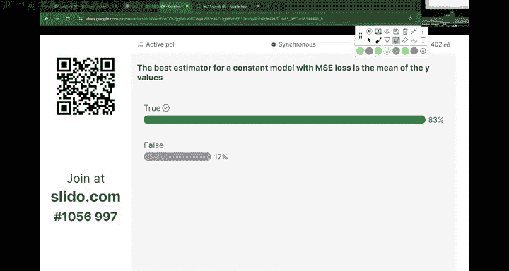
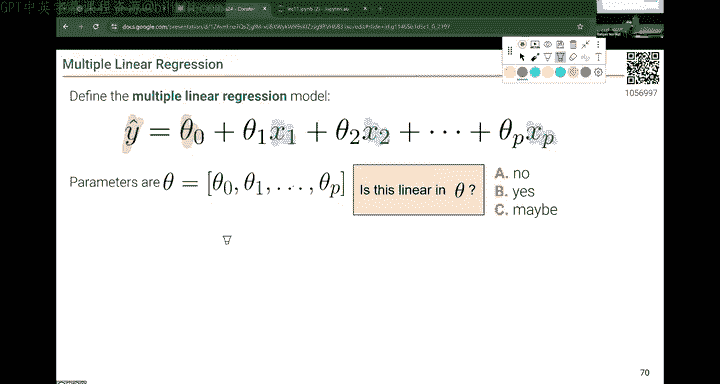

# 📊 课程11：常数模型、损失函数与数据变换

在本节课中，我们将学习建模过程的完整流程，特别是如何评估模型。我们将通过两个简单的模型示例——常数模型和简单线性回归模型，来理解如何选择损失函数、拟合模型参数并进行评估。我们还将回顾数据线性化的概念，为下一节的多重线性回归课程做准备。

---

## 🔍 模型评估与安斯康四重奏

上一节我们介绍了建模的前三个步骤：选择模型、选择损失函数和拟合模型。本节中，我们来看看如何评估一个模型的好坏。

评估回归模型时，一个常用的定量指标是**均方根误差**。其公式为：
\[
RMSE = \sqrt{\frac{1}{n} \sum_{i=1}^{n} (y_i - \hat{y}_i)^2}
\]
取平方根的目的是让误差值与原始数据保持相同的单位，便于理解。

除了计算RMSE，另一种重要的评估方法是**可视化残差图**。残差是真实值与预测值之差：
\[
e_i = y_i - \hat{y}_i
\]
我们将残差 \( e_i \) 相对于输入特征 \( x_i \) 绘制成图。一个理想的拟合模型，其残差图应呈现随机分布，没有明显的模式。

为了说明初始数据可视化的重要性，我们来看一个经典数据集——**安斯康四重奏**。这个数据集包含四组数据，它们具有相同的均值、标准差、相关系数，因此用简单线性回归拟合会得到完全相同的回归线和参数估计。然而，它们的实际数据分布却截然不同。

以下是四组数据的可视化结果：
1.  第一组数据呈现线性趋势，适合线性回归。
2.  第二组数据是二次函数关系，线性模型不适用。
3.  第三组数据存在一个强影响点，扭曲了线性关系。
4.  第四组数据也存在异常值问题。

如果仅看统计摘要就拟合模型，我们会误以为四组数据都适合线性回归。但通过可视化残差图，我们可以发现问题：
*   第一组数据的残差随机分布。
*   第二、三、四组数据的残差图则显示出明显的模式（如曲线或异常点聚集），这表明模型未能捕捉数据的真实结构，需要先对数据进行线性化处理。

这个例子强调了建模前**可视化原始数据**和建模后**检查残差图**的必要性。

---

## 📈 常数模型与不同损失函数

现在，我们来看一个更简单的模型——**常数模型**。该模型忽略所有输入特征，始终预测一个相同的常数值 \( \theta_0 \)。其预测公式为：
\[
\hat{y} = \theta_0
\]

假设你经营一家奶茶店，记录了过去5天的销量：`[20, 21, 22, 29, 33]`。如果仅基于这些历史数据预测明天的销量，你会预测多少？答案取决于你选择的损失函数。

### 使用均方误差损失

如果我们选择**均方误差**作为损失函数，我们的目标是最小化平均平方损失：
\[
R(\theta_0) = \frac{1}{n} \sum_{i=1}^{n} (y_i - \theta_0)^2
\]

为了找到最优的 \( \hat{\theta}_0 \)，我们对成本函数 \( R(\theta_0) \) 关于 \( \theta_0 \) 求导，并令其等于零：
1.  \[ \frac{d}{d\theta_0} R(\theta_0) = -\frac{2}{n} \sum_{i=1}^{n} (y_i - \theta_0) \]
2.  令导数为零：\( -\frac{2}{n} \sum_{i=1}^{n} (y_i - \hat{\theta}_0) = 0 \)
3.  解得：\( \hat{\theta}_0 = \frac{1}{n} \sum_{i=1}^{n} y_i \)

**结论**：在使用均方误差时，常数模型的最优预测值是所有目标值 \( y_i \) 的**均值**。对于奶茶销量数据，均值为25。

### 使用平均绝对误差损失

如果我们选择**平均绝对误差**作为损失函数，我们的目标是最小化平均绝对损失：
\[
R(\theta_0) = \frac{1}{n} \sum_{i=1}^{n} |y_i - \theta_0|
\]

平均绝对误差对应的成本函数是分段线性的，在数据点处不可导。我们通过分情况讨论并求导（忽略不可导点），经过一系列推导，最终得到最优解需满足的条件：使 \( \theta_0 \) 小于和大于它的数据点数量相等。

**结论**：在使用平均绝对误差时，常数模型的最优预测值是所有目标值 \( y_i \) 的**中位数**。对于奶茶销量数据，中位数为22。

---

## ⚖️ L1损失与L2损失的比较

通过常数模型的例子，我们看到了选择不同损失函数会导致不同的最优解（均值 vs 中位数）。以下是L1损失和L2损失的主要区别：

*   **对异常值的敏感性**：L2损失（均方误差）对异常值更敏感，因为平方项会放大大误差的影响。L1损失（平均绝对误差）则相对稳健。
*   **唯一性**：L2损失通常有唯一解（均值）。对于L1损失，当数据点个数为偶数时，最优解可能是一个区间（任意两个中间值之间的数）。
*   **可微性与平滑性**：L2损失函数处处可微且平滑，便于使用基于梯度的优化方法。L1损失函数在数据点处不可微，优化起来可能更复杂。

在实际应用中，需要根据具体任务和数据特点选择合适的损失函数。

---

## 🔄 数据变换与线性化回顾

在可视化讲座中，我们曾介绍过通过数据变换来线性化关系。现在，在线性回归的背景下，我们重新审视这一过程。

以一个预测儒艮年龄的数据集为例。最初，我们尝试用长度来线性预测年龄，但拟合后的残差图显示出明显的曲线模式，这表明线性假设不成立。

我们观察原始数据的分布形态，并参考“凸起图”来决定变换方式。对于此数据，对Y轴（年龄）取对数变换是合适的。变换后，我们建立模型预测新的目标值 \( z = \log(y) \)：
\[
\hat{z} = \theta_0 + \theta_1 x
\]

拟合新模型后，残差图变得随机分散，表明线性化成功。最后，我们可以将变换逆转，得到原始尺度上的预测关系：
\[
\hat{y} = e^{\hat{z}} = e^{\theta_0 + \theta_1 x}
\]
这揭示出年龄与长度之间实际是指数关系，而非线性关系。

---

## 🎯 总结与下节预告

本节课中我们一起学习了：
1.  **模型评估**：使用RMSE和残差图来评估回归模型的质量，并通过安斯康四重奏理解了数据可视化的重要性。
2.  **常数模型**：一个忽略输入的简单模型，其最优预测值取决于所选的损失函数（L2损失对应均值，L1损失对应中位数）。
3.  **损失函数对比**：分析了L1和L2损失在稳健性、唯一性和优化难度上的差异。
4.  **数据线性化**：回顾了通过变换（如取对数）使数据关系线性化，以符合线性回归假设的方法。

下一节课，我们将进入**多重线性回归**。我们将探讨如何将多个输入特征组合起来，共同预测一个目标变量。其基本形式如下：
\[
\hat{y} = \theta_0 + \theta_1 x_1 + \theta_2 x_2 + ... + \theta_p x_p
\]
这将是Data 100中颇具挑战性但也非常核心的一讲，敬请期待！