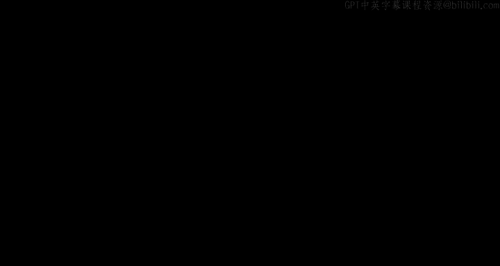
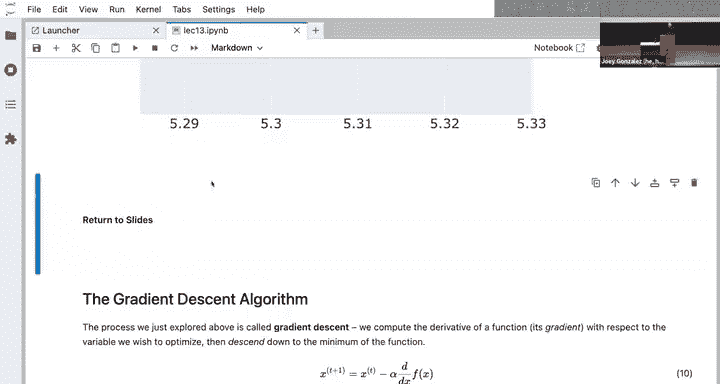
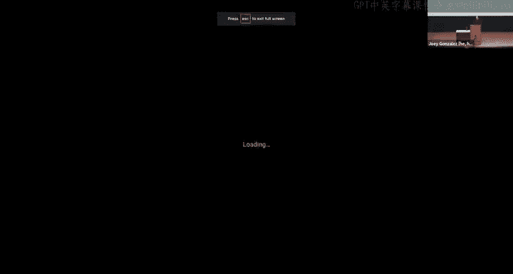
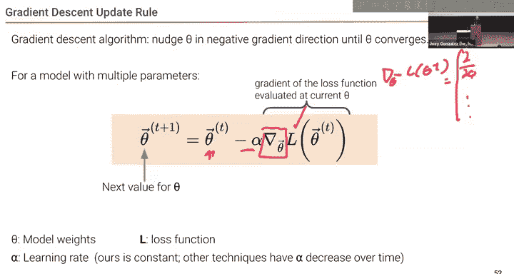
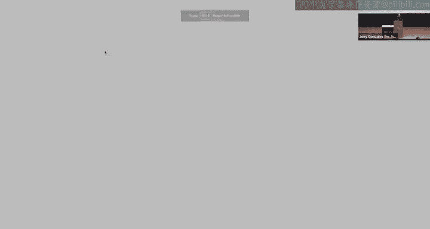
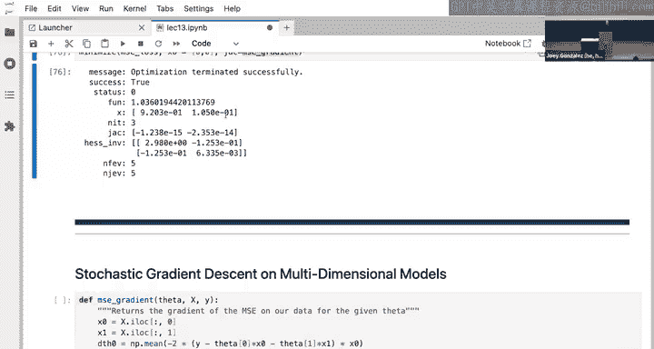
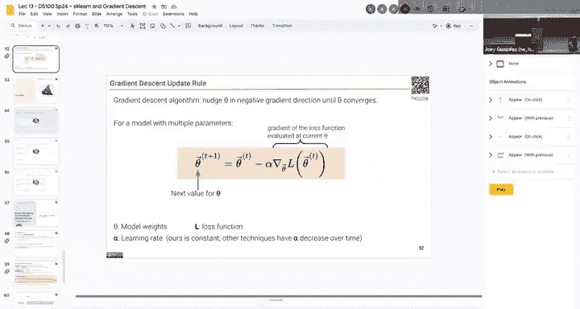

# UCB《数据100数据科学原理与技术｜Data 100 Principles and Techniques of Data Science 24SP》中英 - P13：-13-Data 100 Spring 2024 Lecture 13.zh_en - GPT中英字幕课程资源 - BV1Bc2dYCEbc

Worning， everyone。Lecture attendances。Not as healthy as in the past， but that's okay。

 Today we have an exciting topic。We are。You can actually explore some of the algorithmic optimization tools that underpin all the things we do in this class and also a lot of what's going on in modern AI。

So this should be a fun lecture。So we're going to talk about psyit learning， SK learning。

 it's a package that you use to fit models I will show you how to fit linear regression models in just one line of code I will show you how you can fit many。

 many models in just the same line of code so after today's lecture you can do machine learning。😊。

You probably won't do it well that's what the the rest of this class is about。

 but you will be able to fit models quite easily all sorts of crazy models at the end of this lecture The other thing we'll talk about in this lecture is again this gradientcent algorithm。

 which is again the basis for all the advances we see in modern AI。So after this lecture。

 you'll understand one of the core algorithms it's driving most of computing today。

I'll order for one lecture。All right， so some context。

 so last week we talked about ordinary lease squares we talked about。Multiple regression。

 how we fit linear models， and you learned a series of mathematical techniques that combined initially just basic calculus and then some geometric interpretations today we'll build on that again using algorithms to solve these problems。

I plan to try to finish mostly grade In by the end of this lecture。

 and then on Thursday we'll talk about feature engineering。

 which is a big part of using these techniques。That's plan flu。All right， so again， quick recap。

In the last week， I mean many of you may have noticed last week got a little harder。

 this class has historically had a cliff or a giant wall I don't know how to think about it。

 we do all this stuff that's you know building on basic Python， pandas visualization。

 all of a sudden there's this huge wall of math。That's normal。

 we will now hopefully bring that math down a little bit and talk about some algorithms again and then'll bring more math in in a few weeks。

All right。In the previous lecture we got to this idea of fitting a model of this form。

 so here Y is a vector， x is a matrix， microvariate matrix and theta is my model parameters。Actually。

 we taught this recipe， which is really important， this idea of how to do modeling。

As this multi step process， when we choose the model。

 this again was a simple linear model or ordinary least squares or multi linear regression。

We choose a loss function， we spend a lot of time on L2 loss as it's a pretty common form of loss。

 and this is a measure of how good our model is with respect to the data we have。嗯。And then。

We talked about how to use calculus to solve this in a small one or two dimensional case。

And then we decided to try to show you how to do this using geometry as we extend it to higher dimensional spaces。

And today。We're not going to use this， we use algorithms that borrow ideas from calculus。

I'm actually going to first show you how to do this with 10 characters of code using SKt learn。

 so really simple package， this is how you will do most of the machine learning that you do。

But then I'm going to teach you the math behind that machine learning。

 not because you should be implementing it in practice。

 but because understanding how it works will help you debug things when you use these packages。

It's actually a simple algorithm， it'll also give you some insight into how a lot of AI is progressing today。

 so it's worth knowing。we talked previously about how to visualize and look at the results of our models and how they fit。

 I'll do a little bit of that in demos today。All right， so the first package， psyit Learn。

Who's heard of Psychit Learn before just as a quick survey， yeah。Fair number of people。

 it's a pretty popular package， it was developed as a Python machine learning library that captures all the standard algorithms you might need。

And it's got a lot one of things it has it's really nice is a series of tutorials some sense maybe better than my lectures talking about each of these topics。

 so if you want to learn more about advanced machine learning or applying these models different problems。

 there's great explanations on how that works， how to visualize it it's really well done。😊。

The other nice thing about this package is everything follows the same pattern I will tell you three simple steps。

 this is probably under 20 characters of code that you will know and once you know that 20 characters of code you can proceed to write all sorts of models to build models to solve really interesting real problems so really easy to use。

😡，They said lots of tutorials。There are other packages that we will not cover in this class that are also widely used。

Many of these packages are starting to try to be as close to this as possible so that once you know how to dosyit Learn。

 you can use these packages as well。I'm just highlighting me here for those who want to know about it and maybe want to study on their own these packages here are used for deep learning for advanced AI they also have tutorials that walk you through the same sets of pro so if you wanted to get ahead and learn these things we won't be doing that in this class。

 but it's something you could do on your own。I will say in previous semesters I tried to teach this and it was a failure。

 so we won't be doing that in this class this year。So that's I it learned， and I said it was easy。

 here's how it works。To fit a model in psyic learn first， you need to initialize a new model。

So you'll import one of the many， many models in the library。

 so here I've imported from the linear models package。

 the linear regression model that creates an empty model。It doesnn't do anything， it's the model。

 not fit， doesn't even have parameters yet。You want to fit it to some data？Well， remember X and Y。

 you build your tables， X and Y， these can be data frames， They could be matrices。 X is you know。

 the standard shape where you have these are your your examples on this axis。

 So there are n examples and then maybe D dimensions。 And then y is just this X。

 And then Y is just this one by。One by n vector that is your labels or the things you're trying to predict。

They fit。Fit makes magic happen this lecture， the second half of you about the magic behind fit once it's fit inside of this modelular parameters you can access down here hide this guy。

You can get access to the peri， coefficiention， intercept all the things that we were fitting before。

This coefficient here will be a vector now if you're doing multi linear regression。

So you can look at parameters， but we don't need the parameter。

 you just want to make prediction and feed any x in you want in the same shape。

 they'll make predictions for that X。You know this， you can now go fit a support vector machine。

 a gradient boost decision tree， all sorts of crazy models that we will not teach you in this class using the exact same lines of code。

 just changing the name of thing up here。notげ know machine learning。

At least how to do it the rest of the class will be how to do it well。

 one thing that's worth noting their are arguments for these functions and there's a long list。

 so if you want to start using them， you should look at it。

 There are arguments like turning off the intercept。

 maybe you don't want to intercept in your model we're changing the optimization algorithm we're choosing the parameters It will make no sense to you until the end of this lecture and I'll go yeah。

 I see。 so I need to tolerance any of the learning rate and so on。In most cases。

 you can just leave this blank because these parameters are well set。

 which is why this package is so incredibly popular。All right。

 so I want to show a demo of how this works， and I'm using a data set that I haven't played with before。

We were going to try to predict the length of a penguin's bill。Here are the bill length here。

And we're going to do that based on the， I think the body mass。And the flappy lane， the flippy lane。

 sorry。Why would you want to do that？I don't know it makes a great demo here's the simple reason maybe suppose it's hard to measure the bill length that the penguin won't hold still。

 but you can weigh it and maybe you can get the arm and measure that more easily。

 though I don't know why， but suppose you could the little flipper。

 maybe you could use those to predict the bill。Or maybe as a more scientific purpose。

 I want to understand are the bill length a certain penguin consistent with their weight and their flapper length。

 and maybe as they get sicker， the bill lengths get shorter or longer。

 and so we want to model that effect and we want to model how much the new set of penguins deviates from that effect。

All right。But for this， we're going to make it just it to me a fun demo。So let's go do some demo。

Okay your mouth。So we do a lot of demo today， if you are not in the notebook。

 you might want to get it out， start playing with it， so it is posted。So a bunch of packages。

You lose this data set。Do to pronounce this and'm going to look at a specific species， the Adelaide。

 Adelaide， I don't know， I'm going look at a subspecies， so I have a data frame here。

 which has 146 rows， seven columns。And I want to do some modeling。嗯。

The model I'm going to use is the following， I'm going to say that the bill length the bill length or sorry build depth。

 the millimeters is going to be based on a it's predicted by a constant plus some coefficient times the flipper length。

And another coefficient times the body mass。 It's my model。 So step one， pick your model。

 Very simple model。Let's do this in the previous lecture， we derived an equation。😡。

It's called normal equations。 it lets us solve for the best theta that minimizes this L2 loss。

 if I pick my loss to be L2， there is this map， if you don't know this math yet。

 go check in the previous lecture， I'm not going to derive it here。

But what is nice is that I could write the code D this。 So let's do that。So first。

 I want to build a matrix X。It has a flipper length， body mass， and I'm adding an extra term。

 an extra column of all ones。That's going to make it so that when I multiply theta times x。

 it will also include this extra。Constant term。It's from previous lecture。

And the y values that I'm going to try to predict is this column。For。

And these are the bill depth and millimeters。Right， so in the previous lecture we saw this equation。

 saw this equation here， we can implement this in code。

 so this piece right here is the in matrix inversion function， and I'm applying it to x transpose。

 this is times x， that's x transpose and they so figure see it。You， that's x transpose x。

 the whole thing is inverted times x transpose times y。That's the code。

 and that generates my parameters， so I'm not usings and I'm doing it the hard way。

 I'm writing the equations that you learned in the previous lecture。When to save these。

 we can compare against them。Just some discussion about invertability again in previous lectures。

 take a look。And just to recap having fit the model using the previous lectures techniques。

 I have this data here， it's a column vector， if I convert my X table into a matrix。

 I can multiply that by my column vector and I can get my predicted bill depth and millimes。

So this is using the model life just fit to make a prediction。Again。

 I have not used Psyit learn and I'm doing it the hard way。

Now let's talk about how to do it the easy way。So from SK learnn， the shorthand for Psyit Learn。

The linear model folder， there are many models in this folder， I want the linear regression model。

So I'm going to import that。This is a class that we're going to make an instance of this。

Build a model here can make I've made one model。That is the model， it does nothing。

 it has nothing in it。😡，It's cute， mouseover， nothing's been fitted， so no parameters。Step  one。

 make the model。Step two， fit the model。How do we do that？

So I take my model object I created up here。I say fit。So what the x theta should be。

And what the y data should be。We dive in it from a little bit deeper here， so x here， what is this？

kindind of object is that？Data frame， right？😡，Not a matrix， a data frame。

 something cools about to happen here， what's its shape？And rows， how many rows was this。

 just we have it in our head here？146 rows。And 46 rows， very good。And it's two colors。

So I didn't add the extra intercept， the models are thesic learn package is going to automatically do that for me。

😡，This is also a data frame。Actually， it's a series， sorry， it's a single column for my data frame。

 and that is just the Y values。You need this to be a matrix or a data frame。

 it needs to be something rectangular， this can be a series here。

If I just wanted to use one dimension， I would have to use two brackets。

 I'd need to still make this into a table or a matrix。That's it。 So I run this。 I fit my model。

 now Silver， it's been fitted。Step two， fit the model。Step three， make predictions。

 so I want to make a prediction for a penguin which has 185 millimeter。

Flippper length and a body mass of3。7 kilograms。 so I make a row， see this is a row in a matrix。

 so I have an outer bracket here。So it's a row， make a prediction。And it returns。

The vector with one element， the predicted。Buildup。There's a warning here。

Why is there a warning here？It's actually really， really useful warning。

 almost a breakthrough in warnings。 It's telling me that I passed in some things without column names。

Why would it do that？So's a killer feature， check this out。Gm。What's it going to do？

It's going to make a garbage prediction。Right。Why is it warning me？

It would prefer if I had used a data frame， if I had used the data frame and I had inverted or changed the ordering of the columns。

 it would give me an error， you can't give me a data that looks like that I was expecting the columns to look like you know this order。

😡，It's a feature to make sure that when I use these packages and I play with my data and I create another table and pass it in。

 I make sure the columns are in exactly the right order。So when working with this package。

 I encourage you to try to use data frames when passing stuff in to preserve those column names。

Make sure that you're using it correctly。However you do not need to。

 it will take whatever you give it and it'll give you a warning if you didn't give it thanks。

If I had fit the model， not passing a data frame， but passing in a matrix， let's try this。行。St here。

Sorry， but anyway。Morning gone， why？Because when I made it a matrix。

 what do matrix not have all labels， right？It's a good feature。

 I've made this mistake when fitting models， you have a couple hundred dimensions and you start tweeteting with your data and all of a sudden you flip a few columns and the model goes。

 here's your prediction， but it's garbage because you've changed your columns in the meaning of them。

So nice feature。Mning them。So I can make a prediction for the entire table。Here。

 because I have the column names because this thing here is a data frame。

 I'm going to get no warning。 I'm adding the side kit learn predictions， and they're going to be。

Almost identical， actually identical to the predictions that were made earlier。

I said you can access the parameters。So you can go to the intercept， you get the intercept term。

You get the coefficients， in the model。This is the weights。The theta 0 is the intercept。

 theta 1 and theta 2 are the coefficients for the model 4。

And that works for linear models if you use a crazy other kind of model。

 you'll get different types of coefficients， they may or may not have an intercept and so on。

 so depending on the model you choose， you'll have different members you can access to get different properties in the model。

These are， of course， very close to what we got before， again， I think exactly the same。Yep。对。

They're out of order or are they out of order？Remember， we made the one column， the last column。

 not the  zeroth column， but the the very end。 So the intercept here is the red here。

 And then I have these are in the correct order。 So I have a coefficients here。

Pause for second or any questions。But it's good， yeah。Greatre question。So let's go back up here。

Milter model。I've initialized it again。She modeled that。Thef。They it actually exist yet。

It't exist yet。Not existing worth mentioning again is that there are a lot of arguments you can pass in here。

 so if the intercept is default fault true， there are more arguments。

 special prim you can pass the algorithm that actually is used to fit it。

 which willll explain a little bit。No parameters yet because it's not fit。It's nothing to。Ri。

I think one last thing I want to show you， visualizing the fit。Okay。

 in this lecture I'm going to make visualizations that are well out of the scope of this class if you see code that has like plotly scatter 3D。

 you don't need to know what's going on。We won't be asking you this。

 you might want to know what's going on because it's cool， but you do not need to know this for any。

Any worst purposes？All right， so this is what the model actually looks like。

So these dots correspond to points in three dimensional space。よしょうか。So I have the flipper length。

 body mass， those are the x values， and they predict the bill depth。The millimeters thats the。

 the the y values。 But these are now the the the。We'll call these the y values and this whole plane here is the x values。

Peace here is the plane that corresponds to linear model remember when we did the one dimensional thing you get a line。

 now we're fitting two dimensional things in this space， you get a plane。

And this plane doesn't go through the origin， it's lifted up because it has an intercept term as well。

Is this a good fit？we could measure it。How do we measure it？By the way。

 these visualizations are cute for lecture in practice they don't generally help you a lot and in practice you're going to have many more dimensions。

 so it would be hard to construct these visualizations beyond two dimensions。Yeah。

 so what is the color gradient？So the color gradient is based on the height of the plane at each point。

 so it's the if you want to use the technical term， this is the Z axis of the plane。So in practice。

 you're going to use metrics like the mean squared error to measure your fit mean squared error is hard to interpret。

 so sometimes you'll take the square root of that and put it back in the units of bill length the millimeters and you can say。

 let's see that。Serena。spread air 。998。988 millimeters is my average error from the true buildup。

We do a bonus。 Let's do this。 So I said this is a general technique， this is why psy learn is so fun。

 Let's import a different model this time a decision tree regressor。I make an instance in the model。

 I was like before， and then I fit the model same as before I。Called it tree model。

 so a tree model outfit passing the exact same arguments。Magic happens。

 I've now fit a decision tree your aggressor。It， too， can make predictions。

I guess we should look at those predictions。We get predictions， are they any good， I don't know。

 we can look at the mean squared error。Whoa。Point， let's take the square root of that。

 So it's comparableable in P dot square root。Win2，2，6。Is that a better model？Yeah， it must be right。

 I reduced the air， it was 0。988 now I'm fitting the buildings much better， right？Better air。

Let's visualize it， what do you think this looks like？Does it go look like a plane？

You don't know because you haven't seen the model yet， so let's take a look。

Is what this model looks like。That is some solid fitting there， right？

That model is really trying to fit thoseducts。Okay。So。

The second half of this class is devoted to why this is potentially a terrible idea。

Which we won't cover in this lecture。But this is why P Sar is so popular。😡。

Because I got lower air and I just had to change a few characters。

And I can go try many of probably like 50 other models。 I can try each of them， get even lower error。

 perhaps。Right， so again， second out this class is how to manage that you do want lower。

 That is a good thing， but you want it to。Bit what is there？

I don't know if this is a good fit to this data， that's a funky looking surface。

Maybe that's what the data really looks like， maybe I'm just finding noise。

And that is the balance that we study as we develop these models。So that's a bonus material。

 you do not need to know how to do any of this visualization stuff or how to use decision to your aggressors。

 I'm just showing you as a you know as a demonstration of how again these models can be easily applied with secularA。

Bn lecture。我ction。Okay， so this is a summary slide I'm actually going to skip this slide but just walks through for those who are watching this on Zoom and just you know running the slides and Google slides。

 this is what I just did。Okay。Trandition point so we talked about how this amazing package works。

 for the most part you will use this amazing package with clever arguments to do crazy things。

 but now I want to tell you how the package works internally。

 and I want to introduce this idea of numerical optimization using gradient descent。Okay。

Up until now。We showed you again a calculus based approach， where we did what？I took a model。

Took the derivative。Set the derivative of equal to0。

And then solved for our parameters Why is that working We're trying to find these little points and when the derivative when your curve dips down then goes back up。

 that's when your derivative passes through the zero。

 you know it goes through zero and so I want to figure out these roots。

 these points where the derivative is zero。That works for little equations for big models。

 that's going to be hard to solve analytically， for interesting loss functions。

 that's going to be hard and impossible to solve analytically。给。We also show this geometric argument。

We showed you the geometric argument because it's actually easier to explain than the matrix calculus that lets you solve that same system of equations using just calculus。

geometric argument is nice， but only works for these linear models and the L2 loss。

So we needed something else。Again， we use software packages。

 now we tell you how the math behind them works。So that's great interesting。Right。

It's a big idea in lecture today。Use an iterative algorithm to numerically compute the minimum of the loss。

I would do that。Structure for today， So we're going use a simple example。

 so I'm actually going to depart a moment from this loss minimization problem and just show you a funky looking line I'm going to call it an arbitrary function。

 and we're going to show you how to find the minimum of that using this algorithm。Builds inition。

Then I'm going to apply this algorithm to a simple model。

 something we already know how to solve analytically， just to see how it works。

I'm going to formalize it so you can apply it to any model， I'll give you a little algorithm block。

And in the process， I'll extend this to gradient calculus or compute ingredients gradients of higher dimensional models。

And if there's time， I'll also talk about stochastic gradient。

 which is an extension of this technique， which is what powers a lot of the deep learning systems today。

If not， I will do that on Thursday。Let's do it。Okay， so minimizing an arbitrary 1D function。

So this is my arbitrary 1D function。I don't know how this function came to be。

 it was used in previous lectures， it is a weird function。

It'sX to the4 minus15 x cubed plus 80 x squared minus180 times x plus 144 divided by 10。

 What I've done here is I've created a bunch of x values a bunch of points along the x axis。

 and I've plotted this line where y is the you know the。The function is called arbitrary。

 the y value of that function in x is these x values along that surface。All right。

 so our goal is to find the minimum of this。Let do me do that。I know。

One way just to form as we're trying to do， this is the minimum of that function right here。

 I actually want the argument so I don't care what the value of y is I don't typically care what my loss value is I'm more interested in the parameters to get me the lowest loss。

Right so。My goal is to find this spot right here。New X axis。Right。

 suppose I pick an arbitrary guess like a starting point， often my guess will be something like zero。

 let's say I guess somewhere like six point something okay。

How would I find my way down to the bottom of this line？

So the intuition that we're going to explore here is that if I take that point of line。

 I look at a tangent line， it's a line that's kind of the slope of that line。

 or what is the slope of this line， It's a very positive slope。It's going up。

 but if I take the negative of that， that's pointing in the direction I want to go。😡。

So'm going to go down， I want to fall down this hill。

 so I'm going in the direction that's the opposite of the slope。Suppose I do that。

 I just take a step in that direction。I can compute this slope again at this point。Take another step。

So at each point of line， I'm computing an estimate for which direction essentially is up。

 and I'm going the opposite of that negative down to the bottom。So my slope is positive。

This ways up as positive as to the right， then I want to go left negative slope to the bottom。

Suppose I picked a different point we here。They compute the slope of this line， the tensionent here。

 that slope is going down， it's negative， right so technically the direction that is going up is this way。

The啊。Technically， the direction， this is the direction for up this way。

 but I want to go the negative of that。For down negative slope。

 so we're in the opposite direction of the slope， so this is a this here。

 this slope is a negative slope。So we'll point this way and this slope here was a positive slope。

It the black。So intuition is I use the slope as a guide for which way to walk along the X axis to get to the bottom of the hill。

That's it。So negative slope。Here， this picture here says have a negative slope。

Means the slope would point this way。So I' going go in the opposite direction this way。Downhill。

 likewise， this is a positive slope sign is going up so the slope is pointing this and youre go in the opposite direction。

 I get a slope that walks me down the hill again。价值。Right。

 we have a really cool demo that you can check out on this interactive website。

 we'm going to skip that so that we get to everything today。So how do we use this。

 you have an intuition now， and I want to turn this into an algorithm that I can use to solve any complex problem。

 any of these optimization problems。We have a slido。 Alright， let's try the slido。

 So what is the rule that could help us make our next guess at X。

Ex at time T plus one from our previous guests at time T。

We're going to pause here because I don't know if we're going to get to the final slide I want to make sure that everyone has a chance to answer。

对。If you haven't had a chance to guess， guess something。Go downhill。All right， let's do this。Oh348。

He's 62。71。It means guess， guess， because as soon as I go to the next slide， you can't guess anymore。

 and I don't know if well get to。They wait a moment longer。400。If you're 401， you're in trouble。

We're hurryish。对吧。closinglosing it。And we leave it open after yeah。

 I'll try to open up after lecture for a minute or two。Okay， so what was the rule？Oh。

 you can keep going， that's wonderful， all right， we're good。嗯。Slow。

 what was the rule that could help us make our next guess？Yes， you got it slope derivative。

 gradient in there， I like the emojis that's helpful。The the negative。

 did anyone actually write the equation？ok。Good answer。Go downhill， very good chain rule。

 you're on as something， we're going to use that， okay， let's do this。437 people fill that format。

没个有。All right， so here's the rule。It's really simple。So's our first version of the rule。哎。

We're going to take our current guess。And we're going to go the negative。Of the slope。

 of the function evaluated at our current guess。And we're going to make we're going to subtract。

This from our kind guess to get our new guess here。Really simple algorithm。Let's try it。Okay。

 so this is the function that we had before。Is my Python version that function？There's a plot of it。

Let me do something here I'm going to a little bit。Anan。I function。

That's one way to solve this problem， which is not entirely insane。

 is I could just take a bunch of guesses and just take a look at what this looks like。

Here's a bunch of guesses at random points， I could take the minimum of those and if I take lots of samples that might actually give me a procedure to get to the bottom of this line。

 maybe I could resample around my best guess so far。

 but this isn't taking advantage of that slope information right and as we just demonstrated in the earlier set of slides that slope information can be really useful in finding which way takes us down takes us downhill。

Here's a function that you used in data8 that was an optimization function that is going to actually try to do something very sophisticated。

 it's going to try to guess the slope from this kind of sampling。

 but it allows us to implement this minimization procedure pretty efficiently against our function。

 we give it initial guess it's going to do a lot of sampling。

 it's going to guess the slope and it's going to take us to the bottom。

I'm showing you this because again， the way this solves the problem is to use the same gradient descent procedure we just outlined。

So I now what to having showed you that， and this gives me know an estimate for what the the min could be。

 We'll come back to a good estimate。 let's walk through the actual。Being sent process。

Did something a little bit out of order but fine so here is my function F in order to do gradient descent on it。

 I need to be able to compute the derivative of F so here I'm using calculus the derivative of F is what so I guess it've worked it already。

I mean to do this in slide form， maybe I could do it inside。嗯。Yeah。

 I should have done it the before is okay， so let's go ahead and walk to the actual gradient of this。

So I took the derivative， it's a one dimensional function， a derivative of this one dimensional。

 you know it's one input X， it uses one output y， so this is the derivative， it's just another。

 it's a scalar。So the derivative is this for those don't remember。

 take X bring it to the four bring it down that's three you know 15 sorry three bring it down。

 multi by by 15， 45 and so on so basic derivatives you do need to know this stuff we will ask these kinds of questions on exempts。

Bas calculus， iss it prere。So we can plot this and this is where I want it to be now so this is my arbitrary function this blue curve here F this is the derivative function。

 this is the derivative at all the points， these points here where this derivative passes through zero。

 those are the crossing points， the roots of the derivative and that's where we have inflection or points of transition inflection points in our curve here。

You where from。Down to up and then here is not a minimum。

 but it is a zero and then down and so on so I'm looking for these zeros and actually I'm looking for the lowest zero possible my derivative right that's the goal right but I have computed the derivative now I have a function to implement the derivative I can now implement gradient descent with that function。

对白。This was the equation here on the other slide， so I take my initial guess for x。

 I take the derivative of F， the thing I'm trying to minimize evaluate it at x。

 subtract that from x to get my next guess for x。Here's a short visualization of this。

 I do want to show one important thing that when I compute the point here。

 this red line here this is the derivative， the derivative doesn't actually point down。

 the derivative points to the right because remember the derivative is just in the X axis。

 it's which way I should step along the x axis， not which way goes down。

And this is the negative of the slope right here， right？Because this slope。

 this curve is sloped down so the slope should be negative， which would point this way。

 taking the negative slope going to the right。All right， so here's the function。

 the actual code for our basic version of gradient stent， take my current guess for x。

 subtract the derivative of x， and make that my new x。we'll take my initial guess of four。

 and make that my set of steps， and I'll run 10 rounds of take take X and compute a new X and add that to my list of steps。

So here are my steps， so I started four， I went to 4。4， then  five and so on。

 so this is my sequence of steps。Again， some code that's out of scope of the class let's plot this。

 so this is what it actually looks like。So this is the procedure we started here。

Zoom in a little bit and we walk downhill。Start here。We went in the direction， the negative slope。

 negative slope， so each time we're moving this way across this axis， then well get this point here。

 the next slope put have pointed here drops us down to here。

 next slope points and going to zoom in some more。It's here。See what's happening？

And the next slope here it still tells me to jump across here， so I go all the way across to here。

 that's my next point， so jump across here and go back and forth。D， this is gradient descent。

 perhaps you see a problem here， what is the problem？😡，I'm overshooting。

 this is a pretty naive algorithm， I'm just looking at the slope and'm just walking in the direction that's negative to the slope。

I'm going to bounce back and forth， how could I fix that？Yeah。I should change my step size。

 a parameter in many of the algorithms that you will use， so now you should know about this。

 so my algorithms diverging， perhaps my step size is too big。

 I'm jumping off the page or maybe it's still too big that it's just taking forever to get to the bottom。

Let I make my step size too small， what would happen then？So I go in the direction of the slope。

 slips says go very far that way， but I take a tiny step。Take a while right to get to the bottom。

 especially if the bottom is really far away right so this is something you have to think through。

 let's extend our algorithm to have a step size。So think we'll do it here and I'll come back to the slide okay。

 so simple tweak add a parameter。There's actually a hyperparameter。

 it's not something I'm going to learn， this is a knob I need to turn when using these algorithms。

And it turns out to be a knob that you will have to adjust your entire life as using many machine learning techniques require picking this value。

 the step size。In fact， there's a whole research industry around how to automatically guess some of these。

 but you still end up having to tune some hyperstep size to control the overall convergence。

All right， so if I make a smaller step in the gradient， I take little steps。

 so I'll set alpha to be 0。3， so less than no one。Here's my new algorithm。

 so take one step with alpha。I'll set alpha to 0。3， and I'll run this algorithm for 15 steps。

 collecting my list of results， right？Heres my steps。And here's what it looks like。

We a little bit so we took smaller steps， we walked down to the bottom Now you'll notice these steps are bigger here and then what happens here。

 the steps get smaller again， why is that。But来。I just steps get smaller。Theyre really small here。

Getting smaller。Because I'm taking the derivative， and what does the derivative look like right there？

Let's getting in close to zero， if I'm lucky， I'll get stuck at the very bottom where the derivative is what？

0。That'd be wonderful， right？So as I get close to the answer。

 I hope my effective step size is getting smaller each time。

So the algorithm of them hopefully will converge。But I can have a constant sip size。

 I'll bounce back and forth， I'll make smaller and smaller steps until I get stuck at the bottom。

 And in lecture， or actually， I guess an upcoming homework。

 we'll talk about when it converges under what conditions。Basic version of that。Oh， return to slides。

No。

So， it to work so much better。

Okay。Slides， all right， so we saw they were making too big of a step。

 so we're going to decrease the step size each step。

So update our algorithm to have this alpha as it represents up。It represents our learning rate。

And same as before， we're going to have our front step take the negative derivative of this time just scale by alpha that becomes our new value。

So when do we stop updating？So this is actually a little bit of an art in itself as well。

 most of the algorithms you use in these packages will have another hyperparameter。

 so step size and then maybe max iterations。Why do I have that？I'm impatient so I can say， look。

 run 100 steps， if you haven't gotten to the solution， stop。Okay， well， but you know。

10's kind of small， so I say 10，000 steps， but you know ideally it stops before 10，000。

How would I know I'm done before 10，000？I look how much it's changing right so I'm going back and forth and hopefully it's getting smaller and smaller so I could look at if it's changing by a very。

 very little bit， I don't care anymore， you're basically converged。

So I can set a couple of conditions， I might say how many iterations， what's my tolerance。

 these are all hyperparameters you would pick choosing modeerations。

 a higher tolerance might get you a slightly better answer。

 it might be necessary to increase your step size a little bit taking too long if you make your step size too big it goes you're getting a bunch of infinities because your optimization ran off the surface these are all things you have to think through and using these algorithms。

 this is why we're showing you the algorithm here。But in practice。

 you're going to set something like a tolerance and a maximum iteration， that's usually enough。

All right， so I think we just did this demo， oh now here's a generalization， let's do that。

All so here's a simple version of this encode form so the Python function for gradient descent this is again the very simple version if you were to actually implement gradient descent for yourself you might do a little bit more this doesn't have a thing like a tolerance to check if you we've converged in fact I think at the bottom of this notebook and hopefully by next week or by the second lecture I'll show you a slightly more sophisticated edition this is enough to get started。

So we have the derivative R function that's derivative of F of an initial guess， my alphapha。

 and here's my number of iterations I want to run。Right so I have my list of guesses I'm keeping track of my solution steps just so when I go to analyze the results I okay I was going down the loss was decreasing with each step it is very common when using these models to have plots that show is my error decreasing as my optimizations running or does at some point it just run off and the a gets' really large again。

So you get these plots and you often have this X axises the guesses and the y axis is the errors you。

You've been running the optimization。Okay， so I'm going to take my current guess。

 subtract alpha times the gradient that becomes my next current guess， keep a list。

 just like the code from before。And now I can set my take my arbitrary function from four。

 take the derivative a little bit， let's try running this。So I set my initial guess to 1。6。

 alpha is 0。75， I run for 20 steps。そです。See it jumps back and forth。

 takes a big step initially because this flies to take a big step because it's really steep here right so really steep surfaces make me take really big steps it a very large negative gradient to negative that so big jump to the right and then here it's pretty flat right so I take smaller steps here so I bounce around the answer。

You break this， let's break it， suppose。I choose a starting point over here what's going to happen。

 let's say like 6。9。To large， okay， six。Try 6。对。Let's set my learning rate to one。That worked。6。2。

It jumped all the way across the other mini。Point worth noting。

 there is more than one minute minute here， it could get stuck in more than one bottom point。

 I'll come back to why this is not an issue for us most of the time。

 but in practice this is a common problem。So I increase my step size， I jump further。

I did want to break this one for you okay， so as I start to make these larger， my results converge。

 I get something that's too large， I take cubics of numbers far off to the site。

Let me are there questions at this point and going a little fast？Russians。Yeah。

so let's talk about that， in fact， I think that is the next of slides。

 how do you know if you're in the rate mini， good question。Slideshow。Okay。

 so depending on where I start， I could get stuck in different minia。嗯。In real life。

 a lot of the models we're excited about today have insane number billions。

 perhaps trillions of minima。And it's okay， we just want a good minima。

 we could restart the algorithm we'll add a little bit of noise so maybe if the mini is a little bit flat it'll jump out of it。

 we actually leverage this stochasticity， the craziness of gradient descent to help us try to find the minima that's really steep the one that's like at the very bottom of our surface but precise we want to find the one that traps us but is relatively flat at the bottom。

That is out of the scope of this class， most of the things that we deal with in this class are going to be convex and that guarantees that there's just one minimum。

 and that is what I want to talk about now。Right。So the functions like the squared loss。

Is a convex loss function？What does that mean so I'll give you the intuition behind convexity I will say that this is the topic of entire class on convex optimization。

 so what makes convex functions and how do you very efficiently solve them weve just that this superficial understanding of it if I have a curve that looks like this curve here。

If I pick any two points and I draw a line between them， if that line cuts through the function。

 if the function goes above that line， at some point， that function is not convex。

Right so in order to be convex for all points， so this is a convex function here。

You can't find two points for which the function passes above that line。

So even if I put them beside each other， do here， the function is still going to I draw line between to points。

 the function is still below that line。12 points here。

 right here it functions obviously below that line。

sideside of that function or inside of the range of that line。

So that is a convex function you can save that mathematically here。That's this equation here。

Saying that if I take the interpolation， that's this part right here between those two points。

 that is going to be above the function between those two points。

That's a formal definition of convexity。Where a convex function。

Any the local minima is a global Min there's one。But I don't have to worry about。

 did I find the right minimum？This is why the L loss is so appealing。

So the arbitrary function we did in the demo is not conx。

And I will again say that many of the machine learning techniques we use today are also not convex。

 but we still use these same techniques。When I was a grad student。

 this is something we stressed a lot about and today we've come to just embrace that the lack of convexxi doesn't necessarily mean we can't use those models。

 in fact， we can still find pretty good minimum。Perhaps this minimum here and this minimum here would have been good enough my modeling task。

The mean squared error is convex， that's this right here。呃。Rian sent。Is only guaranteed to converge。

This is important given enough iterations and the appropriate subsize or convex functions。

So if I have a function like this one here。This is my convex function， it's guaranteed to converge。

 not guaranteed to converge here。AndI will say this again， variations of gradient% are often。

 in fact the standard approach to solving these non convex problems。All right。

 so we've covered gradient in descent。an abstract sense on this weird arbitrary function。

 now let's actually apply it to model。To do that， we was a slight change in terminology。

Relative to lectures from last week， last week we talked about the empirical risk of our parameter with respect to the data。

 so this is something over all my data， this is the loss。

 so it's the average loss over all the examples in my data of the true Y relative to the predicted Y。

I'm going to get confused， I'm going to call this the loss。In fact。

 we use this notation here and say， that's my loss of my model。嗯。

It's a shorthand instead of calling this a risk， I call this a loss， that's the loss in data point。

 this is the loss of my model on all the data。Sometimes I'll be more responsible and call empirical risk are both these things mean the same thing if you read papers or blog posts。

 they'll use these things interchangeably LNR。So our goal is not to minimize L of theta。

 it was previously we' were playing with F of x now we're just going to minimize L of theta。

An interesting interpretation of what's going on here。I've drawn the loss。

 this is for one parameter model， so I just have one parameter theta。

You can think of it as a constant model， for example， this here is the loss on the Y axis。

Each dot on this curve is a different model。And that could correspond to a different slope。

 maybe my model is y equals beta。Right？So let me write3 y equals theta x， that was my model。

 each point here would be a different choice of theta， a different model。

 and I want the model that's at the bottom of this surface right it's the model at the lowest error。

Rightい so。We've't done a whole lot here， I've changed L F to L to the minimizing loss。

 and instead of optimizing X， I'm optimizing or theta， so nothing big is going on。

 I'm just going to take this grain descent and apply it in to this loss minimization test。

So let's work through an example。 So here's the model I'm going to choose， in fact。

 the one we just described， here's my model。And we use a squared error。there。And I want to optimize。

 so we'm going to use this gradient procedure。I'm going to try to drive this in slide form。

What do I need？And you take the derivative？Someone helped me do that。So I need the derivative。

Resspec to theta。the loss。对的。What is that equal to？Charal， someone said earlier。

 so can take the derivative of this piece here。So I have one over n。嗯。And's this。嗯。I will one to n。

Okay， so now I've got this two， I'm going to bring this down over here， so the two here。呃 why。

I minus。Beta1 X， I。About the two down。I got to deal with this interior part。

 so take the derivative of the inside here。And so the derivative of the inside here have got negative。

你的。What。That right。I made a mistake。Which be here。Exact。Negative X。A candy race with this pens it up。

 so that is the derivative， is that correct？Oh。Makey my derivative now I need to define my update rule which I will not write because it's well yeah Im just put it on my side right so derivative I got that right when I found I corrected it so I had my two brought it down brought my my negative negative X so the negative here have my X here then my update rule is simply the old theta minus。

Alpha times this whole piece right here。It'sMy derivativeive that this thing is here。第的。

Very quick demo on a slide。So I'll solve it for this。I'm going to apply this to the TPS dataset。

 which I think we used in the previous lecture， so we're going to try to predict the tip as a function of theta times the total bill。

So maybe theta is going to be like 0。15， like the percentage of the total bill that you would tip。

 let's figure out what that theta should be。Its my tips data set。One it is that。

So I'm going to plot the MSE， so this is the means square error for different choices of theta。

I want the one that's like right here。0。14 so the standard tip amount of 14%， 15%。

 so let's see if that's actually true， we're going to try to minimize this loss function。

So we've already derived this derivative， we compute the derivative of the loss。

 we have our update rule。So now， I can implement。Yep。

 so my derivative and my loss my original loss function， here's my derivative function。

 just rewriting the code from up here， the math come up here in code form。

 so the mean of two times yOs minus y hat that was by prediction times X Y hat is just theta 1 times X。

That's good。Now we can apply gradient descent using the function we defined earlier with this new function。

 the derivative of the loss。Yes， you can see the solution path it takes。It converges to the answer。

That's solving the gradient opposition。Fsights。Yeah。bo。All right， why didt we up sorry once again？So。

 I。I got because I used the squared loss。It's convex。 I'm always going to get to the bottom again。

 if I choose my learning rate and step and number iterations correctly。

 So this will always help me try I always it。哎。Yep。

 so I'll always get to the bottom of this cur and you'll see in our upcoming homework。

 I think it's La6 that the L2 loss is convex and we'll actually derive it using a mathematical proof instead of just kind of hand waving intuition like we presented earlier。

So this is why we like the L2 loss， a lot of the loss functions we've covered this class like the absolute loss all have this property of being convex。

 and that means that we get this kind of guarantee that we can get to a single a global mini of the loss service。

Right I think we're going to make it which is great now we're going to take this idea it's called gradient descent not derivative descent because we're not going to take the we're going to take derivative of a multi parameter model。

 which is going to be called a gradient so let me show you how that works。😊。

It is pretty straightforward。So even this simple model here。Has two parameters。

 so it' would have two derivatives， we'd be computing a gradient in general。

 the models we've seen so far these linear models have many parameters。

And we're going to compute the derivative with respect to each of those parameters for the loss。

Let me I will show you this in a second， the loss surface when I start to think of even this two dimensional model。

 it corresponds to this plane right and every point in this plane is a particular model right so this point here is a value for theta 1 and for theta  zero。

Right here， that corresponds to a model on my previous slide right here。

 so that actually corresponds to a line here。So that surface is the surface of all the models that I could build。

 and I want to find the model that is at the bottom of that surface。

And other way to look at this from above and I'm going to show you these visualizations in a second。

 this is actually perhaps more accurate because I'm moving around on this plane down here。

And I'm picking a theta and it has a loss where it intersectionsects to the surface。

 but I'm trying to find the theta1 the theta zero and theta 1， that's at the bottom。

 which is right here。So that's trying to find this point in that lost surface。This is a contour plot。

 I should just say what's going on here， contour plot a theta 1 phase zero and theta 1。

 and the color corresponds to the wall， so I want to get to the darkest color in this plot。Yeah。

Right so this only works because the loss functions defined from the slope why is this different let me step back for a moment this is a general technique if I follow that recipe I said in the beginning right I define my model it has a set of parameters and I don't know what the value should be so I come with a loss which measures how good are the parameters with respect to the data how good does my model explain the data have that loss is very important it's a function of perhaps many parameters。

But it's a scalar， so the output function takes many parameters， returns a number。

So I can take the derivative of a number with respect to each of those parameters。

 and I can define a generalization of that procedure you described earlier。

 which is gradient descent。 So I'm going to take the derivative respect to each of the variables。

 So as long as I can write a loss that takes。My model。

 my data and returns the number and a score for each for the my choice of parameters。

 I can use this technique if I have a loss that says well there's like three things I'm trying to optimize。

 it could be how well it fits you know on this dimension， maybe how well it fits in that dimension。

 I can't optimize it anymore I to I have to reduce that to one goal， one metric。

There are ways to optimize that higher more complex thing， but that's way out of scope of this class。

 and in practice， they tend to reduce it to a single number。Okay so that formula is critical。

Pick your model， define your loss， which reduces the choice of model to a single number。

 and then optimize it， and now we've described the procedure a general procedure for optimizing。

So let's actually work through that general procedure。

 so just as before instead we're bouncing back and forth on this prabla。

 we're going to walk down this surface the lowest point。And so each point， it's essentially a bit。

 maybe better way of drawing this is I'm walking along this plane down here until I get to this。Here。

 the lowest point on that surface。So in this picture here， I have a model which has two parameters。

 this parameter。And this parameter， and then this axis right here， this is my loss。

So that's what I'm visualizing in this picture。In order to find my way to walk down this surface。

 I'm going to take partial derivatives with respect to each of these parameters let's say this was theta1 and this is theta 2。

So let's try to do that with a more interesting function。Suppose this is a nonsense function again。

 but suppose this was my loss right then I actually should just call it F for now this is another arbitrary function。

 how would I compute the gradient of an arbitrary function so the gradient again is just the partial derivatives with respect to each of the parameters this function function takes two parameters。

So I'm going to take two derivatives。Clearly about it derivatives， let's do this。

 the derivative of f with respect to theta zero is。So I have two， I'm going to bring it down。

 so two times8 is 16。Times theta zero， zero， good， what's next one， take derivative respect theta 0？

So these two guys are constants， so it's plus。Three times theta1。You get it right。

So how about the derivative with respect to theta 1？About function。this is all a constant。

 this goes away。Here， theta 1 is my variable and theta and three times theta 0 is my constant。

 so period times。对的。Right right。But I have two derivatives， so the gradient is the vector that is 16。

Stta0。Plus， three times theta 1。And then。3。喂。You。Okay。It's great。

And this each of these tells me a little bit about which way to walk along that dimension to get to the bottom of the hill。

When you're right， so here's the actual really way text version of it。This is my gradient。

 so if I have a two dimensional function， a two parameter model。

 I'm going to have a two dimensional gradient。If I have a p plus one variables， so here。

E plus one because I made it， you know， I have an extra theta 0。 let's say a constant term。

 Then my gradient is going to be。A large P plus one top。Right。How to interpret gradients。

We've talked about this already， but again， the idea is it's telling me instead of just in one dimension it telling me each dimension if I were to walk a little bit in that direction。

For which direction would cause me to go downhill？So you can think of this as a generalization of that derivative。

 but now for each dimension。So instead of taking just one step in one direction。

 I'm going to take P or P plus1 steps and P plus one directions all at once。

better way to visualize this so again here's my model that has two parameters d equals 2 and let's say I started here I have my gradient tells me in fact my gradient is a vector that points this way so I'm going to take the negative of that so I go the opposite direction and it's got a partial derivative here and a partial derivative here so I take the negative of those partial derivatives that gives me this vector。

Se it points here。 That's where the up。And this picture here is the loss where darker is lower and the derivative is telling me the negative of the derivative is telling me which way is the darker direction。

No way to look at this in three dimensions is again， here's my lost dimension。

 is the lost dimension or my L， I'm walking around on this plane down here。

 so I'm moving my theta0 and theta 1 so I'm walking in this path and I'm trying to find which way to walk here so that I get the lowest point on this surface。

Downhill direction。Russians。I will say a point of confusion that I often have。

And when we've talked this in the past， I was just going to show this one more。

 is this thing right here is not the gradient。Why is this not the gradient？

Use arrows here in a three dimensional space。The gradient because this is a two dimensional function。

 the gradients are arrows along this plane。This on the surface right here， is bottom plane。

These arrows here are the steps that I would take in a loss if I was here。

 and I said on the plane go that way， so I stepped to here。So what。

So I have a P parameter model has theta if I have two parameters， theta 1 theta 2。

 by gradient is a two dimensional thing。These blinds here， these arrows， the steps that I take。

 these are the three dimensional steps， I'm walking along the lost surface。

But the gradient is really how to walk along this plane so that the lost surface above me gets as low as possible。

Great question， so as I add more variables。It's a high dimensional surface。

 is it going to get harder to solve？Kind of it's going to get harder to compute it's a convex function and if you take an analysis class you can actually look at the convergence rates of these it's going to end up being linear in these variables for these convex functions again out of the scope of this class in practice state the art models have 175 billion parameters use the same technique。

So we can solve really， really， really， really， really high dimensional problems using these techniques。

 in fact， they are sort of the only way to solve these very， very high dimensional problems。啊。

Probably in tomorrow's lecture， we'll walk through the technique that we do to make this much faster。

Shockingly simple， so it's kind of cool。Okay。Right then standard gradient 1D update。

 so we've extended 1D update so instead of updating just one parameter at a time。

 we're going to update all of our parameters with each of these steps。Yes。

How does one figure out the step size It's a great question There are techniques when you call PsciK learn that actually try to dynamically figure out the step size and even adjust the step size so you get a different alpha one alpha two alpha3 for each of these dimensions again out of the scope is this class even when you use those techniques there's still a global alpha but you set and they tend to set it so like one works pretty well but you maybe say point1 if you find your algorithms diverging so setting these is somewhat of an art in practice if you look at thes kit learn logs like they explain how to get basic settings for your step size hopefully you won't need to tune it because the algorithms that pick these little little sub alphaphas will figure it out correctly for you。

Other questions。We're getting out of scope of the class。

Yeah I'll do it briefly this is the simplest way to write this algorithm down just pick an alpha something a little bit less than one it's more stable in practice people often do alpha T go you know what I want it to get smaller as I proceed。

So this is the learning rate that changes。That's not good enough。

 I want an alpha I of T and I want you know an alpha I for each of the dimensions and then there's clever techniques to figure out how to adjust alpha I based on kind of second order information about the second derivative of the surface at that point again all out of scope for this class the punchline but you should get ins scopepe for this class is that I'm going to choose this load rate perhaps using clever algorithms so that I get something that converges and ideally converges quickly it doesn't take too small the step size but it also doesn't diverge by taking giant steps。

Yeah， so adding more parameters， make your model bigger changes what you have to compute to figure out which way to go before I had to compute one number and I have to compute 175 billion numbers to figure out which way to walk so that that's expensive。

 grows linear in the cost of computing that。😡，Then actually have to take the step have to move 175 billion numbers so that also increases all these things are linear if I start to talk about the curvature。

 now have 175 billion squared things to compute say the art techniques would like to use curvature。

 but 175 billion squared is intractable so we don't use it。All right。

 you all are enjoying this stuff that's great if you' enjoying it， take the optimization class。

 there's a whole class dedicated to it， it's super cool these techniques and how they actually work and all the details。

But we don't have time for that here， so just the intuition of what's going on。Okay。

 we're going to use some vector notation， so this should look identical to our earlier equations。

 except we've added these little arrows to say that we're no longer working with just scalarrs。

 but now vectors。The vectorive version gradient。系い。

I think this summarizes everything at this point we've taken the loss。

 this notation here means the gradient of the loss。

 which is remember the I guess it has on the earlier slide， so the gradient。这个。Wass。嗯。

Theta T is just this vector partial derivatives。A expect。One and so on。

 all the way down to the vector partialer is of the loss。So my next value is equal to the gradient。

 and I subtract alpha of that from my current best guess。

So we have enough time to go through the last demo， which is fun let's do that real quickly then。

On Thursday， we'll talk about one more variation of this and then future injury。Right。

 suppose my model now we results it's something a little more interesting is two parameters。

 theta 0 might intercept the theta 1， the bill and I we predict the tip。

 so those are like a constant tip plus the 15% that that would normally tip。Okay。

 so this is the abstract version of my model。And a little bit tips data。

 I'm adding a bias term so that I don't have to think about the bias。

 I've just increased my dimensions of the underlying x matrix。 So now I have an X and Y matrix。

And just draw this well。X， this is a。Bias and total bill。 So two dimensions， two。

 two future dimensions。My loss， this is the mean squared error。

 so the mean of the squared error between y and y hat。And now I can visualize this loss。

 so this is the thing we've been alluding to the entire class。

 so this is lost surface moving along this axis right here along this spotm plane。

That is the space of theta that I'm trying to choose I'm trying to find a point here where when I go up。

 I get the lowest point on this surface and that is the loss。If I look from above。

This is the contour plot we get them before I'm trying to get to this point at the bottom of this curve again we can visualize this in two dimensions。

 but these problems have billions of dimensions potentially we can't visualize those Another thing that's worth noting is that when you have these long ellipses these algorithms can be a little unstable and that happens when I have things like intercepts or when I have a certain dimension it's really large relative to all my other dimensions。

And that's something thing we would control as we talk about future engineering and transformations to our data to make these surfaces nice and clean and smooth。

Rice is symmetrical and bowl shaped。Onworth and before， which we've already shown on the slides。

Now let's do gradient descent， so I'm going to implement a gradient function。

 this is going take theta， and it's going to return a vector in two dimensions。

 two dimensional vector。So I'm going to pull out my x0 and x1， we derive the gradients。

 I believe in the slides。So， let me look here。So I think I was meant to drive the gradient slides you can work through the gradients this is in fact the gradients we derived in the previous lecture series。

 so this is for our simple linear model， so I compute the gradients and that's a derivative respect to theta zero and a derivative respect to theta1。

D theta zero derivative， derivative respect to theta 1。

 I return a vector of those two partial derivatives， the gradient。收。

So I am using the exact same function for computing gradient as I was using the scalar case because it works just the same。

 but instead of adding scalarrs， I'm now adding vectors of parameters。😊。

So I'm going to run this at a smaller step size。Or 10，000 durations。

And that gives the final parameters， the final steps are pretty close to what we got when we use the minimize function earlier and also pretty close to what we got when we solve the original。

October is of beta。They're not quite the same because our algorithm's a little bit unstable we'd probably want to tune the alphas to get something that's a little more stable again in practice you won't be implementing your gradient to set you'll be using a package which has things that try to auto guess the alphas and adjust things so you get a nice stable solution。

All， one thing that's really cool that I'm now going to say which we haven't covered the previous version of this class。

 is that this minimized function actually has inside of it。

 a very sophisticated version of gradient descent， and you can pass in the gradient function you've derived and it will implement the very。

 very sophisticated version of gradient descent。And so you can actually get something that converges in just a few steps。

To the exact answer or very close to the exact answer。Right。

 so I went through a long explanation of this idea of gradients。

 gradient descent the basic principle of this algorithm is just walking in the negative direction of the slope or in higher dimensions。

 the gradient， this underlies most of what is done in machine learning and model fitting it's a very powerful technique when you use a sophisticated package like the s pi minimize package it's going to use the gradient。

It's called the Jacobian technically because if the function were have more than one loss value。

 it would be a Jacobbian， but so you set the Jacobian equal to your gradient。

And you can now optimize these things very， very visual。All right。

 let's stop here in the next lecture we'll talk about stochastic gradient and how to make this thing run much faster for very high dimensional or large data problems。

