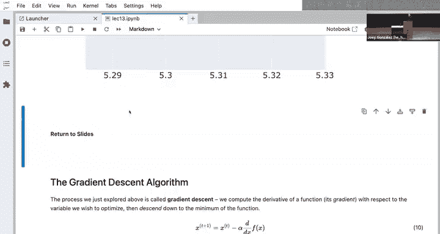
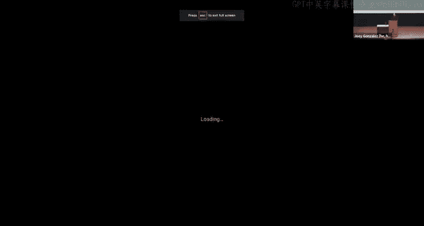
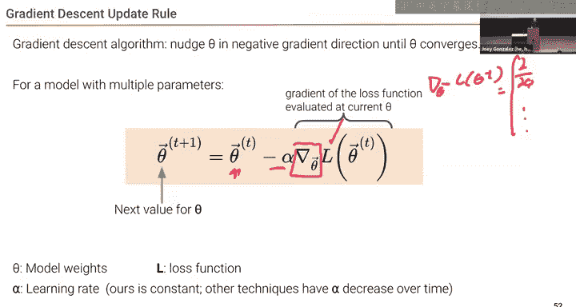
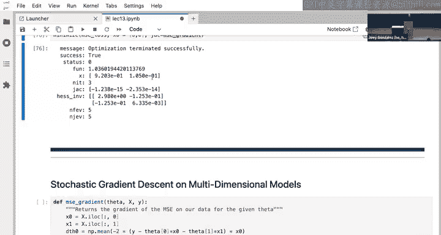
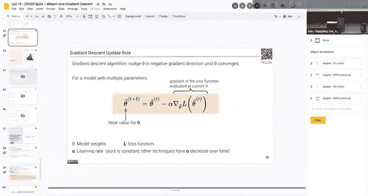

# 课程13：Scikit-Learn与梯度下降 🚀


在本节课中，我们将学习两个核心工具：Scikit-Learn库和梯度下降算法。Scikit-Learn能让我们用极简的代码拟合各种机器学习模型，而梯度下降则是驱动现代人工智能模型优化的基础算法。我们将从实践应用开始，再深入理解其背后的数学原理。

---

## 概述：从一行代码到核心算法

上一周我们讨论了普通最小二乘法和多元回归，学习了如何利用微积分和几何方法拟合线性模型。今天，我们将在此基础上，探讨如何使用算法来解决这些优化问题。

首先，我们将介绍Scikit-Learn，这是一个强大的Python机器学习库，它能让我们用一行代码拟合线性回归模型，甚至扩展到其他复杂模型。接着，我们将深入探讨梯度下降算法，这是现代AI取得进展的基石。理解这个算法将帮助你在使用现成工具包时更好地调试和理解模型。

---

## 第一部分：使用Scikit-Learn拟合模型 📦

Scikit-Learn是一个流行的Python机器学习库，它封装了所有标准算法，并提供了丰富的教程。其最大的优点之一是所有模型都遵循相同的使用模式，只需掌握简单的三步流程，你就能拟合各种模型。

以下是使用Scikit-Learn拟合模型的核心三步：

1.  **初始化模型**：从库中导入你想要的模型类（例如线性回归），并创建一个模型实例。
2.  **拟合模型**：调用模型的 `.fit()` 方法，传入特征数据 `X` 和目标变量 `y`。
3.  **进行预测**：使用拟合好的模型的 `.predict()` 方法，对新数据做出预测。

**代码示例：线性回归**
```python
from sklearn.linear_model import LinearRegression

# 1. 初始化模型
model = LinearRegression()

# 2. 拟合模型
model.fit(X, y)

# 3. 进行预测
predictions = model.predict(new_X)
```
通过简单地更改第一步中导入的模型类（例如换成决策树回归器），你就能用完全相同的代码流程尝试不同的算法，这体现了Scikit-Learn的强大与便捷。

---

## 第二部分：梯度下降算法原理 📉

虽然Scikit-Learn让模型拟合变得简单，但理解其背后的优化原理至关重要。梯度下降就是一种用于寻找函数最小值的迭代算法，它是许多机器学习模型训练的核心。

### 基本思想：沿着山坡向下走

想象你站在一个山谷的斜坡上，目标是走到谷底。梯度下降的直觉是：观察你脚下点的“坡度”（导数），然后朝着坡度下降最快的方向（即负梯度方向）迈出一步。重复这个过程，你最终会到达（或接近）谷底。

### 算法公式化





对于我们要最小化的损失函数 \( L(\theta) \)，其中 \( \theta \) 是模型参数，梯度下降的更新规则是：

\[
\theta^{(t+1)} = \theta^{(t)} - \alpha \cdot \nabla L(\theta^{(t)})
\]

*   \( \theta^{(t)} \)：第 \( t \) 次迭代时的参数值。
*   \( \alpha \)：**学习率**，控制每一步的步长。
*   \( \nabla L(\theta^{(t)}) \)：损失函数在 \( \theta^{(t)} \) 处的**梯度**，它是一个向量，每个分量是损失函数对相应参数的偏导数。

### 学习率与收敛

学习率 \( \alpha \) 是一个关键的超参数：
*   **太大**：可能导致算法在最小值附近震荡，甚至发散。
*   **太小**：算法收敛速度会非常慢。
在实际应用中，我们通常还会设置**最大迭代次数**和**容忍度**（当参数更新非常小时停止）来终止算法。

### 凸函数的重要性

我们之前使用的L2损失函数是**凸函数**。凸函数的特点是任意两点连线上的值都不低于函数值本身。一个重要的性质是：对于凸函数，任何局部最小值就是全局最小值。这意味着使用梯度下降等算法，我们最终能找到唯一的最优解，而不用担心陷入局部最优。

---

## 第三部分：从单变量到多变量梯度下降

上一节我们介绍了单变量函数的梯度下降。对于具有多个参数的模型（例如多元线性回归），我们需要将概念推广到多变量情况。

### 梯度：指向上升最快的方向

对于多参数损失函数 \( L(\theta_1, \theta_2, ..., \theta_p) \)，其**梯度** \( \nabla L \) 是一个向量，每个分量是损失函数对其中一个参数的偏导数：
\[
\nabla L(\theta) = \begin{bmatrix} \frac{\partial L}{\partial \theta_1} \\ \frac{\partial L}{\partial \theta_2} \\ \vdots \\ \frac{\partial L}{\partial \theta_p} \end{bmatrix}
\]
这个梯度指向函数值上升最快的方向。因此，我们更新参数时，是向**负梯度**方向移动，即函数值下降最快的方向。

**代码示例：线性回归的梯度**
对于一个简单的线性模型 \( \hat{y} = \theta_0 + \theta_1 x \)，其损失函数为均方误差 \( L = \frac{1}{n}\sum (y_i - \hat{y}_i)^2 \)，我们可以推导出梯度：
\[
\frac{\partial L}{\partial \theta_0} = -\frac{2}{n} \sum (y_i - \hat{y}_i)
\]
\[
\frac{\partial L}{\partial \theta_1} = -\frac{2}{n} \sum (y_i - \hat{y}_i) x_i
\]
在代码中，我们可以实现这个梯度函数，并应用于梯度下降更新。

---

## 总结与展望

本节课我们一起学习了两个核心内容：




1.  **Scikit-Learn的使用**：我们掌握了如何使用这个强大的库，通过初始化、拟合、预测三步流程，快速构建和评估各种机器学习模型。这为我们解决实际问题提供了高效的实践工具。
2.  **梯度下降算法**：我们深入探讨了梯度下降的原理，从单变量函数的直观理解，到多变量梯度向量的形式化描述。我们了解了学习率的作用、凸函数的优势，以及该算法如何通过迭代寻找损失函数的最小值。这是理解现代机器学习模型如何被“训练”的关键。

梯度下降及其变体是当今大多数机器学习模型（包括拥有数十亿参数的深度学习模型）优化的基础。在下节课中，我们将讨论**随机梯度下降**，这是一种为了处理大规模数据而对梯度下降进行的改进，它能极大地提升训练效率。






---
*课程内容源自 UCB Data 100 Spring 2024 Lecture 13，经翻译、整理与重构。*