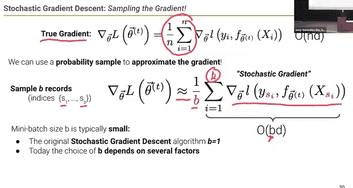
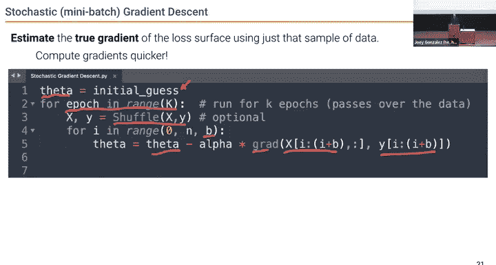
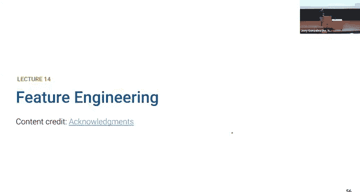

# UCB《数据100数据科学原理与技术｜Data 100 Principles and Techniques of Data Science 24SP》中英 - P14：-14-Data 100 Spring 2024 Lecture 14.zh_en - GPT中英字幕课程资源 - BV1Bc2dYCEbc

Yeah。

Great good morning， everyone。Welcome to Thursday's lecture。

 I don't normally do announcements in lecture， but today there are some important announcements。

 so we're going to do those first。 so as hopefully many of you know， there isn't a midterm coming up。

Next Thursday。Next Thursday from  seven to nine， if you haven't read these， please read these links。

Oned。They will tell you what's going on the midterm， what you need to do。

 I we'm going to summarize some of the stuff here， but the source of truth are these posts。

Midter review session tomorrow。So session tomorrow in Evans。3 to 5。

So seats are available on a first come first serve basis so get there early。

 but we will have recordings and slides good Professor Roi will be also holding an extra office hours next week。

 perhaps I should hold one too I'll maybe make a post about that early next week。

 but from Monday from four to five。Seeing assignments should be sent out hopefully by Monday and that will tell you where to sit and where to go for your midterm and if you think you're going to be needing。

Accommodations。Les fill this form out as soon as possible。

And there's a link in these posts for that information。Please do that。

Any questions about the midterm。RightOr what I've just said。Or ask oned， in fact。

 I will likely be a poor choice of person to answer this。

 So ask on Ed and you'll get a much better answer。Okay。Stuff I can talk about。

 so let's now focus on today's lecture， which is finishing up gradient descent and it will jump into feature engineering。

Al， so I'm trying to do a little bit of recap。 so this whole week has been around this story of model and we've been focusing on optimization。

 we're going to finish up optimization。 we're talk about something slightly different。

 which is how we design the model itself so we go back to choosing your model and in particular how we transform our data so that we can use something like simple linear your models orin least squares to solve really complex problems。

So quick review of gradient descent。 We went fast last time。

 So I want to just recap some of the big ideas Probably the first big idea in the gradient scent was this idea of this lost surface。

And this is the surface I've drawn here， and this is for let's say， a model that has two parameters。

 theta 0 and theta 1。And so if you imagine this stage。

 this is the theta 0 theta1 stage as I walk in one dimension I'm on theta 0。

 maybe in this dimension'm on theta 1， my goal in loss miniization is to find the point when I look up at that surface above me that gets to the bottom。

 So I' want to walk to the bottom， that's the theta 0， theta 1。That gives me the lowest loss。

That fits my data the best。How do I walk around on this stage？We could walk around randomly。

 pick some random points， it's an option。The challenge is， I have to look at that surface。

 and I have to figure out which way to go。Now， when I draw this like I've done on the slide， like。

 wow， that's pretty easy， right， I dont know what's ready to go。 In reality。

 these surfaces are very high dimensional。 The stage isn in just two dimensions。

 but it's thousands of dimensions and walking along a thousand dimensional stages is hard。

So how do we know which way to walk to get to the bottom of the surface。

 we look up and we can calculate the gradient， which is a direction on the stage that points the way in which I should walk if I want to go effectively I want to go up。

But I want to go down so I go the negative of the gradient。

 And that's the direction I should walk if I want to get to the bottom of that surface。

So I walk the gradient says go that way。 I take a step。 The gradient says go that way。

 I take another step， and at some point there's no more gradient because I'm at the very bottom gradient to0。

And I no longer it can take steps。Fortunately， I'm at the bottom so that's where I want it to be。

 right？That's the basic procedure。First big point was the gradient。We started with the derivative。

 just the slope at any point on a line or on a curve。

 and we generalize this to a higher dimensional thing， the gradient。

 which is just the partial derivatives。Of that function。

 of my loss function with respect to each of the parameters。 So I take parameters 0， theta 0。

Take the derivative， treating all the other variables and and parameter， all the other things。

 the data， the other parameters is constant。 I'm just taking derivative versus is spec to that is 0。

That's this the first term in my gradient， and I do the same thing again， or theta1。That's this。

 the second term of my gradient。And this vector here。My gradient vector。

And that vector points uphill or points in the direction that if I were to walk。

 the surface would go up， and I want to walk in the opposite direction。

 So I turn around get negative the gradient。 I walked up。 So this gives me the downhill direction。

So in this picture， just to measure our dimensions， I a two dimensional model。 So theta 1， theta 2。

 so 2 d。2D this loss surface is how many dimensions。Ready。

The gradient is a direction in the on the stage on the 2D surface。

 So it's B plus one for that loss surface， because we have that extra dimension， the loss。

And then the gradient the thing were， we're moving around in the data space is just deep。对。Briishian。

We turn this into an algorithm。With this recurrence relationship here。It says theta at T plus1。

 So this thing in parentheses， I didn't say this last time it's very confusing。

 I'm not saying take theta and raise it to the T plus one power。

 saying the T plus one version of theta。Is equal to the teeth version of theta， that's right here。

But subtract off alpha， this was my learning rate times my gradient。

RightAnd we chose this alpha so that we don't take too big of a step because if I'm looking up in the loss surface right there and go。

 very good， I'll just jump to other side of the stage， I might jump past the minimum。

So I want to take a smaller step。 So I go， okay， I take little steps。

 maybe not too little because it'll take forever to get to the mini。

But we're using this alpha to control that so we don't jump around too much。Okay。

 so that's the basics of the algorithm。I don't think I was very clear about this last time just to recap this as well。

 the loss itself， this gradient of this loss function is typically treated as the gradient of the average of the losses of each data point。

So we typically when defining our loss， we define the loss on a single record。

 and then when we say the loss for our data set is just the average of the loss for all the records。

That's important because the algorithm I'm about to tell you about is going to take advantage of this。

Slides last time were actually in the demo last time。

 I worked through an example that I didn't actually derive derivative。

 so I thought it would be good to work through the gradient calculation here， so let's do that。C。

 one other piece of notation that I didn't say last time I just want to make sure everyone's clear on this is this Nala thing right here。

 So this， justs clear the slide， This is my gradient operator。

 This says take the gradient with respect to the feature or the parameters theta of this function。

 my loss。So let's actually work through that so here I've chosen this model。

 which is x transpose theta or really have a two dimensionsal model。

 I have theta 0 and theta 1 and I have x0 and x1 there's my two features I have no intercept。

 a very simple model。And I've chosen this loss for this example of y minus y hat。 So y hat is the。

 the prediction that this wouldgene。 So this is Y hat。And I've chosen to square it。

 so that is the squared loss。Let's actually derive this， so I had hidden these slides。

 which was a mistake。So I want to work through the gradient calculation just once more to make sure everyone's comfortable with this because it' it's good material for。

 you know， final。嗯。How do I do this， So I need to take the partial derivatives with respect to theta 0 of my loss。

 And here I plugged in my model So this is really minus F。and you。Its same thing as minus。Beta 0， x0。

Ber one。 excellent1。So I've pushed this minus through， and that's how we got。Y I minus y。

I prediction why hat。Okay， so let's take the derivative with respect to theta 0。 How do I do that？

Should be comfortable with this， this is an important skill from calculus。

So I'm going use a chain rule， so the first thing Im going to deal with this is two out here right so it's my have something squared。

And I wish I could erase easily。 Okay， so we'll put a two here。But now what do I do。

We to put the inside of this in。Chhenrono。I。Beta 0。Like 0。inus beta 1。X1。

 and now I have to take the derivative to the inside with respect to theta 0。 What is that。X。Mira。

Right done。I made a mistake， right， I need a minus。 I left space for it。 There we go。

W do I need a minus because I have to take negative theta 0？What about y why I。It's constant， right。

 theta one。It's a constant I just taking the respect that theta is 0。Let's do this one again here。

So we bring the two down again。Copying the inside here。Chain rule。I， sorry。

And now what I need to take the derivative of the inside is。We're thing in respect to theta 1。

So I'm going to take x1 out。And then I got this negative here。ItsNative。

 got to deal with that negative over here。So I've taken my partial derivatives。My gradient is what？

It's copy these two things down into a vector。 So two times Y I minus theta0 x 0 minus beta 1， x 1。

 just a little bit different here。Write it kind of the same way。 Y I minus。

 This is really this inner part here is the same thing as F of beta。X， right。来 did得。Great。

 because this piece right here。We really， we pull this minus out here。 Then we have minus F of。对的。

热可的。All right， so。We up。If your loss， plug in your model。Take the partial derivatives。

Build a vector out of those partial derivatives， that's usually gradient。

That's a gradient respect to one example， the gradient respect by data set is the average of these gradients for the entire data set。

Reading calculation， I have the math here for easier reading。Okay， so that was the example， in fact。

 we went and implemented this in the code last week using this update rule。

 and you'll see here we've plugged in the F version instead of just copying the minus theta0 times x0 plus or minus theta 1 times x1。

Okay， so this gives me a gradient。And the last step is to build my algorithm from this。

One thing we didn't before I jump to the algorithm。

 one thing that's worth discussing is how often do we run this algorithm。

 how do we choose their iterations and again in the last lecture we said。

Typically we'll fix a maximum number of iterations。

 It's how much money or how much time we have that we're willing to wait for the answer。

 But hopefully we get there sooner。 So we'll also have another condition that says if the theta stops changing。

 it gets to the point where it's like the gradients basically  zero stop。That's my tolerance。

 my epsilon of convergence。 These are parameters you would set when calling software packages to use these techniques。

That was recap。And now for the exciting part of lecture， stochastic gradient descent。

W I jump into stochastic gradientcent。 I want to give some context。

 So stochastic gradient descent is the flavor of gradient descent that's widely used today。

 and it is what powers most of know modern AI is running a variation or variations of this algorithm。

 So it is pretty neat。And when you hear about it， you're going to be a little disappointed because it's also pretty simple。

Before I do that， I want to talk a little about computational complexity in these optimization routines。

And before I do that， I'm going to go back to the original normal equations that we had used to solve for the optimal theta for the ordinary least squares model。

IWhen I do matrix algebra， even when I'm doing it for my research。

 I draw pictures of boxes to help me think through what's going on here X this box right here is my covariate matrix。

 my design matrix， it has n rows where n or my n data points and it has D dimensions where D is my features we typically have n bigger than D in most of the problems that we deal with in machine learning or in data science。

 but there will be situations where D is in fact significantly bigger than n。

And we can deal with that not using this math because we'll have a problem。

 but using other techniques， which we'll learn soon。RightBut for this lecture。

 let's focus on a situation where N is bigger than D， but D is not necessarily small。 D could be。

 you know thousands， tens of thousands today and say the are model I said in last lecture。

 D can be only billions of parameters。 and then ends on the order of trillions。

 So these things get to be incredibly large。All right。

 so what is the cost of doing each of these steps， we'll start with one of the bigger steps here。

 This matrix multiply。 So I multiply this， this is x transpose times x。 So know the cost of that。

Watder up， ballpar。So will I do。D by N by D computation。喂。So， that has order of。

And D squared work to do。It's a amount of amount of computation I need to do。

 roughly that amount of work。over here， x transpose y。So I'm going to take each of these data。

 which of these columns you throw here， each of my comms of my y vectors， my labels。

 things can counter of predict。So that has N by D work。Good你 speak up。How about this。

 so now I need to invert this matrix。What's that cost。So matrixtri inversion can be done cleverly。

 but let's just say order of D cubed。 So I have to de cubed work just to invert this matrix。

I then need to multiply these two things together。 This is D by D， and I multiply it by D。

 So I'm going to do D squared work to get the final theta。I this good， this bad。Right。

 what here are the things that caused me stress when trying to apply this technique？

This matrix is kind of a pain。The work I do here， So first I have this n times d squared computation。

And is millions。D squared is， you know， D is a few thousand。 D squared gets pretty big millions。

They have millions by millions of work to do， so this can be pretty costly。

 This D cubebe is kind of annoying。And my billion parameterer model， this is not possible。

Intractable， too expensive。RightSo this is why we went to gradient descent becauset need we don't want to do these giant operations and we want something that can work more efficiently。

Maybe。Ideally， something that's in the order of N would be a nice start。Right。

So like every one of those Ds。So let's say your gradient descent。People asked this last time。

 what's the cost of this？Let's work through it。So these are going to be D dimensional vectors。

 So we're going to do like order D workup here。 I'm not even going to worry about these operations like subtraction。

 The interesting part is this calculation right here。 this gradient。 So I've blown it up down here。

 What's the cost of doing this gradient calculation。Which work do I need to do？Well。

 I'm summing from 1 to n so that there's an n right there。

And then I'm working on things that are size D， such is D。So we're going an order of ND。Roughly。Work。

That's good， so one gradient step takes ND work。Progress， there's no D squares。

When we write it T times。Here's where to run multiple iterations。 So how much work am I doing then？

When I'm doing T times n times D。I that great。Good news。 T is gonna be small。 I'm impatient。

 So I picked T to B， you know， a few hundred， maybe。😊，These is going to be， you know。

 thousand and N is going to be million， several million。Can we do better？

How do we go faster than this， way faster than this？What do you do when you have a bunch of data？

That you're computing something on， and it's taking too long。社保。So we can use sampling techniques。

From this class to make a far better algorithm， and in fact。

 the algorithm the whole world uses today。That is it。So this is a true gradient， true gradient。

I' called the empirical gradient computed directly on all of my data。What if I just sample B records？

We'll use indices S1 to S B。 So the S1 is the seventh record。 S2 is the 30th record。

 S 3 is the first record and so on。 So there's my indices。

Then I can define something that's approximately my gradient。

By just taking the average over my little batch， it comes a mini batch。

Of the loss on just those data points。Breakthrough。Previousreview right， all we did was simple。不在。

It to change everything。Because we can run this fast。How big should our batch be。

What's a good sample size。What would be the best sample size？The original algorithm said。Oh。

 we should point this out first。 Okay， what is the cost of doing this now that I've made this。

B instead of N， I no longer have my N here。 I have a B。B times D。I want this thing to be small。

 so what should I choose my batch size to be？Some people are going like that。The original batch size。

 one。That works really well， actually。Sample one data point。Perhaps they're random。

 perhaps using just a walk over your data， we'll talk about sampling in a moment。

Compute that tiny gradient。 It could be pointing in the completely wrong direction。

 You walk in the wrong direction。 Okay， you take a small step。 Take another point。 Okay。

 you a bit luckier at the right direction。 Take another step。 wrong direction again。

 But you're taking steps so fast。You're not looking at all your data。

 just looking at a single data point。 Great answer instant。

 So you take lots and lots of steps really quickly。 Small steps。And on average。

 it's going to get us in the right direction。And I could do this with these large models is the cost have gone down significantly for each gradient step。

Today we don't typically use batch size one。Wai。But working at budget is， it's a good reason。

But let's dig into both statistical reasons for doing this and computational reasons。

Let's start with statistical reasons， what do we know about sampling。

You want a better answer what should you do。Get a better sample。 How do you get a better sample。

Simple random sample is a good place to start。 How would a bigger sample。 Yeah， that'll help， too。

 So if I can get a nice simple random sample that's really big。

 I mean get closer and closer to the true gradient。But at a cost right。

 so one trade off I have is I'd like a slightly bigger sample size because if I get a slightly bigger sample size instead of going。

 you know， frequently in just the completely wrong direction。

 I'll more often be moving in the right direction。We're going to pay for it in cost。

 computational cost。But there's another piece of magic that came in。

I took a bigger sample。And all of a sudden I can actually take advantage of hardware to process that sample。

 so I went from a sample size of1 to let's say 16， I have 16 cores or let's say four GPUs。

 I can split that computationally gradient because look it's a sum。

I can do each of these grading calculations on a separate GPU， add them together。

And now I can take advantage of hardware。So increasing my sample size a little bit。Actually。

 maybe cost me nothing。Because I have the hardware rate to support it。So parallelism。

So you get better estimates， parallelism。Another thing， system factors。呃。

Some of you might have experienced a outage on the data hub running a recent homework assignment。

 that was probably because many of you said， let's call this neural network function passing one example at a time。

A little bit background， what that means is every time you pass it one example at a time。

 a bunch of code allocated a bunch of matrices， set up a bunch of linear algebra routines。

 ran a bunch of algorithms， and then came back。And it would have been much happier if you had given it。

 you know，60 examples at the time because all that work setting stuff up could be amortized over the cost of actually doing those computations。

So doing lots of little work。Can be inefficient on computers if we can reuse， let's say。

 the model we've loaded。So being able to take advantage of cash efficiencies。

 reuse of code allocations leads to system factors。But。Adminishing returns。

So how big can you go if it's better to go bigger， go bigger。 But at some point。

 the statistical gains are just not there。 and the parallel and gains， Well。

 you bought a bunch of GPUs。 you're communicating across those GP， Its expensive。

So that starts to become a problem。So maybe she go smaller？More frequent updates， it's a trade off。

And sadly， the best answer is unknown。Depends on the problem working on this is something you'll see tuned and many of the libraries you use you'll have an option to set a batch size。

What should you do？General guidance。Try one， two， three。

 you have a GPU Think about how much you can do to keep the GPU busy your software package will tell you if the GPU is busy or I can cr my batch up to make sure utilizing the hardware。

Right。Are there any questions about this？对。Right right， so。I have some code in the previous lecture。

 which I don't want to go through。 I thought I'd give you a short skeleton of what stochastic gradient scent looks like just because I want to introduce one more。

Concept here。 So this is pseudocode in Python where I say I'm going to take theta that's single'm going optimize just as before I'm take an initial guess。

I'm going to run for a number of epos and epoC is going to be a walk through all of my data。

Remember I'm taking samples and for each sample I'm going to take a little bit more of my data and I'll get to the end。

 that's one epoC and we might run this algorithm you know a few epos， two， three。

 stay the art techniques sometimes do just one， so just one pass of the data。

Within each epoC will often shuffle our data， that's our randomness。

 so we'll take our data shuffle it。this is a proper random sample， and then we walk down that data。

 taking a batch at a time and computing the gradient on one batch of the data at a time。

Got our gradient？For each batch， we update theta and then get the next batch。😡，taking lots of steps。

Every B data points。That's the pseudocode for stochastic gradient。

At the end of this lecture or at the end of this part lecture。

 I will show you what real code looks like just to kind of highlight how close this is to what you'd actually do in practice。

Dling strategy。So we said a simple random sample would be great。

So there's a little bit of a catch here， how do you sample a million records， 10 million records。

 how do you construct samples？It's actually not easy to get nice。

 fast access to random locations in a giant set of data。 So again。

 the standard practice in these algorithms is often to take our data， shuffle it。

 We have libraries that are good at shuffling data and then just walk through the data nice and linearly。

 which means I can prefetch pull data into the GP or into memory as quickly as possible。

 as I know where I'm going。 It's no randomness at this point。 When I get to the end。

I'm a good person， I'll shuffle it again， sometimes I'll turn around and just walk back the other way。

 stuff's in memory。If my debt is in a weird order， this will break things。And there's， you know。

 you can show that if I put all the the the high earners at the beginning and the lower earners at the end。

 my model be going to overfit to what I see at the end。So I do want to shuffle data ideally， ideally。

 I shuffled every pass of the data， but sometimes the cost of shuffling is too much。

 so we shuffle once。Let me give a high little picture of what happens here。

 so if we take our original gradientcent algorithm， it works really hard at each of these steps。

 but makes pretty smart decisions about which way to go。Sttochastic gradient。

It doesnn't work so hard。 This doesn't make super smart decisions， but it makes a lot of them。

 So it's able to bounce around and quickly get to a minimum。

It it's going to tell you there's a neat property of this for regularization。

 but it'll make sense when we talk about regularization， so I won't talk about that。Al right。

 so here's our first slido and this is kind of a test of the terminology here。

 So suppose we fit an ordinary least squares model with 8192 data point data set using stochastic gradient sent with batch size one。

How many grading updates are there for each epoch。And move on。Pick something。 Pick something。

All right。So。Remember， I'm taking batch size one， so a single piece of data。

 and Ill walk a new direction， small steps， single piece of data， walk a new direction。

And I'm going to do that for one epoch， which is the entire length of my data set。

So that size1 means I will do 8192 updates。To get through one in pack。对。Look， everyone。

My Ts will be upset with me but I decided to just mention something I did once in the past to kind of highlight what happens when we take well we've talked about this class actually at apply in the real world so back in spring 2020 I tried to change this class to use Pytorrch and actually use neural nets to teach gradient descent it did not go well I think most people were lost。

But I want to show you the algorithm that we would have used had we done this。

 this is the algorithm block， this is using Pytorrch。

 the library that people use today to train state the art neural networks。

 and it again is built on the study of gradient descent。

Here is a pretty simple version of SGD using Pytorrch， it has all the things that we've talked about。

A data loader which fetches data very efficiently onto our GPU。We set a batch size。

 how much data it's going to load and how often we're going a shuffle。

 we're going a shuffle every time we start to load。喂。theyre sampling。Then the loader is nice。

 just returns a batch right there。So every time I hit the loader， I get a new batch x y。

This is the cool part about what happens with modern software。 You don't do calculus anymore。

 The software does it for you。 So you define your model as just some function using something identical to nup。

 but it's called Pytorrch。😊，You define a loss function by saying a minus b squared。You get a loss。

 this is just a number。Actually， a ten are wrapping a number， but it's a number it's the， you know。

 the point on that lost surface， it has this magic lost that backward。

Which computes the gradient efficiently for all the parameters in your model， automatically。

You don't need to define。 You don't have to do calculus。 You should not be doing calculus。

 It will do it for you， and it will do it very efficiently。Then。

I can just access the gradient of my model。And I can subtract a learning rate times a gradient from my parameters to get my new parameters。

But what we cover in this class is what you would do in practice。One caveat， this is too much code。

So there's a function that does that for you， too。And it does it automatically setting render rates。

So maybe depressingly， we just taught you all the basics， the ideas behind stochastic gradient。

 but in practice when you use software， most of that。You won't have to do。

But you have to understand the concepts， so when things do break， you roughly know what's going on。

Yes， so important point in practice， you will use software to do many of these mathematical things we've talked about today and in other parts this class as well。

 and you should use that software because it is very optimized both for performance。And less bugs。

 So make your life better。 you won't be implementing gradient descent。 Most likely。

 you'll be using these packages to do it。But it will use that same， same process。

 and you will likely have this for loop that looks just like this。

So you a loop of repos and loop over these samples。This is out of scope for data 100。

 you will not be asked these things on the exam。But if you want， I linked to my failed lecture。

As well as code。 And if you want to learn about this stuff， there's an hour long video。

 And I'm guessing with what you know in this class now， you can watch that video and make sense。

 and you go build your own neural network using these techniques。So it is possible。

And that is the end of stochastic gradient descent。

 Is there any questions before I move on to future engineering。So if I take a random sample of B。

 I could get unlucky， I could pick some really bad samples。

 and I'm going to take a gradient step perhaps in the very wrong direction。That happens。

 stochastic gradient will bounce all over the place。Things I shouldn't talk about Well。

 when you take these things to production， you have a giant model running。 occasionally。

 that model will just walk off to infinity， and you have to stop everything。

 shut down your computers， reboot it back at a previous gradient step。

 Go that piece of data and keep walking in another direction。

So when people are training these million dollar runs on giant clusters of machines， there's。

Grad students or researchers sitting there watching to make sure it doesn't go negative。

 negative Nan or naan。 So divert to infinity。 and they have to go back in and inspect oh that was a garbage batch Get that。

 start over， keep walking。Good question。 All right。

 so we're going to transition to feature engineering， another exciting topic。

So we already started doing feature engineering， we were doing visualization。

We like to take our data and transform it so this linear makes sense。

 right We were essentially changing the data， changing the X's where the Y's so that the relationships fit our intuition our linear models of the world。

That is what patron engineering is doing， it's making the data。

Fit more naturally how we can visualize it and how the algorithms and the models we build fit the data。

We've talked about advanced models in this class and kind of in reference。

 but in practice it's often enough to transform my data back to a linear model and because linear models are really well understood。

 we can optimize them efficiently， we can reason about what they mean in terms of the features they tell us something about the world。

 it is pretty common even today， even with advanced machine learning to do feature engineering and transform your data into something that you can understand so that when you fit the model go this is a simple model it's got a term for this。

 a term for this， term for that。And I can explain it。

And the term for that was the square root of the volume of the cylinder in my car because I'm trying to estimate mileage。

So I use my knowledge of the problem to design features that make sense。

And then I can explain those features in my model。We already saw this in visualization。

 We did things like taking logs or data that's skewed things are know power higherwalls。

 we take logs to compress them， and that lets us make our data essentially live on a line。

 And when we can fit models to this transform data。

 we can actually plotp those models back in the untransformed space and they become。

Complex things that are nonlinear。So that's what we'll talk about how to do now。Al。

So future engineering is transferring features to improve model performance。

 and I'll add to that improve model performance and often interpretability。

 So I'm going to pick features that I can explain。And I want to do that because often I need to explain how I came to those predictions。

Al， so feature engineering is the process of transforming our raw features into more informative features for use in modeling。

Allow us to capture domain knowledge。So if I know that。I know that a certain property of an engine。

 the volume relates to the height by the cubic root or the cubic root。

 then I can make that transformation if I have the height of the cylinder。

 maybe I'm trying to predict mileage， I want to take the cube of that height， right？

I'll take the diameter times the height if you get the displacement of the cylinder in my engine。

They allow us to model non nonlinearing relationships。

We make these plots of just one of our features against the Y and it's curve。Okay， well。

 we can't fit that curve at the line， but we can transform the data。

 use the bulge diagram to get that to be flat。That's a feature transformation。

 Instead of fitting the original X， we fit the transform feature。

 And now our linear model could fit the data very well。

So we use our visualizations to allow us to see these kind of one dimensional slices of our model。

 so our take y versus some Xi， and we see that it's curved and we apply transformation to straighten that out。

喂。This also， and this is really cool， allows us to fit non numeric things。How do you deal of text。

People's preferences。Theirre names， we can model these things。

 we can convert them to numbers and fit them in our linear models。

So that's the key part of future engineer。We're going do all three now。So a little bit notation。

 let me build this in， this X here is my raw features。In an n by P space。

We're going to find a function phi， this is standard nott5 per function。There features， I think。

 yeah，5 fee for features。 That's better。It's going to take my original raw features and map it to a new P prime dimensional space。

Often， they'll be adding new features。Sometimes that'll be dropping features or combining features into one new feature。

So P P prime is often bigger than P， but not always。In some cases。

 P prime can be thousands of times bigger than P。Thanks she coming。

Talk about how to build these feeds。We already did one。 Yes， let's talk about this。

 So when we were working with。不是都点 so。Let's get that。

I'm going to put the fee notation in the context of our linear models。 technicalically。

 we already did one fee transformation before we added this one feature。

 we just added a column of one。 that's a new feature。

we took a model that was just theta times x and you're like theta times x doesn't have an intercept。

 no problem，ll at a column of1 is now it has a bias term。Previously。

 we would do something like put the one here and then write1 x x squared and so on。

 It'll be easier to write using this B notation。This should be phsio，'m sorry。

Ne need zero to put phi in place of x。So feehi will correspond。

 so Phi1 is the first column of our transform feature matrix， Vhi2 is a second column and so on。

This means that before we would have written x theta。

 now we can write phi theta where phi again is our future transformation or the transformed features。

It's a little bit of an notal shorthand。 let me go back to why this could be confusing。

 So right here I wrote phi of x， but for convenience instead of writing phi of x over here。

This would be annoying。 so we had to write fee。Of x1 that gets cumbersome。

 So we tend to write this thing here， Phi1 to be the the1 column of that phi of x。

All right so that's some notation now let's walk through some encodings。

 some feature engineering steps， I'm going to start with the one hot encoding which is actually kind of one of the more interesting one is our way of taking data that's not numerical and feeding it into numerical models so that we can make predictions based on things like you know the color of the car。

 the spiciness of the food and so on。Alright， so going back to an example we had from before。

 we played the T data set。 It's a toy data set， but it's easy to demonstrate concepts So we use it off in this class。

 We tried to fit the total bill， So we tried to fit total bill。 So we have a tipcom2。

 So we tried to fit tip。Tips to total bill。And size plus total the build times。

Theta 0 or theta 1 plus size。To。So we fit models like that before。

 but we couldn't do anything with day。Right。So now let's talk about how we take day and stick day into our linear model as well。

General technique， I'm actually curious。 How would you take day， day of the week。WeP in tomorrow。

I want to fit it into a linear model， so I need to convert day of the week to a number。

Natural way to do it would be to say， well， what's the first day of the week？Whoseday。

Maybe it's Monday， I don't know， pick a day。It's called Monday and just enumerate the days。

Not terrible。But we can think of day of the week as a qualitative。Variable， right， it's ordinal。

There's a better way to encode it so we can actually express properties about certain days of the week that maybe don't apply to other days of the week。

是下的地点。So one hot encoding is a pretty simple idea。 One hot comes from electrical engineering。

 where we're connecting wires together。 We're going to encode something using。On and off。

 using hot and cold wires。So if I' here's my original column of Sunday， Sunday， Thursday， Thursday。

 Saturday， those is the original feature values for the day of the week column。

I'm going to create three new columns， one for each of the unique values that that picture can take。

And then。The value for that row。If they're saying Sunday。

 I'm going to put a one in the Sunday column。TheNext row is also Sunday again。

 so put a one in the Sunday column。The next row is Thursday， so I put a one in a Thursday column。

Thursday again， one and then Saturday one again。So I took one column here。

 and I transformed it into three numerical columns。Theple ideaea， really powerful。

 so I can take things that are nominal and convert them into numbers that I can meaningfully fit using regression and other modeling techniques。

是。Right， and in future engineering and we'll talk later about some techniques to work through this process。

 you could say， you know what I'll also do day where I say Sunday is one， one， what's Thursday？5。5。😔。

They do it right， I don't know。 Yeah， so I could try to put that in as well。

There'll be issues with doing this， and there'll be techniques that we'll teach later for how to add new features and then subtract them off to figure out which features were really helpful in the end in predicting what you're trying to do。

嗯。One of the things about the day of the week is that what comes after Saturday？Sunday， yeah。

 so the problem with that is that Sunday and Saturday are really far apart。Right。

 and if you're trying to predict， I don't know。Exercise at the， at the park。

 These are really pretty similar to Saturday and Sunday。

 So that might not have been a good choice of of encoding for day of the week。So it wraps around。

But you could say I could add a new feature called iss weekend。And say1，1，0，0，1。

So I create a new feature in codes。 I think the weekend predictive thing I'm trying to do。

 So let's put a feature in for that， too。So that's encoding domain knowledge。对。Right， so I went from。

My original table having this my original my original X was this and this and it had day which I got rid of。

 and I expanded day into these。F additional columns。So P originally was p equals 2。

 and then p prime is this whole new thing， which is p prime。Eple 6。系。Ba features。

 one hot and coated features。Then to make a prediction。If I got a new a new row。

 I would just fill in have a total bill value a size and then I'd set one of these like day Saturday I'd say that was the day that I'm trying to predict the tip。

 I'd set that to one， everything else to zero I make prediction。Then just recap earlier。

 we used this shorthand and you'll see this in the lecture notes。

 you also see it in the homeworks where we just say phi so phi5 corresponds to the fifth column here。

Oh， demo， excellent。 Okay， so let's switch over to demo。Alright， so I'm going to show one hot encod。

We're doing well on time， which is great。Send you the tips data set just like we described。All right。

 so my original X lets actually show these before I proceed。what does that look like？

Of my original X， but I've kept my day calm。And then my y is the tip。It've actually computed。Okay。

 so I'm going to show you how to do one hot encoding using S kit learn。 So S kit learn。

 as I've told you in previous lectures， is a really powerful package。

 It has built in transformations， not just one codingd。

 but pens of other really sophisticated transformations just for these nominal kinds of data。

 One hotcoing is probably the most standards will start there。

 So I'm going to create a one hot enr object。Recall the formula for the recipe for S kit learn is you create an instance of the thing。

 you're gonna fit the thing， and then you're gonna use it to make predictions。 Well。

 this is pretty close to that。 So I create a one hot encoder。 I want to fit it to the tips day。

 Why am I fitting it to the。Sorry， to the data frame， the day column of the tips data frame。

Why am I fitting a one hot cutter？What what is there to fit。

Well what are the unique values that column can take？Saturday， Sunday， Monday， Tuesday， Wednesday。

 Thursday， Friday。One day， I don't know。We have to actually look to the data and figure out what the unique values are so we can create the correct number of columns。

 So fit， we're going to do that。 We' going to figure out the correct number of columns and come up with our encoding。

So we do that。Its fit。And then we can take that bit transformer instead of saying， predict。

 we say transform， because we're not making a prediction here。 We're going to transform the tips。

Da column into that matrix of ones and zeros。One thing here。 I don't think we demonstrate it。 yet。

 let's do that。I've fit this。And I get the output。 What type is it gonna be。I run this。Paarse matrix。

 Why is that a sparse matrix。We could have not days of the week， but these could be， I don't know。

What's the large styles of music or something， There could be many。

 many columns in this one hot en codingd and so we're going to use a sparse matrix to represent this because for any one row there's only one0 or only one1 everything else is zero so the default value is there's fault representation is sparse。

 but Im want to put it back in my data frame I'm going to convert it to an array。

 and I'm going to and take this encoded day as just a data frame here。There is our data frame。

 and now I can join that data frame back to my original features。

We're going to drop the original day column because that's not a number。

And now I have my new transformed data frame for which I can now fit a linear model that might predict better using this additional information。

So now， just before I get my linear regression model and set the intercept to false。

 and I'll come back to that in a second。I'm going to fit this transform data。 What does X look like。

So my X here has got my new features。We're going to fit that。Now I get I have my model fit。

 and for each of those columns， I can look at the coefficient value。And these are the coefficients。

 the weights associated of each of these new columns。

We'll build better models and later we'll talk about how we can interpret these weights and it'll become easier to interpret them when we start bringing regular other concepts。

 but they'll allow us to decide how important a day of the week is in making a prediction about。

 let's say the tip。And that's useful because you come back and use the model not just to make predictions。

 but to try to understand the relationships between these variables。Bonus feature。

 you will notice that I like bonus features。 I just want to show one thing。

 You don't need to know this again。 When we use Psyit learnn。

 it actually allows us to build a whole feature pipelines。Do we do this in the homeworkmark。Okay。

 we used to make students do this in homework。 It was much disliked。

 so thankfully we no longer do that。 but there is a package a part of Psyitt learn that lets me apply multiple transformations at once to my data。

 So if you're doing real real feature engineering with PsKt learn it's worth learning about these tools here I can apply one hot coding polynomial features which we'll get to a moment And when you saw these pictures before we just had linear regression models when you build these pipeline。

 you see this kind of rich cascade of things you're doing to your data before it's fed into the linear model the cool thing is once you've build this pipeline。

😊，Fit， that's all you got to do。 Fit does fit transformations， does everything。 So just fit boom。

So I can fit my original data， the raw data， it'll automatically do the transformation。

 preserve those。 So when I then go to make a prediction。I can predict， just on raw data。

And it'll show me other feature names too actually， so here's my feature names。

 I have a one hot encoded of the day of the week， I have polynomial encodings of the total bill and the remainder was just the size。

Right you don't need to know this， I'm just telling you because hopefully someday you all will go on to do really exciting feature engineering。

 and at that point it'll be helpful to know about these tools。O。I think that is the end of this。Demo。

 have any questions before I leave the notebook？But back up to the earlier example。Great question。

 why didn' I include a bias term， That's exactly what we'll talk about now。

 so there is an important point to that。Backact， I might even ask you all why。

 why I didn't include it first。There a slide on this。Y。

 so we fit the model this is the weights we got I said that we can often interpret these weights it's actually a little hard to interpret them the way I've set up right now。

 but in general as we get further in the class we'll show you how we can interpret those weights as signal about the importance of that future。

All， one quick exercise before we go into the bias term。Knowing what you know now。

 what tip would the model predict for a party with size3 and total bill of 50 eating on a Friday？

So here's my model here，听到。你笑。Probably see enough to answer this。 Try to take the。

T to show up on the phone I with you。We make these polls stay open。

 I'm going to go to the next page or next slide， let's see。Okay， so keep going。 fill it out。

 Let's talk through why this is the right answer。 So gives it away with that little check there。

 Alright， So why is that the right answer。Well let's walk through it。

 so the first two parts are pretty straightforward so the size is three， the total bill is 50。

 so size should be multiplied by 0。187。Good， so 0。187 times 3。 The total bill is 50。

 totalt bill is 0。09293。Is a total bill， 1050， and the remaining thing you have to figure out is on a Friday。

So。Friday is feature three here。Day Friday should be 0。746 or 。745， or 0。746。

 and that is times 1 because the future Friday is on and all the other features are all。

 so this is the correct answer。You all got it right， so I think maybe everyone's getting this。

 which is great。Go to the next slide。 quick submit。对。What I want to do here。 Alright。

 this is actually going through that calculation I just described。 I think I'll skip this。

Let's go on to the the more interesting question of why didn't we include the intercept。

I think this is a free response。 So this should be。呃，放。Good answer。You better。

Why don't we include the intercept。Wital is hilarious。Yeah it's all about independence，hu？

So you guys are converging on something here。It's about linear independence。

 that is a good way to describe it。 What do we remember from our matrix equations。

 What do we need to be true about our features。We don't want any set of features to be a linear combination of other features。

The problem is。If I add up Sunday， Thursday and Saturday。What is that？

It to be all once because there's a number。 There's a one in each row or one of those and a deer everywhere else。

So the sum of Sunday， Thursday and Saturday is equal to。Byister。So if I add a bias feature。

 I have a problem。They're no longer independent。喂。And so in order for my matrix to be invertible in order to properly solve this equation here。

As it's written。I need to ensure that I don't have some column as a linear combination of another column。

How do we solve this？So in practice， and I want to emphasize in practice， this is not an issue。

In practice， if I set the intercept to true， everything will work fine。

And that's partly because we don't actually solve this。

 we use iterative methods and those methods impose something called regularization。

 which we'll teach you later。So in practice you would leave the intercept on。

 but just for the point of understanding the theory behind this。

 adding the intercept does create a problem in that the columns again are these columns become a linear combination or the linear combination of these columns is equal to this column。

So there are two simple solutions if we wanted to solve this mathematically and in some settings you might actually do this。

 you could either drop one of your one hot en codingd columns。

 just pick one So now the combinations no longer a linear combination doesn't equal the biostrom。

 or you drop the bias term， which is what we did in example。

I'm teaching this because theoretically this is essential， but in practice， again。

 the mathematical techniques we use and the regularization we're about to teach you makes this no longer an issue。

可以。All right， so we did one hot encoding， we're getting to polynomial features。

So we've already done a little of this。 I want a deal of curvature in my data。嗯。

I'm trying to fit this data here。This data here does not appear to be a straight line。And you go。

 it can't fit a linear model。 You can fit a linear model。 You just need to transform your features。

Right， we already did this。MaybeYou may be doing this upcoming lab。So I can add new features。

 so I have the horsepower， but I can throw in the horsepower squared the feature。Ideally。

 when I do this， I have some basis for doing that that is based on knowledge of the domain， again。

 I know something about how horsepower relates to fuel economy。

But I could also just say I built these plots and you know the data does have a curve in it and if I do want a better fit and I think there's some generalizable curve here。

 maybe I should add this polynomial term。So that's where visualization might guide you in your process of future engineering。

This is still a linear model because linear is a statement about these things。At thisす。The feature。

The linear feature， but the model is still linear。When I fit this model。

And then I plot this model for all the points。 I get a curve。The curve is a linear model。

 but it's curved。诶。Technically， it's a plane in a three dimensional space。

But when I project it down to my two dimensional space of just horsepower。An MPG right here。

 I get this curve。They said it， maybe I'll elaborate， what's it a plane in？

It's a plane in a space that has horsepower， horsepower。Squared， let's ignore the theta zero term。

 so I have a plan in this space that predicts MPG。嗯。的。

But when I plot it on this plot and I take the HP squared。

 so I put this in this two dimensional thing， I get a curve。So feature engineering。

 taking Pannoials allows me to fit these nonlinear things。Use to be my favorite part of this lecture。

 We're not going to do it。 What if I had more polynomial features。Keep' going， right？

hyWhy stop at Hp squared Hp cubed Hp to the fourth， Look， my air is going down。Making progress。

 right？When I was in middle school， I did a science fair experiment and and I fit like a fifth degree polynomial to something that was like。

Did that they're like why did you do it， it's like， well， it fit better。Yeah。

 there's a problem with doing this， but it's a common trend actually。

 to try to introduce more complex functions to fit my data。And maybe it's appropriate。And again。

 we'll see in the upcoming lectures that we will actually often do stuff like this。

And we use techniques to control those effects， but still give us something that generalizes。

Let's keep going。Why stop at five， we can go all the way to seven。We can also add extra functions。

 I could say， you know is the mile per gallon in this range make that a feature it's a 01 feature and then I can fit this data slightly better by incorporating that information so we can build more and more features to better fit our data。

And this is sort of the danger of feature engineering。

 it showed up in the previous lecture right I switched this really cool model。

It could fit almost anything。喂。Bitting your data isn't actually the end goal。

The more of a subjective question。We the slido。 You have time for it quickly。What would you fit。

Would you make this decision。You you can vote on here， yeah。People are like， order two。No one。

 no one wants to order4 or there we go。 Okay， good。Yeah， we can fit better。Hard to read pinenoms。

There are whole sets of libraries for building polynomial features。

 we're building radio basis function features， there's ways to really fit our data。

 and this is sort of the art in machine learning and data science is knowing how far to go and when to stop。

And that is the focus of the remainder of this lecture and the future lectures。right。

So we're worried about model complexity。系。Right now we're thinking about training here。Right。

 so we're trying to minimize the error on our training data。

So we continue to decrease the air on our train data by increasing the complexity of our model。

 adding more features， adding more parameters。We got to tens of parameters。

 remember state the art models in AI are。Hundreds of billions of parameters。More could be better。

We have this problem。That we keep increasing the amount of complexity。

 So adding more features on this axis。 and our error keeps going down。

 So we're like so happy we report to our our boss every month。 We reduce the training air。😊。

Training is usually in reference to the data that we have where we have labels。

 the things we're not trying to predict the data we have， we already have it， we're training on it。

reducing that training error by making our model richer with more and more features。

There's a steam that's going to merge here。We give you a picture what that looks like？

Kind of relating back to our ideas in linear algebra。If I give you。And not overlapping data points。

 then I can find a polynomial degree n minus1 that goes through all of those points。That's exciting。

So you give me n for anyN， assuming the math works like I can handle really large polynomials。

 I can fit that perfectly。I get your air to 0。But should I do it？So， and he set at points。

 I can fit a line to it。At least analytically I can。

 whether or not the computer can handle these giant polynomials is a separate issue。

We can fit your data perfectly。The reality is maybe I'll just jump to the picture here。

The reality is we're often operating on a sample of the world， right。

 so here's my here's my sample of a few data points from that that data set before。

 I fit a perfect polynomial zero error。 and then I said， well。

 that's my explanation for this this surface right here， these data。That's a terrible explanation。喂。

This。Is the theme of overfitting。 This is the mistake that most people will make when using these techniques at least once。

 I certainly did it。 We you built the best model because you're smart。

 If you how you psyic learn and tune all those knobs and it fits the data amazingly。

 And you get some new data。😊，Garbage model doesn't fit at all。That's over fitting。What wrong？

The model complexity was so great that we overfit to the training data。

 it essentially memorized these six training points。Did great on those points， everywhere else。

What was。We didn't test those points。So we have a real problem。

 we have the tools to build crazily complex models that will fit the data we have perfectly。

 and I just told you the entire last lecture is let's fit that data perfectly。

 let's minimize that loss。But that's also bad because we want these models to generalize。

So overfit models don't generalize the new data， the data we haven't seen yet。Right。

 so we want to be able to generalize the unseen data。

There's a term for this which will become more clearly to talk about the bias variance trade off called the model of variance and it's sort of saying is I sample different amounts of their different samples of data。

 how much will I model change， It's a linear model and I sample different piece of data。 No。

 it's probably in the same kind of line in one direction or another， right。

But if it's a high degree polynomial， it's going to be all over the place depending on which data I sample。

 right， So I have high variance in my model。So our five degree polynomial behaved erratically to different samples of our data set。

So these are all different samples， those are created different models。So this is a picture， in fact。

 in my old style， my old format of slides。Of this trade off。And it's saying。

That we are trying to increase model complexity to bring down our training here， that's good。

We don't want to be underfitting， you don't want a model that's too simple。

 it can't really explain what's going on。But we also don't want to increase our model variance so that when we see new data performers poorly。

So there's this sweet spot。If're right there。 We've managed our model variance。

 and we've brought down the error the best we could。How do we find that sweet spot？We calculate that。

Stay tuned for a future lecture， but I think this will be after exam week we'll have that answer。

All right， that's the end of feature engineering。Maybe I'll give a little bit of additional context on this overfitting as it relates to stochastic gradient one of the things that's kind of neat about these optimization routines is they're imperfect。

And that actually helps us here。 So when we take our model to make it massive。

 billions of parameters should almost always ever fit。 In fact， when I first saw this results。

 it's like， no way that will work。It worked。 Why did it work。 We still don't quite know。

 But one of the things， one of the theories behind why it might be working is first。

 we have billions of parameters， but we have trillions of words that we're trying to fit when we build these big models。

Or trillions of images we're building gene image models。The algorithms are imperfect。

 they're taking these random walks， so they don't they don't find the Min， right。

 so they are also providing this mechanism where we're not fitting the data perfectly。

 And so somehow these combination of these these pieces work to our advantage so that we can get these crazy large models to work when they probably shouldn'。

In the coming lectures， we'll talk about tools that you can use to manage this overfitting process and they're actually pretty simple building on sampling the same ideas we've been using earlier in this class to be able to essentially look at a sample of your data just like we did in that demo with six data points。

 maybe take 100， fit our model and then go back and look at the remaining data and see how it performs。

That gives a picture of what's going on， how it generalizes the data we haven't seen yet。

 and then we'll talk on following Tuesday about techniques to control the overfitting of our models。

不是。2。Right， so how do these giant 100 billion parameter models of weight over're fitting again？😡。

We don't 100% know the answer to this。 First， massive data sets make a big difference。

 trillions of parameters sorry， trillions of data points。

 We read the entire web when we fit these models。 We do the same encodings， by the way。

 So we have a whole feature engineering process to take words and convert them to numbers we can put them in these models。

By。We use techniques that we'll talk about in the coming weeks for regularizing our models。

But also the algorithm itself， it's imperfection， stochastic gradient helps us so that we don't necessarily overfit。

I'll add one more idea， which is still。Research， still theory。Back， it shows up in this picture。

I didn't draw this picture correctly。Another theory that is our models got so big that we went so far off on the complexity dimension that maybe we couldn't overfit because they were too complicated。

And that we start to get better generalization over here with these massive， massive models。

I say that when you go to do data science， you will probably start with smaller models and you'll be in this regime。

We need to be careful， adding too many features will be a problem for you。

So what we teach here makes sense。 you should think of it this way。

 But when you start to get to these。Hundreds of millions， billion parameter models。

 these giant neural networks。We're in a different world over here。 The complexity is so great。

 Some variance becomes less of an issue。Maybe one way to think about it is that many of the models behave the same。

 many of the ways you could parameterrize that model behave the same。And our optimization techniques。

Somehow help us over here。But this is the cool part， we don't really know it's ongoing research。

Open problems。 Maybe you will explain it someday。But for today and for this class。

 we're going to be in this regime。We're thinking about models that get too complex and trying to manage that complexity so we get right to the sweet spot。

Alright， I actually finished a few minutes early。 I will stick around if people have questions。

 I'm happy to try to answer them。 Otherwise， we will see you next Tuesday for a guest lecture。

