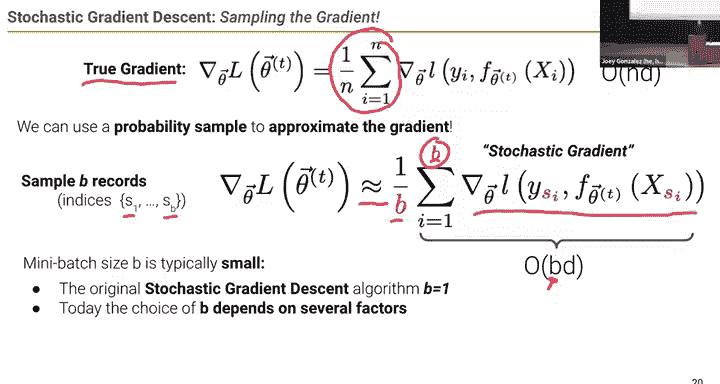
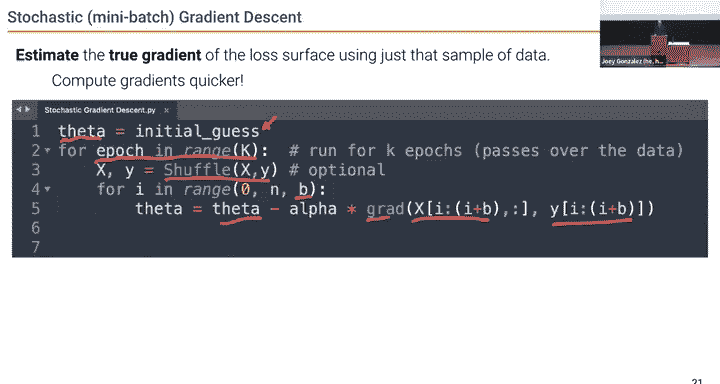

# 课程14：梯度下降与特征工程 🚀


在本节课中，我们将要学习梯度下降算法的核心概念及其优化方法——随机梯度下降，并深入探讨如何通过特征工程来提升模型性能。

---

## 梯度下降回顾 📈

上一节我们介绍了模型优化的基本思想，本节中我们来看看梯度下降的具体实现。

梯度下降的目标是找到使损失函数最小化的模型参数。我们可以将损失函数想象成一个多维曲面，我们的目标是在这个曲面上找到最低点。

### 核心概念：梯度

梯度是一个向量，它指向损失函数在当前点上升最快的方向。为了最小化损失，我们沿着梯度的反方向移动。

**公式**：
\[
\theta^{(t+1)} = \theta^{(t)} - \alpha \nabla L(\theta^{(t)})
\]
其中：
- \(\theta^{(t)}\) 是第 \(t\) 次迭代的参数。
- \(\alpha\) 是学习率，控制步长大小。
- \(\nabla L(\theta^{(t)})\) 是损失函数在 \(\theta^{(t)}\) 处的梯度。

### 梯度计算示例

对于一个简单的线性模型 \(y = \theta_0 x_0 + \theta_1 x_1\) 和平方损失函数 \(L = (y - \hat{y})^2\)，梯度计算如下：

**代码**：
```python
# 损失函数对 theta_0 的偏导数
grad_theta0 = -2 * (y - (theta0*x0 + theta1*x1)) * x0
# 损失函数对 theta_1 的偏导数
grad_theta1 = -2 * (y - (theta0*x0 + theta1*x1)) * x1
# 梯度向量
gradient = [grad_theta0, grad_theta1]
```

整个数据集的梯度是每个数据点梯度的平均值。

---

## 随机梯度下降 ⚡

上一节我们介绍了标准的梯度下降，本节中我们来看看如何通过随机采样来加速优化过程。



随机梯度下降通过每次迭代只使用一小批数据来计算梯度，从而大幅降低计算成本。

### 核心思想

我们不再使用整个数据集计算梯度，而是随机采样一小批数据（称为“批次”）来估计梯度。



**公式**：
\[
\theta^{(t+1)} = \theta^{(t)} - \alpha \nabla L_{\text{batch}}(\theta^{(t)})
\]
其中 \(\nabla L_{\text{batch}}\) 是基于当前批次数据计算的梯度。

### 批次大小的选择

以下是选择批次大小时需要考虑的因素：

- **统计效率**：较大的批次能提供更准确的梯度估计，但计算成本更高。
- **计算并行性**：现代硬件（如GPU）可以并行处理较大的批次，提高效率。
- **系统因素**：过小的批次可能导致计算资源利用不充分。

在实践中，批次大小通常根据硬件能力和问题特性进行调整。

### 随机梯度下降伪代码

以下是随机梯度下降的基本流程：

**代码**：
```python
for epoch in range(num_epochs):
    shuffle(data)  # 随机打乱数据
    for batch in get_batches(data, batch_size):
        gradient = compute_gradient(batch, theta)
        theta = theta - learning_rate * gradient
```

在实际应用中，我们通常使用深度学习框架（如PyTorch）来自动计算梯度和更新参数。

---

## 特征工程 🛠️

上一节我们讨论了优化算法，本节中我们来看看如何通过特征工程来改进模型本身。

特征工程是将原始特征转换为更具信息量的特征，以提升模型性能和可解释性。

### 独热编码

独热编码用于将分类变量转换为数值形式，以便在线性模型中使用。

**示例**：
原始“星期几”数据：["周日", "周日", "周四", "周四", "周六"]
转换为独热编码后：

| 周日 | 周四 | 周六 |
|------|------|------|
| 1    | 0    | 0    |
| 1    | 0    | 0    |
| 0    | 1    | 0    |
| 0    | 1    | 0    |
| 0    | 0    | 1    |

### 多项式特征

通过添加原始特征的高次项，线性模型可以拟合非线性关系。

**示例**：
对于特征 \(x\)，我们可以添加 \(x^2, x^3, \dots\) 作为新特征。模型形式为：
\[
y = \theta_0 + \theta_1 x + \theta_2 x^2 + \dots
\]

### 特征工程中的注意事项

- **可解释性**：设计的特征应具有实际意义，便于解释模型。
- **过拟合风险**：添加过多特征可能导致模型过度拟合训练数据，泛化能力下降。
- **特征独立性**：避免新特征与其他特征存在线性依赖关系，否则可能导致数值问题。

在实践中，特征工程需要结合领域知识和数据可视化来指导。

---

## 过拟合与模型复杂度 ⚖️

随着模型复杂度的增加，训练误差通常会下降，但模型可能过度拟合训练数据，导致在新数据上表现不佳。

### 偏差-方差权衡

- **偏差**：模型过于简单，无法捕捉数据中的潜在关系。
- **方差**：模型过于复杂，对训练数据中的噪声过度敏感。

理想模型应在偏差和方差之间取得平衡，以达到最佳泛化性能。

### 管理过拟合

在后续课程中，我们将介绍正则化、交叉验证等技术来管理模型复杂度，防止过拟合。

---

## 总结 🎯


本节课中我们一起学习了梯度下降的核心原理及其高效变体——随机梯度下降。我们还探讨了如何通过特征工程将原始数据转换为更具信息量的特征，以提升模型性能。最后，我们讨论了模型复杂度与过拟合的关系，为后续学习正则化技术奠定了基础。

通过掌握这些概念，你将能够构建更高效、更强大的机器学习模型。