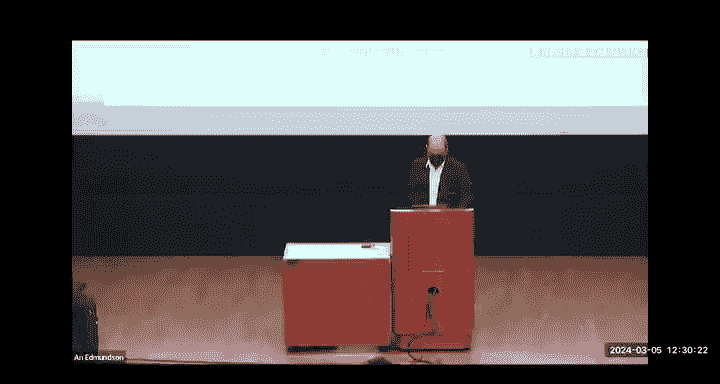
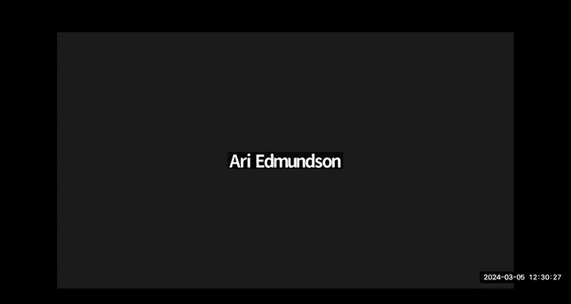

# UCB《数据100数据科学原理与技术｜Data 100 Principles and Techniques of Data Science 24SP》中英 - P15：-15-Data 100 Spring 2024 Lecture 15.zh_en - GPT中英字幕课程资源 - BV1Bc2dYCEbc

嗯。

Wonderful， welcome everyone， It is my pleasure to welcome Dr。 Edundson to our lecture today， Dr。

 Edmondson is a lecturer in faculty and data science undergraduate St and he guides the students through the complexity of data science with critical and ethical with ethicalical lens This lecture that you will hear is a great connection to the next two projects that you will see Project A one that will be released after me term this this weekend and also Project A2 the next phase of the project that you will see coming up two weeks from now。

 so thank you so much for joining us and welcome。😊，Thank you， thank you all right， well。

 thank you all for being here it's a pleasure to kind of get to come by and do this every semester。

is up okay I've been doing a version of this lecture for a few years now。

 kind of is in conjunction with the kind of first project that you have coming up。And this will be。

Yeah， I think screening of 2021 was the first time that's a few years now of iterating on this。

 developing it。 And the point of this lecture is to give you some context for doing your next project and helping you think about it and think about it in a way where you're not just doing toy problems and learning。

 you know， abstract concepts and how to manipulate them， but actually really thinking along the way。

 What does it actually mean to do the work I'm being asked to do because ultimately。

What it means to be a data scientist is to learn to do real things in the world。

 to make robust inferences and in particularly socially robust inferences。

 to do things to change the world。Not just to kind of accumulate abstract knowledge about it。

 So this project really represents a really great attempt for you to think through that and really get sensitive to all the different kinds of。

Complexities that go along with actually trying to design a real world system。

So your project is about something called the Cook County Asors Office and some work that it does。

 so today I'm going to tell you a little bit more about the story of this institution。

 Cook County Assessorss office I'll call it generally the CCAO for short and their open data initiative。

 which is the source of the data that you're going to be working with。

 as well as sort of the model of you know who's the kind of work that you're going to be in a sense trying to mirror in the project。

And it's a case study about the use of data science techniques to try to create predictions。

 predictions that are seen to be more accurate in the generic sense more minimize some kind of error that are uniform and in a simple but telling translation from this general sense of accuracy to create a more fair property assessment system。

So I'll tell you why that all matters many of you like what is property assessment。

 why does this matter to me， this seems really kind of distant and vague and administrative。

 but I try to give you a sense of the stakes of doing this work and why it ultimately matters。

So briefly， what this case study really about， you're looking and working with this data that parallels the work of this institution。

 the Cook County Assessor's office， it was this open data initiative was created in response to a particular social problem related to the function。

Of this institution。So you see here's an image of Cook County。 I've used that word for a while。

 you might be wondering what that is。 It basically means Chicago， the broader Chicago land area。

 So Chicago and some of its surrounding townships。And it's about the assessor's office。

A public institution， governmental office in Cook County that does something that most counties in most states in the United States have to do that is make estimates。

 they assess property values and do so at scale。 They try to assess how much a property is worth like a house or any building has some kind of value。

So residential buildings， commercial buildings， and do this every three years。

And they do this for the purpose of assessing taxation。That is how much in every state。

 you pay some amount of property tax。On your property。In California， those of you from here。

 this probably feels even a little more foreign because of something called Pro 13。

 where your property tax is actually based on its original sale price。

 So if your house was bought in the 1970s， you're paying taxes on a kind of very slight incremental increase from that sale price。

 But in most states in the US， your property tax is based on how much your property is assessed to be worth。

 everybody gets say。You know， in in a county or in a state， a flat tax rate。

 say everybody pays you know， 。08% of their property value every year in property tax and to know how much that is。

 you need them to make some kind of guess about how much the。Your home is worth。

 And unless you live in California， you can't or Oregon or a couple other states。

 you can't just use the last sale price because， of course， markets are changing constantly。

 You sold your house in the 1970s。You're not going to have a terribly reliable indicator of what the house is worth today。

So this is a great kind of， it's a data science problem through and through。

 You need to use data to make a prediction。What would your property have sold for if it sold this year？

And this is a massive operation。And ultimately， something data science is really well suited to do。

And it's been， in fact， a data intensive practice。Though refined over time and become more sophisticated。

 It's been a data intensive practice for for much of the last century。

Because it's a something that takes place at a massive scale in Cook County， there's nearly 900。

000 assessed properties residential and commercial in the last cycle that took place from 2018 to 2021。

 just now closing out the next cycle。Okay， so today。

What I'm going to do is examine the case study in three parts， really。

 the fourth part are going to be slides I leave you with at the end。

 but really break this apart for you today in three parts。

 we're going to look at what was the problem they were facing。

Both a problem that every assessor's office faces， but specifically the problem that Cook County assesssors' office faced when it created this open data initiative will look at how they tried to respond to it。

And we'll analyze it。 We'll walk through it really slowly together。

 We'll unpack things that you assume and take for granted and put a little pressure on them in ways that at first。

 you say， okay， maybe this feels a little obvious， but we're going to keep pushing down and say。

 okay， it's important to add this extra pressure。 the extra layers。

 Unveil these other layers of what's going on in trying to actually do this work that probably seems relatively straightforward。

And we'll close out by reviewing。 what are the kind of higher order takeaways。

 What does this actually mean， Why am I here doing this。

 Why are you in data 100 learning a bit about this and how can thinking in these ways。

About broader context and what's involved in creating a sort of predictive system that operates in the real world at scale。

 What are some takeaways you might have。Okay。So let's start with the problem。

The problem that prompted the formation of the open data initiative， like where this data came from。

 why it's all online， the whole pipeline is online， why the CCAO created it。

 why they made the data that you're working with accessible and tried to design a whole new pipeline in the first place。

 an appeal to data science both in practice and in kind of rhetoric。It starts， in some ways。

With a story。A story or a series of stories published by the Chicago Tribune and sort of the major newspaper in Illinois。

A 2017 investigative report。Which uncover a pretty big scandal in the property assessment system that was managed。

By the Cook County Assessor's office under the watch of its then current county assessor。

 a man named Joseph Barrios， somebody who's actually elected。

 It's a position in Cook County that you get elected to do。

To working with experts from the University of Chicago。

 journalists demonstrated the presence of systematic bias and corruption in the system。

That resulted in a highly regressive tax system whose burden fell disproportionately on lower income and black homeowners。

 So what does regressive mean here， just briefly， a regressive tax system is one where and any tax system。

 a regressive tax system is where the lower income individuals pay a disproportionate share。

 So even if you say it's supposed to be a flat tax rate， everybody pays 0。

1% of the value of their taxes， it means that in practice if it's regressive that those at the lower end of the scale pay a higher rate。

 they're paying， say0。12， by contrast to the wealthier residents who are paying a lower lower rate。

And this is a problem because well， for various reasons， but kind of the baseline。

 it's a problem because it's supposed to be flat， everybody's supposed to be paying the same rate。

 no matter how much their property is worth。How did this come about exactly。

 And a story tried to unpack this using actually quite a bit of data analysis and visualization to help kind of communicate to the public exactly what the problem was and try to point towards its origins。

嗯。They demonstrated with reference to some standard metrics of error used in the kind of assessment the industry。

That the system at scale was not just assessing properties inaccurately。In general。Just overall。

 you kind of all over the place。 But that its errors were clustered in particular ways。

 They had a certain structural tendencyency。The errors converted what was supposed to be a flat tax rate to an effectively regressive one。

 That meant that the reason why lower homeowners are paying a higher effective tax rate was because their homes were being over assessed。

Relative to what they were really valued。Where wealthy homeowners were being assessed at a lower were being under。

 their properties were being undervalued relative to the actual value， whatever actual value means。

 we'll come back to that。So what you see here are a few graphs on the right。

A graph illustrating over there the the regressivity of the effective property tax rate。With respect。

 not just to property values， that is， you know， the lower price， the lower value the home is。

 the higher the effective tax rate， but also because these things are correlated。

 the median income of the household。 Again， there's usually a close but not perfect relationship between household income and property value。

So you see that it's regressive with respect to income and not only to property value。Okay。

 some of this， by the way， in other words， what we're really getting at is the system was regressive because it distributed tax burdens unevenly and in a particular direction。

 placing disproportionate burden on lower income homeowners。

 those who are at least in some ways able to pay extra。

Now some of this change when you look at the dates。

 this is taken cross the part has something to do with the effects of the recession and the kind of housing prices rising after after the recession had bottomed out housing prices。

 but not solely because when you compare Cook County to other jurisdictions you wouldn't see the same drastic changes in these metrics。

 there was something else going on。Just to indicate the kind of social depth of these impacts。

 it wasn't just about income， but this mapped on racial inequalities。In Cook County。So another graph。

 this one from a lawsuit against the former assessor tried to demonstrate that the unfair burden was not just regressive based on income。

 but that it was may have been discriminatory in a legal sense。

 the burden fell disproportionately on Cook County's non-white homeowners as well。

 in part because Cook County is famously one of the most segregated counties in Chicago most segregated cities in the country where you do have sharp divisions in wealth that correspond to racial divisions。

So it's clear here that there was some sense of a problem。 The public was aware of the problem。

 They were upset about it。 They ended up voting burials out of office because of it。But ultimately。

 what caused it， what was behind this。Now， if you're a little bit familiar with generic kind of data ethics issues revolving around algorithms inequality。

 your first thought might to say， oh， the problem here was some biased algorithm。

But that's not actually the story here or not the main one。

 We're choosing something that's a little less straightforward and simple than， oh。

 it's an algorithm that wasn't properly tuned and it was biased， and it needs to be fixed。

It wasn't in the first instance， simply an issue of faulty and regressive models。

 although that played a role， simple models， you know， linear regression。

 which were used during Bar tenure tend， as it even says in the name to be regressive。

Errors tend to regress towards the mean， but in large part， because of the particular social。

 political and technical arrangement。Of the larger property assessment system。

 that is to understand the problem you have to think more broadly。 It's not purely technical。

 It's a sociotechnical issue。 One of the big takeaways of this lecture is learning to think socitechnically about the decisions you make when designing your models。

 doing your data science work。It was a system that ultimately enabled the wealthy and the privileged and actually corporations in particular。

 to more easily and successfully challenge。Their assessments。So what do I mean by this。

 So let's take a step back。 Here's the way everything works。 Every household， you know。

 you live in Cook County。Every three years， you get mailed。The county assess mails you for something。

 in an envelope， you open it， and it tells you。This is how much your house is worth。

 and this is how much you're going to pay。If you believe you look at that number and you think you've been overasse。

You can do something about it。 You can appeal that The primary way is you go to something called an appeals board。

 a review board。This's made up of itself elected government officials， you go in。

 you make your case and try to convince them that you've been overasseed and try to get them to lower it。

 and you need to bring in some kinds of sets of arguments。It's a。

 it's a kind of institutional mechanism that feels like it's the right kind of thing you ought to have in situations like this。

 It's a way of trying to build public confidence， public trust， accountability into the system。 Yeah。

 we're going to make errors at this scale， but you can correct them。 There's a person。

 There's a human in the loop。 It's not some purely impersonal。

 abstract algorithmic system putting these things out there。And a lot of your intuitions。

 if you think about， again， the kind of generic oceans of data ethics， tell you， okay。

 that sounds like a good thing to do。So you might be surprised to find out that it was actually in a large part。

Likely the appeals process that was the cause of so much of the problem。

There's a key lesson that we get from sociology。From legal studies in particular from critical race theory。

 critical legal theory and others。That seemingly neutral and impartial institutions。

To which everyone is supposed to have equal access。An equal treatment to these things under the law。

 right， This is the way anti discrimination law has come。

 discrimination law has come to be defined since the 1970s。That these formerly equal institutions。

Everybody takes the same test。 Everybody is subject to the same criteria。

 Everybody gets to go and make their case in practice， often obscure。Underlying inequalities。

 which they then， in part by obscuring them， continue to perpetuate。

This is true of formally impartial algorithms， so calledled colorblind algorithms that don't take a protected class attribute like race or gender into an effect。

 but can still perpetuate and encode them nevertheless。So why is that the case here？

Not every member of the public who gets an assessment actually has the same material capabilities to access this institution called the review board。

In theory， every homeowner， when you get， you go and contest your tax assessment every three years when your property is reassessed。

But this formal equality of access is not the same as equality of access and practice。

 because you need certain resources， real material resources in order to go do this。

 And that's something not everybody has。 One of those material resources is time。

The ability to take the time off to actually go and do this。 even more important in some ways。

 is money。Money that pays for tax lawyers who know the intricacies of the system， know the loopholes。

 know how to make the right arguments and have actually personal connections。

To members of the tax review board， many of whom get electoral donations from。

From the tax lawyer industry， who are there and willing to listen to the right tax lawyers who come and make their case。

Because Chicago does in fact， boast a large and thriving tax attorney industry dedicated precisely to helping people appeal their property assessments if they can afford to pay。

And this was reflected in a growing number of appeals in Cook County across the first decades of the 21st century。

 more and more appeals going up， and in consequence， wealthier。

 wider neighborhoods appealed more often and one reductions far more often than there are less wealthy neighbors。

 which is something you see described on these graphs here。 So in 2015 alone。

 residential property owners filed assessment appeals involving 370000。

Units winning reduction 80% of the time。So the Tribune'nes analysis pointed towards corruption。

 lack of transparency in the Cook County assesssor's office is the root of the problem。

 I mentioned these kind of close ties between the assessor。

 the review board and the tax lawyer industry， more than half of the assessor's campaign contributions。

Came from tax law firms。So there was clearly some issue of corruption。

Going on underneath the hood here。But one thing you notice that you're gonna to see again。

 when you work out in the tech space。Is kind of what we often call ethics washing。

 They adapted the language of community engagements， accountability。

Keeping human in the loop in order to give the system of ven near of fairness。

 which a lot of people bought into， this is something you see well see really consistently in all kinds of different facets of the world appealing to this ethical language to ultimatelyly mask practices that reinforce unequal and subordinating relationships。

So there's one little takeaway here which says be aware， don't be fooled by， you know。

 just emy appeals to what sounds like nice ethical rhetoric。

Sometimes you learn about human contacts and ethics。 You hear some nice words。

 You see somebody manipulating them clearly in the public discourse。 If you take away anything。

 it's be suspicious。Be cautious and careful around any time you see appeals to things that maybe on surface level seem intuitively plausible。

 ask， dig deeper what's motivating that， what are they what's ultimately lies beneath the surface。O。

To push a little deeper into the stakes of this， because again。

 I'm presenting a kind of formal picture of what happened。

 And I want to make sure that you have a sense of like， why this actually matters。

 There's real stakes to this。 It's not a kind of minor problem or an inconvenience。

 but like something much deeper。So part of this has to do with the structure of racial inequality in Cook County。

As the Tribune reported， many black。And Latinx homeowners purchased affordable houses one year。

 only to find that their house was appraised at levels far in excess of what they paid for just a year or two before。

 suddenly threatening them with the possibility of no longer being able to afford their home。

Being over assessed， depending on your situation in the world， can be catastrophic。

You can lose your house， have your house foreclosed on。

 have to sell it because you can no longer afford to make your mortgage payments because your tax rate is suddenly twice as high as it used to be。

You're suddenly responsible for paying thousands of dollars more every year than you had budgeted when you bought the house。

 This is a really big deal。 It might not be close to some of your lives， but it affects。

Patatrophically and existentially， thousands and thousands of people。

And this is not just a problem for any given individual who experiences this。

 It has effects on entire neighborhoods， because what happens when a house or say。

 a cluster of houses in a neighborhood are systematically overvalued。Or other properties。

 in I kind of say wealthy neighborhood are undervalued。

Because when the error rates are distributed so that the air skews positive。

 say for lower valued homes and skews negative or higher value homes。

 there's a few things that happen。You have to think of this in a broad。

 systemic perspective and not just in terms of any individual house。

Because what happens is that other similar properties。Theres those in the。

In the same neighborhood that have similar features are going to be more likely in the future to be overvalued themselves because they share some of those。

 you know by a model that's picking up on the fact that these homes share different features。

Those things are going to get more heavily weighted in the model than before。

 other homes are going to kind of feel that rising tide effect。

 getting more and more overvalued if you make， you know high errors on a handful of them。

The other reason here that's really important to kind of to think of this as a broad system。

Is that the amount of taxes。Is actually that set to be collected as fixed。 That is it's zero sum。

 And I'm explain this in a second。 It's zero sum in the sense that。If wealthy。

 expensive homes are actually undervalued。Even if you don't technically over assess the lower valued homes。

 they're still going to end up paying a larger share。 Why is that the case。

 Cook County basically sets out things this way。 They say we're going to collect this much in property taxes in the next cycle。

 Let's just pretend they say they're going to collect a billion dollars。

And then they use a property assessment basically to decide who pays what share of that。

So they try and estimate what is the total value of all the properties like each individual property and then you sum that up。

 and let's say it values all properties at $100 billion and then they say， okay。

 the fixed tax rate for this cycle is going to be a 1% tax on every property right to get 1 billion out of 100 billion。

So your tax burden isn't simply fixed based on your assessment。

 but is actually weighted relative to how much other people owe。

But the really complex system that's going on here。So if valuable houses are being undervalued。

 not only do they pay less， but those lower valued homes that are not even over assesseded still pay more than they would otherwise。

 because it's a zero sum amount that's being collected。O。Or as was the case。

 So that's something that happens。 The other piece of the story is that residential and commercial properties are partially assessed separately。

Commercial properties themselves were in particular， undervalued。

Because corporations have even greater access to fancy tax lawyers to help get their property values reduced。

And so residential properties as a whole ended up carrying a higher overall burden within the kind of general of residential and commercial properties。

So not only is this kind of on the face of it， who would say this sounds pretty unfair。

But the issue of what we might call justice goes even deeper than fairness。

 because part of what's happening is not just here's a one- time unfair unfair movement。

 but that there's accumulated harms。 There's a way that this feeds into and replicates much older patterns of racially discriminatory housing practices and the United States broadly。

 that especially in Chicago。 that is it's reinforcing existing trends in existing motors driving racial and socioeconomic inequality。

In some ways， it's not an accident that this took place in Chicago。

 I already mentioned that it's by many metrics， consistently one of the most。

Segregated cities in the United States。So before we look fully at how the Cook County assesssors' office mobilized the power of data to try to solve this problem。

 I'd like to take a little brief detour through the history of racist housing practices to give you a little bit of context to understand some of the stakes behind this。

 It's not a direct causal narrative that accounts for what happened。

 but it's a narrative that tells you a little bit about the background that this story plays out in。

Because housing and real estate， in fact， has been one of the most significant and enduring drivers of structural racism and racial inequality in the history of the United States since the Civil War。

So you might be familiar with the fact of segregationist policies in the United States in the early 20th century。

 in particular， in the Jim Crow South。That for example。

 forbid African Americans from utilizing the same facilities， public institutions。As whites。

 such as buses， bathrooms and pools。But this period was also a story about how neighborhoods。

 even in the urban north that didn't have these formal laws。on the books。

 became increasingly segregated through a set of overlapping and very much data driven private real estate practices and combined with government actors。

So segregation in the north increased across the first half of the 20th century as part of two waves of the kind of great migration of African Americans from the south to the urban centers of the north。

 and though it was illegal for governments in these areas to actively segregate neighborhoods according to race to zone them and say。

 only certain races can live in this area， the government couldn do that。

 there were other methods available for achieving the same ends。

And one of the most notorious practices has come to be known is redlining。

Drawing maps of cities that distinguish neighborhoods in terms of their relative riskiness。

The riskiness for defaulting on loans that you would need in order to buy a house。

So this kind of redlining was something performed by federal housing agencies during the Great Depression in the 1930s。

 which was actually about trying to create increased access to homeowner for low income Americans。

Or white Americans， at least。The areas of highest risk colored in red here。

 Hence the name redlining were deemed too risky for the federal government to ensure banks。

Issuing mortgages in those areas。And these neighborhoods tended to be disproportionately black。

 And part of the reason they were coded is red was because of that fact。

 It meant that credit was near impossible to come by for African Americans looking to own a house in those neighborhoods。

 The effects of these practices have continued to resonate today。To the origins of this practice。

In fact， the origins of the data that was behind drawing these maps lay in what's been called a racial data revolution in the private real estate industry。

Going back to the 1920s， In other words， segregation was established and reinforced。

 in part through a network of real estate agents who were very concerned with establishing reliable and objective methods for doing the very kind of thing we're asking you to do。

 Pre the value of a home when you don't know the actual market value。

Im sorry I did not throw those up。So this was part of the professionalization of an industry and part of the history of how real estate became data driven。

And it was， again， now accidentally pioneered very much in Chicago in the first half of the 20th century。

These were a group of men who aimed to standardize procedures for assessing property values。

To make them more objective， more precise， more accurate in a sense of less prone to error。

 they wanted property appraisal to be a kind of empirical and rigorous science。

Trustworthy because of that， guided by strict methods and principles。 So beginning in the 1920s。

 these burgeoning professional professionals largely in Chicago and other Midwest cities。

 began began creating manuals to train real estate assessors to become experts。

And they're using their right scientific methods to appraise property。

And they coded race directly into their step by programs。

 As you see in this table from one appraisal manual from 1937。 Basically。

 you see a set of these are types of things that constitute additions。You know， you can the site。

 the place where it is be can increase the value up to 15% and the things that constitute deductions。

 sorts of features that that will deduct the price by a certain quantity and they code it as you can see race and nationality directly。

 know， so immigration status directly into how they imagined how how to value a property are the neighbors。

 you know， depending on the kind of who are your racial or foreign neighbors that can deduct the value up to 60% they estimated。

So race simply put an immigration status was was viewed as a risk factor for property or for in a neighborhood。

And so even where race was not explicitly mentioned， appraisers created proxies that stood in for it。

 like obsolescence of a property or a neighborhood。

These standardized forms for valuing property and assessing risk directly inform the home loan practices of the Federal Housing Administration in the 1930s。

And that was part of the process， which increasingly confined African Americans。

To segregated and impoverished neighborhoods。And it contributed to an evolving and self reinforcing system of racial inequality and segregation that is still very much part of our world today。

Now， I want to make a really important note because sometimes students draw the wrong conclusion from this to the next part of the story I'm going to tell this background story is not directly responsible for the overassesment of a black homeowner's property that we see in Cook County today。

If you you kind of thought about redlining as devaluing property。

 then you would actually in some ways expect that being if the same data was being used and replicated。

 you would expect homes that have proxies， you know。

 neighborhoods that or proxies for race show up in your data。

 it would systematically undervalue those homes， not overvalue them。

So it's not because there's some racial proxies in the data that stem back to these practices that directly cause the problem we were looking at。

 It's really important to be clear about that。 But I do bring all this up to be clear that the point of this quick historical background is to explain。

How housing has housing has been a major vector of racial inequality。

Where homes are systematically undervalued or seen as risky on the one hand。

 restricting access to credit or being or overvalued and increasing the tax burden。

 you get caught between on the one hand。Our homes， you your homes may be systematically undervalued in the real marketplace。

 but when it comes to actually being assessed， they're being overasseed forcing you to pay a higher tax burden so you get hit in both directions。

Okay。That concludes the first part。Now we can move on to exactly how is data science and data practices sort of marshaled gathered in order to try to address this problem。

 use data to tell。This problem。And I'm going to walk through it and then try to talk about why it's actually more complex than it may appear at first glance。

So as a result of the story of just Ho， voters in Cook County elected a whole new county assessor named Fritz Kaagge with a mandate specifically to fix this problem。

 in part because what he promised to do was leverage data science to solve it， to create a new open。

 transparent office of data science。Create a whole open data initiative， right。

 This is pushing at this sense of corruption behind the scenes。

 We're going to make this transparent and open for the public。And at the heart of it。

 what we're going to do is not only we're going to create a more， more accurate。

 that is less error prone models and pipelines that issue these evaluations。

 but design a whole new pipeline and system to address the problems with the CCAO。

 that is we're going to fix。You know， not just the assessments that come out are going to be more accurate。

 but we're going to undermine the power of the tax board in doing so。So let's walk through this。

So what I'm going to do now is walk through how。This Cook County assesssorors office data Science department developed the solution by reconstructing and analyzing their path across the data science lifecycle that。

Have you touched on this and costs as the lifecycle showed up this semester， okay。

 so you've seen some version of the lifecycle before， so we're going to make reference to this。

 but we're going to put a lot of weight on asking the question and understanding the world in particular。

 being really precise about what exactly is the task before you。

 what are the challenges that you have to anticipate。And what's involved in understanding the world。

 what actually is the real impact of the numbers that you publish as a result of your system。

 thinking of it， not just as I've got the numbers and they're good。

 but what do those numbers mean and how do they do work into the world。

Because what I'm really asking you to do， you're following in in your project。

 following along with this TCAO is I'm asking you to situate your technical task。

To make predictions that achieve a certain metric。嗯。To situate that in a larger social context。

 you know what it actually means。To do well or not do well and what sorts of things to anticipate。

So you know what kinds of choices to make。And understand the implications and consequences of what you're actually doing。

Okay， so。Let's put you right here in the position of a data scientist。

You're working for the CCAO to build a new system。To replace an old unfair system。

And the way that the problem was framed already for you。

 say as a data scientist shapes the task that you have。In some ways。

 the problem was framed and presented by the Chicago Tribune story and framed again by the new county assessor。

 The idea is this。 The old system was unfair because at the end of the day， it was inaccurate。

 but drawing this equivalence。Between。Bairness。And accuracy。

I'm putting a little star next to the word accurate in some cases here。

 because there's a technical definition that you'll work with in this class of accuracy。

 which is only one of several different measures of error。

But the word accuracy is one that's used publicly by the assesssor's office for its general sense understood by the public。

 that accuracy means something about getting close， minimizing error。

And not the specific technical definition of accuracy， which is one way of assessing your error。

So when you see the little star next to accurately。

 you just know that what I'm referring to is not the technical definition of accuracy。

 but the larger generic everyday sense that public would have。Okay。

 so the idea is that the old system was inaccurate。 That's the problem。 It wasn't just wrong。

 but wrong in a particular way。It made errors for one kind of group。

And a different kind of air for another kind of group。And that is part of what matters here。

 So as they put it， the task was to create a robust pipeline that accurately assesses property values at scale and is fair。

I'm drawing your attention to accuracy stands in for fairness。

 That equation is what we're going to put a lot of pressure on in the remainder of today's lecture。

So the problem of making a system more fair， the social problem was framed in terms of a technical task appropriate to a data scientist。

To make a system more fair， what do you have to do make the assessments more accurate。

That more precisely， minimize errors and minimize them in a particular way。

So if the model is more accurate， the assumption is， it will perhaps necessarily be more fair。

That's a strong assumption， but it's one I think a lot of you probably enter into here。

The fact that these two things are being made equivalent is important in its telling。

It's an equation that's， by the way， not just given by nature。

 accuracy and fairness are not the same thing， but they're one that one that's one that these institutions are trying to make work。

To make too different to social problem of fairness。

And a technical problem of accuracy into one and the same problem。Okay。

So we're going to start with the technical part， the so called accuracy part。

 for really error minimization part。 for you， the data scientist。

 that's where you're gonna to feel most comfortable。Because you can really try to specify。

 what are your metrics of success。What does it mean to actually solve this technical problem and assume that it'll solve a social problem？

So it seems straightforward。The goal is to create a robust pipeline that accurately assesses property values at scale。

 So what does it mean to accurately assess property values and what role does the word scale play here。

So there's at least three interrelated questions， kind of underneath the hood。

 That seems like one question。 But I want to pick out three different components。

 be really precise about this。 The three questions that we need to be able to answer。

In order to clearly define our problem and be aware of where。Complexities might arise。

Even framing our question and problem will require us to think ahead in some ways about the entire life cycle。

 So the three questions are simply what is an assessment。

 You all probably at this point think you know what that means。

 I'll make it a little more complicated。 What is actually， it means to assess a home's value。

And what makes one assessment better in this case more accurate than another。

 Like assessment here is this assessment of this house versus a different kind of assessment。

 How do you evaluate if one is better than the other。

And then what makes a whole group of assessments。That is doing it at scale better or moreac than another。

We're going to work walk through this one step at a time。Okay， so the simple question。

 when it is an assessment， that's what we're going to start with。

We say an assessment is an estimate of the value of a home。Now we have to start with our terms。

 What do we mean by value here？The word value is means a lot of different things in everyday language。

 And， of course， I think you all know that I'm not talking about moral values。

The value of a home is not that it's accommodating or spacious that it feels like home， right。

 We're talking about economic values。 It's value in currency。 It's dollar value given to a home。

How do you know what actually determines what makes a home have the particular value that it has。Now。

 there are a lot of different ways you could imagine determining the economic value of a home。

 and in fact， there are a lot of different ways that are used in practice。

And have been used historically by say real estate assessors。

 you could simply try to use some arithmetic and say， here's what it's made of。

 here's the property size and the land， and just give fixed amounts to each of these different variables and add them up。

You can imagine in a different kind of social system that a state determines this is what the fair price for any home of a certain features are and says that this is what the value of a home is determined from above。

It could be that it's whatever a real estate expert that is。

 the value is what an expert says it is based on some combination of features that they have expertise about。

It could also be the value of a home is whatever a homeowner thinks their properties worth because of what they paid for it or what they know about the neighborhood and its properties。

You could certainly add to the list， but of course， this is not the precise number。

That a property assessor is aiming at。 There's a different kind of measure of a home's value。Which。

Is simply its market value。 This may seem obvious to you， But again。

 there's a choice being made here。 It's a choice that could be made differently。

 What you mean is the actual value of a home is whatever it actually sells for。

 what somebody is willing to pay and someone else is willing to sell it for on a marketplace。

And they refer specifically to arm lengths transactions。 That is。

 there are some market transactions that aren't technically market transactions because though somebody sells it to a friend for a lower lower value than it would have otherwise sold before。

 It wasn't really on the market。But it's properly arms length transactions。

 where there's certain assumptions about how the market is structured。

So what I want to point out to you here is you might be thinking， okay， that's a value。

 It's a fixed thing in the world。 It's just a natural thing， like the position of a star and the sky。

It's actually very much not like that。The market value of a home， the thing you're trying to predict。

 the supposed ground truth。That allows you to measure whether your assessment is accurate or not。

 the product of a momentary social interaction。It takes place at one moment in time。

A sort of interaction that's structured by a whole network of different kinds of perceptions。

 the different kinds of information。The desires， convenience， financial instruments available。

 whether there's， you know somebody's willing to pay with cash versus through a mortgage might influence whether somebody sells for a certain amount rather than another。

So this is a number that in some senses actually compared to what you might imagine as being a ground truth is relatively ephemeral。

It could be sold the next day for a different price so long as somebody is willing to pay that price or sell for that price。

 There's no simple， natural objective truth。About the value of a home outside of what actually it sells for at a simple moment in time。

 at least as far as the Cook County assesssor's office is concerned。So again， it's ephemeral。

 but I want to say it's not arbitrary。 It's not just made up， of course。

There's reasons for why it gets sold at the prices it does their patterns。

 It's not but on the other hand。There's no， it's not precisely determined at any moment in time。

So in an important way， you can say when a home is not actually sold。

 say it hasn't been sold in five years or even in one year。Its actual value is in an important sense。

 indeterminate。 Now， I use the way I use the word indeterminate for a reason。

 I'm not simply saying uncertain。Uncertain says I don't。 It has an objective value。

 but I simply don't know it right now。Indeterminate says it actually doesn't have a determinate value if it hasn't been sold in a。

 say， a long time。It's indeterminate because it has no fixed value outside of socially legitimized acts of valuing on a marketplace。

This is at the risk of complicating this more， if this makes it a little bit more clear。

 if you know anything， kind of a metaphorical extension of truisms from like quantum physics。

 it's more like measuring quantum phenomena like an electron。

 It's neither a wave nor a particle until it's measured。 It's indeterminate。

 It's not that you're simply uncertain about it， at least the Heisenberg interpretation。

 you're not simply uncertain。 it literally has not been resolved in determined into one or the other until you actually make the measurement。

 It's indeterminate。So a home is not actually a that does not have a determminant value。

 apart from the acts of measuring that take place at these moments of sale。Okay。

 I'm going to explain to you why all of this matters in a moment。

 why this long digression throughre thinking for it， like。

 what is the ground truth we're trying to predict actually can matter。 There's a reason。

So if you're trying to determine the price of a home。

 it's market value in order to assess its tax burden。The only way of relying with some like idea of。

 you know， you know， perfect accuracy， perfectly knowing is to actually sell the house。

That's the only way to say that， like I know for a fact what a home is worth is to sell it。

And so an estimate is only really accurately。 if you actually test your assessment by going and selling。

 selling the house at the moment that you make the prediction。And even then。

 it's only perfectly accurate at that moment in time。Unfortunately， that's not a great way。

To make estimates of property values。 You don't force people to actually sell their houses if you're a county assessor。

 you need to have a pretty good idea of what a propertys worth if you want owners to pay their fair share of taxes on it。

So as many properties haven't been sold in decades。

 every year that passes makes the previous sale even less reliable as an indicator。

It even becomes ever more indeterminate as time passes。 So you need to make estimates。

So as data scientist， you know where I'm heading with this。

 You're thinking well with the right data about homes。

And we have enough sales data on other homes that are similar enough。

You can probably predict the value of a property that hasn't sold in data pretty reliably。

And even if you're not a data scientist， you know there are websites out there like Zillow and Redfin that do this all the time。

 You go say how much is my parents' house worth and you go and look it up。

 and it says a number and you kind of take that as some truth。

 but it's an estimate based on lots and lots of data about qualities of homes。

 attributes and sales data of other homes。So。How do you think they do this。

 So we'll move on to talk about the data for a moment。 We have a sense of what they're trying to do。

 what the scope is， what the problem is， how they're trying to make accuracy。

 getting close to this true ground truth， which is actually a little bit ephemeral。

By building a model， starting with the data。 So let's move to the next step of the life cycle。

To look at data acquisition， What data do we have， What data do we need。

 How will we sample more data I our data representative of the population we want to study。

So let's talk about the data we have。 This CCA O and you doing your project have a lot of data。

 two data sets in particular。You have property characteristics on the one hand。

 and sales data on the other on all homes in the county。Now。

 or at least recent sales data on all homes that have sold recently in Cook County。So。

You don't have to be a data scientist to think this way， right every day。

 homeowners do it all the time。 You live on a street of identical homes and your neighbor sells their house for $500000。

 Pretty safe bet that if your houses are really all the same。

 yours would also sell for about that much。But what happens if your house is maybe a little larger？

You've done some remodeling。 There's extra features。

 Maybe you see another house down the street that's a little larger than yours。

 and it has an extra bathroom， and it sells for 700000。

 Maybe your house is somewhere in between 500 and 700。 You have a rough sense of this。

The county assessors have a lot more data to work with。 They have things on square feet。

 number of bathrooms on every home， the number of rooms。

 what types of rooms that they have fireplaces or garages， what kind of garage if it's attached。

 if they have an attic if they have air condition thing， etctera。

And all that data makes it possible to create a model。To predict sale price。

 to predict these so-called fair market value of those properties that haven't been sold by looking for patterns in the data set containing known sales prices and figuring out which characteristics of the nearby properties are relatively predictive。

 When you train a model in this data。 This is something you're all going to be doing and apply it to all the properties about which you don't have any sales data。

Now， a crucial feature of doing this kind of work is not simply to take it as given that you have all the data that you need to have part of the data。

 you know， acquisition stage。Is actually to figure out。

 is are there kinds of data that might be useful that I don't have。And how else might we get it？嗯。

There's whole new categories that get， get sort of discovered or have been invented since the kind of the new assessor' office came about in order to recognize that there were some things like living in a floodplain or near an airport that would have a really big impact potentially。

 and they had no data on。And so it's really crucial because you might think the distribution of quality data as well might not actually be consistent。

 What does it take to get the right kind of data， How do you track improvements on houses if people have been remodeling。

How might the attributes be differentially reported based on location。Okay。

 so there's a lot of work that you and you're not doing this in the homework。

 but I want to point to any time you're doing work like this。

 Don't just take program granted that you can do whatever what you have with the data and actually figure out。

 as the assesssor's office did， how do we actually get more and better data from what sources and how do we leverage it。

So really crucial to always remember， figure out what are other kinds of data sources。

 What do we have to do to actually maybe leverage state resources to go collect more。

And then you move on and start trying to figure out。You do a little exploratory data analysis。

Etra engineering。What exactly is going to matter here。

 which attributes are going to be most predictive of sales price。And you discover some things that。

Some features， their predictive value might actually vary with other variables。 So， for example。

 the value of an extra bedroom actually might not be consistent at be be predictive when it's not tethered to say。

 location or the overall size of the house。But it suggests that in part。

 different models might need to be used on different neighborhoods and townships。

 which is something that assesssor's office also tried out。Indeed。

 they found that location was the largest driver of countywide variation and property value above everything else。

 and that location would impact how other features ought to get weighted。

But you also look for other things， are there data points that are misleaded？

Or do they bias the model。Do all neighborhoods have the same quality of data。 If not。

 how can this be rectified。 Sometimes you realize at this stage， oh。

 there's something there's problems。 Our data is actually not as reliable if you think we go back to a prior stage to get some more。

Okay， and then figure out if you have enough to move on to the next stage of actually creating your model and drawing inferences about the world that is making your predictions in numbers about closing prices。

So we've jumped forward to that stage， making predictions， making inferences about the world。

We're trying to figure out how to decide whether our model is accurate， a star。

 how accurate and what we mean by accurate， such that making the model accurate。

 we hope also means that it will become more fair。All right。So how do we know that our estimate。

How do we know that for any given number that comes out of our model， it's predictive。

 How do we know。And what does it mean to say that it is accurate， again。

 accurate in a generic sense of close。You hold out a test data set， of course。

You see how your model performs predicting the sales price of properties that it was not trained on。

And then you evaluate how close。Your estimate was to the actual sales price。Making sure， of course。

 not to overfit your model。 These are all things you're going to be doing in your project。

Then you go back and you say， okay， I can predict the price of any individual house。

Anyone house that has not been sold recently。And I can say that it's accurate because my model produces values。

That are pretty close。To that real sales data about other houses most of the time。

The quantitative measure of this closeness in other cases， that is for the， you know。

 you have all the sales data that you didn't use to train your model。 And when you predict。

 you can say， oh， it was this off by this this much， right。

And so for a house that hasn't been sold yet， you have to sort of carry over。

That sense of that measure of accuracy。Over to assessing。

The quality of your model with respect to properties that have not been sold。

 and of which you can't actually judge for sure if you're close or not until it actually gets sold itself。

So the qualitative measure of this closeness， right， in other cases。

 gives me confidence that any one prediction。Even if I don't have something to verify。

 it will also likely be close， even though you don't and can't know its certainty unless the House sells right after you make the prediction。

To putut this slightly differently， my confidence that I'm estimating the value of any individual house that hasn't been sold recently accurately depends entirely on my on the metric I've used to assess the accuracy of my model when used at scale。

 There's an interesting kind of。Inferential leap that you have to make there and that all of this rests on。

 And it's really， it's crucial in any kind of statistical inference that you're doing。

So how do we know if an assessment at scale， a mass appraisal is actually close。

 How close counts as close enough， and what do we even mean by close。

So that's one of the really interesting problems that you'll be thinking through and working through on your project。

Because we get into some difficulties。 As many of you already know。

 there's a lot of different ways to evaluate the error。And reliability of your model。

 different ways of measuring it and how it's distributed， where it shows up and in which direction。

 And each of them have different consequences。For how you translate those errors into something the social thing we call fairness。

So one way of approaching this， and this is what you're going to do on this project because it's relatively straightforward。

 and it's a common measure， of error for a linear model。Is root mean squared error。

 So you're going to be doing that and using it to actually assess the quality of your own model in the project。

But I want to say RMSE has limits， too。We'll ask you to think about this a little bit and how much this matters to you and how this relates to your intuitions about fairness。

RMSE does not tell you where， where the error takes place across， say， the different。

A scales of property values。 It doesn't tell you how the error is distributed。

It doesn't tell you whether the error at any given place is positive that is overestimating or underestimateestd negative。

It just gives you a rough measure of your model's overall error。

 which can be useful in a lot of cases。So when we're concerned about fairness。

 I want you to consider whether or not a low RMSE is ultimately sufficient。

If the error that does exist overvalues less expensive homes and undervalues more expensive homes。

 but its a relatively small error， is that good enough。But there's what I do want to point out。

 however， one way or another is。RMSE does not really tell you because of these aspects about regressivity。

So what do you actually do， given that kind of fact， Now， I've made it。

 made it a little bit easier for you。 You don't have to decide。

Which metric of error to use in order to evaluate your model。

 There's an expert body out there that is tried to figure this out。

 And despite a long history of internal conflict and contestation about it。This international body。

 the International Association of Assessment Officer。

 has come up with a few metrics that they think are the things that actually matter for measuring the accuracy and the report fairness of property assessments。

That help you say what counts is close for model estimating property values at scale。

And then this gives you the suggestion that all you have to do is really plug and play。

 How do we best meet those standards， not to say that that's easy。

 It's still a really difficult problem， but at least tells you you think， okay。

 you've solved the problem for me， I don't have to worry about making difficult decisions about what close means。

 I just have to try to optimize for these metrics。 I have to try to minimize these other kinds of measures of error。

 That is how it's distributed。So most of the time， I think the default expectation of a lot of data scientists is to say if there are professional standards。

 you just default to them。And maybe that's often for the best。

 You don't want to reinvent the wheel every time you come to do some new project。

But I want you to be cognizant of the fact。 again， kind of like I was tried to denaturalize the ground truth of property values for you a moment ago。

 also denaturalize kind of black boxed expert standards。 Re that they were made for reasons。

That they kind of weighed different trade offs， they've kind of decided on something and that there might be limitations to the that that deserve being re thought。

These metrics are not， again， simple natural facts about fairness in the world。

 So just as another example of this that might be familiar to you from like data to Aids。

Like when you learn about key values and learn about statistical significance testing and you hear about these thresholds of。

 you know， key value of 5%。You actually learned that the actual number is， for the most part。

 made up。 It's not entirely arbitrary， but it could very easily be a completely different number。

 And then it's black boxed。 And a lot of people just go and Phack taking sort of this is the fixed threshold without really thinking about what does this mean in practice in a particular situation。

 And that's something that you've all been encouraged to think more critically and contextually about。

So it's the same kind of thing here。But again， it's not that these standards are arbitrary。

 They're the products of a history of expert agreements。

 Exp that have particular values and priorities that get encoded into these metrics。

 but they could be otherwise， And there could be good reasons to make them differently。

 So stay open minded about what exactly is the social world that we're trying to get at here and are the metrics that are given to me the ones that actually。

Feel like they align with my own sounds of what's best for the world。

Because are these sorts of things coefficient of dispersion， price related differential。

Are these things that have， you know， acceptable range thresholds。

 Are these the most fair metrics of accuracy。Maybe they are。 maybe not。

Let me just run the thought experiment by you。 You could determine that any errors。

Any kind of error is only permissible。 You can only air it all。If the error is progressive。

That is that you'd prefer or only choose a model。That is slightly more inaccurate overall。

 according to say RMSE。But you trade off that overall inaccuracy。

Say to ensure that the errors the errors that do take place for the bottom。

 you half or even the bottom quartile usually reduce or always reduce rather than increase their tax burden。

What I'm pointing out here is this is a political and ethical kind of decision to set these standards。

 These standards say it's acceptable to be regressive up to a certain amount。

Just it can't be too regressive。 What I want to suggest to you is that it's thinkable to imagine different standards that say no amount of regressivity is acceptable and design a model that even if it's a little bit more inaccurate。

 even if therefore the you know， the reliability of the model overall is off if anybody gets harmed by it。

 it's not going to be the lowest， the lowest income homeowners and there are ethical and political reasons。

 you might think and feel that way。But they're black boxed away by these standards。Fairness。

 in a sense， always can mean more than is captured by any one definition or any one metric。

 the politically and ethically contested notion。And this matters because the metric you choose influences what kind of model。

 what kind of pipeline that you build in order to optimize for what you actually think matters。

His different models。Will try to minimize different measures of error。

So you have some hard choices about what to do， depending on how you evaluate the trade offs at work。

Okay。One way of also thinking about this， there's something that the Cook County I mentioned earlier。

 the Cook County Asor's office。Had toyed with creating a model stack where they would have like。

 you know， five different kinds of models。 they would run on every township。

 And they would see which one was ultimately most accurate for each given township。

 And then use that model。 What that meant is that you were technically， in a sense。

 being assessed by a different model， depending on the township that you lived under。

 And if one of your definitions of fairness is that you're actually being treated， you know。

 like equivalently。That is you're being assessed in exactly the same way。 Well。

 then that might violate some of your intuitions about fairness because there's a different model being used on your neighbors in that township than are being used on you。

 even though maybe it coheres with your sense of accuracy is fairness that the overall accuracy of of the model is what really matters。

 Again， there's a choice there。 There's a trade off there。

 and different public perceptions of which one's more fair is going to have some impact on the work that you do。

Okay。So I want to take a quick poll just to actually get。A sense of。Your intuitions。

This is a poll that doesn't have right answers just because ultimately this is a political and ethical question。

嗯。Is it I no， it't doesn't show up here， but it should show up。Okay。

 so you can see that the options on your end， which sadly， I actually。

 I thought they would show up here。 I don't have available me。 but I've given you a few different。

Opts to think through which of the following best captures your intuition about the meaning of fairness in this context。

 And I've sort of given you a handful of options。That it correspond to some of the scenarios that I just mentioned where you get a sense of some different trade offs where it asks you to think about what are my priorities when I think about what a fair tax system is。

Which one of these models。Coherence with what I actually kind of think ought to be fair。So again。

 I don't have them right here to read off of， but does anybody want to share why they voted the way that they did and explain their reasoning a little bit how they thought about the question and the problem？

Yes。Okay， so you chose the one that says minimizes regressivity。

 even if it comes at the cost of overall kind of like RMSE type error。

 because there's a sense that like what you're trying to think through is who's ultimately like where is the harm that's happening and if you're wealthy。

 you can probably manage being over assesseded a little bit or being inaccurate versus like what matters to you is making sure the most vulnerable aren't harmed further because the harm means more okay。

嗯。Anyone else。对啊。Mmhm。Yeah， so isn't the idea that you you're。

 you're looking for a flat tax rate right is what you're saying。 Yeah， Yeah。

 the last graph didn't didn't quite show that。 that was sort of about like how error is distributed。

 But， but yeah， I mean， that that's So those are two different intuitions。 one。

 one would say the rate ought to be as close to flat as possible。

But one interpretation of that is that like as flat close to flat as possible could still be slightly regressive in order to make it progressive。

 you'd actually have to make it less flat。So those are two different options。

 And that's why's like there's trade offs between us to say。

 like I want to do you prioritize flatness， equal treatment， or do you prioritize thinking about the。

 you know， the particular impacts on which people。The different schemes might have。Okay， don't worry。

' there's a lot of them， okay。对呀。Okay， so 50， the majority of you are say actually the best version of this is has the lowest RMSE。

 even if that means that it's regress， Okay， but it means that we're saying， okay。

 we feel that it's actually the overall closest RMSE is what matters to the largest number of you。

 okay。That's instructive。 Good to know that that's the background。 Not。

 not what the people speaking up said， but overall， that's the direction that you you've leaned。

 Okay， let's move towards closing this out。 So we've now sort of defined a few things。

 We've defined a meaning of an assessment， the meaning of accuracy for an individual property and the meaning of accuracy at scale。

To say that any given individual assessment is accurate， again with a star。

 accurate close means that it is conferred to value by a model based upon its relationship to every other home in the county or township and their relationship to the larger housing market。

Any given assessment to the single property could be judged accurate only because the model can be mathematically demonstrated。

To fulfill some criteria of accuracy or error minimization。

 some loss function with respect to other properties。

Because of all that it shares with those properties， we say that for any individual house。

 its value can only be estimated in light of those relationships。 It's relational。In other words。

 accuracy for an individual property assessment。Because of these relationships actually depends on a kind of to accept。

 say the accuracy， to accept that this house that has not been sold in 30 years。

 that the assessment of it is accurate requires a kind of trust。

There's a social element of trust involved here that the accuracy demonstrated at scale。 Okay。

 the overall RMSC， let's say， is low。 So I think based on that。

 I make the inference that for this individual caves。It's pretty likely that it's pretty close。

 And that's why maybe you feel like overall aacies are really way of demonstrating it to try to gain trust。

In this sense， we say that the value of a home in this way is relational。

 It's a product of an interaction of social and technical elements。

 you need to think about it in terms of like， there's a socio technicalchical performance of creating。

 naming the value and at the heart of it in part is an element of social trust。

 It's not a purely formal mathematical operation。It involves getting people to trust that these assessments are accurate based on how they perceive your own metrics of accuracy。

So this is crucial。 Why is this crucial， Because it's not hard to imagine somebody noticing this gap。

 Yeah， you've told me。That your model is accurate at scale。Your model is usually close。

 You told me you could give me this number that says， yes。

 it's close for most of the properties that have recent sales data。

But it's not hard for an individual say， but I think it made a big mistake on mine。

Rve to me that there isn't something about my property。

 something about my neighborhood that your model didn't capture。

 even though you've done a really good job minimizing RMSE。Prove to me that the numberers。

 which you clean show that you correctly estimate that some set of home sales prices this year have some bearing on my one individual property whose value roll call is actually indeterminate。

And if it has any more determinacy， it's only with respect to this model。But why？

You can make some powerful statistical arguments about why it should hold。 You know， you can use。

 you know， alert talk about everything you've learned in your data science education to say this is the best possible I have this kind of confidence that I'm right。

That your procedures have been robust。But there's always going to be some kind of gap。Because， again。

 it's because the value is ultimately indeterminate。

 always the possibility that something doesn't add up or is perceived。

By who's being by the whoever's being assessed doesn't add up。

The point is that there is this translation。 There's an equation。

A social equation that has to take place to make all this work。A translation from a measure。

Of error at scale on a whole set of assessments。To the assumption that the assessment for the individual property is accurate and therefore trustworthy。

 and there's nothing about， say， human reason or sociality that forces requires us with necessity to take that leap。

It's about persuading people to accept the legitimacy and fairness of the assessment you get in the mail。

 There's an element of rhetoric。Of public presentation。Kind of cross that gap。

To make what's ultimately indeterminate and relational feel more stable and trustworthy。

What's the point of me saying all this， It's not because I want to undermine your confidence and statistical predictions。

 Quite the opposite。What I'm trying to point to is that making your inferences not just robust。

 according to good you know， statistical best practices。

 but socially robust inferences about the world。That is inferences that do work in the world and engender trust in them。

Involves other kinds of work。It involves understanding the work that those numbers that you produce do in the world once they're released。

 as well as the other kinds of work， the social work， the rhetoric。

 the persuasion that's involved to help the numbers that you create do that work。Again， the point is。

 again， not sowing doubt， but rather thinking about how might doubt creep up for others。

 How am I putting numbers into the world that actually fix the problem that's at hand。

Numbers don't do work by themselves。 They do work because they're kinds of social meanings。

That get attached to them。 And that means that they don't mean the same thing to everyone。

 Trust is at the heart of all this。Why and when do we trust in numbers and statistical arguments or not。

And if you don't simply trust in the predictive， you know， in in， say。

 the metric that you've used to assess your model， then you might consider pushing back。

 You might go to the review board。That's where all this was headed。

This is where the review board comes in and can really throw things no matter how well you've optimized your model。

 the existence of the review board in some ways plays on this indeterminacy。

 It's always there that you're trying to bridge over。Someone says， okay。

 sure your model' is really close for most properties， but I think it made a big mistake on mine。

 Pro to me there isn't something about mine property Min the neighborhood that it was not captured。

Prove to me that these numbers。Has some bearing on my property。

 This is the kind of argument made before a tax board， a review board。

 and sometimes more or less persuasively。And it might be one small part of why the system so far hasn't been as effective in practice as promised。

 this stuff was all happening in the late 2010s。And the new。

Cook County assessssessorss office has been up and running now for a few years and has has some data on how well it's actually been doing。

And in fact， there's been stories about this。It may be naive to simply hope that the outputs of an algorithm that are more accurate according to some set of metrics and that are transparent to the public will simply translate into more fair outcomes and practice in social reality。

So for the sake of argument， let's pretend that your model is perfectly optimized for some， you know。

 some metric that satisfies our intuitions about what fairness should mean。

There's no guarantee that the printing of these numbers will actually result in people in reality。

 paying what they were assessed。It may be a step， it may be a really important ingredient。

 It may be part of an ingredient of as the assesssor's office was trying to do engender social trust in the institution by publicly and transparently performing。

 look at our data， look at our work， we can prove to you and to journalists and others that what we're doing is all aboveboard and as close as possible and the idea is that by doing that。

They could undermine the power of the tax review board。

 They could raise the bar for challenging assessments。 That was the idea。

 And I talked to the Cook County assessor， like chief data scientist about this。 And the idea was。

 if you can prove statistically that you're more accurate。

 it's going to be harder for wealthy people to challenge their assessments。

Before the tax review board， because we're going to have the better statistical arguments than these tax lawyers who kind of said these are dumb guys。

 They actually don't know much。 and they're going to take a long time to figure out how to find other loopholes。

That was the whole idea。 That was the kind of sociotechical assumptions about how to actually undercut this institution by creating more accurate assessments。

But all of this， the fact that numbers are not irresistibly compelling。

But because they actually operate on some background of social trust to do their work might be part of the reason why。

 despite their best efforts， the CCO is still struggling。

To create fair assessments and engender trust。 And here's just a series of news stories that have sort of spoken to this fact。

 storiesies like the one on right where total taxes for residential properties actually went up because after this new system came online。

 commercial taxes went down。And the Cook County assessssessor's office actually once again blamed the review board。

We basically being persuaded by。Corporate tax lawyers。

Who were able to reduce their reduce the assessments。

 despite the existence of this accurate and reliable pipeline。

They also pointed that you might also look at actually the distribution of how things have changed。

 since then， if you know Chicago， then you know that the biggest increases。IfYou you look here。

 like yellow is where values went up。Kind the blue is where it went down。

If you know that then you actually see that the biggest increases did occur in wealthy neighborhoods。

The biggest decreases in poor， predominantly black neighborhoods， which actually this map， in part。

 although it says that overall property value overall in Cook County for residents went up。

It went down for some people。 and in part the kind of the part of South Chicago that is most heavily African American。

 So maybe there have been actually some positive results here。In part。Okay。So anyways。

 the point is is that the mistakes are still seen， they're still seen as mistakes by the public。

 they're not convincing enough， it's undermining trust in the CCAO。

 even though it's done sort of pretty high quality data science work because there are still big and frustrating mistakes。

 some of it is about the data in the story on the left here it goes through cases you know individual cases where spotty data may have been the culprit for why some individual assessments were so wildly offboard from just kind of the eye test。

A homeowner seeing this and being like， wait， this cannot possibly be true and then kind of doing and digging and figuring out。

 oh， yeah， their data on my property is just completely wrong。

Some of it is that all this data just hasn't fixed the problem of the tax review board as they promised。

 that this easy equation of accuracy equals fairness。Actually。

 is a much harder equation to draw than it may seem at first glance。Okay。

 let's wrap up with a few quick key takeaways about all of this。

The first overarching takeaway is that accuracy star， again， standing in for minimizing。

 you know error of your predictive model， isn't necessary。

 It's hard to imagine that some measure of error isn't an absolutely necessary part of creating a system that makes fair predictions。

I think there's ways of imagining it。 But let's put it as conditionally necessary。

 but it's not as sufficient condition as a fair system。

 You can't assume it's simply optimizing for some metric that you call in a。

dA non technical sense accurate is actually going to make your system fair because it's not just a technical thing。

Fairness is about more than an accurate system。 So you have to be careful about how you draw that equivalence between fairness and accuracy。

Number 2。Fairness and transparency。As we've seen our context dependent。

 there's no abstract universal definition of what it means for something to be fair or transparent。

 We haven't said a lot about transparency， But that's another firm you can put some weight on that the CCAO uses in their solution。

The new system created a change in the way the CCAO office worked It affected the very meaning of fairness。

 For example， it decreased reliance on manual adjustments by human assessors and increased the need to trust the computing model。

 right So there is other shifts that are important to pay attention to。

 exactly what is the work you know what kinds of entities is people versus models is trust actually supposed to be invested in。

 It changed the process and resources necessary to appeal。 and in some ways。

 change the meaning of the appeal in the process。It's not just a question of how accurate it outputs。

 according to various metrics， but how does the system shift power。

 How does it shift money and other resources， And that's thinking more socitechnically about a system that you're building and not simply optimizing for a metric。

Other questions about fairness we've seen is a neutral tax policy， a flat rate really fair。

 Many of you said yes， and the closest you get to that。 That's what fair really is。嗯。

But there's other levels of fairness， I would say， that have been sort of hidden by a fixation on accuracy that might be really important to pay attention to。

 And I think actually your kind of comment about why you know you chose minimizing reggressivity might get to this。

If you're just simply picking a metric and optimizing for it， you sometimes lose， what does it mean。

 the experience of being over under assesseded is simply different depending on who you are and where you follow into distribution。

 A wealthy homeowner being over assesseded even by a large amount is more likely to be an inconvenience for a lower income homeowner。

 It's much more likely to experience it as catastrophic。Because you might lose your home。

 but the numbers don't tell you that alone。Optimizing for you know。

 minimizing error is not enough if you don't consider the actual social effects in armss from the perspectives of those who encounter them。

Also misses the cumulative effects。 how this fits into a larger structure of oppression and discrimination that can add up over time。

 This just tells you one discrete moment。 Is it a fair， unfair， This assessment。

 But fairness is not something that just happens at a discrete moment。

 It kind of but is about how are you treated across the course of time。

 How do the effects accumulate， How can they get compounded over time。

So those are really crucial dimensions。Let's see for the sake of time。

 let's run through the next two。 Next， simply learn to work with contexts and consequences。

Understand historical context。 understand the history and structural you know。

 forms of oppression or racism that form the background against which this unfolds。

Understand the consequences of how your data intervention does or maybe doesn't reshape the dynamics of the situation。

 no matter how good your technical work is。Okay， and finally。

Keep in mind the power and limits of data analysis。 Is it always the right tool to a hammer。

 everything can look like a nail， The larger the kind of tool kit that you bring with you to actually solve social problems。

 Data science tools being one of many tools， the greater actual kind of positive。

And responsible impact that you can have。And so that might mean not just assuming that putting。

The mathematically correct numbers into the world magically reshapes the world in their image。

The numbers do work， but exactly what work they do。Involve social dynamics that go beyond。

Just the robustness of your inferences。Okay， with that， I'll conclude。 Thank you very much。

