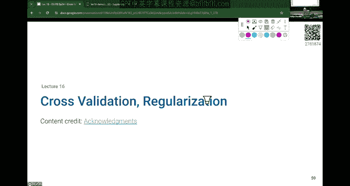

# UCB《数据100数据科学原理与技术｜Data 100 Principles and Techniques of Data Science 24SP》中英 - P16：-16-Data 100 Spring 2024 Lecture 16.zh_en - GPT中英字幕课程资源 - BV1Bc2dYCEbc

哎。啊。Good morning， everyone。All right， can you hear me all right I think the class is fine if people on zoom can also let us know if you can hear us right there were some sound issues in the previous recording so we're just monitoring that as well。

So welcome to another data 100 lecture。This is our first lecture after the midterm we are still grading your midterms and we should be able to release grades later this week so it is still in progress so there's going to be more information coming your way through Ed and some emails that will'll be sending you later this week Gr project is also released so for those who are enrolled in 200200 S200 a please make sure that you check the announcement about Gr project and get us started on that as soon as possible because the group formation and the project proposal is due this Friday there is a very short turnaround time because we just want you to be able to form teams and let us know if you have issues and you need help in forming groups and finding partners for your groups as well so let's dive right into things this is our lecture 16 we cancel the previous lecture so we skip that lecture number in there and today。

We're going to talk about crossvalid and regularization so specifically this lecture is divided into two different pieces so in the first half of the lecture I'm going to talk about cross validation and the idea that during the training process we might need to have different segments of the data to do different things to do training or to do some kind of validation and to test the performance of the model on some kind of data set that we'll treat it as unseen data that we have in the second half of the lecture I'm going to talk a little bit about how to control model complexity and in terms of kind of motivating what I meant by having different segments in the data I want to start by talking about the two kind of lingering questions that we had in lecture 14 remember in lecture 14 it was a feature engineering lecture it sounds like a long time that we had that lecture but technically those two lingering questions where。

I that we kept saying that there is unseen data that we need to make sure that our model is performing comparably well on the unseen data as well as a good performance on the training data but today we're going to take a look at what do we mean by that and how can we simulate some set of data points that we can treat that set of data points as unseen data sets in our training pipeline the second part of or the second question that we started kind of discussing but we didn't entirely answer it was the idea of the model complexity in the model complexity issue we were saying that if we keep adding features and if we keep decreasing increasing the complexity of the model then there is the issue that the training error is going to decrease but then the variance is going to increase so we wanted to find out what is the Swish spot at the point that the model is not underfitting it's not。

Overfitting so we can kind of have a sense of whether the model is going to have a good performance or generalizability capability on the set of unseen data points that it has not observed before。

So the first half of the lecture， the first 30 second。

 I'm going to basically talk about how we're going to measure models' effectiveness or model performance on the unssteineen data and what I mean by that and then in the next part I'm going to talk about how to find this exact sweet the spot in the middle ver we have a reasonable performance and the training data。

 but it still the model variance is not as high。So that's where we're going to talk about cross validation。

 how to evaluate models performance using different segments of the data in our data that we're creating ourselves and then the second half is called regularization。

 which is the idea of how can we regularize or control the model complexity so that the model is not overfitting to the training data and is not going to exponentially get complex and fit exactly to the pattern of the training data without any generalizability to the Einstein data that it can observe。

This was a nice plot in the future engineering lecture and this is kind of motivating why we keep talking about unseen data If I were to give you only five data points and I would tell you that okay go ahead and use these five data points in order to fit a model and I' say for example this is a polynomial function that we or a polynomial model that we're fitting with like degree of four or five we saw that if we keep increasing the model complexity at a certain point。

 the model is going to be able to fit exactly to the data that we have。

 So in this case the error of the model is going to be close to zero a minus error is going to be exactly equal to zero because the model is exactly passing for all of the data points and matching all of those values but if this sample of five data points was a sample of a larger distribution and you see on the right the original distribution of the data So in that case you're seeing that the model that we came up with using。

Those five data points is not generalizing to the pattern of the entire data and in fact the data set itself is some form of an exponential function that we're not capturing with this red plot or this red model that we created so this is why we always need to think about what is the performance and the training data and at the same time what is the performance and unseen data set so that what was the original underlying distribution of this training data that we want to make sure that any sample that we give me later that matches a distribution of the data that is underlying into my entire data set I'm going to be able to have a comparable performance there as well。

So in order for us to be able to talk about model models performance on unseen data。

 we'll use some kind of a trick and we'll say that since we don't have access to unseen data and we don't know what kind of data is going to come our way later on what if I go ahead and segment my data set into two portions one portion be training data that we we'll use in order to fit the data and do model selection and all of those things and then we'll use another segment we don't touch it at all and we basically use it as a test set and well measure the model performance on the kind of pseudo unseen data set using this test set that we have which is kind of helping us to have some measurable performance of the model on unseen data in our case so let's talk a little bit about more let's talk more about this test set so this test set that we're creating is nothing but a portion of our original data set when we give you a data。

For modeling， you will segment it into two portions。

 one training data that you'll use in order to fit the model and then you will use the test data whenever your model is ready and whenever you want to test the performance of the model and the unseen dataset set One thing that I want to note here is that we should only touch the state this test data only once and the reason that we only touch it once is because we don't want to go back to the modeling process by using any information that we learned on the test data because otherwise our test data is not going to be the unseen data set that we wanted it to be and technically the model is going to see it in some way so that's why it's going to be only evaluated only once and there is no notion or feedback from the performance of the model and the test data that can go back to the modeling process。

 So this testing only once as the external data set external unseen data set is very important。

So now we are making a change into our modeling pipeline so in our modeling pipeline our workflow now is going to be done I'm going to just get the data set is splited into training and tests using train test is split from S scale learn and then I'll basically use the training data for training and I'll use the test data for just testing once I'm ready if you're a visual person this is exactly how it's going to work out I have the training set in this blue box and then I'm going to do a training test is split you'll decide about what portion of your data points are going to be allocated to training what portion is going to be allocated to testing and then you'll basically do a split and you'll use one portion for training and one portion for testing so we have training data and we have test data I've been using from training data when I was talking about linear regression simple linear regression and also OLS but now you know where that term is coming from this is like a portion of the data。

That I'm just going to use in order to fit the model that I have。

Let me move this for the sake of recording。Alright。I think this is better。 Al right。

 let's see it then the in the code and see how it's going to work out。

 So we are going to work with the same data set that we had last time we had vehicles data set。

 it had a bunch of different features so I'm going to go ahead and look this data set what you're seeing with this data set actually let me clear all these outputs and then restart。

Okay what you're seeing in this data frame is there is a column mile per gallon or MPG that I'm trying to predict this is a target variable and then there are a bunch of different features but what we started doing last time was looking at the horsepower and using horsepower horsepower square horsepower cube and so on and so forth in order to create all of those polynomial features and the reason that we did that was because we were saying that as I go ahead and create higher orders of this feature then technically I'm doing feature engineering and technically my model is going to get more complex in that case so what I'm going to do next is I'm going to create a data frame that has only the horsepower as the column for now and then I'll keep adding all of those polynomial features horsepower to the power of two to the power of three to the power of4 and then I'm also creating my target vector or response vector y which is now MPG。

So remember that I said that now our workflow instead of just directly using x and Y and fitting a linear regression model and X and Y。

 I want to do a train test to split and we said that there is a train test to split function in SK learn that can that basically does that for us so I'm going to basically call train test。

I split。And I'll say that I have X and I have Y to split once you're splitting。

 you're exactly splitting the corresponding elements of X and Y and you're putting them either in the training data or you're putting them in the test data and they'll just move together and that's why I'm passing both of them together in this case there is also a bunch of different arguments that I want to show you what they are one of them is is called test size and test size is nothing but a portion of the data that you want to allocate to test remember the shamatic view that I showed you in this slide that you saw that a smaller portion of the data set is allocated to testing because it's just going to be seen once the size of the test set should only be some size that is reasonable so that with those data points you can capture the distribution or the general trend in the data other than that the size the size of the test set is not that much of a concern but what you need to be concerned about。

Is having a reasonable size of the training data set that you can do the modeling process more effectively so that's why in this case I would say that I want to use 20% of my data to be in my test data and the rest of the 80% is going to be in the training data this is about the right portion that you want to put in a test data anywhere between 10% or 20% can be a reasonable number。

 but definitely test set should be a way smaller than the training set that you're using because of the purposes that we're using training set and the test set for different different kinds of tests。

I'm going to also tell you something about shuffle so there is the shuffle argument that this shuffle argument by default is going to have a value of true。

 so I could just not have that there， but I'm showing it to you because it's very important for us to shuffle the data set before it's splitting into training and test so that if the data is sorted in some way。

 you are not going to create a bias test set and a bias training set in any order so you want to shuffle at first and then do the allocation。

And because we are randomly allocating points into training and test with 20% probability that the data point is going to land into the test that and 80% that is going to land in the training set。

 we can also say that I'm defining a random state， you're defining some random seat that every time that you're running this data at this code。

 you're going to be able to get exactly the same training data and exactly the same test data。

 this is for being able to reproduce exactly the same result that we are seeing right now。

 every time that you run the model， otherwise if you don't define a seat every time that you run is going to be a different training set and a different test set。

 but the only criteria that you can enforce is that your test that has to be 20%。

So let's take a look at what the output is going to look like。

 it looks like that I got a data frame here you're seeing the row labels。

 so 72 89 and so on and so forth and I have all of those features and it is telling me that I have 313 rows or samples。

Then there is also another training， another data frame and it tells me that I have 79 rows This right here should tell you that I was able to just split my X into two portions。

 my design matrix is now divided into two portions， one one has 313 samples， one has 79 samples。

But it goes beyond that。 it basically also does exactly the same allocation to the labels as well。

 So you're seeing that here the first label series object here has a row of 72 and 89 which corresponds to exactly those row labels that we had in the first design sub design matrix that it was giving us and also the same thing for the same thing for the smaller sets so we have 79 response values that are restore stored in this second series object so technically it was giving me four things and I wanted for things I wanted to have the smaller design matrix for my my training data I wanted to have a small design matrix for a small matrix for my test data and then the same thing for those response variables So what if I go ahead and say that。

I'm going to assume that the first one that you gave me is xtrain。

 the second one that you gave me was x test because these are the two data frames that I got and then also Y train。

And also why test and I'll reallocate it and what we're doing next is just checking this shape so notice that I had 392 samples initially in the initial data frame。

 but then I split it into 8020 80% for training and'm 20% for tests and that's basically what I got So now I have training and tests is split it。

Now， the next phase of the modeling is that I'm going to go ahead。

 take a look at my training data and use the training data to fit a model。

 So what I'm going to do is I'm going to go ahead and say that go ahead and now create this model object and give me a linear regression。

Object here and then I'm going to fit only using my training data and my training labels right and this will basically just look at the training portion the 313 sample in order to create this linear regression object and find the model parameter and what I can do later is I can go ahead and calculate the training error on by calculating minus squared error on the training set and also do the same thing for the test set and I'm going to take a look at the result so you see the training errors is 18 the test error 21 which is kind of expected they're close to each other because of the way that I sampled the distribution of the test data is similar to the distribution of the training because it's randomly split it and then on the other hand the training errors is slightly lower because what's happening there is that my model was able to see the training data and it was able to optimize based on the training。

Data， but it wasn't able to optimize exactly for all of the data points in the test data。

 So it's expected that generally， the test error is going to be。I slightly higher。Alright。Moving on。

 we also need to have another segment and let me give you a motivation about why we need to have a current segment。

 So right now we have only two segments。 The issue is I told you that you can only use the test data only once。

 What if I wasn't happy with the performance of the model on the test data。

 So in the previous example， I was getting root mean square error or minus square error of 21。

 What if I'm not happy with that。 But if I want to reduce that error。 So in that case。

 I can't go back and redo the modeling because we said that the test data has to be only used once。

So in this case， what we're going to say is that we're going to use exactly the same trick one more time if you want to have some internal test set so that you can use that test set to go around this modeling cycle and keep refining your modeling and keep for example。

 updating the hyperparameter and keep doing more feature engineering。

s let me give you an internal test set that I'm calling it validation set。

 so you can use that for internal test and then once you're satisfied with the performance of the model on the internal test set which is the validation set。

 then ship the model then only test on the test set only once and hopefully by two kind of layers of testing。

 now you're going to be satisfied with the performance that you're going to get on the test data。

So technically again， the modeling process is going to be a cycle that's going to happen between the training data and you're using the training data for training the model and you're using the validation set in order to adjust the model and repeat the modeling process and then once you're done then you're going to go ahead and test the performance of the model and the external test set that is going to be only test that once so our entire breakdown is now going to be that now we're moving from the two segments of training set and the test set and we're going to say that okay I'm going to set aside a portion of the training set for my internal testing and I'm going to call that validation set。

And this is going to be the new kind of set of。The the new set of data points that we need to have for our modeling process。

 So let me do that in the code here for you。 So I'm going to。

Let me for the sake of time to just go ahead and get this line and I'm just going to say that I'm using exactly the same thing。

 but this time I'm splitting my training data right using the same 20%。

Portion for the validations that is called test size because that's the argument name。

 but technically what it does is it's going to set aside 20% for you。

 And then what I'm getting as a as a result is going to be x train mini and I'm going to say that it's going to give me now x validation because that is smaller portion this time is my validation data and I'm going to say that okay。

 now I have y train mini and then I have y validation。

And then technically what I can do is testing it one more time。

 313 was my original training set size now my minute training size is 250 and then 20% of that is used for validation。

So what I want to show you here is why this validation data is very helpful。

 so let me run this and explain what's happening here so what I plotd in this case is that I went ahead use the mini training data let me show you here this mini training data。

And I said that let's go ahead and fit different models of different complexity you see when I'm ereading over order。

 that's the degree of the polynomial so I say that what if the degree of the polynomial is23 and4 I'm using the mini training data in order to fit the polynomial of degree degree 23 and4 and then what I'm reporting here is how the model is fitting to the training data and then I'm also annotating there that the validation error for each one of those models is what that's the validation minicor error so you can see that the fit is kind of similar for all of those models but you're seeing that the validation MSC keeps decreasing as I increase the model complexity so this will give you a sense that degree4 polynomial is not so bad for for this data set because you have a good performance and the training data and then at the same time you're not overfitting to the training data and your。

Performance on the validation set internal set is still good This is what's called model selection using the validation set I'm deciding which order of the polynomial is more appropriate what features I want to include and once I conclude that kind of decision based on the result that I'm seeing on the validation data then I'll go ahead and do the modeling one more time and then test it on the test set this is why this validation set is very important for the model selection process。

I can go to the next level and actually get crazy and say that I want to explore all degrees of polynomials between 0 and 17 and including 17 right let me just keep increasing it and then you tell me what's the performance of the model on the validation set and then what I'm seeing is as I keep increasing the model complexity I want to see what the trend is going to look like so what I'm doing exactly is again itrating over all of those degrees that I want and then I'm calling this function fit model data set which technically is the pipeline function that all it does is it goes ahead and gets the feature that I have and then it goes ahead and create all of those polynomial features this is also what you have seen in the feature engineering lecture that I can just call this polynomial feature and it will create the different degrees of polynomial of that feature and in this case my feature is only horsepower so it's going to be horsepower horsepower square。

so on and so forth so I'm going to go ahead and run this and what you're seeing in this plot is that as model complexity increases is starting from zero all the way to 17。

 you're seeing the plotted value is a validation error so you see validation error keeps decreasing and those validation errors that you saw in the previous plot between two。

 three and4。That's kind of the flat line that you're seeing in this plot so as I keep increasing the model complexity then what I'm seeing is first I'm seeing what's happening here I'm seeing a decline and then after a certain point then I'm seeing an increase in the model in the model error so what you're seeing is that as you keep increasing the model complexity at a certain point then you're not going to fit to the general trend of the data and you always start actually overfitting to the test data sorry to the training data。

So what we can do also in addition to that is I can go ahead and take a look at all of these MSCs so that I don't visually take a look at them。

 but I can basically look at all of these MSC values and then figure out which MSC value is the smallest and use the smallest MSC value as the degree of the polynomial that I want to use at the end I can actually go ahead and take a look at the index and is telling me that degree polynomial eight has the minimum MSD and the validation set after eight it will keep increasing and I don't want that to happen because that shows that I was overfitting to the training data in that case。

What I'm doing next is just adding all of those features that were missing from my design matrix because my design matrix had all the features all to the degree of four now I'm adding  five。

6，7 and eight so that my features are degree 8 polynomial and what I'm doing next is technically just doing just fitting on the entire training data this is not on the minute training data you use the portion of the training data to make an informed decision about the degree of the polynomial right and you were using the xtrain mini in order to fit the model of fit model parameters to different kind of degree of the polynomial but once you made that decision you'll put them back into one training set you will go ahead and train the model fit the model and then you will technically take a look at its performance on the test data this is the final thing that you put everything together because the more data that you。

You have the better model you can get， you combine them。

 you fit the model and then your model is ready to be shipped and then you will ship it and you test it on the test data。

 which in this case is telling us that the written minuscor error 20 which is even better than the previous 21 that we got if I scrolled up you will see that if I didn't have this kind of fancy way of doing all of these calculation what I was getting was 18 was my training error and the test error was 21 now I was able to bring it down a little bit further but just going around the cycle trying multiple things doing model selection and now the model is looking get a little bit better on the test data。

Question。嗯可以对。So your question， the question is， can be。

Could we use the entire data set initially all the training data without splitting into the training mini and the validation to do this。

 I wasn't able to do that because once you are at this stage right once you do the modeling and the entire training data your only choice is to test on the test data only once and now when you see 21。

 you can't go back and change anything right if you go back and change something in your modeling process and like keep changing the degree of the polynomial。

 then your test set is not going to be an unbiased unseen data towards your entire modeling pipeline it needs to be entirely isolated So nothing about that should be incorporated into your modeling process that's why I couldn't use that and that's why it's not a one shot thing if you want to make it multiple shots。

 you need to have your internal test which is what I replicated in the validation set I use the validation set as internal testing to make the。

ction between all different combinations of the model。

 but once I was ready and once I made that decision， I put them back together， I'd fit the model。

 and then I tested it on the test data。😊，Very good question。cusion。

We will get to that the question was as the model complexity increases。

 is it always the case that the training error decreases and the test error sometimes decreases sometimes doesn't that's generally correct but we'll take a look at that more carefully。

Okay。So let's take a look so this is what we had seen and technically if I put this plot together with the previous plot that you had seen。

 then we would get something like this that the training error was decreasing the variance was increasing as I increase the model complexity and the validation error was something that was decreasing and then it was increasing so generally speaking。

 yes， the model complex as the model complexity increases。

 the training error is going to decrease that's generally correct。

 there might be cases that your data is structured in a certain way that as you keep increasing it after a certain point your model your training error might not necessarily decrease and might might flat out after a certain point the variance generally increases and then the error on the validation set first decrease and then increases and the point that we're interested in is actually finding that sweetest。

But in the middle of underfitting that before it when the model performance and the validation set is still decreasing。

 that means that there is this still capacity in the model to learn better and then to keep decreasing that validation error。

 But after a certain point as you increase the model complexity in the validation error is going to increase that just a sign of overfitting。

 So you are overfitting to the training data and that's why you're not capturing the trend in the validation set that much。

 And again， what we're interested in is just again。

 finding that Swest spot in the middle by controlling the model complexity。

 which is what we're gonna to see in the second half of today's lecture。

Before we move on to the second half， I want to talk about Kfold cross validation Kfold cross validation is something that you'll use in your project A2 the next phase of project really deeply and it's going to be a very practical technique that you'll learn and to motivate why we need to have KF cross validation I also want to show you that when I was extracting this validation set it was only one time or one chunk that I was extracting from my data and I was treating that as a validation set so it was possible that the way that I was separating that validation set was kind of going to be biased in a certain way so when I was making a model selection based on that only one validation set I might make a biased decision so in practice if I go ahead and randomly select different types of validation set using different seats and take a look at what the training validation。

MSC is going to be the validation error can be like 14， 24 and 22。

 so you can see that the choice of the validation set is going to really give you different types of performances and that's why it can in some cases make your training process biased。

So what we're going to do is instead of only relying on one validation set。

 we're going to say that okay， the entire modeling process is based on the entire training data right。

 this is the entire training data you're extracting one portion and you're treating that as validation set。

 what if you just take a look at multiple different possibilities for validation set so that you consider multiple different models and multiple different validation sets in order to make a decision about your model selection about hyperparameter selection and so on and so forth。

 instead of relying on one data set or one validation set that can make you bias。

The way that it's going to work out is I would say that okay I wanted to give you only 20% of my data to be the validation and the rest of the training data 80% of the training data be used as the mini training or the actual training data what I can say is that if I wanted to treat and only use 20% there are different 20% chunks in my data set so what I can do is I can go ahead and say that okay what if I use the the first 20% for my validation and the rest for my for my training but if I use the second 20% as my validation and the rest for training and so on and so forth so there are5 different 20% chunks of nonoverping data points that I can use for validation and technically what I can do is I can technically have any data point to be part of the validation at least once or exactly once。

And this is exactly going to do that What I'm going to do is I'm going to do a modeling based on each one of those segmentations each one of those training data I'll evaluate the performance on the specific validation data I'll do exactly the same thing for all of those different chunks each one of them is going to give me a different model each one of them is going to have a different validation set each one of them is going to have a different performance and when I want to decide whether degree four polynomial better is better or degree5 polynomial is better I can take a look at the average of the performance of degree4 over all of those models and the average of degree5 over all of those models and then I'll make a decision this way my modeling is going to be more robust and it's less likely for it to be biased in any way so let's reiterate what's happening。

The chunk that I'm saying that I want to use it for validation is called validation fold right when I say that my I want to use 20% for validation。

 that means that I have to divide my data into five folds each time I'll take one fold。

That is going to be my validation， I'm using the rest of the four folds for the training and then this whole process is called crossvalidation that depends on those fold allocations and then each fold is going to be the validation set only once and then each each fold is going to exactly be the validation exactly once。

So what do I mean by KF cross validation， because that's the name of the algorithm or process that we talked about。

When I say that I want to split have 20% validation is split and I said that that basically means that I'll have five different folds of 20% in my data because five times 20% is going to be 100% and that covers the entire data that technically means that I'm running a fivefold cross validation。

 so k refers to the number of folds that you want to create in your data。

 so the way that the algorithm works is that you will decide about K ahead of time。

K is a hyperparameter similar to learning rate。 I'll decide about the number of folds。

 I'll say that for a given a given K value in our case， it was5。

 I'm going to divide the data set into into K folds I'll pick onefold for validation。

 So this is one fold only for validation then I'll use the rest of the data the rest of the other faults as my testing as my training other folds are going to be my training data points。

 and then what I'll do is once I fit the model and the training data。

 I will evaluate the model' performance on the validation fold。

 So here I'm going to say that we're computing the model's error on the validation fold。

 which is exactly the fault that we first decided and segmented out from the process。

 So still you can see that the model was trained on all the other than the validation。

 So still it's validate the validation is my。testing。

So what I'll do next is I will repeat the exact same thing for all of the k fold Each one of those k goals is going to be my validation once each one of them is going to create for each one of those kind of iterations I'm going to have a model I'm going to have a model performance and then what I'm going to report at the end is that the。

Is that the cross validation error is equal to the average of the error that I have from all of those k models and k different folds of validation that I have instead of only be based on one validation fold so again。

 this makes the modeling process more robust。So let's see how that works let's assume that I'm going with the same fivefold cross validation what I'll do is I will use one I'll divide the dataset set into fivefolds。

 I'll use one of those folds here for for the validation and I'll use the rest for testing for training so I'll train on the lighter rule portion and then I'll report the MSC on the darker rule portion or the validation fold that I have then I'll keep remembering this validation error that I got I'll do exactly the same thing for all of the other four fold each one of them is going to give me four models each one of them is going to give me a validation error on the respective validation fold and what I'll do at the end is the cross validation errors is equal to the average of all of those validation errors that you saw so on average rule say that if we make a decision certain way if I'm talking about only including the four polynomial versus degree five polynomial。

The validation error 44 as equal equal to whatever， the validation error 45 is this other number。

 and then we compared those cross cross validation errors in order to make a decision between the two options that we have。

😊，So let's take a look at this workflow so the entire data set that we had initially we said that we're splitting into training and test。

 then we said that okay we're going exploit the training set into the mini training or training and the validation but then we said that okay one is split is not enough it might be biased let's do Kful cross validation。

 let's divide it into K segments have key different processes or K different options for the validation set and then technically we're doing more computation but it will come at the benefit of the modeling process being more robust again。

So why do we need to use this I talked about the model selection so if you have multiple options。

 if you have features that you want to tune might you might want to decide about something in your modeling process we use cross validation for that。

We are also using it for hyperparameter tuning or deciding about hyperparameters。

 and we kept talking about hyperparameters before without formally defining it。

 I'm super happy that now we're finally to the point that I can explain what hyperparameter is because now we know what parameters are。

😊，Hyperparas are the things that we need to decide about ahead of the modeling process。

 So what are those examples The example could be the degree of the polynomial that you need to decide beforehand。

 there is no way that you can have OLS or grade in theent to be able to tell you what the degree of the polynomial you should use once you put in all of your features into the model is going to use all of them it's not going to do selection for you specifically OLS is not going to do that for you learning rate。

 remember learning rate in the gradient and theent algorithm was a decision that we have to make ahead of time。

 we said that there is like a balance that you don't want to have a learning rate that's too small or too large and there were issues with each one of them but you can have multiple options that you need to pick but you need to decide about which learning rate is going to give you the optimum result at the end There is also this regularization penalty that you haven't seen yet but we're going to see that in the second half。

Today's lecture， which is going to be few slides from now。

So let's take a look at how it can actually be done。

For hyperparameter tuning we use cross validationidation K4 cross validationation and what we can do is we can decide about the set of guesses or a set of options we have in the case of the degree of the polynomial I have the options of zero up until 17 right those were my options or my guesses same can be true for learning rate and can be true for other hyperparameters that you want to tune you look at all of those guesses that you have for each one of those guesses。

 you run K4 cross validation now you have cross validationation error at the end。

 So each one of those choices is going to give you a value and what you'll do at the end is you will select the hyperparameter that gives you the lowest cross validationation error and that's a simple decision what do you do next you combine everything together now you have a decision about your hyperparameter you fit the model and the training data using that hyperparameter decision that you already make and then just。

Tested ones under the test data， right， This is the entire pipeline that will have。

Let's take a look at one example， so let's say that I have learning grade。

 let's say that I'm investigating options of learning rate being 0。

1 being 1 or being 10 and I want to go with threefold cross validation again the choice of k for K fold is just your decision it's a hyperparameter that you're choosing so here in this case I'm choosing three I could choose seven I could choose five whatever number that I want。

But the process that I outlined there means that I have to run one full cross validation on every option of these guesses that I have。

 So meaning that I'm going to， for learning grade of  point1， run full cross validation。

So that means that I have to consider three different validation faults， have three different models。

 calculate those MSs for those three different models。

 and then I'm calculating the average of all of those errors and that's my cross validation error I'll do exactly the same thing for all equal to one and alpha equal to 10 and then the decision that I'll make at the end is I'll compare all of those numbers Which one is the smallest。

Al5。1 is the smallest， and then Ali will select01。That' that's a part of hyperparameter selection a part of the model selection process that I can technically do using crossvalidation again。

 this technique is very important in in practice when you're doing projects because you're not going to have access to our own test data and you will only be able to use the test data on greaterco only few times a day。

 so it is very important for you to do crossvalidation to have a sense of how your model is going to perform on a pseudo unseen data and then do all of these selections of the hyperparameters accurately so that your model performs well overall when you're submitting it to greatest scope。

So first is light of the day， which one of these alphas should I choose Al alpha there are multiple different alphas。

 there's a still threeffold cross validation。😊，I shouldn't have advanced that。

 but that's a free question for you there。All right， can someone explain to the class？Y。

1 is the right choice。I'll take a volunteer from here。Do you want to make you guess？

It has the lowest cross validation error， yes，00 for 0。1， the error， the cross validation error。

 which is the average of all of those errors， is equal to 4。67。

 and that's the smallest across all of those cross validation errors that we had seen。

So let's get more practice so this is a question that I'm saying that I want to run K4 cross validation with k equal to three and I have four possible hyperparameters that I want to choose for the learning rate options are 001。

11 and10。 How many total MSC values。Do I need to compute to get the quality of alpha equal to 10。

This is a careful reading question。I like the option of at least one as you'll at least calculate it once that's true。

Okay， so let me read that one more time K is equal to three so every time that I want to run the cross validation。

 I am dividing it into three different scenarios because there are three different folds there right so for every option for every guess there are three MSC values that I am。

Calculating for so I'm training on anything but that validation fold and then i'm testing calculating the MSD on that is specific validation fold so technically because my option is only also equal to 10 there is one cross validation that I'm running and for that cross validation because K is equal to three there are three different models and are three different MSDs that I just need to calculate so the right answer unfortunately is that is small tiny tree over there。

😊，Okay， but if the question was this question that the question says that， okay。

 I want to do I want to do four four full class validation， but I have five options。

For a hyper parametermeter， it doesn't matter what those options are。

 How many MCs do you need to calculate in this case。Okay， so 20， yes，20， five times4。 That's easy。

 right， and there's no trick each time for every guest you have to calculate or train five different models for。

F four different models and in calculate four different MSCs you have five options， five times 420。

 and that's simple。So first part is over Now let's talk about the second part we kept talking about the fact that as I keep increasing the model complexity。

 then the model might overfi to the training data and then we were kind of using this crossval and the validation set in some way for us to have a sense of when we're overfitting to the training data。

 but there is a more kind of systematic way that we can also control the model complexity and I'm going to walk you through what that is so technically again。

 we're focusing on this plot right here， I'm interested in this exact point that's going to give me a reasonable performance on the training data a reasonable inform performance on the test data but at the same time it's not underfitting or overfitting on the validation dataset set as well。

So remember when I was talking about model complexity， I kept saying that， okay。

 if the number of features keeps increasing， generally， the complexity increases。 So this is as if。

What I'm interested in is making sure that some of those parameters that are associated to those features is equal to zero。

 so it cancels out that feature entirely right so that's what I was interested in but instead of me actually going ahead and doing that I can soften that assumption and I can say that okay include all of the features that you did feature engineering and included there。

 but pick only a little bit of each one of those features So the idea is that we just want to make sure that each individual feature is not heavily driving the entire decision in our modeling because what's happening here is that my prediction is happening based on the summation of all of these terms but we want is we want to have kind of comparable contribution of all of the features that are going to be relevant to the target value and that's why we don't want to have large weights associated with some features and we just want to make sure that the magnitudes of。

All of these parameters is control so what do I mean by that What I mean is every time that I'm controlling these magnitudes of these features in a way I'm trying to derive them as close as possible to zero when those parameters are derived to zero this is as if that feature is entirely removed right if the value of the feature if the value of the parameter is not close to zero and that's and the value of the parameter is very small it can still influence the final decision but its impact is going to be less so that less impact is still going to make the model less complex compared to the case that there is going to be multiple competing factors and a very high dimensional function that I'm trying to fit in to the training data that I have。

So this idea is called regularization you're technically assuming that you want to put some limit on the magnitude of these parameters and why do I say why do I talk about magnitudes because what I want to do is I want to make sure that these values regardless of whether they're positive or negative I want to make sure that they're close to zero and they small so that they're not going to compete and heavily influence the final decision so I'm going to highlight this piece because it is。

Super important to me， this regularization idea means that we want to restrict the complexity by putting a limit on the magnitudes of the model parameter。

So how do we do that it sounds like there is some magnitude going on that we can measure by absolute value and then for limiting there should be some inequ inequality that I can create and technically I can write this condition by this inequality I can say that I have a budget of Q。

And I'm telling all of the model parameters that go ahead and divide this budget amongst yourself in a way that the absolute value of the summation of all of these parameters do not exceed the budget that I'm allocating so in a way I'm trying to restrict all of those features and during the modeling process I'm going to be able to use this condition in order to make sure that only the features that are super relevant or super correlated with the final estimation are going to be utilized and then the ones that are not super relevant are're not going to be contributing and they're going to be values close to zero so that they don't use that much of the budget total budget that we have so I'm going to highlight this queue as this limit that we're putting and then I'm highlighting these magnitudes because we're doing the summation on the magnitudes of these parameters of the model that we have。

So seems kind of simple so there is this budget thing there' is all of these parameters and I'm just making sure that the summ of all of these parameters the magnitudes of these parameters do not exceed theteEta parameter and they are going to do the competing in the modeling process so that we see which one of those features are winners and are' going to be incorporated into the final kind of prediction into the final prediction on which one of them are going to be driving to zero one thing that I want to note here is that we do not regularize andteta zero or biased term this is because if there is the baseline that needs to be corrected in the training data we don't want to penalize model to use all of the budget to fix the baseline the baseline is not going to be considered as increasing or decreasing the model complexity if my intercept is 0 versus 10 to the4 or whatever the model complexityities is still not going to change the model complexity is influenced by the number of features and the。

Complexity of those features。 That's why we do not regularize onte to 0。

 And that's also why this I starts from one instead of starting from  zero。 So that's kind of。

A very kind of test question that you should also remember。

So let me visually tell you how this budget thing is working out。

So I have this gradient descent landscape that you learn from the gradient and descent lecture。

 think about it as a bowl that what I'm interested in getting into the center of this bowl or that dark blue area that has the minimum minus squared error right so around in the center the minus squared error is a small and as I move away from it the minus squared error or the cost is going to increase so in the cost landscape in the gradient descent lecture you learn that for every combination ofteta I values here I'm just assuming that I have two features and I only haveteta1 andteta 2 for every combination of them there is a loss value that you're observing what we're interested in in gradient descent is to find out where the optimum parameter is or where is the combination ofteta 1 andteta 2 that gives us the minimum the minimum loss value which is what you're seeing at the center there that if I don't have any regularization or。

I don't put any penalty。With Greg in December， we're hopeful that if the function is convex。

 we'll be able to find the minimum possible value for the loss function。

But what happens if I go ahead and say that， okay， I now have this condition that you have to satisfy not only that you we're looking at having the minimum or the darkest area and this function。

 but that I also want to make sure that there is this additional condition that needs to be satisfied that the absolute value of theteta I should be less than the budget Q if it makes it easier for you to think about Q as a concrete number。

 you can think about Q as being 10， let's think about the case that your budget is 10。

 you just want to make sure that the summation of these absolute values is less than or equal to 10。

So what that condition or constraint looks like is this diamond area what is this diamond area。

 this diamond area basically says that okay， at this region is the point thatteta 1 is equal to Q and thenteta 2 is equal to zero right at this other corner then yourteta 2 is equal to  Q and yourteta 1 is equal to zero and then you can kind of see that inside this diamond is the area that by condition is satisfied。

But at the same time， I'm also operating on this entire landscape and what I'm interested in is finding the darkest area。

 which represents the minimum loss function in the entire training data that is within this diamond。

 which technically is going to be this point on the edge on the corner of this diamond shape。

 so this is the case that with the budget of Q in this case。

 I was able to find the minimum or the bestteta parameter that is satisfying the condition as well as it's giving me the minimum error compared to any other thing that existed inside this diamond thing that I have。

Okay one thing to notice here is that my optimum point was at the corner right this is the point thatteta2 is equal to  Q andteta 1 is equal to zero this is exactly the case that the the parameter one and the feature one is entirely going to be removed from your modeling so with this way of regularization your model decided that okay I can just satisfy this condition and obtain the minimum error possible within this condition by just eliminating feature one and focusing on feature two and just relying on feature two to do the prediction for us and in a sense it does the feature selection for us。

So let's now talk about the notion of this and what happens when Q is a small versus the Q is large when I have a smaller cu。

 then technically this means that my diamond is a smaller my diamond is always going to be around the origin right and when Q is a smaller that means that I'm further away from the optimum point that I can be so the optimum setup up that the optimum parameter based on this condition is going to be not so ideal and it's going to be slightly different from the optimum place that I can be so the quality of the model is going to be less obviously but at the same time you are now constraining your model to be not so complicated。

When I have a large queue， what happens is that the diamond is going to have more intersection with the good regions that you have and it's more likely that the optimum point is going to be this time closer to the case that you had no regularization so think about this budget thing as a limiting factor。

 but at the same time you the model itself is going to find a way to be as close as possible to the optimum point that it can to the extent that it does not violate the condition that we put in place。

So let's think about these options we're thinking about how to budget and what is the right budget for our model and this is again a hyper parameterameter that we need to decide what should be the size of this diamond so the question is how does the size of Q or budget relates to model complexity do you think that the model is going to be more complex when。

Budget is larger or less complex。Yes。So the question is that if the data is。Normalize。

 which we're going to talk about that shortly Do we still want to regularize onte to0。

 the answer is still yes， because depending on your hyperparameter， even if you're。Actually。

 no in that case， you don't need to have an intercept。RightSo if you don't have an intercept。

 then technically it's the same thing， right， so you are not regularizing it because it doesn't exist。

Right， good question， tricky question。All right， so is there anyone in the center that wants to tell us why the correct choice is the first option？

Any volunteer？Sure。So if I have a small cu that means that the parameters are going to be smaller right when the parameters are smaller。

 then it's likely that some of them are close to zero at leads to less model complexity right and also it removes the impact of a huge impact of all of the parameters when all of the features when the parameters are a small so small Q corresponds to a simpler model and a large Q refers to a more complex model because what's happening is that again when your Q is going to become larger and larger and larger at a certain point technically is large enough that you remove the entire constraint so what's happening is if I keep increasing this diamond it will include my optimum point at a certain point so I'm not going to be able to use this condition in order to do any regularization or any limiting of the scope of the parameter。

That I have。 So then I have two more slideed questions。

 These are really kind of insightful for you to get a sense of what this regularization is all about。

 The question is， if you pick a very large value， what kind of model will you have。

Will you have a model that only returns zero， a constant model。

 or or something else that's not listed？So Q is very large。

 think about what's happening in that case。Q very large means OLS so the optimum solution that you'll get is going to be the optimum point within this condition that you have and when your diamond is large。

 you are basically including this optimum solution that you had originally so there is no regularization so this is as if you've done nothing and there is no regularization So at the end you will have the OLS technically happening there what happens when Q is a small。

So think about the diamond getting smaller and is smaller。Is it going to give all zeros。

 is it going to be still orS？Who says constant model？Cancer model， wise the cancer model。

What happens if Q is zero？A small very。Exactly， so when Q is very small。

 let's think about the extreme case that is equal to0。 then all of those parameters。

 they have to be 0 because my diamond technically is just the origin。

 Everything really needs to be at the origin。 So all of the Q values has to be equal to 0。

 all of theteta values has to be equal to0。 And what happens is the only thing that all we left with is my theta 0 because I didn't regularize and theta 0 So it's going to give me a constant model。

 a very simple model that with heavy regularization we can obtain that Who says that it's going to return0。

😊，Yes， why？TheteEta values are going to be zero， but the model does not necessarily give zero and it will give zero if there is no bias term so if your model doesn't have a bias term there is noteEta0 so you're just returningte to0 because that's the only non-0 or non-regularized thing that you have and if you don't happen to have the bias term that's technically what's happening there's a both of those options are correct in case of no intercept the model is going to constantly give zero。

 this is with heavy regularization meaning that you'll have a comparable performance across the training training data across the validation with no overfitting。

 but there is a high underfitting that you have in both of the cases with zero and also with the constant model。

There is this kind of balance that we're trying to play here that what is the right size of this diamond thing and the good news is that what I can do is I can throw in some linear algebra at U without any proof to show you that there is actually a way that we can optimize the model by considering this condition and just have the modeling framework that we have to do that for us so technically this was my condition I just wanted to make sure that some of these absolute values is less than or equal to Q but at the same time my main objective function was to minimize minus squared error so how do I combine these two together I will combine these two together using this condition that I'm doing L1 regularization on the TeEta vector remember the notion of L1 loss that we have before the condition that you see on the right-hand side is exactly L1 that's taking L1 or L1。

Of theteta vector。 So what I'm trying to do is I'm trying to combine these two terms together。

 One is my main objective function， and one is a constraint or a condition that I have that I need to combine these two together。

 but because we don't know how we can combine them together into the training framework。

 we'll use a concept that's called like grandian duality which you will learn in Es 127 if you want to take it later on。

 or if you've taken it， this is a concept that's going to be familiar to you。

 Every time that we have an objective function with a constraint。

 we can combine them by in this format， we can combine them by introducing a hyperparameter or a weight factor for the condition term。

 So we would say that what we're interested in is to make sure that my model MSC is going to be calculated。

 So this is minus scoredd error。 So this is the minus scored error that's happening here。

And then I'm saying that the condition that I said that I need to satisfy is this budget thing or this L1 norm。

 and I'm going to assign a weight or this lambda parameter in order to play a balance between the objective function and the condition that I have So in reality。

 what's happening there is that I'm not going to enforce budget anymore。

 but I'm saying that if you need to spend more budget use more budget。

 but then it will come also at the cost that then the error is going to be also larger in those cases。

 so there's always going to be a balance between these two terms that are going to compete with each other。

So this is going to be our new objective function。 The first part of the objective function is going to try to keep the minus squared error small。

 so it tries to fit the model to the training data as much as possible or as well as possible and then the second term is going to try to make sure that the complexity of the model is going to be controlled。

 So if you technically go ahead。And increase this complexity by a lot by having very large K to I values。

 your entire objective function is going to be increased in value。

 So if your goal is to minimize this objective function， you need to minimize both parts。

 so this is a very important factor so。Then kind of the notion of what happened with the budget thing here technically means that if this lambda value is a large value。

We need to pay more attention to the second term versus when the lambda value is a small value。

 we don't need to be concerned with the second term that much So in the case that lambda is equal to zero。

 it will entirely eliminate the second term and this is as if you have the normal Os so this you can think about this lambda as inverse of your budget So if your budget was large then technically that meant that you wanted to have a very complex model How do you do that you need to have a very small lambda So this is a hyperparmeter that we need to decide ahead of time to just say that how much do we want to really regularize if you don't care about regularization that it to be zero or a value equal to zero this means that。

My parameter when it's equal to when its lambda is equal to zero。

 this is as ifq is close to infinity so this is a very large diamond that we had that we saw that that was an OLS in a case that we want to really heavily regularize we'll have a very large or substantially large lambda value which is equal to having a small budget one overq is going to be large with Q being a small value how do we decide about the right value or right amount of regularization so that you don't do underfitting you don't do overfitting because these two terms are technically controlling underfitting versus overfitting we do crossval this is a hyperparameter that I introduced few slides ago and I said that there will be a way for us to decide about it and decide about how much regularization we want to do。

So this regularization that we did with L1 regularization is called lossso regression it lossso stands for at least absolute shrinkage and selection operator because it does shrink the parameters and then we saw that it will also do the selection for us as well because most of the time the optimum is going to be at the corners and at the corners is the time that you have one or more of the parameters equal to zero so in a sense you are doing the selection of the parameters as well。

So how do we do this in practice， you know that kind of the math behind it。

 but actual actual practical use of it is going to be very simple from the same linear model framework that we had instead of just calling linear regression here you're calling lossso and lossso in practice is linear regression with L1 regularization that's what we just saw the only parameter that you need to pass here is your lambda so this alpha equal to one alpha stands for this or is in place for the lambda concept that we signed the equation so this technically means that just the s lambda to be equal to1 just fit the linear regression model with the L1 regularization or create that object and then we're fitting it under training data and then we're taking a look at the coefficients This is exactly the same pipeline that we had before but now you know that there is a systematic way of us enforcing the model complexity to be as。

Small as possible。What you're seeing here is all of these model coefficients。

 a lot of them are various small parameters， so although it was a highly complex model with eight different features or nine different features。

 then some of these parameters are small。😊，And this basically means that they're not driving the decision that much。

There is a small caveat here or actually sorry， this is the part that I already mentioned that because these are a small。

 this is kind of technically thinking that it will do the feature selection for us。

 so it will loss the regression， both reduces the size of those parameters and the significance of each one of those features that we have and at the same time it can also perform as the selection operator for us as well。

One thing that I want to talk about is the impact or the importance of the data standardization or normalization so what I want to see is this horsepower thing that I was creating horsepower horsepower square and then all the way to the power of eight the magnitude of these features are different when I was talking about these parameters here and I was saying that oh these values are very small my notion of various small and that's why they don't have that much influence with the limit flow because those small values are going to be multiplied by these very large values and they can still drive some kind of decision in the model so what we just want to make sure that we do is we just need to make sure that the magnitudes of the features are the same so that those features that are substantially different in magnitudes are not competing with each other when there is like a fixed budget that needs to be allocated amongst all of them so technically what's happening is with。

The horsepower to the power of8 and then the horsepower itself。

 if you just look at the first data point and the first data point has had the horsepower value be 150 when you take 150 to the power of8 you're getting this very large value and then technically what you're seeing is that those weights that are allocated to horsepower feature and horsepower to the power of 8。

 they're going to be different and for the feature of horsepower to be able to make any influence it needs to use a substantial amount of the budget so it's the 0。

1 as the 0。5 as the absolute value is substantially larger than this weight that this other feature has used and that's why it's very important for us to remove that competition ahead of time by standardizing the data and by standardization what we mean is removing the baseline and then making sure that the standard deviation of all of those features are equal to one。

So this is kind of the Z score calculation that you had seen in data8。

 that you calculate the average of a column， you calculate a standard deviation of a column or a feature。

 you just standardize the data by subtracting the mean and dividing it by a standard deviation。😊。

What happens if I do that？If I do that and I now take a look at my x train standardized and I go ahead and just do the same loss regression with the same lambda to be equal to one what you're seeing is that a lot of thoseteta values are exactly equal to zero because now all of those features are either contributing or not contributing so you can directly see that now it's technically。

Performing the selection for me so some of those features are in my feature set some of them aret and at the end my model is less complex with those four or five features removed from my feature set。

So every time that I talked about L1 norm I also talked about L2 norms so you might have guessed that L2 is coming your way as well the concept is exactly the same except for here we're saying that when I'm talking about the budget thing and the condition instead of me looking at the magnitude in terms of absolute values I'm considering magnitudes as the scoress of those parameters。

 this is exactly what we did with L1 loss and L2 loss and what you're seeing is that my budget is now within this circle and the equation for this circle is that the summation of I scores for all of those features is starting from one and not zero all the way to P should be less than this budget thing that I have。

The rest of the pipeline is exactly the same what happens next I have the objective function and then I have this condition that I need to satisfy。

 I will use like Gangian duality to combine them into one term。

 there is the term that makes sure that my MSC is low and the training data and there is this second term that makes sure that the model is not complex and they'll be competing to overall keep the summation of the two as small as possible and this technically is going to be our new model。

This linear regression with L2 regularization is called Rige regression there is nothing fancy about Ri iss historical term just know that every time that you hear about Rige regression it's just nothing but linear regression with this additional constraint that we're putting。

If I want to implement it， the implementation is as simple as just calling dot Rige instead of dot linear regression or instead of dot lossso here I'm just saying that dot rich and I just also need to pass the lambda parametermeter that I decide ahead of time as a hyperparameter I will get that object then I'm fitting the fitting it to the training data and the training labels and then I can also take a look at the coefficients if you take a look at the coefficients。

 some of them are as small， some of them aren't so small and this is just general performance of this rich regression in this case。

I want to say one last point in the last minute and that's one of the main reasons that a lot of people might want to use rid regression regardless of whether they care about regularization or not。

 and the fact is that the ridge regression or linear regression with L2reization has a close form solution so as soon as you have your design matrix as soon as you have your y vector and you know n as a number of samples and you decide about your regularization parameter there is a close form solution for TA。

What does that mean， this also means that regardless of whether yourre excess is full column rank or not。

 this is still holds。 So this is now much better than Os。

 There is also one other important factor here is that。Regardless of your training data。

 if you're doing the Rige regression or if you're imposing alterreization。

 there will be a unique solution to your problem。This is very important because the unique solution is going to happen here。

So this is the summary of everything we've seen all us before we had seen today we talked about loss or regression we talked about rich regression and this is going to be really practical in project82 I just wanted you to pay attention to all of the details about cost validation and regularization that we talked about today and that was it for today thanks for coming。

😊。

