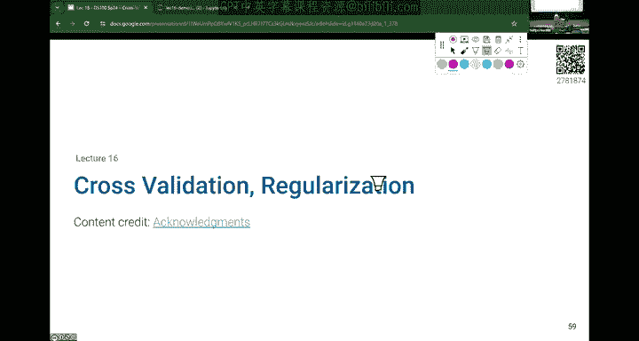

# 课程16：交叉验证与正则化 🎯


在本节课中，我们将学习如何评估模型在未见数据上的表现，以及如何控制模型复杂度以防止过拟合。我们将首先探讨交叉验证的概念，然后介绍正则化技术。

---

## 概述

在之前的课程中，我们提出了两个关键问题：如何确保模型在未见数据上表现良好，以及如何找到模型复杂度的“最佳点”。本节课将回答这些问题。我们将学习如何将数据分割为训练集、验证集和测试集，以模拟未见数据并评估模型性能。接着，我们将探讨正则化技术，它通过限制模型参数的大小来控制模型复杂度。

---

## 第一部分：交叉验证

上一节我们介绍了特征工程，本节中我们来看看如何评估模型在未见数据上的表现。

### 为什么需要未见数据？

如果我们只使用少量数据点拟合一个高复杂度模型（例如四次或五次多项式），模型可能会完美拟合训练数据，误差接近零。然而，如果这些数据点来自一个更大的分布，我们拟合的模型可能无法捕捉到数据的整体模式。因此，我们需要同时关注模型在训练数据和未见数据上的性能。

### 分割数据：训练集与测试集

为了评估模型在未见数据上的表现，我们可以将数据集分割为两部分：一部分用于训练模型，另一部分作为测试集。测试集模拟未见数据，我们仅在模型训练完成后使用它评估性能。

以下是分割数据的关键步骤：

1.  **训练集**：用于拟合模型、选择特征和调整参数。
2.  **测试集**：仅在模型最终确定后使用一次，用于评估模型在未见数据上的性能。

**重要原则**：测试集只能使用一次。我们不能根据测试集的结果返回修改模型，否则测试集就不再是“未见”数据。

### 代码实现：训练集与测试集分割

以下是使用 `scikit-learn` 进行训练集与测试集分割的示例代码：

```python
from sklearn.model_selection import train_test_split

# 假设 X 是特征矩阵，y 是目标变量
X_train, X_test, y_train, y_test = train_test_split(
    X, y,
    test_size=0.2,    # 20% 的数据作为测试集
    shuffle=True,     # 打乱数据顺序
    random_state=42   # 设置随机种子以确保结果可复现
)
```

分割后，我们使用训练集拟合模型，并计算训练误差和测试误差：

```python
from sklearn.linear_model import LinearRegression
from sklearn.metrics import mean_squared_error

model = LinearRegression()
model.fit(X_train, y_train)

# 计算训练误差
train_pred = model.predict(X_train)
train_error = mean_squared_error(y_train, train_pred)

# 计算测试误差（仅一次！）
test_pred = model.predict(X_test)
test_error = mean_squared_error(y_test, test_pred)
```

通常，测试误差会略高于训练误差，因为模型在训练过程中优化了训练数据，但未见过测试数据。

### 引入验证集

如果我们对测试集上的性能不满意，但不能使用测试集重新调整模型，该怎么办？这时我们需要一个内部测试集，称为**验证集**。验证集用于在模型开发过程中调整超参数和进行特征选择，而测试集仅在最终评估时使用。

以下是建模流程的更新：

1.  将数据分割为训练集和测试集。
2.  从训练集中再分割出一部分作为验证集。
3.  使用剩余的训练数据拟合模型，并在验证集上评估性能。
4.  根据验证集的结果调整模型（例如，选择多项式阶数）。
5.  确定最终模型后，使用整个训练集（包括之前的验证集）重新训练模型。
6.  最后，在测试集上评估模型性能（仅一次）。

### 模型选择与验证集

我们可以使用验证集进行模型选择，例如选择多项式的合适阶数。以下是探索不同多项式阶数并选择最佳模型的示例：

```python
import numpy as np
from sklearn.preprocessing import PolynomialFeatures

# 假设我们探索 0 到 17 阶多项式
degrees = range(18)
validation_errors = []

for degree in degrees:
    # 创建多项式特征
    poly = PolynomialFeatures(degree=degree)
    X_poly_train = poly.fit_transform(X_train_mini)  # 使用 mini 训练集
    
    # 拟合模型
    model = LinearRegression()
    model.fit(X_poly_train, y_train_mini)
    
    # 在验证集上评估
    X_poly_val = poly.transform(X_validation)
    val_pred = model.predict(X_poly_val)
    val_error = mean_squared_error(y_validation, val_pred)
    validation_errors.append(val_error)

# 找到验证误差最小的多项式阶数
best_degree = np.argmin(validation_errors)
```

通过验证集，我们可以找到在训练数据上表现良好且不过拟合的模型复杂度。

---

## 第二部分：K折交叉验证

上一节我们介绍了使用单一验证集进行模型选择，本节中我们来看看如何通过K折交叉验证使模型选择更稳健。

### 为什么需要K折交叉验证？

仅使用一个验证集可能导致选择偏差，因为验证集的特定划分可能影响模型性能评估。为了减少这种偏差，我们使用K折交叉验证。

### K折交叉验证流程

K折交叉验证的步骤如下：

1.  将训练集随机分为K个大小相似的子集，称为“折”。
2.  对于每一折：
    *   将该折作为验证集。
    *   使用剩余的K-1折作为训练集。
    *   训练模型并在该验证集上评估性能。
3.  计算K次验证误差的平均值，作为模型的交叉验证误差。

以下是K折交叉验证的关键点：

*   **K的选择**：K是一个超参数，常见选择有5或10。
*   **每折仅一次验证**：每个数据点在K次迭代中恰好有一次作为验证集。
*   **更稳健的评估**：通过平均多次验证结果，减少单次划分的随机性影响。

### 超参数调优

K折交叉验证常用于超参数调优。超参数是在模型训练前需要设定的参数，例如：

*   多项式回归的阶数。
*   梯度下降中的学习率。
*   正则化强度（我们将在下一节讨论）。

以下是使用交叉验证进行超参数调优的步骤：

1.  定义一组超参数候选值。
2.  对每个候选值，运行K折交叉验证，计算平均交叉验证误差。
3.  选择交叉验证误差最小的超参数。
4.  使用选定的超参数，在整个训练集上重新训练模型。
5.  在测试集上评估最终模型。

---

## 第三部分：正则化

上一节我们通过交叉验证选择模型复杂度，本节中我们来看看如何通过正则化直接控制模型复杂度。

### 正则化的概念

正则化通过在损失函数中添加一个惩罚项，限制模型参数的大小，从而控制模型复杂度。我们希望模型参数尽可能小，以减少模型对训练数据的过拟合。

### L1正则化（Lasso回归）

L1正则化使用模型参数的绝对值之和作为惩罚项。其损失函数如下：

**公式**：
\[
\text{Loss} = \text{MSE} + \lambda \sum_{i=1}^{p} |\theta_i|
\]

其中：
*   \(\text{MSE}\) 是均方误差。
*   \(\lambda\) 是正则化强度超参数。
*   \(\theta_i\) 是模型参数（不包括截距项 \(\theta_0\)）。

L1正则化倾向于产生稀疏解，即将一些参数精确地压缩为零，从而实现特征选择。

### L2正则化（岭回归）

L2正则化使用模型参数的平方和作为惩罚项。其损失函数如下：

**公式**：
\[
\text{Loss} = \text{MSE} + \lambda \sum_{i=1}^{p} \theta_i^2
\]

L2正则化使参数值变小，但通常不会精确为零。它有助于处理特征间的多重共线性，并且总是有唯一解。

### 代码实现：Lasso与岭回归

以下是使用 `scikit-learn` 实现Lasso和岭回归的示例代码：

```python
from sklearn.linear_model import Lasso, Ridge

# Lasso回归（L1正则化）
lasso_model = Lasso(alpha=1.0)  # alpha 对应公式中的 lambda
lasso_model.fit(X_train_std, y_train)  # 建议使用标准化后的数据

# 岭回归（L2正则化）
ridge_model = Ridge(alpha=1.0)
ridge_model.fit(X_train_std, y_train)
```

### 数据标准化的重要性

由于正则化惩罚项依赖于参数的大小，如果特征尺度差异很大，正则化效果可能会失真。因此，在应用正则化之前，通常需要对特征进行标准化（减去均值，除以标准差）。

```python
from sklearn.preprocessing import StandardScaler

scaler = StandardScaler()
X_train_std = scaler.fit_transform(X_train)
X_test_std = scaler.transform(X_test)  # 使用相同的缩放器
```

标准化后，所有特征具有相同的尺度，正则化惩罚能够公平地作用于所有参数。

---

## 总结

在本节课中，我们一起学习了：

1.  **交叉验证**：通过将数据分割为训练集、验证集和测试集，模拟未见数据并评估模型性能。K折交叉验证提供了更稳健的模型选择方法。
2.  **正则化**：通过向损失函数添加惩罚项（L1或L2），限制模型参数的大小，控制模型复杂度，防止过拟合。
3.  **实践技巧**：数据标准化对于正则化至关重要，确保特征尺度一致。



掌握交叉验证和正则化技术，将帮助你构建泛化能力更强、更稳健的机器学习模型。