# UCB《数据100数据科学原理与技术｜Data 100 Principles and Techniques of Data Science 24SP》中英 - P17：-17-Data 100 Spring 2024 Lecture 17.zh_en - GPT中英字幕课程资源 - BV1Bc2dYCEbc

Okay， so today we're going jump into random variables。 So a slight change of topic。

 And I'll give some context to why we're doing that。In a moment。

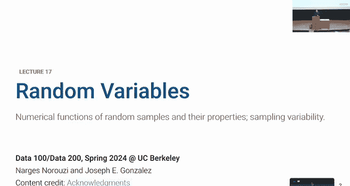

Alright， so folks on random variables day we're going to talk through some of the tools for working with random variables and we're going to need that for a reason and to get to that reason I want to do a little bit of recap So from the last lecture we started looking at this idea of regularization。

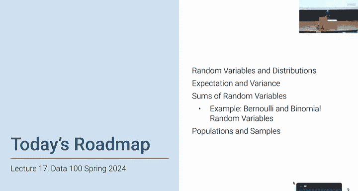

As a tool to manage the process of overfitting。 And we talked about cross foundation。

 So I wanted to try to put one slide that summarizes kind of everything we built up at this point when we think about modeling。

We spend a lot of time thinking about the loss function， and this is how we make sure that our model。

 which is determined by our parameters theta， fit our data。We saw L2 loss。

 we saw variations of absolute loss， and we'll see more as the semester continues。

In the last lecture， we introduced new idea of a regularizer。This is another term in our objective。

 We're trying to minimize our loss plus our regularizer。

 The regularizer is a function just of our model。 our parameters knows nothing about the data。

And it's there to ensure that a model is not too complicated。

 It's there to ensure maybe that we don't use too many features。

And then we also introduced this idea of a regularization hyperparameter。 This is this lambda。

 this thing we tune to set how much our model tries to fit the data versus tries to keep the model not too complicated。

And we said that we would tune this this parameter， this hyperparameter。

 using something called cross validation。So we take a bit of our data， of our training data。

 hold off a little bit of it。Fit our model。With this loss。

 and then come back and evaluate how well it performed。 And if it's。Not fitting our。

 our heldout data， but fitting our data really well。 Then we're probably overfitting to our data。

 And we didn't generalize this， this held out piece of data。 Those cross validation。

 And we'll tune Lada so that it fits both the data we have and the data that we didn't train on that little heldout piece of validation data。

For the regularizer， we've already introduced two forms of regularization。

 They're actually pretty sophisticated。 The first was this L1 regularization is this this square。

 and that was trying to make our model sparser by zeroing out features。

The other type of regularization， I should say， the first one was called Laso， Lau。

So this was the first sparsifying regularization。 The second chi intoregization we talked about was with this L2 penalty。

 taking the square of all of our model parameters。This is sometimes called Rige progression or ridge regularization。

 And this is trying to encourage robustness。 Why is it do that， What it says。

 don't put too much weight on one on one feature， spread it out because if you put too much weight on one feature。

 you pay this quadratic penalty。 So it's better to spread your weight across your features。

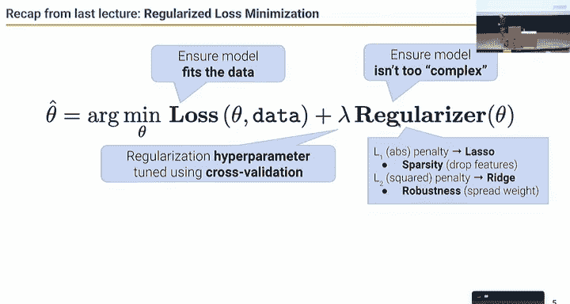

We talked about how to tune these， how to manage this process of overfitting。

Underlying this whole concept was this idea that when our model to fit our data to not be biased towards in this case of regular here。

 we're biasing our model towards 0。 If we crank this regular parameter up really large， It says。

 you know what the best model is， the all zeros model。Always predict zero。It will be consistent。

 no variability whatsoever。 Every time you fit any kind of data set， you get all zeros。

 but it's very biased。 doesn't really explain my data。So there's bias， and then there's variance。

 if I set this regularization parameter to zero， a model fits exactly the data it was given。

 You get a different piece of data。 It fits a very different model for that different piece of data。

There's variants。 And we're trying to balance these two things。So we have this plot。

And actually made this plot when I first started teaching this class， it survived。Model complexity。

 for some notion of complexity， how many features we use later in life。

 it might mean how many layers of your neural net。Complexity as it increases。

Our ability to fit our data the error we have on our data that we're fitting to goes down。

Sphisticcade model really fits my data。 Air goes down。

 but the variability in my model's variance goes up。And so。When I look at the validation error， the。

 the data that I didn't fit to， but I have it It held it out。 and I compare against that。

I want to have good validation error， because that's a guess for what will happen if I take my model and bring it to the real world。

 I just held some data。 I didn't look at it。 So of you're taking an exam。

 You hold some questions aside some practice questions。 You do a few practice exams。 You go， okay。

 I think I'm ready for the real world。 Let's go check you take out this， know。

 the questions you haven't looked at yet and go， did pretty well。 Okay， let's go take the exam。😊。

Right。We're trying to tune to the point on this validation set has the lowest error。

 So we take our validation data。 We going to get the hyperparmeter model， the complex error models。

 so we get the lowest validation error。And we hope that this is a good guess for how we'll do in the real world。

No。When I first started teaching this。I jumped into what I think is the most exciting lecture in the mathematics of this class。

 which is this deep statistical analysis of the fundamental bias andvari trade off。😊。

And it occurred to me。And the students after the lecture。

 that they didn't have the basic like the basic concepts to understand this really cool statistical lecture。

 So we've since fixed that。 And this is why we're going to talk about random variables and probability first。

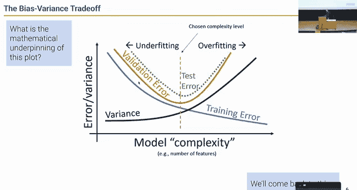

Having those tools come back to do the analysis that is this biasparance trade off。

The other plus side of this approach is you get to learn some more the basic tools that will help you。

 should you go off and do Stat 140， or if you don't go off and do probability。

 you'll have at least some basic random variable knowledge you can use when analyzing complex probability settings。

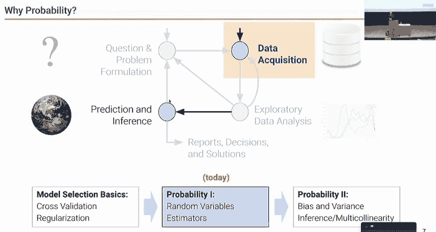

Okay， so that's a plan。I realized I should take a quick pause here。

 were there are questions up to this point。No questions。好 take it。Okay， so so probability。

So our goal with probabilitybil is to try to understand， again。

 this relationship between the sample we have， the data that we fit our model to and what will happen in the world。

Right。And we're use these tools of probability to try to reason about those relationships between our sample and the world。

We're going to have this idea of a population parameter。It's a weird idea， but。

We'll imagine that if we were to fit a model to the entire world， it's still a model。

 It's not gonna be it's not gonna to predict everything correctly。

 but there is a set of parameters that I would have gotten。

 if I just had everything if I had let's say population as the entire class。

 if I took all of the students grades in this class and tried to predict their final grade。

 there is some model that I could fit， It has some set of parameters。

 those are the population parameters。But in practice。

 I only look at a sample of students in this class as bad examples as I can look at all your grades。

 but let's say I'm in a discussion section， I can only see the students in my discussion section so now I have a sample。

 I'm going to fit a model in my sample， and I want to know how close is the model I get。

 the theta that I get to the true theta that would have been fit had I fit the entire class。

Make sense。So the source around randomness that we want to study is this sampling process。

 so I'm working with a sample， I'm fitting estimating parameters， things about my sample。

 and I want know how they relate to what I would have gotten if I had build those parameters of my population。

So the population parameters， a number describing something about the population could be something as simple as the mean or it could be the linear model that I would have fit if I had the entire population a sample statistic is you know the sample mean that I got or the model that I fit。

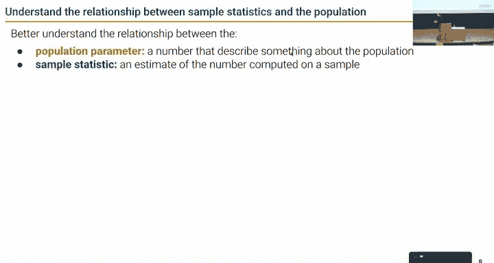

Right。We're going to focus on mean in this lecture。 So in data 8， you did a lot with the mean。

 not all of you have taken data 8， it's a requirement for this class。

 but some of the graduate students may not have taken it。

 What I've done here is we have links to the material in data 8。

 If you've taken data 8 and you've forgotten it。I might have you could go back and click on that link。

 or if you haven't had a chance to take data A yet and you're a graduate student。

 please take these links and try to review some of this material。So you define the sample mean。

 in fact， all of data8 was focused on， here's your data。 summarize your data。

 So we did a lot of our focus。 Almost all of our folks in day8 was on understanding the data we have。

 describing the data we have， and then sometimes drawing vague conclusions about what that means for the population。

One of those conclusions。That we introduced in today 8 is a central limit theorem。

And this is a big idea。 We didn't prove it in did8， and we won't prove it here。

 but we'll derive parts of it。 if you draw a large random sample with replacement。

 then regardless of the population distribution， the probability distribution of the sample mean。

 the mean you compute on your sample。Will first be roughly normal for a big enough sample。

It will be centered at the population mean。 which is kind of cool。

 So the sample you get is probably going to be centered around the population mean。

And if you do this repeatedly， you get a bunch of these different samples and you get a bunch of different sample means that the standard deviation of those means will decrease as a function of the square root of the population size。

And it'll decrease the sand deviation。 This means well have this constant。

 which is the population sand deviation。Which we don't typically have access to。

But it gives an idea of how quickly we converge with our data。

 And we use this in data 8 to think about how we might choose the right sample size。Okay， so today。

 we're going try to understand some of these concepts using random variables and some of the computations like expectation and variance on random variables。

I have to say this。 We are not going to cover all the material and probability that you should know to be a data scientist。

 I strongly encourage you to consider taking Stat 1，40。 It's a great class。

 and it will cover a lot of what I'm going to say in much more detail。😊。

For those in CSCS70 and CS 126 also covers some this material。All， so first。

What is a random variable？It's a confusing term around a variable because it's not a variable。

 it's a function。So a random variable is actually a function from the outcome of some random event。

To a number。Technically， it could be something more general。

 but we're going to save for the purposes class to a number。So give you an example。Take a fair coin。

So a fair coinin is a coin that allegedly would flip heads 50 and tails ， 50% each way。

I can create a random variable X， which is one。 if the coin flips heads。

 that's the random event and0， if it lands tails。

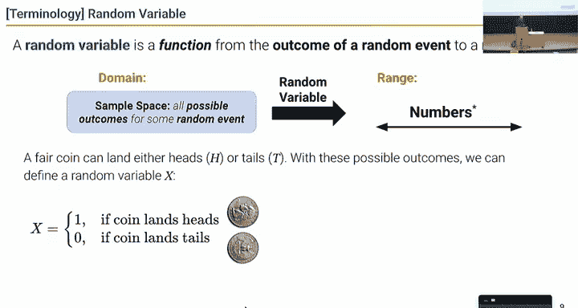

The domain is the input of my sample space。 I could have heads or tails。And the range。

 the output is 1 or 0。There's a notation that we will use sometimes in lecture to actually make clear that this is a function。

So it function from the actual sample itself to a number。 We won't use this notation often。嗯。

I won't go on this aside。 There's a fun aside kind of clickba。Coins aren't actually fair。 flip。

 You can check out this physics study about how coins have a little bit of a bias。

 depending on how you actually flip them。 Coins fair。 Humans don't flip fairly。はい。

So important notation first。Randdom variables are typically denoted with uppercase letters。

 just regular letters X， Y， Z， and then regular variables or values。

 numbers are typically denoted with lowercase letters。

A common source of confusion in this class is that we often often work with matrices like big X。

And we'll occasionally use capulator layers to also denote matrices。

 I think we've in the past tried to use like double lined x's to make it a little bit more clear that this is a matrix。

 but we'll do our best to try to make clear from now on without not referring to a matrix or random variable。

Alright， so let' took another example of a random variable。 Allright。

 supposeupp this is a population of data 100 students as I'm studying。 And then in that population。

 the students labeled in blue are data science majors。If I draw a sample of three size3。

 I could create a random variable for that sample， which is the number of data science majors in that sample。

 So the random event， the thing I'm the source of randomness is the sampling of three people so I get a set of three people that's my S my random variables a function from that set of three people to the number of those that are data science majors。

So you have a bunch of different outcomes。So I draw different samples。

 I get a different value of that random variable。This is why people think of it as a random variable。

 It's a variable that has a random value， but that's not really the right way to think about it。

 It doesn't have a value。 It represents a mapping from a sample space to a particular number。

So you define random variable Y as a number of data science students in our sample。

 the input domain is all sample size three from the class。

 so a set of three individuals and the range is0，1，2， or3。

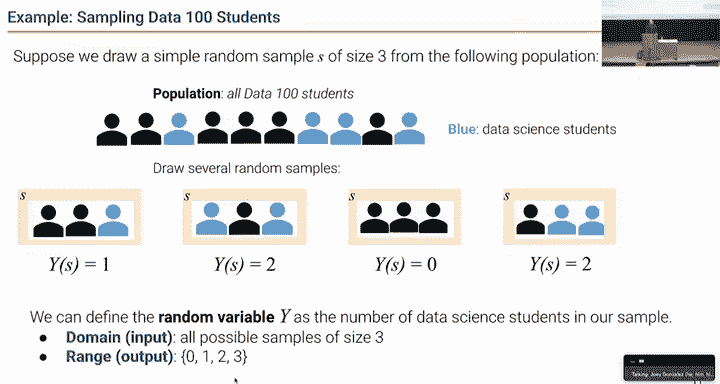

All right。The point of this lecture and the reason we're going through all this for future lectures is that we tend to use random variables in interesting mathematical expressions。

 And we want to reason about the expression itself by reasoning about the properties of those random variables。

 So give you a simple example。Maybe timely。 So I sample three students at random from lecture。

 let X1， x 2， X3 be the midterm grades for each of those students。

 so function from the student to their midterm grade。I can create a new random variable why？

Because it's an expression of random variables。And I might want to know what's this random variable Y it's the essentially the average of the three students grades。

 what's its distribution， What can I say about its properties。

 How does it depend on the distribution and properties these students that I sampled from。

And also critically was a distribution， which we should formalize now。

But a lot of this work we'll be thinking about these kinds of functions and I'll come back this in the later half the selection we start to use operators on random variables。

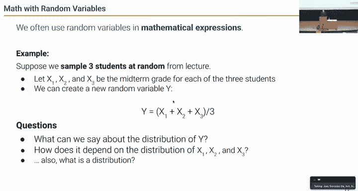

Distribution， important concept。 for any random variable。

 we need to be able to specify two things to define its distribution。 One。

 what are the possible values that random variable can take， So it's range。And two。

 the probability or the chance that the random variable will take each of those possible values。

So each probability should be a real number between 0 and one inclusive。

So it could be0 or it could be 1。And the total of all possible probabilities should sum to one。

Really important。Axioms of a probability。Alright， so assuming for now。

 and we're going to focus on this lecture on discrete random variables。

 So those that take on a finite set of values。I can write the probability that a random variable x takes a value x with this expression。

that would be the probability that let's say x is1 if it's the coin light heads。

 so say probability x equals 1。And then if I can write it this way。

 if I write my probability function this way， then I should be able to say that for all the possible values that x can take。

 if I sum the probabilities they should equal one。

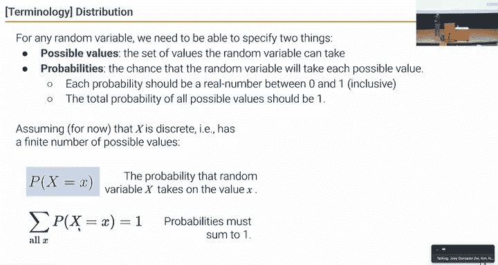

It'll be common to work with a probability distribution table when thinking of these discrete values。

 So here we have one column， which is the possible values X can take。

 and the other column is a probability of each of those values。A distribution。

Fully defines a random variable。 So if I tell you distribution。

 I tell you everything need to know about that random variable。 I tell you its values。

 and I tell you their probabilities。I can compute properties， so if I hand distribution。

 you can start to derive properties at random variable， which will come to a moment。

You can also simulate from it。😡，And this is actually a powerful tool that we introduced in day 8。

 When I don't want to use the math that we'll teach you now， I can often take my random variable。

 sample from it。Create data。 If I create enough data。

 I can start to answer questions by using tools of data mean pandas the data science library。

 I can compute plot statistics。On that data as a proxy for properties that random variable。

So simulation is a very powerful tool。Today， I will try to cover some simulation in Python。

In this class， I it well focus on Ny's random library， but if you want to get more advanced。

 there's s pi stats cybers tons of tools for simulating from different kinds of distributions。

 and these can be really powerful again， for trying to reason about complex properties of variables。

 it would otherwise take more advanced calculations。

There's often a point of confusion about random variables when we work with simulation。

 So if I take a coin and I flip it twice or three times， let's say and it lands heads， heads， tails。

It's a faircoin。 What's a problem that lands heads。well， you might be going to faircoin。

I said if faircoin is probably 0。5 landing heads。 That's an answer。

 That would be if I had a population population。 It is， in fact， a fairco， P is 0。5。But then。

 I took a sample。I sampled it a few times， and I can compute a histogram here。

 and it's two thirds heads， one third tails。That's an empirical distribution。

 It's my observed distribution for that random variable。は。In practice。

 when we make our empirical distributions big enough， we often treat them。

 It's more or less the a proxy for the actual distribution。Often。

 we may not actually know the actual distribution。 So all we can measure is the empirical distribution。

 We'll again， try to reason about the relationship between the empirical distribution and the actual true distribution of that variable。

The population distribution。I bring this up because there's a fun example。

 If I flip the coin and lands heads twice。What will it land the next time I flip it？Okay， well。

 who says if it it lands heads twice， what's it probability it will land heads according to empirical distribution。

So empirical distribution is what I observe， I flipped it twice， landed twice heads。

 and it landed zero tails， so two out of two it was heads and0 out of two it was tails。

 so probabilityative heads is one， probabilityative tails is zero that empirical distribution。

Who wants to bet on that， right？ flip a coin， Would you take that bet。Yeah。

 so this is a challenge when think about probabilities we have small samples。

 it's not clear if we can treat those distributions or if we should treat those distributions as a good proxy for our larger distribution。

And in fact， if you go into more advanced statistics。

 there are ways to deal with these kinds of scenarios。

Using things like priors or ways to incorporate other knowledge that is out of scope for this class。

 I just want you to understand the concept of empirical distribution and that these are know good as I have lots of samples。

 but maybe not as good if I have really small samples。Okay， questions at this point。Right。Again。

 things you've seen in the past， we've done visualizations of distributions， we built histograms。

 we built KDE plots， histograms give us a way to look at probabilities for discrete variables。

 KD plots are continuous variables have these continuous distributions。Important point here。

 So if I want to compute a probability of a range of values， I look at the area under the curve。

So if I'm between seven and nine， what's the probability that x for this probabilitybil fu will be between7 and9。

 I take the sum of these red bars。If y is this continuous variable。

 it's the sum of the area under this curve。Important caveat。Continuous distributions are weird。

 The height of this thing isn't a， probably it's a density。Right。So if these are discrete。

 it's possible。 these things could be greater than one dis density function。

So you can't actually ask， what's the probability that y equals 7。5 0。

 You don't have an answer to that。 It has to be a range of values。

Okay for continuous distributions for discrete distributions， I go， yeah。

 what's a probability of seven。The area end of this bar。 if this bar has width one。

 which they usually do for basic histograms， that's the side of the bar。 Give me a probability。

But you should check， is it the with one， Because if it's not， it's a density。

You're only lucky to call it probability when it's with one。Okay， questions。The red line。

So till end the curve should be one， and again， for continuous random variables。

 we have to look at a range of values， we can't look at a single value for that variable。

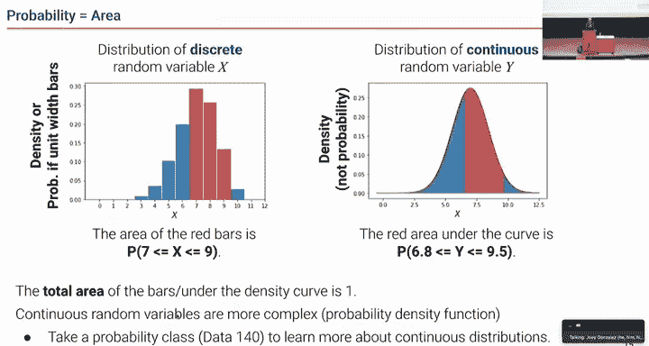

So quick practice。哎。So are some probability questions。 Here is a probability table。

 and here's the distribution。So what is the probability that x equals 4？This should be pretty easy。

 let's try it， so probably x equals 4， it's this bar。Right， and I said this is height to these bars。

 So this are with one。 size these bars is a probability。 It's 02。 It's also a here of 。2。2。

Probably x is less than less than 6。But these are great exam questions。

 so it should be easy to answer these。Probably x is less than 6， doesn't include 6。

 but it's the area under the curve to the left。 So it's the area of bar this bar， so 01 plus 0。2。欢。

Pri that x is less than or equal to6 includes the area of this bar。So it's 0。1。

2 plus the  six bars is 05。Oh sorry， 。4， so 0。7。Probably x is 7 is 0。 jump ahead。

 There's no bar at 7 equals no bar at 7。 So there's no probability of x equal equaling 7。

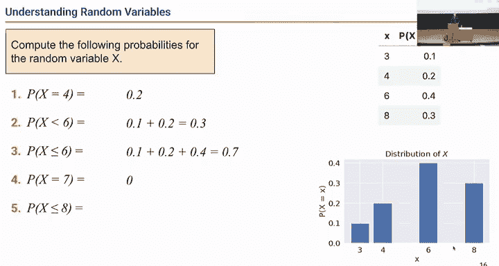

All right，op one more。 So probably that x is less than or equal to 8 is the entire area of that curve。

 So that would be one for a probability。

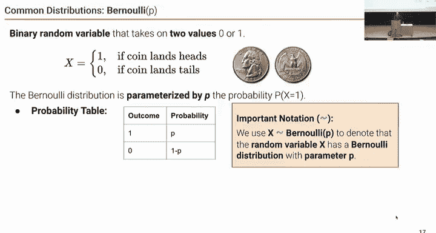

This should be pretty straightforward。 These are pretty easy exam questions。

 So if you're confused about this， ask questions now or go off hours。

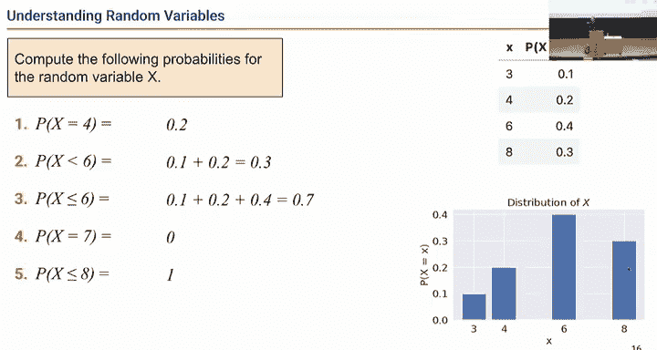

All right so let's start talking about some interesting distributions。

 and we'll come back to analyzing these in a moment。

So one of the first distributions that directly relates to flipping coins is called the Bernoulli distribution。

So we write a distribution like this。 So Bernoulli， a P。Distributions have parameters。

 just like our models did。 In fact， distributions are a kind of model。

 They model model a probability function right here。 P in the pernoulli distribution。

 Is it probably of landing heads or the random variable being one。

So Bernoulli distribution is a distribution of binary random variables taking on the value，0，1。

So we have our probability table。 So probably outcome 1 is P， probably outcome 0 is1 minus P。

 important piece of notation。 this little character here， this says。

X is distributed according to our bonoli distribution。

 So it's a way of saying the distribution of random variable is this distribution on the right。

And we'll talk about some more name distributions in a moment。

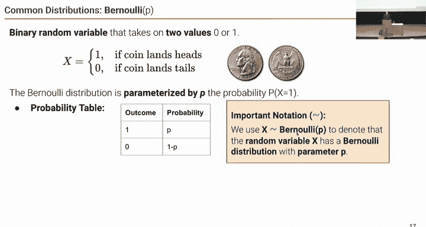

All right， here's a quick exercise。Suppose that x is a Bernoli random variable。With the parameter P。

What is the probability table for the distribution of Y？Thinking about it for a moment。Okay。

What are the values that y can take？Yeah。1， a negative one， right。

 So I have to be able plug in all guys x。 So x is 1，2 times 1 is 2， minus-1 is 1。 X is 0。

2 times 0 is 0， minus-1 is minus-1。 Yep， so those are the values。 What about the probabilities。

P and 1 minus P， they haven't changed of just transforming the values of the random variable。So one。

And negative 1， NP P and1 minus P。Right， so。Brunnoulli random random distribution of random variables that we just covered。

 we'll talk about binomial slightly later in lecture。

 there are other distributions you've already seen like a categorical distribution。

 which is a sided die di die K sided die and has a probably of each of the sides landing facing up。

The uniform distribution， so distribution over the range over a finite this one01 range。

 so uniform distribution over01， you can extend uniform distribution over an arbitrary range and the normal distribution which we'll talk more about later in lecture actually in a later lecture。

 so these are two continuous distributions。Again， the important point is that each of these distributions has a parameter。

 they're a model of some probability table or a continuous probability function。

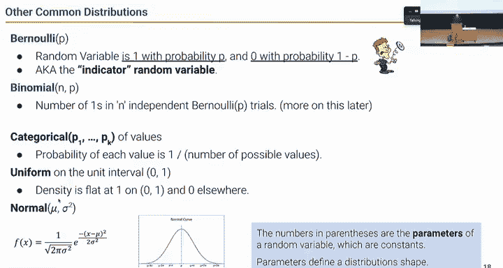

Alright， so this is the part of the lecture that we need to proceed to our biasvariance analysis。

 and that is the definitions and operate the properties of expectations and variance。

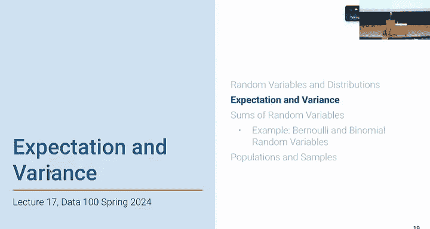

Right。So far， we've been thinking about random variables in their complete descriptions。

 We've looked at a distribution table which fully describes random variable。

 where if we're sampling from a population， having all the possible samples in the population and their frequency fully determines our random variable or a histogram。

 again， a representation of that probability distribution。

Now we' going to start to talk about more descriptive statistics or summaries of that random variable。

Expectation。Which is kind of the idea of the average， but applied to random variable and variance。

 which is the idea of variance， the spread， but applied to the random variable。

And these have really neat properties， and they'll allow us to do more interesting analyses with these random variables。

And we'll see throughout the rest of this lecture that these things take our random variables。

 as I said earlier， when I build expressions of random variables。

 those expressions produce random variables。It's not entirely true when I use expectation or variance。

 these or operators， which will convert my expressions of random variables to numbers that I can directly reason about。

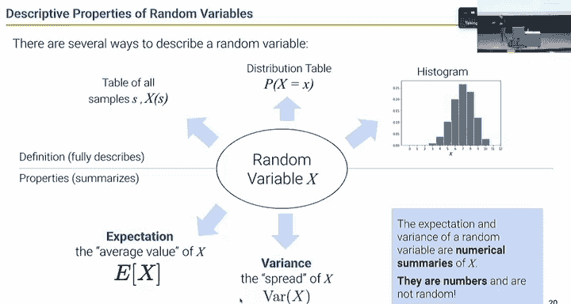

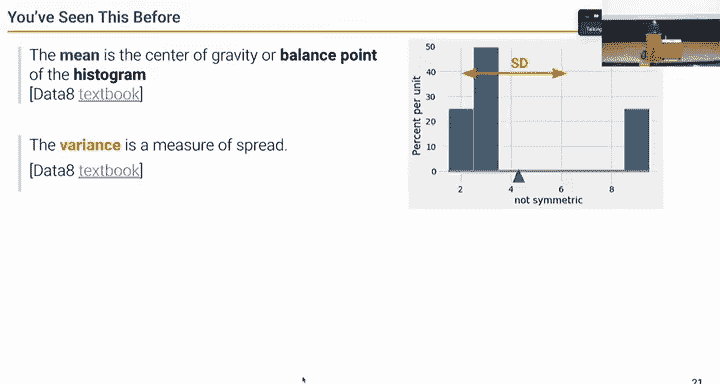

Alright， so we'll start with mean and variance。 So we've seen these before in data 8。

 So in the data 8 textbook， we talk about mean is kind of the center of gravity of our distribution。

 So our expectation is going to compute the same concept。

 and variance is that spread of that distribution。

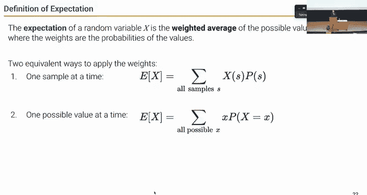

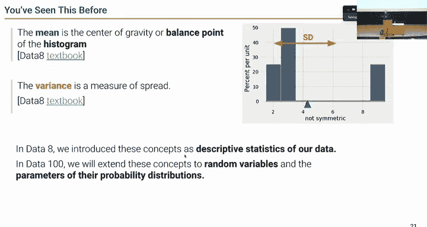

Right， so let's start with expectation。 So the expectation of a random variable x is the weighted average of the possible values of x。

Where the weights are the probabilities of those values。So there's two ways to write this。

 one is to say all possible outcomes that I could observe。For the probability of those outcomes。

 the value of x for that outcome。So all possible I could sample students。Probably that that way of。

 know， that set of three students arriving and then the function on that set of three students。

We typically don't write Pri this way or expectations this way。

 we often use this this form of the expression。 This is saying for all possible outputs of the random variable。

 so for all possible the full range of that random variable。

What's the probability of seeing that value？Times that value。To make that more concrete。

 if we take our three student sample from class， this sum is a sum of 0，1，2，3，4。

RightSo what are all the ways to get 0， what are all the ways to get 1，2，3，4。

 all the ways to get 0 are captured in just one probability，1 p。 So p of x equals 0。

 all the ways to get 0 times 0。X equals1， all the ways to get one data science student and myem of three students。

翻是 one。And so on here， this sum is over all samples of size 3， much bigger sum。All right。

The bottom one is more common， simple sums， we often have access to this probability function so we can do this directly。

Compcrete this again。 expectation of a random variable is a number。

 not a variable is a generalization of the average。 It gives a center gravity of that。

 that distribution function。And if we simulate a variable many times， and we'll come back to this。

 the long run average of those simulations should converge to this expectation。

So when we can't compute these expectations because the models are too complicated。

 we can often simulate and then take the average。

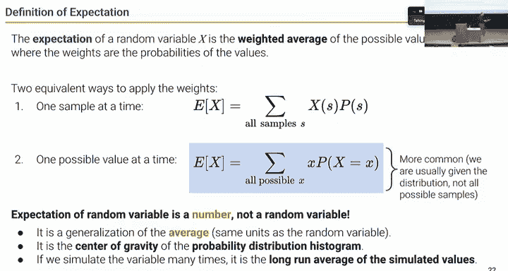

So let's try using this。Take a coin， so we have a random variable。

 x equals 1 if land heads zero of tails。The expectation to compute it is we take in this case we'll sum over the outcomes which are0 and1。

 so the first outcome here is1， so the probability that we get 1 is 0。5 times the value 1。

 and the probability we get 0 is 0。5 times of value 0。So the expected value of x is 0。5。So。

What value if I flip a coin， what value do I expect to see for that coin flip？5。

Do you expect to see x equals 0。5 over？No。A little confusing。 So x is either one or 0。

 but the expected value of x， What we expect to see is 0。5。

So the expected value doesn't have to be a value in the range of that variable。

It's the center of gravity， the center of mass of that probability function。So E of x is 05。

 This is not a possible value of x。 It is the average。

 The expectation does not need to be a value in the range。Questions at this point。Keep going。

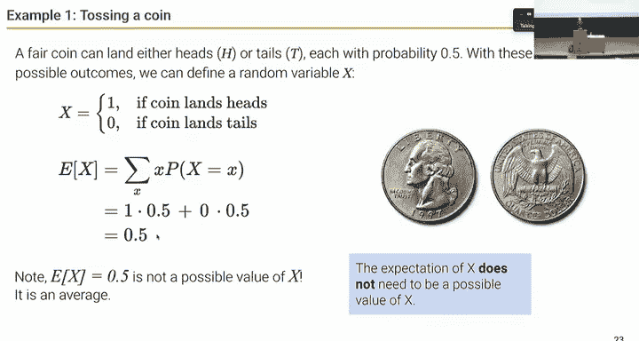

All right， so trust me more interesting。So this is the variable used earlier in lecture when we were calculating those probabilities。

What is the expectation of this variable？So we have the probability function so we can work it out。

 just directly applying this equation。So probably seeing 3 is 0。1， probably seeing 4 is 0。2。

 probably seeing 6 is 0。4 and 8 is 0。3。Multiply these together， add them up。

 That is the expected value of this random variable。 And again。

 it is not a value in the possible values that we could see for this random variable。To 5。9。

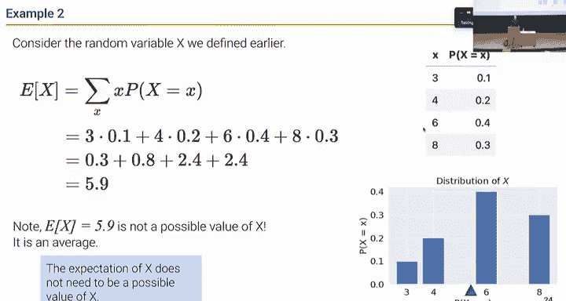

We have a more interesting one， good。I'm going to introduce variances。

 and I think we have some more interesting calculations in a moment。

Variance is another one of these operators on a random variable。

 It's going take that random variable and map it to a number。 It's defined。As the expectation。

Of the square of the difference between the variable and its expected value。It's a pretty obvious。

 maybe natural notion of spread。 So the difference is a good notion of spread and then squared because these could be negative or positive。

So what is the expected square difference， This is the variance that we saw before。

 but now written in terms of expectations。The units of variance are in squared， whatever x was。

 which is often hard to think about。 So there's also the concept of the standard deviation。

 which is just the square root of the variance。It's another operator， just like varianceance。

 the standard deviation operator。

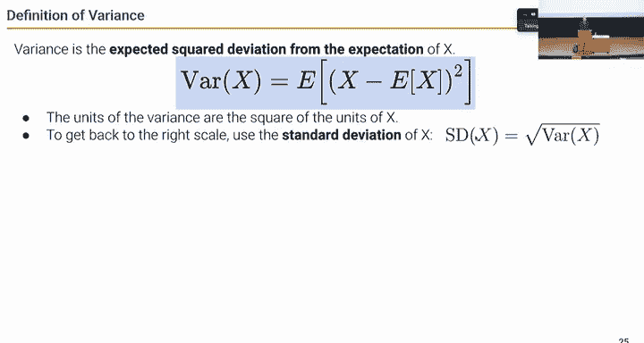

So as before， variance and certain deviation return a number， not random variables。

 They describe the variability of that that variable。 We already to defined it。

 One thing that's kind of neat is you can think of this variance as。

A notion of error because it's the squared error between x and its expected value。

You can sort of think of the expected value as a good guess for x that's what you're predicting。

 and the x is its actual value。 varianceance is a notion of error in that sense。

 variance notion of squared error。This is important because in the next lecture。

 we're going to use this definition to actually formally break down this biospherence trade off and we're going to use this exact definition。

This is a general tool of probability。Whoever Cheby chef's inality， raise your hand。

That's impressive。Sheevy shes inequality is a concept we introduced in day 8。

 I'll just jump to this link because it's worth seeing。

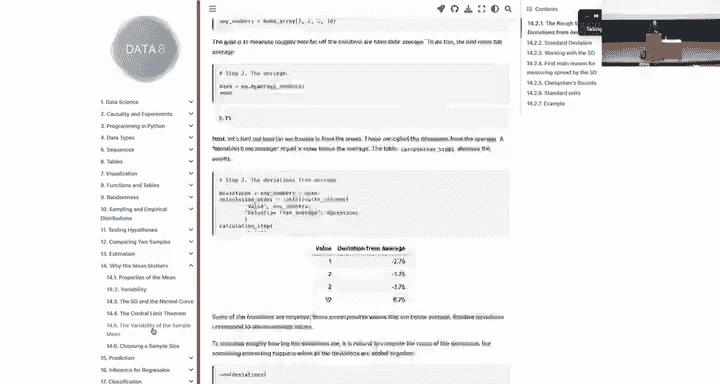

If you hadn't seen it before， most people don't learn about Cheby Cheev's inequality until theyre in their PhD studying statistics or AI。

 but we decide to teach it in our introductory class。 It gives us a bound。

 a crazy bound because it makes basically no assumptions that says that one standard or two standard deviations will contain 75% of the mess。

It's just true， it's a true statement。It's a pretty general statement。

 so often two deviation deviationations contains a lot more than 75%。But it'll at least have 75%。

Right，So standard deviations and then the cousin variance give us a description of the spread of our distribution。

And if you go further， you say 4。5 strand deviations cover 95% of your data， always。

Probably a lot more， but always 95%。So sheby she's inequality shows that these standard deviations are a good measure of the spread。

 or at least a good bound on the spread。There's another way to write the variance that's often used for analysis purposes。

 It's also easier to compute for exam purposes。 So you should learn this formula as well。

 And that is。The variance is the expectation of the variable squared。

Minus the expectation of the variable quantity squared。 So a little confusing。

 So this is the expectation of the squared x， and this is the square of the expectation。

This is convenient because if I ask you on part A， what's the mean or the expected value you've just calculated that。

 And I go now what's the variance and go， okay， great。 I just have to compute what。

The expected value of x squared。How do I compute that。

How do you compute the expected value of x squared， x squared is a new variable。

 So we just use our probability， our expectation calculation for x squared。

So the very values of x squared are for all values of x， I take the square of it。

 and I take the probability x takes that value。So if I give you probability table。

 you just finish computing expectation， you can now compute variances very quickly。

If you're a computer scientist， you might say， I can take one walk through my data computing both x squared and x at once。

 and then I compute the variance。If I gave you this other equation。 you'd go， well。

 first I need to compute the expectation and then I have to walk again into my data to compute the the。

Diffence squared to compute the variance。 So two walks of your data。One walk of your data。

So it's computationally easier and it's great for exams。

It's also worth noting this is kind of alludes to a neat property of our models。

 if our models have expectation zero for error is zero in expectation。

 then we can just look at the square of the thing and not have to worry about this term when reason about variance。

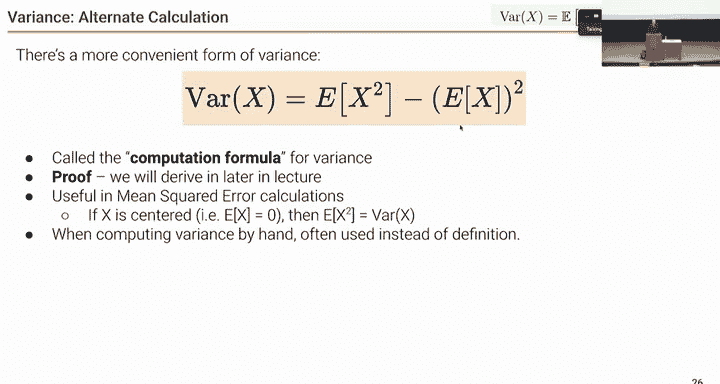

To this。Right so here's a practice that we should go through。 All。

 so Im going I have a die here that has six sides and each side lands with equal probability。

And I want to compute the expectation and variance of that of rolling that die。

This a very natural exam question。

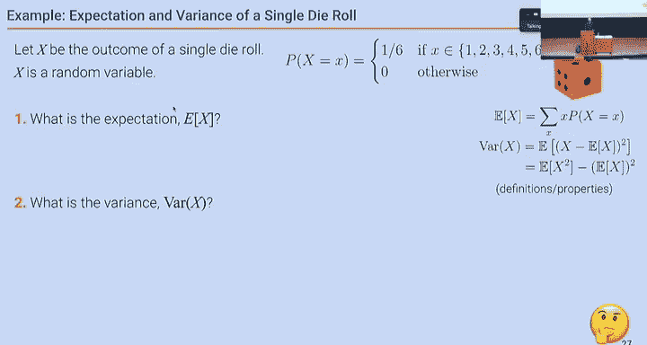

I think I have a slido。 Let's do it。

Slido。Saideludes。There we go。All， so what is the expectation？Of this day。What is the expected diet。

35。I think you're missing a decimal similar。Is the biggest number mean it's the most likely thing。

This is 35。 Does everyone think it's 35， So what's going on？Or it just doesn't show decimal points。

 okay？All right。I think you guys are kind of getting it。Gonzalez， go for it， I like it。Okay。

 we only have。If I close this， they won't get to fill it out， right？Filled out， people， go quickly。

Get your credit。嗯。Okay， well people are playing out， there are questions at this point。

Just a quick raise of hands， is this familiar to you all？Okay。

 and for those who's not familiar or I'm presenting it weirdly， Yeah， exactly。 Okay。

 so some of this should not be familiar。It's great if is it will get less familiar as we go further。

 so bear with me。All right， I'm going to move to the next slide。Come on。And Zoom crowd， let me yeah。

 if my voice is not loud enough， post a comment so we can try to adjust the audio。

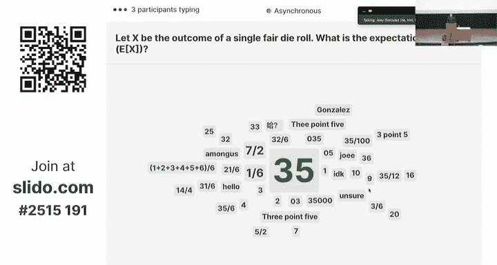

All right， we're going to keep going。All right， so to compute the expectation is relatively straightforward。

I take the1 times 16， 2 times 1，6， 3 times 1，6， 4 times 16， and so on。

 or 16 times1 plus 2 plus3 plus4 plus5， sorry 7 over 2， which I believe is 3。5。Right。

 so the 35 will assume that person or the slidr thing drop the decimal point。All。

 so that was the expectation。The more interesting one is the variance。So what is the variance？

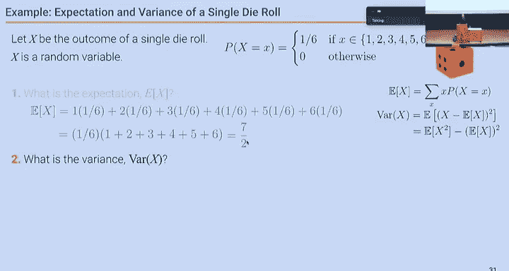

Okay。等等。Do I get the same ci again？Okay， here we go， what is the variance？

How do I calculate the variance of this die？So you might want to use that computational formula。

From the computation formula is the expectation of x squared。

Minus the square of the expectation of x。没有的。As you're getting it。

So it doesn't allow you to decimal points in sliddo。That's great。You did see the answer， good point。

 Okay， all right， please fill something in so we can move on。All right， come on， let's get to 300。

有有有。There's no way to leave this open。

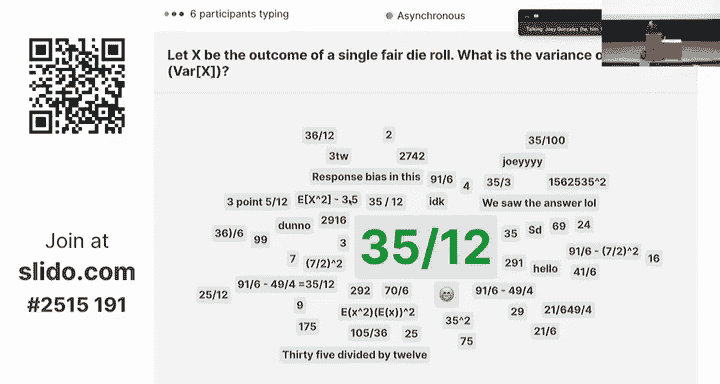

Okay， so we're going to make it so it's open so you can fill it in。

 So let's do it through the variance calculation。 We can do it both ways。 So one is to compute。

The expectation。 So it's going be 16 times each to the possible values for this difference between x。

 So x goes from 1 to 6 and its expectation squared。

 So 1 minus-7 over 2 squared 2 minus-7 over2 squared。 This we get tedDious on an exam right。

 So we could do it this way。 and we get 35 over 12。

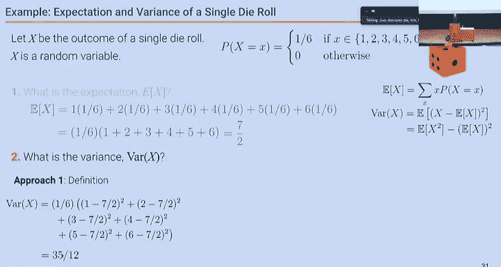

Or we can use a computational method。So here all we need to do is figure out what is the expectation of the variable x squared。

Whi I believe is 91 over6， I didn't calculate this through yeah you can do the math yourself。

 91 over 6 minus7， so this is the explanation of x squared minus the square of the expectation which you already keep computed before。

7 over 2， so we get 35 over 12。Questions。All right， let's keep going。Alright。

 so I said earlier that we would operate on functions random variables。 In fact。

 I showed you a some of random variables。 Now， let's dive into that a bit more。

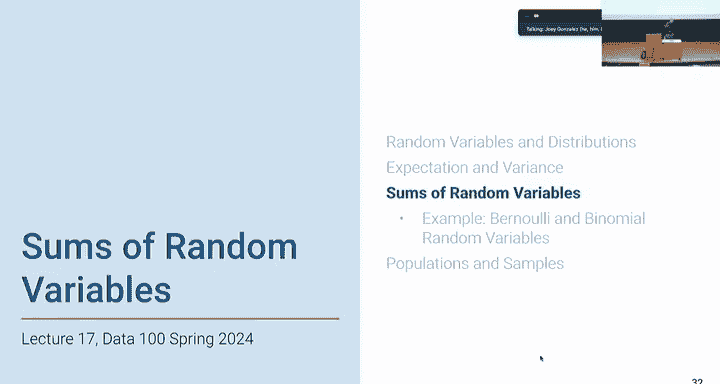

So a function random variable is also random variable， again。

 with the exception of these special operators that convert random variables to numbers。

If you create multiple random variables based on some sampling process。

 then the function of those random variables is also random variable。So if I have x1， x2 xn。对。

The square of them is a random variable， the max of them is a random variable。

 the Ih the number that are greater than 10 is a random variable。嗯。

Some of the square differences between a random variable and a constant is a random variable。

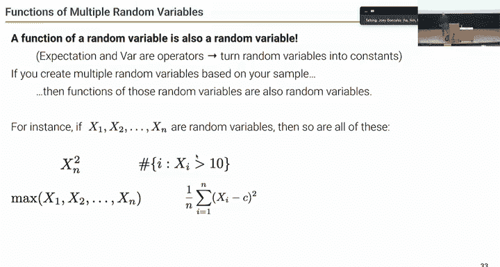

Just the sum is random variable。 So the average is random variable。

 So all of these operations are random variables。 This is why random variables are so neat。

 because I can start with very simple probabilities。 Coin flips。

 I can build up really complex things。And then I can try to reason about those complex things using the tools we've just demonstrated。

And when those fail， I can use simulation on those little random variables to simulate those big。

 complex things。All right。So let's go through some of the important properties of expectations and variants that will be useful in doing these kinds of analyses。

The first is that expectation is a linear operator。 So if I have a。

 the constant a times the random variable x plus the constant B。

 then the expectation of that is a times the expectation of x。Po B。Really important role。

Next rule is the expectation of the sum of two variables is the sum of their expectations。

No assumptions。So nothing about independence。This is just true。Let's prove it。하루프대。

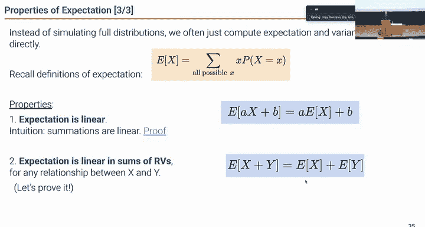

Oh didn't build the proof and that's a about。 I meant to highlight it， I guess。 Okay。

 so we can walk through the proof of this relationship。 So here I take the expectation of x and y。

 I'm going to use that other notation where I say all the possible outcomes from my random event。

 This will let me deal with things like independence when working for this example。

 So I have the random variables X and y。 these are functions。

 So functions of the outcome times probably that particular outcomes sumd over all possible outcomes。

I can take this probability， these functions put the S on the inside。

 so this is the function XS and YS。 so this is just moving that function right over。

Now I can distribute this probability inside of this summation so when I have a sum of XPS plus YSPS。

 this already starts to look like two expectations， I can take this sum slide it through。

 so break this into two separate sums so the sum of our XPS and the sum of are YSPS These are the definitions of the expectations of x and Y。

来。So no assumptions about I random variables。 I can show linearity。 And of course。

 the other proof for A X plus B is an easy an even easier version of this proof。

 So you should try to do that perhaps on your own。

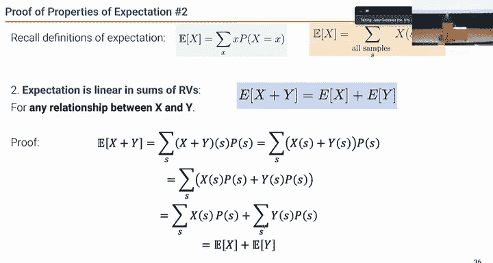

Okay。So we've shown that expectations are linear。We can take the sums of random variabless as sum of their expectations。

Yops。2。One important point is if I have a function G。Of x， which is nonlinear， like x squared。

 for example。Then it is not true。That the expectation of G of x is equal to the G of the expectation of x。

This expectation operator up works on linear。Functions。sorry。

 I can slide the expectation through linear functions， not through nonlinear functions。

And we saw this in data 8。 and I think earlier in this class。 So if I take the random variable。

 x is negative 1 or1。X squared， what is its expectation？X squared。X squared is always one。

 so the expectation of that is one。But the expectation of just x is 0。

Assuming it's a Bly random variable， so it's either。Equally negative one and one。嗯。

So the expectation squared is0。But the expectation of x squared is one。Questions。

 these are important identities， we'll use them to prove some s stuff。

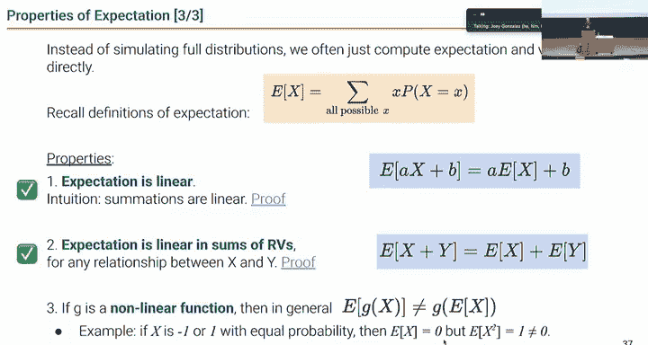

get some practice。All right。Let's excuse it now。 So I want to prove the computational definition of variance using these properties。

So let's walk through this， this will hopefully demonstrate these properties thoroughly。

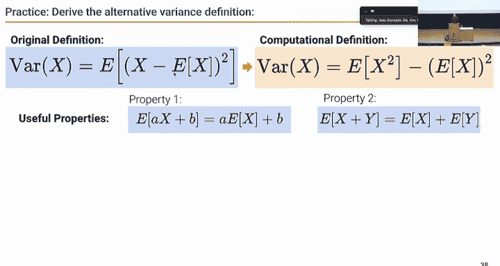

So my pen has died。 So I can't seem to write on my iPad。

 So I'm going to use the pointer for this today。 Unfortunately。 Allright。

 so the variance of x is defined in the original definition here。

 I'm going to use a little bit of a weird coloring notation。

 but I want to color things that are not random variables blue when when they're inside of expectations。

 So this E of X is not a random variable。 That's a number。 It's a constant。

 that behaves like our B over here。Allright， so the first thing we do in this expression here is we want to break out this square so we're going to complete expand the square here。

 so we have x squared， that's a random variable， minus2， that's a constant。

 EX is a constant times x random variable plus EX squared， that's also a constant。

Now what property can I use， I can use as property2， the sum of expectations。

 the sum random the expectation of the sum of random variables is the sum of their expectations。

To take this expectation and break it down， so have expectation of x squared minus the expectation of 2 E times x plus the expectation of E X squared。

Now， if we go to property one， the expectations of constants， let's do it right here。

 the expectation of a constant is just the constant。So this is a constant。

 So the expectation of the expectation of x squared is just the expectation of x squared。Got it。

How about this one one is a little trickier。 So this expectation。

 this thing here behaves like the the A in this expression of here。 So this is a。 and so A over here。

 So if I take this expectation I get to slide these constants out So they pop out over here。

 and I'm left with just the expectation of X。This piece right here。And。This expectation here。

 can't do anything about it。So the expectation of x times the expectation of x is。

The excation X square。So I just this is basic algebra。 and so I now have。

2 expectation of x squared plus one expectation of x squared， which leaves me。

Just minus one expectation of x script。So just algebra。I'm terrible algebraous。

 so I work out every single step， this is how you derive this equation from this equation using just the two properties we've learned in class。

Questions。Get going。All right， so variance is a little bit trickier。

Because we've got that square inside of that expectation。So if I take the variance of A X plus B。

The plus B doesn't matter because it's just shifting the distribution of x。

It's not changing the spread。But the A is going to get squared。

So when I take the variance with respect to the A X plus B。

 the A pops out and becomes the square of a。So a constants multiplied by random variable becomes squares on the outside of that variance expression。

And then naturally， if I take standard deviation， I apply the same logic， I'll take the square root。

So I take a squared， take it square root， so it's just the absolute value a。I decided to prove this。

 okay， well we can work through this too， it's good exercise。Alright， so the variance。

 I'll use a computational formula for variance。 So the variance of A X plus B can be written as the A X plus B squared minus the expectation of a X plus B squared。

Doing to work through this。 Let's just do it。 So on the right side。

 I'll use the identity we've already used。 So pull out the constant。

 So this is just that linear area of expectation。I'll expand the squares one step at a time。

 so I have each of these terms， its just basic algebra at this point。On the left side。

 we'll expand the squares again。 And by the way， this process of expanding squares is pretty standard for all the analysis we would do with these kinds of when doing kind of the biasferance analysis in future lectures。

 so frequently expanding squares， just do it So A X a squared x squared plus 2 A。

 B X plus B squared is basic algebra。Now we can start doing some linearity of expectation。

So we take our expectations slide it in。Slide across all the terms。

 So all of these things are constants， except for the x's。B is a constant。

 So nothing but linear of expectation at this point。 Now we can start see things canceling out。

 So this B is going to cancel out here。 This2 A B X E X squared cancel out with this one right here。

What's left So then we have left a squared E of x squared minus a squared。

The square the expectation of x。Which is this term right here。

 and this is a squared times the variance。 This is the definition of variance of x。

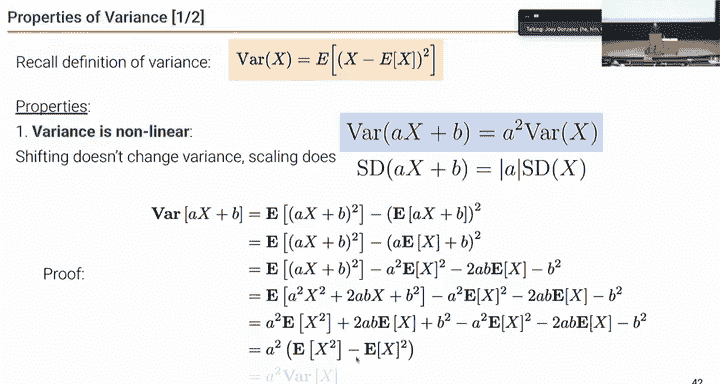

So this gives you again， the。This property that the variance of a plus b is a squared times the variance of x。

So these kinds of arivations， I do them because they're helpful to think about these properties。

 These properties are what we use to do interesting analysis with random variables analytically。

They're also again， useful。Tool useful exam questions。Worth practicing least。Okay。The other thing。

 unlike expectations， remember I said the sum the expectation of the sum is equal to these sum of the expectations。

 this is not true for variance。So the variance of the sum is equal to the sum of the variance plus the covariance of the terms。

Plus two times the covariance。I'm not going to do derivation for this。 You can work through it。

 It is linked in the slides。

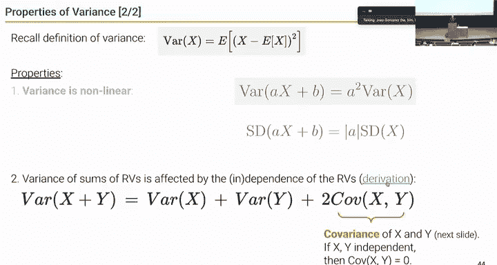

So the covariance is the expected product of the variations。We saw something like this in data 8。

 which I'll come back to a moment。 Let's just look at the definition for a moment here。 This is。

A lot like in fact， if x if y equald x， then I'd have back the variance of x。

 So I'd be saying x minus e of x times x minus e of x， which is just x minus x squared。

 which is the variance of x。So the covariance of x and x is just the variance of x。

 but the covariance of x and y is this notion of their joint spread。Okay。

Covariance has a neat relationship to correlation， which you would have seen in data 8。

 And I believe there's link to it as well。 So we can write this right here。

 If you look at this expression， this is a definition of the correlation coefficient that we learned in data 8。

 These terms here are constants。 So we can pop them out。 We pop them out。

 We're left with This piece up here， which is just the covariance。So the covariance。

 the correlation is just the covariance of x and Y divided by the standard deviation of x and y。

These are the notions of x and y in standard units。 And again， in data 8。 And I think this link。

 if not add。 The correlation is what gave us that first version of our linear model。

 the slope of the line。If I standardize my data， I look at the slope of the standardized data line。

 it is the correlation coefficient。

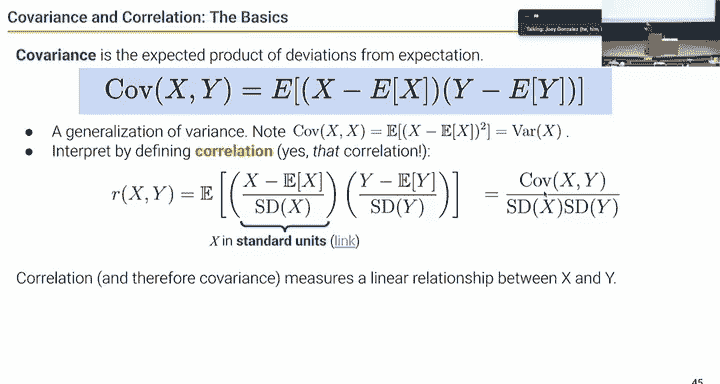

So it allows us to model a linear relationship， and therefore。

 the covariance itself is capturing this kind of linear relationship between X and Y。

So if x and y are correlated， then knowing x tells us something about y。But the opposite is not true。

 So if x and Y are uncorrelated， it just means that there's no linear relationship。

 It could mean that X tells us something about Y， just not in the linear sense。Da8。

 I think we use the example of a parabola where there's zero correlation between x and y。

But knowing X tells you exactly where you are on that parala。So x and Y are independent。

 then they're guaranteed to be uncorrelated， and the covariance will be 0。

 That's an important property。So if I know that these are truly independent random variables。

 then I can say their correlation or their covariance is0。And again。

 the converse is not necessarily true。Yeah， so they could be uncorrelated。

 but they may not be independent。Alright， so we've talked about independence。

 Another thing that's very important to know for this class is kind of various various notions of independence and a few key pieces of terminology。

So if you have two random variables， x and y。And x and y are equal。 Then we'd say x equals y。

It meansan。For every sample， for everything， every outcome。

 if we plug that outcome into X and we plug into Y， we'd see the same values for X and Y。Right。

X and Y are said to be identically distributed if they're drawn from the same distribution。

They're not equal。 There are different random variables。

 but they're drawn from the same distribution。They're equal in distribution。It confusing。

 so say again， they are drawn from the same distribution， but not equal in value。

It is worth knowing if they're equal value， then they are， in fact， identically distributed。

But the converse does not apply。

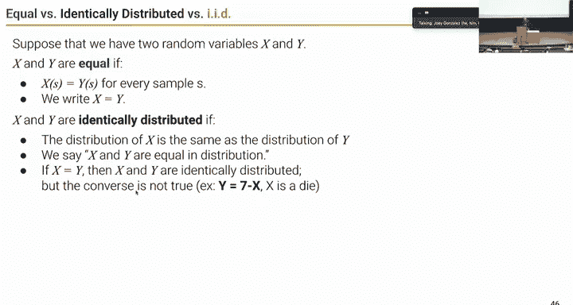

All right。The thing you most likely will hear in any data science setting is independent and identically distributed。

 It's so common we call it I I D。 So our X and y are drawn I I D。

 You might hear something like I sampled people from some population I I D。 So each。

 each thing I observed was。Independent， so I drew a completely separate sample each time。

 same sampling process， and the process was， in fact the same。 so they are identically distributed。

This means that knowing the outcome of x does not influence your understanding of the outcome of y。

And therefore， they're independent。Which comes from name independent and identically distributed。

More of this is covered in later classes concept of independence。

 It can get tricky as we start to think about。I don't want to tell you why it gets tricky because itll make this more confusing。

 So yeah， independence here， we're just going to say they're independent knowing something about X doesn't tell me anything about Y。

So a simple example of this would be if I'm flipping to independent die， I flip them。

 they're equally distributed this fair equal side11，6 probability for each face。

 then they're identically distributed， then they would be IID。是。

I want to come stop here for a second。We talked about sampling with replacement and without replacement。

 So if I'm sampling from some population。With replacement。And I draw two samples。

And I'm sampling from some population。Without replacement， and I draw two samples。Are both those IID？

Let's talk about width replacement。So I pull someone in from the class。

Where' did you get on the midterm， okay？Put them back。 and I pull another person from the class say。

 would you up in the midterm， So they're independent， because I'd say I。

Do this process in a proper way， so they're separate completely separate draws。

Are they identically distributed？more concrete， let's go over here。

 So I pull someone from the class and ask them what you do on in the midterm you stand over there。

 but I pull someone else from the class。The problem is that that second draw。

 this person can't be in it。I changed the class。So when I don't put the person back。

 they're no longer IID。So when we do this statistical analysis， we often try to frame things as idea。

 That's why I say when we do the analysis， we'll assume we put the person back because we don't want to change the distribution。

Now， when the class is really big， the chance that I would have pulled that person again is pretty small。

So for very， very large sample or very large populations。

 the difference between sampling without replacement and sampling with replacement。Is negligible。

 we don't worry about it。 But for smaller populations。

 for smaller things I'm sampling from that first sample， if I don't put that person back。

 I could change the distribution for the subsequent samples。And so I can't assume things are I。

 And then the tricks and analysis I would apply become far more complicated。

I'll show you in a moment where this would break down。All right， so。Let's look at two variables have。

I have X 1 and X2。 These are numbers on my role of my die。

 We already calculated their variance and their expectations。 So I'm rolling to die X1， X2。

I'm going to find two variables。 Y equals 2 x1， and z equals x1 plus x 2。O。

So these have different distributions。So sum of two independent IID variables。

 this is just two times one of them。You can think of this as x1 plus x1 as well，So to depend。はい。

I want to do this。Yeah， so what is the expectation of this。

 We can use our earlier properties of expectation， two times expectation of 7 over two or just 7。

 What's the expectation of this。So sum of expectations， right， It's also 7。O。So same expectations。

What about the variance？So drive the variance。So the variance of the first one。

 we can drive it a couple ways I'm going to use you could look at the covariance do the simple。

 so the variance of two times x1 is four times the variance of x1， which is  four times 35 or 12。

 or roughly 11。67。Is this other one going to have a higher variance or lower variance？

Who says higher？Who says lower？Ler。Ler。Okay， let's see。So to compute the variance here。

I'm going to take the variance of x1 plus the variance of x2。 I said they're independent。

 the covariance goes to  zero。 So I don't need to consider this term。

So I get the variance at 35 or 12 plus 35 over 12， the variance of x1 x2， we had this up here。

 gets 5。83。 Why was that lower？Yeah。嗯。That's right。

 The problem is that his tails went down and had have more mass pulled into the middle。

There's many more ways to get to the center。It distribution。There's more ways to get7。Right。

You can also see from distribution。 Which one has more spread one's pre spread out。

 They both go to the same extremes， but hear a lot more mass in the middle。

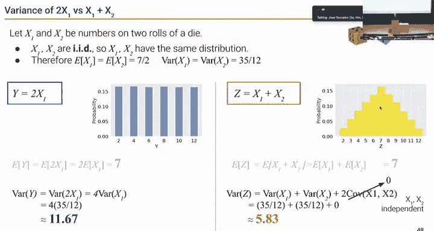

Right。I think。

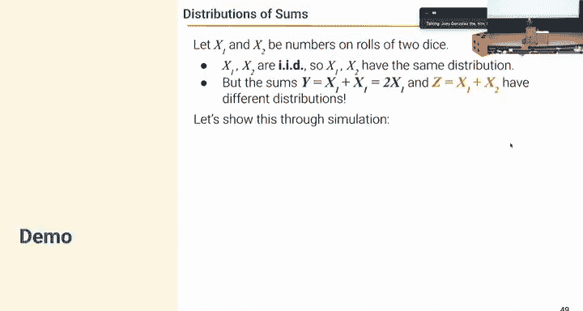

I have a simulation that's posted in the code where you can actually work through this process where we actually simulate。

 I think 8000 draws from both these random variables in the interest of time I'm actually not going to go through the simulation。

 but I encourage you to take a look at it， I think in lab in future assignments you'll use some of the basic code。

It's pretty basic， so definitely take a look at it， but I'm going to skip it for lecture。

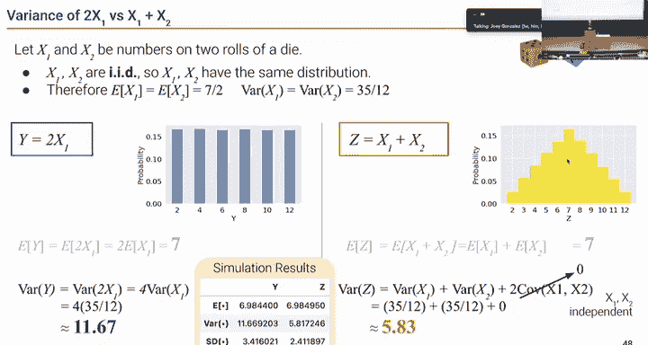

Alright， demo for distribution of sums。 we compute these expectations。

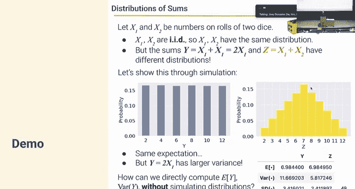

Now let's see how wed calculate without simulating， for sure you did。Okay， so。

I want do a quick recap of where we are at this point。 So we defined expectation and variance。

 We gave one definition of expectation， two key definitions of variance that you should know。

 We showed you some important properties of expectations and a variance， which you should know。

 and then some more important properties about sums of variables。

 both their expectations and their variance。Any questions at this point。

Free start to generalize this stuff。

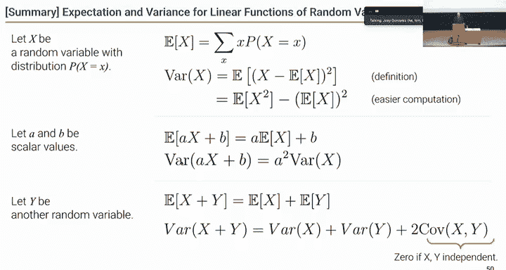

Keep going， right。Earlier， I said we'd introduce some distributions。

 We already told you about the Bernoulli。 We can do our analysis of the variance and expectations of a Bernoulli distribution。

 and we can do this by operating directly on that definition of the Bernoulli。

 which is p times 1 and 1 minus p times 0。 So expectation is easy。哎。

What's maybe more interesting is the variance。 So we can do this same calculation for the variance。

 We use the the the computational form， and we get the variance as P times 1 minus P。

So think about that for a moment， that means that if my coin is really fair， so close to 0。5。

 it has the highest variance in its outcomes。If my coin is less fair， it's more1 or more0。

 it has the lowest varianceance。 So the highest variability of this random variable is when p is at 05。

It's worth knowing this also using an indicator， I't know if I said this earlier so often when trying to calculate sums of things that could happen or fail。

 we't introduce a Brnoulian say this is random variable that could be no success of one and fail of zero we're going compute expectations of successes so we take sums of those there's a particular form of that that we care a lot about which is the binomial distribution。

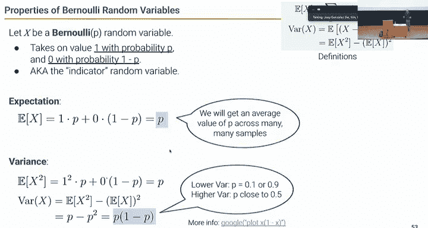

Which is essentially the sum of N independent Bernoli trials。

 So I take N I I D flips of a coin of a Bernnoli trial。 I take their sum。

 I define that as y Y is now binomially distributed。

We're only going to cover two distributions in this class。

 but actually you can do things like take squares of things and they also have name distributions and in statistics。

 a lot of study was devoted to understanding these kinds of distributions in their properties。

But we're going to just focus on a few basics。So binomial has the binomial distribution。

 so there's a nice closed form equation for cculating the probability。

 so n choose y times probably sort of how many times if I have three successes out of let's say n trials then I'd say let's say it's 10。

10 trials， three successes， so 10 choose 3 times the probability of a success to the three times one minus probability of success to the 10 minus3。

7。We can write this as a sum of Bernoulli trials， as I said earlier。

 and we can use that to analyze the expectation， so the expectation of why is just the sum of the expectation of each of those trials or if there are n trials that is n times P because we know the expectation of a single Bernoulli trial is P。

Likewise with variance。We use the same kind of analysis here， all of the coin flips are independent。

 so all the pairwise covariance terms disappear， and we're left with just n times the variance of the individual Brnoli trials。

P times 1 minus P。对。Two key distributions。

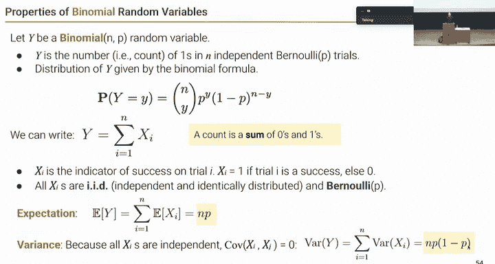

I want to wrap up today's lecture by connecting from populations to samples。

 and then in Tuesday's lecture， we'll actually use this to analyze this biospherance trade off。

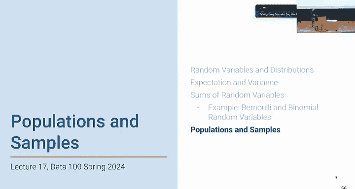

All right。So we've talked today about probability functions of our populations。

And now I want to answer questions about samples that we draw from population and how we can use the tools we just built to reason about the properties of these samples。

And we've been sampling uniformly at random with replacement， and by making it with replacement。

 we can start to treat these samples as IID， and it'll in a moment make this analysis much simpler。

 so if I had sampled n samples from some giant population uniformly at random with replacement。

 I would have NIID samples from that distribution。

嗯。I'm going skip this slide。 in。In the notebook we demonstrate how to do this sampling process。

 you can think of this general idea of I have a huge data frame that the population I don't typically have access to。

 I'm building some sample with replacement of that data frame。

 and I want to reason about properties of that sample。So here I'll use big N， I guess。

 to be the population and little N to be the sample I've constructed。

And these are IID。Yeah， so I think the easiest one， to analyze here is the sample means。

 So let's use as an example。 So again， I have the population of all people。 It does have a mean。

 It has an average。 That is the thing that I wish I knew， but I don't know it。

 I get a sample of that thing。And I take the average of my sample。That average is a random variable。

Now I want to use the tools of random variables to understand the relationship between that sample and the mean that I didn't get access to。

So that's population mean is that fixed mean for the population。

 And then I have this sample mean which I computed using nupy do mean on the data that I have。

Alright， so to see this。The mean of my data， because my data is random。

 It's random because I sampled with replacement is just the。没有。Weve got even random variable names。

 So I'm taking the mean of the grade and my of the midterm grade。

 So each each student student S has a midterm grade X I of S is their their corresponding grade。

I want to compute the mean。 I want to estimate the mean from the midterm by taking just my sample。

 When I do that， I take the average of these random variables for the let's say 10 people I sampled that is a sum of random variables that is this sum of random variables These X bar here to be the random variable denoting the mean of my sample。

Asampble me。So we can use expectation， linear of expectation to compute what this is。

And this is the cool part。 So if I apply linear of expectation。

 it is the sum of the expectations of X。Now， I don't know the population mean。

 That's the population parameter mu。 I don't know it。But the cool thing is because these are drawn I。

This meme。That mean I computed on my data over here。Its expected value is the population mean。

That's great， right？So the expected value of my sample mean is the population mean。

 This is called unbiased。This is an unbiased estimator。In expectation， you'll do the right thing。

Is it a good estimator？Well， there's another thing we think about， the variance。

How variable will this estator be。 We do the same kind analysis。 So take the variance of this sample。

First， the population， sorry， the variance of x have this one over n that have to pop out。

 becomes one over n squared。Times the variance of the sum。Their I I D。

 I really want this with replacement， right， So their I D， the covariance has disappeared。

 I don' have to worry about that。So I just take the sum of the variances。Again， I don't know Sigma。

 That's a population variance， right。But I can say that sum of the variances is n time sigma squared。

Have one over n squared。 So I get the variance as sigma squared over n。

This is a key result from data 8。 just derived it using a few identities。

 I can take something I've computed。 This mean I know that in expectation， it's good。 Great。

 I also know that it's going to get closer and closer。😊，This variance is going to decrease。

As I increase in。Liineterally， the variance sequences linearly as I。

 as I get a bigger and bigger sample。But of course， there's this pesky sigma squared。

I don't know what it is， but if there's a lot of variability in my population。

 I'm going to need a bigger sample。Right。Now， we could ask。

 does this variance of my sample estimate sigma squared。

So the variance itself is another random variable that I can compute on my sample。

 I compute the the equation per variance on my， my data。 that gives me a number。Right。

 calculate the variance。 That number is a random variable。

Does that match the variance of my population？I won't do that analysis here。

But you might have seen this sample variance equation where have this weird n minus-1 thing going on。

That's ensuring that that variance actually has an expectation。

 matches the variance of my population。Again， we won't come to that outcope for this class。

 at least for this lecture。We just analyzed the mean， the mean of my sample。

 and again showed that the expectation matches the mean of the population and the variance decreases by one of red。

Questions。It's big stuff。And then I think in data， we use the standard deviation。 Unfortunately。

 the standard deviation， the right units decreases whenever root end。 But again， for large n。

 this can squash quickly。Allright，The last thing that I won't prove is that this is also normally distributed by the central limit theorem and that is for very large n。

 these things will look kind of like a Gaussian。 the distribution of this statistic will look like a Gaussian and that means if I take lots and lots of samples with replacement and I get lots and lots of X bars and I plot the histogram of those x bars that will look more and more like a Gaussian like this bell curve。

Okay。And this is true， no matter what the population distribution is。

 as long as it's sufficiently large。Okay， so how large does have to be， Well。

 that sort of depends on the shape of population distributionbut。 If it's not regular。

 then you're gonna to need a really large sample。 But if it's sufficiently large。

 there's a large enough end for which this will be a true statement。It is nice。Okay。

We will cover bootsshop hopefully in a week or so。 it was also covered in day8。

 It's a way of simulating from the sample we have to try to guess the distribution of that statistic for the population。

You at the center and the spread determined by these two parameters。

I think I've redund it slide okay。用不さ。I think I have a demo。

 but I think I'm going to skip it in interest of time。Yeah， actually。

 so I already said this but I want to just reiterate once more。

 So the expectation of x is an unbiased estimator of the mean， which is the sorry x bar。

 the sample mean is an unbiased estimator of the， the population mean。 And we showed that。

 and it has a spread that we already defined， which I'm gonna。

P， this is a square root law from day8。Right， so we actually finished。This is。

These are the basic concepts you need。 Actually， we go back to a more useful slide。

 These are the basic concepts you need for the next lecture。

I might have gone fast through the。

Go back one more slide yeah so these are the concepts you need for the next lecture if you were to review something you should work through these maybe there are some proofs I didn't show you could try to practice those proofs in the next lecture we're going to go a little faster and apply these rules to actually try to calculate the bias varianceance tradeoff for a model that's estimated using the squared loss we're going to treat that model itself as a random variable and study its properties。

That's it。 I will see you all Tuesday。