# 课程17：随机变量与概率基础 🎲

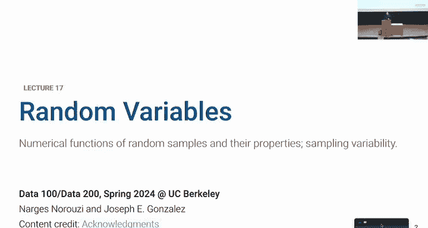

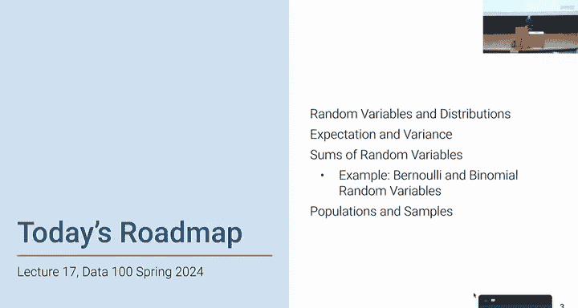

在本节课中，我们将学习随机变量的基本概念，包括其定义、分布、期望和方差。这些工具对于理解后续课程中的偏差-方差权衡分析至关重要。

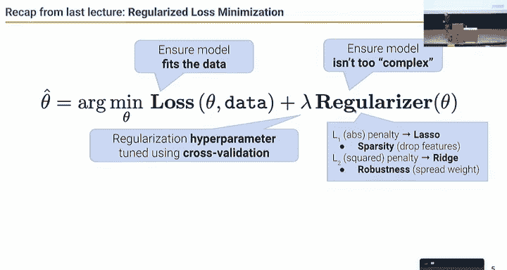

---

## 概述

上一节我们介绍了正则化作为管理过拟合的工具。本节中，我们将转向一个新的主题：随机变量。我们将探讨为什么需要学习随机变量，并回顾一些基本概念，为后续的深入分析打下基础。

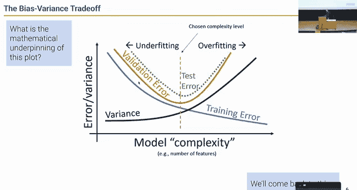

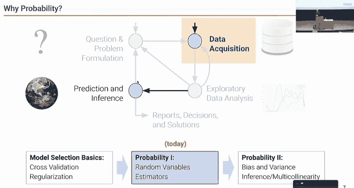

---

## 从正则化到概率

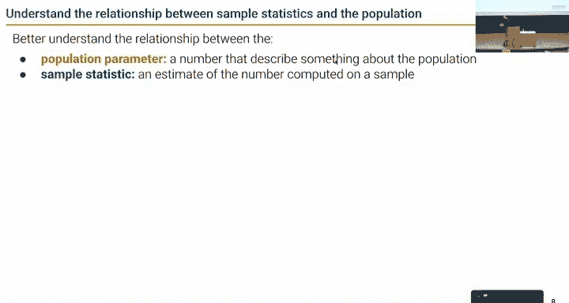

在上一讲中，我们开始研究正则化的概念，将其作为管理过拟合过程的工具。我们讨论了交叉验证。以下幻灯片总结了我们在建模方面迄今为止构建的所有内容。

我们花了很多时间思考损失函数，这是我们确保模型（由参数 θ 决定）拟合数据的方式。我们看到了 L2 损失、绝对损失的变体，本学期还会看到更多。

在上次讲座中，我们引入了正则化器的新概念。这是我们目标函数中的另一个项。我们试图最小化损失加上正则化器。正则化器只是我们模型的函数，它不了解数据。它的存在是为了确保模型不会太复杂，也许是为了确保我们不会使用太多特征。

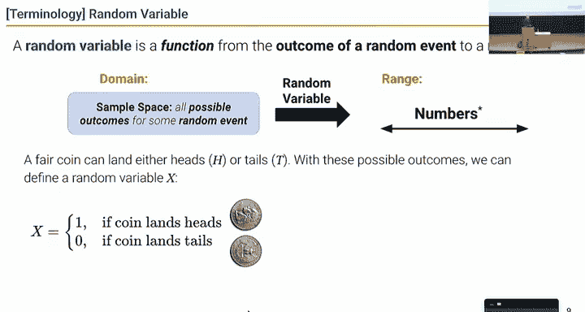

然后我们还引入了正则化超参数的概念。这是 λ，我们调整它以设定模型在尝试拟合数据与保持模型不太复杂之间的权衡程度。

我们说我们会使用交叉验证来调整这个参数（这个超参数）。因此，我们取一部分训练数据，保留一小部分。用这个损失拟合我们的模型，然后回来评估它的表现。如果它不能很好地拟合我们保留的数据，但能很好地拟合我们的数据，那么我们可能对数据过拟合了，并且没有泛化到这块保留的验证数据。通过交叉验证，我们将调整 λ，使其既能拟合我们已有的数据，也能拟合我们没有训练过的那一小块验证数据。

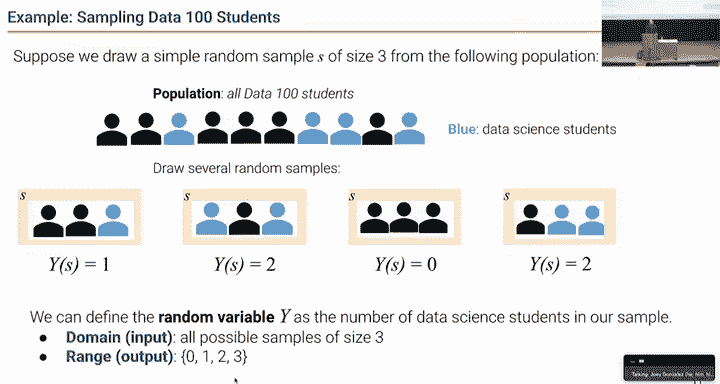

对于正则化器，我们已经介绍了两种形式。它们实际上相当复杂。第一种是 L1 正则化（平方），它试图通过将特征归零来使模型更稀疏。另一种类型的正则化是 L2 惩罚，取所有模型参数的平方。这有时被称为岭回归或岭正则化，它试图鼓励鲁棒性。为什么？因为它说，不要在一个特征上放太多权重，要分散开，因为如果你在一个特征上放太多权重，你会受到这个二次惩罚。所以最好将权重分散到各个特征上。

我们讨论了如何调整这些，如何管理过拟合过程。支撑整个概念的是这样一个想法：当我们的模型拟合数据时，不要偏向于正则化器（在这种情况下，我们将模型偏向于 0）。如果我们把这个正则化参数调得非常大，它说，最好的模型是全零模型。总是预测零。它将是一致的，没有任何可变性。每次你拟合任何类型的数据集，你都会得到全零，但它偏差很大，并不能真正解释我的数据。所以存在偏差，也存在方差。如果我将这个正则化参数设置为零，模型会精确地拟合给定的数据。你得到不同的数据片段，它会为那个不同的数据片段拟合一个非常不同的模型。存在方差。我们试图平衡这两件事。

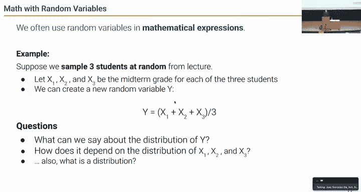

我们有一个图表。实际上，当我第一次教这门课时，我就做了这个图表，它保留了下来。模型复杂度（某种意义上的复杂度，我们使用的特征数量，以后可能意味着神经网络的层数）随着复杂度的增加，我们拟合数据的能力（我们在拟合数据上的误差）会下降。复杂的模型确实能很好地拟合我的数据。误差下降，但我的模型的方差（可变性）上升。因此，当我查看验证误差（我没有拟合但保留的数据）并与之比较时，我希望有良好的验证误差，因为这是对我的模型在现实世界中表现的一个猜测。我只是保留了一些数据，没有看它。就像你参加考试，你保留一些练习题。你做几次模拟考试。然后你说，好吧，我想我已经为现实世界准备好了。让我们检查一下，拿出你还没看过的题目，看看做得怎么样。好吧，去参加考试吧。

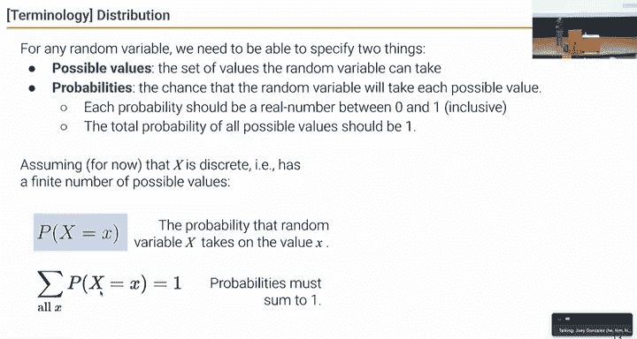

我们试图调整到验证集误差最低的点。所以我们取验证数据，我们将得到超参数模型、复杂误差模型，从而得到最低的验证误差。我们希望这是对我们在现实世界中表现的一个良好猜测。

当我刚开始教这门课时，我直接跳入了我认为是这门课数学中最令人兴奋的讲座，即对基本偏差-方差权衡的深入统计分析。我意识到，讲座后的学生们没有基本的概念来理解这个非常酷的统计讲座。所以我们已经修复了这个问题。这就是为什么我们要先讨论随机变量和概率。有了这些工具，再回来进行偏差-方差权衡的分析。

这种方法的另一个好处是，你可以学习更多的基本工具，这些工具将帮助你去学习 Stat 140，或者即使你不去学习概率，你也会有一些基本的随机变量知识，可以在分析复杂概率场景时使用。

好的，这就是计划。我意识到我应该在这里快速暂停一下，到目前为止有问题吗？没有问题。好的，继续。那么，概率。

我们使用概率的目标是试图理解我们拥有的样本（我们拟合模型的数据）与世界将发生的情况之间的关系。我们将使用这些概率工具来尝试推理我们的样本与世界之间的关系。

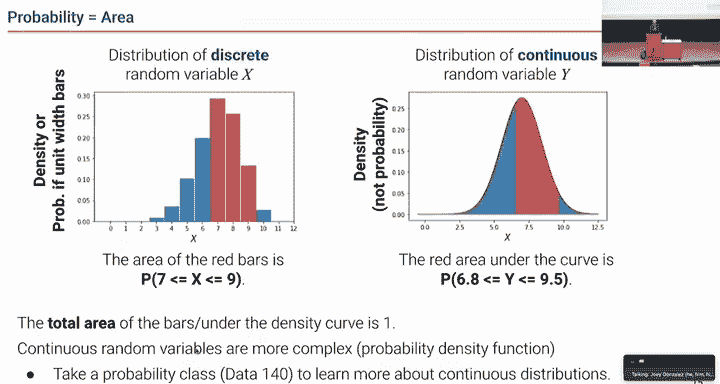

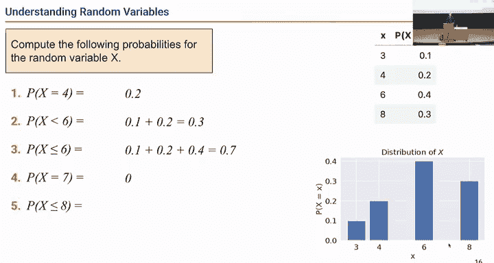

我们将有总体参数的概念。这是一个奇怪的想法，但我们将想象，如果我们为整个世界拟合一个模型，它仍然是一个模型，它不会正确预测一切，但会有一组参数，如果我拥有所有数据（假设总体是整个班级），如果我取这个班级所有学生的成绩并试图预测他们的最终成绩，我可以拟合某个模型，它有一组参数，这些就是总体参数。但在实践中，我只看到这个班级的一个学生样本。例如，我只能看到讨论课上的学生，所以现在我有一个样本。我将在我的样本中拟合一个模型，我想知道得到的模型（我得到的 θ）与我如果拟合整个班级会得到的真实 θ 有多接近。

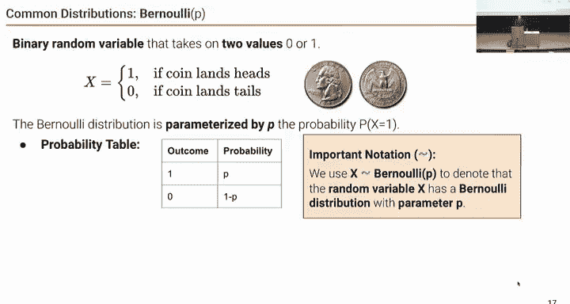

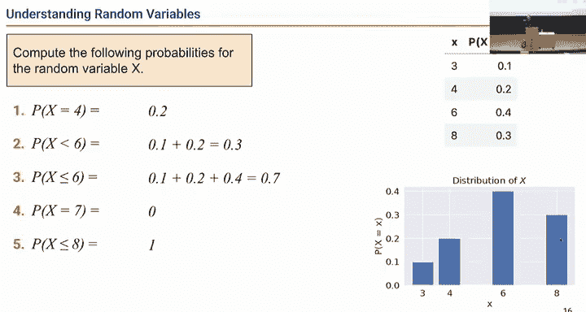

明白了吗？因此，我们想要研究的随机性来源是这个抽样过程。所以我处理一个样本，我拟合估计参数，关于我的样本的东西，我想知道它们与我如果构建了总体参数会得到的东西之间的关系。

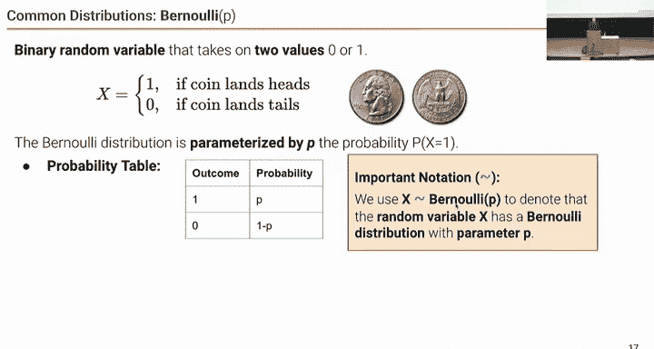

所以总体参数是描述总体某方面的一个数字，可以像均值一样简单，也可以是我如果拥有整个总体将会拟合的线性模型。样本统计量是我得到的样本均值或我拟合的模型。

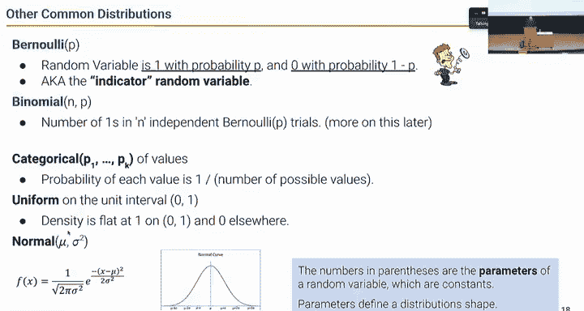

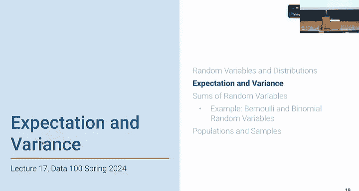

我们将专注于本讲座中的均值。在 Data 8 中，你们做了很多关于均值的工作。并非所有人都上过 Data 8，但它是这门课的要求，不过一些研究生可能没有上过。我在这里提供了 Data 8 材料的链接。如果你上过 Data 8 但忘记了，你可以回去点击那个链接；或者如果你还没有机会上 Data 8 并且你是研究生，请使用这些链接并尝试复习一些材料。所以你定义了样本均值。事实上，Data 8 的全部重点都在于：这是你的数据，总结你的数据。所以我们在 Data 8 中花了大量时间理解我们拥有的数据，描述我们拥有的数据，然后有时对这对总体意味着什么得出模糊的结论。

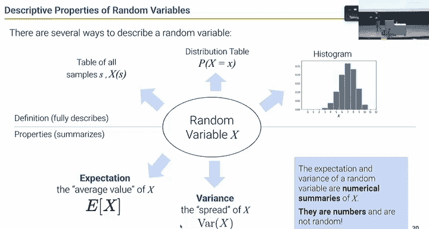

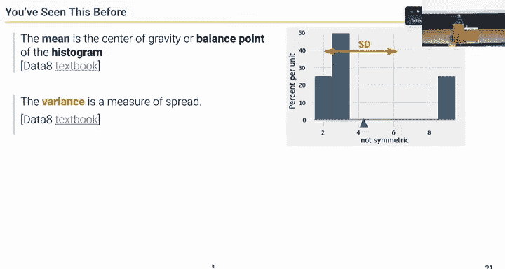

我们在 Data 8 中引入的其中一个结论是中心极限定理。这是一个重要的概念。我们在 Data 8 中没有证明它，这里也不会证明，但我们会推导部分内容。如果你抽取一个大的随机样本（有放回），那么无论总体分布如何，样本均值（你在样本上计算的均值）的概率分布首先对于足够大的样本将大致呈正态分布。它将以总体均值为中心。这很酷。所以你得到的样本很可能以总体均值为中心。如果你重复这样做，你会得到一堆不同的样本和一堆不同的样本均值，这些均值的标准差将作为总体大小的平方根的函数而减小。标准差会减小。这意味着我们将有一个常数，即总体标准差（我们通常无法获得）。但它给出了我们数据收敛速度的概念。我们在 Data 8 中使用它来思考如何选择正确的样本量。

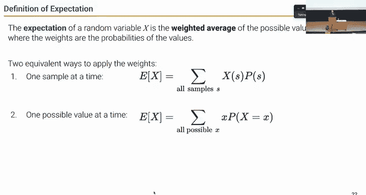

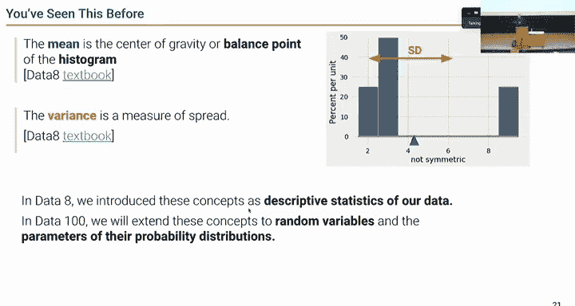

好的，那么今天，我们将尝试使用随机变量以及期望和方差等计算来理解其中一些概念。

我必须说明，我们不会涵盖作为数据科学家应该知道的所有概率材料。我强烈鼓励你考虑选修 Stat 140。这是一门很棒的课程，它将更详细地涵盖我将要说的很多内容。那些上过 CS70 和 CS126 的同学也涵盖了一些这方面的材料。

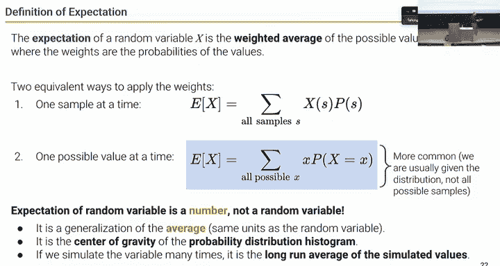

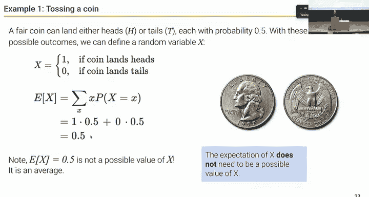

---

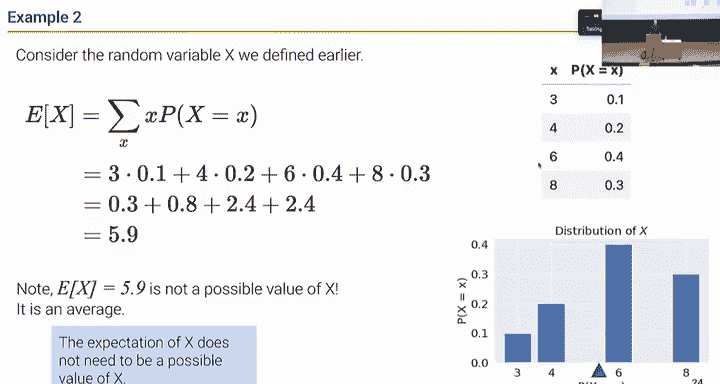

## 什么是随机变量？

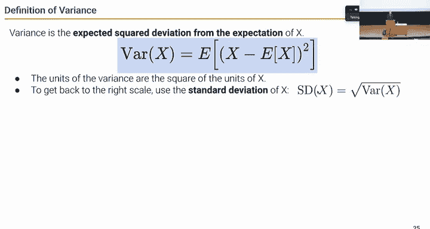

这是一个令人困惑的术语，因为它不是变量，而是一个函数。随机变量实际上是一个从某个随机事件的结果映射到数字的函数。从技术上讲，它可以是更一般的东西，但为了本课程的目的，我们将其映射到数字。

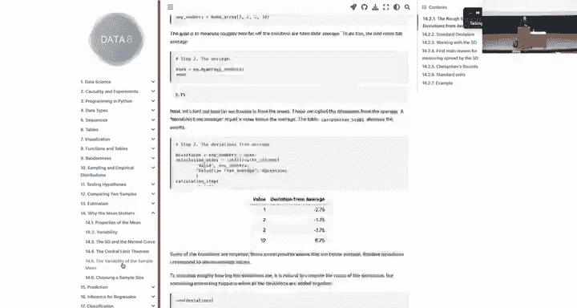

举个例子。取一枚公平的硬币。公平的硬币据称正面朝上的概率为 50%，反面朝上的概率为 50%。我可以创建一个随机变量 X，如果硬币正面朝上则为 1，如果反面朝上则为 0。

定义域是我的样本空间的输入。我可能有正面或反面。值域（输出）是 1 或 0。我们有时会在讲座中使用一种表示法来明确这是一个函数。所以它是一个从实际样本本身到数字的函数。我们不会经常使用这种表示法。

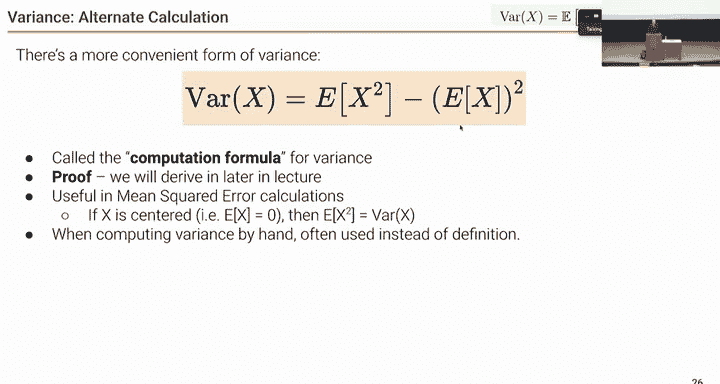

我不会继续这个题外话。有一个有趣的题外话：硬币实际上并不公平。你可以查看这项物理学研究，关于硬币如何根据你实际抛掷的方式存在一点偏差。硬币是公平的，但人类抛掷得不公平。

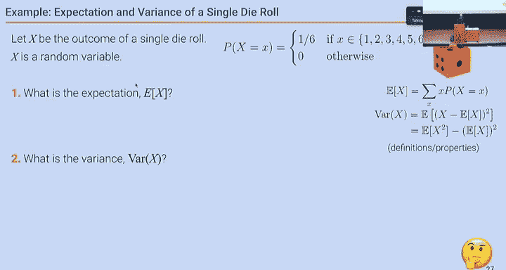

首先，重要的表示法。随机变量通常用大写字母表示，如 X, Y, Z，而常规变量或值（数字）通常用小写字母表示。这门课中一个常见的混淆来源是我们经常处理像大 X 这样的矩阵。我们偶尔也会用大写字母来表示矩阵。我认为我们过去曾尝试使用双线 x 来更清楚地表明这是一个矩阵，但我们会尽力从现在开始明确表示，而不涉及矩阵或随机变量。

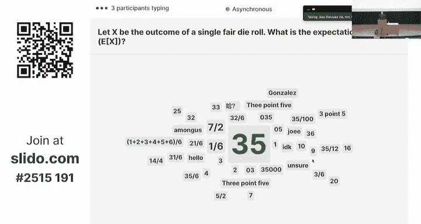

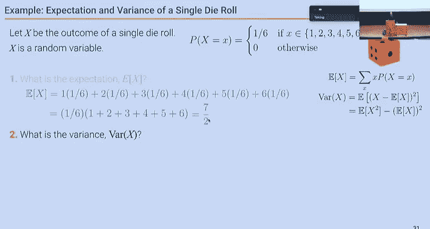

好的，让我们看另一个随机变量的例子。假设这是我正在研究的数据科学 100 课程的学生总体。在那个总体中，标为蓝色的学生是数据科学专业的学生。如果我抽取一个大小为 3 的样本，我可以为该样本创建一个随机变量，即该样本中数据科学专业学生的数量。所以随机事件（随机性的来源）是抽取三个人。我得到一组三个人，那是我的 S。我的随机变量是从那组三个人到其中数据科学专业学生数量的函数。

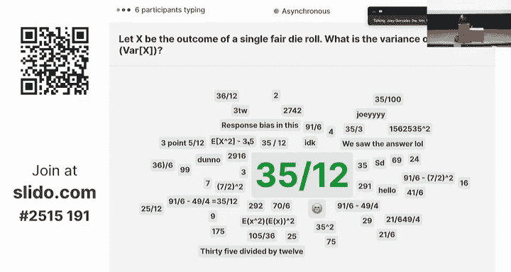

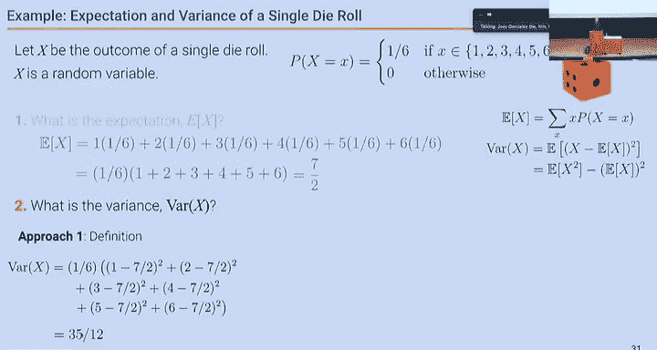

所以你有很多不同的结果。我抽取不同的样本，得到该随机变量的不同值。这就是为什么人们认为它是一个随机变量。它是一个具有随机值的变量，但这并不是正确的思考方式。它没有值。它表示从样本空间到特定数字的映射。

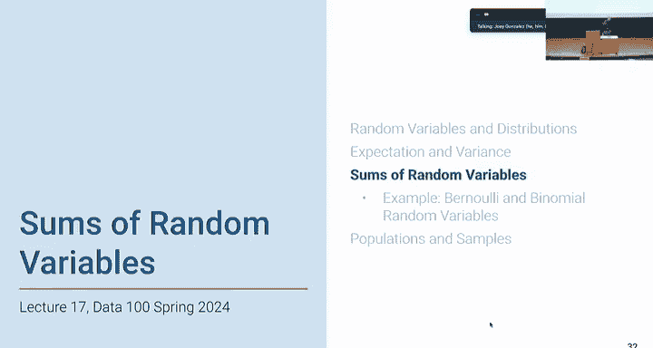

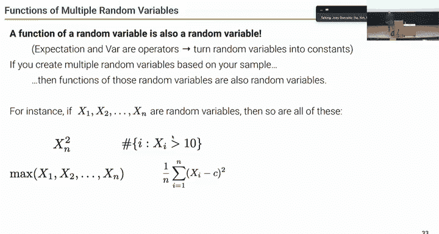

所以你定义随机变量 Y 为我们样本中数据科学学生的数量。输入域是班级中所有大小为 3 的样本（一组三个个体），值域是 0, 1, 2 或 3。

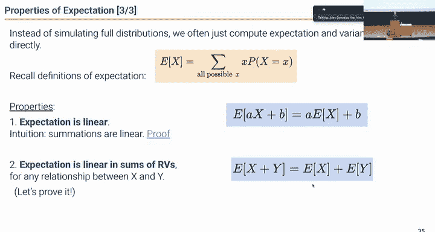

本讲座的重点以及我们为未来讲座进行所有这些讲解的原因是，我们倾向于在有趣的数学表达式中使用随机变量。我们希望通过推理这些随机变量的属性来推理表达式本身。

举一个简单的例子。也许是及时的。我从讲座中随机抽取三个学生。让 X1, X2, X3 为每个学生的期中成绩（从学生到其中期成绩的函数）。我可以创建一个新的随机变量 Y，因为它是随机变量的表达式。我可能想知道这个随机变量 Y 是什么？它本质上是三个学生成绩的平均值。它的分布是什么？我能说出它的什么属性？它如何依赖于我所抽取学生的分布和属性？同样关键的是，它是一个分布，我们现在应该将其形式化。

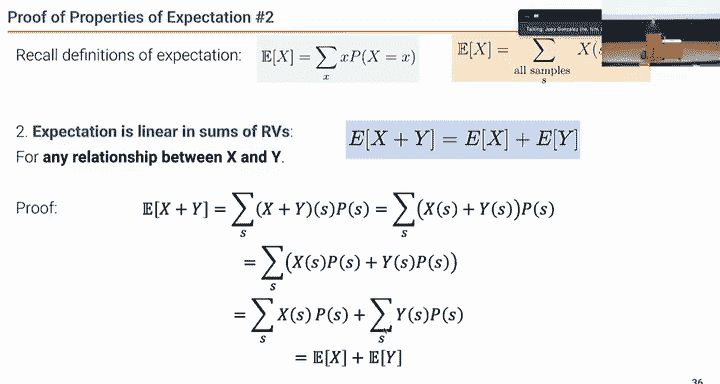

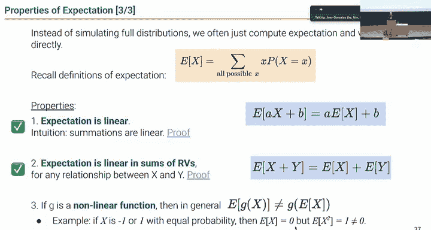

但很多工作我们将思考这类函数，我将在讲座后半部分回到这一点，当我们开始对随机变量使用运算符时。

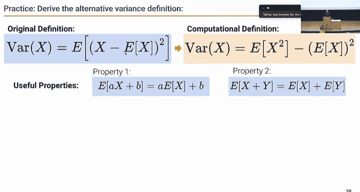

---

## 分布

分布是一个重要概念。对于任何随机变量，我们需要能够指定两件事来定义其分布：
1.  该随机变量可以取哪些可能的值（即其值域）。
2.  随机变量取每个可能值的概率或机会。

每个概率应该是一个介于 0 和 1 之间（包括 0 和 1）的实数。它可以是 0 或 1。所有可能概率的总和应该等于 1。非常重要。这是概率的公理。

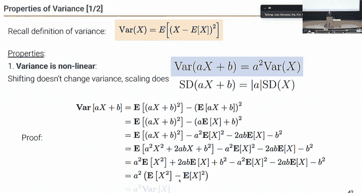

好的，假设现在，我们将专注于本讲座中的离散随机变量（即取有限个值的变量）。我可以用这个表达式写出随机变量 X 取值为 x 的概率：`P(X = x)`。例如，如果 X 是硬币正面朝上为 1，那么说概率 `P(X = 1)`。如果我这样写我的概率函数，那么我应该能够说，对于 X 可以取的所有可能值，如果我求和概率，它们应该等于 1。

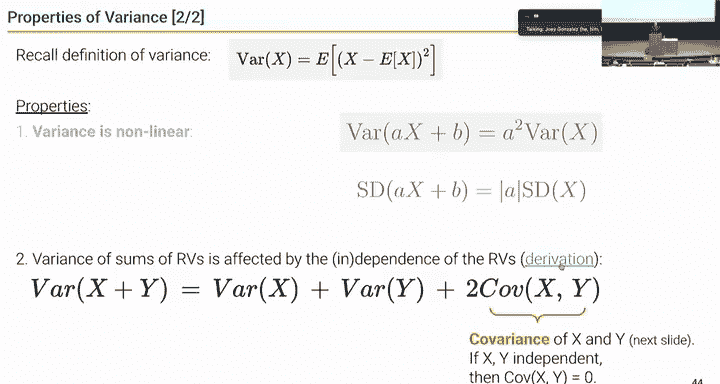

在思考这些离散值时，使用概率分布表很常见。这里我们有一列，是 X 可以取的可能值，另一列是每个值的概率。一个分布完全定义了一个随机变量。如果我告诉你分布，我就告诉了你关于该随机变量需要知道的一切。我告诉你它的值及其概率。我可以计算属性，所以如果我给出分布，你可以开始推导随机变量的属性，我们稍后会讲到。你也可以从中进行模拟。这实际上是我们在 Data 8 中引入的一个强大工具。当我不想使用我们现在教你的数学时，我通常可以从我的随机变量中抽样，创建数据。如果我创建足够多的数据，我可以开始使用数据科学库 pandas 等工具，通过计算绘图统计量来回答关于该随机变量属性的问题。

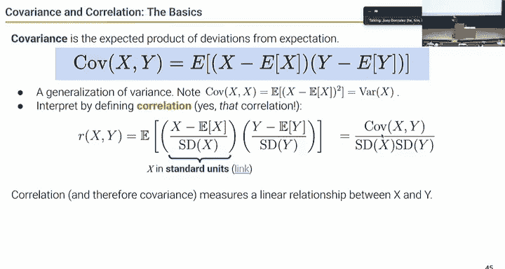

所以模拟是一个非常强大的工具。今天，我将尝试在 Python 中涵盖一些模拟。在这门课中，我将专注于 NumPy 的随机库，但如果你想更深入，有 scipy.stats 等工具用于从不同类型的分布进行模拟，这些工具对于尝试推理变量的复杂属性非常强大，否则需要更高级的计算。

当我们进行模拟时，随机变量经常有一个混淆点。如果我抛一枚硬币两次或三次，假设它出现正面、正面、反面。这是一枚公平的硬币。正面朝上的概率是多少？你可能会说，公平的硬币，正面朝上的概率是 0.5。这是一个答案。那将是我有一个总体的情况。事实上，对于公平的硬币，p = 0.5。但是，我取了一个样本。我抽样了几次，我可以在这里计算一个直方图，它是三分之二正面，三分之一反面。这是一个经验分布。这是我观察到的该随机变量的分布。在实践中，当我们的经验分布足够大时，我们通常将其视为实际分布的近似代表。通常，我们可能实际上并不知道真实的分布。所以我们只能测量经验分布。我们将再次尝试推理经验分布与该变量的实际真实分布（总体分布）之间的关系。

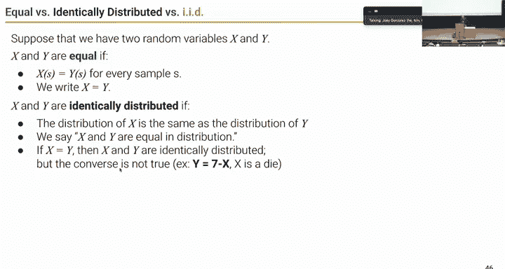

我提出这一点是因为有一个有趣的例子。如果我抛硬币两次都是正面。下一次抛掷时，它出现正面的概率是多少？好吧，根据经验分布，它出现正面的概率是多少？经验分布是我观察到的，我抛了两次，两次都是正面，零次反面，所以两次中有两次是正面，两次中有零次是反面，所以正面的概率是 1，反面的概率是 0，这就是经验分布。谁想赌这个？抛一枚硬币，你会接受这个赌注吗？是的，所以当我们思考小样本的概率时，这是一个挑战。不清楚我们是否可以将这些分布视为我们更大分布的良好近似。事实上，如果你进入更高级的统计学，有一些方法可以处理这类情况，使用先验或其他知识，这超出了本课程的范围。我只是想让你理解经验分布的概念，以及当我们有很多样本时它们可能很好，但当我们样本非常小时可能就不那么好了。

好的，到目前为止有问题吗？再次强调，这是你过去见过的东西。我们对分布进行了可视化，我们构建了直方图，我们构建了 KDE 图。直方图为我们提供了一种查看离散变量概率的方法，KDE 图用于具有这些连续分布的连续变量。这里有一个重要的点。所以如果我想计算一个值范围的概率，我会查看曲线下的面积。所以如果我在 7 和 9 之间，对于这个概率函数，X 在 7 和 9 之间的概率是多少？我取这些红色条的总和。如果 Y 是这个连续变量，它就是这条曲线下面积的总和。重要的警告：连续分布很奇怪。这个东西的高度不是概率，而是密度。所以对于离散分布，这些可能大于 1，但密度函数可以。所以你实际上不能问 Y 等于 7.5 的概率是多少？你无法回答这个问题。它必须是一个值范围。对于连续分布，对于离散分布，我问，7 的概率是多少？这个条的面积。如果这个条的宽度为 1（对于基本直方图通常如此），那就是条的大小，给我一个概率。但你应该检查，宽度是 1 吗？因为如果不是，它就是密度。只有当宽度为 1 时，你才能幸运地称其为概率。有问题吗？红线下的总面积应该是 1。同样，对于连续随机变量，我们必须查看一个值范围，不能查看该变量的单个值。

---

## 快速练习

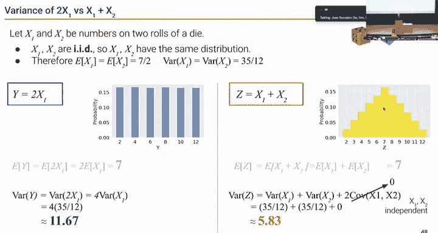

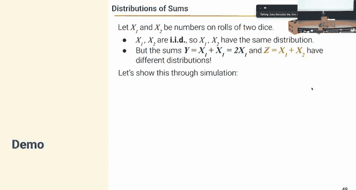

以下是一些概率问题。这里有一个概率表，这是分布。那么 X 等于 4 的概率是多少？这应该很容易，试试看。所以概率 `P(X = 4)`，就是这个条。我说过这些条的高度，所以这些条的宽度是 1。这些条的大小就是概率。是 0.2。

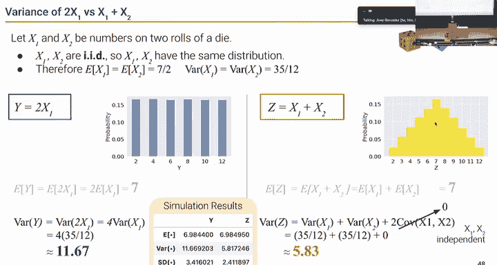

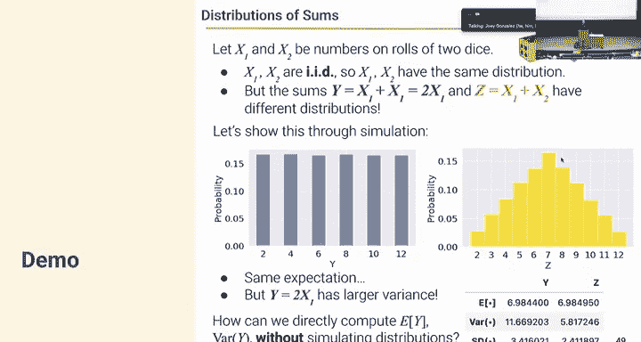

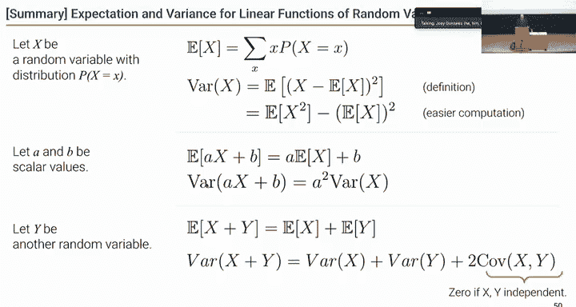

`P(X < 6)` 的概率是多少？这些都是很好的考试题目，所以应该很容易回答。`P(X < 6)` 不包括 6，但它是曲线左侧的面积。所以是这个条的面积，0.1 加 0.2，0.3。

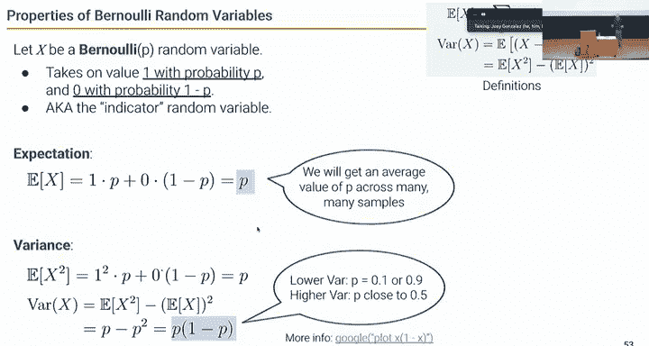

`P(X ≤ 6)` 包括这个条的面积。所以是 0.1, 0.2 加上 6 的条是 0.4，所以是 0.7。

`P(X = 7)` 是 0。跳到前面，7 处没有条。所以 X 等于 7 的概率为 0。

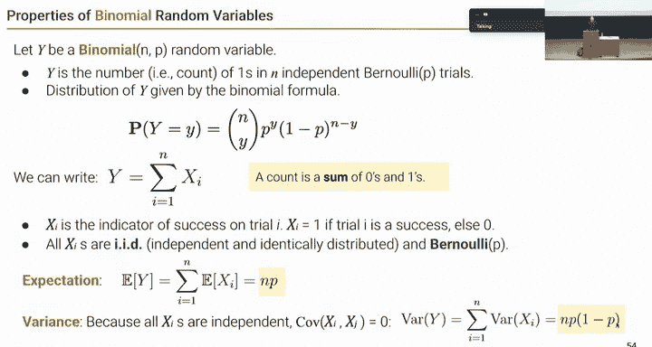

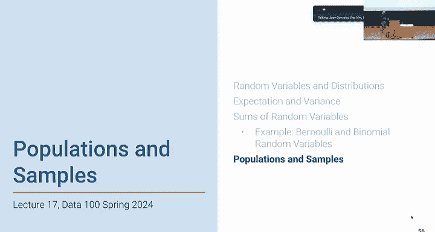

好的，再来一个。`P(X ≤ 8)` 是整个曲线下的面积。所以那将是 1。

这应该非常简单。这些都是非常简单的考试题目。所以如果你对此感到困惑，现在提问或去办公时间。

---

## 一些有趣的分布

好的，让我们开始讨论一些有趣的分布，稍后我们会回来分析它们。

第一个直接与抛硬币相关的分布称为伯努利分布。我们这样写一个分布：`Bernoulli(p)`。分布有参数，就像我们的模型一样。事实上，分布是一种模型。它们对这里的概率函数进行建模。伯努利分布中的 p 是正面朝上或随机变量为 1 的概率。

所以伯努利分布是取值为 0 和 1 的二元随机变量的分布。我们有我们的概率表。所以结果为 1 的概率是 p，结果为 0 的概率是 1-p。重要的表示法：这个小符号表示 X 服从右边的伯努利分布。这是一种表示随机变量分布的方式。我们稍后会讨论更多命名的分布。

好的，这里有一个快速练习。假设 X 是一个伯努利随机变量，参数为 p。Y 的分布概率表是什么？思考一下。Y 可以取哪些值？是的，1 和 -1，对吧？所以我必须能够代入所有 X 的值。所以 X 是 1，2 乘以 1 是 2，减 1 是 1。X 是 0，2 乘以 0 是 0，减 1 是 -1。是的，所以这些就是值。概率呢？p 和 1-p，它们没有改变，只是变换了随机变量的值。所以是 1 和 -1，概率为 p 和 1-p。好的，这就是我们刚刚介绍的伯努利随机变量的分布。我们将在讲座稍后讨论二项分布。还有其他你已经见过的分布，如分类分布（K 面骰子，每面朝上的概率），均匀分布（在有限范围上，比如 0-1 范围，你可以将均匀分布扩展到任意范围），以及正态分布（我们将在稍后的讲座中详细讨论）。所以这是两个连续分布。再次强调，重点是每个分布都有一个参数，它们是某个概率表或连续概率函数的模型