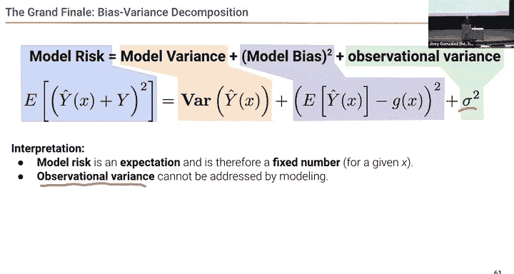

# UCB《数据100数据科学原理与技术｜Data 100 Principles and Techniques of Data Science 24SP》中英 - P18：-18-Data 100 Spring 2024 Lecture 18.zh_en - GPT中英字幕课程资源 - BV1Bc2dYCEbc

Yeah。

Worning， everyone。Is。Great to see a full lecture hall。Does on Zoom should come to lecture。

 it's exciting here。Today we are going to do some more math。

But it's gonna be fun because we're going connect it back to this amazing result that when I first taught this class I just jumped a straight the amazing result and no one followed it this time hopefully you will follow it will I will try to pause we have some interactive sliddos so it should be fun today should be good lecture so let's jump in please join the slider if you've not。

😊，Just I go away。All right， so today we're going to build on the work we did on Tuesday to talk about estimators and then reason about this fundamental tradeoff between bias and variance。

We'll get some exercise， some practice using the mathematical concepts we've already introduced。

 which will be good。And hopefully by the end of the lecture。

 you'll appreciate this trade off and why we have to optimize for it and why it is sort of fundamental to building models to machine learning。

 to estimation， in some sense all the things we do will we reason about the world in data science。

Brief recap。So last lecture was fast， we went through some challenging mathematical concepts that are pretty essential again these are concepts you will see if you go on to take Stat 140 but we needed to see these concepts in order to show you what I want to show you today。

 also having seen them a couple times we'll make it so that when you see them in the future it'll be a little bit easier。

The first that we talked about was the definition of an expectation。As this essentially。

I take a random variable and I want to compute the mean， if you will。

 of that random variable by looking at the probability of each of the possible values that variable takes times the value that it takes。

😡，We write this as expectation。It's worth noting that unfortunately in my slide style。

 sometimes you write expectation with like this double lines and sometimes I'll just write it like this。

 itll be pretty clear I think I'll use square brackets ways to denote expectations。

 hopefully in the exams and stuff， it would be also clear as well。So expectation， again。

 the other important thing is a function from a variable to a number。Paster。

We also introduced the variance， which is the expected square difference。The variable。Again。

 a function from a random variable to number。And we introduce this computationally easier method to compute the variance if you've already computed the expectation。

 you square it， and then you subtract that from the expectation of x squared。

 which you can calculate by again using this equation up here， but changing this to squared。Yeah。

slide。Right， basic ideas， but essential。That we introduced some identities， which are good to know。

And I use these in my research today these are really standard identities and really powerful in particular this linearity of expectation very useful this is saying if I have a constant a random variable and a constant here。

 and I take the expectation of that then it's a times the expectation or random variable plus the constant so constants pop out of our expectations linear linear operations pop out of our expectation。

😊，B's a little bit trickier。So the variance of a constant is zero。Consts don't change。

 so that goes away there's a zero here， and then the variance of Ax is a squared times variance of x。

We put that constant， we had to multiply by the square of it。Some more interesting idents。Again。

 this one I use a lot。Linear of expectation， I can take the expectation of two random variables related。

 not related doesn't matter any random variables the sum of them is the sum of the expectations。

Of the expectations。Very useful。The other one， again， variance a little bit trickier。

Gs of two variables added together。Is this some of the variance of the variables？Plus。

 this term that accounts for the covariance， the dependence between the variables。

We showed that equation in last lecture。Right。Useful identities。

 we'll walk through how to use them in a moment for their questions。😡。

What about using your research very good question often when I'm trying to reason about something that I don't understand a random process。

 it's easier for me to think of it as a bunch of little random processes working together。

So I'm trying to schedule some queuing algorithm and I have a bunch of things happening and I want to look at the sum of those things happening。

Well， I built variables to represent the little things because I know how to reason about them。

 if it's a coin flip or it's an interesting distribution they well what's the behavior of the whole thing？

Add them up， what's the expected value of that expectation so we use these a lot to model complex things and you'll see it I'll do it today for this fundamental result。

😊，Other questions？诶。不。So it turns out。I needed one more identity， which I forgot about。

 so I'm going to give you one more useful identity for expectations。

 I'll derive it here and we'll use it in the end of lecture today。😊。

So what is the expectation of the product of two random variables？General。

 this is actually hard to figure out， but if we assume that they are independent random variables。

Then this expectation factors like this。In previous versions of this class we don't go through the proofs and lecture。

 I like to go through the proofs partly because I'm bad at math and for me it helps to understand what's going on so I want to walk through this proof。

I root it out， I'm not as good as the previous lecture drawing on slide so let me just walk through the steps here。

 so let's look at the definition of the expectation of x and Y。It's two variables。

 so I got a sum over two things。I'm multiplying x times y， so it's x times y here。

 and then I take the probability of x and y， it's the joint probability of the probability of two variables。

 it's saying the probability of all possible outcomes for the pair of variables。

Because it's independent is definition expectation because these are independent。

Key definition of independence I can break this probability into two separate probabilities。

Definition of independence。Now I have a sum and this is algebra so this y here doesn't depend let me clear this out this y here and this thing don't don't independent so I can slide this over here just rearranging my multiplication this summation doesn't interact with this or this term so I can slide this summation over here too so I get something that looks like。

This we have the summation over the y， the summation over the x。

And I put prehees here to make that really clear， so this algebra。

This is the definition of the expectation of x。This is a definition of the expectation of why。

So I get the expectation of x times the expectation of y。Questions。Question， I'll ask you a question。

Is it helpful for me to go through these proofs and lecture？So says yeah。It says， man。I believe you。

 thank you for belief， but okay， so it is helpful I'll continue to tread them。Definition对。Okay。

 so I gave one more important。Identity right here。So we're going to use that end this lecture。

All right， questions here。Os。Let's keep going。O an exercise okay so in previous versions of this class Nargus has a better budget and she brings in money I couldn't find money for this one。

 so we'll do a bedding exercise it'll be mostly philosophical so someone walks up to you and says you know we're going to play a game。

I have two $10 bills， actually I have a bunch of$1 bills， yeah that's it。

And I'm going to flip a coin。20 times。And you get to pick which of these payouts do you want？

Okay so the coin is going to be flipped 20 times it's going to land heads that's going to be a one and tails zero。

 it's a fair coin。It's drawn a fun， so heads one。Taale zero， faircoin you can get。This。

 so if it lands heads the first time you get $10 and heads the second time you get $10 more dollars。

It's $20 a deal。That's one option。Another option you can choose。

 you get a bunch of $1 bills and I flip each coin every time it lands head， you get another $1 bill。

The last one。Those like to go big on the first coin flip。I flipped the coin once， the land's head。

 you get all $20， tails， you get nothing。So first， do you see how I'm modeling this as random variables？

These are random variables。This equation。Here。Is a function， this is a random variable too。

 it's a function of these random variables。Which one do you want？And this is a sliddo。

What do people want？Which bet do you take。What's the good bet？Alllin。How do you analyze this？

So you're thinking what are the tools we have？All right。That's who people said。So you all chose B。

I like that why B。So you want to have a reason why B？Yeah。B has the lowest variance。

 how do we know that？We figured it out。For nuise， yeah， we're going to analyze that in a moment。

 other thoughts， yeah。Well that's good so thinking about the identities。

 one of the identities said if I multiply by a random variable。

 I'm going to square that variable to get the variance。

 I guess everyone's kind of clue I want the low variance bet。😊，Wait。

 why do you want the low variance bet？Don't I want the bet with the highest return？

I went to bed with the highest return， maybe maybe I went some combination of the two that then would have a thought on the return so they all the same return。

 what would that mean？What term do we have so far to capture that concept？Expectation， right？Good。

 so what is the expectation of each of these？😡，1en， we should drive that in a second too。

 that'll be easy。Hopefully， all right， so they're all the same bets so then you you guys have okay。

 so they're all the same outcome， but I want the one lowest lowest variance。That makes sense。

And use some cover ideas about the rationale， you know I could derive it， which we'll do。

 or I could just look at the identities and say remember this one here I'm going to take 20 squared。

Get the variance of this， this thing， this y seems pretty big，10 squared，10 squared。

 and this is just the sum， but they're independent。I mean。

 what happens is some of independent variables。Some of the variances， okay。

 so that does feel smaller。All right， so you all decided you want the the safest bet for10。

 which is probably what I've chosen to some of you are risk seekers， maybe it's more fun。

That one flip。Go big on the first coin？All right， so that was the slido people filling up。

Let's do a demo because I didn't do a demo last time。

There go so I said this last time that when we're solving these problems in the real world and again in my research I use these exact techniques we cover in this class。

 I use them often I will try to do the analysis using the analytic tools that we've introduced。

 sometimes I'm lazy and I won't。Sometimes I'm not just lazy I can't， so the math is too hard。

 so what do I do in those situations？I open up a Jupynter book， and I start simulating。

Yeah I think what's the product of all these coin flips， what's that outcome。

 I don't know how to analyze that yet， maybe I do。But we do know do that， if I make them correlated。

 now I don't have to do anymore， right？So when I flip a coin and it picks the next coin it gets harder right and so in these situations we use simulations。

 let me just briefly show you how you would do this without math。

 without analytic math instead using just simulation。

All right so these are the three variables I'm simulating Y A Y B， YC。

 I'm going to make a probability distribution in pandas， so I have my table。

 this is my Bernoulli random variable it's one with 0。5 and 0。

5 could have changed P be more interesting if I had a different P value we could do the analysis but we're not going to that today we stick with a standard fair point。

How do I simulate YA？There's an important idea here。

 if I want to simulate some function of random variables， this is the cool part。

 I just simulate the random variables， and then I compute the function。

But I actually want to simulate。A scenario so I'm not going to simulate just x1 and x2 I want to simulate x1 and x2 many times。

 so I'm going to simulate I invite some up to stage I flip the coin twice。

 that's one event that's one simulation or what one sample my simulation then I invite someone else up again I flipped the coin twice so on。

So I need lots of pairs of x1x2 to compute Y。So there's a couple ways to do this。

 I'll show you something you've already seen so I can sample from a data frame。

So if my my data from here i'm going to sample 10 times probably want more than that I'm going to choose my weights to be this column here。

 the weights column that want replacement true because when I sample a row I'm going to put it back so I can flip it again。

And then what the x value？That's sampling for my data frame。Does that look great？

We all those ones in a row， is that real？Does that happen？It's a fair coin。Could it be all ones。

 it could be a lot of ones there？A lot of zero there， right？

Kind of reflecting back on something we talked about last lecture， if I give you a small sample。

 it's hard to say what P is。喂。You need bigger samples and there's machinery for dealing with that which maybe we'll try to touch on at the end of the class in practice you generally get a larger sample and these experiments I'll use 10。

000。So 10，000 simulations。I'm going to show you another way to do this Bulli thing so when I'm doing this in my research it's too much work to make a data frame。

 there's a simple way to do this， so I'm going to sample a different random variable and then apply a function to that random variable let's talk about that。

So I'm going to sample， let's look at this first。 I'm going to sample。10000 R。1en，000 by two。

 what is that doing？That's making a matrix。Of。A continuous random variable。

Where I've sampled independently when these grows， it's number between zero and one。

Uniform distribution between one0 and1， I pull a number between zero and one。

 but I want to turn that to a coin flip。So I say that it's less than p。

That's the probability of heads。So 50% of the time， it's going to be less than 0。5， 50% of the time。

 it's greater than 0。5 I said chance of heads was， you know， if I said it was 0。75。

Now75% of the time， this thing is true， Land's heads。I want a fair point。

So I made a function of random variables to make my new random variable as a matrix。Of x1x2。X1 x2。

 x1 x2， 10，000 times。Now I want to function of that random variable。So I'm going to take。

 I said you get 10 for every heads， so $10 times true is 10， 10 times false is zero。

I'm going to sum over the。First axis， that's confusing。

 so if I sum over the zero axisax I'd be summing this matrix。Down the row， but I want to sum across。

 so I have 10，000 numbers。So if summing horizontally， let's see what this looks like。

And I'm going to put this in a data frame， which just do it outside here first。嗯。

OkaySo that made a giant array of 10，000 numbers， which were the outcomes of my 10。

000 trials that was done by taking the sum along the columns。Just actually draw this really quickly。

But just to highlight what I'm doing I made this matrix it looks like this。

 by the way when i'm doing research I also tend to draw a picture especially when working with mathematical concepts。

 I encourage you to do that if you're getting confused so this says you know 100 this maybe got 1010 and so on I want to sum along this dimension so I get just one giant thing which looks like 1020 and so on right。

So I just did。Okay， and I put this in a data frame。And now。Oh well， all right。

 I'm going to analyze these， but let's go ahead and compute the rest of them。

 so that was how to make the first one。Let's do the same thing again。 So get repeat this practice。

 So now I'm going to make 20 of these flips。I'm going to multiply by one because you get $1 for each successful flip。

 and then I'm going to sum again across the now 20 separate columns。Eclipse again。

Make that choice be。Let's do choice C， this one's easy。One flip， so I'm just going to draw one。

One coin're do this n times。And you get $20 for that。Tcy。All right， so now I have a table with 10。

000 simulations of each of these different scenarios。

Jump into some visualizations look at the visualizations first， so this is a histogram of that。

That distribution， so it's a histogram of the distribution of Y A， Y B and YC。

 And already do you see that your choice of B is much more clustered around 10。

Y a has some more mask around 10 to couple options， a couple ways to get 10。

 but has some chance of getting nothing and some chance of getting something quite a bit 20。

 And then option C， the high risk option is you either get nothing。Or everything。

So I simulate a distribution， I'd look at this and go okay。

 which bet do I want Well if I'm a risk a person and I really want that 10。

 this seems like a good bet walk way of 10。Likely。We can also use that same data to do calculations and take the sample mean which is very close to the expectation。

 not quite what we compute for the expectation because it's a sample and really really large it gets really close how close does it get we talked about that in the last lecture so the standard deviation has the square root wall so one over the square root of n so n gets bigger it gets closer and closer by one over the square root of it。

You look at the variance。Some of you bet variance of choice B。

 that summation version was the lowest variance， good choice。

 definitely the lowest choice A was a little higher and choice C was quite high。

It was practically 10 squared， right？Okay。What's left？Look at。E devations， is good the devations。

Right， so we did that， so now let's try to work through these analytically。All， so here's option A。

 option B， and option C。Let's compute the expectation first。All right。

 so we' can use these identities up here。All right so the expectation of a should be。

 I take probably of you getting 10。Is actually using linear of expectation。

 so I take 10 times the expectation of x1。And 10 times the expectation of x2 remember for Bernouls。

 the expectation of a Bernoli Ram variable is just p so this is 0。5。

And also for the Brunoular random variable we going to use variance is p times 1 minus P。

Oh sorry so let's do the expectation of B so this is again this trick that again I use all the time in my research is I'm going to take the expectation of the sum is this sum of the expectations so I slide my expectation in each1s 。

5 so they get 20 times 0。5 or 10。And then the last one again， linear expectation。

 so I take the expectation of this one。And that's 0。5 so again get 1 so as you said earlier。

 they all have the same expectation， same payout。You change P， maybe they don't， I don't know。

Did the else谁。All right how about the variance so we work through this so we're going to use this identity here because it's very helpful these are all independent random variables so we don't have to worry about covariance term so actually I guess we use this as well not to worry about the covariance term。

All right so these are independent， so I take the variance of square this。

 the variance of x1 variance of x2， they multiply it by 10 squared。And square， right？that's。

25 and that gives me a variance of about 50， which is roughly we calculated before。

Do this for variance of y， so I'm going to again take the sum of the variances 2。25。

Added 20 times 20， so you get 20 times 。25， which is 5。But。

And the last one again I'll use this identity up here， so a variance of I this is 20 squared。

 but then I need to multiply by the variance of the variable itself so that's going to bring it back down that's how we got on it。

RightThat fast。Are there questions？I'm going to again ask a question。

 who's feeling pretty comfortable with this stuff at this point？

OkayWho was not which would be very reasonable because this is hard hard stuff so I will say when I started doing this I was often this was part for me to get so I had to go back over an exercise a bunch of times work through these would be good and then hopefully in discussion you get a chance to practice these as well。

Okay。Raising on on June。All right。Keep going so I didn't have a standard deviation。

 but that's just take the square root of the previous numbers， so not as exciting。Actually。

 I should ask， why standard deviation， why do we talk about that， it's important。

They in standard deviation， they're basically the same thing， one's a square to the other。Here's why。

 and I wish my grad students would listen to this because they do this to me all the time and go， oh。

 I got a squared error of x and like， okay， what's the units of it that's in what they calculatedalculating recently。

It's like time squared like， okay， I don't know what second squares are， I can't think about that。

 take the square root of it， it's in seconds。So when people present a number to you and say the variance this variable is something large you're like I don't know how to reason about that space of numbers when I take the screw root it's back in a regular unit system so often you're trying to think about the numbers and put them in contrast so you're like I'm off by。

One these seconds squared， hard to think about， you reduce that down to the square root， Okay。

 I'm off by a few seconds， I see what's going on。So we often like to think about the numbers in terms of these square roots。

 but the math， all the calculations are easier to do when we think about the variance。

So these identities， if I extend them to standard deviations。

 they get weird because I to take square roots of sums of variables and stuff。

So that's why we have that other term。AllAnd the last big part of last lecture。

 which is now the focus of this lecture， this idea of going from some population。😊。

To some sample actually sorry from the sampling frame which we sample to some sample and being able to compute things on the sample and then draw conclusions about the population this way。

 which I think I built in on the next slide。Okay， and so we already did in the last lecture the sample mean。

It relates to the population。Today we're going to talk about predictions， which is pretty crazy。

We worked to be this X bar as a sample mean and we looked at how it relates to the population meaning the parameter that you would have gotten if you computed the thing on the entire population。

 this is of course a random variable because our sample is random so the choice of X size is random。

This was the square root law that we introduced at the very end of last lecture it's also introduced in data 8 it's an important big concept we presented it in a semihand wavingly fashion though I will say in the last lecture we did derive this she should work through that so what is the expectation of this sum this X bar and you can show that if you knew the population mean was mu that it would in fact be that。

You can do a similar analysis for the standard deviation and show that the standard deviation。

 I think we did in the last lecture as well， the standard deviation is this。

And that's saying that x bar this random variable， when I sample it。

The variation of that random variable x bar， that estimate of the mean gets smaller as my sample gets bigger by the screw root end。

😡，And it's also， it's kind of absolute scale to function of the variability of the thing that I'm sampling from。

So if I'm looking at， I don't know。What's something that's not variable heights。

 if I look at heights of students in the class that maybe that's got a small sigma。

 so the sample means are going to change very little depending on the number of students I sample if I look at grades or something that' also the variance but they say that was a wide variance then I take a large small sample I'll see much greater variability that's what this sigma is describing。

Populations true variability here's kind of two cute pictures of how this converges。

So we say that it converges what do we say here？To a roughly normal distribution maybe it's on the slide。

 as I get this sample mean x bar， so this distribution of x bar。Distribution of x bar。

 but as I increase n， it gets more pointy and more concentratedd around mu U right here。

The center on you。That's a big idea right that I can start to reason about what the population。

 what the distribution of my sample statistic is as a function of the population。

 and I can even show that on average this thing is going to look like the thing that I'm trying to compute that it has the expected eye mean and that it's going to get closer and closer as I get more data。

😡，Those are pretty exciting results that gives us hope for our ability to reason about the world from just a sample。

But we'll do more today。Right right。So we said we're taking a sample from the population。

 this is our sampling process， we're going to generalize this idea。And say it's not just the mean。

 but there's some sample statistic that we compute on our sample， it's a function of our sample。

And then there's some sample statistic that we would have computed on the population。

 which is population parameter， it's a function if we had the whole population。

 we run that code on the whole population it gives us。对的。But we only had a sample， so we have the Ha。

And we want to know， can we estimate this parameter？😡，From this parameter。That's our goal。

Here is this one important point of notation is we're going to use this term hat as an estimator。

This is an estimate when you put a hat on a variable， it's probably a random variable， right？

So I put a hat on a parameter here， this data hat。It's a function。Of our sample。

 our sample is random， so this is a random variable。

And I want to answer questions about how this relates。

 how this data hat here relates to this data here， we already did this once with the simple mean。

Right， so it can we use the estimator it's this process of computing this。

 the estimator to estimate the parameter of the true population。

And we already did this once with a sample mean statistic。

 and we use that to estimate estimate the population mean， so in that case this was mu。

And our statistic here was X bar。Maybe you all can guess where this is going。

What if theta is our model， what if the is our model predictions。

 can we say something about how our model or our model predictions relates to the population？That'sね。

All right。Some important questions。So， if we。How do we know that our estimator is good right there's sort of three questions that we've already set up in lecture one we've already talked about error so can I compute the expected error of my estimator。

😡，Good。How close is it on average？Thiss kind of the expectation is， do I expect the estimator to be？

The thing， the parameter。I'd like to say that the expectation。嗯。Data hat。Equals theta。

 that'd be nice。Sometimes you can。Sometimes you can。Sometimes you don't want that to be true。他给他打电话呢。

All right， now last thing。Which kind of relates to what I just said。How variable。

we already talk about this， you X bar has this property that its variance variances of this。

Is sigma squared over n。St deviation。Yeah， the variance is that squared to that sustainable deviation。

So we already said something about the spread of X bar。

 can I say something again more general about any parameter？

I're going to try to do that for a special class of prim in MI。All right。

 so now I say previously when I taught this， I didn't do the notation well this time around we get you have some concepts ready to answer some of these questions so how close is our parameter。

So we've already talked about this mean squared error。And that's this expectation。

the analog to the means grid error compute on the data is this expectation。

Wouldn't it be nice to be able to say something about bound this quantity？Bs。

When we talk about bias here in the statistical sense。

 we're asking what is the expected difference between this and this， this is our estimate。

 this is the true value， this is our estimate here。嗯。If I take this expectation。

 where you have a useful identity， what's the expectation of a constant？They're constant。

 so we just give this， right？Linear of expectation， expectation of a constant。

So have questions on zoom， let me pause for a second here， can they ask questions on Sdo as well？

Please ask questions on Sao， staff will answer it and if there are questions that they want might help to answer。

 let me know， awesome。Okay。B， check， how about the spread？We have a term for that too。

Oh I should say this okay， in important detail。There's a specific class of models when I can say that this equals zero。

 that is an unbiased estimator， that means that the expected value of the thing equals the thing。

The expected value of my sample parameter equals the population parameter that's an unbiased estimator that's often something we seek though we won't always be able to get that and sometimes we don't actually even want that。

Right， and the last reason， the last thing to reason about is the variance。

 so what is the spread of my answer and we were already defined variance。

 this is the definition of variance right here。So how much does the sample vary from its expectation？

I'm going to tell you the whole punchline for the lecture briefly on this slide。

 I want to make this small。I also want to make this small， and I'm going to show you that this。

 this MSE is equal to some combination of these two things。Which is crazy。

 so we can actually say something about the error is a function of the bias and the variance。

 which gets us to this fundamental bias variance trade off。

Sometimes making this one smaller is going to make this one bigger。

We're to find the right combination。All right， let's go next slide。

Oh cool analogy so as a hobby I'm an archer a very bad archer。

 but I like to go to the local public archery range。

 archery is a great way to demonstrate this concept。😊，So we's try to do this here's a target。

Aery you get to shoot an end of six arrows at your target those are random when you try your best to hit the center let's say the center is the parameter theta that's the true value each of these arrows is my guess so this could be like a this is my first theta hat one I try again fix my my bow a little bit that's theta hat two so on I get six shots on target all right。

Sporting analogy？Any archers。I don't expect hands， but great bmer all right。

 so that is be set up let's instead of me explain this analogy， I want to see if you can guess。

How we might relate bias in variance。To this picture。

 so which target demonstrates high variance and low bias？to answer that question。Great at So。

You tell me。Then they can ask which one is my target？Right。So let's see what people said。So again。

 target demonstrates high variance， low bias。Wow， I didn't even explain the knowledge and you already got it。

 Okay， so everyone said a。Let's talk about that。 Why is it a。People finish guessing。

Doesone have an answer to Yat A？We bring it， I think if I go back， you can keep answering， right？

You can still answer， yeah， okay， Y a。Yeah。Yeah， so high variance， large spread， good。

 and then low bias means it should be。Around the true center。So that's a correct。High variance。

 low bias。What does everyone want when doing archery？You want low bias， low variance， right？Again。

 some of the things that's if we can bring both down。

 that'll be great when something that's just clustered on the target。This is me。In my archery today。

 so high variance， high bias， I can't aim consistently and I don't even aim in the right direction right biases how far off am I from the center。

On average， and then variance is how spread out am I so spread out and not hitting the center。

Very good。对。So here's a more detailed version of this picture。

 so when you're trying to think about bias andvariance and how they relate to estimation to matching hitting the target with your theta hat from your sample to the true target theta。

 this is a good picture to have in your mind。It's a good exam question， too。Okay。All right。

 I think that's all I had to say on that yes， so now we're going to do the big thing。

We're going to connect all these concepts and try to make a statement about our predictions。

As a perimeter， we'll see you in a second。so to kind of pull everything together from the past two weeks。

 we have this equation of how we estimate our theta hat from our random variables， our data。

 we have n of them and we tried to minimize a loss and then we introduced this regularization penalty which cares just about our choice of parameters and this hyperpara that you tune using cross validation we can kind of ignore this this is a constant for now。

This is my regularized loss， and I'm trying to choose a theta hat。Again， this one。That minimizes。

This expression。That's my shot。Shot at the target they get。

I get my sample and I fit something to it whoops that's a terrible drawing fit something looks like this green line here that's some my sample。

it's kind of neat， is it every point on this line？😡，It makes a prediction。

 so for right here for this x， I get a prediction， that's my Y hat。It's got a hat on it。

That's sort of a parameter， it's peri estimating the value of the thing at that location。

 but I observed。Maybe I go out and measure it and the value of that location is that that's the true why。

Weve got to go deeper into what it means to be the true why， so let's do that now。So again。

 to make a prediction， I take my model， this is a parametric model。

 so really I'm learning this parameter that's a hat and I'm making a prediction that's another hat right and I make that prediction at a specific location X X you give me that X at test time It's not a random variable。

's it' gonna to be fixed You could actually analyze this with the random variable here。

 but I'm not going to do that for today's lecture。 that's a fix so I'm asking the question of a fixed location of X。

W should be there。That I would really like to minimize。From that slide earlier， two slides ago。

 maybe I was saying there's this means grid error， this is the mean grid error between the true y。

And the why hat。对。Now。What's the random variable here？

I already told you that these are random variables。That means this is a random variable。

Which means this is a random variable， which means。This is a random variable。

 and therefore this is a random variable。What about that？How do you know that's a random variable？

Because I capitalized it。So probably it's random variable， why is that random variable？

So it's the truth， truth is not random。We're going to make one more assumption to make this lecture as complete as possible。

The world has some true underlying function， G。We don't get to Cg。Fortunately。

We only get to measure things， so we have G the truth。But then there's the measurement error。

Observation error。Can't do much about it， maybe you get a better better system to collect data。

This is the truth for today's lecture。This is a random variable that's noise。😡。

And that's going to make the thing that we observe the truth sort of。Also。Branner。

So I'm going to model。And the reasoning through this probabilitybil exercise。

The observation error as well， so there's some uncertainty。Another reason to do that is in practice。

 sometimes I'll assume a simpler version of G， which case there's just something I can't explain about the world。

And every observation doesn't really follow the the G， I don't actually have access to cheese。

 and maybe I'll assume the population has。A specific form of G。

So I definitely want to be able to account for that kind of noise。

Inability to fit the exact data I see。so fixed features， I'm going to look at a test location。

 a new location that's fixed G is going to be fixed。

 so it's not random variable that's the truth out there。And then my response。

 Y is a random variable because of that noise？Make one more important assumption today's lecture is that noise is IID so it's all data all locations have the same noise。

And it's independent， so every time I measure something there's just the standard sensor noise。

I'm going to make one more assumption， which is pretty standard。

Is it the expectation that noise is zero？It's kind of centered noise。Later on， Thursday's lecture。

 we'll see why that assumption is especially reasonable in specific use cases。

 but for now we'll just assume that's centered noise。It's an important assumption。

And the variance of this is some sigma squared。Which we don't know。It's just it's fixed。

 there's a sigma squared variance for all the locations。That's this deviation。

From the true true language。对。Let me pause here any questions？It's important setup。Slight is going。

 okay。对呀。Great great question， how do you know any of this if we don't know anything about the population？

You don't。Here's a cool part， we're going to assume these things， we're going to do some math。

And we're going to see that the math depends on the assumptions we made。And from those assumptions。

 we can see why if I assume something different， I'd get different results。

 so we don't know these are assumptions we're making in our modeling process and these calculations that we're about to do。

😊，So we don't typically know the population， if we did， most of this would be unnecessary。

 we just calculate the answer。So we're going to make assumptions about the population and see and these are pretty pretty general assumptions。

 there's some G I don't know what it is， but it exists and there's some noise that affects what I measure。

 I don't know what it is either， but it exists and I'm just going to assume it on average at zero。

And there's some sigma for which I could bound it by some constant sigma。All right。

 any other questions？Yes。Why is what I observed so when I made my training data set when I sampled a population I got a person I got to see their Y and I measured their y for that person I get another person to get their x and I ask them I get their y and each of these y's I get for each person is a noisy measurement of that true G that you know as part of that person and now it comes to test time。

Got my model I make a prediction， someone hands me an X， make a prediction， it's my Y hat。

 there's a true Y。How close am I to that true why， you know？That's who in China吗。Okay。

 so the picture， just from previous lectures， is I've got this truth。

And then I've got the thing that I'm modeling， this is my model， and here's two versions of my model。

 I got these data points here， I fit this crazy polynomial line， this is the model that I predicted。

noop。And here it is the truth， this hard to see line that's faint， that's the truth。

Never get to see that， remember？And then these are my population dots again I didn't get them either。

 I just got the dot here， the dot here， the dot here。

dot somewhere over here when got a few dots my sample right so there's a lot of things I don't know I want a reason about those using the tools that we have。

This purple line here is another version of all the things seal， they sampled here， here， here， here。

These dots， and I fit this purple line here。And again， it doesn't match the truth。

Here's the truth over here not close it's all over the place。

 but it's what I got for my sample and again i'm trying to reason about the relationship between this line and the truth which is hard as well as this line and all the population points that I would have tested so if I were have tested here this is I see for the population this is the truth which again I don't observe and I want to know how far am I from here today。

Spin trade All。If it's a little confusing， I'm going to draw this in a picture in more detail in a moment。

Just to use our previous terminology。This here is an estimate of this。So we're estimating with Y hat。

 we're estimating why。We're using our model to do that。

 that's a prediction process is a form of estimation。All， so now we're ready to do the fancy math。

I'm going to go back to this picture because this is what we're going to derive so long ago we said this idea is I make my models more complicated。

My variance goes up， so I have more variability， but my training error goes down。

 I can fit my data better。And then there's this validation error。

 which goes down and then all of a sudden because of my model is crazy， it starts to go up again。

And that was a good guest for my test there。I don't get to look at my test there because that's cheating。

I get to do that once， but I can do validation here as much as I want。

 and it's typically a lower bound on my test there， lower guess about my test estimate。

Often pretty close。So that was our setup， and now we're going to formalize this process。

Here's a more formal picture of what it we're about to show。

We're going to talk about model complexity。We're going to talk about the model of variance。

 the variance no predictions in this case。And the model bias。

 and we're going to do this in a square sense， you'll see in a moment。

 and we're going to relate these two things to this test there。Mathematically。Let's do it。

Right this is the picture I think will hopefully make more sense so the green curve is the model I fit to my data points here here here and here so I had a few data points the red curve is the truth I don't get to see that the blue dots are the population I don't get to see that either。

AllSo zoom in on just this dotted line here。不。Let me zoom on that。Get this picture here。

 so have a fixed X that I'm checking out。I predicted why hat？The population had some Y。

 which was a noisy observation of some G， again I didn't get to C either of these things。

And the residual we've plotted this before in our analysis of regression。

This residual just a difference between our prediction and true the population value。

That's this black bar here。And I want to analyze what that is。Let's do it。Okay。

 theres sources of noise that affect my answer。Theres the observation variances。

 which we'll go elaborate around in a second， that's this thing here。This is the model variance。

Which is the variability in f of theta x， it's the variability in this theta。

 which comes from my sample。That's going to affect from this right here。

And then there's also the model bias， which is myM's ability to fit G itself。

 there's just some inability to fit the complexity of the underlying G， this model bias。

 which will make four model second。Right。We're going to try to first draw this in picture form before we do the full derivation。

The end result that I will show you， so I'm just going to tell you in advance。

Is it the risk this mean squared error that we talked about a moment minute ago and I'll formalize a second is the sum of the observational variance that's the noise in our measurement process。

 we can't do anything about that。The model bias is squared and we'll see why it's squared in a second。

What's the model of variance？This is a fundamental statement that we can show。

So we're going to show that mathematically and pictorially， but we'll first start with pictures。

It's the model risk。Is this mathematical concept？It is the squared difference and expectation of our estimate from the y in the population。

So that is。The residual squared。There's something we've seen before。

So we're going to take this gives a drill squared。This is an expectation。

So expectation and it's over what what's the source of randomness here one source of randomness is why because we have this this noise。

 the other source of randomness is y hat because this depends on theta hat。

 which depended on all of our data。X1 do xN， as well as their Y。Source of randomness。

We're going to compute this expectation again over when we go to make a measurement over all the possible whys we could have seen when we go to actually test the test value Y。

It's over new observations below。Please stop here， there questions about this setup。です。

Is admittedly a little confusing we're trying to make statements about a world we don't understand we're at least writing down what we'd like to know。

 we don't yet know how to show this yet， we'd like to know what's this expected difference between our guests and what we'd measure if we go out and measure the population value at a fixed location X。

B什s。Why is there observation variance， why is there random noise？Some people。

 when they do this exercise。Do not do this。So you don't have to model this。

 you could say you know what， the truth is G and whenever you go to see the world， you see the truth。

I like to model this because it'll be useful in a future lecture and because when you go to measure the world。

 you don't ever get to see the truth。No matter how hard we try， there's always uncertainty。

So let's just put that in our analysis， it'll just be an extra term that we can think about as we do the work。

Yeah。So this is the risk and expectation over the future。

 so we're trying to compute this over the you know the risk with respect to all of these sources of randomness。

 so this is an analytic quality， when we compute the mean spread error we're computing that with respect to some data it's a number computed on some data。

This too is a number， by the way， this is a number， which is not easy to compute this number。

 so we're going to try to reason about what makes it。Right。

sying this over over again but we'll do one more time so there's a source of chance air and these are air just due to variability and one was this noise and why。

See， because remember why has this this epsilon noise term。

 that's one source of noise and of course there's a source of chance error from the sample we use to train our models。

Is there chance error？Then bias is a fixed thing， so this is not a random error。

 so not due to randomness alone， it's due to our model being different from the true underlying function G。

Let's draw this out。So let's first take a look at here's G。

Here's why remember there's some random errors so this is you know we happen to get this epsilon。

 but if we run the experiment again or sorry if we measured the population at a specific location。

 maybe this is concrete so I'm testing this new spot， I bring up a person I ask them a question。

They answer something I asked them a week later they might answer something different。

 So there's some variability in how they respond。 I go to measure something， you know。

 I think it's it's you know。This tall and then I measured it again with a different instrument I get some some variability in that measurement。

 so this is just the error in the measurement when I go to do the test。

And there's some just inherent spread in what I'd actually see of the truth。

That's my first source of chance air， and this is just observational noise。

This also shows up in the training process well， but we'll come back to this independent for now。

So this is a source of noise。They't have to count for。

So I get multiple possible observations every time I go to measure something。G is always fixed。

 the truth is constant， it's just when I go to， measure it， I see variability。This is random。This。

The expectation of this thing here is what？This is a constant。This is the random variable？Right。

 the expectation of this random variable is0。 so that the expectation of this is just G of X。

 that's good。 And then the variance of this， this is a constant。 So we don't do it if I take。就。

And here's the variance。Of G X。Plus。Son is what？不理 that。

This is a constant we don't want to worry about that， this is a variance of。Epsilon。

Which equals sigma squared。All， so we have some fixed observational variant， we assume that。

Reasons again measurement error， missing information acting noise another reason we might have this。

 so we didn't get the full X so when we go to measure G we're not really plugging the right values so we see different values per G。

So and later on， we'll see when we make some assumptions about the form of G that this could just be a noise and the inability of the model to fit the true G。

We'll come back to that， but Gerd， let's the thing about for now is measurement error。

How do we fix this？tryry to get more precise measurements。What option。

Typically you think of this as beyond your control， this is the error that you just can't get rid of。

 no matter how good your model is， you're still going to have some air。I its irreducible air。Sorry。

不对。Model variance， this is a little more complicated All right。

 remember in lecture we looked at if I fit my model many times of different samples of the data。

 I'll get different models I get variability in my models。If I put them all on top of each other。

 see all these different lines I could have fit。If I think of the spread of this。

Spread over you know the space here that's kind of the variance of those models at any one point I have spread the very fact I actually have an animate here so if I take one point in space I have some spread of the lines that go to that point in space right because this variance in my predictions for the different models I would have gotten I had different samples of my data。

This is the model variance。We're going to find as just the variance of lighthe。

So prediction variance at a specific location， x。What is that？No， it's a quantity。

 we're going to leave it。We're not going to be able to fill this in more detail。

 that's just a thing that we need to reason about， say source of error in our predictions。

Reasons for it。Different samples lead to different model estimates。Common cause overfitting。

You made your model too complicated， so no matter depending on the samples you get when you go to fit your model。

 you get too much variability in the predictions that you make。How do you fix that？

Reducuce model complexity， and we taught a tool for that。How do we do this。

 what's one mechanism we've already covered？Your utilizationization。Regularization， what's done。Yeah。

 so we already have tools to manage complexity。Should use those tools when you got too much model variants。

All right， and the last thing is model bias。So model bias will define as the difference between the expected。

喂。安ng。How far are we from the truth？Which we don't know， so we can't compute this。

We can define it model bias so in this picture here， the truth is a squiggly line。

And we decided to fit this with the linear model。So get this linear model， I get this linear model。

 depending on which sample I got different linear models when I get limits like this。

Many linear models， if I take the expectation over those models I get this line right here and I want the expectation actually at this point in space so I look here let me draw this again。

So if I take this location right here， I take the expectation over all my lines。

 let's say it predicts this point。The truth is here， so this spread right here is my bias。Questions。

Cterpreting model bias。Pretty simple。If my bias is positive， I'm overestimating it's like residuals。

 my bias is negative， i'm underestimating if my bias is zero and this is kind of a special case that we care a lot about。

 so we often like our models to be un biasased if we can， then we call our model and bias。

Or estimate and advice。And we can show that certain mathematical procedures for certain kinds of things like the sample me are unbiased。

 we can prove it。We don't have to know the population。

 we can answer that question that the estimate will always in expectation be the population value。

But can we say that about our models in lecture， our linear models？Perhaps not。Let's see。

One thing to note， what does regulation introduce？In my model。What kind of bias could that be。

 is it a bias？Yeah。What's the main difference between the mu and the expectation？

 So we return back to our discussion on the sample mean the mu is the population parameter。

 It is unknown。 It is a constant。I have a sample parameter， sample estimate x bar。

 that's my sample mean。That's the mean of my sample。

How does the sample mean a random variable relate to my population parameter？

One's a random variable one's a number can't compare them if I take the expectation of my sample mean and that's the expectation of all the other ways I could have constructed that sample mean for all the other samples I might have gotten。

That is a number。The difference between that number and mu is my bias。😡，哎。Now。

 if I bring in regularization。This affects bias， I recognize a model， I make the model。😡，Bed。

I bias the model if I'm doing organizationization recovery in class。

 I'm biasing the model to have smaller and smaller weights if I turn up the organizationization to too large。

I've made my model all heroes。My model predicts zero or maybe just the offset if I didn't regular that。

So I made a very biased model， let's say I didn't recognize the offset term the intercept。

 then my model just predicts the intercept always for all X， just the intercept。😊，Varance。

0ero variance， very good。 The model only predicts one thing ever。 So zero variance， unfortunately。

 lot of bias and that bias is。😊，Regression to the mean。

 so it it's going to produce an underestimate of large things and an overestimate of small things。

She already you sort just saw in the discussion around housing。

 whether we have these biases and regression， they tend to regress towards the mean。G。Bas。

How do we deal with this？Fundamentally， bias is a sign of underfitting。

Your model is not complicated enough， not variable enough， we need more variability。

 we need a richer model。So probably overregularize， make lambmbda smaller。

Not optimizing loss adequately if you're using an optimization procedure like gradient descent。

 maybe you didn't run it long enough， you ran one step。That's a bias because the model is。

 you know you guessed zero and you took one little step model can't be that big。

So maybe you optimize better。In practice， this is typically not a problem for the tools that we use in this class。

In some modeling situations， this could still be an issue but you need to improve your optimization procedure。

Yeah， in fact， in the wild， if you use most tools again the ones we teach here。

 this is usually not the problem， but this is usually your problem。Or this。

 so you're just not modeling the problem it's phenomenal well enough。

 maybe there's other features you should collect to reduce the bias。So remedies， tune regularization。

 it's a good idea， maybe optimization sometimes and increase your model of complexity。

By adding features or reasoning about the data that you have more effectively。Okay。

 so all the pieces， so here's my G。Here's my。Air from just the noise。呃。This right here。

G is the expectation of why ratio should that。This is。

 if I sit average over all of the different kinds of predictions I can make。

 this is the expectation of why hat for all the possible ways I could have fit my model。

It's also a fixed constant and this right here。It's my bias， it' the difference between this and G。

Let。I'm in this spread right here。Square this is going to be myvari。

 that's the different ways in which I could get。So second。

 the different white hats that I could get for different kinds of samples。Put on the picture。

Maybe the mask will make more sense， let's try it。Let's jump into the map， let's do this。All right。

 so now I'm going to try to break this down。This is the thing that we wanted。

 this is the piece of our squared error， remember if we square this is the mean square error。

 this is the error that we're trying to ultimately minimize and we'd like to reason about。

This is just here just basic algebra， I'm plugging in the definition of y， so I get this piece here。

Now we do something weird and every time I teach this it's a little confusing。

 so let me just say what I did first and talk about it。

I'm going to subtract and add this quantity that's a number I'm going to subtract and add the number。

 what does that mean nothing I'm doing nothing， I'm adding it and then I'm taking it away。😡。

WhereI'm going to subtract it， and I'm going to add it back。Okay， so I haven't changed the equation。

 but I put an extra term in it， and that's convenient for an important reason。

Now you see something here， this looks a lot like what？That random deviation。

 that kind of variance term， this looks a lot like the bias term。

 this looks a lot like the noise term this term before。

So now I have this difference written in terms of three pieces。For three pieces。

 I promise I'd show you a relationship too。But I didn't say this difference。

 I need to do the expectation of this thing squared。So I got some work to do。Let's do that。

 so that's this model a risk。I want to derive this。About to do some algebra？

I'm going to goes slowly and I'll pause if people have questions， so again。

 this is the equation from the previous slide haven't changed anything right here。

First thing I'm going to do is I'm going to try to make the math easier by replacing all this weird notation with just the letter A。

 all this stuff here is going to letter B， and this little thing here is going to letter C。

I've chosen to capitalization these letters to reflect the variableness of them。

So A is a random variable， why is a random variable？

Because this is a random variable B is not a random variable。

 why not this is a constant and this is a constant C is a random variable because this is a random variable。

😡，So far， so good。We one step and a pause。Computing the model risk， which is this by definition。

Rather than having this messy equation up here。I'm going to just use a plus B minus C squared。

If you're gone so I'm just taking a plus B minus c squared。

I am terrible to algebra so I had to double check this， but I believe it is correct。

A plus B minus C squared is going to be a squared plus b squared plus c squared。

 so a squared plus b squared plus C squared minus 2 B A minus 2 A minus2 BC。So， that's just。

All across terms。Now I did a little bit more here I had this expectation I slid this expectation in because I have a sum of things this the expectation of a sum is a sum of the expectations right so I left you know I slid that in here I have a sum over another term this got a little bit fancier because I did the X year I originally had。

The expectation of。图 b。诶。And rather than show that in the slide， I decide， you know what。

 this 2 B these guys get to pop out over here because they are constants so they I have 2 B expectation of a。

A'm going to stop for a second？there questions， this was a little bit of algebra。

 a lot of algebra actually， and a little bit of linearity of expectation。Yeah。

Why didn't I replace it。Great question， Im silly， I could have gotten rid of this expectation， why？

Well， because B squares are constant， I didn't need to leave that in， I lift that in。

I don't know why left it did， we'll get rid of it in a moment， you're not。

Really made that a later step， other questions yeah。Yes， this is all for one specific x， the test X。

 the one test point that you have， you have to do well on that one test point。

But we're going to show that for all x's， this statement is going to be a true statement so contest test it again a different x since statement is so whole。

But I'm treating x as given， not a random variable。There the test X。

 the training x is a random variable， right the X isn't Y of these for training those are random。

This test is fixed。Other questions。Yeah。😊，Why is the model one more time？Oh。Oh， oh no， you're right。

Thank you。Hope that's on other slides fixing these equations is very hard do we render all the way tech and drop it back in。

Bber， okay， yes， that should be a minus good catch。Other questions。Okay。

 we'll keep going so we've done some algebra。There's two things here， that linear expectation。

 these are the interesting terms。Backing it right here。 This is a typo。是。Right。

 so these are my interesting terms here， just to that， and then these are cross terms。

And all are great proofs the cross terms should disappear so' to get rid of those so let's work through why those should disappear i'd like those to go away so we can show that these these first terms like clear i'm going to lose it fine。

These are going to be the things that I care about。And I'd like these to disappear。

So we're going to derive their disappearance now。So let's work through the cross terms。So step one。

 introduce some substitution。Let's substitute in C it brought in C。

 so c is equal to scattered here up， we put that down here and do that here as well。信粒室。

What do we know about this one？Expectation of Epson is。Zero， we assume not。That's zero。Okay。Oh no。

 I jumped ahead of myself， right， what about this？What can I do here？

Don't don't look at the what you can see anyway Bummer all right so I have the expectation of two random variables multiplied I said I need an extra identity now I need that identity these are independent random variables so it is the product of their expectations。

So I get this。Now we said Epsilon， the expectation of Epsilon this thing here is zero。Well。

 this is also zero， so that's convenient， so this term and this term are gone。Thank you。

 linear expectation。So they gone。All right， what's left is this term here。Why isn' this term zero。

 I said it was zero。What happens here， why is that zero？All right， so this is a constant right here。

So get to pop that out and then left with this。It's right here。This this minus this。0。

So the expectation of y hat minus the expectation of y hat is zero。Good。

 so now all the cross terms are zero。Rbo。One great proof so we get to get rid of this whole thing it's got。

And we're left with， it's a bug again， sorry。Let me fix that。咩啊。Okay， so we're left with。

Expanded this out equals this。And now I get to apply my expectation reasoning here。So， first。

Plug in A， which is this thing here， so just plug that in and let that beat， that's something。

Plug in B， we said B' is a constant， so already pointed this out I could have gotten her this expectation earlier。

 so plug B， but I squared it， so B is squared here。So this is B squared。Good。And。

I still have my expectation of Epsilon squared。And what is Epsilon squared？

Expectation Epsilon Squared， we'll use a couple identities here。It's zero meaning。Yeah。

It's the variance， right？For those who are one way to share this of Epsilon squared。

Would have been the expectation of the。呃。🤢，Epsilon。Next up there。

so we up expectation minus expectation epsilon。I squared and since this is zero。

 we just get the variance is equal to。You can't see in this writing so I won't even try yes。

 the if I take this step here， the definition we said this early as well of epsilon squared is sigma squared its the variance。

This is an assumption we stated earlier。One more step。This right here。Is the definition？

Of the variance of Yha。So。For time。Y hat minus its expectation squared is the definition of variance。

So this thing here is the variance of Y hat。And now。We have completed the magic。

So we have shown it's more just。是是妈妈。咩啊。是。So much to fix， okay？This model risk。I written correctly？

Equals the variance。Plus， this was the bias squared。Plus the observational variance。

Or what have we shown we have shown？That。When writing this under the assumptions you made。

 there's a true model G， and that we have noisy observations。

that this error is a function of these three things。😡，In order to bring the air down。

 our goal in life。Le in modeling， to bring this risk down， I need to reduce each of these things。

Can't control this one much， and unfortunately these two here。Fight with each other。

This is this fundamental trade off。And we can show it analytically。

That this model risk is a function of the variance of the model and the bias squared。But square。

So interpretation moderateist is an expectation is therefore a fixed number for a given x。

 do we know that number？Generally， no， we can in some situations。

 maybe derive a bound on this or try to calculate or prove that this is zero。

We don't know in practice， but we do know that it is a function of these things and it is a number。

This observational variance， typically we can't do much about that。

Slide the observation variance here， right？Additional variance。

 this thing right here we can't do much about。So we may not ever get to zero risk because there's just noise in our data。

 noise in our observations。

This sets up for a biospherance trade off these these are the two terms that I fight since I can't control this one to make my model have as low risk as possible。

对。And we talked already about how we manage this trade off。

 so we want to reduce variance by making our model less complicated。

By regularization or other techniques using fewer features。

 we also may reduce bias by making our model more complicated with regular less regular and more features。

And that is that trade off curve that we will fight whatever building a model。Have you said that？

And I believe that is it so we managed to make it the whole material al right so this is hard stuff if you are confused please go back to lecture come to office hours I had to cancel my office hours today because i'm supposed to be at a faculty retreat all day all today I moved it to next Thursday morning so stop by my office hours I'm happy to explain more of this I will also add come to office hours regardless because I like to talk about basically anything so just come to office hours Sam of Marus so join us at office hours。

And I will see you all Thursday。In off hours。