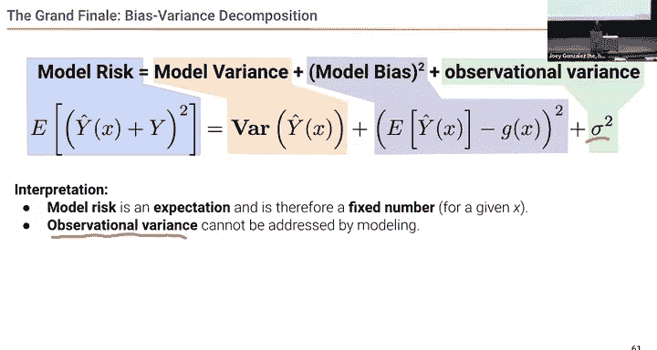

# 课程18：理解偏差-方差权衡 🎯

在本节课中，我们将基于周二关于估计量的工作，深入探讨偏差与方差之间的基本权衡。我们将练习使用已介绍的数学概念，并最终理解为什么这个权衡对于构建模型和机器学习至关重要。

---

## 概述 📖

上一节课节奏很快，我们介绍了一些具有挑战性但至关重要的数学概念。这些概念是理解今天内容的基础，并且在未来的统计学课程中也会反复出现。

首先，我们回顾了**期望**的定义。对于一个随机变量，其期望是所有可能取值的概率加权和。我们将其表示为 `E[X]`。

接着，我们引入了**方差**，即期望的平方差：`Var(X) = E[(X - E[X])^2]`。我们还介绍了一个计算上更简便的公式：`Var(X) = E[X^2] - (E[X])^2`。

我们还介绍了一些重要的恒等式：
*   **期望的线性性**：`E[aX + b] = aE[X] + b`
*   **方差的缩放**：`Var(aX + b) = a² Var(X)`
*   **和的期望**：`E[X + Y] = E[X] + E[Y]`
*   **和的方差**：`Var(X + Y) = Var(X) + Var(Y) + 2Cov(X, Y)`

此外，对于**独立**的随机变量，乘积的期望等于期望的乘积：`E[XY] = E[X]E[Y]`。

---

## 一个投注练习 💰

假设有人要和你玩一个游戏。他将抛一枚公平硬币20次（正面为1，反面为0）。你可以从以下三种赔付方案中选择一种：
*   **方案A**：第一次正面得10美元，第二次正面再得10美元。
*   **方案B**：每次正面得1美元。
*   **方案C**：只抛一次硬币，若正面则获得20美元，反面则得0美元。

你应该选择哪一个？为了分析这个问题，我们将其建模为随机变量。

以下是分析思路：
首先，计算每种方案的期望收益。利用期望的线性性，我们可以得出所有三种方案的期望值都是10美元。既然期望收益相同，我们就会选择风险最低的方案，即方差最小的那个。

接下来，我们计算方差。由于每次抛掷是独立的，我们可以利用方差的可加性（忽略协方差项）：
*   **方案A**：`Var(Y_A) = 10² * Var(X1) + 10² * Var(X2) = 100 * 0.25 + 100 * 0.25 = 50`
*   **方案B**：`Var(Y_B) = 1² * Var(X1) + ... + 1² * Var(X20) = 20 * 0.25 = 5`
*   **方案C**：`Var(Y_C) = 20² * Var(X1) = 400 * 0.25 = 100`

因此，方案B的方差最小，是最安全的选择。这个练习展示了我们如何利用数学工具来分析随机过程并做出决策。

---

## 从样本推断总体 📊

上一节我们通过投注练习实践了期望和方差的计算。现在，我们将这个概念推广到更一般的统计推断中。

在数据科学中，我们通常无法获取整个总体数据，只能得到一个样本。我们的目标是通过计算**样本统计量**来估计**总体参数**。

我们用 `θ̂`（读作“theta hat”）表示基于样本的估计量。由于样本是随机的，`θ̂` 本身也是一个随机变量。我们关心的是 `θ̂` 与真实参数 `θ` 之间的关系。

我们已经在一个重要案例中见过这个思路：用**样本均值** `X̄` 来估计**总体均值** `μ`。我们可以证明：
*   `E[X̄] = μ` （样本均值是总体均值的无偏估计）
*   `SD(X̄) = σ / √n` （样本均值的标准差随样本量增大而减小，即平方根法则）

这意味着，随着样本量 `n` 的增加，我们的估计 `X̄` 会越来越集中在真实值 `μ` 附近。

---

## 评估估计量：偏差与方差 🎯

上一节我们介绍了用样本统计量估计总体参数的一般框架。本节中，我们来看看如何评估一个估计量的好坏。

我们主要关心三个问题：
1.  **估计量有多接近真实值？** 这由**偏差**衡量：`Bias(θ̂) = E[θ̂] - θ`。如果偏差为0，我们称该估计量为**无偏估计**。
2.  **估计量的波动有多大？** 这由**方差**衡量：`Var(θ̂) = E[(θ̂ - E[θ̂])²]`。
3.  **估计量的总体误差是多少？** 这通常用**均方误差**衡量：`MSE(θ̂) = E[(θ̂ - θ)²]`。

一个关键的洞见是，均方误差可以分解为偏差和方差的组合：
`MSE(θ̂) = Bias(θ̂)² + Var(θ̂)`

这意味着，为了最小化总体误差，我们需要同时控制偏差和方差。然而，这两者常常存在此消彼长的关系，这就是著名的**偏差-方差权衡**。

一个形象的类比是射箭：
*   **低偏差，高方差**：箭支平均落在靶心周围，但非常分散。
*   **高偏差，低方差**：箭支紧密地聚集在一起，但偏离了靶心。
*   **低偏差，低方差**：箭支既紧密又准确地落在靶心。这是我们追求的目标。

---

## 将概念应用于预测模型 🤖

前面我们讨论了参数估计的偏差-方差权衡。现在，我们将这个框架应用到机器学习中的预测模型上。

当我们用模型进行预测时，在某个固定的测试点 `x` 上，我们做出预测 `ŷ`。我们关心的是 `ŷ` 与真实观测值 `y` 之间的误差。我们假设真实世界存在一个未知函数 `g(x)`，而我们观测到的 `y` 带有噪声：`y = g(x) + ε`，其中 `ε` 是期望为0、方差为 `σ²` 的随机噪声。

我们的目标是分析预测的**风险**，即均方误差 `E[(y - ŷ)²]`。这里的期望同时考虑了训练数据的随机性（影响 `ŷ`）和测试观测的随机性（影响 `y`）。

经过数学推导（涉及代数运算、期望的线性性以及独立性假设），我们可以将这个风险分解为三个部分：
`E[(y - ŷ)²] = [Bias(ŷ)]² + Var(ŷ) + σ²`

其中：
1.  **`[Bias(ŷ)]²`**：**模型偏差的平方**。这是模型预测的期望 `E[ŷ]` 与真实函数 `g(x)` 之间的差距。它反映了模型本身捕捉真实规律的能力不足。
2.  **`Var(ŷ)`**：**模型方差**。这是由于使用不同的训练数据拟合模型而导致预测值 `ŷ` 的波动。它反映了模型对训练数据特定噪声的敏感度。
3.  **`σ²`**：**观测方差**。这是数据中固有的、不可减少的噪声。无论模型多好，这部分误差都无法消除。

---

## 偏差-方差权衡的实践意义 ⚖️

上一节我们推导出了预测风险的分解公式。本节中，我们来看看这个理论如何指导我们的建模实践。

风险公式 `误差 = 偏差² + 方差 + 不可减少噪声` 揭示了模型复杂度的核心权衡：
*   **高偏差（欠拟合）**：模型过于简单，无法捕捉数据中的基本模式。**解决方法**：增加模型复杂度（如添加特征、使用更强大的模型）、减少正则化强度、优化算法运行更长时间。
*   **高方差（过拟合）**：模型过于复杂，过度拟合了训练数据中的噪声。**解决方法**：降低模型复杂度（如减少特征）、增加正则化强度、获取更多训练数据。

**观测方差 `σ²`** 代表了数据的固有噪声，通常无法通过改进模型来降低。

在实践中，我们通过以下方式管理这个权衡：
*   **正则化**：是控制方差的核心工具。增大正则化参数 `λ` 可以降低方差但可能增加偏差。
*   **验证集**：用于估计测试误差，帮助我们选择恰当的模型复杂度或正则化强度，以在偏差和方差之间取得最佳平衡。

---

## 总结 🎓

本节课我们一起学习了统计学习和机器学习中的一个核心概念——偏差-方差权衡。

我们从复习期望、方差及相关恒等式开始，并通过一个投注练习进行了实践。接着，我们将估计量的概念从样本均值推广到一般情况，并定义了评估估计量好坏的指标：偏差、方差和均方误差。

最关键的一步是，我们证明了均方误差可以分解为偏差平方、方差与不可减少噪声之和。最后，我们将这个理论框架应用于预测模型，解释了模型复杂度、欠拟合与过拟合背后的根本原因，并指出了通过正则化和验证集来管理这一权衡的实践方法。

理解偏差-方差权衡，对于构建泛化能力强的稳健模型至关重要。