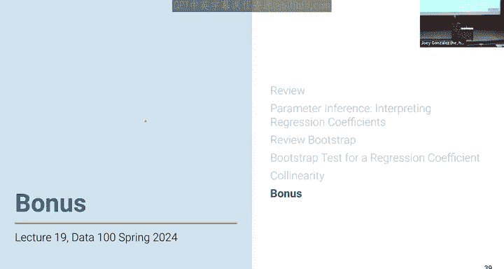
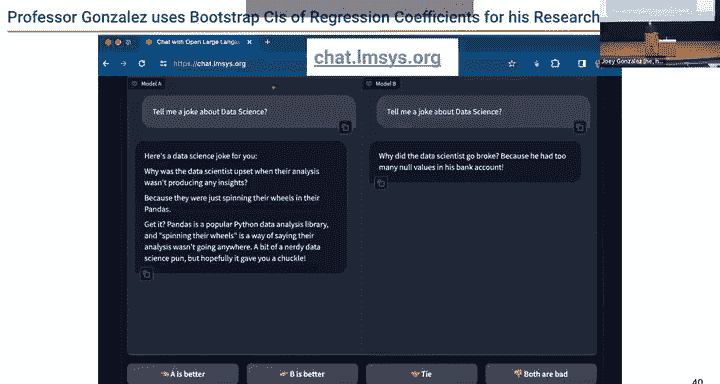
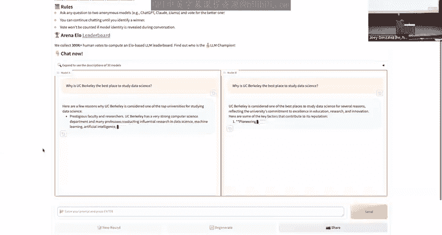
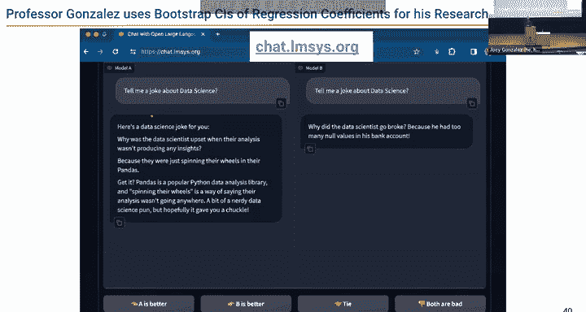
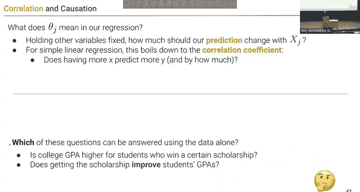

# UCB《数据100数据科学原理与技术｜Data 100 Principles and Techniques of Data Science 24SP》中英 - P19：-19-Data 100 Spring 2024 Lecture 19.zh_en - GPT中英字幕课程资源 - BV1Bc2dYCEbc

Great， good morning。Everyone。How is Project two going？Who says it's going great？The record， no。

 al right。 One person raised their hands， so。Who says it's not so great？

It's a tough project I was just helping people off showers this morning， it's tough。哎。🤢。

I hear office hours lines are long。Go off salaries。 You can also talk to other people。

not just the staff but the students as well you might be stuck on on the same set of problems I was going back to it myself and I think you know we do we walk you through a setup for a simple model。

 maybe think about kind of repeating that process as you build your more sophisticated model。

Hopefully I'll provide some guidance and then I think a theme that people often miss in this project。

Don't forget about the validation data。 you have validation data， use it。

 you made your training data， you're gonna to fit to the training day。

 then you're gonna go submit it。 my test there is enormous you shouldn't be surprised because you checked on the validation data set and it was also enormous。

 so do check against the validation data set that'll help you debug stuff as you go。All right。

Today today's lecture。It's parameter inference and the bootstrap。嗯。

This is going to build on some of the stuff you're doing before though we're going to transition back to more code in this lecture so it's to be a little bit less math heavy actually a lot less math heavy。

 a lot less math and we're going to review the bootstrap and I'm actually just going to go ahead and reex the bootsottrap because who's familiar with the bootsottrap。

That's not bad， who thinks they could implant the bootsrap right now。Yeah， not as many。

It's worth revisiting it's a really cool idea， it's kind of central this this challenge of generalization from our sample to the population it's a clever trick to do that so I will spend some time on that today。

What is the plan？Yes。All right， so first review。The last two three lectures were pretty dense we went from regularization into this random variable discussion then into drivingriv bias andvari and this fundamental trade off it was pretty math heavy the end result was we did some analysis of this thing here right so。

没。Did someone else this thing right here， nope， maybe not。对。Yeah。

 there Gary here and we tried to make a statement about how that thing。

Where we don't know what's going to happen on our new test point。

 what we're going to see and you know what we predict is a function of， you know。

 it's a random variable， it's a function of our data， our training data， how are these related？

And we did a lot of math。And came to the following conclusion where I had a typo previously。

 this was a plus， it's not a plus。It's a minus I fixed it。 I fixed in the previous slides as well。

 that we said that this model risk our goal， like how good is our prediction going to be。

Is equal to our variance of our model， the variability in our predictions plus this bias。

 our ability of the model to fit the the actual underlying process plus some noise。 it's just。

It's just part of the process of measurement itself。😡，This is pretty neat。

 it's a pretty fundamental result。We made very few assumptions about the population。

 we don't have access to many of these quantities， we can't really compute each of these。

 but it gives us an idea of how air can be broken down into these essentially two major parts and this third thing that we can't do much about。

I went quickly and I kind of want to gauge how comfortable people were with the material that we covered up to this point。

 so I thought I'd run this poll。And I'm going to ask you a follow up question for which I don't have a poll。

Yeah， kind of what I suspected。哎。This is hard stuff。So it is okay to feel。

On the left side of this picture， When I first saw this。

 I was definitely on the left side of this picture。 And then I started teaching it。

 I moved it to the right。 And now I just like， it's so beautiful。😊，But it takes time。

So you're going to have to go back over it， the nice thing is that if you go back through the proof。

 which we're not going to ask you to do this proof on an exam。Partly because you've seen the proof。

 you's probably something different and obviously this is a little bit more of an advanced proof than we'd see it in an exam question。

 but the working with expectations and variances iss a useful skills and the proof demonstrates them so maybe go through it try to understand the steps why they're correct。

What properties do we use？My follow on question to this is I can't tell if I'm going too fast or too slow for people。

So I'm going to do a straw poll just in the audience here who felt like I was going a little too fast on this stuff。

 it'd like me go sore。Yeah， I also felt that way。 so maybe I slow down did anyone think I was going too slowly。

Speed up， Joe， it's okay， so we might some of this will be reviewed for some people I am going to go too slowly。

 I apologize。When I do go fast， you'll benefit and when I don't。

 it'll be easier to learn the material。For everyone else。All right so I'm going to do my best。

 but if you are confused do raise your hand here this the live audience is my best signal for where I'm losing people and then I guess on So if there are lots of questions。

I don't have my slido staff number here。Okay， I will try to check Slido at some point to see how questions are going。

个体。Keep right。All right so。We're going to transition to thinking about parameter inference so and this is an interesting point in the class where a lot of what we do and what you're doing in the project right now and a lot of how people look at data science externally that's about making predictions。

Predicting the price that a house should be new assessed at。Predicting if this email is spam。

 predicting if this customer will leave。And that is true， we do a lot of prediction。But sometimes。

I don't care about the predictions， when I don't care as much about the predictions。

 I care about what the model says。😡，So classically， there's sort of two different tasks。

 we call one prediction。Your goal is to predict some outcome。And then classically。

 we call this other task inference。So our goal is。Not to predict exactly where the moon will be next。

 so that would be nice to know， but what is the relationship between the moon and the Earth or between the planets。

 or are the underlying properties of that system and here we're going to make assumptions that the world follows some model G that we think is the true model。

 and then we want to know if G has some form， what is that form。And can we get that from our data？

I say classically。Because it's a problem。The entire tech industry has rebranded inference。

And I will confess， I was also involved in this process of rebranding inference。

To just mean all of this， this is all inference now。

And I guess the meaning of inference itself is you know inferring。

 taking what we know to reason about what we don't is appropriately。

 prediction is taking what I know and trying to reason about what is that email spam， I don't know。

 I have some signal from before I'm going to try to make a prediction or infer if it's spam or not。😡。

So today everyone says this is inference。And this gets less attention， but this is also inference。

 so both these things are inference and so you'll see on the billboards and the Bay Are that you know the fastest inferencing engine in the world and they're just saying。

My software or hardware makes predictions really quickly。

So the kind of modern nomenclature is we're training teaching， training our models on some data。

 maybe classically we'd say fitting our models the data， but now we say training them。

 and then when we're going to make predictions，We often call that inference on our test data or an unknown thing。

But we will also again refer to this idea of inference， know， reason about the world。

 draw illusions about the underlying relationships。I'm going a mess of this slide。

I'm going to use this term here to try to make it a little bit clearer。

 something about parameter inference。I'm trying to， if you will。

 I'm trying to predict the parameters， but really I'm trying to infer something about the world。

 so parameter。What this means。Because I don't care about this anymore。I care about this。What's data？

I get theta hat， that's for my sample， but I want to know what the true theta is。

What does it mean to be a true theta now we have a problem。😡。

So we're going to enter a world where we're going to take。

 you know before we were taking there's some true underlying relationship with the G we don't know G that's a shame and then we built our model of this form。

 it's parametric it's got this parameter that we're learning or fitting and this is going to be our prediction and now we're going to make a big step and we're going to say we're going to start to assume G。

Is parametric。In fact， we're going to assume G is the same。Same shape as I'm working with right now。

But it has parameters。That we don't know。So we really want to know what is really theta？

We just got the hat from our data。So。And we did have this on the previous slide， previous lecture。

 we're going to go from our sample statistic a statistic is something we've computed on our data。

 we did this loss minimization to get this sample stat the。At hat is an estimator， a random variable。

 and we want to relate that back to theta。 This is a population parameter。And we don't know it。

But we believe there is a true one out there。To make this a little more concrete。

 we can actually think of this as a sampling task that we could say you know your shoe size predicts your height。

Let's say an even more extreme statement that the shoe size of a person is linear related to their height。

 there's some linear model。There's all people in the world。And if I could get the shoes。

 size and height of all people in the world and fit that linear model， I would get a theta。😡。

That theta for all people in the world is the true theta。😡，There is a truth。

 there is a truth it out there。I just can't afford to do that。I have a sample。

 this is the sample side of the stage。And I pulled my theta for my sample。

 it's a guess at that true theta。😡，Does it mean that people's shoe size determines their height？No。

But it's an assumption I'm going to make about the population。

 and I just really want to know what that coefficient is， that slope。

 maybe of that shoe size to height for the population。😡。

Because that might tell me something about how I invest in， I don't know， shoes and panticides。

 maybe there's something I don't know why for this example。

 but I would care about that key parameter。If we ground this in science。

 maybe there's some underlying relationship between。Expression of a protein。And some symptom。

And you know， it's probably a very complicated one， but I just want if it were a linear relationship。

 what would be that relationship， What is the coefficient of those parameters？

Or maybe it's some slightly more interesting parametric model。

 what are the parameters for that model？And that might tell me something about the underlying physics or science behind that task。

Or had that relationship。Any questions？Change in framing。You're going。

We'll go a step further and I started to all to this already。For this class。

 and actually for a lot of modeling tasks in general， we're going to use linear models because again。

 they're very expressive and we can start to directly interpret these things as slopes or offsets and slopes are here。

So we're going to assume the world has some true theta。

For the best model we could fit of this form on all the population， we're only going to get a sample。

So we get a sample。We use ours Kiler and fit package when your model fit。 We get these data。

And we want to relate them back。To the truth。Here。Right。We look at the coefficienticient thetas。

This is the slope。With respect to that feature。 So how does it change that feature？

Reellate to a change in the predicted value。Things we might want to know。Is it zero？

Does that feature help us really draw a conclusion when we get lucky and you know's just a bit of noise it's like it's like point001。

Maybe that's zero， I don't know。If it is zero， then maybe this thing doesn't really help me。

 I don't need that feature。😡，喂。Maybe it's negative。Maybe increasing this decreases this。

 I'd like to know that。Does increasing shoe size cause or cause careful that。

 does an increasing shoe size relate to a decreasing person size？Probably not。

 I think it's going to be positive。So maybe I want to learn， is it really positive？

These are kinds of questions we'd ask。Zero is particularly interesting because it lets us know do we really need this feature and do we really need that feature So we spend a lot of time thinking about is that。

Predictive， is that feature predictive， a change in that feature predictive。

 a change in the prediction itself？This will get more complicated as we start to encode interesting features。

One highcos and dealing with cuity which we'll cover towards the end of lecture but thing right now is we're kind of interested are these things zero or not and if they're not which way are they positive are they negative so on。

To I guess elaborate on this so if the parameter theta 1 was truly zero。

 then I wouldn't need this feature and that tends to be a key focus of what we do at at least at the beginning of this kind of parameter inference process。

我mer AI。All right， so questions we answer is。Is the futurex1 linear predictive of why？呃。That is。

 does a change in x1 predict a change in y？Is the relationship positive or negative。

 which way does it go？You can imagine maybe I have a squared term。

 maybe this squared term is more predictive。So I could start using feature engineering and I might be curious which features really tell me something about why and this is my estimation task is trying to understand。

 you know which of these thetas are really zero and which are not。We have a problem。

How do we test if it is zero？Because we only have a sample， so we got it。One estimate of theta 1。

Sample size of N， hopefully end is not too small。We could have gotten other random samples。

And they might have turned out differently。Especially if man， the， what if the theta one is like？

Negative 0。0031， something like that。 That's really close to 0。 Is it really 0。

Maybe the values of that feature are really big to scale them。

One thing to consider when doing these kinds of analyses are these units。

 are they in different units to have some features are huge。

 so the coefficients are really small and then some features are really small。

 so the coefficients are huge。But really I'm curious about chant。

 so maybe maybe I do have this discrepancy and size， but again， fluctuations in the my training data。

 different versions， different samples might give me very different values for that feature。

 very big values， very small values， depending on the scale that。Okay， so this is。

The part of this class， and I think the only part we really deal with hypothesis testing。Data8。

 which hopefully most of you have taken， and if you haven't definitely looked back at data。

 it talks a lot more about hypothesis testing。We're going to review a little bit of it here。😡。

And we're going to build on the null hypothesis， this is one important concept。

 so this is assumption about the world。That we think is sort of the starting point。In some sense。

 it's the world we're going to try to disprove or show is unlikely。

So we're trying to show we think that theta is positive。Not zero。

 so then we want to look at how likely under the null hypothesis theta is zero that we would see the data that we actually saw。

 that we would find the parameter that we actually found。

So things to think about when writing down an old hypothesis。Statement of the world。

Under the kind of base assumption， the thing you'd like to show is unlikely。

 so you have some hypothesis you are trying to show that's your alternative hypothesis that theta 1 is greater than zero。

The other important thing is that under an nu hypothesis。

 you need to be able to simulate what you would see。😡。

What happened if I were to sample under the null hypothesis？

But I'll show you that in a moment when we did that boots。So our alternative hypothesis。

 which probably should also be bold here。Is that the true prim theta 1 is not zero Sometimes we might say that theta 1 is greater than zero theta 1 is less than zero when we I'll show you how we do this。

 when we do this we'll be able to do each of these。All right， then there's this P value。

The P values of probability。😡，That you would get the theta1 you got。😡。

If the null hypothesis were true。And you'd like to say， well， that's unlikely。

Unlikely that I got the P value or the theta that I got。Under the the no hypothesis being true。

The true value is0。So ideally， we want to say that ruling out nu hypothesis。

Provides evidence of the alternative hypothesis the。

In this class we can do this now so both ways and I'll show you it both ways we'll often use a conference interval which is sometimes easier to think about so let's talk about the conference interval fming of this problem so I got a sample。

I got a Theta hat。If I got another sample， I get another theta hat if I did this。

Millions of times I get many， many theta hats， and I could plot a distribution of those theta hats。

 and I could say what's 95% of those theta hats， where do they live。

 Maybe I center distribution on the mean of the theta hat and I say if I cut the distribution and take the tails。

 I say what's 95% of that， that's a commonhen interval。 So 95% of the samples I generated。

 95% of the theta hats I generated， lived inside of these two numbers between these two numbers。

It's an empirical comp rule we can construct and I'll show you how to do that in a moment that says95 of my samples would likely produce that a value between that range。

If that range doesn't contain zero。Then it would be， the other 5% case would contain zero。喂。

So this is if I don't contain zero in my confidence interval rules， then I'm probably not zero。

And also I can see which side of0 Im on， am my on this side of zero or am I on the other side of0。

Right confidence。U there is like going on questions。This is a little confusing， good news。

 I have pictures， so I'm going to try to explain this in pictures in a moment， so let's do that。

Vi a bootstrap。 Oh， okay， this is good。So here's the problem。

 and Boshoprap is a crazy solution to an interesting problem。All right。

 the things I want to study about my theta hat。The things I want to make statements about the data。

Depend on the population， so what's the distribution of theta hat？I only have one。

 but I want to know how spread out how many different。

 what kinds of the hats would I see if I resampled many times？

But the only way to resample it many times is we go back to the population and get some more data。

I don't， I don't want to do that。 It's expensive。So ideally。

 I would draw many samples from the population。By the way， if you can do that， you should do that。

But in practice， that's often too expensive。To time consuming。Did we run more experiments？

Even if they're free， takes time。We you go out there and ask people questions， maybe pay people。

Likelect more data。 So getting the population， getting more samples is often hard。

So we can't do that。We only have one random sample from the population。What do we do？不是。

Insane that this works when it works。We couldn pretend that our one sample。This。

Couple hundred points， maybe a couple thousand points that we have。

Let's pretend it is the population。Put over here and called it this is the population。

Is it the population no？But if it's a good sample， it kind of looks like the population。Okay。

 so I have something that kind of looks like the population。Representative， hopefully。

Let's go to this sample， which we have in our Python environment and let's just take things from it。

 we'll just sample from that sample。That's kind of like the population we'll build another sample over here。

 so they're simple。I pretended that my sample over there was the population。

 I can get a sample from that sample。I do that with the data frame dot sample function。

 makes it easy。Problem， I need to sample the same way I construct my original sample。Again。

 hopefully I could construct my original sample by a simple random sample with approximately with replacement or with a big enough population where it doesn't matter。

So that means that all you need to do now is sample from this sample。Simple。

 panda's data frame do simple， that'll build a sample。So they sample the same way。

And the other part is where it gets。Really confusing。This sample here。

This new sample needs to be the same size as my original sample。How do I do that？

I have end data points over here。I need a random sample of N data points。

 and I need that to be size n。How do you sample and random numbers。

I do sample N random balls from a bucket of end balls。Take all the balls and put them here。

What happen each of my samples。Itll be the same。So I got a problem。

And you're probably guessing the solution to that problem。With replacement。Take a sample。

 put it over here， okay that's person number one， put them back over there。

Over here and pick up again another another sample it could be the same person one well showed up again in my sample that happens fact to expect that to happen。

So we're going to sample。From a bucket of end balls。N balls many， many times。With replacement。

 otherwise they'd all be the same sample。We need this to accurately model the variability。😡。

So I could have said well I have end data points over there I'll just take 10 n is big。

 Ill just take 10， it'll be different each time it's good。

 but I'll have greater variability in all my estimates because it's a tiny sample I want to know what the variability of theta would be if I had a big sample which I have over here。

That's what I'm trying to reason about。All right。So this is the bootstrap。

And it comes from this idea of kind of an impossible task。 I want to lift myself up by my boots。

 So old days boots had straps so you could put them on and you're like。

 I'm gonna to get higher by picking myself up off my boots。It's a silly idea。

 that's what we're doing。We don't have a sample， we're going to pretend we don't have the population。

 we pretend our sample is the population。And ask a question about the。

The relationship between the sample and the population by only using the sample。😡，不见得。

This should sound ridiculous。😡，But maybe not because are samples supposed to be pretty big and maybe representative the population。

 so sampling from it would see at least the variability it would get for different samples。

Right right。Gras， let's do this so here's my population of this needs to be updated 7。

6 billion people。I took one sample that cost money， that's my original sample。

These are the four people you should take bigger samples for people that I have。Okay。

 that's going to I'm going to pretend that is the population for this process。

 I'm going to sample with replacement， look at many samples。

 and again you see this green character right here shows up twice here。

This purple character here shows up twice here it's possible they could all be the purple character that can happen make my sample。

 you know， if my original sample is not four， then you know。Thousands。

Thousands then that gets less and less likely， I see many， many。

 many copies of any one example in my boots job sample。But now I get to see variability。

 so thisre showing the variability。Variability in my samples。

And I want that variability because I can now compute。Statistics。On each of those samples。

 so I can train multiple models， get multiple thetas。B hots。This is not to the power of one。

 but this is the first theta hats， that's the first。Second， so on。 so I get many theta hs。

If this was just， I'm looking at maybe just the slope。The first feature？

I can then plot the distribution of that。What spread would I expect if I do this over and over again？

These are all probable theta ones that I could have seen。

Probable and over here is more extreme values。And if zero is over here。这是个。

Let's say zero is over here somewhere。I's really unlikely。You like we've seen  zero。In fact。

 I didn't see it in my tens of thousands of samples that I drew。So I take these。

I take a probability reasoning problem and I turn into a data problem。I have lots of thetas。

 I sort the thetas， I can take you know go in 2。5%， that's the left tail and I go 97。

5% across and then that's the right cutoff。Non P makes this easy because I have this percentile function。

These are all my theta values just floating point numbers and I say I want。This is 95 is like 2。5。97。

5。So I just give it a list of percentages and it tells me to two cutoffs。Russians。

So break your question into two questions so first what motivates it。

 why the bootstrap why not get more data you should if you get more data go get more data。

 but you got a problem now because you just got a bigger sample and if I were you I would go ahead and throw that data inside your big sample now you have a better estimator for theta and now you have the same problem again。

So you're going to go out and collect another sample。

 chances are you'd like to stick those two samples together and get a better theta。

And now you just have a bigger version of the boots that pro again。

But maybe there's a clever estimator I could use， and there are。😡，But here's a crazy thing。Boojarap。

 when my data is well behavioral come back conditions is a nonparmetric estimator。

 it's actually very good。Good enough that we use it in research。

 I don't use the fancy math stuff because this is better than that。It's harder to use。

 you have to run all this simulation stuff， but for me， it's easier， so I like it， and it's better。

Right。Technically， this here。There's a better way to construct this comp interval。

 which we won't cover in this class you can read it in literature how to do it in my research I just use this method because it's good enough for me。

 but you can get slightly better estimates by knowing something about the population statistics that build on top of the bootsottrapap to improve your estimate quality。

But way out of scope for this class。Other questions。

Great question is the bootstrap sort of reweighting the data and looking at different reweightings the data it is and there is cool research that builds in that principle to speed up the bootstrapping process by just working on reweights of the data。

Again， out of the scope for this class you can think of is just simulating the process of sampling and seeing how that how you would get variability in your estimates and a moment I'll come back to there are things that you don't get from the bootsottrap for example。

 I look at this distribution go wow， maybe this is a better estimate for the mean。

Except this is the this will be theta hat from my original sample， so doesn't really。

 I don't get better estimates of the theta itself。What I do is I get a better understanding of the variability in those estimates。

Yeah。Right right， so it's a good question。 we'll do a demo in a second to try to illustrate this。

 but broadly speaking， there are some concerns about。The extremes。

 So there's extreme characters in my population， and I build the sample。

 It isn't representative of the extremes。 It's representative， my original sample。

 hopefully I'm kind of the center， the bulk of that population。If the statistic on computing。

Who's the richest person in the world？That's going to be a bad statistic and bootstrap will not work well。

If the thing I'm trying to calculate is something that's really sensitive to the extremes of the population。

 the extremes of the sample， we have a problem。So don't use the bootstrap。 Well also。

 you have a problem in general because that is a hard thing to try to reason about because unless you get the richest person in the world。

 you dot not have a very good estimate of the richest person in the world。对。Right。So。

It doesn't improve your your estimate。 So I just said a moment ago。

 So this is a way to understand the distribution the estimate。

 it's not a way to get a better estimate。And it tells me about the center and spread。

Think it'd be better just to do a demo。Oh no， I gave you the answer to this， that's a bummer well。

What are some other answers。But why else my bootstrap failed。那 really是一点吧。Yes good， extreme。

 small samples。If you're actually getting help。Selection bias yeah。

 if you're if you have a bias in your initial sample， bootstrap's not going to help you。

 not it's not going to get rid of it。Small sample is a big problem。Bad statistics。

 very sensitive statistics。You don't do enough samples， I take like three samples I'm done。

 that's enough estimates for theta， not a good estimate distribution。So I'd take many， many samples。

As many as we can afford。Alright， I'm going to leave this open。 Will I go out to the demo。Justs here。

 so let's build a bootstrap。But data I think where already played with。

So I'm going to load a sample of this miles per gallon data set。

 so I'm going to pretend the data set is a population， but I'm not going to look at it。

 I could only afford to look at 20 data points。You'll notice that I'm seeding these experiments so that everything goes the same for each lecture。

 this is just saying that all random numbers will be the same for the rest of this notebook if I do everything in the same order。

So I just picked my favorite number here。Okay， so I took 20 data points from my sample。

And I want to understand about the relationship between the weight of a vehicle and its fuel efficiency。

So I think heavy vehicles should have lower fuel efficiency。

I do have an electric car which is very heavy it's very good for efficiency but anyways where we're focusing on gas cars for a it and so the weight we believe probably has a negative slope。

 negative coefficient， right？😊，And is it really negative and is it really， you know。

 is it really not zero， so it's truly a。A negative number。That's my task。

I fit a linear model predicting the miles per gallon， given the weight。

 and I get a slope of negative 0。00692182。That's pretty close to zero。

Perhaps weight doesn't really predict the fuel efficiency of a car。

It's not a good and informative feature。Let's find out。So to do this。

 I'm going to build a function and we post my estimator using terminology from our lectures that takes a sample and returns a number collection numbers in this case it's going to take a sample of data and return the coefficient of the B slope。

 the first coefficient。Now I've written this tiny bit of code， the bootstrap。

 so let's walk through it。It's going to take a sample， that's my original sample。

It's going to take a statistic， I should call an  estimatesimator， this is my function here。

It's going to take my estimator。You name this and I want to run it number of repetitions times。

Typically a good number， you know， thousands， tens of thousands。

 depending how how much time you've got as many as you can afford， the more you do this。

 the better you'll get。And here's how it works。 I start out with no statistics。

 the number of repetition times。I'm going to take my sample sample。Dot simple。Fraction  one， I means。

 sample everything， sample， same size。And with replacement。That's my bootstrap sample。Sle sample。

 that sample。Now onm a sample， I asked my statistic or my estimator， really should wename this？

Take that sample and give me your number。 That's a number。 That's one hat， one datata hat， okay。

But I'm going to add that append it to my list of theta hats I'm keeping a running total of for all my theta hats。

不s这。So 10，000 times， I'm going to call this miles per gallon。Sample， when I call my estimator。

 should given this better name is my estimator。So I'm going to call this function on samples from the sample。

You get a bunch thetas， there be a long list of thetas。Sos it。Don， now I can build a histogram。

This is a distribution of bittus。Thisistation of the slopes。Where's zero？

I in here right so I did see variability different samples of size 20 from my sample of size 20 give me very different thetas。

So there is variability， quite a bit of variability。But doesn't include zero。本人。Well。

 so in this case， I'm asking the question。Is there a chance that I just got lucky and I got a nonzero theta？

And if I know run a bunch of other samples a couple times I maybe get a positive the。

 maybe heavier cars are more acute efficient。RightI'm worried about that because I really would like to make the claim that no。

 not true， heavier cars are。😡，Les less fully efficienter。

So I'd like to make the claim that theta that slope is negative， not zero， not positive。😡。

And so what I see here is that distribution。And all my samples， I never saw something。Rather than0。

It was pretty unlikely。That sampling alone was the cause of my fortune of seeing a negative what I see before。

Negative 。6921。I could ask using just this data。What fraction of the time did I see a sample greater than zero。

 and it could have been that zero is right here。It's still unlikely I didn't see many many things greater than zero。

There was still tiny fraction time。 And I might still。

 even though I saw a few samples that were greater than 0。 a few times。

 I just sampled my data in such a way that that heavier cars were more fully efficient。

 A few times it happened。 but it's so rare。But I'm willing to conclude。

It's unlikely with the P value of， let's say 0。05。 So if less than 0。

05 of my data is on the right side of that zero， then it's really unlikely with that P value that I would have seen。

The data I got。Under the assumption。That it's， in fact。Greattter than zero。0ero greater。不是。

Great question so if i'm doing all this stuff should I normalize my features。

When I'm dealing with just one slope， it's not as critical。

 but if I'm starting to look at lots of slopes， it's easier for me to reason about when my data has been normalized。

 which is to say I've tried to set the features to be zero mean and unit variance。

But also give you a function here to compute the confidence interval。This again。

 this is now working with data it's not fancy statistics it's I have a 10000 samples。

 I get my lower percentile， which is 100 minus this is 95% confidence interval1 minus 95 that's five divided by two and then my upper percentile is 100。

Back 2。5。 so 97。5。And there's this amazing function percentile， which takes my list of samples。

 don't even have to sort them。 I tell what my lower and upper percentiles are。

And it returns those numbers。So it went in into that list， it sorted that list， it went in 2。5%， 2。

5 the length of it， just pulled that piece of data down and that was 0 negative 0。

0086129209 and it went all the way 97。5 times n and then pulled that piece of data down now was the second number。

It's just an empirical compable。不是。Yes。Enem's distribution should have the mean of the original value。

 My bootsottrap estimator' expectation should match。It could be skewed。This one was skewed。All right。

 what I want to do now， which should be fun。Is I can cheat here I actually had the population at least I like my data。

 that was the thing that I I took 20 things， 20 cars from my original data set。

 that was my sample and then I did this whole exercise by reampling it。

Today I'm going to go to the population 10，000 times and pay for 10。

000 samples and see how does that compared to what I got with this boots shop？Okay， here we go。

 so I went to my population。And I'm going to take my estimator。I'm going to sample 20 things。

I didn't do with replacement here。 we can try it with replacement I I'm going to do this 10000 times。

 I'm going to sample 2020 true samples for my true population。Sorry。

 I'm going to sample a sample size of 20 10，000 times from the true population。

 that's what I was trying to approximate the。Compute the C， the conference interval。

Similar at the same， I think it's maybe more instructive to look at the histograms。

Can't quite read the sidess here。 So Zoom Im going guess which one is the population。

 which one is the。The bootsottrappped estimate， so one of these is really the sampling distribution of that theta is I cheated。

And one of these is the bootsrap。怎么。R， so the one on the top is probably the bootstrap estimate。

 why it says a little bit less variability。 remember I took this sample and， you know。

 maybe there extreme cars。 there are some extreme cars in our list， are just way gas guzzlers。

 they weren't in that sample。 My original sample of 20。

 And so when I went and computed these statistics， I just wasn't as sensitive to those weird or extreme points。

 But when I did resample many times I got to see a little bit more spread。

 So some of the more extreme points showed up。So I get a little bit more spread。

 so the bootsottrap might slightly underestimate that variability in my estimator from the true population variability。

It's not far off。This picture would look much better if I didn't choose a sample size of 20。

 don't do bootstrap on sample size of 20， you need more data。

 but I chose this to get more clarity on that variability。Also my population only 400 so。一辈子吗？

All right。I think that is the end of the bootstrap。Is this surrender render。

Any questions we're going to start using this to solve。People more infferential questions。

Right right，Right so again， it approximates the center and spread worth noting it's not a guarantee in the asymptotic limit。

 it will converge in that on that under some important assumptions that theyre out of scope for this class。

 so it approximates the center and spread of the approximations。sorry， centers better approximations。

It doesn't improve your estimate I said this earlier， so it's not going to you a better theta hat。

 it just tells you about the spread of that theta hat。So it works best when I have large samples。

 works best when my population distribution isn't really skewed。

I don't want these trillionaire people in my population because I don't sample them if my statistic is sensitive to those。

My sample is not representative and therefore the bootstrap is not going to work that well。

And it works best when my estimator is low variance， we're saying that's in to the extremes。So again。

 min Max， not so good， median mean things that work on the center of my data。

 those don't change as much。So now let's talk about applying this to regression coefficients。

I think I'll have time for。One and a half demo let's try to do it。

So there are two demos today I want to show The first one is playing with purple air。

 This is actually a demo that was created during the the fires。 When were the fires。The 2020s。 Yeah。

 Josh Hugg， one of the instructors at that point in this class， was stuck at home。 He's like。

Who's used purple air？If you haven't used purple you should start checking out purpleia。

 it gives you smoke maps and when it starts skin smoking in California， which it's likely to do。

 it tells you where that smoke is And if you have little kids in school。

 they closed down schools And so as a parent you're like is it going be smoking in my area because I have to figure out the day so Josh was trying to figure out if he has to go pick up his kids started playing with this data set and actually found a better way to compute the smoke levels in your area So give you a bit of backstory to this。

The EPA runs these air quality systems that are super expensive。But really high quality。

But because they're super expensive， there aren't that many of them。And because they're so accurate。

They don't report that often because they do all this averaging。And if you're trying to figure out。

 is this smoke moving my way？Will it be here in the next hour do need to go pick up the kids now？

You want something that's much faster and much more dense in its coverage。Purple air sells a cheap。

 that's a strong word， a cheap ish for someone who's wealthy， not me a cheap ish sensor。

That some people buy homeowners buy。Or businesses buy and they can install them outside the house。

If you look in the barrier， there are a lot of them， a lot of them。

They pretty densely cover large parts of area。They measure every two minutes， so very frequently。

But they're less accurate， quite a bit of variability。They also measure something different。

 the purple air number。And the schools close when the air quality reaches an EPA sanction number。

 the number from this system。So how do you convert these purple air numbers into these EPA numbers？

So Josh Hugg wrote a blog post that became part of the lecture。

 and in fact I have a textbook for this class， we worked with the people at the EPA to get their data set for this demo and how they now calibrate the EPA numbers with purple air so that they can publish both to the public。

All rightSo we're going to focus on these PM2。5 particles。The segment of this data。

And we we do something kind of weird。It's called inverse。Reggression to inverse regression。

And what we're going to do is we're going to try to predict the purple error number as a function of the EPA number。

 so we get measurements at points in time for the EPA number。

 and then we have the purple air measurements around that location， so we have a purple error number。

But we ultimately want to go the other way， we want to go from purple air to true air quality。

And it's weird， but we're going to actually try to solve this regression problem。

 we don't care about this model other than these parameters。

 which we're going to plug into this other equation to get our predictions。

So we're doing it sort of backwards， we're going to say， let's predict x is a function of y。

And then go back and flip the model and then say， now I can predict y is a function of x。

But we're going to do that for kind of interesting statistical reason。This is very noisy。

 remember that sigma。I want to put this on the left side。 I want to try to predict this。

 I want to build a robust estimator of that。So do regression against that。

And then this thing is a truth。 It's like an accurate measurement of the air quality。

 And so I want this to be my x value。 So I don't want to deal with variability or uncertainty in my x。

This is more， more accurate。In these situations we have a really noisy thing that you're trying to use to predict something that's pretty robust。

 you often flip the pro around say I'm to use the robust thing to predict the noisy thing。

 use regression techniques， and then invert that equation。😡，This is inverse regression。这记然。

We'll do this second， I think we have time。The purpleple hair？We'm going to skip the data cleaning。

 there's some fun data cleaning， we're going to break this into our X and our y our initial x and Y we're going to invert that。

And get some models， so I get my theta0 theta 1。We plot this。this is the data。

II'm fitting this way right now I'm going to say what is AQs tell me about the purple error number so EPA says for purple A my prediction line it's a good fit right we can probably get a pretty good estimate of the purple error number from the EPA's number。

We take the inverted equation， and this tells us that the air quality is 1。6 times 0。

46 times the purple error。1。6 plus 0。46 times a purple layer measurement。 so it's just regression。

 we use psyit learn to fit theta 0 and theta 1 for this line。

 and then we use just basic algebra to rearrange the equation so here's our y and here's our new our original X。

True air quality。Thank you。不改。I wanted to just show the if I had solved the direct problem。

 I would have gotten a lower loss， but I get a more robust estimator。

 it will generalize better when I do this inverse problem and I don't have the full analysis of this。

 but just this is a standard technique when you have this high variability in the X that you're trying to model。

So these are the two lines。 they are slightly different。

 You need to get a slightly different model solve this。

Right so why dont I do this because here I didn't care about the original models's predictions at all。

 I cared about the parameters in a moment I'm going to show you now I want to reason about adding new parameters and whether or not they are really helpful in making conclusions about air quality。

So the model that's actually used in practice today is the Bark John model。And it's pretty close。

 it was fit using the exact same techniques you just describe， they just added a second feature。

 the relative humidity， which I think we just talk about here。

So we're going to add an extra feature to our model， which is relative humidity。

And this is what is used in practice today。So I want to now understand， is this actually helpful。

 so we're going to apply the same analysis before to this task。这。But I can fit the model again。

So I'm going to solve for theta 1 and theta 2 for the original air quality and relative humidity predicts the per layer value。

I again， invert the equation and I get the air quality is equal to。It's expression。

 So that predicts the true air quality。 If I know the relative humidity and the perlar sensor reading。

Why does humidity matter Well， these things use lasers and they look at particles near and humidity affects how they measure those particles。

 so humidity might be a higher humidity might actually be causing it to falsely predict high so I wanted to down predictd the actual value。

From seeing humidity as as。Purple is dust。What's kind of neat here is as I've extended this model。

 Here's the original line that I have before。 This green line is the new prediction for each of my points。

 I zoom in。 And so I'm compensating for humidity， and I'm getting closer， as I do die。嗯。

So the bad visualization because the line here doesn't mean anything。

 but I did that so you can sort of see the green points easier Yeah so I've improved the fit of my model by including relative humidity。

Clearlyally， I can also show you what this looks like。

 it's worth noting kind of the consequence of this， So I've made my model two dimensional。

So I have the relative humidity and the original regressionggression problem。

 I have the relative humidity and the EPA number， and I'm trying to predict the purple error number。

And in the original model， that's the orange one here。

 there's no variability along this axis right so the orange one is flat along this axis。

 but in this extended model I'm allowing for variability in that axis。 so I'm building a better fit。

 which more closely approximates my data。So this is just simple regression before we did it with inversion。

Bret。So now I want to know if these things are really helpful， so have two thetas。

 theta 1 and theta 2。And I want to figure out their role in predicting the purple air measurement。

 and in fact I think here if I'm going to focus just on the2。All。

 so just before I'm going to define another estimator that takes a sample。

It's a linear model from that sample just as before。

 and I'm grabbing just the second coefficient of that model。 That's the relative humidity slope term。

I'm using my bootsshop function on all of that data。Because that's my I only have one sample。

 the whole data set， so they got， and I want to run this estimate。10000 times。

Questions or this is running。And I don't have my s of people in the audiences about that。

Let's just keep going。All right， so this is a distribution of the coefficient for relative humidity。

Again， it doesn't contain zero， it doesn't cross zero。

 so we would from this conclude that this coefficient is in fact predictive and we get a sense of the spread of that coefficient。

Spring of that relationship。This is sort of repeating we did before on a slightly different setup。

When doing this kind of in a scientific setting， I'd want to know。

 and I might add many other features and try to test them。

 which ones are predictive and which ones aren't and this is the process that I would use to do that。

And we can calculate if you want to do the proper probability。

 so what's the probability of seeing something less than zero？For that coefficient。

 I would calculate what fraction of my samples are less than zero。And so under my simulation。

 there's zero chance that I would see that。It's very unlikely。By the way， if you use this in papers。

 you should talk about know， So these are bootstrap estimates with 100010000 simulations and the con intervals were constructed in the following way。

 And here's what we got。 it's important to present these， how you constructed。

 these samples or how you constructed theses。Right right， I want to get the one more。

 which is a little bit fun， so let's do this one。So it's going to be counterintuitive。

 I talk about culinarity。So we're going to study the snowy lover。

Which was this is data collected around here by a former Berkeley student。

And so we're interested as ecologists in perhaps understanding the， you know。

 how is the population of snowy pover developing， we want to know if the birth weight of the upcoming offspring are going to be high or lower。

 one way to do that is we go and measure the weight or size of the eggs and that tells us again kind of a metric of the health of that population。

So I want to predict how big will the hatchlings be， what's their birth weight。

 and I want to do that from information just about the egg itself。

So I'm going to assume again that the universe has this model。It's not right。

But it's if the universe had this model， I'd like to understand these coefficients。

Which whichch of these coefficients determine really the birth weight of that egg。Of that actually。

IThink I don't want to give this way， so let's go in and actually do this again。

So we're in snow Pver。Very cute birds。Take a look at the data， so I have this data。

 so I have the birth weight， birds weight， and then I have the information about the egg。

I have a ton of data， I only have 44 rows。So let's fit a model。So here I fit a model。

 I'm going to go a little bit fast andm using。You should look over this you want to learn some panda tricks。

 but I'm going to display the intercept weight coefficients of the weight length and breadth of the egg。

 so this is the coefficients of my model and it means square air。Is it a good root mean square error？

How would you know。It's important root mean squared air， what spread weights。

 these are I assume in grams， 5。2 grams root mean squared air is 0045， that's not bad。Pretty close。

 right？If I told you squared error， it'd be harder to reason about again， but this is in gras。

 so we're not off by too much on average。Worth perhaps or all the same weight。Kin of bar。

So the base variability of that thing is not maybe just predicting the average weight's not too far off either。

Okay， so I'm now going to build an estimate that returns all the thetas。

 so I'm going to make a list which includes the intercept and all the coefficients that's my new estimator I'm going to bootstrap that 10000 times。

We get a list of four numbers times 10000， so 10，000 rows， four numbers across。

I put this in the data frame， and so I get intercept， egg weight， egg length， egg breath。

rrying to see some going on here， signs of flipping。

They ran this many times with many different samples。Construct the composition intervals。

Here's my cop intervals。What is going on here？The intercept。

 probably something between negative 15 and five。也贵。Between negative 。2 and1。Egg length。

 somewhere between negative 。97 and2 egg breath， somewhere between negative 。25 and 76。

 So what can we conclude。Nothing is predictive。None of our coefficient fish， that could all be zero。

IsThat that true？Something went wrong， went wrong， what went wrong。

This is weird when I saw this like， man， that's a bug， no it's not a bug。Surely the y wait， come on。

The egg weight has to tell you something about the bird's weight。It doesn't。

Statistics seem to suggest you have a problem。Here's the problem。You can't reject an hypothesis。

Lets skip this is how to write bootsshop code。Yeah， so we run into this problem。

 we have this widespread， something's off。What is going on here？Is culinary。

You can't change these dimensions without affecting the others。So as I move in one dimension？

I change width height。 they're all very tightly related。 This is a circle， if you will。

 So changing the width can change the height。They're closely related。

They're almost functions of each other。If I want to do these kinds of analyses。

I need defying property to be true I want to be and this is a sleep cat example。

 but I want to say if I'm predicting the weight of a cat its function of its length and its sleep。

 I should be able to hold one thing constant and look at the variation in the other it should make sense so cats can you know cats have one inch difference in height but they can have the same amount of sleep。

I can see that my data， I can see that variability。

 but I can see how a change in small change in length relates to prediction weight。

So I need these things to be not。Coinar。Another way to look at this pictorially。

But here is if I have two features， x1 and x2。And I say， well， you know what。

 they roughly have to be equal to each other then I can't be anywhere on this plane。

 but I can only be in this little area， maybe this one line of this plane。

 so I'm not really able to explore the relationships along these dimensions。

 this dimensions and so on。So if I have cuar features。We have problems， we've seen this before。Okay。

 so if the variables are related， this kind of interpretation this analysis fails。

This shows up in things like one hot and codinging。It makes these slopes more difficult to interpret。

 quite a bit more difficult。We saw this earlier， culinarity， we saw the concern about invertability。

This was marginally or mostly addressed by changing our regularization。

But it doesn't affect adding organization doesn't allow us to solve this problem。

So if I have cuar things， it's hard to reason about the coefficients because they're coupled。

When I do this with multiple comps it's called multiculinarity。And it's a real concern。

 and it's addressed by understanding what's going on and choosing your models carefully。

 maybe looking at one feature at a time doing this analysis。give you kind of a simple example。

 if I say x1 equals x2 and x3， then I can have really big changes in those features。

But no change in the prediction， like one go up， the other goes down。

 they cancel't see each other out。 So it's hard again to reason about that relationship between the slope and the actual value。

So let's go back and look at our data again。B birds。在我们。Expected relationships。

So this is plotting egg weight。Against let's say that's down here at length。

 you're all very closely related， each sort of predicts the other。

And this close relationship is going to make it hard to interpret these coefficients because they one can't change without the other changing。

So if one's predictive， the other is predictive， so they're all sort of sharing that predictive value and we can't trust any one of them because we can change the coefficient on one and still account for it on the other。

So。We visualize we just look at the correlation， each of these features is very correlated。

So when you're in this situation， you can't just blindly apply this analysis。

 you need to think about culinity and look for sets of features that are not cuar when you jointly try to model that comp interval。

So how do we fix this？We could look at one dimension at a time one place start here we'll look at weight and。

Egg weight versus bird weight。 They should be predictive。 That line looks very predictive。

 There's got to be relationship here。Let's do the same analysis again。

So I fit my model just as before， I'm going to build my estimator here， which takes a sample。

And it's going to return just the coefficient and the intercept， so just these two terms。

The two statistics。From the bootsshoprap。Yeah， what's going。Yes。

 does culinity apply to your current project。 Yes， it does。 however， in your current project。

 there are two important things happening。 One， you are not currently interpreting the features。

 You're trying to get good prediction accuracy。 So you're back in that prediction task。

You should still be worried， can I solve this this inversion problem。

 but not too worried because hopefully're using some regulation for this project。

 in which case the inversion problem goes away as well。

So cuity in the simple task prediction isn't really that much of an issue because of the things I just said。

 but when it comes to interpreting。The weights and trying to do this in French reasoning about how the changes in features affect the response。

For the relationship between the changes and features in response， colineity matters a lot。

So you do need to worry about those things。It。So let's look at our conference intervals now。

So the intercept's still unclear。Yourter step could be0， we don't know。Proty good variability。

But the egg weight。Not very much positive。Yeah， pretty strong evidence that we have a positive relationship between the egg weight and the birth weight。

Of the snowy pver。That is the end of the demo。You just did this part。

I'm going to talk about some reminders and then since we have some extra time。

 I have a few extra fun things to talk about。When doing this inference， things to keep in mind。

We're going to make assumptions， especially if you're doing linear models that our regression model holds。

We say we're in a model， if we assumed that there is a linear model and on the population。

 I'd fit that linear model， I want to draw conclusions about that relationship。

As a linear relationship in the population。If the population isn't linear。哎。

I can still answer these questions， but I'm going to be answering again about this linear approximation to what's happening at the population level。

Which might be good enough， like I don't think there's an exactly linear relationship between the birth the egg weight and the birth weight of the snowyquiver。

 but I want to know if I were just model that linearly， is there a positive relationship？

So I still draw conclusions that they're。Positively predictive。

 which might be useful if I'm going out and trying to model the species development。

 but it's not an exact relationship that in the universe that the weight of the egg has a 。

86 slope against the weight of the bird。In fact， there's probably nonlinear relationship。

 maybe they get big at some point， the egg is too big and the bird， you know。

 doesn't doesn't survive。Right。It may not be valid if this relationship doesn't hold。

 but we'd have to say under the assumption that we have a linear model。

 what conclusions we can draw will hold under that assumption。

We talked earlier about some of the issues of bootsottrap in general I use bootsottrap and that's what I'll show you next a lot in research and most people will when trying to do complex modeling tasks because it's a very general technique。

But there are certain situations we already discussed in which that may not be valid。

 You should think about this。 I my population really weird Are there extreme values that might really affect my estimate。

 Is my estimate really sensitive those extreme values， Do I have enough data Do I have a tiny sample。

 Maybe I shouldn' be using the bootstrap。All right， are there any questions up to this point？

We to quickly check Slido， fortunately。嗯。So I can't， I'll have to respond to ci questions about。

All right， so we have some bonus material。

I thought one thing I would show you is how I'm using the bootsshop today， like literally today。

 to change how people do large language models。 So this should be fun。

 We at Berkeley run something called the L M sis。😊，Shot bo arena， which I think I opened over here。

This is a place where anyone can go and talk with advanced AI， and by advanced AI I mean。

 see which models we have， you can choose from Claude， Mistrel， Open AIs， chatt GT， everything。

They're all here also all the open source ones are being developed by the research community and you can ask a pair of random models。

Why is UC Berkeley the best place to study data science。16。Oh no。No problem， refresh。啊。

Or dead it's dead， come back。

Alright， Im actually going to debug this because I'm offended by my。System。

Maybe it's a cookie issue。By the way， we need web devs。

 anyone how to make user interfaces work and websites don't look ugly great so why is UC Berkeley the best place to study data science？

Go。So two AIs are randomly paired。

The battle。I like these answers。There's no like， it could be the best place。It is the best place。

go go go。So here's the game。Wow， this one's got a lot to say。嗯。Good for you。Great。

 so I have two AIs give me answer to my interesting question， I think unfortunately。

Which one's better？This is important because what I'm about to click will change the world。

A little bit。 very， very little bit。 We'll show you the boots straprap。

I like the bolds instead stuff pioneering curriculum。Reenowned faculty， I'm going with this one。

 B is better。Okay， that was GP4， left one was clawed to big commercial models。Go G4。Going super鬼。

All right， why did I do that， I don't know because it's fun。

I I can talk to three models and because I can make a difference。A lot of people do that。

And we take all that data。And run a leaderboard。Which ranks all the major models in the world today。

And all the major model makers come to us all the time like， hey， what how are we doing。

 why are we going down， why are we not going up so they care a lot about these rankings。

How do we get these rankings？I just took two A and a B， and I compared them and I said。

Which one you like better So I like a， I like B。We had attorneyneys in numbers。

How do we get these numbers？Well， we've been using。Regression。So we compute these numbers here。😡。

I'm doing on this。Wecomp these numbers here by fitting a linear model。Where the features。

 and this is weird。For each game， there's a game Anthropic plays open AI。

 Anthropic gets a plus one for its feature， Open AI gets a minus one for its features。

 all the other models didn't play， so their features are zero。And then we say the y is Play A wins。

 it's the one Play A loses， it's a zero。It's a regression problem。

 it's actually a logistic regression problem which we'll cover the week after spring break。

We solve it using the exact same techniques， which we'll cover at that point in time。

The rankings are the coefficients。So the weights， the theta 1。

 the theta attached to Open AI whenever it plays a game。

 and the theta attached to Anthropic whenever it plays the game。Those coefficients。We sort them。

 and that is how we compute the leaders。So we fit a linear model。

 logistic regression model to all of these games， we have millions of games。

And we use that to calculate the ordering this。

It's called the Bradley Terry model which again you do not need to know this's a bonus it's like variations of this are used in Xbox and all these gaming systems to figure out the ordering of players。

 the ordering of teams and so on， it's also something called the elo rating system used in chess but a better version of that that's what we're doing。

But we don't just give you the numbers。We give you the confidence intervals。And why does that matter？

Because it turns out。All of these are probably about the same we don't know who's first。So well。

 open AI is very proud to be one of the best out there。Not far behind here is Andropic。

 another competitor， another company。And so these people are all competing。

 their businesses are competing to be at the top of this leaderboard。

And we're building conferencing ruless using the bootsottrap。Same code。 In fact。

 I copied the code from lecture to make the implementation of this。

The same code is being used to calculate these rankings， know who is really the best and who's not。

AreAre these opponents is this one really worse than this one？

Probably not the confidence interval rules overlap。It could have been the other way。

 it have sorted differently。So yeah， we use this stuff all the time。We use inference on parameters。

 again， I don't care to predict I sometimes want to know which one will win。

 but I really just care about these coefficients because they are these zero scores here。

We compute them using this model。And once we've taught you logistic regression。

 you two could do this using S Kiler， and we've actually published all the data here。

So you can actually go in。Compute the square yourselves。And adjust them。

And this whole process is actually remarkably robust， so we can drop models from the system。

 add new competitors， all changes over time。It's it's a pretty neat way to use this stuff。All right。

I think。

We'll skip the correlation and causation are different you've heard that probably enough from day eight。

 Let me stop here or a minute or two early， are there any questions。Up to this point。

Who felt like we're going too fast for this material？Because we need go fast。

It would be rational to say too fast， they wouldn't feel like we're going too slow for this material。

Good because we're definitely not going to sell right this stuff is part this class is historically right around the kind of the linear algebra parts of regression and then through regular and through this part tend to be the more mathematically challenging concepts in the class and then we'll switch over to some more modeling stuff which has some math but the math starts to get a little simpler and so hopefully you'll pick up the pace you also in the middle probably the hardest project in the class so project to the second part is quite challenging so do work at it post on off hours check a you're feeling behind。

Right so we have spring break next week so everyone gets a break including me after spring break we'll have I think we switch back into some of the modeling stuff it will also get oh actually after spring break we're doing SQL which is quite a lot of fun so we're going to do mostly codeade away from math a little bit and then after that' back into some more modeling we'll also give you guys feedback on the mid semestermester survey and some of the things we're doing to hopefully make the class better in the coming half of the semester。

All right， see you all after spring break。对。