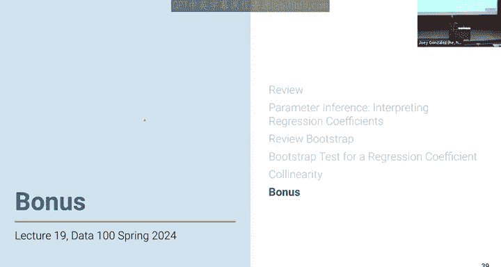
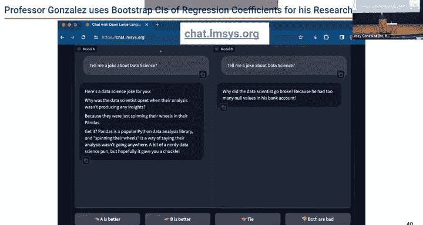
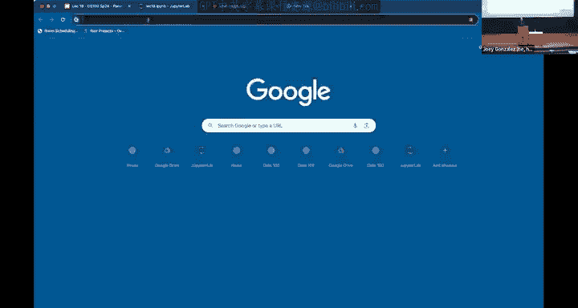
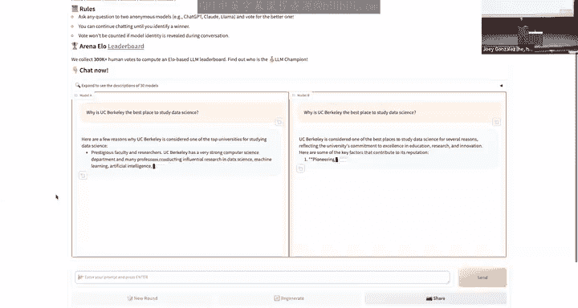
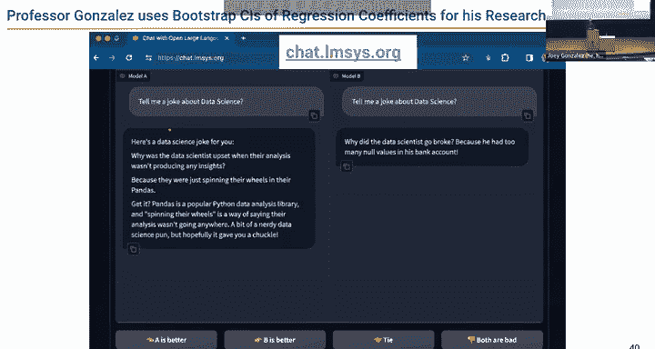
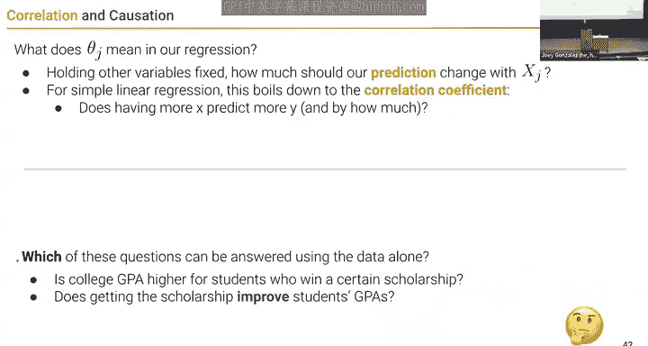

# 课程19：参数推断与Bootstrap 🎯

在本节课中，我们将学习参数推断的核心概念，并深入探讨Bootstrap这一强大的重采样技术。我们将从预测任务转向推断任务，学习如何利用样本数据对总体参数（如线性模型中的系数）做出统计推断。

---

## 回顾：偏差-方差分解

上一节我们介绍了模型风险的分解。本节中，我们来看看这个分解的最终形式。

模型的总风险可以分解为三个部分：

**风险 = 方差 + 偏差² + 噪声**

其中：
*   **方差**：模型预测的变异性。
*   **偏差²**：模型预测与真实关系之间的系统性误差。
*   **噪声**：数据中固有的、不可约的随机误差。

这个结果非常深刻，它告诉我们模型的误差来源。然而，我们通常无法直接计算这些量，因为它们依赖于未知的总体。

---

## 从预测到推断

到目前为止，我们主要关注**预测**任务：利用模型预测未知的结果（如房价、邮件是否为垃圾邮件）。

但有时，我们更关心**模型本身**告诉我们的信息。我们称之为**推断**或**参数推断**。我们的目标不再是预测具体的Y值，而是理解特征X与响应Y之间的**关系**。

具体来说，在一个线性模型中：
`预测值 = θ₀ + θ₁ * 特征₁ + θ₂ * 特征₂ + ...`

我们想知道这些系数θ（参数）的真实值。例如：
*   θ₁ 是否真的不为零？（特征X₁是否真的对Y有线性预测作用？）
*   θ₁ 是正还是负？（关系是正向还是负向？）

我们通过样本数据拟合得到的是样本估计值 `θ̂`。参数推断的核心问题就是：如何用这个 `θ̂` 去推断未知的总体真实参数 `θ`？

---

## 假设检验与置信区间

为了判断一个参数（如θ₁）是否显著不为零，我们使用统计学的假设检验框架。

以下是其核心概念：

*   **零假设 (H₀)**： 我们试图质疑的基线假设。例如：`θ₁ = 0`（特征X₁对Y没有线性预测作用）。
*   **备择假设 (H₁)**： 我们希望证实的假设。例如：`θ₁ ≠ 0` 或 `θ₁ > 0`。
*   **P值**： 在零假设成立的前提下，观察到当前样本数据（或更极端数据）的概率。P值很小（如<0.05）时，我们倾向于拒绝零假设。
*   **置信区间**： 另一种更直观的推断工具。如果我们能重复从总体中抽样很多次，每次计算 `θ̂`，那么这些 `θ̂` 的95%会落在某个区间内，这个区间就是95%置信区间。**如果这个区间不包含0，我们就有证据表明参数显著不为0。**

问题在于：我们通常只有一个样本，无法重复抽样。这就是Bootstrap要解决的难题。

---

## Bootstrap方法 🥾

Bootstrap是一种巧妙的**重采样技术**，它允许我们仅利用手头的一个样本来模拟抽样分布，从而计算置信区间或评估变异性。

其核心思想是：**将原始样本视为“总体”的替代**，然后从这个“替代总体”中**有放回地**重复抽取同样大小的新样本。

以下是Bootstrap的步骤：

1.  **准备**： 拥有一个大小为n的原始样本。
2.  **重采样**： 从原始样本中**有放回地**随机抽取n个数据点，形成一个Bootstrap样本。
    *   “有放回”是关键，这保证了每次抽取是独立的，并且同一个原始数据点可能在新样本中出现多次。
3.  **计算统计量**： 在这个Bootstrap样本上计算你关心的统计量（例如，线性回归的斜率θ̂₁）。记下这个值。
4.  **重复**： 将步骤2和3重复大量次数（例如，10000次），得到一系列统计量的值（θ̂₁\*, θ̂₁\*, ...）。
5.  **分析**： 利用这大量统计量的值来构建其经验分布。这个分布近似于真实抽样分布。
    *   取2.5%分位数和97.5%分位数，就得到了该统计量的95%置信区间。
    *   查看0是否落在这个区间内，即可进行假设检验。

**Bootstrap的优缺点：**
*   **优点**： 无需对总体分布做假设；概念直观；应用广泛。
*   **缺点与注意事项**：
    *   不能修正原始样本的偏差。
    *   对小样本（如n<20）效果可能不佳。
    *   对估计总体极值（如最大值）等统计量效果不好。
    *   计算量较大。

---

## 应用示例：回归系数的推断

让我们将Bootstrap应用于实际问题，推断线性回归模型中的系数。

**示例1：汽车重量与油耗**
我们想验证“汽车重量是否真的负向预测油耗（MPG）”。用Bootstrap对斜率系数重采样10000次后，发现斜率的置信区间为负且不包含0。这为“重量增加导致油耗降低”提供了统计证据。

**示例2：雪鸻鸟蛋与雏鸟体重**
我们想用蛋的重量、长度、宽度来预测雏鸟出生体重。当把三个高度相关的特征同时放入模型进行Bootstrap推断时，所有系数的置信区间都变得很宽且包含0，似乎没有一个特征有用。

**问题所在：共线性**
当特征之间高度相关（共线性）时，模型很难区分每个特征的独立贡献。一个特征的效应可能被其他特征“分摊”或“抵消”，导致系数估计不稳定、方差变大、难以解释。**在需要进行参数推断时，必须警惕共线性问题。**

解决方案之一是进行简化：一次只关注一个特征。例如，单独用“蛋重”预测“雏鸟体重”进行Bootstrap推断，得到了显著为正且较窄的置信区间，证实了其预测能力。

---

## 现实世界案例：LLM竞技场排名 🏆

本节中我们来看看Bootstrap在尖端技术中的应用。UC Berkeley的“LLM竞技场”通过让用户盲测比较两个大语言模型（如GPT-4 vs Claude）的输出来排名。

**我们如何计算排名？**
1.  我们将每次比较视为一个数据点。
2.  使用一种称为“布拉德利-特里模型”的统计模型（本质上是逻辑回归）。
3.  模型的**系数**即为每个模型的“实力分”，根据分数排序得到排行榜。

**我们如何确定排名可靠？**
仅仅给出分数不够，我们需要知道排名是否稳定。例如，第一名和第二名的分数差异是否显著？这里就用到了**Bootstrap**。
*   我们从所有比赛数据中进行Bootstrap重采样。
*   每次重采样后拟合模型，得到一套新的模型分数。
*   重复上万次，为每个模型分数的估计值计算**置信区间**。
*   如果两个模型的置信区间严重重叠，说明它们的排名可能并不稳固，谁第一谁第二带有偶然性。

通过公布置信区间，我们让竞争更加透明和科学，这也是参数推断和Bootstrap在现实中的强大应用。

---

## 总结与注意事项

本节课中我们一起学习了参数推断的完整流程：

1.  **目标转换**： 从预测Y值转向推断模型参数θ。
2.  **核心方法**： 使用**假设检验**（P值）和**置信区间**来判断参数是否显著。
3.  **关键技术**： 引入**Bootstrap重采样**，仅凭一个样本模拟抽样分布，从而构建置信区间。
4.  **应用实践**： 将Bootstrap应用于线性回归系数的推断，并认识到**共线性**对参数解释的严重干扰。
5.  **前沿案例**： 看到了Bootstrap在大语言模型实力评估与排名中的实际应用。

**进行参数推断时请牢记：**
*   推断结论依赖于**模型假设**（例如，我们假设总体存在线性关系）。
*   Bootstrap并非万能，需注意其适用条件（样本量、统计量性质等）。
*   **相关性不等于因果性**。即使我们推断出系数显著不为零，也只证明了统计关联，而非因果效应。

通过掌握参数推断和Bootstrap，你不仅能够构建预测模型，还能深入解读模型，理解数据背后的关系，并量化结论的不确定性。这是数据科学从“黑箱”预测走向“可解释”分析的关键一步。