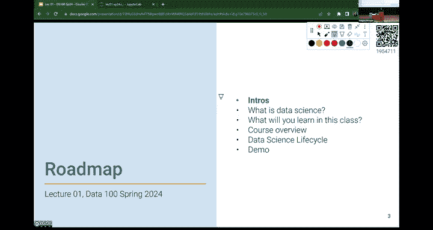
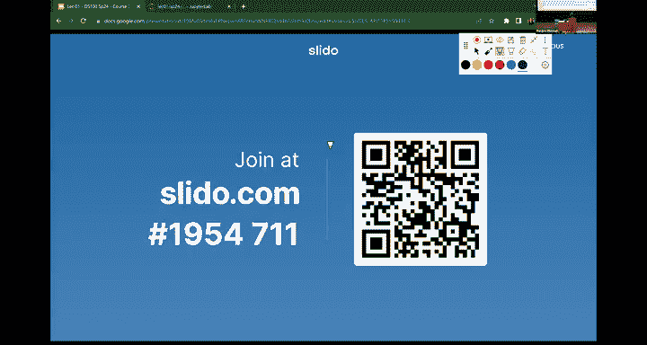
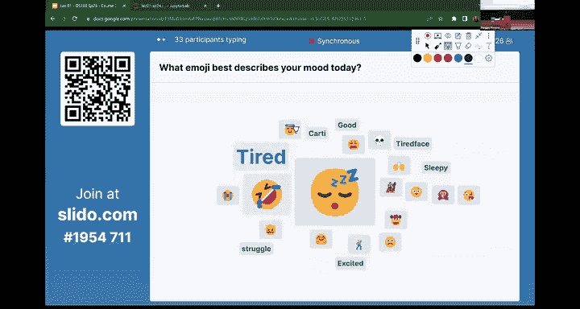
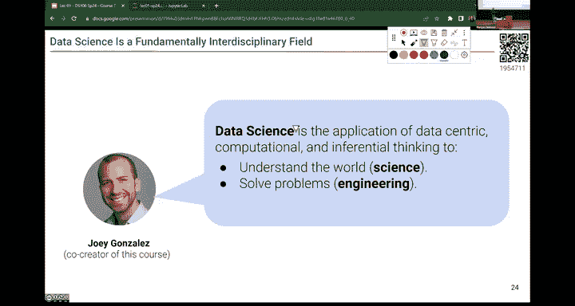
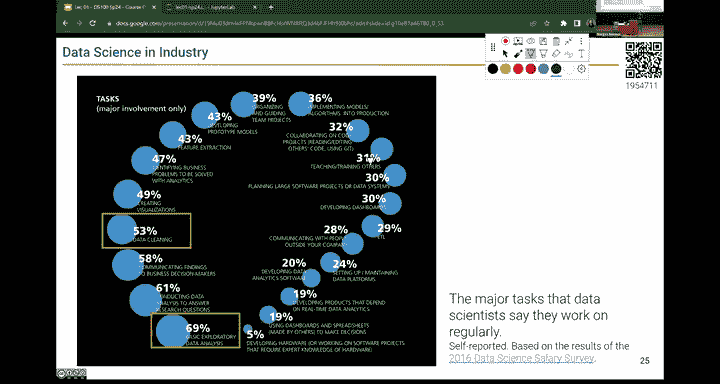
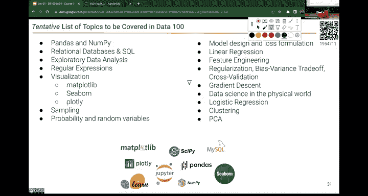
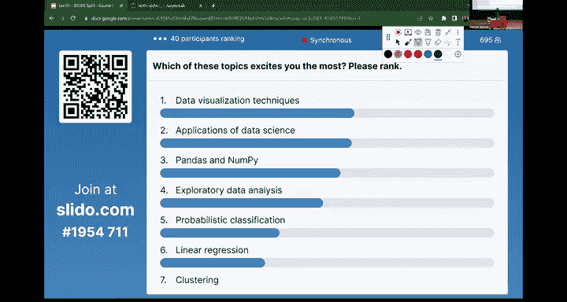
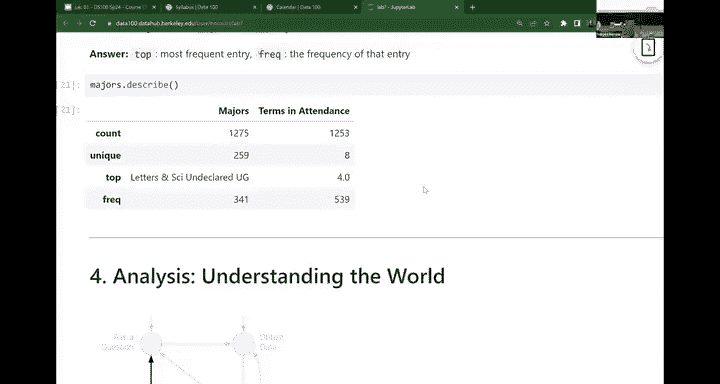

# UCB《数据100数据科学原理与技术｜Data 100 Principles and Techniques of Data Science 24SP》中英 - P1：-01-Data 100 Spring 2024 Lecture 1.zh_en - GPT中英字幕课程资源 - BV1Bc2dYCEbc

Yeah。

Alright。Let's go ahead and get us started。Grab your seats。

Welcome everyone to data 100 this is so exciting we're so excited to have you in data 100 this is spring the next couple of months is we're going to learn a whole bunch of things and things are going to be very exciting for all of us here So the plan for today's lecture is that I'm going to go over some introductions to the course we're going to go over some course logistics and then we're going to talk a little bit about what data science is what is the data science lifecycl and then we'll see a quick demo of how many students we have in the course and let the enrollment looking like in data 100 what you saw in the beginning of the lecture was a bunch of different print QR codes and the codes what you're seeing on this slide right here is a login for a sliddo sliddo for those who don't know is a lecture participation platform that we're going to use for data 100 you can either scan this QR code or if you're on your lap。

😊。

You can go to sliddo。com and enter that 7dit code what's going to happen and what you're going to see in data 100 is that you're going to during each one of the lectures we're going to pose a number of active learning exercises in the lecture you're going to be able to respond to those questions we're also taking questions on the slido there is a QA portion on the slido that we will take your questions will respond your questions your wonderful Ts are going to be with us during all of the lectures so they will respond to some of the questions and they will basically highlights any questions that we need to clarify the lecture during the live lecture time。

So to get us started， let's try this out， let's see if you're all able to log in slide over today what emojiist describes your mood today。

Yes。I see a lot of。Exciting faces， tired。but you'll thank us for the lecture time this time around last semester。

 the lecture was at 5 pm， you don't want that you want 11 a。

So generally what's going to happen is you're going to see at this top portion right here how many participants are still typing and then on the right hand side you're going to see how many responses we got so generally I'll wait until this number goes down and settle and then we'll move on to the next lecture we're going to talk about what is the lecture attendance policy for data 100 this semesters I'm going to explain how you're going to utilize this slideA a little bit more later。

So moving on in each one of the lecture slides you will see the Kira code and the code also in the top right corner。

 so if you come and late you can still log into slidedo and then be able to ask questions and then respond to the questions that we send you My name is Naraga Nroi。

 I'm an assistant teaching professor in the EECS department I did my PhD in the University of Toronto I graduated in 2017 I was a teaching faculty at UC Santa Cruz from 2017 until 2022 and then 2022 until now I've been at Berkeley I taught this course three times actually twice and this is the third time in the past two semesters and I also taught adjacent data science courses before at UC Santa Cruz and also at University of Toronto like machineine learning deep learning。

Artificial intelligence courses this data 100 curriculum is very exciting。

 I really like how this starts from grabbing you from just knowing basics of programming。

 a little bit of linear algebra and also a little bit of knowledge from data8 and then it moves all the way to some advanced machine learning techniques that you'll see later on in data 100。

😊，My research is mostly on machine learning and statistical signal processing with biomedical applications and also since I'm a teaching professor I work on the intersection between artificial intelligence and education so I'm working on AI intelligence tutoring systems that's funded by national science Foundation and also by Google and different places so I'm very excited to teach this course this semester I'm also teaching data science honors seminar and I'm also teaching other special topics course but I decided that I will hold my office hours in Barren Hall so I can get to meet as many of you as possible we're going to talk about where our office hours are and this schedule a little bit later in today's lecture so has to get onto。

😊，Professor Benonzalez。对有。对。Right， can you hear me now much better I was off already All right so hi I'm Joseph Gonzalez people call me Joey I'm excited to be here。

 I actually started this class long ago so it's my time to come back to its my favorite classes I'll talk more about that in a moment but first a little about me so I did my undergraduate studies at Caltech which is a very different place the classes were tiny there were like six people in a class and that was a big class it's not necessarily good because if you fall asleep in the front of the room your faculty know it so I started out in small classes and then I went to CMU where I did my PhD。

😊，At Connenie Mel University and working on graphical models bringing statistics and computation together back when it wasn't trendy。

 so it' was really exciting to sort of bring fields together that today are central to data science。

I am now an associate professor in EECS， I do a lot of things。

 I am one of the co directors of the Rise and Sky Computing Labs。

 we think about the future of cloud computing AI data systems。I also， one of the co directors。

 LM Sis， now one of the leading groups for doing open source large language models research。

I am also in Bear， so I work on just general AI research， design of neural networks。

 some classic learning techniques as well。I try to put a research focus down。

 I put links to all the kinds of projects I'm involved in。

 I did this partly because I think you all should get involved in research too and throughout the class I will try to reference opportunities to get involved in research this course sets you up to be able to do research so you should get involved。

😡，So some of the stuff I worked on around systems， so things like Cpper VLM output but these are big big open source projects。

 another neat thing about Berkeley， a lot of the work we do here isn't just research but it is building software artifacts that have a lot of impact。

So get involved in research could also be good if you're thinking about launching companies or getting in industry research projects here have very close connections with the large industrial groups。

Do a lot of work in developing large language models which we may or may not try to talk about during the semester。

 I worked on computer vision techniques， robotics， projects and so on。

 so I'm not going to go into details these but you can follow links if you want to learn more about the research。

I also am a cofounder of several startups and I'm currently working。

 I guess working advising Run LLM and Genmo， so working in the AI space。

 so for those who are interested in entrepreneurialship， come to Do StarRS。

 I'm happy to talk about kind of past entrepreneurialship。

 especially for our undergraduate students and working out of Berkeley。

Peaking so I'm a research faculty but I love to teach and my favorite class is data 100 I also taught data 8 recently and it was a lot of fun too but I think data 100 is the best class at Berkeley I worked on it when it was a baby so v0 was terrible and none of you had to take that we scaled it every semester it got better and better and then I stopped and professionals took over and the class got 100 times better still so I'm excited to see what it is like today。

Speaking of kids， so I also have two little kids so a lot of times I'll have to run out of office hours as quickly as I got to do daycare pickup I apologize it just I have to prioritize family so that's why I'll be running early。

😊，That's about me。When we started teaching this class。

The big question people had is what is data science？Because we were defining the field。

 CDSS hadn't been built yet， and so a lot of the beginning of the class was trying to set up the definition of the field。

I'll give you a definition in a few minutes， but I want to step back and sort of motivate why data science is so important and why it's central to the way the world operates today。

So to give you some examples， data science。Probably the most。

Influential version of these technologies being applied to businesses early on when we launched the data science program was in recommendation technologies or in AI tools that allowed businesses to adapt to customers。

 their interest to become more targeted is multinational corporations。

 but they really understand you sort of this was the early days of kind of AI with a lot of impact on the world。

 and data science was sort of leading this not just in the design of these techniques。

 but actually providing insight to businesses like Netflix to decide what things they would invest in the future。

 what plots would make sense so it wasn't just the algorithms but it was the actual creation of content。

Today I think this is a little less exciting slide I want to point to another direction that AIs or data science broadly and I keep referring to AI is kind of a part of it。

 but actually in this case， data science centrally has had a big impact in our world。So。

Who just took day eight， I guess I can do a quick straw pa， took it in the last few semesters。

 who took it with me。I'm sorry， so when I taught the8 we had DJ Patelli give a guest lecture。

 it was really exciting， one of the things he said which I didn't actually realize at that point。😊。

data science became the first responder。What' does that mean？

That means if you were in the Obama administration。

 so DJ Patel was one of the first US chief this scientists he helped define the field。

and Obama comes to him and says， you know， there's a fire， there's a flood。

How do we use our resources？Who will be impacted？I have to make decisions today now tomorrow。

Can you make projections about what resource are needed， Where should we send generators。

 How should respond to these emergencies。So data science became the first person the president would go to when a problem arises to become kind of a central part of how we deal with problems today。

 in the very immediate sense， it's not just writing reports。

 it's I need to make a decision now how do I use the data that have my knowledge about the past to make those decisions。

I think he's actually giving commencement， but there's a link to the video here if you want to go back and see some of his story。

 his journey in defining the field， I found it very inspirational and it kind of points to the ways in which data science is really having impact on society。

 both locally in California， the national role in at the global scale。

Just to highlight one of these that hopefully won't be an issue this semester is wildfires。

 we're using data science already to really project where fires might be as they arise。

 how might they spread， how to respond to them effectively。

 and there's a cool website you go to here and you can actually see livecams track the actual fires。

 see the data that people are processing to make decisions。When we started teaching this class。

 there's a lot of focus on industrial applications and some political and social applications。

 but data science is also central to science。Who's seen this picture of a black hole。

 the first humankind picture of something that really can't be seen。How。

Using techniques in this class， using tools that you will learn in this class。

 they will to generate a picture of a black hole。And what's kind of neat about this。

I they actually went through some of the very same exercises you will do in this class。

 So how do I know that my prior beliefs aren't influencing me one of the experiments they had is they gave the data for a snowman in space to science teams like go go figure out what this is。

Some of them tried to see a black hole anchor point here。Yeah。

 someone tried to see a black hole in the bottom of the snowman。

 So how did my prior my beliefs about what I expect to see affect what I actually see。

And I don't want that to dominate I want the data to tell me what's there and so if it's a snowman I should see a snowman floating in space so it's really cool how the techniques we use in this class the software。

 the tools were actually used in this research to give humankind's first picture of a black hole。

So why did it matter？I think。To me。One of the central tools of data science is helping us make decisions。

We live in a complicated world in a very changing world， and we have to make very hard decisions。

And we shouldn't be making those decisions based on gut instincts。Priors。

 but the knowledge that we have， the data that we have and putting those pieces together to make a decision process that we can reflect back on afterwards。

 and data science gives us the tools to do that。So data science is used everywhere， science。

 medicine， social sciences， engineering。😡，Sports using data science to make predictions about who to hire for our team。

Using it everywhere。One of the neat things about data science is because it's become so exciting。

 because people are starting to embrace it to go， you know what， what does the data say？

And some expert comes in and goes， well， the data says this。But is that person right？

Are they the new authority， do we just go to a data scientist and you what do you say？Well。

 in some sense， yes， because they're using the data， they have evidence to support their conclusions。

 but also we as citizens in this world need to be able to go， I don't agree with your analysis。

 your conclusions are wrong， or you use the wrong data to draw those conclusions。😡。

So data science is something that we all need to participate in。

We didn't know what the data really says。And this class helps you participate in that it empowers you to be a part of that decision process and how we use data。

But for I think the third time I taught this class。

 I wanted to make a projection about the future and this is 2018。

 2019 it was like what is 2020 going to be all about and I was looking at kind of the trends in technology？

The 1980s， hardware was changing the computing landscape， everyone wanted to buy a box。

And then someone said， whats stop selling boxes， let's sell the software that goes in the box。

 Someone else can raise to the bottom on the design of boxes。

 so software emerged as a as a next big industry and then the internet took off and it changed the way we interact with software。

 who needs software now you can get to services， you can interact with data and technology across the world。

And that changed our relationship to data。 We became much more data intensive。

 We collected everything for the 2010s is why like if you have data， don't throw it away， save it。

 And so when later on go， what are we doing with all this expensive data we've been saving nothing。

that's where data scientists started to emerge like。

 well what if we could hire someone to look at our data， provide insights。

 solve problems for our business？😡，That started to grow this fascination with people who have these skills to make sense of the data。

 to go at scale to use advanced techniques， but also to think critically。And then 2020 is like。

 what's going to happen is the future crypto， I hope not。What will 2020 be， Well， it's 2024。

Pretty easy to guess what the 2020s are about。We're seeing a lot of AI。

You will learn in this class the foundation ideas that drive AI， and as an AI researcher。

 I must sadly confess they haven't changed much， so the AI that's changing the world today is built on the same principles we cover in this class。

So you're learning the tools of AI that are shaping AI today， and that will shape the future。

The other crazy thing about the newest generation of AI。It's really about the data。

As we're getting back to an interest in understanding the data we have。

 we go to build these giant models that are shaping everything from how we draw images to write movies to even produce the movies。

It boils down to the training data that we put into those models and the tools that we develop in this class。

 the techniques we develop in this class will be useful in making sense of that data and understanding the biases it introduces and how it affects what we produce。

So an easy bet for the 2020s。2030s。I'll leave that to you all。When we start teaching this class。

 there was also a concern that data science is dangerous。

 there's this rising opinion that you know maybe we shouldn't trust these these new models。

 this new data。And those concerns were actually well founded， data science。

 these new techniques have had some negative impacts on society already。

We developed mathematical models that were so sophisticated。If they couldn't be wrong。

 who would need to analyze that only a few people could understand it。

 so we'll just trust it because it's complicated。That was bad or worse， it's complicated。

 but it's deciding my life， and I don't know how to act to make sure that it makes good decisions for me。

So the complexity of these technologies made it so that fewer could participate and fewer could reason about their consequences。

 the risks， that's something we need to embrace as we search for parsimony in the techniques that we develop and we'll do that in this class as well。

The data is always right。Except when it's not so the data is a picture often of the past it's hard to get the data of the future and sometimes following the data of the past is a bad idea In many cases it's a bad idea maybe I use historical data for hiring I could be bad I could be biasing the people that I hire I could use historical data to curb exams that would be a bad idea too the exams are going in know a positive direction So thinking about how the data that I use affects the future is important and this is something that a lot of people who had terabytes of data that was going to change their business weren't really thinking about they're like well how am I can use all this cool data。

Not recognizing that data is a picture of the past and they're trying to make decisions to manipulate or to think about the future。

So understanding the consequences of the models， the techniques and the data and thinking critically about it。

 and that's something we will do in this class as well。

I used to have a termminator slide about skynet rising and these technologies taking over us。

I don't believe that's going to happen， that slide was thankfully cut from these lectures。

 better instructors， I will end this negativity on a quick positive note。

I think data science offers immense potential to address all of the major problems that we face today。

 It'll be a tool for all of us。And I think you all will pick up these tools and find ways to use them better than I would。

Or common good。Theres one of the reasons I am thrilled to teach you to 100。

It's also something I have to say that of all the classes I've taught。

 I get the most emails when people have gone off to industry to launch companies to work in scientific groups like this class changed my career。

Awesome， I don't know why， but that's great because they picked up the tools that they used to solve problems to get the next big job to go out and pursue PhDs so these skills will be very essential for you I hope。

😊，Right。One of the things about this class is forcing you to think critically。

In building a class like this that's actually hard it's very easy to ask you technical questions like prove this calculate this number。

 but thinking critically is like well think about that I'll grade your thought which is very hard to do it's very hard to do when I have to do it for know a thousand0 plus students。

😊，But we're going to do our best to help you do that one of the challenges in taking a class like this is we're going to walk through examples。

 exercises like us doing data science and thinking through it critically and you're like。

 so what is this thing I'm supposed to remember？You're supposed to watch and think critically yourself you're supposed to develop those skills we'll try to do that the assignments will have open ended parts of our questions of our homeworks and our labs。

 but a key part of this class is really starting to think critically。

That means when thinking about a problem understanding， do you have the right data？

We probably don't have the right data for some of our assignments。

 we're going to make our best effort to do that in class we'll talk about what it mean is this the right data。

 is it representative of the thing that I'm trying to understand？Recognizing limitations。😡。

I've got this amazing result， this really cool model， it fits it amazing。 What's wrong with it？

Can I trust it， where will it fail that's really important when you communicate these ideas to someone else。

 they may not understand the technology， you need to communicate why you shouldn't use it in that that setting that they have in mind。

 so understanding limitations。😡，Are we asking the right questions？

We once tried to make this a whole lecture， how do you ask hard questions that's really hard asking the right question really means understanding the problem。

 which is hard and understanding what you can ask and reasonably understand so breaking the problem down not into how do we make the world a better place。

 but smaller questions that I can actually make progress on to build data to find evidence to build models to solve the problem。

What are the assumptions you have to make assumptions？Are you making reasonable assumptions。

 thinking through this， there's no， here's a list of things to check for your assumptions。

 but we'll have to work through examples to see this。😊，We'll talk about doing analysis。

How we communicate our findings， and that will be a big part of the exercises that you do。

So you should learn how to apply critical thinking and skepticism to your work。😡。

Hopefully when you're done this class you'll see articles in New York Times ago which I do this slide that's wrong there's no way that's the correct conclusion。

 they just implied causation without appropriate data do they really have the facts to support that you should start to look at the world to this new lens。

😊，And then， finally。Throughout this class we'll talk about the societal implications of what we do and it's important to think through and it's hard and Ill say to think through the consequences of what you're doing and how it might be used and how it might affect others it's often these unintended consequences of the things that we do。

 the ideas， the presentations that we make that have sometimes the worst， maybe sometimes the best。

Consequences affect so thinking through that' a key part of doing work in data science。Okay。

 so after this course， you should be able to take data and produce useful insights on some of the world's most challenging and ambiguous problems。

 and I will say this。😊，As a researcher， students who've taken this class are often better than my graduate students at looking at our data and understanding what's going on。

 they have a more inquisitive mind like yeah that data doesn't look right。

 your plot goes up and then up you don't have conference intervals。

 you're not presenting the results clearly so the skills you pick up in this class should be useful and they should help you solve real problems。

At the end of the semester。All right， so like I said。

 we launched this class like how do we define data science， the whole division is being created。

 what is data science some others had put forward this picture it became a trendy picture of the time data science is three circles in this weird Venn diagram。

All right， I wanted to comment on this。 So someone said this is Dr Conway。 He goes hacking skills。

Computer science please this is computer science up here we'll call this computer science it's an intersection of computer science statistics。

 mathematical knowledge we call that machine learning。

 which is recently been rebranded as AI but that's what lives here and then we' bring in this other bubble here of substantive expertise you should know something about the domain outside of computing mathematics statistics This is often the hard thing to teach you need to go actually learn something about something else I will say one of the few things that Caltech was a great place one of the great things about Caltech is that the teaching wasn't necessarily great and so we were forced to just learn stuff on your own in this class we will hopefully teach better but you will have an opportunity to learn stuff on your own and that is critical to being a good data scientist。

😊，You need to go， I don't know anything about fire， I'm going to go learn about fire。

 what are the things that I need to know who are the people I need to talk to to learn that domain。

It is this domain knowledge that combined with these other skills makes a really good data scientist。

We used to have this joke here that this danger zone is when you're a hacker and you know something about the domain。

I don't know if that's true the concern here is that in order to be a good data scientist you need to have statistical mathematical discipline。

 and I think that is true， but there were a lot of hackers that knew something of a domain that did make forward progress。

But really a data scientist brings these three skills together that's a not a very useful definition。

 so I wrote this other definition which for whatever reason they've continued to use throughout the history of this class so here is my definition。

😊，Data science is the application of data centric， computational， and inferential thinking。

What does that mean， So data centric， you're learning to look at problems through the lens of data。

 What data would help me understand this， What data should I collect。

 what data do I have computationalut means it as I approach a problem。

 What tools of computation can I use to make sense of the data to advance my understanding。

 An inferential is being able to reason beyond the data， I can understand the data。

 but I want to draw conclusions about the world， I want to make predictions about the future。

 and I want to take action on those those prediction。😡，That's infferential thinking。

So those three things together， sort of the three circles。😊，To do two things。Understand the world。

Science。And solve problems。Engineering。And I put these two definitions for a reason。

 because back in 2017， 2018， a lot of people are hiring a data scientist to do one of these two things。

And not the other， and that was a mistake。So a lot of groups with hire data scientists come look at our data and build a recommendation system to increase our revenue。

Engineering。But that person have to come in and go， you know what， your data is garbage。

 I need to do science to figure out how to collect better data。😡。

Another group of people with hire data scientists， you are an expert in machine learning。

 you should come solve our problems， here's our data。😡，Tell us something。

And the expert in machine learning， a computer scientist like me would go。I can do AI。

 I can build a model， but what should I solve， I don't know。So you needed to have both these skills。

 you need to be inquisitive， be able to define hypotheses， explore and understand data。

 but you also need to be able to go， okay， there is a problem I need to solve。

 I'm going to fix the data and I'm going to build maybe a system。

 I'm going to bring together tools in computing， collect new data to actually solve that problem。😡。

So it's a connection between science and engineering。

That's my definition。Another thing I used to do in the beginning of this class was talk about。

Surveys had showed the field。 What do people do and how much do they get paid。

We've since cut how much they get paid， data scientists get paid a lot。 we'll just stop there。

 It's a generally well paid profession。 What I thought was more interesting in this picture was what do data scientists do。

This is a terrible data visualization， you'll learn about why this is bad visualization later in the class。

 but our colleagues at O'Reilly thought this was a pretty way to show this。

 so I've put up on the slide。A lot of what data scientists do。

 more than 69% say that the majority of their time is exploring data， understanding what's going on。

Data analysis EDA that is a big part of this class。

 so we'll spend a lot of time on how to explore data， the tools to do it， what to look for。

 that critical thinking process and unfortunately again we're going to have to do that to examples it's hard to give you here's the step one of the equation。

 step two the equation and so on。But that is a lot of what data scientists do。

We used to make this joke， the other half the time data scientists spend is cleaning their data。

That is no longer such an issue， but it used to be in the 2018s， the early the 2010s， the 2000s。

 the data was a total mess。It's less of a mess， but you still need to know how to work with data that's not well prepared。

 That's not organized。 It's got bugs in it errors。 And we'll see that even in our first lecture when we use the campus systems。

 which。Unfortunately， RMS。So data cleaning is a big part of it at the very top up here。

 cool machine learning AI stuff。Not the majority of the time。

And I think that'll actually continue to be true， it's using those technologies。

 but the innovation is really in understanding the data and how to pull the pieces together。

Nonetheless， we will teach those technologies， you will have a deeper understanding of the underlying principles and techniques of using machine learning。

When we were building this class， another thing came up， my colleagues and see like。

 we must teach this tool and this tool and this library。

 because data science is after all using these really cool software packages。

That is not true you do need to know how to use lots of tools and the tools we teach in this class important。

 but by the time you go off into industry they may be deprecated。

 you're to learn new tools so the technology is constantly changing。

It's learning how to think through problems using these technologies that's important。

 and that's what we'll focus on in this class， but you will learn to use the tools that are common in use today。

There's a fun quote， the purpose computing is insight not numbers and again。

 this is something that actually President Obama told DJ Patel when he came in and as like。

 you know what， I don't want a number， I want you to tell me the story about a person。

Who is that dot？And then be able to make sense of that dot and the policies we're building， right？

We think as computational people as mathematical people about the data， but the data is often people。

 it's the real world， appreciating not just the computation， the methods， but the consequences。

Pretty exciting stuff。All right， so here's some questions。

ThatThat we had compiled over the years of things that we would like to explore。

Things that data science could be used for。诶。Starting to kind of basic stuff of what should I recommend how should I shape my business what content should I show people let me put a new lens on that now we have to think about what should I recommend not just to grow my business but to think about its implications。

If I'm a giant media platform， what I show people， what I encourage them to see shapes their perspective on the world。

 and I need to think about that。How do I build a platform that keeps people interested that engages them not just now。

 but for a long period of time and broadens their view of the world because。

That's not just good for society that could also be good for my business in a company like Google I want people to be informed。

 I want them to participate not in just onehes of the web， but the entirety of human knowledge。

Should I send my kids the daycas what I had to think recently。I did look at data。

 and can collect data and answer these questions， often the questions you encounter in your life can be addressed by collecting some data。

Hopefully you'll use these techniques in your daily lives。Any other interesting ones here？Yeah。

 we'll talk through some of these action in this class， where to dock bikes。

 how to solve problems that might face things from climate change to better transportation to maybe how the government addresses policies around immigration so a lot of really cool questions。

 important questions that face society can be addressed using at least the tools in the techniques from this class。

All right， so what will you learn in this class？So it principles and techniques？

In creating this class， one of the first things that I actually did with a few other colleagues is say what would be our goals to scope what we would cover and these goals have stayed throughout the duration。

 the history of the class， and I want to kind of reflect on them because it points to how you will encounter this semester。

So first goal that we had was that this class as a 100 level class should prepare you for upper division classes。

If you take this class， you should do better in higher division CS statistics and now data science classes。

If that's not the case， you should let us know because that is a primary goal of this class to get you ready to take upper division classes and to make those classes both more enjoyable and so you learn more in those classes。

Two， this is pretty important for me， enable。We wanted to make sure that after this class。

 you could do stuff。It's not a toy class we use。P software packages。

 but will you use real technology， work on real， messy problems that haven't been curated。

 work through them， present findings， do data visualization。

 the skills you build in this class should help you immediately。To do real things。

A consequence of that is the class has been historically a little buggy。

 we have new software coming in， I have a track record of making the class harder or different each semester I've promised my coin instructorors I will not do that this semester。

 but the class is constantly evolving because we want to use technology data that is present。😊。

And then empower。I don' like a na， But the hope was not only would you learn to use these things。

 but you would be。I can use these things。 I see a problem。

 I now know how to approach that problem using the tools in this class。

 I will use the tools in this class， I need to figure out how to allocate students to sections in my class。

 I will use optimization techniques。😡，I need to figure out what classes or maybe better yeah what career path to follow。

 I'm going to go collect some data。So hopefully in taking this class。

 you'll be inspired to not only know how to use these techniques。

 but to actually use them for problems that you face。So these are the goals。And weirdly。

 I think we've stuck to them throughout the years。All right， and then last thing。

 we have a lot of topics in this class。It says tentative here。

 and that's because every semester some faculty member decides to add something new or change something again。

I promise I won't do that， I technically promise that every time I've taught in the past。

 but this time I'm really not going to change it， this is pretty closely the set of concepts that we will cover。

As long as neither of those changes the class， I think this covers a pretty broad space of things that you would need to know both tools。

 techniques and so on， so hopefully this gives you the foundation that you need。

One thing I will say is if you there's stuff here that you're like I wish I knew more。

 we can't go deep on everything， come to office hours， talk to the staff， talk to the faculty。

 we love to talk about anything， certainly things going on in the class but also research。

 career paths and so on so we won't be able to cover everything there's things that I wish I could put in the curriculum but no time so if you want to learn more come to us come to the staff and we're happy to talk more。

😡。

Oh cool， a poll all right， so instead of me telling you to come do hours， we can do a quick slido。

 what do you want to know？Go there。Bit of isz， nice EA， bit of isz。Do you have more options。Oh。

 there's more options， so wonderful， what's on the tail here， Dementity reduction。An important topic。

Vinear regression So you see we have a bunch of techniques it's exciting to see that what you want is pretty aligned with how the classes is organized so we're going to spend a lot of time on data visualization application data science。

 pans NmpI and ED we will cover in class we will lecture about it and then everything you do in the class well do a little of this you get tons of practice with these these core techniques。

😊，All right， and see I see some convergence so。CoAll right， so that is the space of topics。

 I think I'm about to hand it over， but maybe before I do。

Oh prerequisites should I cover these I'll cover them okay one of the things in building this class that we spend a lot of time on is what classes should you take before this class and it's changed over the years we've con a pretty good set of prerequisites that were done very intentionally so we tried to make it a minimum set of prerequisites but also the core classes that cover things that will be really essential to your success in this class。

Theyta eight。Everyone should have taken did eight。第。It's sort of like the baby version of this class。

But it brings in concepts that no other class anywhere captures。

 so it brings in this mix of computational inferential thinking that is central to this class。

 so that's why it's important people to take and did it。Right code， a fair amount of code。

 hopefully relatively clean code because it's going to be hard to debug otherwise。

 having some background in programming is important。In this class。

 we're not going to teach you Python， you need to know how to use Python。

Were not going teach use Jupyter notebooks， you need to know how to use Jupyter Notes。

If you're feeling uncomfortable about these topics。Talk to us。 We want you to succeed。

 We'll help you find the tools， but。Those classes as preres are very important。

And then math and this has been a great debate for this class what is the core math that you must have to succeed in this class and I think we've converged on some degree of linear algebra because we're going to do linear algebra in this class。

 we're going to understand the mathematical foundations of the techniques like linear regression dementity reduction and having seen these topics will make your life much better this semester。

So that's why the master crime。So again， we won't teach you Python won't teach you Jupiter inference this kind of sampling ideas those are covered in day8。

 you need to know that for this class and then when you're algebra we use a fair amount of it once upon time we also did a fair we still do a calculus to do some gradient descent so you need this mathematical background and these math classes are important for that。

And we， I think the last time I taught this class， which is a while ago。

 we started having homework one to do this calibration that's really important so take a look at homework one lab one and they get a sense of kind of how ready you are for the material in this class。

All right， before I hand over a course overview， I want to say one more thing， so office hours。

 I encourage you to come to my office hours， My office hours tends to be lonely。

 maybe I'm bad at explaining stuff， but come by， say hi if you don't have a question about the class。

 you can just say hi anyways， I have data8 stickers。

 I need to get some data 100 do you have stickers。Good I'll get some data on heart stickers just say hi happy to just meet you I'm in Soda Hall 733。

 I'm not going to be there this Tuesday which is today I'm not going to be there today but I'll be there starting next week so come by my off。

Okay。Thank you。Great so I'm gonna go and talk a little bit about course logistics before I do that。

 I want to talk you a little bit about our courses of this semester because obviously with the class size it just doesn't run itself we have wonderful set of Ts in the course their pictures in their names are here their information is also on the website we have two wonderful head Ts this semester shiny and near you're gonna to meet them in office hours you're going meet them also on Ed and in different places we also have different specialization areas in data 100 so you can imagine that there are a lot of logistics happening there's a lot of content development there's a lot of supervising graduate projects so each one of those areas have their own leads so most of the people that you see on this is slide they're leading one specific area I think some of your Ts are also in the room if I can ask you stand up on wave to our students so that at least they can get to。

😊，Some of their Ts here wonderful they're sitting there and they're also responding to your ed questions so thank you for everything that they've done to get us started they started working in January 1 kind of to have all these this infrastructure set up and have us ready to go today so thank you we also have a number of other UCS2s who are also helping some of the specialization areas you're going to meet them in office hours and discussion sections so their information is here and also we have a vibrant team of UCS1s so you'll meet UCS ones and ed office hours again and then also they'll be grading your homeworks and projects and labs and etc most of the UCS ones are recent graduates of data 100 so we' are technically building a pipeline of people who are taking data 100 doing well and they're interested in teaching so they're hired next semester and so on and so forth so this is a very nice pipeline。

That we building that we started building over the past few semesters。

So let's get into some course logistics to talk about different elements of the course。

 how the course is being structured what's the timeline of homeworks and labs and such so let me go ahead open the syllabus here I'm not going to read everything in the syllabus I'm just going to go over some of the important information and especially the things that have been changed this semester compared to the past semester and what we are expecting you to read the syllabus entirely and to end so we talked about the preres for the course preres are strictly enforce enforcing data 100 data 200200 S 200 a students are not required to take data8 but undergrads are required to take data 8 before coming to the course as we also mentioned there is a linear algebra requirement but it's a correct with data 100 so if you are enrolled in。

As54 right now don't be scared。 we're not going to need linear algebra stuff up until the second half of the course so by that time you have built the skills that you need in order to succeed in data 100 and understand the things that were going to need in the modeling section of data 100 so course culture section is important I want you to read this course course cultures section at your own time。

 but I just want to make sure that we and we are also going to see in the demo that data 100 is the largest upper division course at Berkeley and we have variety of the students from different backgrounds and from different majors。

 we have undergrads and we have grads so make sure that in all of your interactions with fellow students and also with your Ts be respectful and mindful of your actions there are also links here that you can communicate communicate any issues with us and also with the data science undergraduate studies if anything comes up。

Please feel free to talk to headTs or talk to us instructors about anything that you observe in the course that we should address so i'm going to skip this section I'm going to leave it to you to read in details。

 but I want to talk about the course component so this is the flow of one any given week date of 100 but you're seeing is on Fridays we are releasing any work that's due the week after so we are releasing one week one lab per week one homework or projects per week and we're generally releasing those on Fridays around noon labs are due the next Tuesday so you see that lab is do Tuesday and homeworks and projects are also due on Thursdays we also have office hours is scattered between Tuesday。

What's happening between Tuesday， Wednesday Thursday and also Friday with the focus of most of our office hours being on Wednesday。

 almost all day and also Thursday to make sure that we're able to help you with the homework specifically and if there are any questions please feel free to come to office hours to discuss it with us the discussion sections are going to be run on Tuesdays and Wednesday so see the discussion sections here I'm going to talk a little bit more about discussion sections and our different policy that we're implementing the semester and obviously lectures are in the mornings of Tuesdays and Thursday。

So you can also go to the calendar page and on the calendar page。Actually， let me。

Open it here on the calendar page you'll be able to see all of the events in data 100 so for example。

 the first calendar says instructor office hour calendar and here you're going to be able to see our office hours where they're located and especially for instructors office hours please make sure that you check our office hours schedule and this calendar before coming to office hours because some of the weeks we might have traveler schedules and we might change our office hour times but as Joe mentioned you're holding office hours on Tuesdays and I'm holding office hours on Thursdays and you can find a location of our office hours here lecture discussion and especially events such as meterman such is going to be in this calendar in this second calendar right now we still haven't put in discussion section schedule here yet but in the next couple of days we're going to put information about discussion sections and other information there so this is。

be your friend knowing what's happening at what time when the general office hours。

 when our instructor's office hours and discussion and everything related to that。

I briefly mentioned in the beginning of the lecture that lecture there is a lecture attendance policy in the course but to put it simply you need to watch lectures either synchronously or asynchronously within one week of those lectures happening this is just to make sure that you have watched the lecture recordings or you have participated in lecture in some way so that you're ready to do the lab and also the homework and making sure that everyone is moving with the pace of the course so how does it work there is the slido thing that you saw if you are participating in the lecture in person or zoom you notice that there is also the synchronous zoom session going on on our screen you should be able to log into slido with the link and the code that we put up and then if you respond to at least one of the polls that we have during the lecture you will get your participation point right so sometimes you see that we're moving over these pollcus quickly。

Because we have just so many of them and as long as you respond to one of them you should be fine if you're not going to come to the lecture or watch it synchronously you have one week from the day of the lecture to respond to all of the questions so this is all of the questions not ones question all of the questions that we had in the lecture in one survey and we're going to put up the link to the slideest survey on the website a few hours after each one of the lectures along with the recording of the lecture so you can watch and then you can respond to the survey questions as you're going as you're working through that so lecture attendance is required is 5% of the coursework for data 100 200200 a and 200 S so make sure that you are aware of that as well。

There is also a bonus point allocated to attending to all of the lectures。

 so if you attend all of the lectures， meaning synchronously or asynchronously you're going to get 0。

5% extra credit at the end of the semester。Moving on to discussion so there is a different discussion policy this semester and you also noticed that in pre semester survey that we we sent it out to you yesterday there are two options for discussion section and two grading schemes there is graded option and ungraded option so the graded option means that you have to just attend discussion sections on a weekly basis and you have to attend all of them there is I think tree drop that we're allocating to discussion sections just for unforrseen circumstances if you get sick or something or something but you attend all except for the tree drops and you'll get5% towards your final course grade。

If you choose the ungraded version， this ungraded version is going to divide that 5% equally between your midterm and final exam so whatever percentage of midterm is going to be which is 20% for data 100 you're going the waitinging is going to be 22。

5% per final exam instead of 30% is going to be 32。

5% and I'm going to show you that as well I think in the next week or so once we gather all of your preferences between graded and ungraded version we're going to have you sign up for the discussion time that works for your schedule and we're going to make an announcement about that and then after attending the first week of discussion then you have to stick with one of these grading options and you can change it afterwards if you choose the graded option you have to attend all of the discussions if you choose the ungraded option you can still change and attend some of the discussions that you want。

But you probably are going to miss some of the points for the discussions that you have missed the priority for enrollment in the discussion section is going to be for those who select the graded option for the graduate students for 200 S 200 and 200 A students are not required to attend discussion section。

 but if you're interested in attending discussion section let us know well try to find a time that works with your schedule。

 but again priority is going to be given to data 100 students that this discussion attendance is part of their grading scheme。

We have homeworks and projects so I said every week on Friday we're going to send you one lab and one homework or project homeworks are designed in a way that they take a week long roughly and projects are going to take two weeks long but they're going to be broken down into two deliverables so everything that you're going to send you in terms of any phase of the project or any homework is going to be is going to be due the next Thursday and you'll have one week to complete those。

Labbs are going to again be released on Fridays the way that labs are designed is that they're going to take anywhere between one or two hours for you to complete because they come with prerecorded walkthrough there is not going to be a separate lab session for you to attend but that video walkthrough along with questions that you might be able to ask on any specific lab is going to be the way that we're going to operate on this lab component of the course very important exams so let me highlight this here data 100 if you notice in the enrollment does not accept time conflict therefore it does not accept exam conflict so exam for the final exam for the course is May 9 might mark your calendar 8 a to 11 a again no conflict is a lot if you think that you might have a conflict with that final exam time please resolve it as soon as。

Because this big course there's no way that we can offer reasonable alternate exam for different schedules there is also an outside class midterm is scheduled and Thursday March 7 from 7 to 9 pm more information about that is going to be released closer to the midterm generally the topics covered is going to be up to a week prior to the midterm but notice that it's 7 pm to 9 pm we're going to send you the room assignment and seat assignments again closer to the midterm。

There is a grad project element to the course we're going to talk a little bit more about Grd project in the coming weeks but we have not released Grd project information just yet if you're 200 200 S 200 a student please be patient while we are figuring out finalizing the logistics of the grad project we talked about office hours there are some most of our office hours are going to be in person in Warrenren Hall there are some online office hours that we will release but the schedule of office hours is going to be released very soon。

Grading policies take a look at your grading policy and it's also your responsibility to know which section you're enrolled in especially for graduate students know if you're enrolled in 200200 s or 200 a 200 a is similar to 200 notice the weight and the percentage allocated to homeworks projects labs discussion and then the two versions of graded versus non graded discussion section here and also the weighting for the met term and final exam and the lecture participation that's equally 5% for all of the students notice that there is no drop for lab homework and projects but I'm going to talk about the grade period policy that we put in place for again for all of these elements for discussion and lecture attendance we' going to drop three of the mis attendancetendance points so that's also for unforeseen circumstances that you。

Might have throughout the semester。So I mentioned that there is no drop for labs homeworks and projects but what we have is a grace period all of our deadlines is 1159 pm but you do have a 24 hour grace period policy on top of all of those times on top of the official ontime submission deadline this is basically for any technical issues that you might encounter any sicknesses or any unforeseen circumstances that might happen please use that 24 hour grace period policy that we put in place to incentivize you to submit on time there is a little bit of a 3% bonus credit allocated to submitting all of your homeworks or any any of the homeworks and labs and projects on time so if you do submit on time you get extra 3% on top if you don't submit on time you still can freely use your grace period and then submit at any point in time。

In that 24 hour time， but you're not going to be penalized。

 you're just going to be given the same grade of the thing that you submitted。

So read more details of these grace for your policies and all of these things yourself talking a little bit about extendating circumstances on DSB if you are a DSB student make sure that you have already register with the DSB office and they're going to send us your accommodation letter if there are any extendedating circumstances beyond what's in your control and beyond what you can use the 24 hour grace for your policy for then you can reach out to us through this extendating circumstances Google form this is where you can reach out to us as for extension and assignments if you are a DSB student and you want to utilize your DSB accommodation you have to reach out to us through this Google form and then we will evaluate the time or the extension that you wanted and then we will be able to grant it automatically on grade scope。

You can also request the meeting with one of our student support Ts if there is anything that we can help but during one on one meeting。

 we would be happy to schedule that you can also request those through the extendedtenutating circumstances form as well。

For DSB students， our policy is that we're not going to grant extension beyond seven days for any given assignment。

 make sure that you reach out to us if you have assignment extension accommodation before the deadline for any of the homeworks projects and lab so that we can give you a reasonable extension in a timely manner。

The rest of this information， I think， is simple for you to go over at your own pace。

And I think this is mostly what I wanted to cover。So I'm going to move on to talking about different online platforms and different tools that we're going to use in data 100 obviously there is the course website DS100。

org/sp24 spring 24 is where you can see all of this information that we have the syllabus。

 all of the lecture slides and everything is also going to be posted there so if you take a look for example here you'll be able to see you'll be able to see the schedule at what time we're covering what topic and the link to each one of those lectures and the slides and the code that we're going to post and any homework and lab that we're going to post there's going to be a link to all of them here as well。

We are going to use data hubub for you to work on your labs and homeworks and projects。

 and there is Ed that you will need to use Ed for any questions that you have。

 please do not email us instructors because obviously we can respond to 1300 emails if any one of you have any questions。

 please reach out to us through Ed or through the data 100 instructors account。

 which I think there should be a link somewhere。Let me find。Instructors。嗯。Here datata 100。

instructors@berkeley。edu is where you can email and this email address is going to be monitored by both instructors and your headta so if there are any questions。

 please make sure that you reach out to us through Ed or through this account。

We are going to use greatest scope for assignment submission。

 we do have lecture notes that are technically mirroring each one of the lectures and we do also have a textbook which is kind of a more general。

 more in depth version of data 100 material， but lecture notes are exactly kind of the topics that we're covering in data 100 on a week by week basis so you can follow them in order to get a summary of everything in the lecture。

Jupiter Lab is where I said you're going to code and you're going to work on your labs and homeworks it's very similar to what you used in data8 so you will basically have the notebook in the middle and there is a file browser thing on the left hand and it's kind of a minutecomp thing that you can open your file you can inspect your file you can also code and you can take a look at your file management system and then be able to see everything in one place I'm going to show you how that looks like in a quick demo if I have time if you're not familiar with a Jupyter lab or if you're not coming from data8。

 make sure that you watch this two minute overview and then take a look at this platform and how it can be utilized in the lab one we're going to teach you a lot of shortcuts and how to use notebook more efficiently so that is going to be released and front。

So make sure that you go through it carefully and then remember all of the information that's on that lab one。

So let me with the logistics out of the way let me quickly talk about data science lifecycle because you're going to see data science lifecycle throughout this course what is the data science lifecycl if you just do a Google search on data science lifecycl you're going to see a bunch of these colorful flow charts。

 but the version that we're going to use in data 100 has these four main states you can see that this data science lifecycl is a highle description of data science workflow it has two entry points the entry points are into two states of asking a question or obtaining a data so are the two main entry points that we have right here on this data science lifecycle you can see that there are arrows going around and then there are cycles and this data science lifecycle because this is an iterative process that we go through to make sure that the entire lifecycle is captured and then properly executed ones。

We're going to make a report or send a solution to industry or to stakeholders。

So let me go through each one of these steps。The first is that is asking a question so in a lot of cases we might want to start data science lifecycle with asking a question so asking a question would be for example。

 questions like what is it exactly that we're trying to solve。

 what kind of hypothesis do we have and then we also want to make sure that we know what kind of metric we' are evaluating or what is our metric so that we know at what point we're done with the data science lifecycle and we have the results with a reasonable performance and metric that we want。

In some of the cases we don't start with asking you questions。

 there is a data set or there is a stakeholder that comes to you and then gives you a data and they want some information about the data that they provided to you so in those cases you might want to look at the data go ahead and obtain more data and then see at that point if you have enough data with enough characteristics and attributes that you want or not you want to take a look at how the data is sampled and collected。

 you might want to make sure that the data that you collected is a representative of the population that you're studying we're going to talk about some of this differences between sample and population and some considerations about that I think it starting from week3 or four of data 100。

Once we have the data obviously the next step is to do exploratory data analysis so this is the time that we look closely at the data we identify whether there are biases in the data or not and then we also want to make sure that we have all the relevant data that we need if we don't have all the relevant data that we needed and all of the attributes that we wanted in our data look at that cycle that goes back to obtaining the data at that point we would go back and obtain the data and go around this cycle up until the point that our data is ready to go and has all the information that we want for for doing an analysis at this point once the data is there we will do some visualization we will gather some information about the data and then we might want to also look at whether any data transformation and any future engineering is necessary so that it makes the modeling modeling phase a little bit easier so the last phase is understanding the。

Understanding the word so this is a part that well do some prediction。

 some inference and you will learn some of the different algorithms that will help with a prediction you will learn regression you will learn classification in data 100 but the goal is for you to model something about the words so that once after you've done the analysis and another data comes in that is similar to the data that you have can you make a reasonable prediction on that new data or not so that's a prediction test the inference is different the inference means that you have modeled something based on your data now you want to do an inference and some other data and something other than the data that you have observed and then you want to make a generalization from the model that you already created so that's the inference piece we're not going to focus so much time on inference。

Inference is a topic for the next course after Data 100。

 but we're going to more focus on the prediction task here and then obviously after we do a prediction task。

 then we will generate reports and then we will share our results with the stakeholders。

So for the sake of time I'm going to quickly go to the demo and then show you some fun demo。

 I'm not expecting you to be able to understand everything that's happening in this demo。

 this is just for you to be able to see Jupiter La how we are running different cells and learn something about data 100 this semester。

So let's take a look I'm going to just import some of the libraries that we need you notice instead I'm importing NmpI your friend from data aid and pandas which is industry standard for the data science library that youve seen in data aid so the first thing that we want to learn is we want to take a look at who are students in data 100 how many students are enrolling data 100 and then what are the majors and what are the terms in attendance for each one of the students in data 100 these are some questions that we're starting this data science lifecycl way so I'm going to go ahead take a look at the data that I gathered so this data is kind of the the identify so it has your names and your majors but there's no way for anyone to combine them together and identify each individual student in the course but there are two CSD files here。

one CSV fell with all of the majors and terms in attendance and one CSV fell with the names of the students in the course so I'm loading this entire data and then we want to understand what information we have in this data and do some exploratory data analysis on this data so taking a look at the top the top 20 rows in this data set you're going to see the structure of this data set and this CSV file that we have there is some index or labeling here that labels each one of the rows and there are two columns majors and terms in attendance so notice that there is electrical engineering and computer sciences and term in attendance8 and so on and so forth so there is no order here this is just based on the order that this data is stored in this data set。

One thing that I want you to notice is that there is term attendance as G。

Can someone guess what that G means here。But。Graduate students so for graduated students。

 we show them by G， we don't show them by terms in attendance and we'll see why that's going to be helpful。

 We're going to do the same thing with the top few rows in the names data set there's Emily and Dr Nathan and E and we're going to take a look at how we can standardize this data that we have because if I have Nathan in all caps and Nathan in lower case。

 I just want to make sure that when I'm counting the number of Nathans in the course I can basically count them as the same name So therefore in the exploratory data analysis。

 all of these things here， you're going to learn them in the next two three weeks what I need to do is I need to standardize my data I'm going to say that。

Take this string in the name column and lowercase them if they're not lowercased already。

 and then we're going to take a look at the same list。

 So you can see that now we have some kind of a standardization in our data。

We can also take a look at， for example， the first letters of so stare at index0 is the first letter of all of the names so I want to get the first letters of all of the names and then figure out the frequency of the first letters of names and data 100 and what I'm going to do next is I'm going to visualize them so take a look。

There is more than 175 names is starting with A and around like 140 names is starting with J。

 this is also in line with what we know about the US names that most of them are starting with。

 or there is a higher frequency of names is starting with A and J。

I'm going to take a look at the length， the distribution of the lengths of the names so all of these things all of these plots are what you're going to learn in visualization in data 100 you can see that the average lengths of the name in data 100 is 5。

6 we're going to take a look at how many students or how many records we have in majors and names this is a number that won't surprise you we have 1200 and 76 of students enrolled in data 100 this semester this number may go a little bit higher in the next couple of hours what I'm going to do next is also take a look at some of the anomalies in the data because this is also what we're going to do in exploratory data analysis you see that there is a record that is hashtag ref and this is an anomaly so we want to remove identify all of the outliers and remove all of the outliers so。

Here is the way that we're filtering our names data frame and we'll say that remove all of the instances of this RE instance here so that later on we can basically have a clean set of names。

 and here you can see the frequency of each one of the names that we have 13 Matthews。

 nine ethans and so on and so forth in the course。So going into terms in attendance。

 if I go ahead and look at the frequency of terms and attendance in the entire data frame you're seeing that the majority a majority of the students in the course 539 students are in their fourth semester at Berkeley and we're going to take a look at the distribution of also the majors a little bit later you can also see that we have 52 graduated students as of today as of this morning in data 100 and you can also see the rest of the possible values for terms in attendance in this data frame again you can see this anomaly this is part of exploratory data analysis that you have to go and clean the data and make sure that the distribution of your sample makes sense and there's no wrong information or wrong record in your data so we can go ahead。

Remove all of those values and once we remove the RE anomaly value。

 you can see that now we have a more reasonable possible set of terms in attendance and the frequency and count of students in each one of those terms and attendance categories。

So taking a look at or summarizing what happens in the names data set， using the describe function。

 what I can do is I can say how many names we have in the names data frame is 1275 names。

 how many unique names we have in data 100， 914 different unique names in data 100 and Matthew is the most frequent name with 13 students named Matthew in data 100 raise your hand if you're Matthew I'm expecting at least6。

 1，2，3，4，5。5 did I can you six assuming six so assuming that there is a uniform distribution between in person and online so I was expecting like almost half of these maths used to be in the course again in the fourth week of the lecture you're going to learn more about these kinds of assumptions and these kinds of calculations that we are making。

So I'm going to。As I see people are starting to gather to step and leave I'm going to let you go over the rest of this notebook this notebook is on our website if you want to learn more about majors。

 the distribution trends of majors on campus and also in Data 100 take a look run it and we'll see you back on Thursday thanks for coming。

本案依的。

