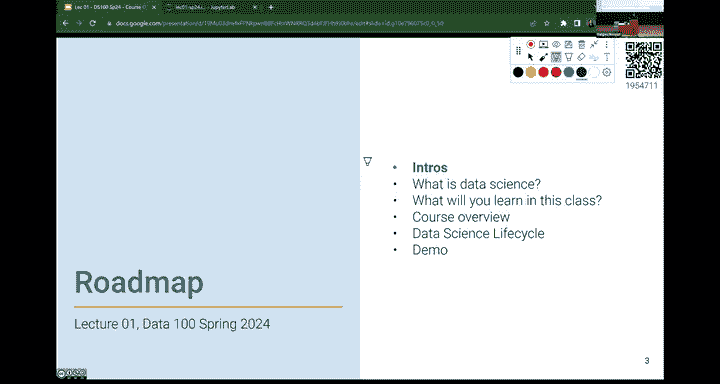
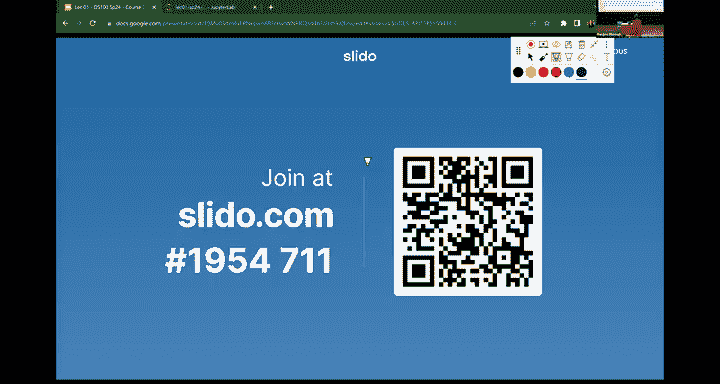
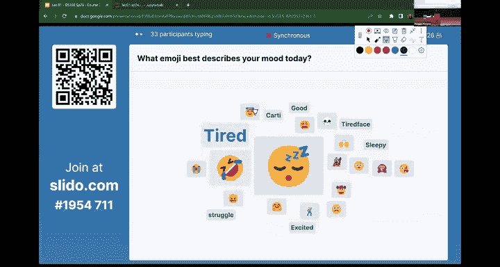
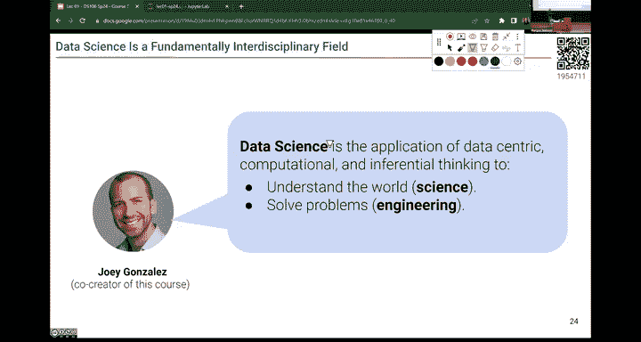
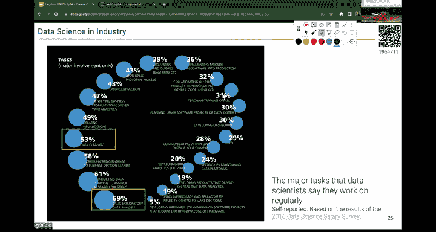
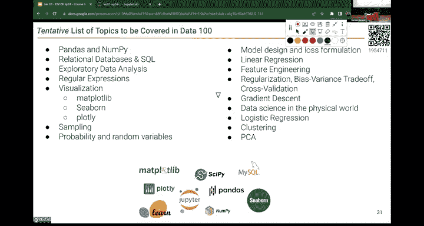
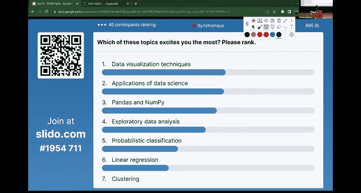
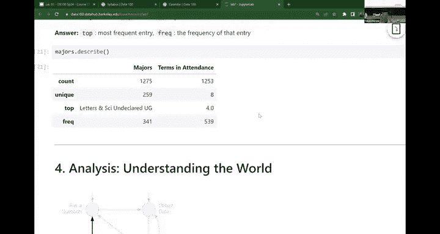

# 📘 课程 1：数据科学导论与课程概览

在本节课中，我们将学习数据科学的基本定义、其重要性以及Data 100课程的整体结构和要求。我们将从课程介绍开始，逐步了解数据科学的工作流程和核心思维模式。

***

## 🎯 课程概述与欢迎

欢迎大家来到Data 100课程。我们非常高兴能和大家一起开启春季学期的学习。在接下来的几个月里，我们将共同学习大量知识，这对我们所有人来说都将是一段激动人心的旅程。

今天课程的计划是：首先介绍课程概况和后勤安排，然后探讨数据科学的定义及其生命周期，最后通过一个快速演示来了解本学期的学生构成。

***

## 📱 课堂参与工具：Slido

在课程开始时，大家看到了屏幕上显示的二维码。这张幻灯片上的信息是用于登录Slido平台的。Slido是一个课堂参与平台，我们将在Data 100中使用它。

你可以扫描这个二维码，或者在你的笔记本电脑上访问 `slido.com` 并输入代码 `7dit`。

在Data 100的每一节课中，我们都会提出一些主动学习的练习。你将能够通过Slido回答这些问题。Slido上还有一个问答部分，你可以在这里提问。我们出色的助教团队将全程参与课程，他们会回答一些问题，并在直播课中强调需要澄清的问题。

为了让大家熟悉这个工具，让我们先尝试一下。请登录今天的Slido，回答这个问题：**“哪个表情符号最能描述你今天的心情？”**

通常，你会在这个区域的顶部看到还有多少参与者正在输入，右侧会显示我们收到了多少回复。我会等到这个数字稳定下来，然后再继续下一个话题。稍后我会更详细地解释如何在Data 100中使用Slido以及本学期的课堂出勤政策。

在每一讲的幻灯片中，你都会在右上角看到二维码和代码。所以，即使你迟到了，仍然可以登录Slido提问并回答我们发送的问题。

***

## 👨🏫 教师介绍

**Naraga Nroi教授：**
我是Naraga Nroi，是电子工程与计算机科学系的助理教学教授。我在多伦多大学获得了博士学位，于2017年毕业。从2017年到2022年，我在加州大学圣克鲁兹分校担任教学职务，从2022年至今，我在伯克利任教。这是我第三次教授这门课程。我的研究主要集中在机器学习和生物医学应用的统计信号处理领域。同时，作为一名教学教授，我也致力于人工智能与教育交叉领域的研究。

**Joseph Gonzalez教授：**
大家好，我是Joseph Gonzalez，大家可以叫我Joey。我很高兴能回到这里。我实际上是这门课程早期的创建者之一。我本科就读于加州理工学院，之后在卡内基梅隆大学获得了博士学位，研究方向是将统计学和计算结合起来的图模型。我现在是EECS系的副教授，也是Rise Lab和Sky Computing Lab的联合主任之一。我还参与了许多开源大型语言模型的研究。除了研究，我也热爱教学，Data 100是我在伯克利最喜欢的课程。

***

## 🔍 什么是数据科学？为什么它很重要？

当我们开始教授这门课程时，一个核心问题是：**什么是数据科学？** 因为当时我们正在定义这个领域。

数据科学之所以重要，是因为它已经成为当今世界运作的核心。早期的例子包括推荐技术和人工智能工具，它们帮助企业适应客户兴趣，实现更精准的目标定位。数据科学不仅涉及算法设计，还为像Netflix这样的企业提供了关于未来投资方向和内容创作的洞察。

如今，数据科学的影响更加深远。它已经成为“第一响应者”。例如，在前总统奥巴马执政时期，首席数据科学家DJ Patel被要求利用数据在火灾、洪水等紧急情况下做出资源分配和响应的决策。数据科学成为应对即时问题的核心部分。

数据科学也是科学发现的核心。人类首张黑洞照片的生成，就运用了本课程中将学到的技术和工具。研究团队甚至进行了实验，以确保他们的先验信念没有影响结果分析，这正体现了数据驱动思维的重要性。

数据科学的核心工具之一是帮助我们做出决策。我们生活在一个复杂多变的世界，需要做出艰难的决定。我们不应该仅凭直觉或先验知识来做决定，而应该基于我们拥有的知识和数据。数据科学为我们提供了整合这些信息并构建可反思的决策过程的工具。

因此，数据科学被广泛应用于科学、医学、社会科学、工程、体育等各个领域。它使我们能够基于证据得出结论。但同时，作为公民，我们也需要有能力去质疑分析过程，判断结论是否正确或数据是否恰当。所以，数据科学是我们都需要参与的一项活动。

***

## 🤔 数据科学家的思维：批判性思考

这门课程的一个重要目标是迫使你进行批判性思考。在像这样的课程中，这实际上很难做到。提出技术性问题很容易，但评估你的思考过程则非常困难，尤其是在面对上千名学生时。

但我们会尽力帮助你培养这种能力。学习这门课程的挑战之一在于，我们将通过实例和练习来引导你像数据科学家一样思考和进行批判性分析。你应该观看并自己进行批判性思考，发展这些技能。

这意味着在思考一个问题时，你需要理解：
*   **你拥有正确的数据吗？** 我们可能没有完全正确的数据。
*   **数据是否具有代表性？** 认识到数据的局限性。
*   **我得到了一个惊人的结果，模型拟合得非常好。它有什么问题？我能信任它吗？它会在哪里失败？** 当你向他人传达这些想法时，他们可能不理解技术细节，你需要解释为什么不应该在他们设想的环境中使用它。
*   **我们问对问题了吗？** 提出正确的问题意味着理解问题本身以及你可以合理询问的内容，将大问题分解为可以实际取得进展的小问题。
*   **你的假设是什么？** 你必须做出假设。你的假设合理吗？我们需要通过例子来思考这一点。

你还将学习如何进行分析以及如何沟通你的发现，这将是你所做练习的重要组成部分。因此，你应该学会将批判性思维和怀疑精神应用到你的工作中。希望在这门课程结束后，当你看到《纽约时报》上的文章时，你会开始用新的视角审视世界。

最后，在整个课程中，我们将讨论我们所做工作的社会影响。思考你的行为可能产生的后果、如何被使用以及如何影响他人，这是数据科学工作的关键部分。

完成本课程后，你应该能够处理数据，并对世界上一些最具挑战性和模糊不清的问题产生有用的见解。

***

## 📊 定义数据科学

那么，如何定义数据科学呢？早期有人提出了一个维恩图：数据科学是**计算机科学（黑客技能）、数学/统计学（数学知识）和领域专业知识（实质专业知识）** 这三个圆圈的交集。

要成为一名优秀的数据科学家，你需要将领域知识与计算和统计技能结合起来。你需要主动去学习你原本不了解的领域。

因此，我提出了另一个定义，这个定义在本课程的历史中一直被沿用：
**数据科学是以数据为中心、计算和推理思维的应用。**

这意味着：
*   **以数据为中心**：学习通过数据的视角来看待问题。
*   **计算思维**：在解决问题时，思考可以使用哪些计算工具来理解数据、推进认知。
*   **推理思维**：能够超越数据进行推理，根据数据得出结论，对未来做出预测，并基于这些预测采取行动。

这三者共同作用，以实现两个目标：**理解世界（科学）** 和**解决问题（工程）**。在早期，许多公司只雇佣数据科学家做其中一件事，而忽略了另一件，这是一个错误。你需要同时具备这两种技能：既要有探索性、能够定义假设、理解数据，也要能够解决问题、修复数据、构建系统。

调查显示，数据科学家将大部分时间花在**探索数据**和**数据清洗**上，而很酷的机器学习/AI工作只占一部分时间。创新真正在于理解数据以及如何将各部分整合在一起。

***

## 🛠️ 课程目标与涵盖主题

在创建这门课程时，我们设定了几个目标，这些目标一直指导着课程的发展：
1.  **准备**：这门100级别的课程应为你学习高年级课程做好准备。
2.  **赋能**：确保课程结束后，你能够真正动手做事情。我们使用真实的软件包，处理真实、未经整理的混乱问题。
3.  **激励**：不仅学会使用这些技术，更要在看到问题时，知道如何运用课程中的工具去解决它。

课程涵盖广泛的主题，包括Python工具链、数据清洗与探索性数据分析、可视化、统计建模、机器学习基础（如线性回归、分类、聚类、降维）等。我们无法深入讲解所有内容，但会为你打下所需的基础。如果你想了解更多，欢迎在办公时间与我们交流。

***

## ✅ 先修课程要求

本课程有明确的先修要求，这些要求是经过精心设计的：
*   **Data 8**：每个人都应该学过Data 8。它引入了本课程核心的计算和推理思维。
*   **编程经验**：需要一定的编程背景，能够编写相对清晰的代码。本课程不会教授Python或Jupyter Notebook的使用。
*   **数学**：需要一定的线性代数基础，因为我们将在线性回归、降维等技术中用到它。我们也会用到一些微积分来进行梯度下降。

如果你对这些主题感到不确定，请与我们沟通。我们希望你成功，会帮助你找到合适的资源。家庭作业1和实验1旨在帮助你评估自己对本课程材料的准备情况。

***

## 📅 课程结构与后勤安排

本课程规模庞大，离不开出色的助教团队。我们有总助教、各专项领域负责人、本科生助教等，他们从一月份就开始工作，搭建课程基础设施。

**每周流程：**
*   **周五**：发布下一周的实验和作业/项目。
*   **下周二**：实验截止。
*   **下周四**：作业/项目截止。
*   **办公时间**：主要集中在周三和周四。
*   **讨论课**：在周二和周三进行。
*   **讲座**：周二和周四上午。

**课堂出勤政策：**
你需要在一周内观看讲座（同步或异步）。如果你亲自或通过Zoom同步参与讲座，并通过Slido回答至少一个投票问题，你将获得参与分数。如果你异步观看，你有一周的时间通过一个调查问卷回答该讲座中的所有问题。课堂参与占总成绩的5%。全程参与所有讲座可获得0.5%的额外加分。

**讨论课政策（本学期新规）：**
有两种选项：**计分**和**不计分**。
*   **计分选项**：你需要每周参加讨论课（有三次豁免机会），这将占最终成绩的5%。
*   **不计分选项**：这5%将平均分配到期中考试（占比变为22.5%）和期末考试（占比变为32.5%）中。
研究生（200, 200S, 200A）不要求参加讨论课，但如有兴趣可以告知我们。

**作业与评分：**
*   作业和项目通常有一周的完成时间。
*   实验配有视频讲解，预计需要1-2小时完成。
*   没有作业/实验的最低分剔除政策，但我们有**24小时宽限期政策**。所有截止时间都是晚上11:59，但你还有额外的24小时宽限期。按时提交所有作业/实验可获得3%的额外加分。
*   如有特殊情况，可通过专门的Google表单申请延期。

**考试安排：**
*   **期中考试**：3月7日（周四）晚上7-9点，校外举行。
*   **期末考试**：5月9日上午8-11点。**本课程不接受考试时间冲突**，请务必提前解决任何潜在冲突。

***

## 🌐 课程平台与工具

*   **课程网站**：`ds100.org/sp24`，包含教学大纲、讲义幻灯片、作业等所有信息。
*   **DataHub**：用于完成实验、作业和项目的编码环境。
*   **Ed Discussion**：用于提问的论坛。**请不要直接给教师发邮件**，请使用Ed或课程公共邮箱 `data100-instructors@berkeley.edu`。
*   **Gradescope**：用于提交作业。
*   **JupyterLab**：编码环境，与Data8中使用的类似。

***

## 🔄 数据科学生命周期

数据科学生命周期是对数据科学工作流程的高度概括。在Data 100中，我们使用包含四个主要阶段的版本：
1.  **提出问题**：明确要解决的问题、假设以及评估指标。
2.  **获取数据**：查看现有数据，评估是否需要收集更多数据，确保数据具有代表性。
3.  **探索性数据分析**：仔细检查数据，识别偏差，进行可视化，判断是否需要数据转换或特征工程。
4.  **理解世界（建模与推理）**：
    *   **预测**：根据模型对新数据进行预测。我们将学习回归、分类等算法。
    *   **推理**：基于已有模型对未观察到的数据进行推断和泛化。本课程将更侧重于预测任务。

完成这些阶段后，我们将生成报告并与利益相关者分享结果。这是一个迭代的过程，各个阶段之间可能存在循环。

***

## 🧪 课程演示：探索Data 100学生数据

（注：演示部分涉及具体代码操作，旨在展示JupyterLab环境和数据分析的初步概念，此处仅概括其目的。）
在演示中，我们加载了本学期Data 100的学生数据（已匿名化），进行了初步的探索性数据分析。我们查看了学生专业、在校学期分布，并对姓名数据进行了标准化处理，统计了名字长度分布和最常见名字等。这个过程展示了数据清洗、初步分析和可视化的基本步骤，这正是课程初期将要学习的内容。完整的演示代码可在课程网站上获取。

***

## 📝 总结

在本节课中，我们一起学习了以下内容：
*   数据科学的定义及其在当今世界中的重要性。
*   数据科学家所需的批判性思维模式。
*   Data 100课程的目标、结构和先修要求。
*   课程的后勤安排，包括出勤、讨论课、作业和考试政策。
*   数据科学生命周期的四个主要阶段：提出问题、获取数据、探索性数据分析和建模推理。
*   通过一个快速演示，预览了我们将要使用的工具和分析流程。

希望大家对即将开始的旅程感到兴奋。我们周四再见！