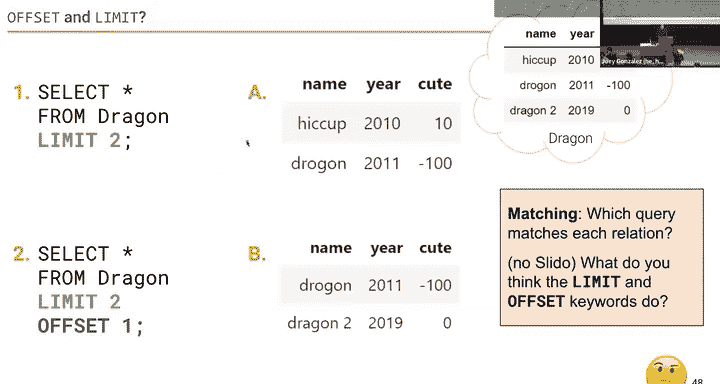

# UCB《数据100数据科学原理与技术｜Data 100 Principles and Techniques of Data Science 24SP》中英 - P20：-20-Data 100 Spring 2024 Lecture 20.zh_en - GPT中英字幕课程资源 - BV1Bc2dYCEbc

The cloud。

All right。I once forgot to do that and it was bad。Okay， I think recording to the cloud。

 we've got all the Zoom stuff going， we've hopefully fixed some of my audio issues in the past there are issues with audio。

 I'm hopefully louder now。We'll see we've also been fixing some of the audio come back to。

 I guess welcome， welcome back。I hopepe you all had a great spring break。

 got a chance to do fun stuff， I spent a lot of time with my kids which was awesome。Good news。

 we're taking a break from math this week。We'll be doing coding and we'll be doing coding in an ancient language in all caps。

 so it's just going to be a very different week than previous weeks， so hopefully it'll be fun。

Join the So。Mid semester survey。We look at it。 We ran a survey。 You answered questions。

 We looked at those questions and thought， what can we do better。Aye。

There was some confusion on topics。just highlight some of the topics so we might have gone over these in previous slides once more so if many of you are confused about gradient descent so right here sadly I covered this topic it's a big word。

 but you know gradient descent how are you feeling better or worse about gradient descent。

Better or worse， hopefully there'll be some exercise will actually pointed to ways you can do some more reading。

So people are confused about that ordinary least squares is typically kind of confusing so these are pretty standard every semester these cause confusion they are the more mathematically challenging。

Topics。I'm going to guess you guys would like to do this now too bias variance probably goes here too yeah so there are more topics recently however they are confusing。

Practice them through lecture we'll have walks and stuff， I'll talk about that in a moment。

How comfortable were you with the content and difficulty of the midterm？

I'd say this is a pretty good midterm that's about right， wasn't too bad， wasn't too easy。

Some people felt you know it's challenging， some people said no it's pretty easy and very comfortable。

 this is pretty standard for the shape of exams in this class so it generally hit where our exams typically align from previous semesters。

 but the punchline here is that we have covered hard topics。

 you are not alone if you're feeling you're on the you know the left side of this graph。

 there's probably 50% of the graph in the class with you if you're on the right side I maybe a little bit less 50 a little bit more than 50 on the right。

Do not alone go off hours， good discussion， we'll talk in a moment about things you can do to get caught back up。

All right， so here's some actions we're going to take based on your feedback。First。

 people have asked for a three minute break in each lecture。Me， too。

 So let's take a three minute break in the middle of this lecture。

 If it gets to the middle of this lecture， I haven't taken the break， raiseise your hand， say。

 Profess Gonzalez， where's the break。 I'll add the break and get some water under the bathroom。

 stretch all that stuff。😊，Off hours。There was a request for additional faculty office hours。

 Professor Norui has already created one， I will look into seeing if I can add one。

I think the issue is there's a lot of conflicts with our off hours times。

 so hopefully this now covers the off hours times。Who's gone to the faculty office hours？

Come to office hours it's fun， we don't even talk about the class half the time。

 you know stop by office hours for sure。We also do know what's going on in the class。

 we're happy to talk about the class too。嗯。Who's waiting in line for online off hours？

We're going to try to increase the availability of online offs support this was an issue that people have raised concerns about and hopefully this will be now fixed。

Make a mess of this slide。How would do that。Y， okay， audio recordings。

So there was an issue with the audio recording some of the recordings I think especially mine were quiet we've since fixed the volume on the recordings and reuploaded them if you're having trouble and moving forward I believe we have fixed the audio settings and we will continue to make sure the audio levels are high enough that you can easily hear the recordings you have to get blasted with the ads and I think there's some discussion on that too we're looking to making sure you don't get those。

😊，We share more advanced learning resources， so there's more resource being posted。

 so please check those out so walkthroughs， discussion walkthroughs things will hopefully help pick up the material。

Looking at a better DSP seatding for the final， so hopefully those who had issues with DSP seeding in the midterm will have a better experience for the final。

Right again， we appreciate all your honest and constructive feedback。

 please keep it coming is helpful for us we want this class to be good for everyone。嗯。有 that。Great。

Okay， what are people most looking forward to？Bio variances weren't in here but you know not to be not super surprising SQL is the next topic。

 so we're going to do SQL next and it is a fun topic it is I think on this spectrum of complexity it's a little bit easier than some of the earlier stuff so kind of a nice return from B。

Right so things that people found out helpful office hours。

 please go to office hours step by faculty office hours discussion sections。

 people found this to be helpful course notes and we're continually updating these so when I make changes to content or we we。

😊，The staff are updating the notes continuously to hopefully make them as helpful as possible。

 if you find issues let us know and we can try to improve the notes。Exam prep sessions。

 continue to do those as well。Other resources， so again， lots of online off hours。

In case you can't get someone in Warren Hall， so this is in person， we also have an online option。

Our tutors and TAs are constantly monitoring Ed。You should too check Ed， post there。

 look answerss there， that is a hopefully very helpful source。Discussion walkthrough。

Will be available for all discussions on the website， again。

 ways to learn their content from other mediums， so very important。We started this a while ago。

 but this is really useful debugging guide we look at the common mistakes that students run into and we try to explain what's going on and how to fix them learning how to debug is a big part of this class is a big part of learning data science of being a computer scientist of being an engineer is you will encounter problems I encounter problems in fact I was up late last night trying to fix the upcoming homework because we had problems。

L any debug is a big part of the process， these guides will help you。

We have a content feedback form it's linked to on the slide。So if you have issues。

 pointed out we want to improve our class， we want to improve the material for everyone。

And then this is can't be oversed I'm going to clear the slide this is really important life happens。

You are going to have trouble in your life， we want to help you， but we can't unless you let us know。

ok。We said sometimes we find out at the end of the semester。

 someone was struggling the whole semester and we could have been helping the whole time。

We want to help you so let us know， okay？I think that is it for the mid semester survey。

Anything I miss， questions， comments。We begin sQL so this week is dedicated to sQL I will say this class deserves more sequL。

 so we only have one week。But SQL will be something you' probably use throughout your entire lives。

Sadly。We will do our best to give you the basics you need here， it will not be enough。

So you will have to learn more SQL throughout your lives。

I'll try to give you some hints on how to do that。All right。

 so we are stepping away from our friend the Python pannda's data frame and we're going to look at new situations we're going to work with we'll call them professional data tools or ancient data tools or the standard data tools of today。

 and these are the relational databases these things powered by SQL。We'll start with whyA database。

should have made this a slido， why a database， why would you use a database？😡。

Who's heard of a database， raise your hand？Who's user a database once in their life。

 Everyone just go ahead and raise your hand。 You use a database database all the time you don't even realize that you buy stuff using a database。

 you log into a computer， you're basically using a database。Right， so why do we use them？

Computationally better， less expensive。It one reason others， we'll come to these inside slides。

 but yeah。Structure your data， organize your data， so faster， better organize what else？Safer。

Cleleaer scale we'll include all these things so database is used for a lot of reasons。

Let's go into this。Up until this point。We've been sort of living in a fiction where we have。

Structured files。That we've downloaded a CSV file， a tab separate file。

 some JSson data we have on our computer in our Jupiter H， maybe on our laptop。

And we're using Pada's tools to read these files。And turn them into data frames。

We we do all our analysis on。I'm about to tell you a whole new set of technologies that are better。

 probably。😡，And yet， most of the time， you'll do this， or we just taught in this class。Why。Well。

 these tools。😮，Are easy to program Python， easy to build stuff around。You'll see later。

They're more constructive， I can go through the process of describing transformation I won' to saying differently I'll change a little bit change a little bit more。

 but they're good at working with really messy data that doesn't start in tables so we teach you the standard tools。

That are great when your data is， know， small， small changes， by the way。

 small is to be a few hundredgabytes。Maybe you get 10 gigabytes。

 how about this kind of a third the Ramm you have on your computer？We your fourth。That's small。

When your data is like that， the tools that we've been teaching are the way to go and they are pretty standard。

😡，They also work on things that are static in time， so sort of snapshots， things are un changing。

 moderately sized files that are static。Changing pipe。

These are the standard tools of data science we've been using up to this point all the libraries speak well to these technologies and hopefully've come to appreciate pandas who likes pandas at this point。

Great， not the animal but the software and who despises Pans this point please I wanted to change I want to drop Panish from this class but yeah Pans is the standard there are reasons to not like it and maybe after today's lecture you will you will like it less or you'll like it more we'll see。

😊，So we have been focusing on pandas， we've been focusing on data that's local on our file system。

 this is very convenient， you don't need database software you don't need a whole other language a whole set of technologies you can just use Python and simple functions and tools we've already taught。

But that's not the real world。The real world is full of these big data technologies。

And they live on a spectrum， things that they can do。

They're essentially data management systems software that manages your data。I is a spectrum？

It on the left side of the spectrum are the operational systems， you log in。

 your grades are stored on these。Your you， your accounts for your favorite social media stuff is stored in these。

 they have the latest data， they're not as large as some of these others。

 they're just what's needed to run the business so operational systems。

Data scientists often live on this side of the universe。

These are data systems designed to work on huge snapshots。😡，Every day。

 checkpoint what the world look like next day， checkpoint， what does the world look like。

 copy all the data from all the different regions of the world into one place。

Sometimes called a data warehouse。Sometimes called a data lake。

And then a bunch of companies invent this idea something between a lake house so it combine a house and a lake very cute What are these doing？

These technologies over here。Work on snapshots in time。The data is often much bigger。

It's sometimes organized in tables， sometimes it's in a bunch of big files， maybe massive CSV files。

 maybe some new data formats storing all sorts of crazy data with audio and video。😡。

Now I'll talk more about this， I think on Thursday， we go to the far end of this picture。

 the world of Lakes， this is where the whole cloud computing went。

 just put all your data in the cloud。All of it， and then use fancy compute systems in the cloud。

 big data systems to process it。😡，That got really complicated and the other side of this picture kind of emerged is very popular put all your data in the cloud but make it tables。

 organize it a little bit so it's a little more organized use those same kinds of technologies which we're about to teach in class to work on those giant files so why am I tell you all this well again use a data scientist we're going likely live over here if you go over here be careful you could break stuff this is where you know the actual bills are kept so probably not over here。

So you're on the right side of this picture and you're likely operating with SQL。

Hopefully most of the time， you know this half the picture。

 your data is pretty well organized and you're just working with giant tables。

 occasionally you'll write some Python to work with some messy data and hopefully maybe put it over here where you can work with it as giant tables。

So hopefully motivating。The real world， you're going to use SQL， which we haven't taught you yet。

To interact with these massive data sets。And often， if you're smart。

 you'll do most of your stuff writing SQL， and then maybe pull down a little sample。

 which you might play with and pans build visualizations fit a model。

 but you're going to use these technologies， these warehouse technologies， lake house。

 even data lake technologies to operate on this vast amount of data。So how the enterprise works。

 what will you take away from this slide？When you go to your next job or your next internship they'll probably mention these kinds of things and I'll tell you a few examples of them and you okay well this is where I want to be。

 this is the data I can play with， should be careful over here。

 this is the business data this is probably got snapshots over here in the data warehouse so I can look at things how they've changed over time and I'm going to need to know SQL and I'm have to figure out how to connect to the SQL system with my Python environment to do the SQL stuff。

What's the database？I start there databases。Isn't actually software。

 it's just an organized collection of data。Abstract idea， collection of data， that's a database。

A database management system。That's the software that manages the database， it stores， manages。

 and facilitates access to the data in that database。

Here are some of the common large scale DBMS systems that you would use as a data scientist。

You'll notice they're attached to big cloud companies like Google BigQuery， Amazon Redshift。

 Snowflake and Databricks or smaller startups that provide these same kinds of technologies。

 Microsoft SQL Ser， so these are big data platforms that speak SQL。So again。

 you go to big organization， perhaps UC Berley and you go， hey。

 I want to look at all the students for all the past。

 semesters in six of the major departments in my college。

You're going to probably talk to one of these systems。

You might be talking to another one on this page， Oracle。

 which is what I think campus uses to store a lot of this data。So big software packages。

They all speak sequL。And you should be， I'm excited to use these because it's going to be easy to work with my data when they're in these systems。

Here's a fun aside。Youll often see this picture。I I think the only slido because I ran out of good ideas for sliddo so so Phoebe。

What is the picture of？What't wait see you as a it。use some context。

 people use this to depict a database， why is that a picture of a database？😡，Magnets。

You're actually not wrong。Not right， either。Who's seen this figure before？Picture for database， yeah。

 the other picture of database often an elephant， we like to use elephants to denote databases any guesses why？

Elephants have good memory， they never forget。Is that actually true？Yeah。I my logo for databases。

All right。I'm told you need more time to complete these。That was one of their feedback in the survey。

Just put anything， come on， IDK question mark。Fill this out。You're here for lecture。

So what is it really？Canidada。This is what I refer to it。

I wanted to show this because it actually points to where all of this technology came from and we're going to use technology that's almost 50 years old。

Which is kind of crazy。 There are very few cases where use software systems that are 50 years old。

On a daily basis。Right right。So this is supposed to be a picture of a spinning disc of the platters in a hard drive because when these technologies were developed。

We didn't have a lot of memory。Few megabytes。You'll see actually maybe a better picture。

That some of the early disks。5ive megabytes， one ton。That is not a portable storage unit。

one ton hard drive， these little sliplipers right here。

Around like that those are little pieces of I think glass with metal filings on them those were our early discs they were magnetic Someone kind of got that right those little arms we go back one slide these little arms would come out this is a more modern spinning disc and read they'd swipe back and forth and read this disc as it was computing and they'd read each layer she had many stacks of that disk。

So database technologies were actually built initially to manage business。😡，Great idea。

 what if we could？Put transactions right away， you bought something。

 and then instantly it would be in some system。systemst that had to never fail because your business is there。

 all the money， all the records are there， so to be durable。They had to be reliable。

And they had to fit a bunch of different businesses。

So breakthrough in computing was being able to build a single technology around a crazy idea。A table。

Did anything could be represented as a table or tables？And I could build a platform。

 a system that manages these tables on which I could run entire businesses。that became the database。

 database industry， which was a huge industry and remained a huge industry in computing。

It started again as a thing that manages the truth about my business。

 and it evolved become the thing that manages all the data。😡，Databases now you know。

 do we use these anymore？New， do we use these anymore？Not really either。

 So now everything is solid states。 we don't have spinning disks。

 a lot of technology was actually designed to deal with the fact that this was spinning at a fixed speed。

 And if I put data here， I could get the next piece of data here really quickly So a of a lot of research went into making these things fast。

 And to this day， a lot of research goes into making them fast but in different ways。

 that's why the technology I'm about to show you in lecture is actually faster than in many cases。

 using even pandas to process your data on your own computer and certainly when we get to the cloud you have terabytes of data and you want to spin up hundreds of computers to process it these systems will automatically do that and you can process terabytes of data in seconds。

Justs crazy。Innovation database systems。So why do we use these？Build this in， so data storage first。

And businesses really care about this reliable storage。

 these systems were designed so that you could walk up， well， it's running and unpug it。

And you wouldn't lose data。Either data was in or it says it wasn't written and you'd force the thing to send the data again when you plugged the back it。

 so very reliable storage。They were designed to deal with failures， and they still are。

 do you put something in the cloud。Doesn't disappear Cloud never forgets why keeps copies。

Do you keep copies of all your CSV files if you drop your laptop， do you lose your data？

That would be a problem， so a lot of these systems are built around fault tolerance， redundancy。

Designed to compute on data that doesn't fit in memory。

Remember our storage systems are often or is a magnitude bigger than what we can compute on in Python。

So suppose I have 100 gigabyte file and I have a 16 gigs of Ramm on my laptop， I can't work on it。

Of a database system I can。It's a big breakthrough in how we compute。

Specialized data structures and actually a lot more designed to improve performance。

So very fast technologies and we have a class dedicated to the CS186。

 So if you're interested in how these systems work。We want to take CS186。

It is a fun class is a more technical engineering oriented class We also have a class that。Data。温度。

What。Which is data engineering， which takes what I'm about to cover lecture today and makes an entire semester about it。

 So how to work with SQL systems and how to work with other things that aren't quite relational。

 Is there other technologies that have emerged since then that don't just work on tables but work on documents or Jason style things。

Data management。Okay， right。Sueo already mentioned this。These systems allow us to organize our data。

And say who has access， so it's organized and safe。And that became pretty important。

So I can put all the student data in one of these systems and I can have it so that it's well organized you don't have to figure out what's going on it's you know structure and tables with clear clear columns of constraints on what can go in those columns。

And I can say you， you， researcher only have access to rows that mentioned data 100 so I can place these interesting constraints on what you can see。

So safety is really important。And forth guarantees on the data。

these anomalies we've been dealing with in EDA， database systems can make it so that you can't put the data in if it's wrong。

This field must not be old。Your GPA can't be a negative number。

What that mean buggy software can't put bad data in the system。

 buggy humans can't enter bad data in the system。😡，Right， so we place these constraints。

 sometimes they get in the way， sometimes like， well。

 I just want to put bad data in I'll find a way to do it。We can come back to。

So they prevent data anomalies some of these problems。The other last thing。

 which is really important when it's the source of truth。

 when it's the actual the leftmost transactional system。

 is it creates this idea of a transaction itself so that I take money out of this bank and I put it in this other bank。

 what happens if I take money out and the computer crashes power outage？Is's that good。

 so I want to make it so that if I take money out。And I put money in that either all happens or all doesn't happen。

 it's a transaction。😡，It's a big idea on database systems， it is not important to us in this class。

 fortunately， we're going to work on snapshots。But just one thing to keep in mind。

 suppose you're crawling the grading system at UC Berkeley。

You're just playing around that data and someone wants to enter a grade。Well， you're crawling on it。

 you may make it so they can't enter greats。Because you've locked that table。

One of the things it's guaranteeing is you're reading it。

 you won't see things that are changing as you're reading it。😡。

So well you don't have to worry about transactions use a data scientist might create havoc for people who are actually using these systems so you do these big scans when you do the big analysis make sure you're not working on the system that's actually serving the student selling a product you know entering scientific data right those are the transactional systems that is why we often as data scientists take a copy。

😡，At nighttime when no one's using the system， except the grad students。

 so we take a copy of the data and transfer it over to some data warehouse。Where now I can scan away。

Keep playing with that data and the people using the system to run the business don't get affected。

So one way to get in trouble as an intern is to lock up the entire database that the business is using。

 so don't do that。All right， I've talked a lot about these systems。

 I want to share one more thing and I'll give some examples and we'll take a quick pause for questions at that point as well。

So。How do we interact with these technologies I'm to show you how you interact sort of abstractly in the real world then in class we're going to use this simplified version which will make this process easier and you would actually use that in the real world too but this is this is a standard setup up so typically you'll be on your workstation。

Probably using Python in some Jupiter environment， and there's some database server and it's probably more than one of these boxes maybe spread all over the world。

😡，And you want to do analysis。The way you will do that is you're going to send a query in a language which we will now teach。

To this server。It will do lots of clever thinking， so it'll think。

And then it will send a response back， this is your table。啊 it。This server， if it's。You know。

 if it's a modern server， we'll probably only send you a few rows at a time。

 you'll ask for more and more rows。If you're smart。You will not say select。哦。

I'll explain the language you won't say。You will not say select star from sales。

You will put some constraints on your data if you just say， give me everything。

This system move no problem， here comes everything。

And that will that will be a problem for you because you' be pulling way too much data so the point of using SQL system。

 the point of teaching you SQL this class is not so that you can just download all the data and play with it in pandas。

 but so that you can think through what you want to do and have the big media system do all the hard work for you and return some summary。

Of that hard work that you can work with local。So now hopefully the usage model。

 a database is going to be some software system probably running in some data center somewhere or collection data centers that you connect to just like a website。

 but you it's a database server and it's going to stream data back to your compute environment。

Pa there other questions？27号。One thing that's worth noting and I said this a moment ago is that often other things will be talking to that same piece of technology right so I might have web servers。

 the thing that's rendering my business that's serving web applications that's making the page load and I will also be doing analysis on that same data and again I need to be a little bit careful about asking this system to do everything in the world for me when this other traffic this is important stuff like the business stuff going on when that's happening I don't want to。

Lock down everyone's experience， everyone using the data system。So again。

 the standard solution to that is the take。This thing here and cut it in half。

 we'll have one that talks to the world， does all the business stuff。

 and then one that we the data science team will play with。Or snapshot of the world。All right。

 so that was a long penent on these systems it's important to know about them at the end of the day you're just going to interact with them using SQL so now we will jump into the SQL language itself again。

 let me pause here are there any questions about this idea of working with database systems。

I met in Canada。嗯。I presented a bunch of high level stuff that's important to have in mind when you go to actually use this scenario real world。

 which is again， a big focus of this class。Let's do SQL。

Today we're going to be programming in a new language。

Called the structured queryary language or S QL。It is its own programming language。

 so you're about to learn a new programming language。Exciting。It is distinct from Python。But。

We will often call it from inside of a other programming language， in fact。

 in this class we use Python， but SQL， you'll see in all sorts of languages from the technologies we use to write apps for our computers to cloud web services。

It is a special purpose programming language。It has basically one goal。😡。

To manipulate and work with data， that's it。It is the dominant language technology for data period。

You must know it。Every semester we think about dropping it from this class because you know。

 you should have seen it in other classes maybe， but the reality is。You must know it。

 so we will continue to teach it and probably should teach it more this is the dominant language for working with data。

It is a language of tables。So everything isn't a table in and a table out。

 inputs and outputs are all tables。😡，That's crazy if you think of what's going on in the pandas world。

 or we have what？Data frames。Series。Indices， values。Everything in SQL is a table。

 you get back a single number， it's a table， a column， it's a table， a table， also a table。

Everything is a table is what we'd say is closed under tables， all the operations take in。

 zero more tables， produce zero more tables。It's ancient。It's older than me。

 and I'm pretty old 1970s。This is old technology。Is originally called the structured English query language。

 just emphasize that's English。It's designed for business people so they should be able to read it。

It would have been pronounced and spelled SQL like that。

 it was later shortened to just a structured query language SQL。

You can choose whichever name you like， I call it SQL， some people call it SQL。Does it matter？

Sequel to me。It is old and you will notice it has some of the trappings of old languages。

 lots of caps kind of herbose， it's not as pretty as Python。And that upsets people sometimes。

It's new Just respect the fact that this is， you know， developed the 1970s。

 Can you name another language or technology that'， you know， from 1970s， you use all the time。C。

 very good， so C is one of these ancient languages that's still around today。

Why is it still around today？How can such a funny thing be around for so long。

It's still around because。All your data was behind the SQL thing。

So if I'm another company have this really cool new database system， you want to use it， you're like。

 great， I'd love to use it。Does it speak SQL Yeah， I speaks SQL， Great， I support SQL too and then。

 you know， 2010 rolls around we have this really fast created database system Do you want to use it and like。

 yeah， I'd love to use it Does it speak SQL because all my system all my business stuff isn't SQL。😊。

Yeah I think it's SQL to so it's been hard to replace this and it remains a standard and well new technologies have come to try to you know replace it。

 they failed so it is it is a standard partly because it's around for so long and most of the technology that works with data now speaks SQL and therefore all the systems that support it support data also speaks SQL。

Here's the real problem though。Nobody follows the standards。

Which means that every database you talk to， you're going to have to learn again。😡。

There's a little bit of difference in how they do their SQL the stuff we cover in class today will mostly work across any system。

 mostly。But when you go to Oracle's fancy new system for the campus records。

 the queries you right there may not work when you switch to let's say another university's Microsoft SQL server system right so it is not a universal standard every system will be a little different in fact in changing the system for this class last night we ran into issues as well so it's a little different it's kind of annoying annoying you just should know that upfront。

So we're going to program in SQL using the Jupyter notebook environment， you don't have to。

 a lot of people use special products from many vendors that talk directly to the database。

 they still write SQL just in a different colored text box。

And we're going to be connecting toductDB and sometimes SQL light in this class。

So I'm going to talk about these two technologies in a moment。Back October right now。

Right so for this class， we've tried to bring in different data systems in the past and have generally failed。

 here's why。When a class has 1500 students and you're all connecting to a database server and you all do scan all tables。

 it doesn't go very fast。So a few years back we decided each you would start to use one of these embedded SQL technologies。

 so let's talk about these now。SQL Light is a really cool technology that ships with Python。

It's a SQL database that runs directly in your Python environment， so you can write SQL。

 you don't connect to server just。Reads the SQL string you wrote in the Python tool， opens up a file。

 a database file and starts doing SQL stuff on that file。

No server is none of that complexity I showed you earlier。So it's a library。

It lets you work on database files or in memory DBs just in your Python environment。

And it's a simplified version of SQL， so it's SQL light， not all of SQL。

It is actually pretty commonly used， I think on Android。

 this is the way you manage data locally on Android devices。

So SQL8 is a pretty standard piece of tool and it is what we've been using for this class for the past several semesters it is optimized for simplicity it' very easy to use。

And in speed of simple data tasks， you would put a few records in a table。

 play for like a few megabytes of data， SQL it's a fun way to do it。So I say we used to use this。

I also promised I wouldn't change this class， but I went ahead and did anyways。

 this semester we're going to useductDb。Why。SoductDB is also an easy to use library just like SQLite。

 you can install it with PP install， you can import it into your Pythonator off to the races。

It lets you directly manipulate database files or collections of table formatted files， so CSV files。

It also saying crazy， it works directly on Pennda's data frames as well， which is new。

And it's a more complete version of SQL and this for me was one of the reasons I wanted us to switch to it。

I I'll tell you something funny last week when I was on vacation。

 I hung out with the guy who wrote Padas and I asked him， what should we be using in the future？别逼。

Might be the future ofenddas， maybe these systems will actually sit on top of pandas。

 you'll do pandas。And pandas。We'll talk to this to actually do the work on the data。

So we're switching to DDV this semester， hopefully it goes well。

You guys should give us feedback on it in the upcoming assignments it is very popular right now it's a trendD system used for data analysis tasks a lot of people are installingductDB in their Python environment then opening up you know 100 gigabyte files and scanning over them it can do it efficiently from Python pandas can't do that so it's easy to work with data even large data sets on your computer therefore you should probably learn this。

It is still optimized for simplicity， but it is very fast for advanced tasks faster than pandas will be。

So we're switching it。y hundred。Well I really make a mess of these slides， just clear that very good。

Questions here。Yeah。Great question。 So in the last project， you did all this feature engineering。

 all these interesting things with Python。 How would you do that and something likeductDB I won't show you。

 but check out the documentation inductDb， it's easy to attach Python code and write it on your database and produce interesting stuff。

ductDB is incredibly flexible， lets you reorder things things you shouldn't do with your SQL queries。

 it lets you talk to all sorts of files as though therere tables So it's a pretty cool piece of technology。

 We are not going show you the full extent of it， but those who are going on to play with data scale should check it out yeah。

Would have been faster slower， it depends on what you're doing。

Talk to me in off hours this is something I'm pretty excited about technologically。

 but it's definitely out a scope for the class for you all new technology you get to play with for the assignments it will hopefully look like a five change in five characters so it won't be a big change it might affect the error messages you see so you start to run into troubleubling the assignments you go Professor Gonzal has made this worse because you got new error messages。

I apologize for that in advance。All right， so let's do it， let's play out some data。

 we're going to do some demo time now。Is it break time？We've been going for what an hour。

Let's do a break， actually， short break and then a demo。Stretch， stand up。Or you like。ち。Herelude。

 there we go。All right。Was that that was like three is minutes。Bish was。Feedback， give us feedback。

 you want more or less order to waste too much time people either。All right， let's do it。So。😊。

We're going to do some code now， we use the magic。SQel magic。So we actually some Jupiter magic。

We're going to use the percent percent character operator， so Jupiter。

 this big environment that we work in is amazing because it does not just Python。

 but it can support all sorts of languages and technologies and there's this new feature that we're going to pull in called the percent load X which you can tell Jupiter。

 is not Python is Jupiter magic it's literally called Jupiter magic I want to load in the SQL module to the Python environment to my Jupiter environment。

This is going to bring the ability for Jupiter to do syntax highlighting。

 reasoning about SQL so I can write cells with just SQL in them。Easily in my Python。

 my Jupyter environment。I'm going to take now they've imported the SQL power to Jupiter I'm going to call the SQL command to connect to my first database I'm going to connect to the D Db file stored in data example underscore duck。

db I've said alias to Duck you don't need this is just if I want to connect to a couple database files I can do that and I can name each one of them I don't know why I did that。

All right， so now I've connected to my database。Now。

 normally this would be something like this here I'll zoom in a little bit normally you're not going to connect to a local duck file。

 but connect to some。Enterprise ready search or database system like Snowflake。

 and you'll ask someone for a username， a password， your account identifier and all this information。

And then you'll create an engine， right？Create an engine here， and then you'll do SQL。The engineer。じ。

A little bit of extra work， but this is what you would do to connect to an enterprise database and so when you go  hey。

 I want to work with enterprise data。You'll import SQL alchemy。

 a package I'll explain in a moment and you'll do something like this and someone at the place you're at will probably go。

 yeah， here's how to connect to that database to get an engine and then I will do something like this to connect to that database。

So the one we're going to use for class and we're going to give this to you in the assignments stuff is we're going to connect to aductDB file as my local database。

Now I can do SQL， so to run a cell full of SQL， I do percent。2% followed by the SQL command。

 and now I can write SQL in the rest of my cell and it's it's highlighted with SQL syntax。

 So here's our first piece of SQL syntaxt， select。😊，What do I want？Everything。

 where do I want it from？The table called Dragon。When I run this， what will happen？

What just happened， okay， so SQL Magic told Python to take this cell。

 stick it in a SQL alchemy string behind the scenes， make a call to the database。

 which is actually just a thing running inside of my Python event right now just that database was a program that read that see this exampleductDb file。

 which contains a collection of tables， it said run this query。

 this program in that system and that program said select all the columns from drag the table。

Semicolon end of expression。Our first SQL expression incidentally this is probably the most common expression in all of SQL select everything from table and then it would be followed by you know copy to CSv which is how most data scientists do it wrong they say great just give me all the data let me save it as a CSV file and then open up the pandas goodbye SQL。

In this class， my hope is to teach you to not do that。Try to do your work with just SQL itself。

 don't slurp down all the businessess data onto your laptop and then walk away。All right， so。

SQL magic， lets me write SQL， SQL in myself first expression， select all the columns from dragon。

SQL is pretty flexible and white space or how we align text is up to us。

 so I could have said select star from Dragon on a new line。

Python's kind of fussy about new lines ss like， no problem。

And it's a good thing because these expressions can get really low， so you want to indent things。

 great new lines， make it easier to read。Let's change it a little bit I could have said select name。

And year from Dr， that would get just name in year。 I could say select name year and cute。

 It's a lot of work。A you're on cute， or I could say select star。

So this part of my expression is my select expression determines what columns。

And maybe transformations， I could do something like cute times too。It's funnyny column name。

 we'll come back to how we change that in a moment。

You'll notice that everything I do is producing a table。A we产。

We've learned a little bit about syntax， excellent。

 let me talk a little more about the technology and we'll spend again the rest lecture with fun SQL syntax。

😊，That's how to do this SQL magic， I got a table here， how do I play with this table？

There are a couple ways to do it， I'm going to show you another way to connect SQL that uses no magic at all。

 just pure Python。This is probably what you would write if you're writing a Python script or working with an engineering team they like this magic is too magic for me。

 I just want something that's just clean Python doesn't need Jupiter。

 it's not you know nothing fancy there's this package in Python called SQL alchemy。

You don't need to really know it， but it's going to make your life easier because it's designed to talk with all the big vendors SQL systems it manages all this connection stuff so you don't have to think about that you import sqL achemy。

I'm going to import pandas because it also has built in SQL support。

I use SQL achemy and this is the one command you do want to know， create Engine。

And it takes a string and again there's different strings for each vendor usually it vendor nameductDB is an open source project。

 we know that the vendor name and then how the vendor likes to talk to its files or its systems often there's a password here or username schema accounts and so on。

 but inductTB it's just a path to my file。All right。Got an engine， pandas has Re SQL。

ReadedSQL takes a string。Just a string。You're going to program in strings。This is not pretty。

 there's no， look at all this beautiful syntax highlighting none of that here， just a string。

I wrote the string I used triple quotes so I can put lots of new lines， make this easy to read。

It's a mini lime string。And I say read SQL， I stick in my string as my query。

 and I give it my engine。Let's do it so we connect to our engine。Get our ductV engine going？

And I get back a panda's data frame。Again。This is the most common query in all of SQL data science don't write this query This is suck down all the data and move away from SQL you'll probably write this query when you have we' lines of five lines of table and you just want to play with it and pandas I get it but when you have you know gigabytes of data you go sit here for a couple hours for it to download don't do that。

😡，Learn how to use the database to and do the stuff you need to do。

There are rare cases you really do need to pull all the data down to do something weird that you can't do in the database system。

All right。And now for new stuff。TAs were going to kill me， but okay， here goes。

 you can also talk to data frames with DDb， check this out。

This is a standard thing we do in previous lectures， I have my MPG data frame。

DocDb is like no problem， MPG is now a table onductDb。

Anything in your Python environment you can start talking to in SQL。

So you have some tables you want to join or some data frames， just write SQL。

This is one of the reasons I want to teach DrDB because it integrates with the existing Python data ecosystem。

好。Pretty cool stuff。I think that's probably the extent of crazyductDb things Ill show you today。

 come to hours if we can talk more， maybe on Thursday I'll show a little bit more。

 but if this is exciting to you again， explore it， is this is cool stuff。Just to show you。

 I can run my SQL query on this data frame one thing that's maybe worth noting is what if I wanted this result so I could say result like that What is this going to do？

Now I see nothing， but the answer is saved in result。This works for any SQL magic。

 so anytime I do anything with SQL magic I can do make a variable here， res is a Python variable。

 but its type is funny。Its type is this weird sQL achemy thing。But check this out。You can do to D F。

No would I do wrong。Oh data frame， sorry。And you get a penaceaogram。

So a couple ways to get to data frames， you can do this。You can do。This up here reads SQL up to you。

I think in the assignments we're going to do something that's closer to this so that it's easier for you to work with and so you get all the nice syntax highlighting to help you with the assignments。

All right， that is the extent of technology， are there questions here？So， yeah。Interesting。Okay。

 so there's an issue with the Dr data set not being in the website。

 the database file might not be in the website， watch the video and we'll update the website if that's the case。

 I apologize。Not sure why that is。All right， return to lecture。

 let's do that It's good idea All right so what I did do for lecture here is I have slides explaining what I just explained so that you have it for reference in the future So the few things that we did that are important。

 we use this sQL magic to load this externalt or sorry we use this Jupiter magic to load the sQL module into Jupiter so we can do this sQL cell magic。

Then we use this double sQL command here or double sorry double percent command to run a the connected database。

 so we did percent percent sQL let me just clarify what's happened here if I do percent。

Percent single percent SQL。Then I have to write in the same line the rest of my expression。

 so I could do something like percent。SqL。Select。starar。From。Draagon我 just是点。That's okay。

 but I cannot write percent。SqL。Select。Star。B。Draagons。This is multily。I want to do that。

 I need to add two percent。Two% for multiline，1% for single line expressions。So here。

 if I put this back up here， then I need 1%。But since I put this。

This expression here on another line， I need two% here。So this is just magic。

 you need do how magic works， magic is either 1% and then the module name。this case。

 it's sQL followed by the command。That I want to run or I get2% module name。

And then I can write all my stuff the rest the cell is now sequL magic， sorry， two%。

The rest of cell is now sQL metric。One other point we are usingductDB。Semester。So not SQL light。

 had we been using SQLite， you would have not saidductDb， but you would have instead said SQL light。

It's connected to the SQL light product to connect to your file。All， questions。Good。

 so SQL is the ability for Jupiter to speak to any database system so this is this expression here is saying I want to use SQL of any flavor in my database or my Jupiter notebook so you need that no matter what you connect to。

This command here is saying connect to a database， in this case， the SQLite database。

 which is a software package， tell it to load this file。But I want to load the SQLite file。

 which you can do and I believe that's already checked in so if you want to play with this assignment。

 you can just instead of using theductDb version， you can use a SQLite version if you just copy this command right now。

For those who want to play with it， that should work out of the box for the rest of the or for the rest of the lecture。

Right and as I said， if you were connecting to fancy technologies like Postgress or some commercial system。

 you'd have a much longer string here， but it's the same kind of idea so now I'm connecting to a Postgres server Josh Huggs。

 here's his password， my pass is a terrible password and the location of the machine it's on some Berkeley server and then the schema grades。

But you don't need to know this， you're going to learn this when you go work for some organization that actually has big data。

All right， and then we've gone through some simple expressions we looked at select star from。

 so what do we want and where do we want it from from dragons people。And this is a SQL programr。

 it's a SQL statement。That is our first s here。All right。

 so now let's do some more interesting stuff， we're going to talk about tables and schemas。

so you have the basics of querying SQL， I want to focus on briefly how data is organized。

 so data is organized in tables， but SQL people call them relations。

 why do database people call them relations？That's an odd name for a table。

It's a relation between columns。It's saying that the name and the year。

 they probably tell me whether or not you're cute， I don't know if that's true。

 but it's supposed to be a relationship between a set of columns that describes other columns。

What we think of these as relations between these attributes。About that note。

 so this is the I have a table at all tables have a name， so this is the relations name。

It has a collection of columns or attributes or fields so use many different terms to refer to these things。

 which you probably are at this point of called columns in the data framework world。

And then we talk about these things as rows or records or this computer science term tuupole。

Which is a collection of different kinds of things。Ordered collection。

Right and what's interesting here in a database in a relation for a single table is that every column has a name。

 it has a type and it has zero more constraints and these constraints are what ensure the quality of our data as we work as data gets added to our database and itll also allow us to do certain things like join tables more effectively。

The schema of a database describes this information， so it's the logical structure of the tables。

 so when someone goes hey， do you know the schema for our new data system're like now I have no idea。

Well you can go yes， that's the tables for the students yeah how is it organized you have like student name and then you have another table with like homework one grades。

 another table homework two grades， how is data organized across tables？

So it formulas the collection of names of all the tables and the schema of that table。

 which is the columns， their names， their types and constraints。

So each column has this kind of information。You do not need to know how to create tables。

 but I want to show in cl just to get a sense of the organization of this data。

 It is possible when someone goes oh yeah， the schema go go over here and they point you a file that looks like this like。

 okay， what's going on here， you should be able to maybe read this file because I see what's going on。

 So you have a table。 It's called dragon。 It has a column called name That's text。

 It is the primary key of that table。 It's going to be unique and identify the remaining columns。

It's got another column called year that's an integer。

 and it's got a constraint that years have to be greater than or equal to 2000。

And it's got another column called integer cute cute that's an integer I don't know why cute is an integer。

 but okay， that was a schema that someone had chosen。So you might be given not one of these。

 but like 50 of these。Go here's your data， here's how it's organized。

And then you have to go figure out how to do the analysis you want to do。

So you probably will not be writing this， so no need。To write。Who would be writing these things？Yeah。

Yeah people make the databases well the people who manage the databases they used to be called database administrators often today they're called data engineers they manage all the data ecosystem you go hey data engineer how's the data organized they go here's my schema you go this makes no sense at all can you walk me through it maybe they'll explain okay dragon is you know the table of dragons and you hear the rest of tables and these are the only two tables you need this one and this one the other tables are just you know we use those to make these two tables。

Okay。So data engineer is the role who's responsible for a creator who actually does this。

 but you will probably need to be able to read these。OK呃。

Database systems will allow you to get the schema using different mechanisms depending on the product for all the tables in your in your view so let's actually demo this now right you got a demo yeah。

Soスma。So as I said I'm going to go， every database is a little bit different if I want to get the tables in myductDB。

 I have to use the there is a table that maintains the information about all the tables。

 it's called the information schema dot tables and I can select star and I get all of the tables in my database I have assignment dish。

 Dr grade scene student so on I have information metadata about these which is。

I don't even know what half this stuff means is typed yeah so you can go through these if you're a data engineer you'd be worried about setting these correctly this is just a toy data set so I have not optimized my schema This tells me just the names of the tables I want to know what's in those tables I look at another thing which is the information underscore schema do columns another table which contains information like let's see here table name I have let's say dish it has a column called or a dragon Dragon has a column called name its originally was in the first position。

It's mutable， know。What else did have。Interval type。All these constraints。

 I'm not going to go through this right now。Doesn't have the create schema。Depending on the vendor。

 you can also get the actual create command and I think this's I do withduct to be。

 but I don't know what I'll tell about。You would actually be able to get something that looks like this in some cases。

You can actually see the create commands that were used to create those tables again， in most cases。

 you're going to talk to probably someone who's a data engineer that will give you the file which contains all of these commands that will sort of explain how the data was created。

Or at minimum they'll say here are the two tables you need and I send you the schemeche over those perhaps is a slackck message。

And that'll tell me how the data is organized so I can start writing SQL queries。All right。

 I think that's want actually let me show you one more thing that'll be useful here。

This is again where SQL alchemy is helpful because every vendor is a little bit different。

 so I showed you just one of the ways to get data you can also use。

Oh actually here sorry so the SQLL file that is shipped in the current version of the lecture I can connect to it using pens that you know read SQL I'm connecting directly to the SQLL file database and here i'm selecting from the SQL light schema which is another table that SQLL maintains which again has the information about the tables in the database So you see how every database can be a little bit different to get the schema you should be able to read the schema but how you get the data will depend SQL alchemy has a tool to make it so。

InRegardless of the database you're connecting to， you can use this to get the information about the schema。

 so CLomy has this inspect tool that gives you the table names。And then for a specific table。

 you can get the corresponding columns， let's do Dragon。

Right and this gives me the information that was on the slide for that specific table and the reason I'm showing you this again is because if you connect to a snowflake database or databases or a Google or Microsoft。

 this will still work。So it's a cross technology way to get a sense to what's in your database。

Do you need to know all this， no you can look it up。

 I don't think we'll ask you any of this stuff on an exam。

 but should you know about this yes it'll be helpful in life。Oh no， okay。

 so I put something here a little more advanced， let's skip this this is an example of creating an interesting set of tables and putting constraints。

You do not need to know this。Okay so remaining thoughts on the organization data so it is typed。

 there are quite a few types in these systems and again they vary depending on the platform you're using so you could check the docs。

 but things you'll likely see like integers， floats。

 var is another way to say just arbitrary text Lo allows you to store just bytes could be images。

 video audio so you can store that to date time or just like the date time objects we play with in pandas。

 but they store date information time information and call。So talk about constraints。

 so we already showed an example but check constraints so check that the year is greater than equal to 2000。

Primary key constraint right here says that this name column is going to be unique and it's the primary key for that table。

 so it determines the other columns in the table。We talked about well we didn't talk about this not nullles you can specify some things are not null you need to know this because you can go okay well I can reliably know that that column is not going to have null values in it you might also go because that column has no null values I'm going to guess9 negative 999 was some human trying to write null but wasn't allowed to so they wrote negative 999。

So knowing the schema will tell you a little bit about the kinds of anomalies you might expect。

And then of course， you can have default values but you can't see this。

So you can have default values in your table as well。

And different platforms have different ways to set default types。

Knowing that the default value is negative 999 might be helpful or the default values the date the data was entered would be helpful。

 so when you go look at the date and you go dates missing but that date is going to be filled in with whatever it was imported。

Okay let's do this primary keys and foreign keys are important concepts in working with database systems they'll show up again on Thursday's lecture we already talked about this in the pandas data frame the primary key is the set of columns or column that uniquely identifies each record in the table。

So in the Drs table， the name so that means there can be only one dragon of name hiccup determines the year and the cuteness。

You can think of this as a relationship， you know this is x and these things are y， right。

 so this's the relation between the key and its corresponding attributes。

Where the relation concept comes from？So in these database systems。

 this allows us to ensure data integrity， uniqueness， it also allows us to optimize access。

 knowing that these things are primary keys I can look up stuff much more quickly。

This also produces one other important concept that you will see in these systems。

 that is a foreign key。A foreign key is a reference to another primary key。So， here I have a。

Here I have a students。Table， which has got the student ID， a name and email。

 student ID is a primary key， and I have the assignment table which has an assignment ID and a description。

And I have a grade table here， and the grade table references a student。Student ID。

 and it also references an assignment。And it's a foreign key。

 which means I can't assign a grade to a student that doesn't exist or an assignment that doesn't exist。

 and the database will not let me add a record to this table that violates that constraint。

It's useful so now I don't have grades for nonexistent students or nonexistent assignments。

 and this is why we use these systems to ensure the data we have in it is well organized so' a foreign key constraint。

You again need to know this because you go， hey， I see this。

I'm going to be doing some joining I'm very likely to join this to this and this because I have these four key constraints it basically says the rest of the information about these things is probably somewhere else。

 in fact it's here and here。So why you need to be at least read these things。All right。

 we're going to get through basic queries and then we're going to do interesting queries next next lecture all so you've already talked about select and from and select took a list of columns or the star and from took a table。

Our queries ended in a semicolon。Let's bring some more stuff in， we're going to bring in where。

Order by， limit and offset。So。Mo in demo。we did the select one already。We talked about asterisk。

 yeah， let's we already covered column names。I good ahead myself right so let's talk about aliasing in the select statement。

 so we're back in the selectx statement for a moment remember I had a funny call name before when I did like cute。

Times 2。Well， if you're the database and I do Q times two。

 what should I call that column in the output table？

C times two seems like a good name often I want to rename it so use the as to pick a new name for that column so in this example here I'm going to create a table from cute and year where the new table has cuteness as cute and year as birth。

This seems silly here in this example because cute and you are totally fine names。

 but if I did interesting stuff which I can do like I can take some of year。

 I want to give that new thing a meaningful name。And that's why I need the as statement so I can rename or alias that column name with a new column name。

 and that determines the output column name for my output。

So an alias is a name given to a column by you， the programmer。

 and here we've alias and your cuteness and birth。Makes it more readable。

Yeah okay I already mentioned this but you'll notice how this is nicely formatted imagine tables that have pens of columns and potentially many more expressions down here it is helpful for you and for future you to organize your data in a way that looks something like this it's entirely up to you what style you use but find a style that is easy for you to read so。

New line indentation， all these things can be very helpful for making these queries more readable and you will want that for the homework assignments because they will get messy very quickly。

All right， so another we can do another thing we can do in the select statement is this thing called distinct。

Wwhichch is going to select just the distinct or unique years and if I put year and cute it would select all the things that are distinct year and cute value and so on。

 so just the distinct tus or rows so it's you can think of it as as actually we had unique in pandas as well it was unique。

Ad of boring， let's just go over to the code for a second。

So I have these here and again if you connected to the SQL light it should work for most of these this part of the assignment so I did select star from Dragon we just did select cute in year done this is with aliasing I want to show you something that's important this is a feature that will not be present in SQL light but isn't inductDB is available induct tob and is actually standard in most SQL systems if I want to put columns that have weird spaces and funny characters in them I need to quote those columns so I put them in quotes。

In SQL， a quote like this is different。 So this will run。 this creates a calm called birth here。

I can't go in and go like this。Why not。But that did work in general that will not work so in SQL columns need to be quoted with double quotes when I do string operations I need to use single quotes turns outductDb is being flexible allowing me to use single quotes for column names not all sQL dialects will let you do thatductDb will be finicky and tell you that if you do string operations you need to use single quotes。

All right， so let me recap that very quickly， it's important as they'll show up in the assignments。

In general， you will be using single quotes in your strings in your sQL crase the only place where you would use double quotes and you should use double quotes is if you're making a column。

Like this， that is a column itself that's， you know。

 needs to be quoted because it's got spaces or funny characters in it。 You cannot write this。

Because that doesn't parse this you could write。This should be okay。

But you can't have spaces and stuff if I want to have a funny looking column name with like plain English in it。

I need to quote it。Okay。All right， so we did aliasing。It would just briefly show you distinct。

 so select distinct year， that's just going to return the distinct years。 If I had not said distinct。

 I'd get all the years。I say distinct， I get just the ears that are you， distinct。

Right now wear clauses， let's do where in here so where。

Is similar to the where and data 8 so data8 data data8s table library called the data sign library is actually modeled after SQL so it uses similar syntax to what we see in SQL here there and here we use the word where to indicate constraints we want to apply on the rows so I want all the rows。

In the dragon table， I want the， let's read it。 I want the name in year。From the Dr table。Where。

Cuteness is greater than zero， or acute is greater than zero。

So it's just selecting the rows where that condition holds。

I can have more complex wear clauses where cute is greater than zero or year is greater than 2013。

 so I can use or and。English words。Or conjoining individual things。

 these are called predicates predicate。s predicate。

 I'm joined these with them or to build a bigger predicate。So wherever this whole thing returns true。

 wherever that's true， I keep that row and where it's not， I drop that row。For my output table。

Please pause for a second， are there questions at this point？Yeah。

That's correct so if the column name has a space in it and in general don't do that for for this clash just keep your columns simple so you don't need to quote them。

 but when you do stuff with strings which you'll do later on when I'm like checking if a string is equal to another string those strings need to be single quote strings。

Yes， so great question， does the order matter？This is going to be disappointing， I'll show you。

What do people think does the order matter？So in regular SQL。But。The order does matter。

The order in which I put these expressions。InductB does not。

So that's a feature or another reason why DTB is yet another slightly different SQL language。

 I would encourage you to follow the order and there's a canononic order which I have outlined in slides select。

From。😡，Where。Goododbye。Wdering limit。All the keywords you need are outline this slide and you should use them in that order because most SQL dialects will follow that order The computer doesn't care at all when it reads this expression。

 the first thing it goes aha I need the dragon table let me load that very quickly from some index and then I want the cute clause so I'm going to pull that column very quickly so the computer doesn't process these things in the order that we write them down but you should always write them down in this canononic order of select。

From where。Group by order so on group by having order by and so on。

 I'll have a slide with that in a moment。So your style will be select from where。Capitalization。

Does it matter？But this is an old language so we capitalize all this intacttax in that language because in the 70s and stuff that was trendy and we've kept that style so keywords in the language are capitalized and then our fields are whatever we want lowercase uppercase there's different style conventions some people are very。

Pgmatic。Tables should be capitalized without pural and columns shall be lowercase with camel casing。

 so you know cute。Anim， something like that。Doesn't matter， it's up to your your convention。

 how people at your organization side organize choose their column names， their style。

So it is not case sensitive that said some database systems treat some casing a little bit differently。

 so if you use a specific renderer they might go well， actually columns tables can't be capitalized。

 they must be capitalized。How much time we able to left we got a few more minutes we can get to one more thing so where in this is great this let me do strings so I want to select nam in year from dragon where name is either puff or hiccup so it's in the set puff or hiccup This should not work。

Single quotes。 when I want to write strings here and I really want a string。

 So where it's in this string， not a column name， I need to use single quotes。

 This will likely a bug you will encounter in doing your homework and labs。 so no doubt。Simle quotes。

All right。Database have this concept of null， so where cute is not null so if I want to work with thing check if something is null I don't say equals or doesn't equal null I have to say is nots you verbose so this is a rare clause that deals with the nullness of the cute column。

All right， let's do this。I think we have enough time to briefly talk about order bias。

 let's do order by what is the order in which the rows are returned？Arbitrary。

 that is very important for you to know it is up to the database to decide how it wants to return rows y because a database person knows how to return rows fastest and it can find these two rows quicker than any two rows。

 so here you go。😡，So you say limit two， I just want two rows， the two rows I could find fastest。

 perhaps the ones I have in memory right now。So if I want to determine the order of stuff。

 I need to specify that order， otherwise it's arbitrary and it can change between ques and so we do that using the order by laws so I can say select from I could put where by I've skip it here。

 say order space by and the column that I want to order and then if I want it descending I say descending or as sendingending so I can specify the order or that column。

This is commonly used with something like a limit that says I just want two rows and I want the order by the highest two rows if I just say limit two。

 I'm going to get technically an arbitrary two set of rows。

 the two that the database decided were easiest for it to get to me at this point in time。All right。

 let's stop here and on Thursday we'll pick up the more advanced SQL expressions。

