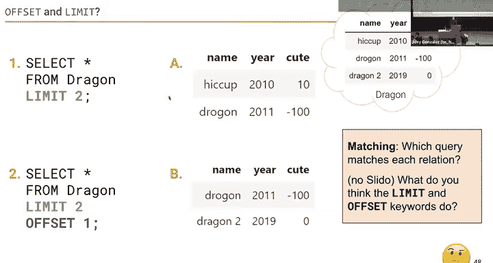

# 课程20：SQL入门与数据库基础 🗄️


在本节课中，我们将学习数据库的基本概念以及如何使用SQL（结构化查询语言）与数据库进行交互。我们将从为什么使用数据库开始，逐步介绍SQL的基础语法，包括如何连接数据库、查询数据以及理解数据的组织方式。

---

## 概述：为什么使用数据库？

在之前的课程中，我们主要使用Pandas处理本地文件（如CSV、JSON），并将其转换为DataFrame进行分析。这种方法适用于数据量较小（例如几百GB以内）、静态且结构化的场景。然而，在现实世界中，数据通常存储在专业的数据库管理系统中，这些系统具有以下优势：

*   **可靠性高**：设计用于容错和冗余，确保数据不丢失。
*   **计算能力强**：可以处理远超单机内存容量的海量数据。
*   **性能优异**：使用专门的数据结构和优化技术，查询速度快。
*   **组织性与安全性好**：数据以结构化的表形式存储，可以设置访问权限和数据约束，保证数据质量和安全。
*   **支持事务**：对于关键业务系统，能保证一系列操作的原子性（要么全部成功，要么全部失败）。

作为数据科学家，我们通常不与直接支撑业务运行的“事务型数据库”交互，而是与存储历史快照的“数据仓库”或“数据湖”交互。这些系统大多使用**SQL**作为查询语言。

---

## 连接数据库与基础查询

我们将使用 `duckdb` 和 Jupyter Notebook 的 `%sql` 魔法命令来学习SQL。以下是连接数据库并执行第一个查询的步骤。

### 1. 设置SQL环境

首先，在Jupyter Notebook中加载SQL模块并连接到数据库文件。

```python
# 加载SQL魔法模块
%load_ext sql

# 连接到本地的duckdb数据库文件，并为其设置一个别名‘duck’
%sql duckdb:///data/example_duck.db --alias duck
```

### 2. 执行基础SELECT查询

连接成功后，我们可以使用 `%%sql`（双百分号用于多行）开始编写SQL查询。最基本的查询是选择表中的所有数据。

```sql
%%sql
SELECT *
FROM dragon;
```

*   **`SELECT *`**： 表示选择所有列。
*   **`FROM dragon`**： 指定要从名为 `dragon` 的表中获取数据。
*   **分号 `;`**： 标志着一个SQL语句的结束。

执行上述代码将返回 `dragon` 表中的所有行和列。

### 3. 选择特定列与列别名

我们可以指定只获取某些列，并可以使用 `AS` 关键字为列设置一个更易读的别名。

```sql
%%sql
SELECT
    name,
    cute AS cuteness,  -- 将‘cute’列重命名为‘cuteness’
    year AS birth_year -- 将‘year’列重命名为‘birth_year’
FROM dragon;
```

### 4. 使用纯Python执行SQL

除了魔法命令，你也可以使用 `sqlalchemy` 和 `pandas` 库来执行SQL查询并直接获取DataFrame。

```python
import pandas as pd
from sqlalchemy import create_engine

# 创建数据库引擎
engine = create_engine('duckdb:///data/example_duck.db')

# 编写SQL查询字符串
query = """
SELECT name, year
FROM dragon
WHERE cute > 0;
"""

# 执行查询并获取DataFrame
df = pd.read_sql(query, engine)
print(df.head())
```

---

## 理解数据组织：表与模式（Schema）

在SQL数据库中，数据存储在**表（Tables）**中，也称为关系（Relations）。每个表都有一个定义其结构的**模式（Schema）**。

### 什么是模式（Schema）？

模式描述了：
*   **表名**
*   **列名**（也称为属性或字段）
*   **每列的数据类型**（如整数、文本、日期）
*   **约束**（如主键、非空、取值范围）

例如，`dragon` 表的创建语句可能如下所示，它定义了表的结构和约束：

```sql
CREATE TABLE dragon (
    name TEXT PRIMARY KEY,      -- ‘name’列是文本类型，并设为主键（唯一标识符）
    year INTEGER CHECK (year >= 2000), -- ‘year’列是整数，且必须大于等于2000
    cute INTEGER                -- ‘cute’列是整数
);
```

### 如何查看数据库模式？

不同的数据库系统查看模式的方式略有不同。对于 `duckdb`，可以查询其系统表：

```sql
%%sql
-- 查看数据库中有哪些表
SELECT table_name
FROM information_schema.tables
WHERE table_schema = 'main';

-- 查看特定表（如dragon）的列信息
SELECT column_name, data_type, is_nullable
FROM information_schema.columns
WHERE table_name = 'dragon';
```

使用 `sqlalchemy` 的 `inspect` 函数可以跨数据库地获取模式信息：

```python
from sqlalchemy import inspect

inspector = inspect(engine)
# 获取所有表名
table_names = inspector.get_table_names()
print("Tables:", table_names)

# 获取‘dragon’表的列详情
columns = inspector.get_columns('dragon')
for col in columns:
    print(col['name'], col['type'])
```

---

## 过滤、排序与限制结果

上一节我们介绍了如何选择数据，本节中我们来看看如何对查询结果进行筛选、排序和数量限制。

### 1. 使用 WHERE 子句过滤行

`WHERE` 子句用于指定条件，只返回满足条件的行。它类似于 Pandas 中的布尔索引。

```sql
%%sql
SELECT name, year
FROM dragon
WHERE cute > 0; -- 只选择‘cute’值大于0的行
```

`WHERE` 子句支持使用 `AND`、`OR` 来组合多个条件，并使用 `IN` 来匹配一组值。

```sql
%%sql
-- 选择名字为‘Puff’或‘Hiccup’，并且年份晚于2013年的龙
SELECT name, year
FROM dragon
WHERE name IN ('Puff', 'Hiccup')
  AND year > 2013;
```

**重要提示**：在SQL中，**字符串值必须用单引号**（`'`）括起来，而**列别名若包含空格或特殊字符，则需用双引号**（`"`）括起来。

### 2. 处理空值（NULL）

在SQL中，判断是否为NULL不能使用 `=` 或 `!=`，而必须使用 `IS NULL` 或 `IS NOT NULL`。

```sql
%%sql
SELECT name
FROM dragon
WHERE cute IS NOT NULL; -- 选择‘cute’列不为空的行
```

### 3. 使用 ORDER BY 排序结果

默认情况下，查询返回的行顺序是**不确定的**（由数据库优化决定）。要确保特定的顺序，必须使用 `ORDER BY` 子句。

```sql
%%sql
SELECT name, year, cute
FROM dragon
ORDER BY cute DESC; -- 按‘cute’列降序排列
```

可以在 `ORDER BY` 后添加 `ASC`（升序，默认）或 `DESC`（降序）。

### 4. 使用 LIMIT 和 OFFSET 限制返回行数

`LIMIT` 用于限制返回的行数，常与 `ORDER BY` 结合使用以获取“前N个”结果。`OFFSET` 用于跳过指定数量的行，常用于分页。

```sql
%%sql
-- 获取最可爱的3条龙
SELECT name, cute
FROM dragon
ORDER BY cute DESC
LIMIT 3;

-- 跳过前2条，获取接下来的3条（即第3-5条）
SELECT name, cute
FROM dragon
ORDER BY cute DESC
LIMIT 3 OFFSET 2;
```

---

## 总结

本节课中我们一起学习了数据库和SQL的基础知识。我们了解了为什么在真实数据科学工作中需要使用数据库系统，掌握了如何连接数据库并执行简单的 `SELECT` 查询。我们学习了SQL语句的基本结构：`SELECT`（选择列）、`FROM`（指定表）、`WHERE`（过滤行）、`ORDER BY`（排序）以及 `LIMIT`/`OFFSET`（限制结果）。此外，我们还理解了数据是如何通过**模式（Schema）**在表中组织的，包括列的类型和约束（如主键）。



SQL是一种强大且行业通用的数据操作语言。虽然其语法源于上世纪70年代，但至今仍是处理结构化数据的核心工具。在接下来的课程中，我们将学习更复杂的SQL操作，如数据分组、聚合以及多表连接。