# UCB《数据100数据科学原理与技术｜Data 100 Principles and Techniques of Data Science 24SP》中英 - P21：-21-Data 100 Spring 2024 Lecture 21.zh_en - GPT中英字幕课程资源 - BV1Bc2dYCEbc

Great， good morning， everyone。Wow great attendance today for those on Zoom。

 you should come into lecture， it's exciting even though it's rainy the Act lecture hall it's not entirely true。

 but you can't tell so yeah， come to lecture we have an exciting lecture today that is the follow on to SQL so we'll be covering the SQL to SQL and this time I will try to go a little bit faster because I want to cover a bit more syntax than we did last time this will be the end of SQL today so。

😊，That's a shame， but anyways， youll get to enjoy it in lab and homework next week。

 so we're not you're not quite done yet， but I will be。

All right so today we were going to finish the basic queries to select froms and the wares and we I think we left off on limit and order by so I'll talk to those a little bit more and then we'll get to the more interesting stuff。

 grouping and joints， which you already know because you've learned all of these concepts before with data frames so in some sense this will be a review but it will also be new syntax so you'll get to learn that today。

😊，And I would argue actually， we might be able to explain it better and how that you already theoretically have seen join in GroupI before。

 it might actually make more sense this time。Okay， so last lecture kind of rushed at the end there and we got to limit an order by so our SQL commands when to go to code now and we'll come back to probably a lot of lecture for a little bit and then some more code So where do we leave off we had this magic syntax it's literally called magic This is magic2% means I'm running a SQL query in this entire cell。

 this is all SQL because I have these two queries it's doing some kind of syntax highlighting so it's making this easier for me to read this is SQL expression。

 which is saying select all the columns from the table called dragon and I want to limit it to just two rows。

😊。

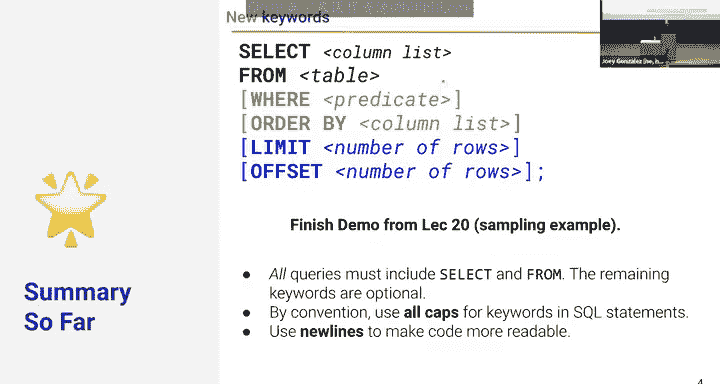

嗯。I know。Gotta do this says I didn't import anything。 it was my first run。

 so let's let's fix that run all above selected cell that's good idea。

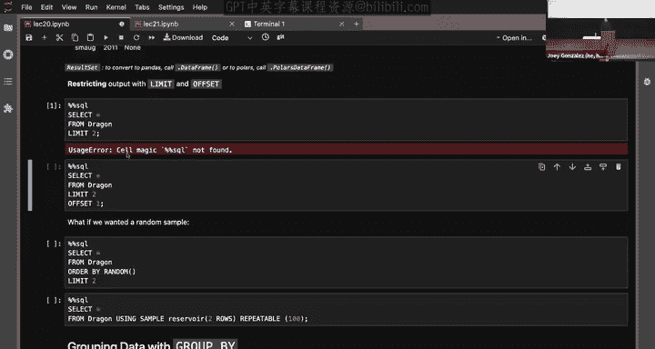

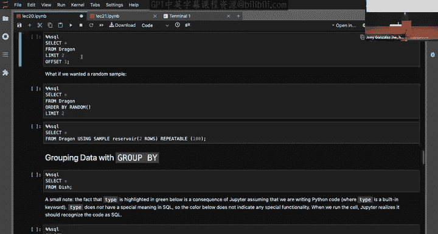

狗狗狗。I'm using dark mode， that is a theme that you guys can change theme dark is dark better for lecture or light would you all once dark？

Who one's late， whoa， okay。

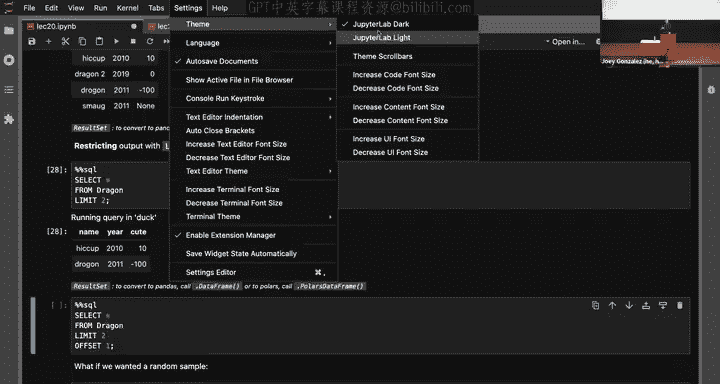

The late has one。Let there be okay， so we have a table which has returned to rows。

 which two rows are return from the do table？Who knows that's sort of where I want to kind of catch up at this point lecture limit it's very useful。

 you'll use it all the time， probably because you go hey， big database。

 I'd like to look at a few rows from all the customers across all of the regions of the world。😊。

And database goes no problem shoots a ton of rows at you and you're like your computer crashes so you go。

 no， I don't want to do that。Give me five limit five right and why do five is one what are the columns what does the data look like I just kind of want to get a taste of it so five rows is fine。

In practice， you want to sample。So maybe you do limit to or there's another another piece of syn syntax。

 so if I say limit two that says give me two rows， if I say limit two offset one that means。

Take the first row， throw it away， offset one， and give me the next two rows。Again。

 which rows kind of up to the database doesn't really have any preference on ordering unless we say something about order so I taught last lecture the order buy syntax。

Let's six should do this here。Let's say order by cute。Now which two's。

The two lowest cute rows in the table Now it's not arbitrary。There's a specific ones。

 the two lowest ones。If they were tied。Maybe have many cute zeroes， it's kind of arbitrary again。

So didn't I didn't say what the remaining comms how to order them， so it would be arbitrary。

 but you know since there's only one of cuteness zero and one of cuteness 10。

There's exactly one result of this cr will return those two rows。We did offset  one。

 Let's go to that offset。 So these are that was the technically。

 we dropped the most cute that was dropped from the table。 and we took the next two cutest。

 the most cute。I don't know if cute is a negative thing all right the least cute since we did it in ascending order is dragon Dr at a negative 100 What if I wanted the most cute。

 I'd say what this in descending order。Now I get the two cutest， there we go。

 Puff is the cutest and hiccup is an order of magnitude less cute， but still cute。All right。

 so that was our syntax for for for for getting。A collection of rows that are ordered。

 And then we took two。 again， a lot of you will do the following ago limit。

 probably most will will do this limit 10。 there only。Five rows in the table。

 but you know if there's billion rows，10，1s good enough to get a sense of what's going on。

 this is not a sample。How do I get a sample I want a simple random sample concept in this class。

 Here's one way to do it that all your database administrators will be very upset about。

 but let's talk through it。 I want to select all the columns from the dragon table word by and I create a new column called random。

😊，It's the item number。And I want limit two。What's that going to do？

You can attach a random number of T row。A lot of compute。

 then it's going to sort all of the rows by that random number， the number of attached each row。

 and it's going to choose the two lowest random numbers。The simple random simple。

Each row these randoms are uniform between zero and1， so just picking a random number。

This is a way to get a sample from my table， it。Limit two， you do limit three。Every time I run this。

 I'll get a different answer sort of。There go， different answers。Right。

Why am I teaching this Well first limit 1 thousand0 is not a random sample don't do that unless you have something to give you some randomness in that query the database's intrinsic randomness is terrible randomness it's probably the you know 10000 people that most recently logged into your business so let's use randomness。

😡，Why would our database administrator come yell does for this？

So we haven't talked about how these things run one of the neat things about SQL is we write a command。

We're actually just describing what we want the output to look like。

We're saying there's a random column， I'm going to order buy it。Is up the database for how to do it？

This query， you've said that there's a random number attached to every call to every row。

 and I want to choose the。I want to sort， essentially。

 I want to order by them and choose a top three。A silly database might look at this and go great。

 I need to attach your random number to all 1 billion rows so I'll walk three row make random number that's compute。

 and I need to sort all billion rows， which means I'll move all the data all around the world to get them in the right order so you can take three rows。

😊，So they're like， well did you move all the data all over the world to get to just three rows？Well。

 I needed three rows， so in a random sample。Right。re like well why don't you use something a little bit more intended for this so these database systems often have a way to get a sample DDB has one that I think works in some of the other commercial the big vendors。

Let's walk through it。So is advanced syntax， for this class you can do this， that's fine。

 but when your database administrator yells at you， you'll do something like this。

 so select all the columns。From the Dr table， using the sampling syntax。

And if you look up sampling in your favorite database product that you're using。

 they'll have potentially slightly different effects。

 this one's cool it saying take a reservoir of two rows and construct a sample。

Because beyond the scope of this class， we once tried to teach this。

 but there's an algorithm that you can do that just walks over the data once and when it's done it goes I have two randomly chosen rows from that table from a simple random sample。

It's a cool probability algorithm where you take a sample and each time there's a decreasing chance you'll take the next row and put it in your pool of two and every time you put it in your pool of two。

 you throw away one from your pool of two。So I do a pull of three， maybe three rows。Repeatable。

This is my seed。So I do again， it's going to get the same number each time。

But I like a different seed。So I get the same， I get a different same number each time。

 so it makes it so I can reproduce this query。We're seeing it。All right， so somewhat advanced syntax。

 but good to know so takeaway from this is。Limit 10 could be arbitrary。

 think about the order of the rose。Once youve thought about the order。

 if you really want to sample the purpose of this class， generate a random number and order by it。

 if you're in a bigger situation， maybe use a more sophisticated technique。In general。

 you will use limit， you will use it in the homeworks。

 you'll use it in the labs whenever you work the database。

 you will use limit one important caveat because it's so important not to suck down all billion rows when you use these SQL magic commands。

It automatically does limit for you。So I don't do anything。I just dropped this， let's oh。

 how do I comment dash， that's comment。So that's just taking all the rows， if there were more rows。

 let's do it from iddle。This is my MDB thing。Oh， I haven't imported I D B。What did you wrong。好。

Maybe I not I've not included on DB yet。 that's not we're in lecture 20。

 Okay apologies we'll see it in the next lecture or have a different table yeah so if I pull a really large table in and this will be a potential place where you make mistakes and homework by default it will show you only 10 rows you can change the the SQL magic settings to show you more rows if you want but the default behavior is 10 I think for the homework we might make it 15 so when we say hey just give us 10 rows。

 you don't I got 10 rows that's because the I didn't show you and you forgot data limit。

So you repeat that one more time， I went fast。You should use the limit statement when we say， hey。

 give us 10 rows， probably say hey the top 10 for example。

 so you should use an order by and the limit statement because there's a high chance you might pull a lot of data in general。

 most of these platforms will prevent you from doing that by imposing a limit by default。

Which you can configure。对。Was was fast， any questions， yeah？Yeah， so this is setting a seed。

I'm going to explain this a couple time， so let me do it here too as well。

When we use randomness in anything we do in data science， we want things to be a random sample。

But we wanted to be the same random samples， and we go do our experiment again。

 we could double check that we got the same result each time。

So we use pseudo random number generators where we pick a seed， we pick a number。

 my favorite number is 42， you pick a number and you might change it and if you run the experiment again。

 okay I'm going to change it to 64， pick an arbitrary number。

 that number determines the sequence of random numbers from then on。And so by choosing that number。

 every time I run that sequence of steps in that order， I'll get the same outcome。😡，It's random。

But it's deterministic。Makes sense， they are called pseudo andmerium， pseudo。

 random number generators because they are not actually random。They're very complex sequences。

 they're deterministic sequences determined by the seat。Good。

I't remember if I was going to go straight to groupby？Yeah， let's do it in the slides Okay。

 so that was the end of the limits and order by now we'll go into grouping。Which should be familiar。

So here's my table dish。I mean by the way this is all unfortunately from lecture 20 that I didn't get to so these slides are in the end of that lecture and I'm going to use a notebook from that lecture for the remainder of group by and having but so I have this table dish right here my table should have labeled it dish and suppose I wanted to know like what are the distinct types of entrees maybe what's the average cost for each kind of entree and panda data frames we'd say group by entree and maybe take the average of the cost column so let's talk about how to do that using SQL。

So I'm going to group by the entree here by the study by the type。Different kinds of meals。

 So entree appetizer or dessert。So the syntax for group by is get this group by type。

 you need a space here，'s a space。confusingcusing there's lots of space and you know。

 SequL supposed to be English like。The original original definition so here I'm going to group by type so group by here。

 this piece right here is the column or set of columns so I could have group by。宁。And type。

That's just like in pandas， we would give a list of things we want to group on。

 but here I'm just grouping by type。We're just going to do type。Clean up the side a little bit。

And what does that mean that's clustering my table into groups。

 so it's breaking the table into this group？This group。This group。

And now I just projected just selected the type column， so I brought the type column here。

 and I have now just the distinct values of that type。

The only columns that I can write just the column name over here are columns I've mentioned in the group by。

So it would not be okay， I cannot write costs。This is bad。Why is that that。Well， what cost do I put？

You chose entree， which cost do I put this one， this one， this one， I don't know。So you can only put。

Comes like this on their own。If I want to do something like cost。

 I could do something like the average。Of course， that's okay， and we'll see that in a moment。

So the important thing to know about group by is I put my column or columns here and only the columns or columns here can go on their own without something around them up here。

One of the reasons I do not like SQL light is SQL light says。That's that's silly。

 I will let you do this。You can write cost there。Cool。And was it due？

Yeah this is good this is good this is good so it basically just picks one arbitrary I think it picks the first if you had really wanted to do that you could have said something like I went the first。

Capitalze it first。Co。So let's keep going this syntax here。

So you already understand what a groupai does it's pulling。Enre appetizer at dessert， puts them here。

You'll notice it's in sorted order， is it in sorted order， that's not technically guaranteed。

Database systems have a choice in how they want to do what they do and they make no promises about the order of the results unless you say order by。

Often database systems will go， you know what， I'm going to group this by sorting on that column first。

 I can just walk that sorted list and go okay。Entree。

 that's the first group entree is the same entree saying oh no next group appetizer。

 same same up next group dessert。So it may come out sorted， it may not。Again。

 out of scope of this class， it might do something like cashching。

They figure out how to build the groups。UpUp to the system。It's kind of magic。All right。

 so already mentioned this earlier。So here I'm gonna group by dish and I could take the sum of cost and there's a bunch of aggregate functions you can use all your favorite max sum average first is pretty useful if youre like I wanted to group I I'm sure that you know you'll see this in homework I'm sure that the actor's ID and the actor's name or by group by actor ID the actor name should be the same Z I should be able to mention the actor name is one actor name for one actor ID but technically the actor could have changed your names they could have actor ID1 and it's Bob and later movie they're called Robert So which name do you use maybe you just choose the first one that you come across。

So you need to think about either grouping。If I really want to put I really， really。

 really want cost up here， so I just want to write cost， then I got to added it down here， cost。

So I call them I can put cost up here。It' the only way to do it。Without aggregating at first。

Just once more， I want to say this because maybe didn't come across with pandas when I define one of these functions like some。

And I apply it to a column like cost。What I'm saying is take all of the things in the group and compute the aggregate。

 the sum of them。If I had said first。Of cost。So take the first thing in the group。

Which is a little bit where I'd have to set an ordering first， so what's the order of my rose。Okay。

Questions。对。Oh great so I used to have a rant that would waste like 15 minutes。

 I'll make it like one or two minutes SQL is a declarative programming language， what does that mean？

😊，That means， and I said this briefly a moment ago。

 that you don't technically tell the database what to do。You just tell it what you want。

You don't say I want you to sort the rows and then I want you to filter this and then I want you to sort it again and then I would like you to group it by this and pan as we do that right so we say do this。

Do this。 Do this。Technically in SQL， we're saying。I want these columns。From this table。

Or are grouped in this way。And it can choose you to what first， I'm going to load the table。

Maybe then I'll just pick the columns。And then I'm going to go ahead and do the grouping。Actually。

 it's probably a good idea because I'll do less work if I only have the comms that I needed when I'm doing the grouping so it's up to the database。

 the engine to figure out how to do this and this is where you will suffer struggle a little bit because each engine has its own peculiarities。

 you're going to write queries that are。Hundreds of lines long。

 and I'll show you how to do that in a moment where you'll build like a temporary table。

 another temporary table I join these two tables to get this new table。

 which I'm going to feed into this other query。They was going look at all of that and go。

 you know what， I'm going to do it this way。And it's the slowest way possible。Ofse。

 I don't know that， I think it's the fastest way possible， but I have bugs。And you go。

 why is this taking forever and the database administrator will go， he， I know what you did？

See that that's joined there if you joined on the ID instead of the name that would have gone way past。

 and there's a trick that I will briefly show you that you can look in to see what did the database decide to actually do when you gave it the  query you gave it。

All， so sort of the end of the ant punchline。In these declarative programming languages like SQL。

 you are describing the outcome you want and allowing the system to use all its brilliance and magic to somehow do it faster。

Many times it will be faster， it will be faster than what you can do in pendas， it will scale。

 it'll be amazing。Sometimes it'll be slow and obnoxious and you'll have to dig into why and you'll have to get someone who managed that system to maybe change the way it was structured or slightly modify what you're asking the database to do。

Its a shorter version there ran， any questions？Yeah， so the database system will take this string。

 this program you've written in SQL， it will read it。😡，It will go okay。

It will actually build a query plan， a logical and then physical set of steps that it will actually then execute。

 and then it will spin up hundreds of cores across regions of the world to then try to make that happen。

And that will involve sorting， shuffling， hashing， loading data from different sources。

 moving data around， none of which you you said anything about you just said I wanted a table with these rows and that is the magic of these systems。

Clative program language。Yes， we declare our end result。

 that's the goal here system does it one point of order here。So I said you declare what you want。

 but the way you declare it has some order to it， and that's just a syntactic order。

 the database with the language you'd like you to say select first and then what you want to select and then from and then where and then go by and then having and then order by and then limit and there's other things but those the ones we carbon this class。

Changing the order in which you write those。Some systems go yeah， that's cool。

 some systems like nope， we just want it in that order。

The actual system itself often does something like it actually runs the from piece first then does the join then the where。

 sometimes a select happens before this， sometimes it happens later。

 the actual ordering of things can be vastly different than the order that you write it in the SQL query。

But you should write this SQL query in this order， select from where loop by having order by limit。

Good。slide okay。Mable aggregates just as one more demo of the group by。

So I said you could do one aggregate here I've group by type from D， and I've set some min and max。

That generates my table。With some。When are you looking columns， huh？How would I fix that。

 I don't like those column namess。Yeah。Aliasing， right， so we did cover this last time， I'd say as。

As。Some costs， maybe， I don't know。Maybe I put another as here。As。明。Ot。And。

And remember I said this funny thing we can have coded name is so cool。Aim。Don't do this though。

You can， but don't。食裤。So Ailes。Great， so this is great。

 so now I can do all sorts of aggregations at once。Pandas this was kind of hard actually。

 it it looked ugly。This intax is somewhat easier to actually do group by。

 so it's just what I want to group by and then what I want to do with each of my groups and the thing that I actually group by。

 I don't have to put it inside of an aggregate function。Okay， some side notes。

 one of the really commonly used functions is count。对。If I count cute。It不 here。

So if I count cute it will ignore the the null rows。

 but if I do count star it will actually include the null rows so where Q is null by count to cute you can't null doesn't add to the count so if null is like adding plus zero but if I count star I also include the counts of the null entries。

It includes the Nll rows as well。Cot again， is just it's equivalent of size and goodbye。

Yeah and I said this quickly at the end of the last lecture， nullness is funny。

 so databases really allow you to have null， you can have anything can be null and null behaves funny in math like null doesn't equal null。

But no is no。So you can't use arithmetic operations on null and database systems have some nuances in how they handle like is null greater than null or is null less than null and you can look up the behavior of null or the system you're using。

Okay， so be aware of the nullles。All right， I think this is a good recap。

 so let's just very quickly go through everything， so this is what we've covered so far。

And then in this order， so select from where group by order by， limit and offset。Good。

Invention is all caps again you don't have to， but we prefer to yell in databases， use new lines。

 make your code readable， you don't have to put this in new lines。

 you can make it one very long query on one very long row。

Don't do that we talk about the as as a way to alias， so as keyword let's me alias columns。

We talked about expressions for aggregation。All right， so in pandas。

 we also had this concept of filter， what did filter do？

So the wear function is kind of like a filter， but that filters the rows and the table。

The filter function in pandas。Filtered the groups， it was a function on the groups。So in SQL。

 we have a thing called having。Which keeps only the groups that match the condition of having。

So what does that look like？So I select my column。So columns。From table。

Group by so my grouping column。 and the having is a condition applied across the group。

 whether or not I keep that group， a picture of this。 So let's execute this query where I've said。

 select all the columns。From the dish table where the row had cost greater than four。

 grouping by the type。And taking the max。Cost of the group。If that is less than 10。

 I want to keep that group。Nice animation of this。So first I applied to where。

 at least you should think logically the where is done first。

 so that's going to take out these rows they're gone my table because they had a cost。Greater than4。

Sorry， it had a cost less than four and it went cost greater than four can I read so I've blocked out these rows here so those are gone。

Then I'd said group by type， so this is my first group。This is my second group。And then I said。

 having。Max cost less than 10 Well， this group， the max cost is what？13。Okay。

 so I don't get to include this group， it is not included in my final set of groups。

 so what is the final answer？Just as one。That's all that anchor。Just a slido。Wch is a slider okay。

 great， right， so have a query for you select。😊，Type and then the max of the name。

 no when we're doing that， but okay， from the dish dietary， that's this table over here。Where notes。

 is its gluten free， I dont believe that's what Gf stands for。

So gluten free and then group by pipepe。Having max cost。Less than or equal to seven。

So there's a bunch of options。We'll leave this up for a second， think about it。

A little bit easier to read。Hopefully the slido。Can you read this？

When you go to the slideo on your phones， you can see this， right？We're good。All right。

How are we doing？What is the answer？All right， let's see what people said。Past your votes。AD。

So I can't really read it， clearly so D is the right answer。

Let's try to understand why D is the right answer。 Well don't change your votes。That's not even fun。

I think it's worked out here， okay？All right， were good1 well let I won't animate through it let's just walk through it。

 Okay， so let's let's execute this query。I will I'm going to use this to execute queries here's how I do it。

 I'm going to figure which table So from that stuff was easy we know what's going on here it's dietary dish I want type。

And Max name， so it may only be two columns。All these have two columns okay， well note this one。

 nine one's gone， so I need two things my output。Okay， where I mean this this is a bug。

 there should be just one equals there where notes equalsoo free。All right， so I just。

 I drop all of these，hu， this is gone， this is gone。Sone， goneone， is that's my table looks like now。

 I'm going to group by type， How many types are there。There's this one。And then there's this group。

Okay， so we did where and we did group by and we did select。

 And then I want the group having max cost less than7。Li's than equal to 7。So that's。

Both groups make it， right？So both groups make it， that was kind of a silly having clause。

 but' go with it， and then I wanted the max of the name。

So what's the max the name so name is taco that's definitely the max so taco better in one of the answers and then。

Rise is the second one。Okay so I got fries， so these are the two rows。

So I want fries and taco and entree and appetizer Okay good so appetizer。Is fries。

 so that's this row here， risees。诶。And entree。The other group and then the name is taco so this is the correct answer。

So was there any dead giveaways， so Max none？That didn't make sense。

 probably could have figured out when I was just looking at this part here。嗯。The rest have to think。

 oh， yeah， so this one。Its got。呃。This one down here。

I don't know if I could have ruled that out easily。嗯。Yeah， so this is definitely the right answer。

And we could show it， these were easy to maybe eliminate early and then the rest that had to actually work the rest of the were。

啊。Russians。You'll get lots of practice with this story。

Those select these you know this animation was much better than mine okay oh you can walk through the slides and have preier graphics。

Okay， so we have now finished having rolling right along， which is good。

It says do EDA and SQL all right so let's walk through some stuff that we can actually do because you can do all of your analysis you could run this entire class in SQL in fact someone saw that we had switched this class to DD and commented on GitHub are we swapping the class we getting rid a pandas so yeah we should do that。

But not yet， so you're going to continue learning pandas but for today and for next week when you do the homework you you're going to do everything in SQL。

 so let's do some of this EDA and SQL。So we're going to play at the table actually play at a couple tables in the homework。

 you're going to work with this IMDB data set。We had to shrink it down for grading purposes because the great infrastructure can handle the full file。

 so you're going to play a sample of the IMDB dataset set。

 but for lecture I posted the full IMDB data and so the notebook that you if you look at the lecture notebook you can play with it and this is basically the ratings。

 votes and all the movies and IMDB for all the movies。

 actors and the roles and we can ask all sorts of crazy questions about film throughout time。😊。

What do I do in the beginning， I do select star from title limit10。

15 I don't know what I chose here just give me a little picture of what's in this table。

 this is you know what's in the table。哎。It has a lot of interesting information the type of。

The title type， the primary title， which is probably to title the movie。 I don't。

 I didn't use original title， but there's a original title is adult。 I didn't mess with that。

 You can when the the movie aired the length of the movie。Gs。

We'll use this information to ask interesting questions about movies。Right。

 one thing that you do a lot of in EDA is working with text data。

The nice thing about databases is that most the other data is probably already hopefully well structured so you have votes should be numbers。

 there're probably encode as numbers， there may be constraints that say you can't have negative votes and so on。

But you will run into situations like this。Where someone decided to put a list of things as a string in your database。

And you're like， I want to figure out。Where are the action movies because I just care about action。

 so I want to find the things that contain the string action。The substr action。

 I want all the genres that have that。So SQL has some ways to do it。哎。

By the simplest way is the like expressions。 you can say column name， a string column， like。

 And then you give it a string。 noticeice that it's a single quotes here。 So single。Quote。

 very important。Single quote， and then have some funky syntax going here have percent percent。

SQL decided to invent its own regular expression language。

 So you get to learn another regular expression language。 Good news， it's really limited。

 So there's two characters， there's percent look for any character any number of times。

 it's like just whatever， whatever before Star Wars and whatever after Star Wars take that one。😊。

If you have Star Wars basically anywhere in this string， it's a match。It's true。

It also has the match just one character， so I went just Star Wars episode。I get one number， we one。

 two， three， four， that's a match or any single character there is a match。

 it's a wild card character。So two pieces of syntax。This guy match anything any number of times。

Match anything once。But we spent all this time learning red Xs and most modern databases said that's probably where everyone is today。

 so they added syntax called similar to， which instead of like you just write similar to and then you use everything we already taught you to write all sorts of crazy regular expressions in your database。

So you have choices now。You can use Regx light， this very basic stuff。

 which is probably good enough for simple things， or you can go get Regx 101 and write all sorts of crazy regular expressions and the only difference is whether or not you choose to use like or similar to。

Who comes up with this synt？I have no idea。It's ridiculous。But that's what it is。

You get to choose like or similar to。How will we use this？Oh we used it already right up right here。

 so I want to find all the titles。Have。Star Wars somewhere in the title。

Let's actually do that because it's hilarious。How many you think have Star Wars somewhere the title？

All right， so let's bring in another database。And this time。

 I'm going to set the display limit to 100。I want to see up to 100 rows， don't limit it to 10。

I're going to connect to that toy database from before alias is basic and I'm going to this is complicated code you don't need to know。

 but we made it so that in theory you can run this notebook in the hub or even on your computer and it will pull the entire IMDB database in。

All， I'm going to connect to the IMDB engine and read only mode because it's a big file and I don't want people messing with it。

And let's take a sample of 10 rows from this table so what's going on here。

 so I'm going to select title from selecting everything from the title table order by random well so we'm going to take 10 random rows limit 10 here I'm setting the seed to 0。

42 and sec when you use the the set seed operation you have to select set seed and then a floating point number between zero and1。

So this gives me1 random rows， I could do 50 random rows。50 NOs， you time run this。

 they'll get a different set， gives you kind of a sense of the movies。

 pretty broad range of dates that I think go back to early 1900s。

Let's do this fun query about Star Wars。All right， so I want title type， primary title from title。

Where' a primary title。Is like Star Wars。Here we go。There are a lot of Star War films。It's going。

If ESPN even has a sty Wars film。And we actually had to stop there， so it ran out of space。

 could have kept going， but a trunket hit 100 rows。So there's a lot of data。

 it's a two gigabyte file on just movie names， so lots of movies look at lots of data around them。嗯。

So that was one example of working with text。 So here we use the the like。Pcent no。

 the percent wild character。I love our character。And let's do the red X version。Okay。

 so same as before， but where primary title is similar to the regular expression that you already know。

Same thing， same result。It's too any。Limit 5。被告 just by。啊。Any questions or。

 let's do this other wild card character。 So what will this do。

 Harry Potter and the Deathly Hols part。Who knows the answer to this， how many rows will this return？

意思。Two， part one， part two。When will part three come out？不用。嗯。Yep。

 so this only matched if we did part one part two， curious what happens when I do percent any guesses。

Oh， there are only two matches anyways。I we， yeah， we'll stop there。Let's go back to slides。

Can't get too distracted。 Okay， Ca， that's the next useful thing。

 So cast this expression right here lets me convert types。

 It's similar doing the as types operations and pandas right can change the type of a column。

Why might I cast something sometimes people encode numbers inside of their string。

 there are string functions to pull out the the thing that matches a specific pattern。

 you can look up the the depending on your database vendor。

 the kinds of functions you can use up here to extract stuff， but you can compose those。

 pull the number out and cast it to an integer， for example。

You can do all the fun stuff we do in class with pandas using these kinds of functions in the previous cuts of this class you needed CA to do the homework because SQL light didn't handle numbers correctly I don't know that you need it for the homework this time around but you should know about it anyways way of changing types so this takes this string for example converts it to an end you could convert it to a real number。

You could convert it to a string of our car。Right， and in the previous lecture I gave a list of types。

 but you can also go look up Google docDB types and it'll tell you all the things you could cast to。

Okay， the last cool expression or little piece of syntax is sort of like our if statement。

 so we're going to put this goes into select again this thing here。😊，And I can say， you know。

 under a case。so I say case when and this is a condition on the column。

And then the value I want it to return， which could be the value of the column。

 the function of the value of the column， or could be like three， could just put a constant there。

So its sort of like if the column is this， then output you know for this。

 this whole thing produces a new column。So you could say this whole thing and do as。嗯。Com。

So when some condition is met， new columns should be three， when another condition is met。

 then new column equals you another value。Let me do a conditional statement we have an example of this。

 yeah here we go。Okay， so here's a simple example， I'm going to select title type start year。

 and they're making this whole new column thing here。

You don't need the pre strong to make it easier to read and I'm going to say when start year is less than 1950 then the age will be old。

And when start year is less than 2000。Mid aged middle aged， I don't know。

 then the movie age should be mid aged and otherwise else。It'll just be new。If then else。

 in a select statement。This all occurs within dyslexia。

And I could use this in a where clause down here， it' say where。唔咪。Age。Equals。有。Messed up， no。

One quote， new。Another one quote。All right， questions。How was slido questions， all good。W。Let' sleep。

An example。No， let's keep going， because I don't get by。

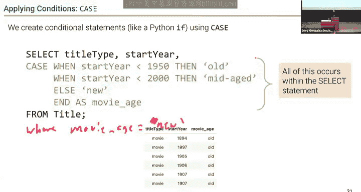

Oh interludeed great so we have a short break everyone can stretch as was told in last lecture people went a little bit of a break。

 we'll try to do a few minute break and you can debate the finer points of how to write SQL none of these this is correct this is wrong this is wrong。

😊，We'll take a break， stretch， stand up。Someone stands up so it feels less awkward when someone else stands up。

 there you go， yeah。Stretch。Has it been three minutes？

I should use a timer or something in the future。Yes， it's been three minutes， it's exciting。

 let's keep going。We shall do something fun， we shall all join。

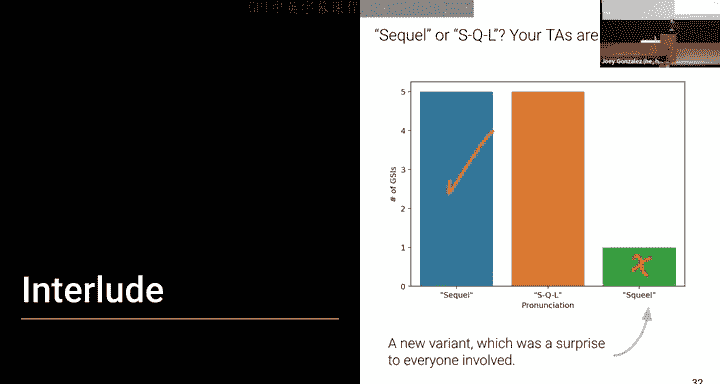

It'sJo time。Joins， why't you join me while we do some table joining。 it's not that funny。 Al right。

 so joins。You've seen this already too。And in pen， as it was called。

Merge which is ridiculous pandas also has a join operation which does join I don't know what they were thinking of pandas join is the common term for bringing bringing things together in databases you will be doing tons of joining and that is an artifact of how data is organized in database systems and there's a reason for it you will come to a database and you go why are there 50 tables encoding what should just fit in one totally rational table。

😊，Why does a product have a table that's like the product ID and then the description。

 and then there's another table which is product prices， which has product ID region and then price。

But just put the price with the product。Well， because the product' price could depend on the region。

 okay， we could make two copies of the product， one with each region what each price。

 and that is the thing that database people do not like never copy data， why。You might think， well。

 storage， it's going to cost more to store。But what happens if you change the description of the product？

You' got to change in all the places。So don't copy data， break it apart。

So what could have been written in one giant mini column row， we make many rows。

 perhaps in many tables。And so this pattern。Is probably most represented in these fact and dimension tables。

So these are going to be relationships maybe here's a better picture so we have things like drinks which has a drink ID a name let's say ice sell sweetness we have a thing like toppings another table that describes another set of properties of toppings and then our product composes these tables together so a product has a reference is a foreign key reference the drink ID a primary key a topping ID which references a topping and a store ID where that happens to be sold。

So what again， could have been wholly rational in one giant table for our analytics purposes was split across many tables。

And there's only one thing to be done about it。Join。

And so you will often see much of the work in your database queries is these really crazy joins across lots of tables。

And certainlyly this is also the hardest part of building these systems because it means moving data from all over into one big place in some organized fashion。

 so joins are the heart of these systems， the challenging part of building them and also the thing you'll probably be doing most。

Who made these tables？Yeah， sorry， I've inherited new slides and we have slides about cats。

 which I know nothing about， but so we're going to join some cats with their names I'm guessing these are breeds。

Did you make these tables？Okay。ThisThis is one of these is your cat。好。This one。Okay。

 yeah that's Professor Nory's cat all right so I'm going to try to do this so we have names of cats and they have an ID and then we have breeds of cats in the table T and they also have an ID and I'm going to guess that boots is a Persian cat right so these are two tables I'm going to probably want to put them together for all sorts of reasons this data set which is entirely made up has a few interesting properties that we'll have to deal with there's a cat a per cat。

😊，What kind of cat is that forcott？It's， well， it's cat ID zero and I'm probably going to look over this table to figure out doesn't exist。

Common data anomaly， these keys don't line up。Okay， and then there's this this breed of cat here。

 the Persian cat。She looks like this did not know that。We don't have any cats of that re。

So those are the two kinds of things that have to think about as videojoins when things don't match。

 and the rest of that I I'm going to explain is how we deal with those not matching cases。

So let's join these tables。So the inner join， this is the standard join。

 the join that you probably have the most experience with at this point。

 and that is join these two tables so like we merge。And I'm essentially going to match on ID。

 so in a match， match， match， match。Match match， and then where they match。

 I'm going to pull the name from one and the breed from the other so this will be my output table。

So let's look at this in taxax for this。So the indexax for this is still there excited。There you go。

 okay， so the syntax for this particular query， no。thatAll right。

 so this index for this particular query to do this join on these two tables down here is going to be I'm selecting all the columns from S inner join T。

So my from claw has this little extra piece in it and then on what do I want to join？

S I D equals T I D。More generally， select， pick your whatever columns you want here， table one。

Innerjoin。Table two。This should have been table two， there we go。

 join these two tables and then on what condition？So what do I need to match？

There's another kind of join which is a cross join。

 which is essentially say take all accommodations of all rows， we'll connect them together。

 so select star from cross join。Why would I ever want to do this？I don't know。

 maybe you want to try every topping with every combination of food and make that a new table， maybe？

Could imagine a cross train？What ends up happening？Let's walk through the cross join。

 you don't actually need to do cross join here， you can just do S comma T。That just says。

 just do the cross strike。And then often this is just a convenient syntax instead of writing on。

 I'll just write again， all right， select， I'll do the gap here select。Star。From。Sか T。

And then in my wear clauses。I'll just drop all the things where it didn't match。What is that doing？

It's just like the inner joint， so I take all the rows。

From the cross product and then just drop all the ones where it wasn't a match。

And this is the output of my inner joint。sing a row。Well， we've got truncet at the bottom here。

But there's only three in the match okay yep so this is the cross product if I put a wear clause on this big join。

 then I get just the the tuples where they condition match one thing to think about is that the wear clauses applies after the front。

So logically I've constructed this join， so I've made not one table or not two tables。

 but one big table by joining those two littleer tables and I applied the warehouseclos。

And this is equivalent again， to writing this over here。

Most of the time when I use a database system， this is what I write。

Select something crazy from just a comma B comma C。

 I'll do aliasing which we'll talk about in a moment and then a wear clause that does。

 you know if a matches on key and then B matches on another key and then end B matches C on another key and so on。

 I'll implement my my on expression because I don't like writing innerjo joinin that's a lot of extra characters。

But they are the same and you can choose whatever one you want in fact。

 I think we have both solutions often for the assignments。All right， so those are the basic joins。

And what's interesting about those joints is if there were things that didn't match you don't see them in the answer right so if there was never a match or you know where it was an example apricot or apricot didn't have a breed。

 so apricot was never in the answer。😡，Because it didn't have a match。

Let me tell you a story of when this is a problem。Suppose I join the student IDs for my class with the people who took the exam。

Right。And then they go， okay， well， how did people do？Last it's great， no one got a zero。Why。Well。

 the students who didn't take the exam didn't have a match。And so I did that join。

 those students were just dropped from my table。Good job， class。No one failed to take the exam。

So what do I want to do？I want to keep those students around so I can say no。

 they didn't get a grade for the exam。RightI've actually made this mistake when doing grading long ago and I was like。

 wow， we did really well and then I realized I had dropped all of the students that didn't take the exams and I messed up the grades。

 fixed it， but it was a problem。So how to fix this？There's a left and right joint。

 which are the same thing， one is doing things to the left and one is doing things to the right。

 so we'll just talk about left for a moment。The left joint says。Everything in S shall remain。

If it didn't have a match， make it no。So what does that look like？Jo。Or you give an animation， okay。

 so that's saying。If I find a match， if I don't find a match， I'm just going to say null。

If we do find a match， we'll go ahead and attach。That table。

Those rows to that to the row on the left， this is my left。And it's literally if I say join。

Actually I have it on the next slide。Yeah， so if I say from S。

 this is the left side of this expression， this is the right T's on the right。

 so from let s from S left join T。I say I got matches， matches， but no match。

 and so I have no match right here。No， no， this is no。ど。And then these are the things that did match。

And now the student that didn't take the exam has a noll grade， and I can deal with that。

 maybe use a condition statement， set it to zero。The case。can account for those missing exam grades。

Left joint， what does right join do？Exact same thing。So I just change this to right。And instead。

 if there's no match on the right side， it puts null， it would be null。All down here， right？

It's so the same that SQL A didn't even bother to implement right joint。

 you can't do a right joint in SQL8 they're like you want to do right join， make it left。

Other systems， most systems will just do both for you。Questions。

Do we do left and right joins of penduice？Remember， but you can。Theres join kind in pandas。

 when you say mergege， you can say left merge， right merge instantly when I made this mistake。

 it was in pandas， it was grading， you know， but I had a really fancy notebook to to create the final grades in the first version of data 100。

 and I forgot to set the kind of merge。Drop some students， it was bad。All right。Russians。

You're going。All right， so I'm I'm going to illustrate right join maybe a will Okay， yes。

 so right join， we matched here， this poor row， this Persian doesn't have an animal， so it got old。

Then you might be wondering what if I want noll on both sides？That's last join。

Yeah so how do I deal with these nullles you can do additional processing later for example I might just month the null column so I'll say where name is null and I go what were the breeds that didn't have a name attached to I might do a case statement to transform the nullles I actually don't know I think DDB might have a special expressions that way you set a null automatically to a default value which you could apply as well。

So many ways to deal the nules， it depends on what you want to do next。

The one thing we have taught you is a case statement， you could do a case if this column is null。

 then set it to negative  one， zero。pick what number you want to give for the default。All right。

 so you might be wondering。Left join， right join， can I have both？Full outer joint。

I don't often use this， but it's the same thing as a left and right join at all at once。

 that means if there's a no match， just say noll。So I get an null here， up， the match over here。

 nullles， so I put nullles down here。Basically means that every row and S。And De row and T。

Will at least be once over here。Could could be more if there's more matches。Questions。

Yeah why would I use this， I guess maybe there were students whose name didn't show up in the roster like oh that's not good I got an exam with nobody's name on it I got a name with no no exam that'd be a problem i'm trying to figure out。

😊，So maybe a full outer join is what I should have done。第二的。Oh。Well we return。

 this is surprise for me， I don't know what the slido is asking， but we should try， should we do it。

 open up the slido。What is02， What will be return relation to。You know what that's for？系不。

Proably a typo， okay， in Northern two。Yeah， yeah。Let me think about it too。Todayday。😊，Okay， no。

 it's a new question。Do answer。And now I give it away a no， hey。Well， the answer is a。

 so why is it a？The think through this。So we know it's not old because this join。

 but maybe on the next slide， well I can't let you guys keep answering。Got to answer it， click A。Go。

If you did vote B， you don't have to change it。Unless you're doing this watching and the recording。

 I should fix that， yeah， sure。Okay， how can I， can I go。Can we go。It's re enabled。Oh， okay， well。

 there's no answer。All right， so let's just walk this really quickly so let's see there's null values in C so it can't be C。

 we thought it might be B why might it not why is it not B let's interesting B and A。😊。

what is difference from B？The columns， right？So because I said select everything。

 all the columns will show up and since ID is redundant。

 it gets prefixed with the table name or the alias which we'll explain in a second。

 but in this case the table name so we have T。id and we have S。

I so we're going to get S and TID in the final join。I think they're otherwise the same。过。That was a。

A question。I will improve my slidos sorry let's talk about aliasing joins because you're going want to do this for the homework writing title over and over again gets to be really long。

 especially when table names get long so it is very common to do something like as T and rating as R so that I can do stuff like this。

😊，Below， and I might have other wear clauses where tea。

I don't know movie kind equals or I guess yeah T start year is something so I want to be able to reference these specific columns and if there's any redundancy between these two tables。

 I need to alias it and I need to say you know table name or alias dot column name。

Because if I had just written， yeah， maybe I should do this， what if I do this so I get rid of these？

So I just have t cons equals tcons， but it's true， tcons definitely equals tcons。

It's not a helpful statement， so I need to say that the p cons。

 the title ID for the title matches the title ID for the rating。

So I need this aliasing to address ambiguity in which column' referring to when tables have matching column names。

And that's common because I'm going to often have ID and ID and I'm joining on ID。And again。

 ID equals ID not a helpful statement， so D dot ID and R dot ID I mention it。

So aliasing is done with as you already knew that。But SQLs cool。And people don't like to type。

 and so they also have syntax where you just drop the as。You get this title T。Rating R。

 why did they do that？I don't know。What they do and people do it and you will see this in your code and perhaps you will also drop the as as well。

So this is the same syntax as this or the same result， different syntax。Questions。Let make it。

All right， this is new， sorry VAs， we used to teach this。

 I'm going to teach it again because you should know it。

Common table expressions it's so common they're called CTEs who age you write a CTA I wrote a really long CTE today here's what it looks like。

In fact， life without this would be hard because you'd have to write everything in one giant select statement。

 why would you want to do that？😡，Break your problemm down。You get to write width， so with。

Make up a table name， make a good name， pick something as。

 and then whatever crazy select statement you like。You've made a new table， like a variable。

 make another table name if you like， need a comma here。And you need these parentheses， parentheses。

 comma， another table name。As and then another crazy select statement， what you like？

Now in this final select statement， you've got tables you can use， new tables。😡，Bick your query out。

对。Common table expressions， CTEs。Very， very useful let you think in steps。Finor concern。

Some database engines are not so smart， they go oh cool， thank you for that。

 I will go ahead and do this query。😊，Save that to disk， do this whole thing， save that to disk。

 then do this whole thing。And that might not be very efficient。And so some people go hey。

 why did you do that， you can just write that in one nice clean single select statement to you you should say get a better database real systems will look at this expression。

 sophisticated ones will analyze this whole thing and go you know what I know how to do that I'm going to rewrite that for you and write it way faster。

So for clarity for your future selves and other data scientists you'll have to read your code someday。

 if you're doing something crazy， think about breaking it down into steps。Mix some temperatures。

For those who want to go way beyond the scope of this class？Don't do this in this class， but you can。

 write， recursive。And you can implement crazy software programs using SQL with statements。

Don't do it for this class out of scope way way out of scope。

 but if people want to go dig deep learn about recursion with width and you can do insane stuff I wrote a query here。

That maybe we'll spend a moment to walk through， yeah， let's do it。What is my queryee doing here？

So I've decided to construct the good action movies， so I'm going to select all the columns。

From title。Join rating on title， so I'm connecting the ratings， the titles， this is IDB ratings。

And I once。The genres。They contain the word action and whatever before and after， I don't care。

 it's got the word action in genre。And the average rating is more than seven。

 I thought that was a high score， good movie。And there's been at least 5。

000 votes for that movie on IMDB。Those are the good action movies。Checkuck。😡。

I also want the prolific actors。So I'm going to take the actors so I have the name table。

 the principal is the role that they took I think for the homework we've renamed this table to roll。

Which will make your life a little bit easier instead of trying to guess what principle is。

 but the principle is the role， so i'm going to take the name。And the role。

 and I'm going to join I'm going to take the name ID and the primary name of the actor and the number of times they've taken on a role as roles。

And I join these again， this is an inner join on the name the ID of the name and the ID of the role this roles table connects。

Movies and actors together。And so a actor might have many roles in the role table。

 and I'm just counting all the roles that they've taken。

And I'm only looking at actors because there's producers and other people that I can be considering。

And I'm grouping so I'm counting grouping by both the name ID and the primary name。

 so if an actor changed their name but had the same ID。

 I'll have two different versions of that actor I'm okay with that。So now I have the prolific actors。

 or at least I have the number of roles each actor took attached to them teach the actors。

And now I can join these two tables， I'm going to find， let's say， the good action movies。

Join at the prolific actors， and go back to the principle。

 the roles to figure out which role they took。I'm going to connect the movie。

With the roles as a role with the movie， I'm going to connect the actor with that role。

 so I'm doing a three way joint， it's crazy。And I'm going to choose rating descending。

 so I want the highest rated。And the most roles limit 10 so what actors？They were good actors。

Meaning， they had lots of roles， were by roles， joined with movies， they were good action movies。

And looking at the highest rated combinations， actors in a number of roles。That's a weird query。

I should probably document this because if I read this again the next lecture it'll be confusing this is one of the challenges of SQL and you will experience this if you pick up someone else's SQL query they will look like this or worse and you're like what are you trying to do here？

At least you have an idea that I was trying to find good action movies and maybe prolific actors and I might have written some explanation。

Of what I was trying to accomplish， and then maybe I would try to explain what's going on here with some additional explanation。

 some comments。So that's a real， real kind of query。Let's do some demoing。

We have a few minutes can run that query， actually， it's kind of fun。All right。

 so in the notebook I have all of these oh no。嗯。

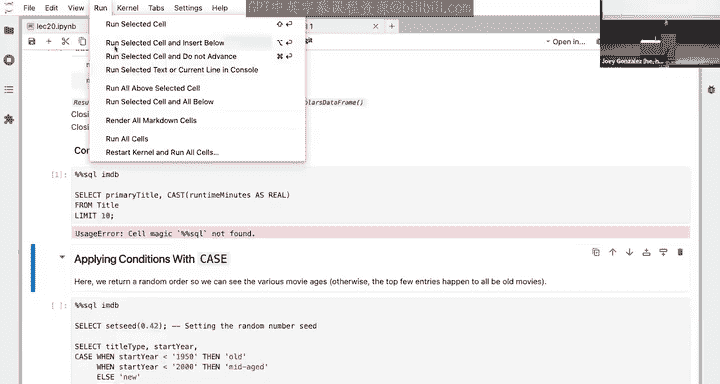

Just restart kernelel。

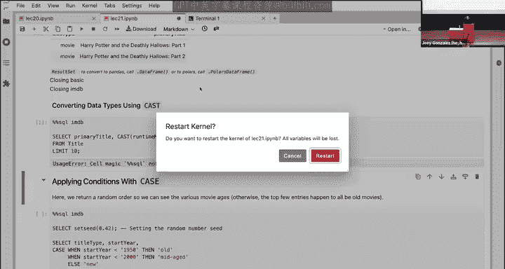

嗯。Run all above selected cell figured。So you can walk through this。

 I have the case statements and all the other interesting queries that we did in the slides i'm not going to show those now because it's not fun。

All the joins are here， you can experiment with the joins in different syntax。

I want to play with actual MDB data so we'll put the MDB data one thing I discovered last night as I was going over my slidesductDB is so commonly used in place of SQLite that they even let you query the SQLite master table and it gives you what inductDB what the actualductDB organization is but looks like a SQLite query so。

So many people switch from SQLite toductDV that you yeah the things that should not work actually work。

All right， so let's go to actually something interesting， I think my query。

Let's do one of these first， let's look at top rated action movies。

right so here's a long select statement， a lot of comms I want to pull out。

 I'm going to join title and rating， so this is going to implement an inner join。

I'm going to alias title is T and rating is R so use the aliasing there this is my my join on clause but I wrote it in where because it's just easier to read so where the title title ID matches the rating ID。

And then I'm going to set the I want to look at movies that had runtime greater than zero and less than 300。

 There's some weird runtime in this database so I'm just going to look at meaningful runtime for movies long in the 300 is a stupid long movie I want to look at the start year is going be greater than zero should be in the 1900s but there's some bugs in the years and we look at movies only not documentaries I want number of votes greater than equal to a000 so I'm looking at many votes for each movie I was just going to look at genre's action and when order by the average rating descending limit 10。

We get。So these are the highest rated movies that had at least a thousand0 votes and non non sense entries。

I've seen who's seen some of these， who's seen this one。

Pro go see it so is one of the highest ratings on IMDB you can check out the actual mid people seem to really like this movie from 1993 just give you an idea what's in the data let's do the CTE that I just wrote so this is the common table expression。

This is the one we just explained， so I have my good action movies， my prolific actors。

Let's see what we get。This takes a little bit longer。

Spreat level midnight right so this is these are each of the the roles of this person so Steve Kral probably played more than one role in this movie might have been a producer and an actor maybe I should put the role up here。

I'm going title the head role。What was it called category？So。Got category。It's going to work。

Yeah producer and actor so Steve Krell played 51 roles in his career。

 which means you could have an actor producer in films d1 times this movie has a very high rating I discretized the ratings here so I rounded them。

Just an example of dec query。Right， not a super andcic。

 one of the things that I hope you all will do is play with this data and find more interesting stuff。

 you will for the homework be asked to find more specific patterns。

Let's actually try to do some real analysis now so how would I actually do data science with with this data so one thing I will often do is i'm going to mix pandas with SQL so I will use SQL to the extent possible to get the data in the form that I need and I'm going to pull that out as a data frame and plug it into my data visualization tools。

This function right here so percent SQL IMDB is saying switch the IMDB database I alias earlier again with SQL magicic。

 you can connect to your enterprise snowflake database and your enterprise I don know Google BigQu database at the same time you can't write queries across them but you can write a  query against this one pull some data down against this one pull some data down and then do the analysis locally and we do that with these alias commands here I'm switching from now on all queries will be against the IMDB database so I don't have to say IMDB each time and I'm setting the configuration for SQL magic it's really called magic to automatically return things in pandas。

Which means when I run this query here， the output of this entire SQL expression will be stuffed into this data frame here that I can play with。

So what is this expression doing this is the same expression I had before。

 so I'm again getting the ratings and looking at top rated movies movie type is movie so not no documentaries and I'm looking for the action genre or sorry no TV shows I'm looking for the action the genre action。

Nothing returning。This is annoying and confusing， but this is just how S magic works when I stuff things into a data frame I don't get any result it's the data frame so now if I look at the pandas data frame。

 this is the actual data frame that I get。Great law。I can now plot this。Just directly。

 takes couple seconds。And I can now look at the rating as a function of time for action movies so I could start to do analysis here this plot is over ploting there's way too much going on so I'd like to build some confidence intervals maybe I'd like to build quantiles I can actually do that again in my database so here I'll use another common tail expression this one makes a little more sense so i'm going make this action movies table which is that other query not reduced to a simple table so now the action movies table。

The whole query is now called this table。And then from that action movies table。

 I went the year the median rating and I'm going to call that the median rating column。

 and I'm use a quantile functions， it's another builtin function。

 there are many functions in these database engines。

 quantile of rating and I want the 25th percentile and the 75th percentile quantiles。

Can run this query？It's doing all the crunching for me。

 calculating these quantiles against the database。I think it's actually done running the query and it says running query so it is done done running up here and now let's look at the table actually what did I make here？

😊，What's this going to have in it？Almost at the time。M。Spence is killing me all right。

 so I have the year the median rating lower quantile number quantiles。Let's run it。What I do？Upper Q。

Did make something。I swear this work before。嗯。Actually not sure why it's not working。这个。

HAnd maybe not debug this， we are out of time。I will post the updated version。

 but you should get quantiles actually。If you were bear with me， no， don't run away yet。Okay。

 fine right away。

I feel I having a book here， yeah， but。I won't run it now， yes I will run all while you're leaving。

Run ourselves。Wait， Ch we tied Reynolds ourselves， go， go， go。

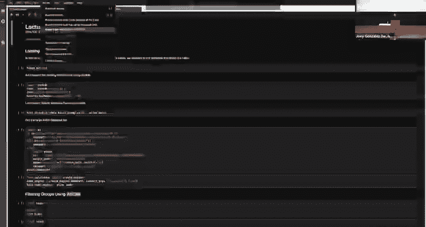

I broke something。

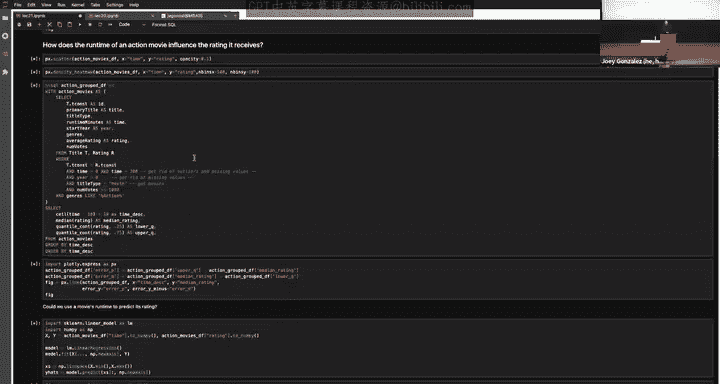

There we go so this would I've gotten before so you can actually see the quants of this plan and we can look at ratings as even involved with time and you might suggest that maybe the median rating has gone down a little bit there were some high points in film and people just thought the films from that era were amazing and then they got lower so you can do all this analysis someday I'll figure I was wrong with some typo in my code that I just added you will get through all this in homework so have fun then and we will see you all next week。

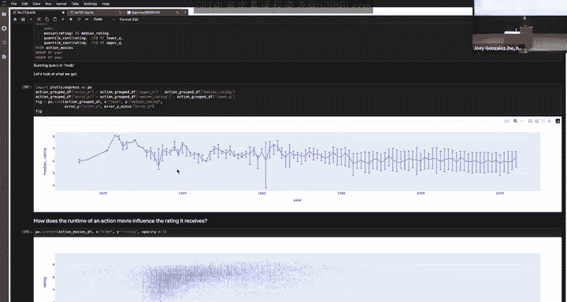

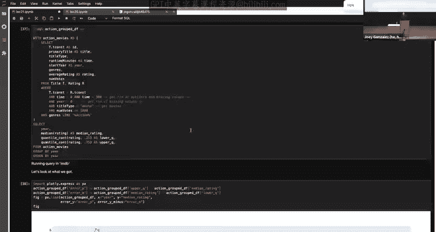

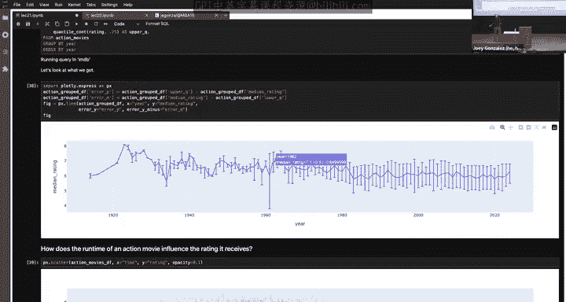

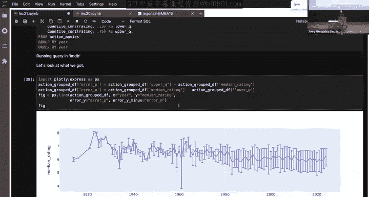

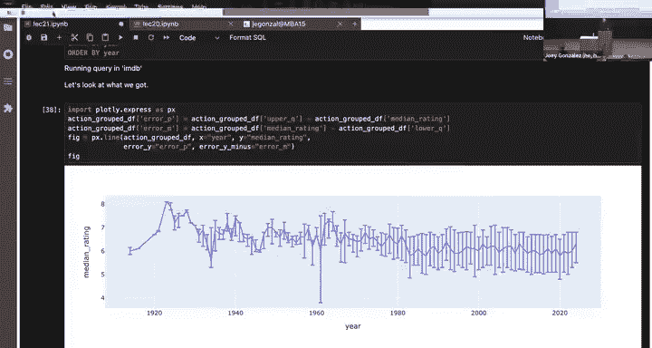

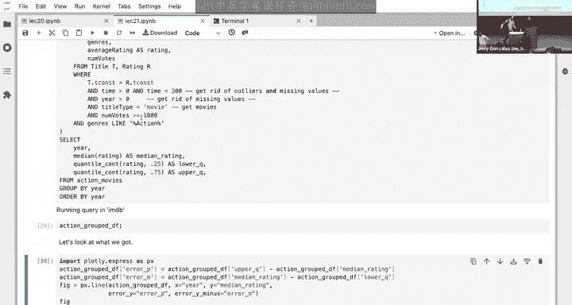