# 课程21：SQL进阶查询与连接 🗄️


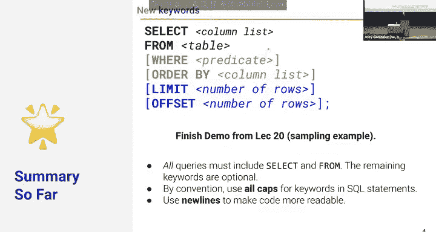

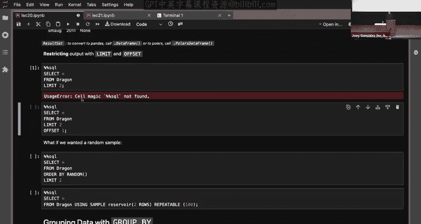

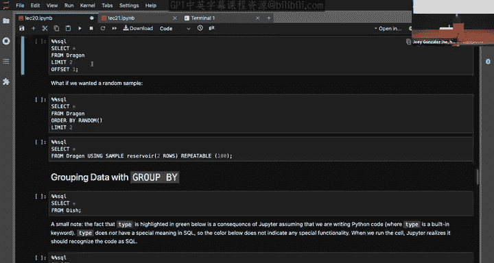

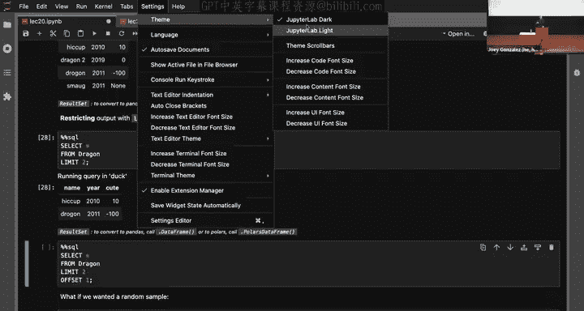

在本节课中，我们将深入学习SQL的进阶查询功能，包括数据分组、聚合函数、连接操作以及如何编写复杂的查询语句。这些技能对于从数据库中高效提取和分析信息至关重要。

## 概述

上一节我们介绍了SQL的基本查询语法，如`SELECT`、`FROM`、`WHERE`、`LIMIT`和`ORDER BY`。本节中，我们将重点探讨如何使用`GROUP BY`进行数据分组，以及如何通过`JOIN`操作将多个表的数据关联起来。这些概念与我们在Pandas数据框中学习过的分组和合并操作类似，但语法有所不同。

## 分组与聚合

`GROUP BY`语句用于将数据行根据一个或多个列的值进行分组，然后对每个组应用聚合函数（如`SUM`、`AVG`、`MAX`、`MIN`、`COUNT`）。

以下是`GROUP BY`的基本语法结构：
```sql
SELECT column1, AGG_FUNC(column2)
FROM table_name
WHERE condition
GROUP BY column1;
```

**核心概念**：
*   只能将出现在`GROUP BY`子句中的列，单独放在`SELECT`子句中。
*   对于其他列，必须使用聚合函数（如`SUM(cost)`、`AVG(rating)`）进行处理。
*   `COUNT(*)`会计算所有行（包括NULL值），而`COUNT(column_name)`会忽略该列中的NULL值。

### HAVING子句

`WHERE`子句用于在分组前过滤行，而`HAVING`子句用于在分组后过滤组。它允许我们对聚合结果设置条件。

以下是一个使用`HAVING`的示例：
```sql
SELECT type, MAX(cost) as max_cost
FROM dish
GROUP BY type
HAVING max_cost < 10;
```
这个查询会先按`type`分组并计算每组最高的`cost`，然后只保留最高成本小于10的组。

## 连接操作

在关系型数据库中，数据通常被规范化为多个表。`JOIN`操作允许我们基于相关列将这些表组合起来。

### 连接类型

1.  **内连接**：只返回两个表中匹配的行。
    ```sql
    SELECT *
    FROM table_a A
    INNER JOIN table_b B
    ON A.key = B.key;
    ```
    也可以使用`WHERE`子句实现：
    ```sql
    SELECT *
    FROM table_a A, table_b B
    WHERE A.key = B.key;
    ```

2.  **左连接**：返回左表的所有行，以及右表中匹配的行。如果右表无匹配，则结果为NULL。
    ```sql
    SELECT *
    FROM table_a A
    LEFT JOIN table_b B
    ON A.key = B.key;
    ```

3.  **右连接**：返回右表的所有行，以及左表中匹配的行。如果左表无匹配，则结果为NULL。
    ```sql
    SELECT *
    FROM table_a A
    RIGHT JOIN table_b B
    ON A.key = B.key;
    ```

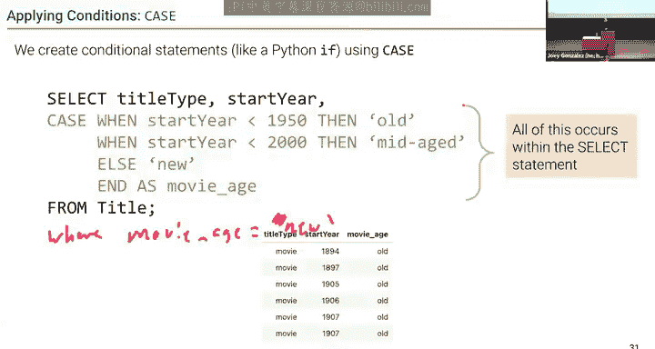

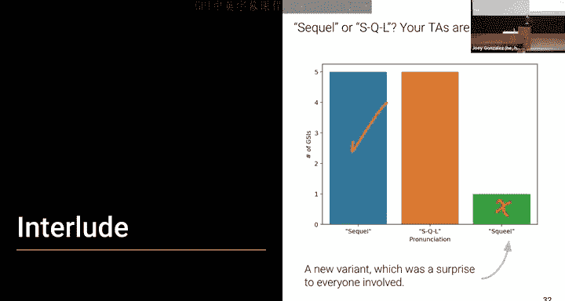

4.  **全外连接**：返回左表和右表中的所有行。当某一行在另一个表中没有匹配时，另一个表的部分将显示为NULL。

### 表别名

当查询涉及多个表，或者表名较长时，可以使用`AS`关键字为表设置别名，使查询更简洁。`AS`关键字可以省略。
```sql
SELECT t.primary_title, r.average_rating
FROM title AS t
JOIN rating AS r
ON t.tconst = r.tconst;
-- 等价于
SELECT t.primary_title, r.average_rating
FROM title t
JOIN rating r
ON t.tconst = r.tconst;
```

## 高级查询技巧

### 使用LIKE进行文本匹配

`LIKE`操作符用于在`WHERE`子句中搜索列中的指定模式。
*   `%` 代表零个、一个或多个字符。
*   `_` 代表一个单一字符。

```sql
SELECT * FROM title
WHERE primary_title LIKE '%Star Wars%';
```
此查询会查找片名中包含“Star Wars”的所有电影。

### 类型转换与CASE语句

*   **CAST**：用于转换列的数据类型。
    ```sql
    SELECT CAST(column_name AS INTEGER) FROM table;
    ```
*   **CASE**：实现条件逻辑，类似于编程中的if-else语句。
    ```sql
    SELECT start_year,
           CASE
               WHEN start_year < 1950 THEN 'Old'
               WHEN start_year < 2000 THEN 'Mid'
               ELSE 'New'
           END AS movie_age
    FROM title;
    ```

### 公共表表达式

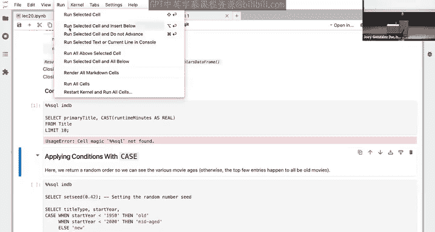

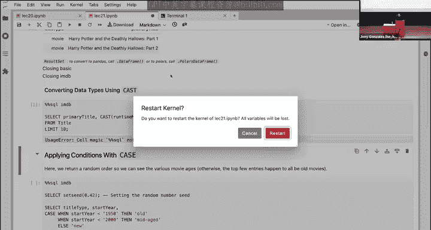

公共表表达式（CTE）允许你使用`WITH`子句创建临时命名结果集，这有助于将复杂的查询分解为更简单、更易读的部分。

```sql
WITH good_action_movies AS (
    SELECT t.primary_title, r.average_rating
    FROM title t
    JOIN rating r ON t.tconst = r.tconst
    WHERE t.genres LIKE '%Action%' AND r.average_rating > 7.0
)
SELECT * FROM good_action_movies
ORDER BY average_rating DESC
LIMIT 10;
```
这个CTE首先定义了一个名为`good_action_movies`的临时表，然后在主查询中引用它。

## 总结


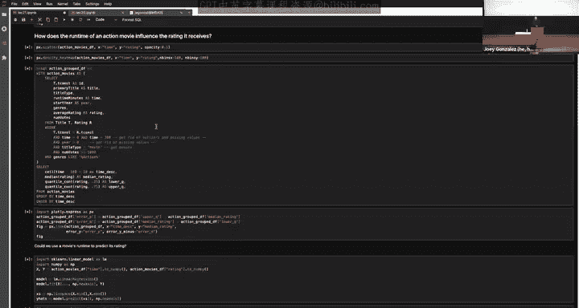

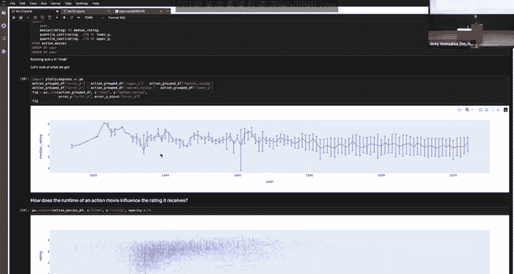

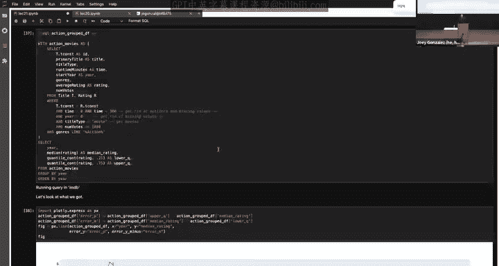

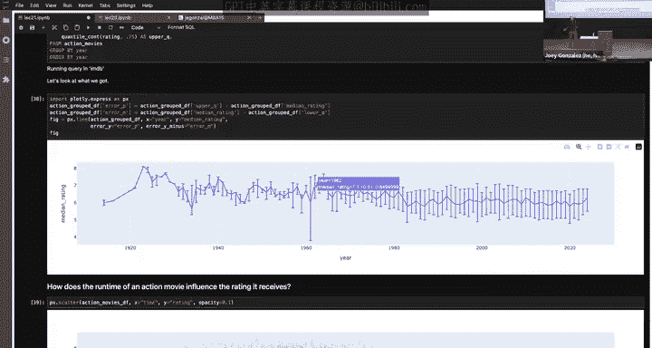

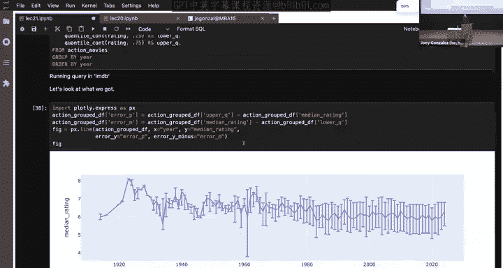

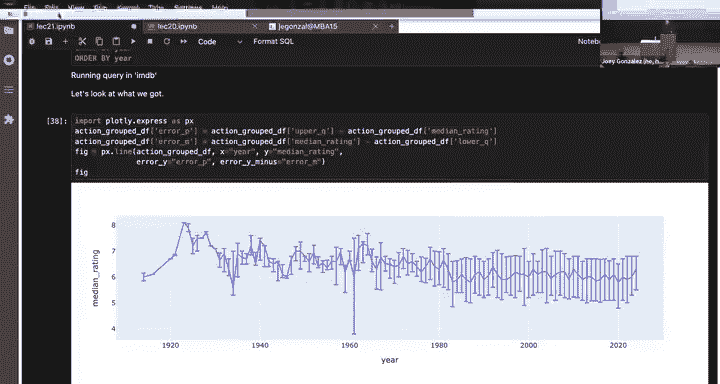

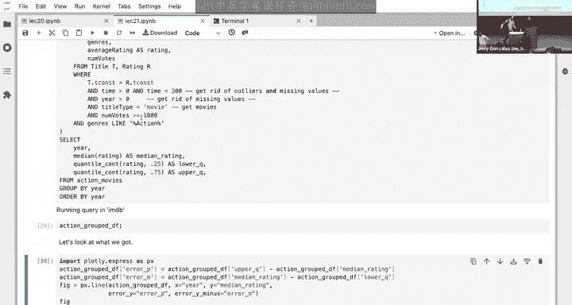

本节课中我们一起学习了SQL的进阶查询技术。我们掌握了如何使用`GROUP BY`和聚合函数对数据进行分组和汇总，以及如何使用`HAVING`子句对分组结果进行过滤。我们深入探讨了各种`JOIN`操作（内连接、左连接、右连接、全外连接）的用法和区别，这是整合多表数据的核心。此外，我们还学习了表别名、文本匹配（`LIKE`）、类型转换（`CAST`）、条件逻辑（`CASE`）以及通过公共表表达式（CTE）组织复杂查询等实用技巧。这些技能将使你能够从数据库中提取更有深度和洞察力的信息。