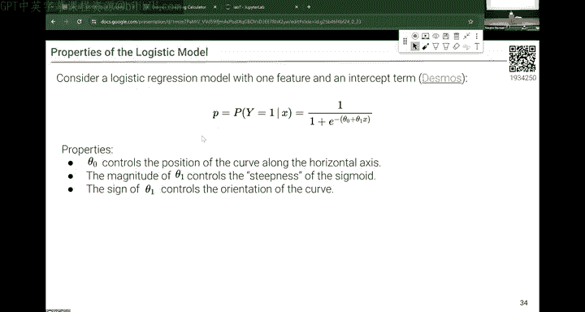
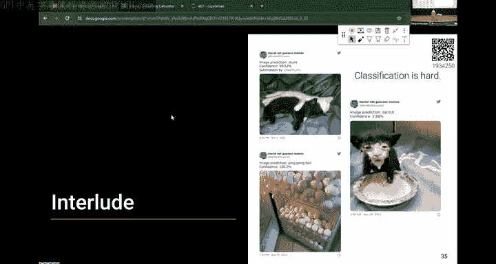
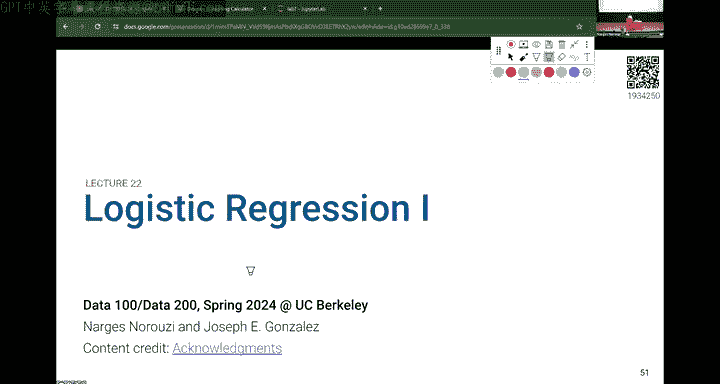

# UCB《数据100数据科学原理与技术｜Data 100 Principles and Techniques of Data Science 24SP》中英 - P22：-22-Data 100 Spring 2024 Lecture 22.zh_en - GPT中英字幕课程资源 - BV1Bc2dYCEbc

Good morning everyone Welcome to another data 100 lecture This is gonna be a very exciting lecture it will actually open up kind of a new category of machine learning algorithm that you're going learn in data 100 it's also exciting for me to be back after a while we took a break it with divided the lectures so it's so good to see you all before I dive into the content I want to make sure that everyone saw our Edison Edison is an LLMbased bo that we released yesterday for the first time akely in data 100 it has multiple different modules it's not just a G4 wrapper we send some links about the details of the Edison and how it's implemented but in short when you're making a post on Ed if you're including any screenshot or any information al text。

😊，The screenshot is going to be processed through OCR we will extract the text from any images and the screenshots depending on the context of your question depending on the tag for the question。

 make sure that you tag all of your questions correctly make sure that you use a proper title for your questions then we will do context retrieval and document retrieval what do we do retrieval on we do retrieval on two different elements the first thing is we have historical data question and answers and data 100 so we use multiple different semesters ofed data that we have and all of the good responses that the T is provided to all of those questions so we we will match your question with historical question and answers that came in again because the context is kind of similar if you're asking any conceptual questions or if you're asking anything about the lectures and the homeworks there is a likelihood that something similar to that have been asked before。

So we do QA retrieval then on top of that we also do document retrieval so if you ask any questions in any logistical questions what we'll do is we'll do retrieval on the syllabus so we have the context we have the context of all the homeworks we have the context from the course textbook from the course note so everything that's happening in data 100 and anything that happened historically in data 100 is the context that we use that your question is going to go through all of those retrieval modules。

 all that information is going to be received and then we will do some we did some prompt engineering so we do some conditional prompt prompt creation that we then prompt we will prompt to GP4 and everything is implemented on Azure so the bot is end to end is now hosted on Azure platform。

For now we're just doing a stage by stage release of the bot so for now you will see that every time that you create a question there is like a little prompt populated at the bottom that you consent us to prompt your question to an external LLM or GP for or something like that if you say yes what will happen is the T is going to identify whether the question is an appropriate question for Edison and then we' basically invoke the bot will retrieve the response and then they will modify it depending on what response they received from Edison and then sometimes they will probably give you exactly the same response that was provided sometimes they might modify it or sometimes they might just delete it and write write the responses themselves what we're also doing is we want to collect the data in terms of what is the human preference of the Ts in terms of like creating pedagogically relevant responses to your questions so what we'll do is we will。

Take a look at what was the final response that the TA released to you and what was the original response and we might want to go ahead and fine tune and get a little bit more more fine tuning and optimizing the process using this data。

If you want to us being able to use this data of the questions that that you're asking。

 please make sure that you fill out the consent form so that we can use your data as a part of our evaluation process as well if you're curious to learn more we had two papers that were recently published in 2024 and AAAI and 60 so please go ahead and read and feel free to come to my office hour and。

Some of our Ts office hours and they can answer your questions If you take a look at who are the authorss on that paper。

 you will figure out who the team is and which one of your Ts'm actually mirror one of your head Ts is involved in the project so we can just ask him or me questions about how this process works good news is that we have an LLM lecture coming up in data 100 last lecture of the semester is going be LLM So everything that you learned we're just going to show you that LLM is not something magic and it's not going to is not a very complicated concept and what we will do is we'll go over how it's trained and how it's performing and how it is doing the generation the way that it does which is going to be quite exciting So with that out of the way。

 let me start logistic regression lecture so in the logistic regression lecture what I said was we're going to start a new chapter what is this new chapter we're going to step away from regression test that we learned before we will use the same。

Pinciippleles in order to create a new model a new modeling technique that we're learning and this modeling technique that we're learning right now is called classification and the way that we do classification the model under the under the or the model that we're going to talk about today is going to be logistic regression so I'm going to talk briefly about the difference between regression and classification and why do I call this logistic regression but say that this is not regression and this is classification and kind of seeing what other general techniques exists in the entire landscape of M so let me speak a little bit about that so when we talked about regression what we've been doing was we had an input data the input data could have multiple different features we were calculating a way the combination of features in order to calculate a real value number that we refer to that model as regression in the entire landscape of machine learning。

😊，There is like generally three different categories of learning that we can do there is a category of learning that we have seen so far and we will continue to see today which is use which is using label data so every time that we were doing regression I would give you the design matrix or you would create the design matrix and I was always giving you the target vector so the y vector was the label that we were trying to match so when we were doing house price prediction we had the target values that we were doing the prediction on so this is the category of learning that is called supervised learning there is some supervision or some information that we have and all we're doing is kind of finding the parametric function that maps features into those target values again we had seen regression which is basically trying to generate a quantitative variable so a real value number that we're generating as a result at the end。

Today we're going to see this fancy new algorithm that is based on creating or mapping into two categorical variables so instead of having real value number or quantitative variable that we're trying to match to using your regression here we're trying to categorize into different categories of this quantitative variable which is what we're referring to as classification task there are two other different categories of learning there is the category of learning using unlabeled data once you just have collected data out in the word but you don't have the capacity to label them or like labeling the data is not necessarily the underlying tasks that you want to do what we do in those cases is we learn from the data when you hear from the concept of learning from data and unsupervised learning tasks that technically means that we will try to find patterns but using our understanding of the distribution of the data。

😊，SoThere are two different algorithms or multiple different algorithms。

 but two of which we're going to see in data 100， which is dimensionality reduction and clustering so we'll come back to this。

 this is going to get exciting。 we're going to finish up two different algorithms in supervised learning and then we're going to start to other algorithms in unsupervised learning This is why I said that after the midtermine data 100 things are generally more interesting because things are in modules so you're going to like open up a new door。

 learn a new algorithm， blow the door go to the next algorithm and then you keep like exploring all of those avenues of machine learning there is this third category that is designing models based on a reward system that kind of is generally a reinforce the reinforcement learning category which is kind of the research that we're trying to do with Edison when I said that we're going to take a look at the human preferences and then build a reward function for Edison that it generates responses that are。

In concise and relevant and readable to you。 So all of those could be like some kind of reward system that you're building into the model。

So where we are right now we completed regression， we're going to talk about classification today and in the next lecture and then next week we're going to come back and Jo is going to walk us through dimensionality reduction then I'll come back the week after and we'll talk about clustering and then we'll have an LLM lecture and that's a wrap for the semester。

😊，Let me now go into reminding you of the framework that we've been working under。

 We had regression before。 you remember that we always had a design matrix all of those quantitative values that we had in multiple features Rose we were referring to different instances or data points that we had columns we were referring to different features。

 what we were doing in regression was we were calculating a weighted combination of features right so this is my design matrix X。

 so we were multiplying x translu times theta。 This is the feature vector and what we would get as a result was a scalar value for each individual instance right so each individual instance was the prediction for each individual instance was a real value number between negative infinity and positive infinity we had played with it for。

While right now there are different multiple examples that we saw in the lecture the most important one was the project A that you did and you completed house price prediction successfully in project A1 and A2 but in the lecture we have also seen examples that can be predicted tip from the bill amount can be for example。

 predict the per gallon using horsepower and so on and so forth and we also did some study on the NBA data set for example。

 predicting the goal difference using the turnover percentage these are examples So what are we doing in classification I said that in classification there is a main difference that we are going to predict a categorical class this is no regression anymore no real value number but we have the same process meaning that what we want to do is we want to use the features that we have in order to predict categories so what are different examples if using the same tips。

said what if I want to predict the day of the week using the total bill dollar amount right so this is a classification test what if I want to predict the model of a car using the horsepower information right again。

 the model of the car there is predefined categories that you can classify any given data point into different multiple different categories that you have or you can predict whether whether a team is going to win using some stats in the game for example。

 using the turnover percentage and whatnot。How is the pipeline going to work。

 We still have a design matrix， we still work with numerical features。

 What we'll do is this slightly different here。 So what what we'll do is we' will say that we are moving away from a deterministic model that we had in a linear regression and we're moving on a probabilistic model。

😊，So listen to that carefully we are moving away from a deterministic model which was giving me like a scalar value and I was able to calculate minus squared error or absolute error or whatever it was as our cost function into a probabilistic model that this probabilitybabilistic model is going to give me a probability and then I can use this probability in order to decide whether I want to classify the data point into class1 or class zero class v or class losing okay how do we come up with that probability value we will basically follow the same principle that multiple features need to be summarized into a single value so we still need to calculate away the combination of inputs right what's happening on top of that is we are applying this nonlinear function which the goal of today is for me to derive this nonlinear function for use so that you can see what this nonlinear。

function is this function is called sigmoid。 We're gonna to talk about that at lengths in today's lecture。

 but what this does is it is a nonlinear function applied on top of a summary of a data point。

 How did you get the summary of the data point it was a weighted combination of features using the weights that you learn all we do under the hood always in machine learning is learning weights So once I have weights I can calculate x transpo times theta I'll pass it to a nonlinear function。

 which will give me probability Why do I care about probability because I can use that probability in order to make a decision so there is a decision rule step that we will set a threshold and we'll say that if that probability is above a certain probability or a certain threshold I'm going to classify into class1 otherwise I'm gonna to classify into class We're going talk about this threshold thing in the next lecture。

 but for now let's assume that the threshold is 50%。

 What does that mean that means that if the result of my model says that the。

is 60% I am more confident into class classifying the data point into class1 as opposed to classifying into class 0。

 which is the probability is 40% right because there is a rule of total probability。

 the summation of Europe the probability of the data point belonging to two classes should add up to be 100%。

And then after this decision will， once you said it。

 then you have classes and that's the gist of the classification。Okay， it's not very complicated。

 but I'm going to technically unb these two areas。 Today I'm going to talk about sigoid。

 I'm going to drive sigmoid。 I'm going to show you that nonlinear function。

 and I will prove to you that this is going to give me probability。

 And then I'll tell you how you can quantify how good or bad these probability values are because we still need to have a loss function in the next lecture。

 we're going to talk about that decision rule and how we can actually get the categories。

The question is does this mean that we can only predict binary categories that's a very good question which is my next slide I'm going to talk about different types of classification in data 100 we're going to only concerned with binary classification unless you're a graduate student and you need to do multiclass classification in your grad project which the Ts are going to give you pointers to that but in data 100 we'll do binary classification to classes only。

So I kept talking about logistic regression。 Today's lecture is named logistic regression。

 but I also say that this is classification and not regression。 This is kind of an。😊。

Naming convention， historical naming convention that happens。 Think about logistic part。

 referring to this nonlinear function and regression part to the value that you're passing into the logistic function。

 This is logistic regression So you need to summarize multiple features using weights into a single value that then that single value is going to be giving you is going to be passed your logistic function。

 and then it will give you the classification result so。

Kinds of classification in data 100 I briefly said we are concerned with two different classes we would say that the response is either zero or one in binary class。

 whether its zero and1 categories it just depends how you want to define your test winning or losing can be two classes you can define V as one and loss as zero if you're a medical professional you might have a data set of disease or no disease so you have a bunch of medical tests records and then you want to classify those records into disease or no disease or the next exciting project that's going to come your way is project B1 and B2 this is dealing with email classification in email classification test。

 the data set that will give you as a bunch of different emails the subject line on the body of the email and you will do a spam classifications some of the emails are the spam will give you the labels and some of the emails are not the spam which we're calling them hand and you're going。

To Dubai neuroclassification。There is also multiclass classification so it can have more than two you can have three four or five whatever number of categories that you have and obviously because no lecture can go by without my Piy this is an example of some kind of an image classification tasks say for example we want to classify images of Piy versus Touren H。

 my friends German Shepherdds， then in those cases we have Piy To Hea and three different categories that this is a treeva classification task again the number of categories depends on what classes or what values the category that you're using to label is going to take and that's the number of classes that you're defining。

There's also structured prediction tasks。 So the entire idea of deep learning is built on top of a structure prediction。

 What it is is that we have weak classifiers。 We have like a smaller classification task。

 that when we combine them together， it can do a pretty complicated task。

 So that's the whole idea of neural network。 So we have neurons。

 which are like a small classificationifiers， which when we combine them into a network。

 they can do pretty complicated tasks， such as like translation voice recognition and all of those things that we see。

 But under the hood。 it is a classification task， but it is a structured and combined classification task that we that we're performing in deep learning。

But going back in data 100 in today's lecture， always my Y hat is going to be zero or one because I'm doing binary classification and my classes are going to be represented by zero or one in this case。

By now you should be pretty tired of me putting these four boxes up on the screen。

 but this is very important， Everything that we do in machine learning follows a similar structure we need to choose a model you need to have a loss function。

 you need to optimize for that loss function and you always need to evaluate and report the performance of the model in linear regression。

 you're pretty familiar with this we had the equation for linear regression we choose we can choose MSC MAE or different loss values and then we did the fitting of the model with different consideration regularization and then we did use we could use grade in the center we could just use off the shelf as learn in order to fit the model and then we would evaluate with different techniques so。

What's today's plan。 Today's plan is to just tweak one small thing that instead of the predicted values being real value number。

 now my predicted values are going to be 0 and1。 and we're going to basically answer these two questions for now。

 we're going to talk about what that model is going to look like and what is the loss function。

 I'm not going to go through gradient descent and like take the derivative of a complicated loss function in data 100。

 the details of that exist in the supplementary slides after。

I think today is the slides or next lecture is the slides。

 but technically what we're using is still we're going to use a scale learnar I'm going to show you how simple it is to use SD scale learnn and then next lecture we're going to come back and talk about evaluation and what does that mean for studying the right threshold so that the model is going to perform well depending on the past。

So with all of those preliminaries out of the way let's talk about logistic aggress so the data set that we're going to use today is games data set is kind of derived after the NBA data set that we have before remember the first linear regression lecture that I had NBA data set here we have game Is and we have different matchups so for example we have a team name and we know which matchup they're participating in and we have a feature that this feature is called goal div what it is is basically the difference in field goal success rate of all the players in that team versus the team that they're playing against right if it's a positive value will give you more confidence that the team is going to win if it's a negative value is going to give you some indication that the team is going to lose what we're going to do is we're going to use this goal di feature in order to predict bone and you can see that Vo is a binary。

al beforehand， anything， any labels that you have or any classes that you have。

 you have to turn it into zero and one and then you have a categor you have a classification task that you can solve。

So I'm going to dive into the code and quickly run this and run the data set。

 This is the same data set again， same setup。 Now， you know， the definition of goldd。

 What I want to do is I want to show you that kind of an issue in general machine learning。

Doomain that once people learn one algorithm， they think that they can apply to any other problem and they keep insisting that no。

 I know linear regression， I know like classification and this is a classification test。

 but like it won't apply what I'm going to show you is I'm going try plotting this data to see how this data looks like and then we will try to actually fit a linear regression to it to see if it's going to work or not so let's do that So I'm going to say that and'm going to plot a scatter plot using seaborn and I'm going to say that this is the games data set on the X axis I want to use the feature so what was my feature my feature was。

go this。And on the y axis。I want to plot my target value， which was bonus。

So let's take a look at this。So。Why is it like two kind of straight lines because Bo was binary It was0 and1 That's why I have a bunch of points at0 and a bunch of points on1 and you can kind of see the distribution of gold if right here when the goal if is on the negative side we have more points that are classified into class zero and as we move to the right side and the gold if is a positive value then there is more points that are more data points that are classified as class 1 and there is like some in the middle around zero that there is also winning and losing but this is not a very great plot because there is a lot of overpling I want to see how many data points I have around zero and how many data points I have around the both extremes which but what we can use is we can use is strip plot it strip plot what it does is it is going to randomly add noise so that there is no overping hopefully and then you can see data points a little bit more clearly。

So strip plot using same dimensions and now it's kind of also color coded zero and one to different categories now you're seeing that the distinction and you're seeing that how many points we have in each one of these categories。

What we can do is I can say that， okay， what if I go ahead and like pass a linear regression model like this to the data and what is the property of that linear regression model and how can I interpret it？

So we know that we can build our design matrix， so this is the design matrix using only one feature。

 then why as target value， creating a linear regression object。

 fitting it to the data and just the rest is plotting so this is the equation that I have。

What are the issues with this plot and what are the issues with my approach？Yes。

So one issue is that because the output wanted to be0 and1， this is like a real value number。

 it can be negative infinity can be positive infinity。

 so that's right so there is that issue that my values are not founded as a probability that then I can use that probability or the value between0 and1 in order to do any classification task that I want to do。

There is also another issue that say for example， you don't you're not concerned with like that real value number you would say that okay。

 if I have that real value number and I set a threshold that5 anything below5 is going to be class as class 0 and anything about five is going to be classified as class1。

 but still there is the issue that it's really hard to interpret what's happening so when the output is negative 2。

3。What would that tell you， That doesn't tell you any indication about how good or bad the team was performing or how what is your confidence in classifying the data point into one of those different categories。

One thing that we learned in data8 that I'm going to use here and we're going to build the step by step this probabilistic model that we're going to work towards is that in data 8 we didn't have the calculus kind of tool that we use in data 100 when we were driving linear regression and with all the derivations that we did but instead what you learn in data 8 was the graph of averages it might be a long time since you took data 8 or if you're a data 200 student you might not have taken data 8 but the gist of the graph of averages is that it assumes that if you're dividing your x axis your features into a smaller bins you can represent one bin by the average of the y value in that bin right and then that's the prediction saying you're assuming that if the values are close to each other then the target value or the prediction should also be close to each other less represented by one point and then moving on to the next。

pinin moving on to the next bin so every bin is going to have one prediction and that's called graph of averages then you will combine all of those points together in order to build the shape of the plot that you have so this is kind of an example on the x axis we're dividing it we're dividing x into different bins bins and what we're looking at this is there's a yellow kind of dot in the center is that for every bin we're looking at taking average over all of those y values we would say that if x is in that range that's the prediction and you' will do that for all of the data points and then you will end up getting if your data shows the linear relationship。

 this graph of averages should also show a linear relationship which then later in data 100 we derive the entire equation for and we learned that there is actually a weight the combination of features or that feature plus an intercept term that would give us exactly the same kind of shape as what the graph of average。

Averages was giving us okay， why do I say it because I want to motivate you that now I want to go back and do exactly the same thing with the data set that we had seen。

So technically what I want to do is I want to go back look at these two classes and all the data points on the x axis I want to break it into bins and I'll actually break it into 20 bins for each one of those bins I'll calculate the average of the predictions right average what is the average of predictions there's a bunch of labels of ones there's a bunch of labels of zeros I'll take the average I'll note by one dot and then I'll move on to the to the next bin and so on and so forth so。

Let's take a look here I'm cutting the feature into。

20 different bins What I'm doing here is I'm creating one column that is representing the right hand side of each bin and then what I'm doing is I'm doing group by by each bin for every group of data points in a bin I would say that take a look at the bone feature and take a take an average creating that dot for every bin。

 but then i'm doing it for all of them altogether so let's take a look at。

What the series object is going to look like， so you're seeing that this is a series object。

 the index is the right right hand side of H being and then whats the values that are restored are those averages that I calculated。

 the average number of the average of the v for that specific bin because you can also verify that that's exactly what I did。

So， I can go ahead and。Lots what it looks like。This is our graph of averages here。

So we can kind of visually confirm that this shape is correct and we calculate a graph of averages correctly Why is that the case So I basically if you go ahead and break it down into different bin say for example this is the first bin this is the second bin this is the third bin and so on and so forth by looking at this bin only you're seeing that there is no data point for class1。

 everything is0 so the average is going to be0， which is what we observe right here right so the first one had the average equal to0 and then the second bin is0。

 the third bin is also zero and then we will start seeing some values is of1 and then the average will keep increasing and increasing and so on up until the point that towards the righthand side of this x axis all of these values are values of one and then taking average of all of those ones So this is the bin that I'm referring to right here is going to give me the average of one right so that's why you see this。

smooth transition， you're starting from zero， you're making the transition into the class of one。

 and technically， this is a function that's bounded between0 and1。Okay， that's our graph of average。

Why do I care about this so much， Because this is the shape of the logistic function that I want to derive。

 and I'm going to step by step。Work。With all of these code and this data set to show you what's the equation for this S shape curve。

 So what we did was we did exactly the same thing。 We were able to calculate。

 find out the shape of this nonlinear function。 Remember that I said。

 we are basically calculating x transpose times Teta， then we're passing it to a nonlinear function。

 This is nonlinear function。 Why is it that nonlinear function because it's a kind of a function that mimics probability。

 It is bounded between0 and1， right， And then it is also kind of corresponding to my confidence in class data point into class 1。

 like increasing as I as I increase the feature value。

 And as I go from the left hand side to the right hand side。 So this is very interesting for us。😊。

So let's take a look at what I calculated。 what I was calculating was technically taking the average of y value for a given bin right。

 what is that average going to look like So we were counting the number of data points with class one in that bin。

Times1。And then the number of data points with the value of 0 times0。

 which no contribution for data points in class 0 right and then average means that I have to divide it by the number of data points in the bin。

Right what does this mean， this means that this second term is not going to contribute at all because however number of data points in class0 I have is going to be canceled out。

 then technically this is equal to calculating the ratio of the data points with class one over the total number of data points that I have in that specific bit。

What is that from probability we know that that's probability of class one given a specific bin so that's why it's a conditional probability that's why it was a probability function it was a probability function bounded between zero and1 but now we know what that is it is a probability of class one given a specific a specific bin value or a bin that we have so this is a function that we derived that we're going to work with。

So I'm going to write that one more time， remember the P that I had initially in the classification in the introduction to classification the slide。

 I said that we're going to go after calculating a probability P。

Now we know what that probability is， it is a probability of having class one or predicting class1 given a data point that we have if I give you a data point。

 you have a certain weights which is going to parameterize this P function。

 this is a parametric function right now and then what it calculates is probability of class1。

What do we do after this， We have probability。 This is a probability of class 1。

 So I can just set a threshold。 I would say that if your confidence in class 1 is above that threshold classified as as such otherwise classified as the other class。

 right， So let's think about what we did， right， So we came up with this probability function that this probability function gives me the probability of data point belonging to class 1。

😊，What I can do is I want to derive that the equation for that S shape curve。

 but I have an issue that like there is no way for me to directly derive that S shape curve。

 there is no nonlinear function that I know from before that would kind of equate to that S shape curve that be had seen。

But one thing that we can think about is following the same process that we had before one thing that we can do is there is a nonlinear function we want to learn the equation for that nonlinear function。

 we could linearize that relationship we learned that using the Bulge diagram we can go linearize the relationship。

 then we fit a linear model， then we reverse the transformation so that we capture the underlying original relationship and this is going to basically give us the equation for that nonlinear function which we did multiple times in visualization lecture and also in linear regression lecture so if we want to do exactly the same thing with this S shape curve right here。

 there is the issue that there is nothing on the bulge diagram that gives us an indication of what kind of transformation I can do in order to derive the S shapepe curve right something that would be looking like this function right here that we had there was nothing in the Bulge diagram。

Indicating that transformation， but one thing that we can do is we can rethink this probability。

 So I said that this S shift carrier is giving me probability of class one。

But the ultimate goal that I have is to decide between the two classes。

What if instead of just working with the original probability。

 I just compare the probability of class1 versus probability of class  zero and if the ratio of probability of class1 to class  zero is above one。

 I would say that there is more way towards class1。

 if the ratio is less than one then there is more evidence towards class zero than I would classify as class  zero。

 so instead of looking at one probability alone， I'm going to compare that probability of that class versus the other class which brings us the equation for or the concept of odds ratio。

Why is it important， It's important because it's going to make our lives easier and you're going to see that in a sec。

 but it is also important because when we're doing multiclass classification。

 we can't put a single threshold for for a probability for a single class What we can say is that okay。

 I have five different classes。What is the odds of class one versus all other four classes。

 So you need to consider everything You cannot consider only a single probability value right so in that sense。

 in kind of in like a general setting， when we say that whether the odds of a certain event。

 we're looking at the odds of the event or the probability of the event divided by the probability of anything else。

 So in this case， then technically my odds ratio is going to be what is the probability of class1。

 given data point x over the probability of class0 given the data point X。

 So if I'm thinking about probability of class1 as p then probability of class0 is going to be 1 minus p because there is a rule of total probability that the summ of the two should add up to be equal to one。

Right。This is pretty clical because if odds is equal to one， let's look at different scenarios。

 if odds is equal to one， what does that mean？If odds is equal to 1。

 that means that p over 1 minus p is equal to 1， that means that p is equal to 1 minus p。

 which technically means that p is equal to12。That's probability of 50%。

 That's where we're putting our threshold a lot of times in the next lecture。

 we'll see that we can change that probability or that threshold。

 but technically this is telling you that if your probability of class1 is 50% you have a ta you can't make a decision between the two classes。

 we're going to see in the next lecture that we call that a decision boundary the boundary where we can't make a decision。

 you have a data point， there is a ta， you don't know which class you can you can classify2。

 but what happens if this odds ratio is greater than1。

 So that technically means that p over 1 minus p is greater than1。

 that means that p is greater than1 minus p。 And then if I move this p to the other side2 p is greater than1 and then P greater than1。

Right if the probability is above 50% odds of you classifying the data point into class1 is going to increase。

 which is exactly the same thing， so it's exactly thinking about probability in the same sense。

 but we're just writing it in terms of odds ratio so that you compare the two classes directly as opposed to only looking at a single value and then technically odds ratio equal to one means that you can make a decision above one classifying into class1 below one classifying it into class zero。

Okay， so let's go ahead and calculate this odds ratio right。

 so we had this graph of averages which we built here。

And what I want to do is I want to draw this odds ratio based on these same values and then say if we're going to get a better shape。

 which then we can transform that and linearize that and model it， right？So let's do that。

So I'm going to go ahead and say that what was the values that we had here？It was。Win rates by bin。

 This was my function。 So I'm going to go ahead and say that， okay。

 what if I go ahead and create odds， which is equal to win rates by bin divided by one minus those same probabilities because win rates by by by by when by by bin。

 sorry， was the was the probability that I was calculating now I'm calculating odds ratio So I'll calculate this。

 And then we're going to plotted。Beautiful， what function is this？It's exponential。

 we moved away from S shape curve。To something that's still under the hood is a。

Probability related function is just odds ratio， which I can recover odds probability from odds ratio。

 or I can turn probability into odds ratio。 It's just a transformation， simpleim transformation。

 But what it gave me was an exponential function right What I can do then is remember bulge diagram。

 So this is going to be， I think in the fourth quarter right here that's transformation What I can use is I can use a log transformation to linearize it I'm going to take the log of the y axis。

 And if I take a log of the y axis， this exponential trend is going to shrink and then this is going to linearized technically。

So taking log of arts。And then plotting it again。Beautiful linear function。

 This is kind of similar to the graph of averages that we had。

It started with in linear regression and then we try to model it， but now we have it here。

 what is this function， this is this is a linear function that mapped the goal difference。

RightThere is ateta0， obviously for this line， there is a kta1 which shows what is this slope or what is the way that is associated with gold difference and then what it models is it models log of the odds ratio。

 It doesn't directly model probability。 It models log of the odds ratio。

The assumption that we're making here when I go ahead and build a linear regression model is that。

The feature that we have。Has a linear relationship with log odds of the probability or the log odds of the output so let's go ahead and take a look at some of these we did calculate the odds we did see that it's an exponential function we took the log now we saw a linear relationship what I can basically right out in terms of the equation for this line is that this is a line that predicts is the value and what is this the value this the value is this y axis right here which is log of the odds ratio log of P over1 minus P it's equal to linear combination of inputs in this case I have only one feature but you can have as many features as you want。

 but technically you are modeling log of p over1 minus p using x transpose times theta。

And that's the regression piece and then when it is translated。

 that regression is translated to probabilityability。

 we will drive that as shape function that we can actually use that in order to calculate the probability again one more time this is z what is z this is log of odds because of that entire process that we came from and but was odd it was log of P over1 minus P。

Okay I'm going to tell you a secret when someone says that they've taken machine learning course or they're interested in doing research。

 one of the questions that will kind of tell you if someone have learned machine learning systematically and they understand all the underlying kind of structure of all the models is to ask them some question about logistic regressionggress and this process right here that like what are we modeling what is that probability and like how do you derive for example。

 probability from the input features are generally normal questions that you can probably see in internship interviews and full-time position interviews if you claim that you know machine learning this is like very。

Kind of traditional that there's always going to be some question about logistic aggression and it will show the depths of your understanding and you watch this lecture one more time。

 do the homeworks and go to the discussion one more time and everything end to end is going to make sense。

 yes。That's true， yes， that's odds concept， that's the odds of winning one team versus the other team or when you're looking at。

 for example， horse betting one horse versus like other ones。

 it's odds of that versus everything else。Yeah。Question。Good question。 Look at this plot。

 So the question was why x transpose times theta is equal to y odds what I what I plotted。

 which is like empirical thing。 I had a data。 I did all of those transformation This is theres no equation behind it。

 but technically what I did was I was plotting different things of goal difference versus other metrics or other other y axiss I once plotted goal difference with respect to probability which was that as shaped curve Then what I did was okay。

 probability is not helpful。 I'm going to calculate odds instead becausem I want to work with odds when I calculated odds there was odds versus。

Ods under y axis and then so here odds under y axis and then goal difference on the X axis it was exponential。

 I said that okay， I know a linear regression or linear models I need to linearize it usingvol diagram I took the log So when I took the log then X y axis became log odds。

And then goal differences right here。 What is this。

 This is technically the line that says that y is equal to x transpose times theta right。

 that's the linear relationship right What is your x， your x is goal difference。Right。

 and then your y right here is equal to log of o。Because that's the Y axis。

 That's why when I went to this slide， I'm saying that。

The equation for a linear regression line is always x transpose times t。

 but what am I predicting using this linear linear regression， I'm predicting like at。

 what is log odds log up p over 1 minus p。So fancy stuff Now I'm going do magic and then show you what that S shape curve function was。

 So what I have right now is log of p over1 minus B。

 This is log of odds is equal to x transpose times setup up This is hopefully by now pretty established and we're comfortable because this is coming from this line right here that x is under under x axis and then。

😊，It has slow， it has intercept and then if what we are predicting is log of odds and the odds equation is p over 1 minus P。

So one step transformation is I can go ahead and calculate e to the power of each side because this log in data 100 every time that we talk about log without specifying the base。

 that's natural log base。I'm going to calculate e to the power of each side。

 which technically is going to give me is going to give me p over 1 minus p because e to the power of log of base E they will cancel each other out。

 it will give you what you have in the log P over 1 minus p and on the right hand side is just E raised to the power of x transpose times theta。

Okay， so the rest is pretty kind of straightforward。 what we want is that S shape curve。

 which was modeling the probability right we did all this like going around and all of those doing all of the calculation of odds and what not in order to get the probability so that we can play with the probability with a threshold to do the classification right So what I'm going to do is I'm going to derive probability。

 this is just simply simplifying this equation right here。

 which I start by multiplying both sides by one。😊，By 1 minus p。

 So this is going to give me p equal to 1 minus p times E to the power of x transpose times theta。

Right， I'm going to just keep doing multiplication。

 This is going to give me p equal to e to the power of x transpose times theta minus p times e to the power of x transpose times theta。

Yep。We could do that yes， there are multiple ways I'm just doing it quick simplification so that you have the final answer。

 but the final answer， no matter how you simplify it as long as p is in one side and everything that you simplify to is on the other side。

 then you will have the function that you want。Can I continue。

 I'll continue and then we'll see okay P equal to e to the power of x transpose times theta minus p times e to the power of x transpose times theta。

 I'm going to move all the factors of p to one side。

 so I'll get p plus p times E to the power of x transpo times t。

 So this guy is just moved to the other side is equal to e to the power of x transpose times t。

 I'm going to factor p out， So this is going to be p times1 plus E to the power of x transpose times t equal to e to the power of x transpose times。

Tta， and then what I'll do is I'll divide both sides by1 plus E to the power of x transpose times t。

 Then it will technically isolate P1 side。 So this is equal to P equal to E to the power of x transpose times t divided by1 plus E to the power of x transpose times T。

What I'll do is in order to simplify and have a numerator that's equal to one。

 I will divide both numerator and denominator by E to the power of x transpo times T。

 So this will give me one over E to the power of。X negative x transpose times theta plus one。

Right and then if you simplify this further and just reorder these two terms in the denominator。

 what you're going to get is the equation of a sigmoid function or that s shape curve that was a probability what was it it was equal to p equal to1 over1 plus e to the negative of your regressiongress value x transpose times theta okay and this is this is exactly this function right here that we have x going in and we're predicting a probability and the equation for this s shape curve is equal to1 over1 plus e to the power of negative x transpose times theta。

Okay， so let's talk about this a little bit more This function that we derived is called logistic function or sigmoid function a lot of time we show the sigmoid function by this sigma and we say logistic or sigmoid function is sigma you just pass the transform version of inputs x transpose times theta and all it does is it will calculate one over one plus e to the power of that transformation and then it will give you the probability。

 the probability that is it is giving you is probability of class1 given input so then you can technically do whatever you want to do with it。

 you can put a threshold you can say that my threshold for classification is 20% or my classification for my classification threshold for class1 is 50% or whatever you want to do and we're going to talk about that in the next lecture what is the optimum threshold for classification that you want to put so that some of the metrics that you have is optimus。

So to predict the probability， this is the gist of logistic regression， you will do regression。

 you will learn about parameters and you will calculate a weighted combination of parameters using x transpose times theta everything else is going to be just transformation there is no learning after this phase the only learning that's happening is for the weights that are associated with the features that will give us x transpose times theta afterwards you just apply sigmoid function。

 there is no learning in the sigmoid function Sigmoid function is a constant function like not a constant function like a non-changing function or a nonparametric function that you pass a value into or just do the transformation and it will give you the probability that you're looking for。

So let's talk about this sigmoid function a little bit more that's the shape of the sigmoid function we talked about it being S shaped curve we can you can kind of see that the domain is from negative infinity to positive infinity because this T can be any value there is no limit undervalue that can be passed into a sigmoid function。

If you pass t equal to zero， what's going to happen？What is t equal to 0。

 This is going to give me sigmoid of0 is equal to one over1 plus e to the power of 0。

 This is equal to one。 This is equal to one。When activation or the linear combination is equal to zero。

Then what the model is going to tell you is that I can make a decision。 My probability is 50%。

 My confidence in classifying the data planning class1 is 50%。

 What happens if t is a positive number， if t is a positive number or that activation that goes into the sigmoid function is a positive number。

 what's happening is that e to the negative t is going to become smaller than1。

 So the probability is going to be larger than one half。

 So it's going to have a higher than 50% probability that's what's happening in the righthand side here。

 that the probability will keep increasing as you keep increasing the value of t and obviously it can do the mass if if the value decreases below0。

 if the value decreases below zero， then the probability is going to shrink up to the extreme that when input is negative infinity。

 the probability is0， if the input is positive infinity， the value is1 and this is。

This is kind of really representing the probabilistic function right so because you're predicting a value between zero and1 and is bounded and all of the properties do whole I'm not going to go over other properties these are properties of sigmma function which makes it suitable in deep learning domain but this is kind of out of scope for data 100 I'm just putting it there so that you can see that it has other nice properties that can be useful in other settings。

So we kind of unlock the first step， right， so the first step of this classification is I give you a design matrix。

You'll learn a bunch of weights using the optimization that you'll do so these are the weights once you have the weight youll calculate a linear combination of inputs features using those weight x transpose times theta you will have a value that we call it activation and then that activation or that value or that regression value is going to be passed onto the sigmoid function which we're showing it here by sigma and then that's going to give you a probability next lecture we're going to talk about how to work with this probability a little bit more in depth。

Take away from the lecture so far。 We went through a process of defining a function that mimics a probability。

 We learned that the function that mimics a probability is this S shape S shape curve and the probability that is predicting is probability of y equal the class of1 given the input X So it was a conditional probability and then under a certain assumption that the assumption is that the log odds is a linear combination of x andteta assuming that the graph of averages was actually a a linear equation we went ahead and derive and put everything together and we came up with this function that is parameterized by Teta that is going to basically give you the probability value1 over one plus E to the negative x transpose times theta。

 and this is the logistic function。 This is the logistic regression and that's the entire。

Model of logistic regression。 Now， you know how it strive as opposed to me coming in the beginning of the lecture and telling you that。

 okay， this is sigmma function。 You just do this magic。

 And then this is going to give you probability。 But now， you know， the rationale behind it。

 You can really end to and derive it yourself。 And then you know how logistic function is derived and can be used in practice in in in the classification task。

So now let's do practice。 First the slide of the day。 Let's say that I have。

On the same data set and the games data set I have two features instead of one feature I have two features right now I have gold div and I have the number of free tros and this is the delta between the two teams right and I want to calculate and I have the weight as well so the weight for feature one is 0。

1 and a feature weight for feature2 is negative 01 and there is no intercept so it is a logistic regression model with no intercept this is just for simplification。

😊，What would you tell would you tell me about the predicted probability that this team is going to win。

The team that we're looking at their features is going to win in that matchup。

So I'm going to move on to show you the result as we are calculating a weighted combination of inputs using those features 0。

1 times 15， negative 0。5 times1 and applying the stigmoid， this is going to give us the probability。

 which if it go ahead and calculate that probability and here the probability is going to be 0。73。

 which might give us more indication that it's more likely than not that the the is going to when that is specific gain。

So I'm going to。Take a look at the property of some properties or the impact of these weights on this logistic regression function。

 so this is the logistic regression function。 you seeteta0 and heta 1 we're assuming that I only have one feature。

 This is feature and the x axis right andteta 0 right now is equal to zero if I go ahead and increaseteta 0。

😊，You will see that there is a horizontal shift that I'm noticing right because activation is going to become zero when there is a negative value or when the x is a negative value and then if I move it to the left。

 then you will see that there is still a horizontal shift so the biost is going to move the sigmoid function horizontally what theteta1 or the weights that are associated with each one of the features are doing is that they're controlling the steepness of the curve。

 So in this case， if I go ahead and increaseteta1 you will see that the curve is going to become more steep。

Right that will tell you that the change in your decision between the class1 and class class 0 and class1 is going to be sharper。

 So with this light change in the value of x， then you might suddenly change the class association of a data point from class zero to class1 because there's just a sudden increase in the probability if I keep decreasing this value and then I go and for example。

 haveteta 1 equal to0， then this is going to give me this constant constant model because then feature is not going to be important and the only thing that is participating is theta 0 and I'm calculating sigma ofteta 0 if I keep decreasing it。

 then the orientation of the sigma is going to change but then if I increase the magnitude of theta 1 then you'll see that again the steepness is going to keep increasing as long。

 So that's how I want you to think about the role of the weight the role of theta0 and the role of theta1 or the。

Praomes that are associated with different features。

We promised a two minute break this is your two minute break and I'm going to come back and talk about the rest which is how do we optimize this。

 which is very interesting so you stand up is stretch for two minutes and then we'll be back。

And don't leave， it's very important， the next part is important。How are we doing so far。

 Good sideways。But。ok。It's going okay， all right， good question。All right。

 I rule that this is two minutes and we will continue so the next thing I want to throw at you and you loss function cross entropy loss function it's been a while that we didn't introduce a last function since like the right time to do it you know MSC you know MAE this is cross entropy loss function Why do I care about it because that's the next step of this modeling process in this modeling process we have the model we have to work towards a certain objective in order to optimize in order to optimize the model that we want to have。

Again， one natural thing that you might want to think about is like what if I keep using the minuscord error that we had before and I have done this for you if you're wondering so this is a toy data set that we're going to work with and this is the shape of the data set it is still is if you'll take a look there is like two classes class0 in class1 but now we're just working with six different data points if I go ahead and say that okay I'm creating my sigmoid I'm creating minus scoredd error with calculating sigmoid of the weight the combination of input and theteEta which gives me P hat or the predicted probability and then I'm calculating the minus squared error between the predicted probability and the target value and I'll just go ahead and say that let me see the lost landscape for differentteEta values forteEta between negative 10 and positive 10 I just want to go ahead and calculate this loss MSC loss and I want to see the。

Shape of this loss function。So the shape of this loss function is not pretty what are the issues with this loss function so let me go to this question what are the issues that you think is happening with the MSC function that you just saw。

That I want to use for this classification pass。You don't know， that's there。

But remember why we cared so much about MSC， we were so proud of MSC。

 there was some kind of functionality of MSC that we kept using and reing on。Error to spread。

 not linear， not linear。 We want a nonlinear con function， not convex。 That's what I want。 Okay。

 I'm going to move on。 it is not convex。 what's the problem with convexity or not convexity we care about the convex function because if we want to find the optimum point of a convex function。

 It's guaranteed that there is one global optimum right。

 And then it is guaranteed that if you run a grade in the。

 you will reach to that global optimum But I don't have I like non convex so many smart people in the room So I'm going to go ahead and show you why that's a problem。

 Remember that we had this。Si pi optimize minimize function that we would just make an initial guess and we would say that okay with this initial guess go and incrementally move towards the optimum And then once you're done。

 let me know what that optimum value is And this is the optimum value。

 So I'm assuming that on this plot right here。If I go ahead and say that， okay。

 my initialization point is going to be at zero， we start right here and then we say that okay。

 go ahead and find the optimum point， I'm hoping that it will reach the global optimum。

 which it probably does， it goes ahead and finds the global optimum for Teta to be 0。5。

 which we can kind of visually guess that that's true。

If I go ahead and do take a look at what's the shape of my sigmoid function using theteta 1 being equal to 0。

5 this is the shape of the function it does have a misclassification error for example。

 for this point right here and this point right here but for example。

 for these two points it does a good job the label of the data point is one if we take a look at the predicted probability it is above 80% so this is like where we are。

Looking at so the predicted probability is 80%， so it does a good job。

 It will classify eventually if you use a threshold of 50%。

 it it will eventually classify be classified as class one。But if I go ahead and say that， okay。

 what if I go ahead and start my initialization from negative5， right。

 that's my initialization point。 So this is where negative5 is going to land。

 This is your initial e starting point。 And if we go ahead and do that。

It will give me a separateteEta value。 so now you can see that it did not reach the global optimum we had。

 It says that negative 10 is the right value for TeEta1。 And if I go ahead and plot the sigmoid。

 I'm seeing an entirely different thing that has misclassification for a number of points right So this one is going to be misclassified。

 this one is going to be misclassified same here and same here。

 So this is obviously a not optimal model that we have。

So then technically what happened was that when I was starting from different initialization points I reached different optimums and this is what's happening with a noncomvex function it's not guaranteed that using grade InN you will reach to the global optimum and there are local minimize that if you run a local search for those who have taken 188 or we'll take 180 these are the nice things that you will learn there if you run local search algorithm which is exactly what we're doing in grade InN sometimes well reach the global optimum sometimes we don't and that's exactly the issue that we have with this loss function。

Besides that there is the issue of the lost value being a bounded value and that's what we don't like。

 So I'll do it with misclassifying a data point00 percent the data point would belong to class1 it would say that it belongs to class0 and it would give a probability value close to zero it does a pretty bad job of that classification but because what we're calculating is here。

 the S squared error right the squared error because y is also y hat is also between0 and1 if the actual data point here y is equal to1 if the actual data point was belonging to class1 the squared error is always going to be between0 and1 so we are not able to exponentially or like somehow more rigorously penalize the model for misclassifications or these kinds of errors it's just going to be like a value between0 and1 that is going to be penalized penalized for so these are the main issues with。

This MSD function applied to a classification task for one it was not convex。

 we saw different local minimum points and then we saw that it would lead to different different models and then the second one was that the loss was bounded。

What I want to do is I want to show you a loss function that is unbounded right so how can I come up with that unbounded function。

 we are introducing cross entropy loss function so in the cross entropy loss function what we're trying to do is we're saying that depending on the target value when y is equal to one I want to give a low loss if the probability is large if the probability is large that is kind of on par with what I want to predict I want to have probability be close to 100%。

On the other hand， if the true label of the data is equal to0， if it gives me the same large P。

 then I want to have a very high loss， because if the label is equal to 0 And you tell me that the probability of the data point belonging to class 1 is 100%。

 that's very bad。 That's the off from what I want to do。 So this is what we're going to work with。

 and technically this cross entropy loss function is going to consider different cases for y equal to 0 or y equal to1 and will consider how to penalize misclassifications or the errors that the model is making。

 depending on what the value of y is。So this is the gist of the function and I'm going to break it down for you if y is equal to one。

 we're saying that the loss is going to be equal to negative log of the predicted probability。

The shape is going to look like something like this， why is it important？

What this says is that if y is equal to one， the ideal scenario for me is that p should also be equal to1 or close to1。

 when p is close to1， log of p is going to be close to zero。

 So the negative negative value close to zero is also going to be close to0。

 so we're going to have a very small loss that you're observing here On the other hand。

 if the data point was belonging to class1 and you were saying that okay。

 no I'm saying that the probability of data point belonging to class 1 is0 or a very small number。

 what's happening is that you're calculating log of p4 p value close to0。

 this is going to be negative infinity， then negating a negative infinity is going to give you a positive infinity loss that's what you're observing here if the probability is close to0。

 then the loss is going to basically shoot up to positive infinity。

And iss going to substantially penalize model for that misclassification。

The same scenario is going the reverse scenario， but same situation is going to happen for the case that y is equal to 0 when y is equal to0。

 we have the same situation， we want p to be close to0 so that's what we are happening as the low last when p is equal to0 and when p is equal to1 we want to substantially penalize it how would that work when p is close to1 then this value is going to be close to0 log of a value close to0 on the positive side is going to be negative infinity and then I'm negating that and then the loss is going to be positive infinity that's how it works。

But there is one main issue when I want to optimize this function。

 I don't want to optimize based on conditions， it should be one single function that I'm optimizing。

 how do I do that？😡，This is a trick in machine learning that you will see probably for the first time here。

 but same technique is going to keep appearing in different places。

We are combining these two terms or these two cases into one function by these coefficients。

 so the coefficient are y and coefficient of1 minus y。Why is that why are those equal。

 this technically means that when y is equal to one。

 which one of these two terms is going to be active？

This term right here is going to be equal to0 when y is equal to 1。

 so the second term is going to go away。Then you're left with the first term。 What is the first term。

 The first term is going to be one times negative。 So there's this negative sign that we factored out。

 negative one times log of P， which is exactly negative log of P。

 which we have right here that we wanted。What's happened。

 what happens in a case that y is equal to zero in case that y is equal to zero。

 then obviously the other way around is going to happen。

 The first term is going to cancel it because this guy here is equal to0 then what your left with is the second term the second term the coefficient right here is one minus0。

 which is equal to0。 So this is as if that doesn't exist。 So your left with your friend here。

 which was using the negative from here， negative lock of one minus D So this is kind of a trick I had two cases using these coefficients I combine them into one single function and that single function you have basically seen oops you have basically seen what's going to happen in each one of those cases and those exponential functions that are happening in case that label is equal to one and in case that the label is equal to0。

So I'm going to end quickly with the fact that what we calculated with the cross entropy loss was for one data point Obviously we want to calculate empirical risk。

 which is the average of this loss function for different data points so going over all the end data points calculating this cross entropy loss averagever in it is going to be our empirical risk for this classification test and this whole thing is going to be our objective function so we're going to be after minimizing finding theteta value that is going to minimize this whole objective function。

 which is the average of crossenttropy loss on every single data point in your data set。

If we go ahead and actually try that on the toy data set that we have from before and I go ahead and for example。

 actually let me。Okay， if I go ahead and define cross entropy loss， this is the exact same equation。

 negative y times log of P hat and then you know the rest， I'm defining cross entropy loss。

 I'm calculating mean cross entropy for the data set that I created the toy data set with six data points so that's the mean cross entropy loss and then I'm going to go ahead and build the lost landscape for theta values between negative4 and 4 and I will see this function。

What is this this is our final objective function which is obviously convex so there is no local minimum there is only one global minimum that we're observing here which is exactly what we wanted to do all right right on time this was it for today's lecture next lecture I'm going to come back and talk about logistic regression in at more depths thank you。

