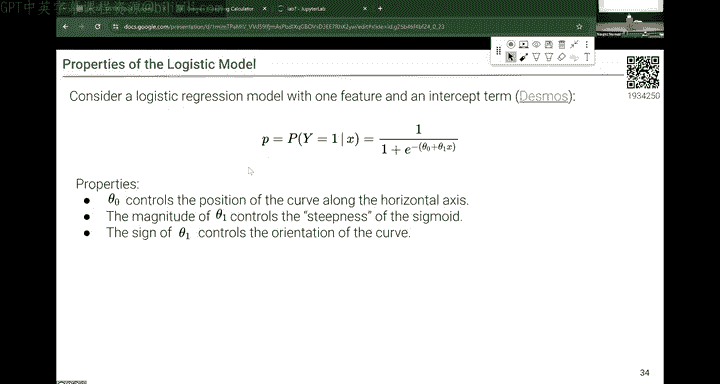
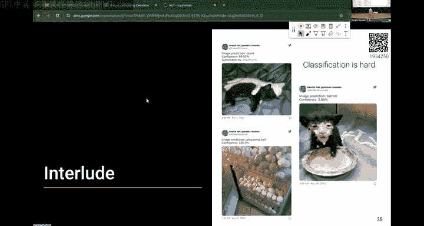
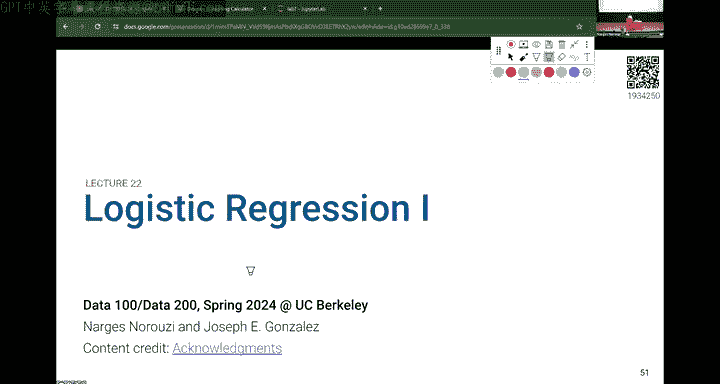

# 课程22：逻辑回归与分类入门 🧠

在本节课中，我们将开启机器学习的一个新篇章：分类。我们将学习逻辑回归模型，理解其如何从回归模型演变而来，并用于预测类别而非连续数值。我们将推导逻辑函数（Sigmoid函数），并介绍用于优化模型的交叉熵损失函数。

---

## 概述：从回归到分类

上一节我们介绍了回归模型，它用于预测连续的实数值。本节中，我们将看看如何将类似原理应用于预测离散的类别，即分类任务。

在机器学习领域，学习任务通常分为三类：
1.  **监督学习**：使用带有标签的数据进行学习，如我们学过的回归和即将学习的分类。
2.  **无监督学习**：从未标记的数据中发现模式，例如降维和聚类（我们将在后续课程中学习）。
3.  **强化学习**：基于奖励系统设计模型。

本节课，我们专注于监督学习中的**分类**任务，特别是**逻辑回归**模型。

---

## 分类任务简介

分类与回归的核心区别在于预测目标。回归预测一个实数值，而分类预测一个**类别标签**。

**示例**：
*   预测一封电子邮件是“垃圾邮件”还是“非垃圾邮件”（二分类）。
*   预测一张图片是“猫”、“狗”还是“鸟”（多分类）。

在Data 100中，我们主要关注**二分类**，即预测结果只有两个类别，通常编码为0和1（例如，输/赢，垃圾邮件/非垃圾邮件）。

---

## 逻辑回归模型框架

逻辑回归的流程遵循一个清晰的模式，与回归类似：

1.  **模型**：选择一个能够输出概率的模型。
2.  **损失函数**：定义一个衡量模型预测好坏的标准。
3.  **优化**：找到使损失函数最小的模型参数。
4.  **评估**：评估模型在新数据上的性能。

本节课，我们将重点解决前两步：**模型**和**损失函数**。

---

### 从线性回归到概率模型

在线性回归中，我们计算特征的加权组合：`y_hat = X @ θ`，得到一个无界的实数值。

对于分类，我们希望模型输出一个介于0和1之间的值，代表数据点属于类别1的**概率**。为此，我们需要一个非线性函数将线性组合的结果“压缩”到[0, 1]区间。

这个非线性函数就是**Sigmoid函数**（或称逻辑函数）。

**模型流程**：
1.  计算线性组合：`z = X @ θ`
2.  应用Sigmoid函数：`p = σ(z) = 1 / (1 + e^(-z))`
3.  输出概率`p`，代表`P(Y=1 | X)`

---

### 推导Sigmoid函数

我们如何得到Sigmoid函数这个特定形式？让我们通过一个篮球比赛数据集来一步步推导。我们有一个特征“投篮命中率差值”（`goal_diff`），目标是预测“是否获胜”（`won`，0或1）。

**步骤1：观察数据关系**
如果我们绘制`goal_diff`与`won`的散点图，数据点会集中在y=0和y=1两条线上。这并不直观。

**步骤2：计算“平均图”**
我们将特征值分成若干区间（箱），并计算每个区间内`won`的平均值。这个平均值代表了在该特征值区间内，球队获胜的**经验概率**。绘制这些平均值，我们得到一条从0平滑过渡到1的**S形曲线**。

**步骤3：引入几率比**
直接对这个S形曲线建模比较困难。我们转而考虑**几率比**：`odds = p / (1 - p)`，其中`p`是获胜概率。几率比衡量了事件发生与不发生的相对可能性。

**步骤4：线性化关系**
当我们绘制`goal_diff`与`log(odds)`的关系时，神奇的事情发生了——我们得到了一条**直线**！这意味着`log(odds)`与特征`goal_diff`之间存在线性关系。

**步骤5：建立模型并反推**
因此，我们可以建立线性模型：`log(odds) = log(p / (1-p)) = X @ θ`。
从这个等式出发，通过代数变换，我们可以解出概率`p`：
`p = 1 / (1 + e^(- (X @ θ)))`
这正是**Sigmoid函数**！

---

### Sigmoid函数的性质

Sigmoid函数 `σ(z) = 1 / (1 + e^(-z))` 具有以下关键性质：
*   **输出范围**：将任何实数`z`映射到(0, 1)区间，完美表示概率。
*   **中点**：当`z = 0`时，`σ(0) = 0.5`。这是模型的决策边界，概率为50%，难以判断类别。
*   **单调性**：函数是单调递增的。`z`越大，输出概率越接近1；`z`越小，输出概率越接近0。
*   **参数作用**：模型参数`θ`控制着S形曲线的形态。`θ0`（截距）控制曲线左右平移，`θ1, θ2, ...`（特征权重）控制曲线的陡峭程度。

---

## 交叉熵损失函数

有了模型，我们需要一个损失函数来训练它。一个自然的想法是沿用回归中的均方误差。但将其用于分类（概率输出）会存在问题：

1.  **非凸性**：损失函数可能存在多个局部最小值，梯度下降算法可能无法找到全局最优解。
2.  **惩罚力度不足**：即使模型完全错误分类（例如真实标签为1，预测概率为0），均方误差损失也被限制在一个有限范围内（0到1之间），无法给予足够大的惩罚。

因此，我们引入**交叉熵损失函数**，它专为概率输出设计。

**单个数据点的交叉熵损失**：
`Loss = - [ y * log(p_hat) + (1 - y) * log(1 - p_hat) ]`
其中，`y`是真实标签（0或1），`p_hat`是模型预测的概率`P(Y=1)`。

**工作原理**：
*   当`y=1`时，损失为`-log(p_hat)`。如果预测概率`p_hat`接近1（正确），损失接近0；如果`p_hat`接近0（错误），损失会趋向无穷大，给予巨大惩罚。
*   当`y=0`时，损失为`-log(1 - p_hat)`。如果预测概率`p_hat`接近0（正确），损失接近0；如果`p_hat`接近1（错误），损失会趋向无穷大。

**经验风险**：
我们的最终目标是最小化在整个数据集上的平均损失，即**经验风险**：
`J(θ) = -(1/n) * Σ [ y_i * log(σ(X_i @ θ)) + (1 - y_i) * log(1 - σ(X_i @ θ)) ]`
这个函数是凸的，保证了优化过程能找到全局最优解。

---

## 总结

本节课中，我们一起学习了：
1.  **分类任务**与回归任务的根本区别：预测类别 vs. 预测数值。
2.  **逻辑回归模型**的框架：通过线性组合加Sigmoid函数，输出属于某一类的概率。
3.  **Sigmoid函数的推导**：我们从数据观察出发，通过计算几率比和对数变换，线性化关系后，反推出了Sigmoid函数的公式 `p = 1 / (1 + e^(- (X @ θ)))`。
4.  **交叉熵损失函数**：我们了解了为何均方误差不适合分类任务，并学习了交叉熵损失如何根据真实标签对预测概率进行有效且严厉的惩罚，其凸性保证了优化的可靠性。

下一节课，我们将继续探讨逻辑回归，学习如何设置分类阈值、评估分类模型性能，并完成整个建模流程。