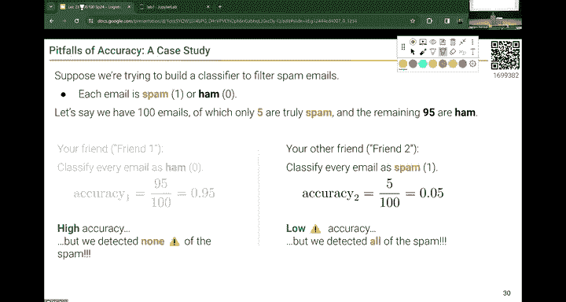
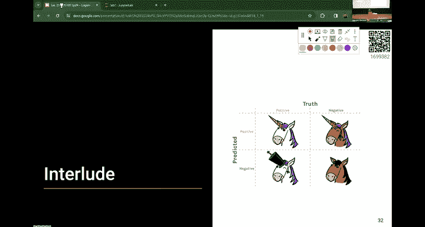
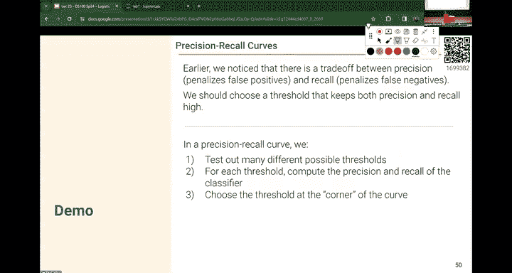
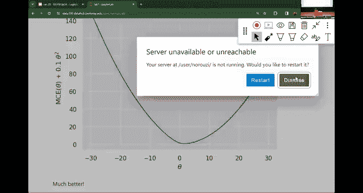
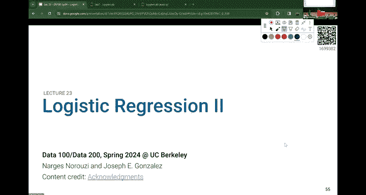

# UCB《数据100数据科学原理与技术｜Data 100 Principles and Techniques of Data Science 24SP》中英 - P23：-23-Data 100 Spring 2024 Lecture 23.zh_en - GPT中英字幕课程资源 - BV1Bc2dYCEbc

Good morning everyone。 Welcome back to the second logistic regressionion lecture。

 Hopefully you got signed in to sliddo before I just dive into the logistic regressionion。

 I just want to say few words about our little Edison Edbot so some clarifications。

 There were a bunch of different questions coming our way one， you can just use it。😊。

Kind of for free without giving consent So why do you want to use that because it is going to shorten our turnaround time of responding to questions on Ed right but please don't give consent if you're including any personal information like if you're just talking about accommodation or something that's like not content related or logistics related to the course you don't need to give consent we're just going to reply to you directly。

 but otherwise you can technically use Edbot and just say that we are the yes that you're putting in your post technically just gives us permission from the FERPA kind of regulation standpoint to prompt your question to an external G4 what's going to happen when we're going to invoke open AI G4 then technically what happens is that no data is going to be stored and open AI is not going and G4 is not going to be using your data。

To do any fine tuning undermod。 That's the rule that if the models are invoked by API， they cannot。

 the data cannot be used for fine tuning any model as opposed to if you have G4 child G subscription your data is going to be used for training right so that's the difference。

 The only thing that's going to happen is that Microsoft has a 3 day abuse monitoring system that is just going to record all the conversations for 3 days in case there is like a complaint or something that they want to take a look。

 but otherwise your data is not going to be stored on the external party database or whatever and your data is not going to be used as a part of any training of the model。

 So feel free to just say yes so that we can use the bot you're going to see the response always with the icon of the Edison but technically what's happening is that the Ts are invoking the bot。

 they're going to get a response。 will be they will be evaluating the response and they might be。

Some cases modifying the response so don't think that if you give us consent to technically use your question to invoke the bot。

 this is technically going to mean that there is like direct communication between you and the bot it's always going to be the Ts for validating the response right so there is a degree of the change that the Ts are making behind the scene。

 but you don't see those edits but just be sure that you but you can be sure that like when you're giving us consent to use your question to invoke the bot then the response is 100% accurate because it is monitored by ATA the second piece that we talked about like you're giving us consent for doing the research is just for us to take a look at what was the delta between the original response from the bot and what the Ts decided to give you as the final answer and just try to make sure that the gap is as little as possible so that in future revisions we can just directly release it for you to use so that。

Can directly have be able to invoke the bot and get the response right away That's the part that is that we would require your consent specifically and if you don't give us consent in the second piece。

 obviously your data is not going to be used as part of any kind of modeling or any kind of evaluation but again you will have the right to use the bot even if you don't want it to be used for research and your data is not going to be stored anywhere except for like the Tri day abuse monitoring that the Microsoft has that we can turn off okay hopefully that clarifies things if you have any more questions feel free to shoot us an email or like asked on it and we will respond to your questions。

With that out of the way let me talk about today's topic again we're going into logistic regression second lecture of logistic regressiongress today we're going to see the second piece of the logistic regression we said that there is the modeling piece or the logistic regression that is giving us the prediction that is giving us the probabilities but to turn the proba into classes we need to have some kind of a decision rule that is what we're going to take a look at and then we're going to see a couple of metrics to see how we are generally evaluating a classification task because the regression task was entirely different so we need to have new metrics so let me talk about the decision rule and the decision boundaries and what does that mean remember we had this kind of workflow that we started seeing last time we said that okay there is this data frame that's coming in that is your design matrix your design meters has a bunch of different features it can have one feature more than one feature what we're going to do at the part of the modeling the only。

😊，Tinable piece in the entire logistic regression is these set of parameters。

 this vector what is that vector that vector says that how should you incorporate importance of each one of those features and what's a biot that you want to add which technically what's going to happen is we're going to multiply x transpo by theteta vector that is going to be the vector that we're going to train and optimize and find the optimum set of parameters which is going to give us some scalar value that I'm going to call it Z and this is a real value number that then later we will pass it into a sigmoid function and sigmoid function is going to give us a probability the equation for the sigmoid function or logistic function from last time if you remember it was that if we provide an input T this input t is an unbounded value between negative infinity and positive infinity then the sigmoid value is going to be calculated as1 over one plus E to the power of negative。

Of T and you can prove that this value of sigmoid of t is always a value between actually there's no equality between0 and1 and that's why we call it a probability and we state that it models probability for us and the way that we train those weights is that those weights should correspond to giving us an activation that then if I pass it to the logistic function it gives me the probability that the probability is hopefully going to be close to the class that I want to assign data points to today we're going to focus on the second piece the decision rule we said that there is a certain decision rule or a threshold that we're going to apply that and we would say that anything above that threshold or that decision rule is going to classify data points in the class1。

 anything below it is going to classify as class 0 and in data 100 we're only concerned with binary classification right that's why I always talk about one probability because once I know one probability and that probability is the probability of class1 then uniquely。

I can identify depth the probability of class zero and that's all I want right and then the output of the decision boundary。

 applying the decision boundary and the decision rule is going to be the actual classes。

 zero and ones that then we can go ahead and evaluate。

This is the equation for the logistic regression I briefly mentioned it in the previous slide。

 but technically the entire model is going to give us the probability。

 it has had because it's a predicted probability right every time that we were predicting something we would put a hat on it so it's a predicted probability that is parameterized by the parameterteta so if you change Teta your probability is going to be different right what is the optimum set of parameters it is the optimum set it is a set of parameters that gives you the best set of probabilities across your entire data set What does it model it models the probability of us predicting probability of a data point belonging to class1 given that I have information about those features from the data point that I have the output obviously is a probability because we said that it's a value between zero and1 and then it also talked about the equation。

But what is the decision rule because I don't want to work with this probability。

 I want at the end what you want is you just want to know whether is class one or whether there is class zero and that's the thing that we won and we will apply the decision rule。

Most commonly the decision rule that we're going to use is some kind of an step function。

 how does this step function work the step function is going to be kind of designed around a threshold T that we would say that if the probability that you're giving me for class one is above a certain threshold I would output one I would class as class1 if it is below that threshold it would be classified as class zero and then that's how we are going to get the final final output of the actual predictions which are the y hats which are going to be zero1 values。

 binary values which then you can compare with the actual labels that you had in the data。By default。

 SKLn uses a threshold of 50% or 0。5， but that's not always the case。

 we're going to spend like a third of today's lecture to talk about what happens if I move that threshold and what does that entail in terms of different metrics and how should you choose it and why 50% is not all these the optimum threshold that we can use？

So I want to kind of build a little bit on top of that intuition Why do we need to have a threshold Think about the threshold as your confidence threshold right。

 say that if you want to classify if you for example。

 had a medical test and a medical test result came back and you want to classify a patient into whether the patient has cancer or not cancer。

 you want to basically have a margin of confidence and you want to say that okay I'm going to say yes。

 when my confidence into classification is say 20% even if I think that there is a 20% probability that the patient has cancer。

 I'm going to just say cancer and then go through the biopsy and then validate that I don't want to miss any cancer patient right so that's how you can think about moving the threshold and the importance of the threshold which is like technically think about it as like where do you want to put your confidence and then do you want to have a super high confidence or do you want to basically。

A little bit more lenient or do you want to just cut halfway and say， okay。

 50% probably is going to be empirically be the probability that I can live with。

So what does the decision boundary give us， the decision boundary is going to give us a hyperplane in feature space。

That's a complicated statement let me take his step back， walk you through a demo。

 build a logistic aggression with SK learn so that you can see it for the first time I don't think that we did actually train it before and then we will take a look at what that means what that line or hyperplane actually means。

So we're working with the same data set as last time you have the code on the website these are just some setups what I want you to notice is that SK learn linear model is going to have a bunch of different linear models that you can use so I just imported that as LM which then I'm going to basically call logistic regression and then create an object of logistic regression in the same way that you would do LM that linear regression to create a linear regression object that's that easy so I can technically directly use that。

So this is again， same data set as last time， mostly the same。

 there is a team that's playing in a matchup， there is a result of whether they win or not。

 there was a goal， the average goal difference of all of the players。

 and then this is a new feature that we're adding compared to last lecture that is ASD which is the average number of assisteded players gave during that a specific game。

So this is what we also saw last time that when I plot using a strip plot and I plot the feature on the x axis and the target variable and the y axis。

 then technically we can see that depending on the feature value， the average goal difference。

 you are seeing whether the teams are in class zero or class one。

 that's why you see like those horizontal points along the1 equal to zero and1 equal to one。

So let's go ahead and create this logistic regression model。 So I created this design matrix。

 Then I also have my target values。 that I'm only going to model using the goal difference。

 So I'm going to go ahead and say that I'm going to create a model object。

 And this model object is going to basically be called on the linear model sets。

 which is I'm going to say logistic。😊，Logistic regression。And then actually， if we take a look。

 this is actually a logistic regression object。What was the next step in linear regression。

 It was fitting the data。 You just created the barebone of like what is the function that you that would act as your model。

 but then you need to actually find out the optimum parameters。

 So you call the fit function in the same way that we call fit function in the linear regression and then our model is going to have their optimum parameter。

 So I would say that okay， this model object that I have。

 I'm going just going fit to the data set that I created。 This is the training data right。

 I have the design matrix。 I have the target values then technically I have now the train。

Model parameters， right， So that's ready to go。 What I can do is I can actually go ahead and say that I want to take a look at the output of this model。

 One way that you can take a look at the output of this model is you can say that model that predict。

😊，Probability so we want to take a look at what is the probability that the model is outputting so I would say predict probability and then I'm passing the input or the entire design matrix X and let's take a look at the result。

So you see that the result has a bunch of different rows。

 we can think that like all of those rows are the rows of your design matrix kind of are associated to the rows of design matrix。

 so one corresponds to every given data point and then you see two values you see the two values in each one of those arrays in each one of those list which then if you kind of take a look and examine that closely the summation of the two element does add up to vehicle equal to one so this should that give you information that this is some kind of a probabilityability but you have two probabilities。

And it is true because we had two classes， so the model is giving us two probabilities one for each class。

 so class one and class zero， but I just don't know in what order and what how the model is referring to multiple different classes that I have。

So what what I can do is I can say that， okay， model dot。Glasses。

Give me the classes that you have and the actual order that you're going to give me the output so here the classes is going to give me that okay there are two classes they're called zero and one and that's the order that they have so the first probability that we that we sign each one of the row is the probability of class zero the second one is the probability of class one。

Right， what we wanted was actually just working with probability of class  one。

 So I can just directly go ahead， extract the second element of this entire this entire output and then technically use that as the model output that I have。

 So I'm just gonna grab this probability， which is probability of class one。 given the data point。

 So I'll do that and say that， okay。Model dot predict。Pbability on x right。

 and then I would say that I just want to take a look at the second element right for all of the rows。

Give me only the second column right and then we can take a look and then we're seeing that all of those second elements are retrieved。

 So now we directly have one probability， which is probability of class one for every given data point that I have。

Right so what do I do with that probability I just really need to assign it to class It needs to turn into a label zero or one。

 so what I can do is I can say that okay， let me apply the decision rule let me say that if the probability is greater than 50% it's class one let's just try that so i'm going say that okay。

 if the probability is greater than or equal I'm just going to work with equal to。

Tell me what the class is going to be。 if I just say P greater than or equal to greater than or equal to 0。

5， it's going to give me a bunch of true false values。 True falses do associate with true class  one。

Fals class  zero or not class  one， right， I just need to now turn it into zero months。

 You have done that multiple times in your homework。 I can just。

Change the type from Booleing into integer and then by default true is going to be translated into one and then false is going to be translated into a zero so I can just say that take this operation that you did and then give me that of type integer。

And then we're getting all of those zero1 values that we wanted。So this is like end to end。

 everything super simple with S scale learn。It can actually get even easier so instead of you getting the probability and instead of you applying the decision rule yourself you could just directly say that okay go ahead and predict on all of this entire design matrix that I have and just give me the classes and it would give you exactly the same thing it's just that by default it would apply the decision rule of 50% that's the only difference right so predict underscore PRA is going to give you the probability。

 then you decide that like which probability you want to get for what class then you will basically obtain that then you can apply a decision rule and then you have the classes that you want or whether the classes true or false for that specific class or you could directly just go with this the default is that the threshold is 50% and you have to really trust me on that process that these two arrays are exactly the same right and you can also examine that。

So what I'm doing next is I'm adding a column to my data frame called Preor classes。

 I I want to store all of those zero and ones， and I want to create a strip plot that the color this time is the predicted class。

 not the actual label and then see how it looks like and the rest is just the line here that is the line of the equation for the stigoid。

 So let's take a look together。 So you see that what's happening here is that under the X axis。😊。

I have to make it a little bit smaller。嗯。On the x axis I have the only feature that I got right and then on the y axis it's one the grand truth label0 or1 right and the colors are the predicted values so you're seeing that the predicted class of orange class one are all of the data points that are here and the data points that are here obviously this set right here is misclassified because my threshold was low and it was misleading and it was putting some of the class zero ones into a class one and then the blue points are the predicted class class zero so we are doing well on this side here these are the correct class zeros that are labeled as zero but these are also the cases that we have a misclassification。

So when I talked about the decision boundary being aligned。

 you should kind of be able to see where that line is right you see that kind of vertical line that's separating the two classes from each other so the way that is happening is that so when I take a look at this data point right here this technically corresponds to 50% right here。

 so think about the y axis as being the axis of probability from zero to one So at the 50% was the time that was the place that we were cutting or we were putting that threshold or putting that cutoff so what's happening right there is that at the 50% it's actually going to cut it and then it will basically say that any value from here to the left is going to be going to give me enough activation for me to come up with a probability that is always less than 50% so that's why it's going to be classified as class zero and any value of feature value above this value。

Above that like feature value is going to give me an activation a coveted combination of features that's going to give me a probability above 50% and that line is my decision boundary so my decision boundary is actually in the feature space so technically I was wrong in saying that that was my decision boundary but this is actually my decision boundary right here the decision boundary is in the feature space you only deal with like the features so I have only one feature that's why my decision boundary is only on one dimensional space and i'm using a rock plot in order to show that decision boundary but if I go into two dimensions right so I go to two dimensions and say that okay I want to create。

A model with two features， and I still want to model one in the same way。

And the decision boundary now this time is going to become an actual line and this is in two dimensional space you can imagine that if I have three features。

 then we're going into a three dimensional space and a line in three dimensional space is actually a hyperplane is's not a line anymore it's like a hyperplane in three dimensional space There was a question right here。

Sure。Which one。Yes。That's the scale so the question is like if the answers are01。

 why is there is is such a like large gap compared to what we're seeing on the x axis that's why default is going to scale them proportionally so that like it covers the entire range of x and in the entire range of range of y so they're not going to have the same scale that's like automatically what we do and then you can also if you want to rescale them to the same dimensions then you can do that but then just think about having two ticks here from zero pick of0 and tick of1 and anything in between is possible just think about that as probability。

Good question。So let me move on， this sounded a little bit complicated。

Why did I get this equation of this line right here？

Or how did I come up with the equation of that line？So think about it for a second。

 So what's happening technically is I say that， okay， I want to put the threshold。

I want to put the threshold to be equal to 50% right what value is going to give me the threshold of 50% So how am I calculating these probabilities so technically the threshold is that the point that1 over one plus e to the power of negative z I'm just directly using z which is like a weight the combination of features n weights and whatnot is equal to T right so what I can do is I can technically say that okay now one over t is equal to1 plus e to the negative z and then I can say that okay e to the negative z is equal to1 over t minus1 and then I can take the log of the both sides so if I take the log based e of the lefthand side this is going to give me negative z and then I'm taking the log base e of the same thing1 over t minus1 and then I can just technically move the negative sign to the other side。

So you're seeing that this is Z equal to like a constant factor。

 That's a constant factor that you decided like you have T。 you just do that like calculation。

 you have a constant value。 What do you have on the left hand side you have a linear combination of features that's why you see a line so what is what is z let me write z one more time here。

 Z technically in this case is equal toteta0 plusteta 1 times x1 which in this case I can assume that that's the goal difference that I have plusteta2 times x2 which in this case is going to be AS T。

 So this is this is z is now equal to a constant value。 What is that that's the equation of line。

 That's why I see a line in this case So the line is like super beautiful when you have two features because it's like clear what's happening there is a line that's gonna have an interceptors the specific slope that talks about like sorry it was。

Hiding behind us， this slope that's calculated based on like the。

Tetta 1 and Teta 2 Valley that we have。 But the bottom line is that that characteristic is line。

 What happens if you move the threshold。If you move the threshold then you're just moving the line you're moving the baseline right that's the only thing that's going to happen Why is it important Because then technically you can just play with this threshold to figure out where it makes sense to put that threshold where do you have misclassification So in this case obviously my color the color that I assigned was the color of。

Where can I show you Yes， the color was the predicted classes so it makes sense that you see that clear nice distinction between the two classes。

 but if I go ahead and just use the one the actual ground truth value as the color then you're seeing that it's kind of a messed plot and it's not going to be linearly separable that's the first one that you're hearing that term so my data set is not linearly separable because I have those misclassifications around the decision boundary that's why tuning the decision boundary is important because you you might want to say that okay I want to be more conservative on capturing all the orange points or capturing all the blue points and then just moving this line so that like it sits where you're comfortable with。

Question。It is a feature that's representing the average number of assists。The question was。

 what is ASED， sorry， forget to repeat it。Questions。How are we feeling。Good sideways。und sideway。

 Okay， it's gonna get better。 It's tilting down。 Okay， let's see。 so moving on。

 we talked about this decision boundary。 you saw the importance of this decision boundary。

 one thing that I want to tell you is that you might think that， oh。

 this logistic regression is so powerful。 It actually has room for improvement because the capacity of logistic regression to do a classification is that line that it's putting。

 So if your data set is not linearly separable or your data set is not clean and whatnot。

 and it has a nonlinear decision boundary it's not going to be able to do a good job in classification。

 That's where in neural network， this is kind of a teaser for neural network。

 they put multiple of these together。😊，To make a non linear decision boundary。

 So there's a bunch of different lines that if you say that there is this。

There is this line here for one logistic regression。

 there is this line here for one logistic regression。

 this line here for one logistic regression and then one here。

 then all of those piecewise linear functions will form a non nonlinear decision boundary and that's how we navigate more complex feature spaces。

 but there's this is kind of a limitation of logistic regressiong but。Also。

 a nice thing about legislative aggression that once you understand it。

 then technically that's a gateway for you to understand everything in deep learning。All right。

 so what did we see we saw decision boundary， we saw the definition of that we saw that in this case that I have one feature then my decision boundary is only a single point if I have two features then my decision boundary is going to be a line and then if you increase the dimensionality of the feature space you're going to go with seeing a hyperplane in the feature space All right so we talked about this equation so we said that if I set a threshold right here for all of the points that the probability is exactly equal to this threshold then those points are going to be on the decision boundary for me then we did the transformation which you can see here that like I did the entire transformation and then you can see that on the left hand side there is the equation for the line and then there is like the biast here there is a constant factor here that if you rearrange a stuff it is the equation for a regression line and this is all。

So the plot that you saw that it does a little bit of misclassification because this data is not as clean as we want it to be。

So now let's talk about linear separability， I talked about linearability separability a little bit and we saw that in this example my dataset was not linearly separable so I want to see what happens if my data is linearly separable an example of a dataset that's linearly separable in one dimension is for example。

 this data that if I can put a point anywhere between those two like the right most blue point and the leftmost orange point and then that is a full kind of a decision boundary that will give me 10 percent accuracy and there are cases that no matter what you do you're not going to be able to get 100 percent accuracy so no matter where you put that decision boundary you're going have misclassification in two-dimensal space is the same thing the left hand side is an example that I have a linearly separable data and on the right-hand side so this is a linearly separable dataset on the right- hand side you see。

No matter where I put my decision boundary， there is at least one point that's going to get misclassified and that's an example of a known linear。

 not linearly separable data set for us。So we might think that okay。

 it's nice if I have a linearly separable data set。

 then I should be able to have 100% accuracy and a zero loss let's see if that's actually true so say that I want to just take a look at my linearly separable data set and I want to see whether I can reach the loss which we saw last time crossenttropy loss that we're using for classification that is going to be equal to zero。

So kind of a reminder of cross entropy loss function。

 This is the crossenttropy loss function that we had The negative sign comes from the fact that if you're taking a log of a value between0 and 1 which is going to be the case for both of those log values it's going be a negative value and in order for us to penalize the model positively like there is a penalty that should be positive then we're adding that negative sign that's the first thing and the second thing is you saw it last time high built this loss function as a combination of two functions I said that okay in the case that my ground truth label is equal to one only one of these functions or one of these terms is going to be active if y is equal to one then the second term right here is going to be equal to0 and will cancel out because when y is equal to one then this whole thing is going to be equal to zero that will go out of the way then the loss is0。

Technically going to be negative log of P。Which then technically you're going to get a loss of zero if your p is equal to  one。

Right so the only way that this is going to be the best case scenario and you're not going to be penalizing it and you're going to have a loss of zero is that one times log of p is equal to0。

 which makes log of p equal to zero which makes p equal to1 that's how it's going to happen that's how it is important that the probabilities are going to be as close as possible to the actual groundous values so if the ground truth values is one the probability has to be very close to one if the groundrus is equal to0。

 the probability has to be close to zero and you can kind of do the same calculation in the mirror case as well。

So。😊，Let's see。And you two and you allright， wonderful。 So let's consider a simple example。

 Let's consider an example that I have one feature and I don't want to use any intercept。

 So then technically that means that my parametermetric model is going to be equal to one over one plus e to the power of negative theta。

 which is like a scalar value is not a vector at this time because there's only like one feature of one parameter。

teta times x So what I'm saying is if I am telling you that the ground first label is equal to1 and that your feature value is equal to one as well x is equal to1 what should be theteta value so that your loss is equal to0。

And that's the slideo for you。So the question is looking at that loss function right there。

 looking at what I said about what P should be corresponding to the grandur values in the optimum case。

If x is equal to 1 and if heta is just the scalar value。And if y is the equal to one。

 what should be TeEta？Let's see how are we doing。0，0， infinity， okay， Infinity has 19 boat。

 Teta has 0，5 boat。Oops， what happened to that。All right， going back。And going forward。Infinity。

 infinity credit。ok。嗯。This is slightly unrelated but we had a paper on how students are using a slideo that was published in 602024 which basically we took a look at a student's earnestness and using a slido like are they actually like being earnest and like doing the activity and like learning and sharing or like is it just that they're completing for grade I suggest that you go ahead and read it or we can also link it on that and you can read it afterwards but it looks like infinity is spinning so that's good but that is the right answer so what I want to do is I'm saying that y is equal to one so P has to be equal to1 from this is statement right here。

 so one equal to one over one plus E to the power of negativeteta times1 because X I said is also equal to one so the only way that this fraction is going to be equal to one is that the second term in the denominator be equal to zero。

And the only way that this second term can be equal to zero is for TeEta to be equal to positive infinity。

And do we like positive infinity or no？We don't like positive infinity as a weight。

 We don't want large weights。 Does that ring a ball anywhere that we didn't like large weights。

We didn't like large weights in linear regression too we generally don't want too many weights and we generally don't like really large weight because large weights are an indication that we're overfitting to the data so technically what's happening is。

When the data set is linearly separable， then what's happening is that we will have diverging weights and our weight are going to diverge the positive infinity and negative infinity and that can be a problem so let me show you an example so this is a purely like linearly separable data set with only two data points and with two classes right so let me show you what the issue is going to be with this data set right here。

😊，So this is the dataset set right so this is like just two points x and y I just created as a toe example and what I want to show you is that if I don't want to have a bias term and I only have an intercept and I tell you that okay every time that you give me TeEta and you give me x I'm going to create this logistic regressiongress model and then I want to plot mean cross across entropy loss because we have crossenttropy loss that we need to calculate average of cross entropy loss across the entire data set so if we take a look at this function。

 this function is going to look like this， this is our cost function and it is cost function because you can see that as I changeteta and I plotted the cost function or empirical risk on the y axis。

 you see that anywhere that I start the initialization process here so if I start the initialization process here and I just run great in this。

and go go down this slope then I'll reach to that kind of a flat area and what's happening in this flat area is that it's not flat it's actually that if you go ahead and take a look at say the last 10 values you can still see that it's something that keeps decreasing and that's why the model is going to keep increasingteEta and then this is like gradually decreasing and decreasing and decreasing and then it really has incentivized to like go all the way to TeEta being positive infinity in order to get us the optimumteEta。

Which is what you saw right here。What we can do is use our knowledge from before。

 what did we do when we didn't like large Tetas？Say that loud。

Regularization I'm hearing right we did regularization so this is an example this is an extreme example of what happens if we have the divergent weights when we have divergent weights and the weight is like positive infinity you're going to have a very high very sharpest load and then what's happening is that if later on you're going to come back and do inference on a sample data point and your sample data point is going to be misclassified what's going to happen is that the label of this sample is equal to one but based on your model。

 the probability is going to be equal to zero right and then if you plug it into your loss function your loss function is going to say that okay the label is equal to one so I'm going to go with the first term in calculating cross entropy loss and then when I calculate log of a value an epsilon greater than zero this is going to be negative infinity and then because I have。

😊，That negative scientist is going to be positive infinity or an infinite loss that I'm getting for just one misclassification。

 We don't want that。 We want penalty， but we don't want to have like positive infinity penalty that we can do anything about it。

 because again， you might have samples in your test set that are going to be misclassified anyways。

 So we don't want to penalize it。 And we heard from you that we can do regularization。

 Let's see how we can do regularization。With the regularization。

 it's exactly going to be applied in the same way that we had before the first part of this is slide that this equation is a little bit of scary。

 but this is what you saw previously you saw mean cross entropy loss so let me read that on the equation for you。

This is the mean part right and this is the cross entropy loss that you saw from before and then technically what you can see is this right here is the probability of I so we just put the sigmoid of that weightd combination now we also have the second term for regularization so here i'm adding the penalty remember that we always had the penalty and then here I'm just going to say that I'm going to do L2 regularization。

But you're fancier than this， you know that there's L1 regularization。

 there's all types of different regularization that you can use。

 but the bottom line is that I want to have some penalty in the loss function that will enforce it to not get positive infinity or negative infinity weights or else this entire objective function is going to be positive infinity。

 so it will basically stop somewhereber。There is that the stopping point。

 so let me just change the code that I had from before this time I'm just including also the regularizer term or the penalty here。

 which technically says that go ahead and calculate mean cross entropy loss and then add this second term of regularization times heta squares。

 which is L2。And then if I do that， then technically， you see that my loss is going to be different。

 So now theteta， the x axis， obviously is Teta。 Theteta is not going to go to positive infinity for the optimum point。

 The Teta is going to be somewherem before， because if Teta keeps increasing that lambda times theta square is going to penalize it more。

 So this is going to basically shift and limit how big how large theta can be。

 And that's why I'm getting this other convex function that we're seeing right here。

 So with regularization。 We were able to。We were able to actually get this finite argument minimum。

 so we will never have deposit positive infinity or negative infinity weights in the model anymore。

 which is good because the model is not going to be overconfident and if it does missclass。

 it's not going to penalize it by infinity。So you might be asking how can we implement it。

 the implementation is also super simple like before but just say that the penalty function is going to be L2 you can go take a look at the documentation and you can use L1 or any kinds of other types of penalty functions and similarly we can also specify the hyperparameter for regularization as well so here we're showing the hyperparameter to be the value of 1 and remember exactly similar to linear regression this C has an immer relationship with lambda so larger C is going to penalize less and the default value for penal is L2 the default value for C is equal to1 which should tell you that by default logistic regression is going to apply regularization for you even if you don't explicitly say it because it is needed your data。

It might be linearly separable and you might not have a good model at the end。

 it will automatically apply that penalties that the model is going to be reasonable for us。Question。

by looking at it， if you connect two points on a graph， every two points on a graph。

 there should not be any part of the function between those two points that's at the top of your line that seeking line。

So for example， this function。嗯。Sa what was the function that we had last time？嗯。

I think we had this function right here right last time when we were using MSC for classification if I for example choose these two points and I create this then theres this this part of the function that's above the line that's kind of showing you that。

This function is not comevex。There should always be a guarantee that your function is going to be under it。

All right。Good questions As an aside， I kept saying that okay， if you run great Incent。

 this is what's going to happen and whatnot， but we're not going bother you but great in but logistic regressionggression is just complex enough that just knowing logistic regressionggression is enough you can just directly use SK learn create an object fit it and just use it directly there is also no direct solution closeform solutions that we had with OLS and whatnot there is no direct form solution So again。

 that's also that you're not going to see the calculus behind that as well。

Now let me talk about performance metric a little bit and this is the very last piece of every modeling that we're doing and with classification is particularly important because there is a certain kind of difference in the nature of classification compared to regression that we had seen before previously regression if I was just looking at the loss I would be able to just say how good my model was doing because the loss was kind of correlated with what I was predicting it was like something in the similar magnitude and similar notion that I was calculating especially if it was mean absolute error then that was really in the same kind of。

In the same kind of the scale that I had with the classification my loss is cross entropy if I tell you that okay mean cross entropy loss 100 like what does that mean in terms of probability right just translating that to what it means in terms of accuracy or in terms of the model metric is very complicated that's why we need to have kind of a new way of thinking about how do we evaluate it。

So we are going to introduce a bunch of different metrics today。

 I think particularly six different metrics that we're going to take a look at like where they're going to be used and how they can be used for us。

So one out of the way， this is accuracy， you know accuracy。

 so accuracy is how accurate are in your predictions？What ratio of your classifications are correct。

 meaning that of all of the points that you had， how many of them did you correctly classify that only deals with correctly classifying data points and that's the accuracy that we have we could directly go ahead and use the score function pass your design matrix you have the model so it knows the parameters it can do the prediction for you and then it will use the predictions in order to cross reference it with the ground truth labels and then it will give you the accuracy as a result so score in the language of SK learn is actually the accuracy or you could also go and take the mean of this comparison that you're doing in between your predictions and the ground truth values that you have。

So accuracy is good a lot of time when people talk about how good their models are。

 especially if they're not like。😊，Very professionally trained they would just report accuracy of their model。

 but in a case that there is class imbalance or there is a case that the importance of missing a negative sample and missing a positive sample are different from each other Ac is not going to be useful so we're going to see why that's the case。

Let's say that you're working with the email classification pass。

 so this is a spaM versus H your project B， I kind of gave you a hint that you're going to see two phase of project。

 one phase processing the data， one phase actually training a classifier that does the class between emails that are spaM and emails that are not the spaM or hamM。

Hypothetically say that you have 100 sample of those emails of those 00 samples。

 we know that like the ratio of a spam email is much less than the regular email so let's say that of all of those00 samples。

Five of them are spam and the rest 95 examples are ham right and let's say that instead of training the model you just go and talk to your friend。

 let's say that this is frame one and tell them to build a classifier for you but your friend is lazy and your friend says that okay every email that you give me I'm just going to say yes。

 I'm just going to say no， meaning that like I'm just going to put everything in your inbox and not filter anything nothing is a spam in this case。

So what your friend is doing is having a high accuracy。

 but let's see how high the accuracy is in this case。And it's more fun to see the response。

 as always。Okay， please don't respond on a slideo， respond here， otherwise you're not going to get。

Dgrreee。Alright。Now we're having all different variations that one can write 95%。

 So obviously this is like 95% accurate and like this is where you can see the danger of like just reporting accuracy you're just not doing any modeling you just have a constant model and then you're gonna get 95% accuracy and they can put it under the resume that like I got a model with 95% accuracy but this is no good and let's say that there is a friend too that's more conservative。

 The friend too says that I want to be very careful and not let any spam email landing in your inbox so I'm going to classify everything as a spam。

What would be their accuracy？5% the accuracy is only 5% the accuracy is low。

 but they were able to retrieve all of those cases so we're going to talk about like how do we compare these two cases which are the two extreme ends of a certain thing and then how do we put the right threshold in our model so that the model is going to do a reasonable classification for us。

😊。

So let's take our two minute break and then I'll come back and share that with you。Alright。

 so it looks like that。 We have our good two minutes。 This is a teaser into what you're going to see。

 I'm going to talk about two different。😊，Outcomes the outcomes for the prediction and then how does that correspond to the ground truthrous values which is also two different kinds of categories and then we're going to see how that looks like so there are four different categories of outcomes that might happen from that teaser thing that you saw there are cases that the model is going to say that okay my prediction is positive I'm going to classify the data point into the positive class or class one。

And they are correct in doing that so this is I'm going to mark this as correct true means that they were correct in doing so meaning that there is alignment between what happened。

 what the actual label was and what was predicted right so this is like the best case scenario that the case ones are going to be extracted there's also a category that that is called true negative so true negative case is a case that the outcome oops not that definitely。

The outcome is negative or negative class， meaning that y hat is negative。

 so we're predicting the class zero and the prediction is actually true because the Y class is also equal to actually let me use this utter color。

嗯。Da爹。There is agreement between the actual grant label and the。And the predicted label。

 And there is also the exact opposite of both studies。

 There is the case that the model says positive， right， So the model says positive。

 and we have this positive thing right here。 But then there is disagreement between the two。

 and then there is this disagreement means that the label is actually they're not in agreement with each other。

Right， so it is a false， positive report。Right that's how you can read it。

 and there is also the case that it says that it is actually negative。

 so we're saying that okay the prediction is actually negative。

 but they're not actually in agreement but each other because the actual label was equal to one and then technically the prediction that it did was false。

 It was falsely saying that it is negative that's how you can read it So then technically all the terminology that I used here means that positive and negative means that what was the actual prediction。

 positive means that the prediction was one negative means that the prediction was zero and then true and false means that whether it was actually correct in doing that or whether it was incorrect in doing that。

 So there's it's a little bit complicated but once you learn kind of the underlying language of how to read these four metrics。

 it will make sense。And the way that we will organize it all of these four values is we organize it into a confusion matrix what the confusion matrix is is a two by two matrix you can think about rows being as actual values so these are actual values in the rows and then the columns are are the predicted values so what you're seeing is that on the diagonal line is all of the correct predictions so here we're correctly saying that the cases negative because zero and zero is in agreement with each other here we have a true positive because it's a positive case and it was correct in saying that it is a positive case right so that's why the diagonal line is all of those good cases that we have and on the other direction then technically we have all of the cases that we had issue so this is the case that it said that the output is one right it said that it's positive but it was false。

😊，in saying that is positive in this other case， it said that it's zero。

 so it said that it's negative， but it was false in saying that so we have false negative so it's a little bit complicated to just wrap your head around like all of these terminologies that we're using。

 but then every metric that we're going to design is around making sure that across the columns and across the rows we have some kind of purity or we're measuring the purity across the columns and different rows。

So if I go back and say that okay， how do I create this confusion matrix。

 our friend SK learn in the metrics is going to do that for us so I can directly say that go ahead and import confusion matrix from SK learn that matrix and then you can just just directly call it and pass。

😊，The ground truths and the predicted predicted values。 The order matters， right， You can mix them。

 Otherwise， we'll think that the other one is ground truths。 And this is predicted value。

 and it will Bm。 So the first value is going to be the ground truth。

 and then you pass the predicted values and it will give you this kind of a heat map with those numbers where you can see where the saturation of your data points are。

 So for example， you see that the saturation of the data points is around the diagonal。

 So I I'm correctly classifying or extracting a number of positive cases correctly。 That's the 294。

 And then I'm correctly sorry， that's a negative case。

 And I'm also correctly extracting a number of positive cases。

150151 of them and then there are some misclassifications that you're seeing here and here as well。

 But you can technically take a look at them and then evaluate it and then see how the model is performing。

But this are accuracy in terms of these new metrics。

 it is the ratio of all of the correctly classified samples divided by the entire sample size we have。

 so this is divided by the entire sample size and then all the correctly classified ones are the ones that start with true it has to be true。

 the prediction has to be true as some true positive cases， some true negative cases。

 this is our accuracy。Al right， but we said that we should not always report accuracy。

 So that's why we're going to talk about purity across like different dimensions of this confusion matrix。

 specifically， there is a concept of precision。 So think about precision as like you have a medical test result and you want to figure out。

How precise is the outcome then technically you want to take a look at that when a cancer screening comes back and it says that it's positive what is the portion of the actual data points that are positive versus the entire population that are flag for for example cancer screening right so you just want to make sure that you're calculating true positive divided by true positive plus false positive so in the case that in the case of the precision then we're putting a penalty。

 some kind of penalty on the false positives we don't want to have some samples that we positively flag a case right so that's that's the problematic example in that case there's also the example of recall or the metric of recall recall basically says that I'm going take a look at the road that corresponds to the ground truth one right that's the ground。

the last row and I want to say that I want to be able to extract as much of the grant truth one values as possible I want to be able to recall every possible positive cases right so then technically here we're saying that we're interested in calculating all of the correctly classified class one cases that we had and we'll divide it by penalizing it based on the false negatives you had all the positive cases that you incorrectly said that theyre negative and I'm going to penalize it for that。

So you can see that with precision and recall with precision were penalizing false positive。

 with recall we are penalizing false negative and then they're considering different things。

 so the best case scenario is that if you have a classifier you have to report accuracy so you have to report precision and you have to report recall as well so that you can have a good picture of entire this entire confusion matrix that's happening here。

This is a nice visual from Wikipedia which I'm going to walk you through what that is this is the entire data that we have so in this entire data we're saying that let's think about dividing this entire data that we have into two different possible values so that's the line that we have we're saying that all of the positive cases ground truths positive cases are in the left panel and all of the negative cases are in the right panel so this is ground truths right so think about just kind of cutting it in half。

And then what the model is saying as the predicted class of one is inside the circle。

 so here you're seeing that actually not that， but what you're seeing here is that this circle right here is all predicted。

Class one。So what are we interested in？What precision says is precision says that how pure the circle is so when you said one。

 how accurate were you in saying one， how can I rely on your decision when you said one in the case of for example the friend one case when the friend one case is actually the opposite when the friend one says that everything is not a spa how can we rely on there thing that everything is not a spa in the other case in the recall what we're interested in is shifting this entire circle so that it captures the entire left panel right we just want to make sure that we cover as much of the left panel or the ground truth as possible so that's why the denominator here is the entire left panel for the recall and the ratio that you're covering is going to be just the recall ratio versus in the precision you're going to say that okay out of all the cases that you said are one top precise values so I'm just going to take a look at the ratio between the predicted class1。

Divided by the ratio of the actual class ones that are extracted and then divided by all of the samples that you labeled as class one。

So putting it into the context of this friend one and friend2 friend one had the accuracy of 95% what is the precision and recall so remember that precision was looking at the purity of the column one so it was going to calculate the ratio of true positive divided by the sum of true positive and false positive so the precision is undefined if the precision is undefined that's really bad that means that like or the recall or the we're going to get to the next metric later but this is the case that the precision is undefined。

What is recall in this case， this is how you can identify that actually there was a class imbalance and that's how it got a high accuracy with the recall we're going to take a look at this row right here and we're going to say that okay out of all of the possible cases in this row which is the combination of true positive and false false negative how many true positives were you able to capture so true positive capture is equal to zero and then the rest is just all of these false negatives that was equal to5 and then the recall is zero so。

😊，Kind of saying it in a different way it says that nothing was recalled， nothing was captured。

 nothing was returned。 that's how I got the 95% accuracy。

 that's why you when you put 95% accuracy plus recall of zero， then you will see the red flag。

 then you will discount that reported 95% accuracy。

What's happening with F2 there should be some benefit in being conservative F2 had a low accuracy。

 but they could argue that the 5% accuracy is actually not that bad by saying that they have a high recall so if they take a look at if we take a look at their recall it's this value through positive divided by this summation here so they have 100% recall 100% capturing everything that you said that you want to capture at the cost of having a low accuracy and then definitely also the precision is also precision is also low because we're calculating the purity of the column and the purity of this column is5 divided by5 plus 95 which is the same5% that we calculated。

Right so you can see why all of these metrics all of them together are very helpful so when were thinking about like what is this precision and recall and how precision and recall is changing depending on how we're putting our threshold and how we how we're training our logistic regression model think about the case that we want to avoid avoid or have a high precision if we want to have a high precision what should we do we just need to make sure that the false positives are as as small as possible how can I make sure that false positives are as as small as possible。

 I should be very conservative in saying positive I should really move the threshold to be high right don't say that it positive unless you're very confident with the high probability that this is a class of one。

What happens in that case when you're moving the threshold up or when you're moving the bar for the classification up。

 then you're technically going to have a lot of false negative cases because you will end up having a bunch of your class ones that are now going to be classified as class zero because they fall below that threshold that you have so theres always this tradeoff between precision and recall and this precision and recall tradeoff is actually based on the threshold where you said the threshold then you're going to have high versus high precision low recall and vice versa but the ideal situation is we want to have 100% precision and 100% recall for our case。

There are cases that we might want to value precision more and we might want to value recall more。

 right， so let's take a look at some examples。So。😊。

Sorry that I keep going back to the cancer screening case。

 but this is a case that you just want to make sure that in cancer screening you want to have a very high recall you don't care about precision you will said that okay precanancecer screening says that you have to go through biopsy and whatever whatever if the precision is 10% that's still okay as long as you captured all of the people with cancer actually in your population it's just that there is going to be a 95% of that population that's going to do some additional testing which is fine but you captured everyone that actually needed to be captured so that's the case that recall is very important precision is not important and you will see that in all of the results that are reported in the medical in the papers from medical domain。

Versus the case that hypothetically say that there's an AI that's going to decide whether based on a certain offense a person should be sentenced to prison or not in those cases。

 you really want to have a high precision you don't want to send an innocent person to prison so you really want to have 100% precision at the cost of not capturing everyone and maybe you're capturing them in next time or something like that and there are also some cases that there is no like really like。

呃。very critical cases with missing a case or not missing a case。

 which is an email classification task， which we're going to talk about like what should you consider in that project so that you're making sure that you're not blocking a certain voice by filtering all of all of the STM emails based on a certain criteria。

Now I want to talk about the last two metrics so the last two metrics are looking at the purity across both of the rows right so we looked at the purity of the last row。

 so this is kind of the same thing we basically said that okay if I'm looking at the purity of this last row I'm basically calculating true positive divided by the summation of everything that is ground truth positive then technically one this is the same as recall so true positive rate is calculated as true positive divided by true positive plus false negative which is the same recall that we had from before but this is new so looking at the first row you're saying that I'm just going to calculate false positive rate so false positive rate is bad recall is good like having high recall is good having high false positive rate is bad so the false positive rate is calculated as false positive falsely saying positive right？

Divided by all of the actual negative cases that you have。

 all of the ones that you false that positive， all of the ones that you truly said that they negative so you calculate a false positive rate in that case。

 so it tells you that how reliable your ones are， how reliable your zeros are and then technically you can。

You can think about it that way。How do we adjust the threshold so that we can have this kind of calculations that we had so we're saying that we have this decision rule and this decision rule or this threshold is going to play some kind of a role in having false positives and false negatives which are then going to impact precision and recall and let's see how that looks like so say for example I go ahead and set the threshold to be at 50% remember that when I had the threshold at 50% then I'm saying that this is kind of my decision boundary anything beed class zero。

 anything above it as class one。If I lower the threshold。

 what's going to happen is that when I lower the threshold at 25% for example。

 now my breakpoint is going to be moved to the left。

 so I'll have more data points that are going to be classified as class1 versus the case that I increase the threshold to 75% obviously the kind of the bar is going to be raised and this is going to come at the cost of having less sample of ones and then more sample of zeros because I have a larger range for the values of zero or the prediction of zero。

If you overlaid with the same example of MBA data set that we had。

 you're going to see how that's going to work out， think about it as like having a sliding line that sits in the middle when T is 50%。

 and then if you're lowering the threshold， then you're basically going to slide this to the left。

 when you're sliding it to the left， the number of data points that are classified as class1 are going to be increased。

So what's happening in this case， you're having a high recall。

Most of these samples are captured already， so versus this case that like you had some misclassifications here。

 so your recall is increasing at the cost that your precision is going to decrease because if I take a look at all of the ones that you said。

 now it it looks like that that's not pure enough。Versus the case that if I increase the threshold increase the threshold and have a higher bar。

 then technically what's happening is that my precision is pretty good because the only imprecise example that I have is only that sample point right there that's a false positive I said positive but it is false right but it has a high precision but it has a very low recall because if you take a look at this class right here at the top。

 I'm not recalling or capturing all of them so that's the problematicmatic part that's happening right there。

So there is this kind of a threshold setting that we're setting if we do an experiment and we take a look at。

 okay， for different thresholds， where do you get the maximum accuracy。

 we can prove that the maximum accuracy is also not always at 50% we can also go ahead and take a look at few more things。

😊。

And we can go ahead and say that。 Okay， I'm just gonna go ahead and。Okay， I need to restart。Okay。

 I'm not going to go through the code， but I want to show you that if I go ahead and create a plot for precision and recall this blue line is precision。

 this orange line is recall what you're seeing is that if I increase the threshold the precision is going to increase and the recall is going to decrease from what you saw from before there is a way that I can see both of them on one plot and what I can do is I can say that for every single combination of precision and recall I'll show that in as one point in a plot that's called precision recall curve this is precision recall curve what we want is we want to make sure that precision is high and recall is high so we're looking at finding where the corner is and where is the point that we have a high precision and we have a high recall。

There is also another plot that we can do and we can plot false positive rate versus true positive rate and it's called ROC curve or receiver operating operating characteristic it's a term from electrical engineering。

 but basically what's happening is that。Oops， actually， I did the restart once。

Never mind what's happening is that if I do exactly the same thing and I calculate true positive rate I calculate false positive rate and I plot false positive true positive rate with respect to the false positive rate and then technically you're seeing this curve that's happening that's going from the left to the right and what's happening here is that for example in this case my false positive rate is equal to zero this is the case that my threshold is pretty high right my threshold is pretty high my false positive rate is equal to zero and my true positive rate is also equal to zero but then as I basically decrease the threshold you're seeing that both true positive rate is increasing and both false positive rate is increasing and what we're interested in is making sure that false positive rate is a small but the true positive rate is a large value so we're still looking at finding a nice point this on the corner of this plot。

in the optimum optimum case what we're interested in is having this right angle thing and then we are calculating the area under the curve that's going to tell us how good the model is so in this case what I have is that false positive rate is equal to zero and true positive rate is equal to one best case scenario area under the curve is equal to one when you do feature engineering and you come up with different models you can basically plot this ROC curve。

 you can calculate area under the curve and then see how close it is to this right angle area of one the closer it is。

 the better your features are， the farther it is， the worse your features are your model your model is and you can go back and do more feature engineering。

If your model is random， then ROC curve is going to look like this with the area under the curve of 0。

5， so that's simple as like guessing randomly so the performance of the model is 50% kind of similar to guessing randomly between the two classes。

That was all I wanted to cover， sorry that the last part was rushed。

 but if you go through the demo and you go through the slides that will make sense next week we're going to come back and we'll talk about principal component analysis and how can we reduce the number of features in a model more effectively。

还有还是本身。

