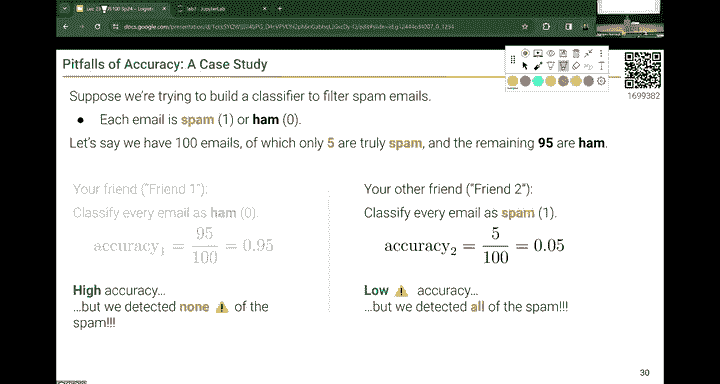
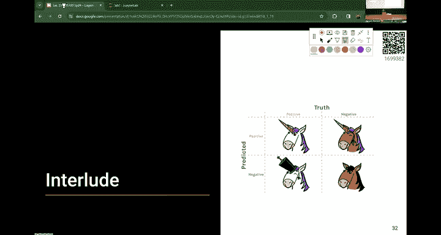
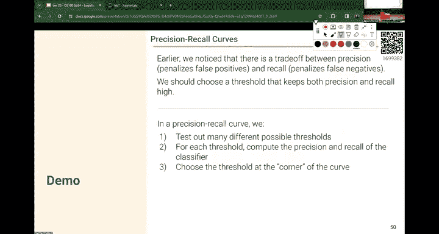
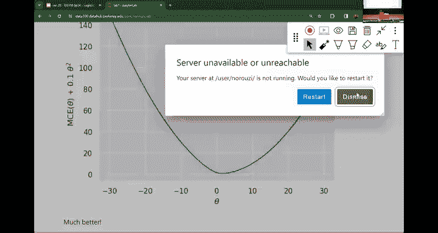
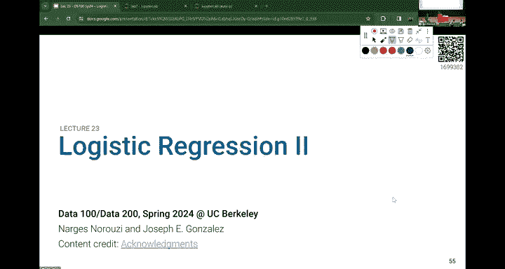

# 课程23：逻辑回归（二）与分类评估 🎯


在本节课中，我们将继续学习逻辑回归，重点探讨如何将模型输出的概率转化为具体的类别预测，并学习如何评估分类模型的性能。我们将介绍决策规则、决策边界以及一系列用于分类任务的关键评估指标。

---

## 概述

上一节我们介绍了逻辑回归模型如何输出概率。本节中，我们来看看如何通过设定一个**决策阈值**将这些概率转化为具体的类别（0或1）。我们还将深入探讨**决策边界**的概念，并学习一系列评估分类模型性能的指标，如准确率、精确率、召回率等，理解它们在不同场景下的重要性。

---

## 决策规则与决策边界

逻辑回归模型输出的是一个介于0和1之间的概率值，表示数据点属于正类（Class 1）的可能性。为了得到最终的类别预测，我们需要应用一个**决策规则**。

最常见的决策规则是一个基于阈值 **T** 的阶跃函数：
*   如果预测概率 **P(Y=1) ≥ T**，则预测为类别 1。
*   如果预测概率 **P(Y=1) < T**，则预测为类别 0。

在Scikit-learn中，默认的阈值 **T = 0.5**。但这个阈值并非一成不变，调整它会直接影响模型的预测结果。

**决策边界**是特征空间中的一个超平面，它将预测为类别0和类别1的区域分隔开来。
*   当只有一个特征时，决策边界是一个点。
*   当有两个特征时，决策边界是一条直线。
*   当有更多特征时，决策边界是一个超平面。

决策边界的位置由阈值 **T** 决定。改变阈值，就等于在特征空间中移动这条边界。

以下是使用Scikit-learn训练逻辑回归模型并应用决策规则的示例代码：

```python
from sklearn.linear_model import LogisticRegression
import pandas as pd

# 假设 df 是包含特征和标签的DataFrame
X = df[['feature_column']]  # 设计矩阵
y = df['target_column']     # 目标变量

# 创建并训练模型
model = LogisticRegression()
model.fit(X, y)

# 方法1：获取概率，然后手动应用阈值
probabilities = model.predict_proba(X)[:, 1]  # 获取属于类别1的概率
predictions_manual = (probabilities >= 0.5).astype(int)

# 方法2：直接预测类别（使用默认阈值0.5）
predictions_auto = model.predict(X)

# 两种方法结果相同
print((predictions_manual == predictions_auto).all())
```

---

## 线性可分性与正则化

如果存在一个超平面能够完美地将所有数据点按其真实类别分开，那么这个数据集就是**线性可分**的。对于线性可分的数据，逻辑回归为了达到零损失（完美预测），模型权重可能会趋向于无穷大（正无穷或负无穷）。

这会导致两个问题：
1.  模型变得过于复杂，容易过拟合。
2.  在预测时，任何一个微小的错误分类都可能产生无限大的损失，这在现实中是不可接受的。

为了解决权重发散的问题，我们需要引入**正则化**。正则化在损失函数中添加一个惩罚项，以防止权重变得过大。逻辑回归中常用的也是L2正则化。

带有L2正则化的逻辑回归损失函数（成本函数）如下：

$J(\theta) = -\frac{1}{n} \sum_{i=1}^{n} [y_i \log(p_i) + (1 - y_i) \log(1 - p_i)] + \lambda \sum_{j=1}^{m} \theta_j^2$

其中：
*   第一项是交叉熵损失的平均值。
*   第二项是L2正则化项，$\lambda$ 是控制正则化强度的超参数。

在Scikit-learn中，可以通过 `penalty` 和 `C` 参数轻松应用正则化（注意：`C` 是 $\lambda$ 的倒数，`C` 值越小，正则化越强）。

```python
# 使用L2正则化，并设置正则化强度（C值较小意味着正则化较强）
model_reg = LogisticRegression(penalty='l2', C=0.1)
model_reg.fit(X, y)
```

---

## 分类性能评估指标

由于分类任务的损失函数（如交叉熵）其数值含义不直观，我们需要一套新的指标来评估模型性能。这些指标大多基于**混淆矩阵**。

### 混淆矩阵

混淆矩阵是一个2x2的表格，总结了模型预测结果与真实标签的四种情况：

| | 预测为负类 (0) | 预测为正类 (1) |
| :--- | :--- | :--- |
| **真实负类 (0)** | **真阴性 (TN)** | **假阳性 (FP)** |
| **真实正类 (1)** | **假阴性 (FN)** | **真阳性 (TP)** |

*   **真阳性 (TP)**：模型预测为正，实际也是正。
*   **假阳性 (FP)**：模型预测为正，实际为负。（误报）
*   **真阴性 (TN)**：模型预测为负，实际也是负。
*   **假阴性 (FN)**：模型预测为负，实际为正。（漏报）

以下是计算混淆矩阵的代码：

```python
from sklearn.metrics import confusion_matrix

y_true = [0, 1, 0, 1, 1, 0, 0]
y_pred = [0, 1, 1, 1, 0, 0, 0]

cm = confusion_matrix(y_true, y_pred)
print(cm)
# 输出可能为：
# [[3 1]  # 第一行：真实为0的样本中，3个预测为0(TN)，1个预测为1(FP)
#  [1 2]] # 第二行：真实为1的样本中，1个预测为0(FN)，2个预测为1(TP)
```

基于混淆矩阵，我们可以定义多个评估指标：

### 1. 准确率 (Accuracy)

准确率衡量的是所有预测中正确的比例。

$Accuracy = \frac{TP + TN}{TP + TN + FP + FN}$

**局限性**：在类别不平衡的数据集中，准确率可能具有误导性。例如，一个简单将所有样本预测为多数的模型，也可能有很高的准确率。

### 2. 精确率 (Precision)

精确率衡量的是**所有被预测为正类的样本**中，真正为正类的比例。它关注预测的“准确性”。

$Precision = \frac{TP}{TP + FP}$

高精确率意味着模型在说“是”的时候很可靠，误报很少。





### 3. 召回率 (Recall)

召回率衡量的是**所有真实为正类的样本**中，被模型正确预测出来的比例。它关注模型的“查全率”。

$Recall = \frac{TP}{TP + FN}$

高召回率意味着模型能找出大部分真正的正类，漏报很少。

### 精确率与召回率的权衡

精确率和召回率通常存在此消彼长的关系（精确率-召回率权衡）：
*   提高阈值 → 模型更保守，只对非常确信的样本预测为正类。
    *   **结果**：精确率上升（因为误报FP减少），但召回率下降（因为漏报FN增加）。
*   降低阈值 → 模型更激进，对更多样本预测为正类。
    *   **结果**：召回率上升（因为漏报FN减少），但精确率下降（因为误报FP增加）。

选择侧重于精确率还是召回率，取决于具体应用场景：
*   **高召回率重要**：例如癌症筛查、垃圾邮件过滤（不希望错过任何重要信息）。宁可误报，不可漏报。
*   **高精确率重要**：例如司法判决、推荐系统（推送的内容必须可靠）。宁可漏报，不可误报。

### 4. F1分数 (F1-Score)

F1分数是精确率和召回率的调和平均数，试图找到一个平衡点。

$F1 = 2 \times \frac{Precision \times Recall}{Precision + Recall}$

当精确率和召回率都高时，F1分数才会高。

### 5. ROC曲线与AUC

**ROC曲线**描绘了当分类阈值变化时，**真正例率 (TPR)** 与**假正例率 (FPR)** 之间的关系。
*   $TPR = Recall = \frac{TP}{TP + FN}$
*   $FPR = \frac{FP}{FP + TN}$

**AUC** 是ROC曲线下的面积，用于量化模型的整体分类性能。
*   **AUC = 1**：完美分类器。
*   **AUC = 0.5**：相当于随机猜测。
*   **AUC 越接近 1**，模型性能越好。

ROC曲线和AUC对类别不平衡相对不敏感，是评估模型区分能力的常用指标。

```python
from sklearn.metrics import precision_recall_curve, roc_curve, auc
import matplotlib.pyplot as plt

# 获取预测概率
y_scores = model.predict_proba(X)[:, 1]

# 计算精确率-召回率曲线
precisions, recalls, thresholds_pr = precision_recall_curve(y, y_scores)

# 计算ROC曲线
fpr, tpr, thresholds_roc = roc_curve(y, y_scores)
roc_auc = auc(fpr, tpr)

# 绘制ROC曲线
plt.figure()
plt.plot(fpr, tpr, label=f'ROC curve (area = {roc_auc:.2f})')
plt.plot([0, 1], [0, 1], 'k--')  # 随机猜测对角线
plt.xlabel('False Positive Rate')
plt.ylabel('True Positive Rate')
plt.title('Receiver Operating Characteristic (ROC) Curve')
plt.legend()
plt.show()
```





---

## 总结

本节课中我们一起学习了逻辑回归的下半部分以及分类模型的评估。我们首先了解了如何通过设定**决策阈值**将概率输出转化为类别预测，并认识了**决策边界**在特征空间中的含义。接着，我们探讨了线性可分数据集可能导致权重发散的问题，并引入了**正则化**作为解决方案。



最后，我们系统性地学习了一系列分类评估指标，从基础的**混淆矩阵**出发，理解了**准确率、精确率、召回率**的定义、计算及其内在的权衡关系。我们还介绍了**F1分数**以及**ROC曲线与AUC**，这些工具能帮助我们更全面、更稳健地评估和比较不同分类模型的性能。理解这些概念对于在实际项目中构建和优化分类模型至关重要。