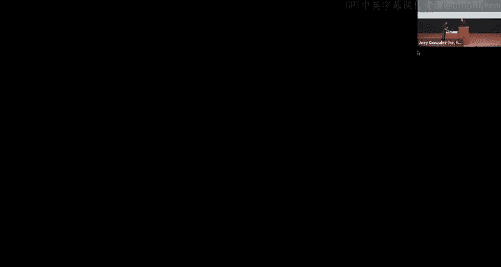
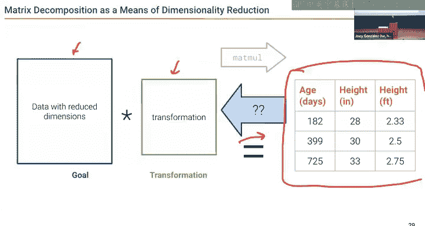
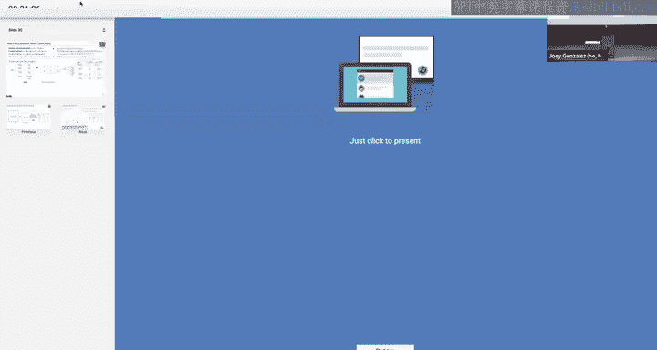
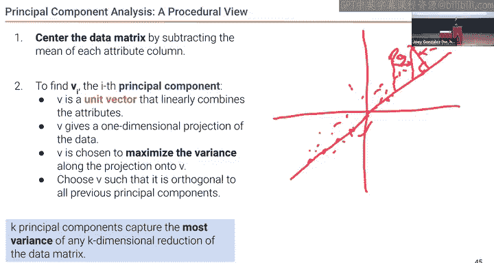
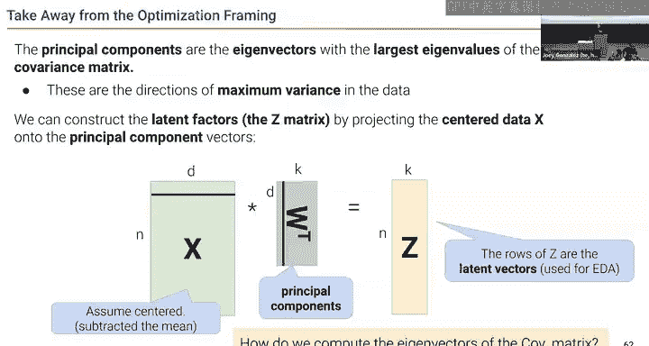

# UCB《数据100数据科学原理与技术｜Data 100 Principles and Techniques of Data Science 24SP》中英 - P24：-24-Data 100 Spring 2024 Lecture 24.zh_en - GPT中英字幕课程资源 - BV1Bc2dYCEbc

喂e。Great， good morning， everyone。The nice week， we have the sun back。

 we had some sunny music this morning， very good。We are continuing the kind of。

 I don't want to say fun part of this class， but it's fun so we're playing with more models today。

Is a Slio？Today we'll be looking at principal component analysis。哎。This lecture is a little Matthew。

I readid some of the math， so we'll work through it and see how it goes。

 but hopefully you'll take away some exciting concepts around dimension reduction。

 which is a big part of EDA and a very cool modeling machine learning technique。

So putting this in context up until now， we've been thinking about supervised learning problems。

 that's this stuff of group。😡，Lets step over here。嗯 up。嗯，还。Or no。So， I guess。可以搞。应该。

That pen networking turn on pen shift delegate I did that Okay， all right， we're set yeah。

 so we've been thinking about supervised learning here。

 which is where we are making predictions or building a model。

 but we're given some features and some label we're trying to predict。

We saw regression when we're trying to predict a quantitative， continuous number， like a real number。

And then we saw classification last week where we're trying to predict a categorical thing zero or a1 do we get to multiclass classification I missed the last lecture we didn't Okay。

 so just zero1， but guess what you can extend that to more classes and we'll talk about that in our discussion on large language models at the end of the semester。

So。Two very powerful genres of learning， regression and classification。

 but they're all under this meta genre of supervised learning where we have labeled data。

Now we're going to go to the right side of this picture。We have unlabeled data。

 or sometimes we have labels and we've decided to ignore them。Why might this happen？

Maybe you got a ton of text， you download a bunch of people's speeches， my lectures。

 like what's going on with this text？I like to understand it。

 perhaps I'd like to know which lectures are good or bad， but there are no labels of good or bad。

 so what can I do with my data？😡，If this is your world， you are in the world of unlabeled data。

 and we are going to look at unsupervised learning techniques。Here we have features。

 maybe the text of the data， but no labels。Or we've decided to ignore those labels。

 I keep getting raised hand popped up， how do I turn it off？Oh， okay。

Well can I I'll keep talking sorry for those on zoom I'll refresh my presentation when I。

Noow what to do。Okay， who're refreshing now。New slide code， okay。Sorry， everyone。

Sliidehow it also I'm getting the raised hand notifications， I guess yeah you guys got that Okay。

 yep， yep， presenter viewer。You knowI watch old lectures from previous faculty and they're here debating their technology and it's funny I'm like。

 why I wouldn't do that and then I'm doing it。All right， so new Slio。Everyone got it。Everyone got it。

 we're going to go I'll when the site comes up again， I will actually have to ask questions so yeah。

 go ahead。没意思。That's really bad。Will that happened， share。Okay， is it shared now？Oh wow。

 so I'm sorry Zoom crowd and future me who will be watching this lecture like what were you thinking in two years and I'm trying to re giveive this lecture or next semester okay so。

Here's the slide you all missed it's really pretty again regression and classification。

 you heard the audio track for it， we have labels in this case so we're making predictions about labeled data。

😊，About labeled data very good and now we've just switched this new genre of unsupervised learning where we have unlabeled data so unsupervised learning we don't have labels。

People are still raising their hand what is going on？Let me know。Inngineue， okay。

Sometimes we have labels we'll ignore them and there are two techniques in this space that we're going to explore in the next week and a half。

 one， which is today and a bit of Thursday or probably all of Thursday is deity reduction this is kind of an analog to our story over here regression。

😡，I have data， I'm missing labels in this case， quantitative numbers that I'd like attach to each my pieces of data。

 maybe to make better sense of my data， and I'd like to automatically discover them。

And'm going to discover them by finding what are the kind of dimensions on which my data live。

 so that's kind of an analog to regression and then when we talk about clustering later next week。

 this is kind of like classification。I'm going to touch。Labels， discrete labels to my data。

 is it in the red， the green or the blue cloud here？So that's clustering。

 but today's lecture is on dimensionality reduction。Oh， no。

Sorry， everyone。Stop sharing。Share a screen again。When you bug on my computer， I hope not。

I am sorry for me when I'm watching this video year from now， it's going to be very upsetting Okay。

 should we do it again？I'm going to go with。No， so you're good， Okay。

 so I'm going to get rid of this， I just pop。我。Did I just lose the slides？Are you on。Yer。

So very raising heads。It's good， okay， so we've all seen this。

 we're going to keep going because we got a lot to cover today。Okay。

 so today PCA part one and part two， today we're going to do PCA。

 we're going to talk about singular value decomposition。

 we'll do a fair amount of linear algebra linear algebra review as well to hopefully make it easier and then on Thursday we're going to look at applications and there's a small chance we'll also probably finish part one。

Finish here because I added a little bit extra math。All right， so first。Visualization revisited。

And for this， I have a demo， this is to motivate why we do PCA and in a moment to actually do the PCA。

 so let's try it。Are you seeing this as well？Someone check Zoom and make sure we're good。Okay。

 thank you all right， so I'm going to play with the toy data set to demonstrate the power of visualization and my ability to go to higher dimensions at which I will fail。

 but we'll try to go as far as we can。All right， so here's data have， we've played this data before。

 it's kind of a boring data set， but I'm going to use it because we've seen it before and it has a bunch of columns that are numerical。

I'd like to look at this data and try to understand trends this data。

You might have other situations where you have genes or complex scientific phenomena with many。

 many columns， you want to understand the kind of relationships between those columns。

We've already covered how to visualize data if I have one dimension I can make a histogram so displacement some lot of cars which have you know reasonably sized engines and then there's some cars with silly sized engines it's kind of a distribution of engine sizes。

Looking at cars here， we can plot two dimensions of data so we can take displacement versus horsepower。

 so bigger engines， more displacement gives us more horsepower apparently。

 so more more volume to burn gas the power more powerfully your engine is okay that's two dimensions how do you visualize three dimensional data。

Well， we can doesn't make for great prints， but we can look at data in three dimensions using computers。

We can look at displacement， horsepower and weight。

It's actually a kind of a neat trend you see something going on here。So as my， oh。

 this is silly and I flip this round， it's easier to read。okay， well。

 I guess as my displacement goes up and my horsepower goes up。

 my weight also seems to go up these points up here of everything big。

So data visualization you'll notice that this is not a great plot。

 but when I turn like go oh and I see what's going on right it does not work well in print so two dimensions about as good as you can get on a paper if you make these plots I be like I don't know what's going on please make another plot this is not helpful for print but on a screen this is wonderful it can start to see trends。

😊，Three dimensions， How about four dimensions？Previous lecturers said it is not possible。

 it is possible。😡，Let us visualize four dimensions， how do I do that？Color。

So now I have my three dimensional plot again this only works on a screen and I've got this extra color dimension so a little bit so you can see everything the model year。

 we see a trend here。What is going on？So this is visualizing four dimensional data I have。😡。

Displacement getting bigger， or is power getting bigger this？This way。

 And then this is what was this one。 This is weight getting bigger this way。 And then I've put color。

 So brighter things are newer。 So all my new cars are down here and all my old cars are up here。

 Was that telling us。😊，Ours are getting slower it's not true。

 but it's telling us that if we look at zoom out a little bit。

 we can zoom out here if we're looking at like displacement horsepower， the big。

Hyigh power engines that were heavy are all in the old days。It seems。

 and then the brighter stuff down here seems to be the newer stuff， which has lower weight。

 lower displacement， and lower horsepower， but maybe horsepower is not the only thing to describe an engine and how it forms。

Right。I this is also muscle car data， so maybe it's a trend in the style of cars as well。

Four dimensions， can we do five？Let's do it five， how will I do five？Ideas。Yeah。Size。Let's do it。

I decided to do 6。 That was bold displacement， horse par weight。

 Ma year size is going to be miles per gallon， and symbol will be origin，6 dimensions。And they said。

 you could only do three。Here we go。Are we getting more signal？A little bit。

But it's getting hard to visualize， this would not print well。😡。

And we started to see something going on， right， what do we see？Like this is high dimensional data。

 but is it really？It's like I have a cloud that's like in a tube or something and then check this out。

 you've got our different regions for our cars， we turn on and off Japan。

I think Japan is basically down here， put Europe on and off， Europe is down here too。

 so European cluster， and then the US cars are all up here。And主。There seems。确 be。Some structure。

 some。Lower dimensional thing which we could put all this data on and this seems like maybe just one axis going from here to here。

 maybe this axis is the ridiculousness of the car， I don't know what it really means。

 but it's some combination of all these dimensions that seems to describe everything from where the car is made to the size of the car these are terrible MPG higher MPG down here so everything sort of lives on this line。

😡，I'm a plane， maybe it's a plane。Take a little slice through this space if it lives on some kind of plane。

That is the focus this lecture， how do I find that so I can visualize the data more effectively。

 and so I can do modeling on that simplified representation of my data。

Why use six dimensions when I can maybe reduce this to one or two？So。

Put this together this is the entire lecture if you just skipped the lecture you could do this and you would get all of the benefit from today's lecture minus all the learning。

There is a built in function for practically everything in basic machine learning in psyit Learn。

 There is a built in function for PCA， a built in object。

I want to find a two dimensional representation of my data， so I use this PCA two dimensional model。

And I want to take here I'm going to take just the quantitative entities。

 I didn't include miles per gallon we could do that， I guess but not seven miles per gallon。

So those are my all the data that I'm going to fit into my my model and you have no clue how this model works that's the rest of the entire lecture it's going to spit out two dimensions。

 It's going to reduce every record from。Five dimensions。

 displacement horsepower weight Model year and MPG to two dimensions， Z1 and Z2。What do you mean。

 I don't know。But it's going to make two dimensions。Put that in my data here。

Now I can make a scatter plot of my data in two dimensions。

So it took that slice of data and projected down onto a nice two dimensional surface。

Two dimensional plot where I can start to see things like this cluster model year， and so on。

It's a slice of my data。That is today's lecture。 That is a story。 This is a general technique。

 you can do this in six dimensions on Thursday， we can do this for an entire corpus of text to take documents。

Convert them to the bag of words and bedding。 Convert them to numbers。

 and then project them into a two dimensional space where I can see， you know。

 if some documents are conservatives， Some documents are liberal。

 hopefully they'll have some nice structure clustering in that two dimensional space。

Questions up to this point。 let's do it。Back to lecture。All right， so to do this。

 we need to start to talk about dimensionality。What does it mean。In all of lecture。Up to this point。

 we've been thinking of data that's n records and D dimensions。

Sometimes you might have used the letter P for dimension， statistician like to use P for parameter。

 computer scientists tend to use D for dimensions， you flip them around they're the same letter basically。

 this is just a measure of the data that we have， the number of columns in that data is D or P and the number of rows number records is n。

In linear algebra， we can talk about the matrix， dimension of a matrix。An Nd matrix has N rows。

 D columns。We're going to bring in a new idea for dimension today。

Those were the intrinsic dimension of a data set。😡，This is a very fuzzy term。

 which we could formalize， but it's out of scope for this class。

 and sort of the minimal set of dimensions required。To approximately represent our data。G this way。

 if I would take all my data and squeeze it down， force you to just pick two columns。

 and those columns can be interesting functions of the original data。😡，3 comms。

 interesting functions， original data， and then I had some method to bring it back to the original data that if I did that。

 I'd be preserving the original data to the best of my ability。 It's a good approximation。

So there's some simplified representation that encodes my data。This is the minimal set of dimensions。

 and now we can think about this is a minimal set of dimensions that we can build using linear operations using just columns from the original data set and so on。

It's a fuzzy term。Make it a little more concrete， so add some data like this to a 3D plot。

I can't spin it It's on a slide， but you get get the idea。

 I can imagine that that data sort of lives on some plane。 right。

 We sort of looked at something like this for regression already right。

 So we did this regression thing where we tried to draw like， you know， this is our X axis here。

Yes I should draw this one clearly。That's something like。啊。X1， x2。

 and then this was Y that we're trying to predict and so then we tried to project like find a plane that described this data。

 but that was really just describing the y value as a function of the x so describing y。

As a function of x1 and x2。In today's lecture we're not going to try to do that we want a plane that describes all three of these variables。

 so in this case we'll call this you can call it x1 x2 andY。In a little bit。

 I'll talk about the delta， the change in what we're doing and really maybe give a quick picture。

 we're looking at things where the reconstruction errors is measured perpendicular to that。

But I get ahead of myself。Main story here is I have data in some higher dimension。

 this is in three dimensions， but I'd like to look at it as though we're on this plane。

 and so I'd like to plot it over here， two dimensions。

The intrinsic dimension of this data might be thought of as something closer to 2。

 right so it's 3D data， but maybe the intrinsic dimension is closer to 2 2D plane。See it's fuzzy。

 it's not quite this data really has volume， it's all over the place it's in some cloud。

 but most of that cloud sort of lives along some plane。😡。

That plane is a two dimensional thing in that two dimensional space。

It's a rough idea of intrinsic dimension。Give another example here， so I have people。

 I have their height and their weight。对。So I can plot that data， it's in two dimensions。

 so it's says height or weight and height right here。

And then I could imagine that really there's only one thing here that all this data lives on the the body size light。

 maybe or the human size light。Size small to large。

There's some dimension that describes both these variables。

 so maybe the intrinsic dimension here is closer to one。Right， but it lives on a 2D。

The data originally starts in a 2D plane。Now there's an extra concept that we've already introduced in lecture。

 which is a more concrete notion of an intrinsic dimension， and that is the rank of a matrix。

The rank of a matrix is the column space of that matrix。

 which is the number of dimensions of that column space。

This can be less than original dimensions of the matrix itself。

Let me go through some examples of this right， so to illustrate that we've got here two matrices。

These matrices are two dimensions。And three dimensions。What's the rank？Of these matrices。

I have a slido， okay， let's go to this。 what would you call the column space of these data sets。

 Let's do this slido。Reretendance。So these two data sets， data set three and data set 4。

The span of that column space the rank of these matrices。you're thinking through this。

 you're looking for what is the linear combinations of the columns， how many dimensions can I encode？

Are there any columns or a linear combination of an existing column？It's great to。

They colon your columns。This slide going to be open if I move forward have to wait， okay。

 we're going to keep going。So what answer， what is the answer？Good， you're all getting it。

So the answer is。Three this at three is a， which I believe is one dimension， so the rank is one。

And data set4 is C， which I believe was three dimensions。The rank is  three。What does that mean。

Let's go through this so why was this one dimension right here？SoWe can plotted the data below。

This是 data。So weight in pounds。And weight and kilograms are。Linear operations of each other， right。

 So I scale my weight and pounds to get my weight and kilograms by。Divide by 2。5。Yeah。

All rightSo my conversion here that slope is a constant。

 so I can take some alpha times this one and that equals this color。So linear combinations。

Same thing here。Thats one dimension here I have three dimensions。

And original data has four dimensions， so height。ight weight， weight and pounds in age， but again。

 these two columns。Are linear combinations？Each other， so one can be expressed in terms of the other。

 and so it's rank is actually three。Any questions at this point。

 I'm building on some basic stuff they've already covered the near aggression。

 but I want to make sure people are comfortable。Intrinsic dimension is a fuzzy concept。

 you could say i'm going to focus on my definition of intrinsic dimension is the rank。

 which is just the truly minimum linear combination of columns that's needed to represent that data。

And in fact， today's lecture will do a fair amount of that use rank as our notion of intrinsic dimension。

 but in practice。The intrinsic dimension of this data might be like we said the intrinsic dimension of this data is here we said it was three。

 the rank is three。But maybe you know height and weight are good estimates of age or age is a good estimate of height。

Or wait。In which case。I could approximately construct my data with fewer dimensions than three。

 even though the rank of the matrix is 3。And in fact， when we do dimension I reduction。

 often our data will have a very high rank， but we're going to want to bring it down to it two or three dimensions to visualize it。

 and we might think that maybe the data really does live in a smaller two or three dimensional space。

Right so I would isn't going to talk about this， but I think you should know very very simple idea as we get higher dimensional data。

 it often has a lower intrinsic dimension youll encounter in life data sets of millions of dimensions。

 but to really have millions of dimensions takes one a lot of data to span that space and then two that data really has to be random has to have weird structure for that to happen often real worldor data sets have relatively low intrinsic dimensions。

And that is why dimensional reduction is a popular technique I can hand you a high dimensional data set。

 but is it really that many dimensions， Can I use an algorithm to reduce it down to a few dimensions？

Dimenssality， what does it mean？This is a good example here， so I have this data set。😊。

What is the rank of this data set？It's going to be ranked2。 It is truly a two dimensional data set。

 but does it really come on。 There's just this one outlier。

 which takes one data point to be a problem。Maybe the true intrinsic dimension here should have been one。

All this data is。X is a linear function of y。But。De to keep in mind。

There is a formal version of this that looks at how a sample distances between points。

 but it's out of the scope for this class， so just use intuition about the intrinsic dimension for us。

So dimensionia reduction is also generally going to be an approximation of the original data。

 which means it will go to a dimension often far lower than the rank of the underlying data set。

All right， so how do we do it？There are actually many ways to construct a low dimension representation in this lecture we're going to focus on a family of techniques that are pretty widely used。

Which basically build on the idea of matrix decomposition or matrix factorization。

So I'm going to try to connect this to linear algebra to matrix multiplication。

 if this here is my original data set。I want some reduced dimension data set that when I multiply by some magic matrix。

 which we'll need to figure out。Maybe approximately， or if I'm lucky。

 exactly encodes the original data。It can be a linear technique for dimensional reduction you can do nonlinear techniques by transforming features or by using other methods out of scope for this class。

We're going to focus on matrix c composition， so this flavor of factorization and this is very similar to matrix multiplication。

So a little more general picture， which I'll use later on we do some more advanced mathematics is I'm going to say my data set is some variable x or some matrix x。

 it's n by D。And I want to approximate it by two matrices。 Well， one is my z matrix。

 which is going to be n by K and here I'm going to pick K to be small，2，3， you know。

 it could be up to the rank of the matrix， but it's ideally much less than D。

And then this other matrix， which again， we need to figure out how we're going to build it。

 which is K by D。And whenever I do this drawings in here， yeah。

 I try whenever I'm doing linear algebra and I advise you to try this well。

 I draw the rectangles to work through what are my dimensions I should to made this one a little bit wider。

Yep， so this dimension here should match this dimension here， right？So whenever I'm multiplying。

 I'm basically taking operations where I walk down here， align with this thing。

We'll see more of that in a。Okay， so interpreting matrix multiplication there are a couple ways to interpret it here's a simple example。

 so I'm going to take two matrices， so let's call this my data matrix here data。是。

And then multiply by this column matrix here。Transformation。What am I computing here。

 I'm computing the price of each bowl at each store and I can do this with matrix multiply。

And excuse me。So I take this whole row here multiply by this column。

And that's going to give me the entry in here， so the price of bowl one。All one at store one。

And if I went to price a bowl one。At store2， I take this vector here again。

 I'm going to multiply it by this。I want vector here， and that gives me the price of bowl1 at store2。

Basic matrix multiplication every time I do stuff with algebra again I like to draw these pictures and think through that。

It's going to get a little more complicated。There's two ways to interpret this multiplication operation。

 one is a linear operation on each data point，'s kind of an operator on my rows。

 another is a column transformation of my data matrix。Let's look each of these。So for first。

 the multiplication view1， so the linear operations。So here's my data again。In my operation。

 and I can think of taking each row， here's a row in my data。And then sliding it up。

 putting it aside。Co。Here for my operation I'm going take a dot product of these two vectors that's going to give me a number right it is a linear combination。

 so it is two times two plus one times two plus four times two。

So a linear combination of the entries。In my original data。

And also think of this as taking the projection of this row。against this column。

One way to look at things。Another way to look at things is it。

The I have this here right matrix transforms the features。

 so it's untaking say this is my right matrix so I have two one。

 four those are going to be scale like multiplicative scale on each of my columns of the original data set so two。

Times 2。2 and 2。5。 So this topic here。That again， and then I take the one so it comes down here and I scale this column at one。

And then I scale。This column。By4。Yeah。Adding all these together gives me a new version of that。

First new version of the first column。不。New version of the first column but a way to define that transmission。

Right actually it gives me a new column here say it more precisely and that new column so just to double check here。

 so I have a second column here， so I'm going to produce two new columns so。Chop。

Your second comm rule again， scale each of these by one。

 so one times this plus one times this plus one times this gives me this new column here。

So a way of combining columns or a way of projecting rows in my data。Questions。I keep going。Yeah。

Yeah， so in this case right now I'm just using this as a mathematical tool。

 so here I can define any transformation I want， it could be all zeros。

 not a very good transformation， but it is a operator on my data。

 a way of combining columns in my original data。In a moment。

 we're going to talk about specific designs for these， which we can use for factorization。

Back that moment， I believe， is now。So my goal。Is to be able to take this matrix here of data。Again。

 construct。Some new。Representation of data that when I multiply by some transformation recover the original data。

Recquisition。

So we make this concrete， so here is a matrix factorization。So I have。What do I have here。

 I have age。And height。That's a reduction and then in my original data had age height and inches and heightened feet so actually let's look at this briefly so what is the rank of this matrix。

This matrix is rank two， Why is it rank two because these columns。

Can be expressed as linear combinations of each other Okay， so rank two。

So how do I get it ranked to decomposition let's do it by hand so I could say I'm going to have age。

And height， that's my new representation， and I have this new transformation matrix here。

That when I multiply by this matrix， recovers， rebuilds my original data。How's that work？Very对。

So the first thing here is saying that the first column is going to be just what？Just the age。

This thing here is saying the second column is going to be what？Just the height。は。

You can see this by remember the columnient oriented interpretation。

 so I want my new first column to be again， my new first column is going to be one of this column and zero of this column。

And my new second column is going to be zero of this column and one of this column。

Now my third column is interesting。My third column is going to be。Zero of the age。

And one over 12 of the height。An inches。Which is going to give me height and feet。So each。Right吧。

What did I just do。sry吧。

喂。So what it。Good。Y， so each of these columns is defining how I build my new column in my output matrix。

 right？It's telling me how to mix the original columns to do that。This is a factorization。

It's a good factorization。 This is a lossless rank to factorization of the data。

 So I preserve the full rank of the data。And it perfectly recovers my original data。Questions。Right。

 great， I have a question for you and we can do some questions afterwards。All right。

 so what are the possible matrix factorizations that I could construct in this situation？

This was just one。How many factorizations could I construct to preserve the data？

So there are infinite many decompositions so I could choose to。那什么事儿？Should。

So I could choose to move one of these numbers by 0。1 increase by 。

1 move just changing the scalar so even for this example that I gave before。

Could rescale any of these matrices and these matrices infinitely ways。

 infinitely many ways and get different factorizations。 so that's true。

But here we're asking a more interesting question。How many different shapes？Ftorizations could I use。

So I think this is a slight otis。People are you doing it。Maybe hint there's more than one answer。

Does this player it lot from where you want answer？So it's only letting you pick one。

Pick more than one。Good。Mattrix factorizations， select all that apply。You all are picking C。

Wteresting choice。Why are we picking C。We' are changing your mind now， very good。iss actually。

Interesting。He's the most interesting one this list， so' fun to talk to。All right。People vote。

 Let's get to 300。One more people。Do it。There we go。All right， so what are the correct answers？

According to the previous staff， all of the things except C were correct answers。

And yet you all like， see。Why was everyone so excited about seat？First。

 why are all the other answers correct？So they're all factorizations。My date is what rank？2。

I could build a factorization I make the data bigger， that would be a factorization。

 so that's an option。I guess three is you know here is bigger， four。

 I could make it bigger I could increase the dimensionity of my data sort of arbitrarily I don't know why I wouldn't do that。

 but I could do it。keep it the same。I could hear my dimension is two。

 I could reduce it down to rank two。Something else I could make it even bigger still。

But you all said see。And I agree with you。So I'm happy about that。 Why did you say seed？I see okay。

Good， so when I construct the outer product， it will in fact be a  three by few matrix who has the right shape of the answer。

Let me tell you why obviously this was thought to be wrong。And I'm okay with this claim as well。

So if my goal is to preserve the rank。Of my data， if I do this C option。

 I'm basically saying I want to reduce my data to rank one and have some function to recover that rank one representation。

But I can't do that， I can't take a rank k thing and express it in a less than rank K thing。

But you can set a simple contradictions of my。My matrix on the left here is ABC， and my operations X。

 Y z， then I need a times x to be 182 or 80 times x should be 182， so A times x should give me here。

And then I need a or B times x to be what？3，99， Here we go。 B times。X， but I also need a times y。

And B times y to be 28 and 30， and if I simplify my expressions， I'm going to get a contradiction。

It can't be done。There is no way to express this data， this rank2 data。Using rank3 sorry。

 using a rank one representation。So I went to two few dimensions to preserve my data。Perfectly。

Now this is why I'm happy that everyone chose to see。Because sometimes I'm going to do that。

I do want to approximate my data。 I will get a approximation a factorization that does not recover the underlying data。

 fact， that's sort of my goal。 I want a simplified representation。 I want to throw away。

 eliminate things that are essentially noise。So。I would be okay with this as an answer if we had not asked and we didn't ask。

 it must preserve the  rank。Had we say said it must preserve the rank。

 then this is no longer a valid answer。Right， C is not valid。Right right。Since you all disagreed。

 I'm curious， so there are questions at this point。I you very confused。

I'm explaining well to go very confused right so the real question now is how do we automatically choose one of these decompositions？

So how do I build this？And we're going to try to work through that now。All right， so one goal。

We're going to try to automatically factorize our rank R matrix into an R dimensional representation again。

We said rank R here in practice we might choose something even smaller， so it's a rank R matrix。

 we might choose this to be know K much less than R。In which case。

 we're going to be doing an approximation。All， so we want a lower dimensionmentia representation。

Thevos redund features。Excell slide， actually bit clear。2。So we often。

 one something as I said earlier， it's approximation that。

 so we're going to build an approximation so a lower dimension representation。

 which is a good approximation to our underlying data。I think here we had what。

 this is how manyrink width length， area and perimeter。Brink of that。It's not question， yeah。Yeah。

 so perimeter is a function width and length。Areas too， but it's not a linear function。

So this is rank  three。But here we decide let's do rank two， so now we're approximating。Right。

 so we're doing something。 We're building a representation in two dimensions of something that is rank。

Three， which we can't do， we can't do it perfectly， but we can do it approximately。Why do we do that？

And this is the part lecture on principal component analysis， so our method we doing it。

So it starts some intuition。So we're going from a high dimensional data set down to a low dimensional and in this case often two two is a good number because it makes for great plots。

 so we're using this often for a visualization tool so。Frequly。

 we be moving down to just two dimensions。We want a load dimension representation that should capture the variability of the original data。

What does that mean？All the things that are changing， interesting about the data。

 we want to capture that。Things that aren't changing like that little blip a little bit above the line。

 it's kind of uninteresting， we don't care to capture that。

Not this is the stuff that's most variable， but we'll make that more clear in a moment。

AllAnd way we're going to do that is we're going to define this transformation matrix。

And the columns of this transformation matrix， when I've applied some constraints。

 which we'll talk about in a moment。These columns are going to be my principal components。

And the first column is going to be called the first principle component。

 the second second principal component and so on， and they're ordered so these components can have some kind of interpretation。

So once we've built these columns of principal components。

We're going to project our data against these。And that's going to give us something called latent factors。

For latent vectors。These are the from my earlier demo， these are the Z1。Z2 and so on。

This is the data， this is the data that I'm going to plot， so I'm going to plot this data here。

That's my compressed， reduced representation of my high dimensional data down to two dimensions。

So why do we do this？It's often used for exploratory data analysis。

 it's often used to visualize and then cluster high dimensional data， so I take my speeches。

 reduce them to two dimensions， and then cluster that plot using the techniques from next week。

We'll do this when we have reasonably our data is inherently low rank。

 so we might have situations we know function that some of our columns are likely combinations of other columns。

Some modeling techniques， which for the most part are out of the scope of this class might actually benefit from running this technique。

 so you'll see when you run other machine learning algorithms。

 they say run PCA first to transform the data so that that algorithm performs slightly better。

So it eliminates correlations in these columns， so these columns here。

These new features are uncorrelated。And that's really useful again。

 for certain machine learning techniques and some optimization procedures work better when your data has been transformed。

So again， why two dimensions？Mostly for visualization。So we'll see that often in our dose。Okay。

There are two ways to frame PCA。And I'm going to go through both these today。

 one is finding the directions of maximum variability in the data。

This is the original statistical interpretation， what is the dimensions if I were to find my data that have the most variance？

And then the second is finding a low dimensional matrix factorization that best approximates the data。

The second interpretation is the one I prefer， which is。

Taking that loss minimization story that we've used throughout this class and applying it to dementia I reduction。

 we set up a goal of approximating our data and we use gradient calculations to solve the answer to that that goal。

All right so I'm going to start variance maximization。

 I'll come back to the approximation formulation。Yeah。

 I want to just highlight this again so when we the reason I want to show you the optimization framing is that more advanced dimension I reduction techniques won't focus on variance maximization。

 but they'll instead define objectives like independent on analysis graal auto enrs things that you don't know about won't know about for this class。

 but when you go to do this in your in your lives will be built on the second story they'll have some goal and they're going to try to optimize that goal and how they。

Rduce and of the data。Okay， so let's say my variances first， that's the standard framing。

We can compute the total variance of all of our columns by way。

She had to compute variance for a column。You do that column by column。We get total variance。

 as is some of these variances。三得物。So total variance。We can say in PCA。

 our goal is to find a linear transformation that creates a low dimensional representation。

 so it's linear。And it's going to be a low dementia representation that's okay。

Which captures most of the original data total variance。

So our goal is to find what sort of comms have them， if I were to just use those columns。

 get most of the variants。Which gives you an idea right now how to solve this problem， right？😡。

This's a simple way to do it， suppose I just look at the variance of each column and I pick。

In this case， area and perimeter these two columns。There， so perimeter。And area。

 and I say this is my representation that I want， in which case this is my transformation matrix。

Right。You is just saying select out the area column and the premier column and throw the rest。

That gives me a pretty high variance， so the variance of this new total variance of this new data representation just these two columns is pretty high。

 but can we do better？And if you run PCA on the same data， you get something even higher。

397 said 389。So there's a way to combine columns a different way that gets even higher variance。

 and the trick is it is combining columns， not just selecting them it mixing columns together to get higher variance。

We we're going to mix columns。We're going to get this matrix。

 which we still don't know how to do yet。Okay， so now we have to figure out an algorithm for that。

So here is the algorithm， I'm going to explain this algorithm。

 then I'm going to tell you that we don't use this algorithm。

 but itll maybe give some intuitivetuition what's going on。Step one， we do use， so when you do PCA。

 the very first thing you should do is take your data matrix X and center it。

 that means subtracting off the mean of each column from each column。

It's essentially taking that point cloud that could be flying far over somewhere in space and making sure it's at the center。

 the origin of your your space。The reason why is that we're finding a representation that's a plane that must pass the origin anyways。

 so we want the data to be at the origin。So first step， straightforward， data transformation。

Second step more complicated， so we're going to find a vector， which is the I principle component。

 let's start at the first， the first principle component。It needs to be a unit vector。

 which means that the norm of that vector is one。The way of saying that is that V times。V transpos B。

 So Vi now this is say row vector， column vector， this should equal  one。B transfers V is1。

V gives a one dimensional projection of the data， som going to I could take a row of x。

Then they will't multiply by my V， that's going to give me scalar， it's a scalar。

That's the thing I'm projecting onto。And I'm going to choose V to maximize the variance of my projections。

And then the subsequent Vs I choose。Need to be orthogonal。All the previous ones I've chosen。

So we'll find a basis， So I find one direction。 the next direction has to be orthogonal。

 can maybe its that way。 the next direction has to be orthogonal to that so on。Or axes in our plots。

This visualization is probably the best way to illustrate what's going on。

I'm trying to find the plane that's this thing moving around。It's be hard to keep track of。

I'm trying to find the plane that maximizes the variance along that plane。

 which is the spread of these dots。so now they're getting more and more spread out。

 really spread out， really spread out， maximum spread out now it's getting less spread out again。

So I'm trying to find that direction， that plane。The other way to look at that same picture。

 which gets for a reconstruction idea is these lines here， these red lines。When are they shortest？

The plane goes to the data， right？So I'm trying to find the plane that goes through the data。

And as a consequence has the shortest distance to the data。

And as a consequence has the widest spread along that line。Questions。

the intuition of what's going on makes sense。Yeah。ThatSo variance， yeah。That's what's going on here。

 so i'm trying to find the plane here that when I project onto it is going to give me the maximum variability I wish there's a way to stop this ski it's very distracting。

I will draw it again。So。We have our picture here， we have our point cloud。

Now I'm trying to find a plane。有。So unfortunate， so we centered our data。

 so let's draw it correctly so we have our data here。

 where point clouds now centered around the origin。

And I'm trying to find the plane that goes through the origin。That best explains that data。

 It's kind of like regression， except for regression， we were measuring the air like this。

 So air is straight down here we're going to measure the air perpendicular。

 So the closest point on this plane。 So if we're to project that data onto the plane itself。Guess。

 we're measuring this air。Instead of this air， so this is PCA。This is regression right here。

Russia are trying to minimize again， this air， UCA we're trying to minimize this air。

 but another way to look at it is if I put all my data， I force it to live on this line。

 what's the line that will spread the data out the most are the most variance？

So if I put the data all on a line， so now I'm forced to put all the data on this this new plane。

I want the data to be as far out as possible， spread out on that one。

The line that explains most the variability of my data。Quions。不是。

So that's the intuition from the variance perspective。Good picture。In practice。

 we won't run this algorithm。Instead， we'll use SVD。

 and I'm going to show you the derivation behind SVD in a moment that makes all this makes sense。

That is a variance perspective， again， this is how we normally teach this。

I put a short stretch break in， and I'm going to present an alternative framing for how to derive the PCA。

单的。All right。Let's get started。Doy the stretch breaks a little quick。

All right， so I'm about to do something that again I will probably regret。

 but I'm going to present some new slides that have not been used for this class before to try to give a different interpretation from the optimization perspective there will be more linear algebra in a moment。

 but。Send me feedback afterwards， see if it's good。

 all right you're not expected to be able to redo this transformation。In fact。

 I have to think about it when I did this transformation however， walking through and go okay。

 I see what's going on I kind of understand is important that'll help you have a better appreciation for what's going on and it'll give you some more practice with the linear algebra you will need as you do more advanced techniques in the future。

All right， so we go back to a picture here。We this matrix x。

 and then this thing over here is my approximation to x。

So my my represent my k rank representation of my x so this is the matrix that I'm going to use is my output when I'm done this whole procedure。

 this is going to be my principal components should I have this built in with today so the row vectors of here so I'm going to say Xi is a row vector。

And I going say ZI is also a row vector of Z。Am I W matrix here？

I'm going to assume X is entereded for the rest of this is part lecture。

The rows of W are me my principal components when I'm done。是被删了。One more thing want to say yep。

 and the rows of Z are my latent vectors， these are the things I'm going to draw pictures of and so on。

 my two or three dimensions I'm going to apply。And this picture up here。

 this equation should seem familiar。 This is saying that I want these sum。

Of the squared error between the Xi， the original vector here。

And my reconstructed my approximate vector here that I take when will play this。bye。Yes， this， this。

 they all the the comms of W。So another way to interpret that last bit， is it this here？

Is giving me combinations of the columns or the rows of the principal components， W。

So each entry in here is a mixture of these principal components。

So important thing here is I'm defining a loss。Which is function both Z and W。

So loss minimization is our goal， we're going to minimize our reconstruction loss。

Using our matrix factorization model， the NW。Make this a little clear。

 I'm going to get rid of the square。This is essentially a vector。This piece here is a row vector。

 And then when I take the transpose of it， this piece here becomes a column vector。

 like take their inner product that is a。Scalar， right， so this。Times this is just a number。好了。

So I want the sum of these numbers to be small。To measuresure my air。不是。够了。What result from this。

All right， so I want to minimize the reconstruction error， which I've defined here。I's this loss。

There are many solutions we discussed earlier， so we're going to constrain our model and then we did this earlier in our algorithm we said that it had to be a unit vector so and that they all had to be orthogonal so I want W to be a row orthogonal matrix what does that mean that means when I take W like this and I multipied by W transpose I should get an all ones。

Why do I get all ones well this？Dotted with itself is a unit vector 1。

 and this dotted with that vector should be 0。Right， so that's zero here。做完。

I want the inner products of all the non matching rows， so any I and J where I doesn't equal J。

 those should be zero， and when I equals you J， that means when I take this one and this one here。

 they should be one。Got correct explain。Rs。有问。对。I'm going to use a derivation that follows a textbook。

 which I actually recommend if people looking for machine learning textbook。

 it's a great textbook and there's a PDF version you can look at， there's a nice clean derivation。

 I've modified it slightly for our notation， but that gives you weight to both CPCA and then 10 or 12 other techniques that build on top of these ideas。

😊，So I'm going to follow a simplified version of that and the easiest way to do that。

 and I like this is to start with k equals one。So I'm going to choose a my goal is to build just a rank one approximation that thing we said earlier is wrong。

 we're about to do that， so we'm going to choose just one vector for z。It's one vector。

And then one vector for W。What's the best Z and W that I can find？How do we do that？Well。

 take or lost her。I'm going to expand it， so this is just taking this outer product here。

What do we have。You have x transpose X。 and you've animated this。 This is a constant。 So I took this。

transranpose goes inside， transpose transpose x times x is just right here。 That's a constant term。

 So I can ignore that why。Because my goal is to minimize the loss of respect to Z And W。

 I don't care about costs and terms。That's one。W。Times W transpose。Is one。Right。

Remember w is just a vector， it's a row vector， so I take W。 and I said it's an orthonormal vector。

 so this thing here is one。It's gonna be one。在。What。Okay and then I have this term here。Just left。

Simplify things so we get this simplified expression down here that's the loss we're going to work with。

And what am I going to do next with this loss？I want to minimize it and how do we minimize losses in life？

We take derivatives and set them equal to zero。Or take gradientdis and then walk downhill。

Today we're going to take the derivative instead set it equal to zero。

 but it's actually a two vectors， Z and W。 Let's start by just looking at the derivatives of the Ih element and Z。

 so one of these entries in Z。Partial derivative， dis expression with respect to ZI。

Let's walk through it， so ZI is just a scalar。So this is Scalar。This is also a scalar。

We have this scalar。And then Z here is a scalar， it's squared， to bring the two down。Dirbitative。

That is our derivative。Everyoneone with me on that。Sos yeah， good。Now what do we do？So equal to0。

 okay。You said equals zero。And these guys disappearears， peers this。

This thing here equals this thing here， yep， so we get this done here。就 z i。Is what？

It says take the i throw of x and。I throw a x and remember， unfortunately W is a you're on this way。

 so I take the transpose of w， it's like that。That's say column vector， I throw X。

 I projected on the W。 That's great。 That's we went。 So in order to get the Z'。

 all I need to do is project my X onto the W's。😊，Or in this case， the1W I hat。

Promise I don't have the W yet， so now it's solve for W， how do we do that？How do we do that。

You got a rejection。Right， solve for W is's a little more math， so let's do it。

So I have this expression here。I now know that this ZI has this value。

 which I can plug into the expression here here， right， So let's do that。 So I plugged it in。

 plugged it in here， and then I plugged it in here and I get。This， this。

Now I'm going to do some algebra， which I will hopefully be able to explain clearly enough。All。

 so what do we have here？Well， so this is a scalar。This is scalar。

 so this is really the same as this， right， so it's the same。

So before I could expand this one to it's may be easier so I could rewrite this piece here。As X。

 I W transpose times。X， I W。Transpose， which looks awful lot like this。But there's a two here。

 so I add one。And I'm going to get just one left。喂。That was just algebra。Next step。Rearrange terms。

All， so this is a scalar。I can rewrite this， this is XI like that。W it's up。 So X I。

Times W transpose， remember it e looks like。This times this。Xi。W transcode， I can flip these around。

This is just a dot product， and I instead say W Transpo or sorry。Eraser W finds。X， I trans。

Just flip them around。Still thatt product。Just flip the order of these two things。Thanks here。

That lets me rearrange this to look like that。Something is magic now， what can I do。

 Why did I want to do that？This starts to look familiar， I like this thing。

I can pull these W's out of the sum。The weR the summer。

So now I have this sum here that slid into that expression。This sum here。

Is the covariance matrix sigma？Now we're cooking。So。

This expression down here is this expression here， which is way simpler than whatever craziness this was。

Now we can do some calculus。So we got our loss。Looks like this。The rate of time。

Oh wait let's look at this for a second， there's one problem。

 how do you make this as small as possible？Make W as big as you want， right？Big Ws， really big Ws。

 minimize that loss。But as I said earlier， we're going to add a constraint here。

 this is very important， otherwise this problem would not work well。

We need to ensure that the W isn't big， in fact， the norm of w is one。No less， no more， just one。

That's an important constraint。How do we do that？With gradients。Calcus。

Who's heard of Larrange optimization， Lage multipliers？Great。

 so this will make sense to just a tiny fraction of people， but let's do it anyways。

 So how do I deal with constraints in optimization， we use the method lagr multipliers。Put simply。

 if I have a constraint like I want w times w transpose to be equal to 1， I add this term here。

Times a lagre multiplier， I put the Lage multiplier is another variable I'm optimizing。

What is this doing？We say， I want to make this as small as possible if w times W transpose。

Does not equal。So it does not equal one。You know how to make this small， What do you do？

Let's say it's greater than。Let's say this is greater than one。What do you do。

You make this as negative and large as possible。Go to infinity， problems you'll define， no good。Okay。

 well， if it were less than one。What would you do？Well， again。

 you're just if I want to make the small as a negative number。

 I just can make this as big as possible， make landon massive。

Okay so the only solutions that are work is when w transpose or w times W transpose is equal to one。

 those are the critical points where this thing doesn't just fall apart。

So when I have these constraints， I can add more lambdas if I want。

 I can add another lambda2 if I want to say w1 times w2 transpose equals0。

 so I say minus0 gives me another constraint， we'll do that in a little bit。

 This is a way to add constraints to my optimization problem and now the beauty is we can just go back to doing in calculus。

 we can ignore those constraints。We'll have to come back and make sure that when we solve this problem。

 that whatever solution we have， make sure that this is true that this is in fact zero。

 otherwise our solution could diverge for our choice of laptop。

Or we need to show that Lada has to be zero。Or some constant value。All right。

 let's do this actually it has to be zero。All right。

 so let's take the derivative of this expression here， respect respect to W。

So I'm doing something again that's a little bit sneaky， I'm taking a vector derivative。

 which you don't know how to do。So we're going to just pretend for the purpose of this lecture that this behaves just like a regular calculus derivative。

So I have W squared Sigma。Is going to become two times sigma w transpose？

What's actually happening is going to be， unfortunately， I think， beyond the scope of this class。

But you can take a class on vector calculus and actually see what what's really going on here。嗯。

Right， so that was。The derivative with respect to this is just two times W transpose。

And then how about this term？Its your respect to W here。So again， this is like a square term。

 so have my2 L semi lambda on the outside， semi my lambda， so lambda times w transpose。

If you look up the matrix calculus， there's definitions。

I'll just give you one that's good for this So what's the derivative？Of。W of。W。诶诶。W。

Does anyone know what that is？Actually。诶。Again， if you look these identities up。

 sigma is a symmetric matrix so we can make this just a two week point。

I'm not going to go through that in more detail， you can go take a class and a matrix calculus I just want to use this to set up the key insight。

 which will be really， I promise。So we have this expression here， what do we do next。

 took the derivative。What comes after that？Set the s to zero， right？Let's do that。

So we take that expression from before。So it equals zero， and what do we get？

This is the most exciting part of this lecture。What is that？Why is that so exciting， it's orange？

Someone say something。This is a matrix。Mattrix， this is a vector equals a scalar times another vector。

 the same vector。It's an eigenvector。 Yes， we found an eigenvector。 W better be an eigenvector。

 That's great news。 We know how to get those things。 So W is an eigenvector of sigma。😊。

That's the solution to a problem。More precisely？It's going to be a unitary eigenvector because we're going to make sure it's norm。

This thing， it's got to go to zero。And it's you going to a unitary eigenvector。

 the covariance matrix， which is great we know how to compute that。

And this is where the areas minimized。And it's minimized when we choose the largest eigenvalue。

Because that will maximize this expression here。Amazing。So now。

We actually have a method for solving this problem。 We need eigenvectors of Sigma。

I have a bonus derivation which I will skip， you can walk through that does this inductively。

 but you can repeat this process using the same math that I showed in the previous slide and you will keep finding。

That we get this same expression over and over again for each of the respective。Prinipal components。

So you can keep applying this for W1， we did if1， we can add another vector W2。

 we're going to have these orthogonality constraints。

It's going to keep going and each time it's going to have to be orthogonal for the solution to be well defined and you get。

That the principal components are the eigenvectors in sorted order of w choosing the the eigenvectors the largest eigenvalue for or sorry。

The eigenvectors of sigma in sorted order， choosing the eigenvector the largest eigenvalue first。

 all the way down to the eigenvector at the smallest eigenvalue。Right。

So principal componentss are the eigenvectors。The largest eigenvector of the conveyvariance matrix being the first。

There are the directions of maximum variance？We saw that because the eigenvectors are the directions on the sigma matrix maximize variance。

The latent factor Z matrix is constructed by projecting the center data onto the principal components。

 we showed that in the beginning。So now we can get。

Pinncipple components by constructing this is the eigenvectors。Of w of sigma。

 and I'll choose the top three， top four I get to pick up to K。And that will give you my C。

So now we have the basic mathematics of principal component analysis。Since' centered。

The principal components are here and these are my latent factors。

So how do we compute the eigenvectors of the covariance matrix？How do we do that。When me stop here。

 are there questions， we went through a lot of math。This is not easy math。

Who feels like this map was？You've already seen this math before， who's like。

 this math is very familiar to me。Wonderful， so no one's seen this before that's great who says this math is still not familiar to me do it again please。

😊，Anyway。You're good， so many of you think we should do it again。All right。This is challenging。

 I would say look through the slides on Thursday's lecture since I have a few minutes。

I have no time left on Thursday's lecture I'll try to do a quick recap of this if people have comments or suggestions for these slides。

 send me an email or I guess post on Ed and I can try to update the slides based on your comments so this new stuff。

All right， so I will see you all Thursday。拜。

