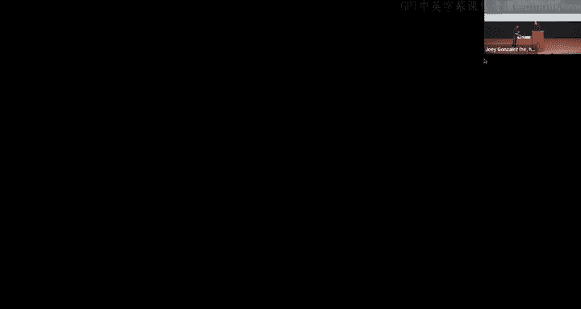
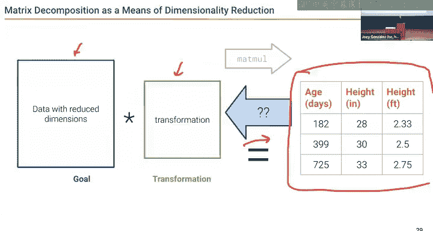
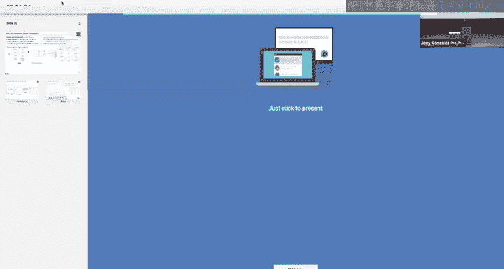
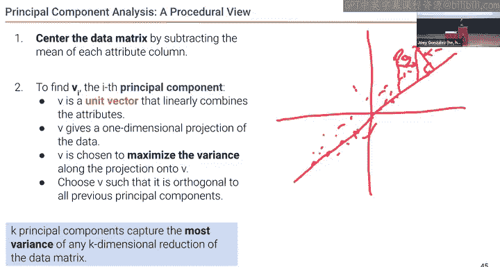
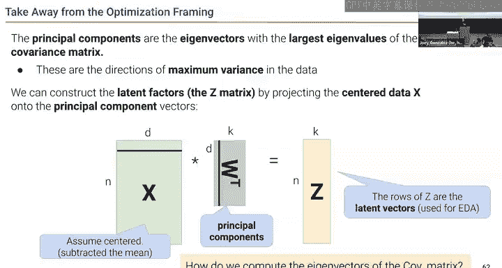

# 课程24：主成分分析（PCA）原理与推导 🧮

在本节课中，我们将学习一种重要的无监督学习技术——主成分分析（PCA）。这是一种用于数据降维和可视化的强大工具，尤其适用于探索高维数据中的内在结构。

---

## 概述：从监督学习到无监督学习

到目前为止，我们主要关注**监督学习**问题，即我们拥有特征和需要预测的标签。这包括**回归**（预测连续数值）和**分类**（预测类别标签）。

现在，我们将转向**无监督学习**。在这种情况下，我们只有特征数据，没有标签。例如，我们可能有一堆文本文档，但没有关于它们是好是坏的标签。无监督学习的目标是从数据本身发现结构或模式。

降维技术是无监督学习中的一个重要分支，它类似于回归，但目标是自动发现数据的内在维度。另一种技术是聚类，它类似于分类，旨在为数据分配离散的标签。

---

## 为什么需要降维？🎯

为了理解降维的必要性，让我们考虑数据可视化。我们可以轻松地绘制一维（直方图）或二维（散点图）数据。对于三维数据，我们可以在计算机上使用交互式3D图进行查看。

但当维度增加到四维、五维甚至更高时，可视化变得极其困难。例如，我们可以用颜色表示第四维，用点的大小表示第五维，但这样的图表难以解读，尤其不适合打印。

核心问题是：**我们真的需要这么多维度来描述数据吗？** 数据可能本质上存在于一个更低维度的空间中。降维的目标就是找到这个低维表示，以便更好地进行可视化和分析。

---

## 内在维度与矩阵的秩

在讨论降维之前，我们需要理解“维度”的概念。

*   **数据维度**： 指数据集中的列数（特征数）。
*   **内在维度**： 这是一个相对模糊的概念，指近似表示数据所需的最小维度数。数据可能位于一个高维空间中，但其大部分变化可能仅由少数几个潜在维度驱动。

一个更形式化的概念是矩阵的**秩**。矩阵的秩是其列空间的维度，即线性无关的列的最大数量。**矩阵的秩可以小于其原始维度**。

**示例**：
*   一个包含“体重（磅）”和“体重（公斤）”的数据集。由于一列是另一列的线性缩放（乘以常数），所以该矩阵的秩为1，尽管它有两列。
*   一个包含“身高”、“体重（磅）”、“体重（公斤）”和“年龄”的数据集。如果“体重（公斤）”是“体重（磅）”的线性函数，那么该矩阵的秩为3。

在实际降维中，我们通常寻求的近似表示维度（K）远小于数据的原始维度（D），甚至可能小于数据的秩（R）。我们允许一些信息损失，以换取更简洁的表示。

---

## 矩阵分解视角下的降维

降维的一种常见方法是通过**矩阵分解**或**矩阵因子化**。

我们的目标是：找到一个低维表示 **Z**（n × K 矩阵，K 较小）和一个变换矩阵 **W**（K × D 矩阵），使得它们的乘积能够近似重建原始数据矩阵 **X**（n × D 矩阵）。

用公式表示，我们希望：
**X ≈ Z * W**

**如何理解矩阵乘法？**
有两种视角：
1.  **行操作视角**： 将 **W** 的每一行视为一个“方向”。计算数据 **X** 的每一行与 **W** 的点的积，得到该数据点在新的低维空间（**Z**）中的坐标。这相当于将每个数据点投影到新的方向上。
2.  **列组合视角**： 将 **W** 的每一列视为一个“配方”，指导如何将原始特征（**X** 的列）线性组合成新的特征（**Z * W** 的列）。

**一个简单的分解示例**：
假设原始数据有“年龄”、“身高（英寸）”、“身高（英尺）”。由于“身高（英尺）” = “身高（英寸）” / 12，这是一个线性关系，数据矩阵的秩为2。
我们可以构建一个分解：
*   **Z** 矩阵包含“年龄”和“身高（英寸）”这两列（2维表示）。
*   **W** 变换矩阵为 `[[1, 0, 0], [0, 1, 1/12]]`。
*   计算 **Z * W** 即可完美重建出包含“年龄”、“身高（英寸）”、“身高（英尺）”三列的原始数据。

这种分解是**无损的**，因为它保留了矩阵的完整秩（2）。但我们的目标通常是进行**有损压缩**，即用更少的维度（K < 秩）来近似数据，舍弃一些不重要的细节或噪声。

---

## 主成分分析（PCA）简介

PCA 是最常用的线性降维技术之一。其核心思想是：
*   找到一组新的正交坐标轴（称为**主成分**），这些坐标轴方向是原始数据方差最大的方向。
*   将数据投影到这些主成分上，得到**潜变量**（或**得分**），即降维后的新数据表示。

**PCA 的两种解释**：
1.  **方差最大化**： 寻找能够保留原始数据总方差最大比例的线性投影方向。
2.  **重建误差最小化**： 寻找一个低秩矩阵分解，使得重建数据与原始数据之间的误差最小。

这两种解释在数学上是等价的。本节课我们将从**重建误差最小化**的角度进行推导，这更符合本课程一贯的优化框架。

---

## PCA 的优化推导（重建误差视角）

我们的目标是：找到低维表示 **Z** 和变换矩阵 **W**，最小化原始数据 **X** 与其重建 **Z * W** 之间的误差。

**第一步：中心化数据**
首先，将数据 **X** 的每一列减去其均值，使数据云的中心位于坐标原点。这是必要的，因为我们要寻找的投影平面或方向需要穿过原点。

**第二步：定义损失函数**
假设我们已经中心化数据。对于单个数据点（行向量）**x_i**，其重建为 **z_i * W**（其中 **z_i** 是 **Z** 的第 i 行，是一个 K 维行向量；**W** 是 K × D 矩阵）。
重建误差（使用平方误差）为：`||x_i - z_i * W||^2`。
对所有数据点求和，得到总损失函数：`L(Z, W) = Σ_i ||x_i - z_i * W||^2`。

**第三步：引入约束**
为了避免平凡解（例如令 **W** 无穷大），我们需要对 **W** 进行约束。在 PCA 中，我们要求 **W** 的行向量是**标准正交**的，即：
*   每个行向量的模长为1：`w_j * w_j^T = 1`（对于第 j 个主成分）。
*   不同行向量之间正交：`w_j * w_k^T = 0`（对于 j ≠ k）。
这意味着 **W * W^T = I**（单位矩阵）。

**第四步：求解（以 K=1 为例）**
为了简化，我们先考虑只找一个主成分（K=1）的情况。此时 **W** 退化为一个行向量 **w**，**Z** 退化为一个列向量 **z**。
损失函数简化为：`L(z, w) = Σ_i ||x_i - z_i * w||^2`。
约束条件为：`w * w^T = 1`。

我们使用拉格朗日乘子法将约束优化转化为无约束优化：`L = Σ_i ||x_i - z_i * w||^2 + λ(1 - w * w^T)`。

**求解过程**：
1.  首先，固定 **w**，对 **z_i** 求偏导并令其为0，可以解得：`z_i = x_i * w^T`。这表示潜变量 **z_i** 就是数据点 **x_i** 在方向 **w** 上的投影。
2.  将上述关系代回损失函数，经过一系列代数化简（利用矩阵运算和求和性质），损失函数可以重写为：`L ∝ - w * Σ * w^T`，其中 **Σ = (1/n) * X^T * X** 是数据的**协方差矩阵**（忽略常数项）。
3.  现在，我们需要在约束 `w * w^T = 1` 下最小化 `L`，等价于最大化 `w * Σ * w^T`。
4.  再次使用拉格朗日乘子法，构建函数：`F = w * Σ * w^T + λ(1 - w * w^T)`。
5.  对 **w** 求导（使用向量微积分）并令导数为零，我们得到关键方程：`Σ * w^T = λ * w^T`。

**第五步：关键发现**
方程 `Σ * w^T = λ * w^T` 正是**特征向量**的定义！这意味着：
*   我们寻找的主成分方向 **w**，必须是数据协方差矩阵 **Σ** 的**特征向量**。
*   对应的拉格朗日乘子 **λ** 就是该特征向量对应的**特征值**。
*   我们的目标是最大化 `w * Σ * w^T`，而 `w * Σ * w^T = λ`。因此，为了最大化保留的方差，我们应该选择**最大特征值**对应的特征向量作为**第一主成分**。

**推广到 K>1**：
上述推导可以迭代进行。在找到第一主成分 **w1** 后，我们在与 **w1** 正交的子空间中寻找第二主成分，这对应于协方差矩阵 **Σ** 的**第二大**特征值对应的特征向量，依此类推。

**最终结论**：
*   **主成分**： 就是数据协方差矩阵 **Σ** 的特征向量，按对应特征值从大到小排序。
*   **潜变量（得分）**： 将中心化后的数据 **X** 投影到这些主成分上得到，即 `Z = X * W^T`，其中 **W** 的行由前 K 个主成分构成。

---

## 总结

本节课我们一起学习了主成分分析（PCA）的核心原理：

1.  **动机**： 高维数据难以可视化和分析，而降维可以帮助我们发现数据的内在低维结构。
2.  **核心思想**： 通过线性变换，将数据投影到一组新的、正交的坐标轴上，这些坐标轴（主成分）方向是数据方差最大的方向。
3.  **两种视角**： 方差最大化与重建误差最小化，二者等价。
4.  **数学本质**： 从重建误差最小化的优化问题出发，通过推导证明，**主成分就是数据中心化后协方差矩阵的特征向量**。第一主成分对应最大特征值，第二主成分对应次大特征值，且与第一主成分正交，以此类推。
5.  **计算**： 在实际应用中，我们通过计算协方差矩阵的特征值分解（或更稳定地，对数据矩阵进行奇异值分解，SVD）来获得主成分。

PCA 是一种强大的工具，广泛应用于数据可视化、噪声过滤、特征提取以及作为其他机器学习算法的预处理步骤。在下一节课中，我们将探讨 PCA 的具体应用实例。