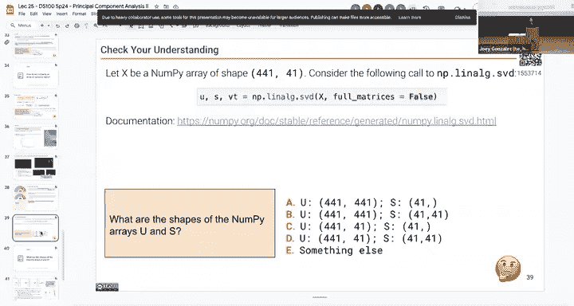
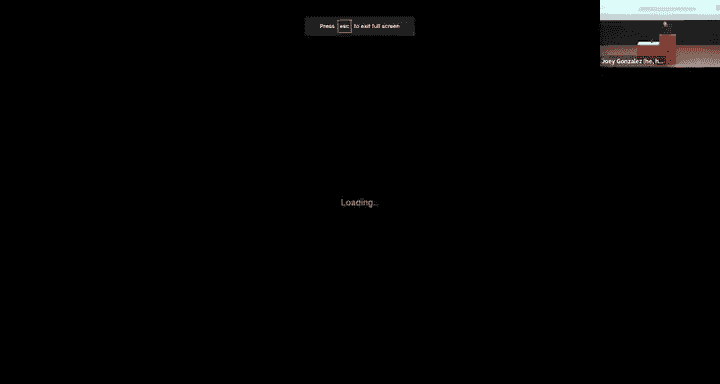
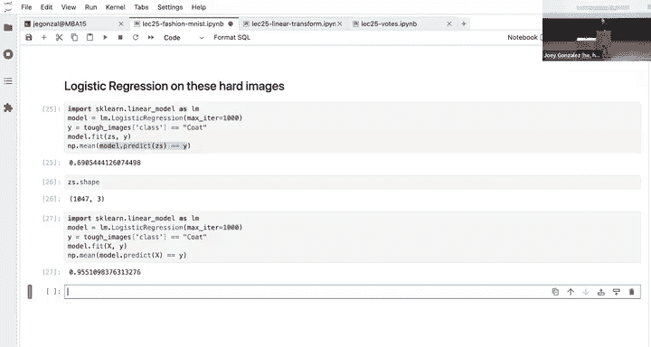

# UCB《数据100数据科学原理与技术｜Data 100 Principles and Techniques of Data Science 24SP》中英 - P25：-25-Data 100 Spring 2024 Lecture 25.zh_en - GPT中英字幕课程资源 - BV1Bc2dYCEbc

And break everything。

对。Ho the zoom。People can see the screen。I did the same thing I did last time， which also failed。

 but hope for the best here。If it doesn't start raising your hand or add comments or something。Okay。

So welcome back to part two of PCA principle component analysis last lecture was a lot of fun for me。

 I don't know if it was as much fun for everyone else because there was a little bit more math than I probably should have put in a lecture。

We're going to stick with it， but today I'm going to try to recap and make that math seem a little bit less complicated and then we'll spend hopefully most of today making pretty plots in three dimensions and visualizing politics and fashion。

 so should be a fun lecture。I said that last time too， all right， so quick。

Refresh of why we're doing principle component analysis because we want to work with high dimensional data and when we have high dimensional data and I break my pen when we have high dimensional data。

 that means we have many columns and working with data with many columns is hard。You could plot。

Every pair of columns， which could take a while， you have hundreds of columns。

 you could try to do the things I did in the previous lecture where I add color and three dimension and stuff。

 but at some point many columns is just hard。So for visualization and for some modeling situations。

 we want to make our data smaller with fewer columns， not less data， but less columns。

Part of why we can do that。Is the world often isn't as high dimensional as a A would suggest？😡。

I measured all of these things， but I'm really just measuring something about a person or a shape or a product and there's some intrinsic low dimensional space sometimes we use the word manifold living on a manifold。

😡，Some low dimensional space in which our data lives。Wouldn't it be nice if we could have that？

So we measured all this stuff， but I just want the true basic dimensions of my data。😡。

This is dimensionary reduction goal。Just define something like that。

To take our high dimensional data and find a smaller set of new features。

 columns that approximately capture this information。That was what we were trying to do。We。

 or at least I got lost in some math in the last lecture。

 I will try to recover from that in a moment and work through what was going on with our matrix factorization example。

Just pictorially。该 go。Pctorialally we had this idea of， you know。

 this is my data in three dimensions you can't tell because it's on a screen。

 but believe me that's three dimensional data and there's this plane。

The data sort of kind of wants to live on and if I could just get that plane and where these data points live。

 I could plot it in two dimensions and make a better picture and that is basically pictorially what we're going to do today and we're actually going to do that with real data。

But I said matrix factorization， so in the last lecture I said well we have this big data set that's our x as D is big a lot of dimensions。

 we have a lot more data but we have a lot of dimensions up here wouldnn't it be nice if we could break this into a smaller table which had just k dimensions that when its treated as a matrix Z if I multiply it by W this magic matrix which we have yet to figure out how to build if I just did that I would get back my original data。

Or something approximately like the original data。Wouldn't that be nice？So that is what I want。

 and I really just want the Z so I can make pretty pictures。

The principal component analysis is about finding it is W。And in finding this W。

 I will also find this Z。How do we do it？Beme in this class。It's called principles and techniques。

 we do a lot of techniques， we have some principles too。Loss， minimizing。Some loss for some model。

That's a lot of machine learning， a lot of AI， a lot of statistics。What am I trying to do。

 I'm trying to do something that reflects my data， how much does it reflect it loss was is something the model that I just want to be close to my data。

So here's my x's， this is my row of x， an animation here， so row of x。

 and then here is a row of my Z's， a row of my things that I wish I had。

 and I multiply it by this matrix W。And that gives me an error， so I have my centered data。

 my principal components， which we don't know how to build yet。And this rows of Z， my latent vectors。

 again， the things I want to plot。And I want to minimize the difference between when I do this to reconstruct one of these。

We want to minimize that error。And we picked an air we all know well， the old two， the squared air。

There are many ways to do this， there are many such matrices。

 I can scale this by a and then I could scale this by you know1 minus a can do different variations of that scaling so we needed to pick something to make this unique。

And so we're going to or at least partially unique。

 we're going to pick our W to be an ortho normal matrix。You can think of that as the rows of W。

Have magnitude one。That's part of it and that any row against on the inner product of this row and this pro。

 this row， which is you know if I take。The inner product of these two rows here and here should be zero。

 they're normal。Perpendicular by dot product， things that are perpendicular， I get zero。

So when I do this matrix multiply。I get ones on a diagonal because that's got producting with myself。

You。Loop。This one here， but anything off diagonal this one and let's say this one。

 that's going to be zero。Ororth and normal。It's my goal。We have an objective。

 we even had a constraint， and this is where I got excited。

So I then can minimize this objective with this constraint step one we showed and I will not show again there was this was actually algebra that you probably should be able to do we showed that Z。

Is best is minimized， that loss is minimized when we choose z equal to x。

Inter product with W transpose product， take the matrix X。

 and this is projected onto W transpose or onto W。They great， if you know W， you know how to get Z。

We don't know how get W yet that' sort of we got lost last time it's like， okay， we figured out Z。

We kept going， let's take derivatives and figure out W。So we now know that Z is this。

 we can plug that back into the equation that is not on this slide or in this lecture。

 and we started doing this fun stuff。I add Larangian multipliers so cool。

 unfortunately out of scope for data 100 because you guys don't know what that is。

Kind of know what it is， I give you a hint of it， you'll see it again in some other point in your life and we did that to get this orthonority constraint in our objective because we have a constraint。

Then we took through its with respect to W， it's like， oh， that's fun too。

It looked like regular calculus。But technically， I did vector calculus because my W's weren't。Scals。

 there were vectors。 You could squint angle go， yeah， that makes sense。 You had w times W。

 and you've made that 2 W。Some transposing stuff， but it worked out。

This is also out of scope for data 100 it's a bummer so you do not need to actually know how to do vector calculus。

 but you can kind of see what I did in that process we took derivatives and then we set them equal to zero and I was so excited I flashed up this picture whoa。

And everyone clapped。Except no one had clapped because nobody understood what I was doing here。

What was I doing here？Does anyone remember what I was doing here？Someone remember I was doing here。

 that's good， should do a poll， okay。So we should go back to this。This equation is amazing。First。

 because it has Sigma。What Sigma？With sigma。I don't know， okay。

 that's a bummer Sigma is the standard notation and statistics for a covariance matrix。Sigma。

Is if we had centered our data and we did， if I took my data and did x transpose X。That's sigma。

It's the covariance of my data。You might remember covariance being something that looks like。X minus。

New。Transpose X， X u。Except we said mu is zero。衰 get。X transpose x， and this is again。

 what we said with sigma in the past。Covariance。I believe I taught that in this class。

 so I know you know it。Okay。So that's cool covariance matrix very exciting。

 I guess this is on the slide so when asked you that question it was less fun。

What is this eigenvalue equation， super exciting， whatever you see equation like this matrix times vector equals scalar times vector。

 that same vector， this is an eigenvalue equation， and that means these things have names。😡。

We have this thing called an eigenvalue。And this thing here is called an eigenvector。

Those of you who do know what's going on are like， Joey， why is there a transpose here？Okay。

 so normally when you see an eigenvector equation， it looks something like ax equals lambda x。

 unfortunately due to my notation， W here is a row vector， so I had to transpose it。

 so it looks like a column vectorctor。For those of you were not confused by that。

 please remain not confused by that that's matrix time is vector。

Equals scalar times that same vector。So that's super exciting because we have machinery to find these things and if we know that the answer。

 the thing that minimizes our loss， looks like that， we know how to solve for it。😡。

And as we recall before， we have this extra constraint。

 which is fine because our machinery is going to preserve this constraint as well。

 that we want this to be an a row orthoormal matrix， yes。This equation， great question。

 why is covariance so exciting in this equation， why should you have all been clapping when this came up？

😡，Well， I said the first way to show PCA is finding the direction of maximum variance。

Covariance matrix is measuring that variability。It's measuring the variability across dimensions and then along each dimension。

So the thing that maximizes that solves this。It's also going to be directions of maximum variance if I choose the the target the。

Eigenvectors with the largest eigenvalues。It's related to the really coefficient。

 which again out of scope for this class， so ignore I just said that。Okay。How exciting。

You're all now very excited about this， right？Yes， I'll just assume so and move on。Okay。

 so now what do we got， this is I think we left off last time。Priinncipal components。

A eigenvectors with the largest eigenvalue of our covariance matrix。

As directions that maximize variance， right， minimize loss， maximize variance， same thing。

We can construct the latent factors of the Z matrix by projecting the centered x on these principal components。

Which we know are now eigenvectors and we're to use some magic in a moment to find those eigenvectors。

Thats how we got our Zs。Rejectsami or Z's， we know how to get our W's。

 all centered principal components， and by the way， these are called the principal components。

Unfortunately in previous versions of this class， these were called principal components。

 I have made that mistake in the past before， but the correct definition of principal components are these guys here and these are just factors。

Some of the lectures that we will link to from other faculty elsewhere also make this mistake。

 it is a common point of confusion that someone calls this principal components don't get too upset with them。

It'sAnother way of thinking about it， These are technically called latent。

Vectctorors sometimes are called scores。嗯。I'll just say x project on a principal components。

 but these here。Are my principal excuse cash？Columns of this thing。Rs of W， columns of W transpose。

Confused， that's okay。 we're going to keep doing this。 We'll get some examples。 So how do we compute。

How do we compute？The eigenvectors of the covariance matrix。

And that brings us to the last Mafi part of this lecture， which having learned my lesson on Tuesday。

 I will try to make less Mafi today， but it is a very cool concept。

 the singular value decomposition so these really big ideas in linear algebra。

 it's a very important concept。We assume you've taken some linear algebra or taking it now。

 so hopefully some of these vector ideas are starting to make sense or will make sense in the next week or two。

I will not explain SVD， I really wanted it to， but we don't have time for it and'd be confused。

And I'm not going to prove stuff about SVD except they might prove why it's related to PCA because we can do that now we have the tools there's this E16 lecture notes which are awesome so if you really want to go learn everything about SVD can check those out so it's a pretty in depthepth study of the properties of SVD in the various flavors。

But not today， today， I will just tell you， SVD is a piece of magic machinery that takes my matrix X and factors into three matrices。

 U， S and V transpose。3 matrices。I will say just notationally， I am going to use the letter S here。😡。

If you see anyone else's lecture， guess what letter they use here。Yes。

Which is very confusing because sigma means covariance。And not。Singular values， interesting。

 they are very related， which we'll show in a moment。 But I'm going to call this letter。

 This is the letter S。 I don't speak Greek。 And so we'll just stick with simple letters here。 So U。

 S and V， let's talk about these magic matrices， U。😊，Is going to be a。

The columns of you are orthoormal so their unit length and they're orthogonal。And this is cool。

 the columns of you are the eigenvectors of xx transpose。We don't need that。

 but it's a cool fact now you know that。S is a diagonal matrix that is D by D so that my columns by number of columns。

And along the diagonal are the things called singular values from which the singular value decomposition or SVD gets its name。

And they are ordered largest to smallest。And if our matrix is rank R。

 then there'll be R non zero singular values。So if our matrix is lower rank than the dimensions of our data。

 we might actually not have zeros along the entire or one or nonze entries along the entire deck so maybe I'll draw a quick picture so this is my D by D matrix see an example in a moment and if my thing is rank R then I'll have ones along here and then maybe it stops here this is R here here is R and thenll be zeros all the way around here。

嗯。These squared are my eigenvalues well let's let's get to this next piece here and we'll come back to that so next we have V V is exciting so V the comms of V so this is v transpose the comms of V are also worth normal that's something we wanted。

And this is the big reveal， the columns of V are the eigenvectors of x transpose x。

So call some magic function， spits out three matrices， I got matrixtri V and I'm good to go。

There' would been a much easier way to present this entire lecture。

 but now you have the math behind it and you know why it's related to this principal component。

 loss minimization problem。Here's an example， so we have a table of rectangles width。Eight。

 area and perimeter。What's the rank of that？Oh no， don't look okay， we get the answer。

 I guess why is it rank three with height perimeterter in area， think about it。

Because this's in the last lecture， perimeter is a function of the width and the height。

 right two times width plus two times height perimeter， rectangle。So let's rank three。

 which means that I'm going to get a matrix u， which I said would be n by D。

These are just some numbers。I get a matrix S。Which is D。By D， it's mostly zero， it's all zeros here。

so it's diagonal， and it's also zero here because it's ranked deficient X was not full rank。Ex。

 so it's only rank  three。I think at VT， that's the one I was so excited about。

The rows of this matrix。Are my principal components， things I want to project onto？

So now it can make pretty pictures。So yes， this was rain3。Okay。

So the last mathematical step is how do I get？系。my principal is for SPPD， I just told you。

 but just once more to see it happen， Im was saying that X is equal to USV transpose。

 This is just a fact my computer program gave me US and V transpose。

If I sigma is my covariance matrix， I want the eigenvectors of that。

 what sigma is equal to x transpose x is I've centered my data， I just plug this in。Here and here。

 this is x transpose times x and the transpose of things in parentheses。 How do I deal with that？

So the transpose of this is equal to I reverse the ordering so I'll read it backwards and I take the transpose of each thing。

 so this is V transpose transpose， such as V S transpose and U transpose。That's what I got here。

Here my slide for a second。And something neat happens， this was an assumption that we had about you。

 who transpose you is the identity matrix， so it's just one。So we get sigma equals V。

S squared just for simplicityimistic notation times B transpose。

If you're curious S square is just a square of the diagonal elements of S。If I write multiply。

 so I'm going to put a V on both sides here。You get sigma V equals V S squared times v transpose times V。

What's going to happen？We know about this。What's V transpose V。one。😡。

O's the identity matrix so what do we have now everyones super excited against standing ovation。Yes。

 what is that？An eigenvalue equation。But here I have a bunch of vectors and here have a bunch of vectors here。

 so it's a bunch ofigs eigenvalue system。A bunch of eigen equations。So this tells me that V。

 which I already told you in the earlier site， is the eigenvectors。Of Sigma， which was our end goal。

So a bunch of math to prove to you that I've got my eigenvectors。

So V is my principal components I showed you in math， you do not really need to know all this math。

 but it will help you in your future careers， so I showed you anyways。Go the way。

And this means that S squared。So the principal components squared are the eigenvalues of sigma。Yeah。

 so this is a notational thing S transpose S。I've written as S squared， you could keep it like this。

 S transpo S is still a diagonal matrix。With sigma 1 squared Sigma。 Oh， no。

I said I wouldn't need sigma。Okay， it's hard。 S transpose S。Es I said S squared。

 which is equal to a diagonal matrix with S1 squared， S2 squared and so on。

So it's a square of the S is just easier to， to see。 You could leave it at S transpo S。 That's fine。

 too。These when I have a like a diagonal matrix rate on the right of this is just scaling each of the columns of this matrix feet by one of the corresponding signals。

S is a diagonal matrix。So diagonal matrix time diagonal matrix。You square the elements。

Good questions。One thing I will say again， you don't need to know all this。

 you're co-taking a linear algebra class， but it is helpful to see all this。

 it'll hopefully make the linear algebra class maybe make a little more sense and again when you go further and do like 189。

 you will need to know all this stuff。Soあ thisす。Okay now we're getting redundant here how to do it so now I've got my V。

This is in Python。And I can do this little V subscripting trick What is that doing that's saying I want all the rows of V and I want just the first k columns so maybe I should make this k you know K is here Yeah。

 I want the first k columns my I just。So this is shorter than D， so D is this long。

 but I'm only taking a little bit of it， so I'm leaving off some of the other columns here。

UIt's a b mother comes here that I didn't get， this would have been D over here。Ste。

 so I'm taking just the first K columns。This bigger V matrix。So this is the Python notation。

 which we'll use in a moment anyway， so I'll show you how that actually works。

So that's all I got to do call for D， grab that matrix V and multiply by x。And I now have the。

 so I can make pretty pictures of my data in low dimensions。

 and in practice I will typically use k equals 2 and for this lecture for your entertainment。

 we will also do k equals three。Big batch。Gs a way to compute Z kind of a fun side。

 So I told you Z equals X v。 we just did that。 you've even showed that a while ago。

 remember I said x is this thing up here， so I can go ahead and put that right there and we know that v transpose V is one。

 This is one the identity matrix， which means that Z is also us S。So many ways to make Z。

Take your favorite。ItDoesn't really matter。All right， so let's actually do it， so here's my matrix X。

行。Heres my matrix V right here。Big matrix， but I just want the first two principal components to V。

 so I'm just going to pull these two columns。C1， PC2， and I'm multi by。X， and I get Z。

 let mean Z right here。That's it。B c a。But that's speed。

I said you can do it more the one way heres the other way to do it here's my matrix U that SD spit out some。

eigenvectors of Xx transpose， that's weird， but I take the first two columns of it。

Take the first two columns， two rows of s。Well's bound together and I get the exact same Z again。

There are two ways to compute the answer。Okay， and I've said this a bunch， but I'll say it once more。

 if I take just a few columns， I'm going to approximate the underlying X。And what do I mean by that。

 so I've built my Z as an approximation low dimensional representation。

 I can multiply that thing again by V transpose， which I have for my library。X V V transpose。

This is also going to be one。So I get， I'm sorry。Let go here， I get x， correct。If this is one。

 they get back to USB。Okay。Let's actually go through an example now。

How to transform oh let me give this one picture I probably should have start with this picture at the beginning of lecture。

 but we'll do it once more for those who are still a little bit lost here's the end story of what we do we have data in two dimensions so this is my cloud of data over here in two dimensions。

I am going to do first， first step of PCA is center my data to subtract off the means so it's now going to the origin down here。

 step one。Step two， I run SVD， I get those eigenvectors and I project onto them。

And that's going to rotate my data so it's aligned along the two principal component dimensions。

This data started out in 2D。And it ended up in2 D， So I didn't really accomplish much。

 But if you'll notice， if I had thrown away this dimension and I just had kept this dimension。

 I would have had most of the interestingness about my data。 So I have taken my data from。

2D I drop this dimension。Looks like。All my data would look like this along this line。

That kind of captures where the data is， doesn't capture this information where it deviates from the line。

 but it captures where it is on this axis， principle commit 1。

 which is where most of the interesting stuff is happening where most of the spread is。All right。哎。

We can go through all this actually 2。 I want to bring out so once I run PCA。

We already said that the things are orthogonal， the comms would be orthogonal。

 our data can be aligned along these axes。I want to say yeah principal are linear combinations so the principal components that we build are linear accommodations of the original column space。

 so there're still a subspace of the original column space in my data。

 I think no else say something about the covariance but' be that in a second。

Right let's go through a demo so that's sort of the end of most of the math for today。

 are there any questions at this point on the math？How are people doing on Zoom， you know？

Weird people doing good， okay， we'll go with that。Let's do some code。

We're not going to start fashion。Should second。Upputs， okay， here we go。So I have a notebook。

Which I'm going to pull in my rectangle data。I dont this one。

 I want this one votes here go notebook and pull in my rectangle data so I have width height and area。

I center my data step one so I take the rectangle data and I subtract off the mean。

 that's the mean of all the rows， so take the mean across the rows so I have the mean width mean height and mean area mean perimeter。

Something that I didn't talk about that is pretty common is I will subtract off the mean in some cases Ill also want to standardize my data that is I want to make sure that the variance of the original dimensions are about the same Why do I want to do that Well if you happen to have a dimension that was like square of another dimension let's say area then the principal component analysis go wow。

 everything is really varying along that dimension so that must be a really important dimension。

And it may not be it just happens to have weird units， squared units。

 so when you have data that has weird units like squared cubes and things are like billions of dollars and then the height of the person。

 you might want to scale those things so the original dimensions before you do all the magic are about the same order of magnitude of variance so you don't just overfixate on that you know billions because the numbers are big。

😡，So I'm going to divide by the standard deviation， it's another technique to do。

I'll show you what happens when we first start with x just taking the subtracting off the mean。

 so x is the centered data， as I said in lecture， here's how to do SPVD。

We could have spent half a lecture on this whole topic if I just jumped here。

 so I'm going to say numpys， linear algorithms library， SVD function of X。

 and I don't need the full matrices。If I was ranked deficient as you can get additional eigenvectories even when the eigenvalues are zero。

 don't worry about that， just say full matrices is false， save some compute。All right。

 so what do I get I said before the shape of U is going to be n my data was n00 by four four dimensions S is this diagonal matrix which is a four that's weird back to in a second and V T is4 by four these are my principal components。

So S is written as a list as a one dimensional array， which is just diagonal elements。

 why waste storage， storing all these zeros， but if you want to make it a diagonal matrix you can just convert it to a diagonal matrix。

 so just the eigenvalues along the diagon。You'll notice that we said this was rank three。

 there's a non zero entry on the fourth。Principle component， why。It's basically zero。

10 to the negative 15， so we'll just call that is it close to zero？Yes。

 it is close to zero Nai has a function to test that floating point math is imperfect。

 so you'll get things that are basically zero but not actually zero what to deal with that。

If we round to five decimal points and I look at just s， the original vector。

 these are the diagon elementss， you'll see that is in fact zero。

It is zero again because that matrix is rank  three， not rank four。

 even though it has four dimensions。Are those numbers sorted？Yes。And， how are they sorted。

Good question so remember they're sorted from the largest to smallest principal singular value。

 which is the largest to smallest of the square root of the eigenvalues or if I square them the eigenvalues because remember S squared the eigenvalues that's important because the well I'll show you in a second it's going to tell me something。

So we have our di and made it prettier rounding stuff。Let's make， oh， let's look at this。

This is S squared divided by n。So this and I'll come back to a moment of slides。

 this is the variance along each principal component dimension and that's very useful because now I can actually calculate project my data。

 what will the new variance be in each of these dimensions and the variance of the first dimension is huge。

Why is the variance the first dimension huge？The first principle component explains most of the variability in my data。

We'll make some plots of this in a moment。Just for fun。

 I'll also do SVD of my standardized data where I not only centered it。

 but I divided by the standard deviation of each of the columns to make it so that area doesn't get all this extra attention because it just happens to be a bigger kind of number。

And then we see this is a little bit different。Right。

So here there's one massive principle component that really just explains everything you need to know about rectangles。

Now there's one that explains a lot and then two that explains a fair amount， then the rest。

 not much。 why is that？Why do you need two numbers for a rectangle？But these were squares。

 how many numbers would you think I need？One， why do rectangles need two？

There's intrinsic dimension or rectangle is two。That's absurd。Where' is it？

Maybe we should draw a rectangle。Can I， let's do that。 command one。

What does the rectangle look like for those who are。A familiar。the rececttangle。

 there are two numbers。8ight。喂。RightIf these were squares。

 I could have gotten away with just one intrinsic dimension， how many dimensions here。8い。はい。喂。

Squares， everything's equal， rectangles， you got two numbers。

 so we kind of expected if we were thinking carefully about it。

 that the intrinsic dimension of this data is two。Okay， well。

 jumping ahead to my eigenvalue discussion。Okay， so step three， we construct our approximation。

 I said there was two ways to do it。I've computed you。And I had my diagonal matrix S。I take。

All the rows， but the first two columns of U and then just the two diagonal elements of S。

And I multiply them together？And Z。I get my Z， my projection of my data on the principal components。

 sometimes called latent vectors， latent factorss。This is the stuff I want to plot and we will plot today。

Soon。O。Let's also project onto my standardized version。 So here I'm doing x times V this time。

 So I'm taking my X it standardized。And I'm multiplying it by my V T。

 so I'm taking all of my x and I'm taking all the rows of V。Transpose， transpose， that's confusing。

 V transpose transpose， also known as V。And I just want the first two columns， all the rows。

 just the first two columns。And it's。The same thing。

Why is it the same thing because when I computed STD a moment minute ago I did it for the standardized data so these are the Z for my standardized data and this is the Z again for the standardized data and these are identical methods produce the same result。

What time。What's this going to look like？Those are my rectangles on two dimensions。Good。😊。

Don't get much from this picture in a moment you're going to get blown away by pictures。

 but this one don't get a whole lot。Just for completeness。

 we can also do this entire calculation by calling one function PCA。

So I get a PCA and I just want two principal components and I do PCA fit transform on whatever data I have and magic。

 I get another embedding。Right， so all of that math could have been reduced to。

This many characters and we could just skip the whole the whole week kind of bummer all right。

 here's my Z again for this one， let's actually look at something cool。What。So if I look at my Z。

 my my data projected on to the principal components， there' one last thing I want you to know。

 and that is make this easier to see。And pe do round。great， that's good。It's diagonal。

It's important to know， it's one thing I wanted to say earlier in my slides。

Once I've done all this PCA magic， I've made the covariance matrix of my data diagonal。

So I rotate it， so it is diagonal。So I've made the dimensions independent。

That's a strong statement I made it。The covariance zero across the dis。

Right across the off edge here。Right right。Give little more pictures， so let's see this picture。

So I'm going to try to recover my data and this is what it looks like。

So the blue data is the original rectangles， it's easier to see。

The blue data is the original data points where I had with。E an area。

I've ignored perimeter because that's redundant， so with height and area。

It's on that blue kind of p shaped curve and the red dots are my approximation。

 I' projected onto that plane that kind of more or less fits to that blue curve thing。

 and so if I go to reconstruct my data after bringing it down to two dimensions I lose a little bit of information。

Because I'm doing a linear transformation， if I want to preserve information about area。

 I can't do that just linear transformation。Okay it's not perfect。Right。Questions。

We your turn to lecture。Yeah。Great， so let me do this again I made a very strong statement with the rectangle。

 it is true there are only two things you need to know height and width。Problem。

 PCA is a linear operation， so how do you get area from height and width？😡。

Hyight plus width is not area， right？So I actually do need three dimensions if I want to recover area。

😡，If I'm going to use PCA。We will not cover in this class。

 but there are methods that can actually find this， again， two dimensional manifold。

 this blue curvy thing is still a two dimensional thing， but it's bent。

So PCA alone is going to be a lossy projection， it's going to find a lower dimension representation。

capturetures a lot of what is important about a rectangle， there's really just kind of two numbers。

 but not enough to recover the data completely because area is not something that I can recover with linear operations。

That's why I am losing information and we saw that because even when I did。This SVD decomposition。

 where's the numbers。狗 go go go。Where is the numbers going too far。嗯。And you asked， here we go。

The last singular value is not zero。I standardized my data。

 but there's still information there in that last dimension。

I can't recover the full data with just two dimensions。But I'm pretty close because area。

 at least when these things are small， is pretty close to a linear approximation of。With and night。

AndSo if I made this data bigger， I had giant rectangles， I'd have more and more loss。

 more and more air。Are there questions？不是。We want to get to pictures， let's do it。Right。

 so I want to finish by talking about some of this discussion around total variance。

 So in our original data， we had this notion of the sum of the variances of all the columns。

 So I take the variance of each column and I get a number and I can sum these up。

Let get this total variance， right？The whole goal here is to try to find a new set of dimensions。

 it has as much of that variance as possible。All right。

 so the way to compute the variance of each of my new dimensions that I've projected on these singular values onto these principal components is to take the I singular value just 197。

4 that's the singular value for the first principal component square it because remember it's s squared to get the variance。

Theres the single values of the covariance matrix， and I need divide by n because when covariance matrix is scaled by one over n it's just not。

I guess I lied earlier， it's1 over n times x transpose x。

 you just kind of ignore this in optimization， but you do need that one over n if you want to compute the variance。

 so bring it back。De write1 over n times x。X， we bring back our n and this right here。

This calculation of the singular value squared divided by n is the variance of that column of z of that projection under the first principle component。

Which is great because now I can see how much of the variance is explained by just using one of the principal components。

😊，Or using two of the principal components。And I can even make a plot， I think。So my next slide。Okay。

 one more plot to discuss before we get back to plotting so once I found the right number of dimensions which I haven't told you how to do。

 oops， we should do it now。嗯。🤢，arrange this okay yeah we'll just do this and we'll go back to the slids in a second I can now plot these these variance numbers for each of my principal components and I make something called a screen plot and the idea here is if we look at this plot most of my data seems to be here I don't maybe need these I certainly don't need these these all look kind of they don't explain much this explains a little bit's maybe two principal components is enough if my plot looks something more like。

It looked like something like this。And maybe it goes like that。

 then maybe I need three principal components to represent my data。系。So this is done pictorially。

 it's not really a science more of an art looking at the elbow in this plot and trying to find what's the thing on the left of the elbow。

 what are the number of principal components I need to capture most of the variance of my data。

It's called a screenre plot。Which until a week ago I didn't realize was actually related to a a geological formation。

 this is called a sree on the side of a mountain。It's named because it looks like the side of the mouth。

我的。Sreet point。Ss slids okay so we talked about computing these and then the last thing that we're about to make some pictures of is once we have our three dimensional data we project it and we already did one of these project it into a lower dimensional typically two so。

嗯。So 2D space， we can start to visualize our data， we'll often attach attributes as color so we can see clusters and the behavior of our data in some lower dimensional visualization。

Coect。As I said before， if we don't if we need more than two dimensions。

 it may no longer be a good representation of our data。So it might be emitid a lot of information。

I want to go back。We'll come back to this in a second Sio， let's do some actual fun stuff。

Right right so。Now I get to do the fun part of lecture。

 we're going to look at complicated data so I'm going to study congressional House votes in 2020。

And so this is the data。So we have the chamber， the session， the roll call。

 that's the thing that we're voting on and then the House member。

 whether or not they decide to vote or whether that they could vote yes， no abstain。

 not voting speaker and so on。This all， I think all of the 116th， yeah， Congress。

 we have data for the 116th Congress about how people voted。

And I'm going to do principal component analysis， what do you think I'm going to find？

Let's make my data a little more concrete， they'll help a little bit。

 so I'm going to pivot this data so now I have。The House of Res， the congressman。

 and then I have the vote， so vote on bill 515 or roll call 515 or some bill I don't know it was。

And then yes， no， no， no， yes。 Okay， so I have this kind of information。

How many dimensions do you think US politics has？We are rich， high dimensional。Political society or。

Or a low dimensional political society two is a good number because we can plot it three。

 we can also try to plot。Higher than that's going to be hard。

How would we figure out how many dimensions we really are？Reod。Let's try it。

So here is a situation where I have 41 columns， 440 individuals on 41 different voting occasions。

I can't visualize this data， it's a bunch of ones and zeros， it's a paint。So I'm going to use PCA。

 try to bring this down to just a two dimensional space and see if I place people in this two dimensional space。

 where do they live？Who are their neighbors？First step。We got this vote pivot table。

 which I built here， we'm going to subtract off the mean。More numbers。Or to visualize。

But we have a slidr question let's do the slidr questions， we haven't know yet。

 so have all these numbers。Well sorry it the previous one。They break my sideo。Sorry。😔，诶。

Let's keep going， I don't think I want to do this slideo yet。One second。

 I do want to do a slido so I make sure you guys get your attention。嗯。So look at it。

Yeah， my slide is out of order， it's a bumpmer。看。

So I have this 441 members on 41 voting occasions， let's test our knowledge of SPD。

 so I want to figure out what is the dimensions of U and S。Slier。These votes。

 so we go back to pictures。Okay。Aud is better。 Thank you all。 I've put the mic a little higher。

 Maybe that's the promo lot。First。Okay。Vote， vote， vote。

I want to show you the picture it's going to blow your mind。好，O。Let's who we got。Okay。

You're getting it and I will accept this answer too I'm good with that Both are basically correct So the first answer。

Is U remember is n by D and the second matrix S is D by D except in nuy where D by D would be a waste of memory sting all those zeros。

 so we just store the aagonal， so it's just this 41 So the correct correct answer is U and the pretty much correct answer is sorry is this one the pretty much correct answer is this。

对。Now we've finished this slide out， I'm going to leave this running。I want to show pictures。

So at my table， I run SVD pretty quick。And now I'm going to make a 2D plot。Wow。What do we see？Dots。

 receive dots。What do these dimensions mean I don't know。 What do these dots mean， I don't know。

 But the first thing I see。Like a cluster of stuff over here。

 a cluster of stuff over here and some interesting people over here， each of these stuff。

 each of these dots is a person in Congress Congressman。

Wouldn't it be cool if I had the political affiliation of everyone？

How could I do this components course， I'm going to skip this。Right， no， I won't。

 because you guys need to style。So're going to do one more slide off。基本就是。

So I want to look at the distribution of the before I dig into what's on those dots， I want to know。

How many dimensions is the US Congress？If I project their votes into a low dimensional space。

 I want to find where the variance is explained， so I want to know how to compute the variance ratio for each of the principal components。

 so what fraction of the variance ratio is expressed by each of the principal components？啊。S here。

So is it enough to reduce Congress to one， two， three dimensions。

 I want to make that screen plot in this wax I want to have the。The ratio。

 the fraction of the variance， the total variance explained by each of the principal components。嗯。

Right right， you're close， so S squared。Over n is what I said earlier if I wanted to compute the variance。

 but I made this modification here that this time I want a screen plot because remember screen is just a shape。

 I want to know what fraction of the total variance is explained by each of those components so I want the variance divided by the variance the total variance it's my by sum of S technically I need to divide each of these by n。

 but if I divide the numernominator by n that doesn't do anything so I get rid of that。

Why we want to plot this because it's easier to look at that's 30% of variance。

 20% of variance and so on as opposed to trying to read the variance numbers themselves。

So it gives me a better sense of what fraction variance is covered。It's open。

So you look at our variance， so 80% of the variance is explained by the first principal component。

And then 0。05 the。 So the US can be reduced to one dimension。

 at least our politics seem to be one dimensional。Ive got screen plot。Right。

There's one dimension that explains。The vast majority of the variability in how people vote。So now。

I can look at higher dimensions remember there's this one that's probably this dimension here going across this way。

 Z1 it's right here， Z1 second dimension， it's a variability here and if I look this way。

The third principle component， there's some variability。Curious what this persons doing up here。

 maybe they're interesting on this third dimension。But there's not as much variability。

 so most of the interesting stuff is happening on this axis right here。

So how do we know what is happening now the exciting part？

I'm going to bring in the political affiliation of each of the voters。

 each of the members of Congress。Join now of my data。

I'm going bring in a bunch of information at once。And now we can see what's going on。诶。We have。

People who vote blue or Democrats， who voted red Republicans。People who voted green independence。

And then interesting people down here。This is why I do PCI can take something as complicated as boats。

Congress， reducing the lower dimensions， start to see interesting patterns。

One thing that's happening here， which you can't quite see is some people vote so identically that there's a bunch of people here。

It's called overping when I stack dots and that this dot is many dots。

 you can't really tell what's going on AOC， nice。I would guess she's on the far left here。Yeah， pure。

That's far no， she's right here far left。this plot， it's just the coincidence， by the way。

 that this organized left to right。You' have taken the reverse eigenvector。That's what we got。

 so we spread the US votes， the people on this one Z1 principle component explains a lot of how people vote and in some sense that Z1 principle component is their political affiliation。

whichch we sort of might have expected if you follow US politics， with I said。

 there's people stacked so to make this little bit more clear。

 something you will often do when you make these plots is you'll do some jittering。

 adding a little bit of noise to each of the dots so that you can see the differences。

When you present this in public you just say this data has been jittered because you're changing the actual placement but this is for our visualization purposes it'll help a lot so now we can see the cloud of points over here。

 the cloud of points over here because data has been a little bit jitter。

We do things like look at the。Did you对。So we can look at like take away certain groups。

A lot more male Republicans。There's one independent。Smbarrassing。Yeah。

 so this gives us a picture of what's going on。 I've done some extra things， so I've encoded the。

 I think the size。As the age of the representatives so we can see younger older representatives and stuff on this one plot。

 so we can still visualize in the other dimensions， the attributes of the data。

 but we've taken all that vote， the 41 dimensional vote space and reduced it to something that we can really see。

We're fun， we can also look at this in three dimensions。

 I don't think anything else really interesting is happening along this dimension。

So it's not much spread if I look on this dimension， I'm not seeing a whole lot of interesting stuff。

Most of the interesting stuff is happening along this dimension going horizontally the Z1 jittered。

 and a little bit of stuff is happening along the Z2 dimension going this way now。嗯。Right。

So this data has people who voted different amounts of times and some people didn't vote that often they abstained or just what weren't present so we can look at the histogram of voters we might be curious I didn't run this analysis but we could look at like are the people down here interesting they happened to be the people here just didn't vote that often so maybe that's why they're the middle just didn't participate in a lot of the votes they abstained。

So we can start to see other patterns as we bring that information into this plot。

So this is what you would really do in the real world。

 You're going to take high- dimensionional data， try to bring it down to a few dimensions。

 visualize maybe two，3， maybe pairs of a few of the dimensions at a time。

 try to bring other attributes in， seeing things like color shape to encode other parts of your data and you're looking for patterns because this is a big part of E In some cases。

 you won't have the red in the blue you'll just have dots that's interesting。

 There seems to be a bunch of dots here， a bunch of dots here let me start moing over okay these are all people from states that seem conservative or these are all states that seem liberal Let me go see if I can get the political affiliation and then start to deeper analysis So that is how we would use PC in。

One more thing we can do is we can look at the actual principal components themselves。

 So the first principle component is a direction of votes， if you will， it's saying no。

W right here for 515， it's a negative number for 520， it's a positive number。

Given what we saw in our picture， what do you think this looks like？Should if I'm a Republican。

 should I vote yes？Or no on 520。Ppublicans are on the right， positive inner product with this vector。

 their votes have positive inner product with this vector。

This is essentially the vector of what a conservative should vote。And by how much。

We believe that that first pencil component describes as the dimension of the political spectrum。

And we can kind of check that because we have the data。So here is the average votes。Yes。

 no for each of the parties。And here is my figure from before。If I look at the average votes。

 it more or less aligns with the average votes of the Republicans。

So we could have skipped all this PCA altogether and just said。

 what's the average vote of a conservative？And project onto that dimension。

 that's pretty close to what our principal component analysis found。But in the real world。

 we may not have that label。We just have the data so we can't do that analysis。

 only PCA can reveal this information。Moving long。 This is good。 we might get to fashion today。

One more plot that I don't use often though I'm just going to bring it up because you might see it。

Sometimes I want to understand if I took just two principal components。

I might want to plot on top of my original cloud of points。These vectors。

 so let's take a look at like one of these vectors， 515。Okay。

 so this is saying if I take the first principle component and the second principle component that z matrix。

W， I messed up just now。My data projected onto the first and second principle components。

 I get that Z matrix， and I look at。The correspondence of， actually no， this is not quite right。

Shows。Do I have a。Piece of math that I can point to for you here， this actually does it。

So I'm taking my V if I take my principal component， the first principle component。

 it's in D dimensions， which means it's a vector in the original voting space and I can look at the contribution of each of the votes to that vector right so if I look at the row the first row that's corresponding to vote 515 and has this number in principle component one in this number of principle component2 that's sort of the contribution of that vote to each of those components I can plot those votes。

As arrows on this plot。And that gives me a sense of how this vote lived on in this space。

 so these are votes that went liberal， these are votes that went conservative， for example。

So one additional kind of visualization you can do is once you have your principle components。

 you can look at how the original dimensions break down in that space。

 something called the loadings of each of those original dimensions。I don't typically use this。

 but you might see this kind of plot in the future。

 it does tell you a little bit about how each feature contributes to those new dimensions you've created。

 the two principal components。All right， that is。It for votetes and a moment we'll do fashion。

 but it want to stop are there questions at this point。Correct。

 so in this example here I had labels about the political affiliation and if I were clever I might have guessed that maybe I could just project onto some dimension depending based on political affiliation。

Even still in this setup， I would have started by running PCA on the boats I get that cloud of data points cool I get a cloud of data points。

 I do see some clustering I there something special about those clusters and that would bring in the other information I have about the dimensions of those clusters。

sorry， about the attributes attached each to those points like the political affiliation。

 it might have been those clusters didn't correspond to political affiliation all。

 it could have been they corresponded to regions of the country。

It happened that in the US it was political affiliation。

 but maybe I had to label them by the region of the country。Maybe I have to go grab that information。

 I don't have it here。 I just have the states， but is that state in the the northeas， southwest。

 what region is。So this attachment of labels to the data， that's next Tuesday's lecture。

 so we'll think about how to assign labels to the data when we don't have those。All right。

 I owe you guys a break。 sorry about that。 So take a two minute break， stretch。

 and then we'll do some fashion。All right， it is fashion time。We were doing fashion MNist。

 this is a play on a classic data set we used to play with digits， but they're boring。

 so we're going to start to reason about clothing， which is less boring than numbers。

I'm going to load a very famous dataset， this is the fashion MNIS data set。

 it is typically used for classification for things like logistic regression or design of neural networks。

 and I'm going to show you how we use PCA to reason about pictures so have lots of pictures do those pictures live in a lower dimensional space。

😊，So you should feel free to follow along I'm going to sample this data set to work with something little bit smaller so we're going to take I think 5000 well that's a lot okay so're going to take 5000 images from the data set there's a training and test split we're not going to worry about any of that today I'm just going to play with some of these raw images I'm normalizing and standardizing the data so I'm going to subtract off the mean and then standardize as well。

嗯。Okay sorry here I've just no blast no done sization。 Okay， so here's my my images。

 I've made a data frame where I have a column of images， the images themselves。

The picture of this are 28 by 28 pixels， so each image is a matrix of 28 by 28 and then each entry in that matrix is how bright the pixel is。

 whether or not it's bright like a white color or dark like a blacker color it's like this white black so these are black and white images keeps it simple。

OkaySo that's the date I have。I'm using some cool visualization stuff you do not need to understand this code。

 but if you want to play Bz。Maybe the code it's cool yeah。

 so my data frame is these images I have a label that would be used for you know machine learning classification。

 but I also have the class itself so image one is a dress image two is a coat you can visualize it here that's what a dress looks like that's a coat that's a t shirt or top This is a pullover These are trousers。

😊，You got bag shirt this is a sample I think I have all the classes here let's just look at all the classes all right so is what we got we got two ankle boots just different than a boot I guess okay。

 so have ankle boots bags coats dresses pullovers。Sandals。Shirts， sneakers， T shirt and tops。

 trousers。Those are the kinds of images I have。In what space does this data live？How many dimensions？

All right， how many dimensions is my data？So I have 5。

000 images and each image is 20 by 20 that's a tensor， I don't even know how to deal with this。5。

000 images， 28 by 28， so each image is a matrix first thing I'm want to do。Is reshape this。

 We'm going to unroll those matrices， take all the comms and just take the calm， stack it。

 take the next column， stack it。 So I now have。5，000 images。

 and each image is now a 784 dimensional vector。That's going to be tough to visualize。

How many dimensions is this data？Well， what's the intrinsic dimension of this data？You know。

 conceptually， I have 10 classes of things， so maybe it would be nice if the intrinsic dimension was like 10。

Possibly boots have different styles and maybe the boots have like two intrinsic dimensions like there's like clutches and different purses and so maybe there's like two dimensions for purses and dress have like a line and not a line and all that stuff so。

Maybe a bunch of dimensions for dresses， too。 So it's probably not 780。4。

 but it's probably still pretty high dimension。But I only have two dimensions and sometimes the on my screen so let's see what we can do with this data and also let's see what that screen plot looks like。

Step one， we're going to do SVD， subtract off the mean。

I already normalize these pixels because you know， pixels are all roughly the same units of brightness。

 so I'm not going to worry about that。I'm going to run。

This timesitt learns principal component library， this is same as running SVD。

 but I'm going to use this the second learn package I don't technically need to subtract off the mean it will do it for me anyways。

 but this makes it a little easier so I'm showing you again another way to do it。In practice。

 by the way， just do this so when people reading your code are like， what is this SVD？

Ca they didn't take this class。 They'll go， I don't know what that is， but they'll see， oh， PCA。

 I took the easy version of this class。 I know what PC is。 that's dementia reduction。

 I can read your code。So you just fit some 50 dimensions to my data， boom that was quick。

Let's look at our screen plot。Okay， so we need some more dimensions this time。

Pretty good at the first few。Let'd say maybe around 10， it does start to tape off。

 certainly the rest of these don't do much。诶。There is definitely higher dimensional data US politics were depressing just like one dimensional here we've got rich structure。

So I'm going to pull out the transformed data so I fit the PCA model and I'm going to take those eigenvectors which are stored in the PCA model that the principal components I'm going to project my X onto them and just take the first three columns of x because remember I actually save 50 dimensions of eigenvectors just for fun。

 I'm going to go。Im I'm going to add column Z1， Z2 and Z3 to my image data frame。

Show you what that looks like。So I have these things。

 so I took all these crazy numbers and I have three principal components。

Let's do this I'm going to late， I'm going to show you a scatter plot。过ol。Is there structure？

See some clustering， you don't know how to do clustering yet， but if you ran a clustering。

 Ill go a cluster here， maybe。In a cluster， here's something going on in this data。

What would we like to do to make this more interesting？Let's attach the labels。

 you have these colors。The label here is the label， let's change this real quickly。

You have a class as a dimension here。Let's see bags， these are bags， okay， okay。

 how can we improve this plot？Let's color it。Let's at the color to be the class changes just to class students。

How do we get？And something going on here in two dimensions we start to see some kind of structure these orange things are all sneakers and sandals and ankled boots。

 okay， they're all kind of together。Do like things。Good。And bags， bags are kind of like shoes， right？

Same shape approximately so bags are over here。It's good on here， coats and pullovers and a sandal。

 that's confusing coats， pullover， shirts。Youing like shortly short things and then I guess over here we got to have some dresses。

 T shirts， trouser okay that's weird that's down here Okay。

 dresses and trousers and then there's just lots of trousers down here。

So we did find interesting structure in this really high dimensional data that we could actually visualize。

Why stop there， we have three dimensions。You can look it in three dimensions。

 see what this looks like。So we start to see in three dimensions even more structure there's like this pile of what is this pink stuff ankle boots over here right and then there's this pile of bag stuff here right that's pretty pretty organized and then there's this mess over here of all this stuff that was just hard to separate coats tshirs dresses。

Pretty similar。Right。So we did find interesting structure in this data。

If I were playing with this data and I found you know a shirt that's over here or sorry an ankle boot over here。

 I realized that's an interesting ankle boot， I should go check that one out。

Didn't live in the right space， so sometimes we might use this to find outliers where if things just didn't agree with the patterns we see in the reduced dimension representation？

The。One thing you could ask is what if I just projected instead of on these eigenvectors。

 but on something just a random vector， so make some random vectors。

 some normal vectors and 784 dimensions these sort random noise。They project onto that。

Is there structure？This is interesting， would you say there's structure here？

Did I get some clustering of my data？Thank。I say you kind of got a little bit。

 it's not nearly as good。This is a little structure。

 This kind of hints at something that's sort of magic about these high dimensional spaces again out of the scope of this class。

 but if I start to take random vectors and throw my data at random vectors。

 I get enough random vectors， they also may recover some of this high dimensional structure in a low dimensional space is random projections can also work and it's actually a whole family of other techniques that again out of scope for this class。

😊，That said， if you had to pick just two or just three。Vectctorors project onto。

 which are the best three you could choose to minimize the squared loss。

The first three eigenvectors of the covariance matrix， the first three principal components。

 So they're the best we've got。But there's some structure in these other random projections too。

But if I had to pick three。I picked these three。Im going to show you another method is now you know about Prince about dementia reduction you can go just pull up psyler and look at all the advanced methods and they work exactly the same way they just take a lot of time to run so TSNE very trendy among the machine learning crowd these days is another way of finding these loadment representation this is a nonlinear method。

It's going to try to preserve some statistical structure。

And sometimes it finds a little bit more separated classes up than mess setup up。

Now you get a little more structure。哎。Scra。Yeah so I get some more structure in my data right so it does spread things out maybe a little bit better。

 not a whole lot better。When you're doing the analysis I would encourage you to just start PCA1 there's a reasonable chance that people you might talk to will understand what you're talking about and two it works pretty well and get you a good starting point if you're like I really want to cluster this crazy data and I want to bring it down to loadmental space maybe do a clustering afterwards。

 then maybe try some of the other techniques like TSNE and there's independent component analysis a whole bunch of other techniques you could apply to your data。

😡，And they all work the same rough way， just different loss functions。Looks like in three dimensions。

 you can see there's a little maybe a little better separation of our components with this。

Or advanced technique。Still it gets these things confused just seems like coats and T shirts are hard to tell apart that's probably true。

Probably hard being a human to see difference between those things。

 so finding a simple representation， they're likely to be close by each other。

One thing you could try to do is look at a subset of data so youre can to look at coats or pull livers and coats which are pretty similar right liververs and coats look pretty similar。

You could try to run a projection on a subset of your data and now you maybe have a different set of axes to spread things out on you get a little bit of additional spread if I just look at the subset but not a whole lot so in this case it's not likely to help just because this data is part。

Okay。One last thing。Should I model on top of these techniques。

 should I take my high dimensional data？Bring it to lower dimensions and then run logistic regression。

 which you just learned。Should I do that？It's that going to help me。

This both the mathematical or philosophical and the technical questions， it's kind of fun。

So if I'm doing。Linear stuff like logistic regression or linear regression， least squares regression。

And I apply this transformation first， I'm applying a linear transformation to my data。

 and then I'm applying another linear projection in my weight space。

So I'm just reducing the space of vectors of models that I can consider。

 so this will not improve my ability to fit the data。😡。

But I might still want to do it because maybe it could speed up some of the algorithms that I'm using find the sort dimensional space。

It might be easy to explain， it might be a little more robust， so you might do it。

 I would say in practice。Don't。Unless you're using a special kind of technique。

 that depends on things like independent directions， which we haven't covered in this class。嗯。

So just to give that point， make a little bit clear， I'm going to figure a logistic regression model。

To my theses， which I think how big was these here？死。She。So my three dimensional space。

 I'm just going to look at the training error， so my prediction accuracy。On the original data。

And if I run it again on the original x， the non reduced dimension representation。

Its going to be better or worse。Who says better？He says worse。Who says， I don't know。No one voted。

 so you just vote for something， all right， better。Worse。So I took a high dimensional thing。

I made it simpler， through information， and then I'm trying to fit a model to the simpler thing。

I got in accuracy， what if I kept all that information and I fit a model to that original thing？

Better。A worse。Let's see。Significantly better。My training accuracy is much better。

I I can fit the data better because there's more information。 I didn't throw any pixels。

 I didn't reduce things down to this simplified three dimensional space。

 I kept all that rich structure so that one bright pixel in the top corner of that one purse can now be used to figure out that that's a purse。

So be careful of dimensionia reduction， it is a common pattern for people to try to simplify their data and then run regression on it。

 this might help with generalization performance， but again it's a tradeoff here。

 so you might be improving generalization but at the expense of your ability to express complex foam so my guidance would generally be just apply the machine learning technique directly use other regularization methods unless this is explicitly called for。

All right， so we actually finished everything just on time， well see you Tuesday for Queing。

