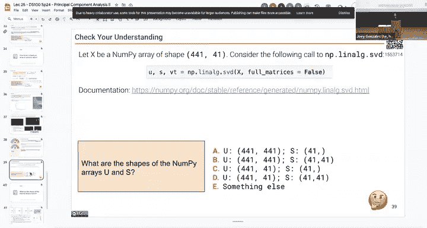
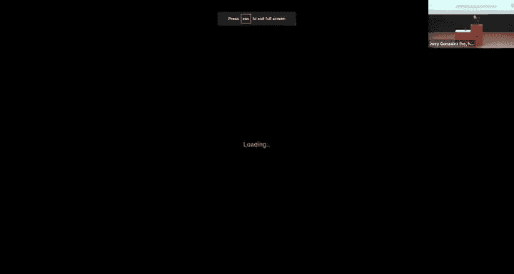
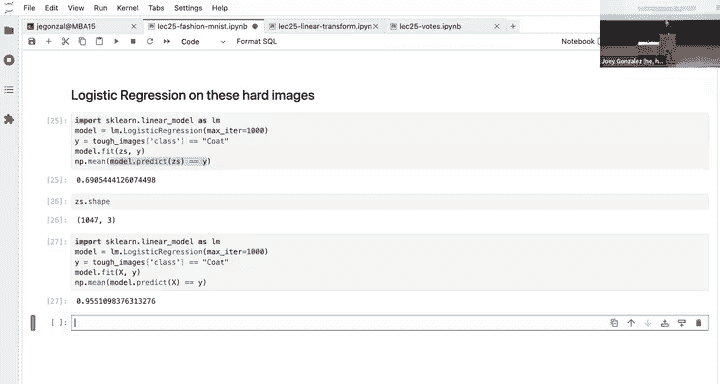

# 课程25：主成分分析（PCA）原理与应用 🧮

在本节课中，我们将学习主成分分析（PCA）的核心原理、数学推导以及如何将其应用于高维数据的可视化和理解。我们将从回顾上一讲的内容开始，逐步深入，并通过实际数据案例（如国会投票和时尚图片）来展示PCA的强大功能。

---

## 概述：为什么需要降维？ 🤔

上一讲我们介绍了PCA的基本概念。本节中，我们来看看为什么我们需要处理高维数据。当我们拥有许多列（特征）的数据时，分析和可视化会变得非常困难。例如，绘制每一对特征的散点图会非常耗时，而通过颜色或三维图来展示也存在极限。

世界本身的数据维度往往没有我们测量的那么高。我们可能测量了许多指标，但它们实际上只反映了关于一个人、一个形状或一个产品的某些内在低维特性。有时我们称之为数据存在于一个**流形**上。我们的目标就是找到这个内在的低维空间。

**降维的目标**是：获取我们的高维数据，并找到一组新的、数量更少的特征（列），这些特征能够近似地捕捉原始数据的信息。

---

## 从矩阵分解的角度理解PCA 🧩

上一讲我们从矩阵分解的角度引入了PCA。我们有一个大数据矩阵 **X**（n行，d列，d很大）。我们希望将其分解为两个矩阵的乘积：一个较小的矩阵 **Z**（n行，k列，k < d）和一个矩阵 **W**（k行，d列）。

公式表示为：**X ≈ Z W**

其中，**Z** 包含了我们想要的低维表示（潜在因子），而 **W** 就是我们要找的主成分。PCA的核心就是找到这个 **W**。

---

## 构建目标函数与约束 🔧

我们如何找到 **W** 呢？遵循本课程“原理与技术”的主题，我们通过最小化一个损失函数来构建模型。

对于数据矩阵 **X** 中的每一行 **x_i**，我们希望通过其低维表示 **z_i** 乘以矩阵 **W** 来重构它。我们希望最小化重构误差。

我们选择使用熟悉的平方误差作为损失函数。同时，为了确保解的唯一性，我们为 **W** 增加一个约束条件：**W** 的行向量必须是**标准正交**的。这意味着每一行的模长为1，并且任意两行之间的点积为0。

**目标**：最小化重构误差，约束条件是 **W** 的行向量标准正交。

---

## 数学推导：从损失函数到特征方程 📐

通过一系列数学推导（涉及代入、拉格朗日乘数法和向量微积分，这些细节本课程不要求掌握），我们可以将上述优化问题转化为一个关键的方程。

我们最终得到如下形式的方程：
**Σ w = λ w**

其中：
*   **Σ** 是数据 **X** 的协方差矩阵（假设数据已中心化，即 **Σ = (1/n) X^T X**）。
*   **w** 是一个向量。
*   **λ** 是一个标量。

**这是一个特征方程！** 这意味着：
*   **w** 是协方差矩阵 **Σ** 的**特征向量**。
*   **λ** 是对应的**特征值**。

这个发现非常激动人心，因为它告诉我们：**主成分就是数据协方差矩阵的特征向量**。而特征值的大小则代表了数据在该主成分方向上的方差大小。

因此，PCA的求解过程变为：
1.  中心化数据。
2.  计算协方差矩阵 **Σ**。
3.  计算 **Σ** 的特征值和特征向量。
4.  选择特征值最大的前 k 个特征向量作为主成分（即 **W** 的行）。
5.  通过 **Z = X W^T** 将数据投影到这些主成分上，得到低维表示。

---

## 计算方法：奇异值分解（SVD）的魔力 ⚡

在实际计算中，我们通常不直接计算协方差矩阵的特征值分解，而是使用一种更强大、更数值稳定的方法：**奇异值分解**。

SVD可以将任何矩阵 **X** 分解为三个矩阵的乘积：
**X = U S V^T**

其中：
*   **U** 的列是标准正交的，是 **X X^T** 的特征向量。
*   **S** 是一个对角矩阵，其对角线上的元素称为**奇异值**，按从大到小排列。**S²** 的对角线元素就是协方差矩阵 **Σ** 的特征值。
*   **V** 的列是标准正交的，是 **X^T X**（即协方差矩阵，忽略缩放因子）的特征向量。

**关键联系**：矩阵 **V** 的列正是我们寻找的**主成分**（即 **W^T** 的列）。

因此，计算PCA的步骤如下：
1.  对中心化后的数据矩阵 **X** 进行SVD分解，得到 **V**。
2.  取 **V** 的前 k 列，记为 **V_k**。
3.  低维表示 **Z** 可以通过 **Z = X V_k** 计算得到。

在Python中，这可以非常简洁地实现。

---

## 实例演示：矩形数据 📏

让我们通过一个简单的例子来巩固理解。假设我们有一个关于矩形的数据集，包含宽度、高度、面积和周长。

我们知道，对于一个矩形，其本质维度是2（只需要宽和高）。面积和周长是宽和高的函数。

以下是分析步骤：
1.  **中心化数据**：减去每个特征的平均值。
2.  **进行SVD分解**：得到 **U**, **S**, **V^T**。
3.  **观察奇异值**：我们会发现只有前两个奇异值显著大于零，这证实了数据的本质维度是2。
4.  **计算低维表示**：使用 **Z = X V[:, :2]** 将数据投影到前两个主成分上。
5.  **可视化**：绘制 **Z** 的散点图。虽然我们丢失了面积信息（因为面积是宽高的非线性函数），但PCA成功捕捉了数据的主要结构。

这个例子也说明了PCA的一个局限性：它是**线性**变换。如果数据存在于一个非线性的低维流形上（如本例中面积与宽高的关系），PCA可能会丢失信息。

---

## 方差解释与碎石图 📊

在选择要保留的主成分数量 k 时，一个有用的工具是**碎石图**。

每个主成分所解释的方差比例可以通过其对应的特征值（或奇异值的平方）来计算。将所有特征值归一化后，按从大到小排序并绘制成折线图，就是碎石图。

**如何选择 k**：观察碎石图，寻找一个“拐点”或“肘部”。拐点之前的主成分解释了大部分方差，拐点之后的主成分贡献的方差增长变得平缓。通常选择拐点处的 k 值。

例如，在美国国会投票数据的分析中，碎石图显示第一个主成分解释了超过80%的方差，这表明美国政治在投票模式上几乎是**一维**的。

---

## 实战应用一：美国国会投票数据分析 🇺🇸

现在，让我们将PCA应用于一个真实数据集：美国国会众议院在2020年的投票记录。

**数据**：441位议员对41项法案的投票结果（赞成、反对等）。
**目标**：在无法直观理解41维数据的情况下，发现议员的投票模式。

**分析步骤**：
1.  将投票数据转换为数值矩阵（例如，赞成=1，反对=-1）。
2.  中心化数据。
3.  运行PCA（或SVD），将数据降至2维。
4.  以2D散点图形式可视化每位议员（每个点），其中坐标是他们在第一和第二主成分上的得分（Z1, Z2）。

**结果与洞察**：
*   散点图清晰地显示出两个主要的簇。
*   当我们引入议员的政党 affiliation（民主党、共和党、独立人士）作为颜色标签时，发现这两个簇几乎完美地对应了**政党的区分**。一个簇主要是共和党人，另一个簇主要是民主党人。
*   第一主成分（水平轴）似乎代表了“保守-自由”的政治光谱。独立人士和某些特殊议员（如AOC）位于光谱的特定位置。
*   通过添加“抖动”可以避免点重叠，从而更清楚地看到每个簇内部的分布。
*   我们还可以检查主成分本身（**V** 的列），看看哪些法案对区分政党贡献最大。

这个例子展示了PCA如何从复杂的高维数据中提取出有意义的、可解释的低维结构。

---

## 实战应用二：时尚MNIST图片分析 👗👟

最后，我们探索一个更复杂的图像数据集：Fashion MNIST。它包含10类服装的28x28像素灰度图。

**挑战**：每张图片是784维的向量（28*28）。我们如何理解和可视化这样的数据？

**分析步骤**：
1.  将每张图片展平为一个784维的向量，并标准化。
2.  运行PCA，并观察碎石图。发现需要大约10-50个主成分才能解释大部分方差，说明服装图像的内部结构比国会投票更丰富。
3.  将数据投影到前2个或前3个主成分上并进行可视化。
4.  在散点图中，用不同颜色标记不同的服装类别。

**结果与洞察**：
*   在2D/3D图中，我们可以看到一些有希望的聚类趋势。例如，鞋子类（运动鞋、凉鞋、短靴）倾向于聚集在一起，包包也形成一个簇。上衣、外套和连衣裙等类别则更混杂一些。
*   这证实了PCA能够发现高维图像数据中的潜在结构，即使类别间存在重叠。
*   作为对比，如果我们将数据随机投影到2维，得到的结构分离度远不如PCA。
*   我们还简要提到了更先进的非线性降维技术（如t-SNE），它们有时能产生分离度更好的可视化结果，但PCA因其简单、可解释和高效，通常是一个优秀的起点。

**一个重要提醒**：如果你计划在降维后的数据上运行线性模型（如逻辑回归），请注意，先进行PCA降维可能会限制模型的表达能力，因为它是另一个线性变换。通常，直接对原始数据应用模型并配合正则化可能是更好的选择，除非出于计算效率或解释性的特定需求。

---

## 总结 🎯

本节课中我们一起学习了主成分分析（PCA）的完整流程：

1.  **动机**：处理高维数据需要降维以进行可视化和分析。
2.  **原理**：PCA通过线性变换寻找数据中方差最大的方向（主成分），这些方向是数据协方差矩阵的特征向量。
3.  **计算**：通过奇异值分解（SVD）高效实现，主成分对应于 **V** 矩阵的列。
4.  **应用**：
    *   我们通过**矩形数据**验证了PCA能发现本质维度。
    *   通过**国会投票数据**，展示了PCA如何揭示清晰的政治光谱结构。
    *   通过**时尚图片数据**，演示了PCA如何用于探索高维复杂数据的内部结构。
5.  **工具**：碎石图帮助我们决定保留多少主成分。
6.  **注意**：PCA是线性方法，可能无法捕捉非线性结构。它是数据探索和可视化的强大工具，但在下游建模任务中需谨慎使用。

PCA是数据科学工具箱中一项基础且至关重要的技术，希望你能够掌握其原理并灵活运用于实际数据分析中。