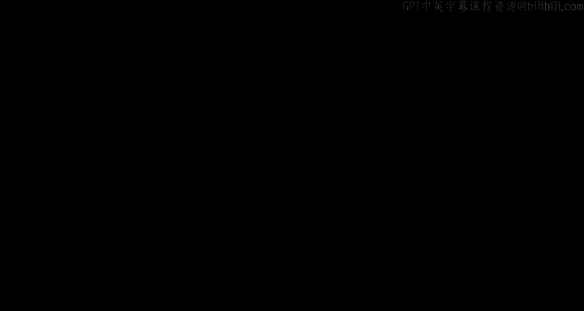
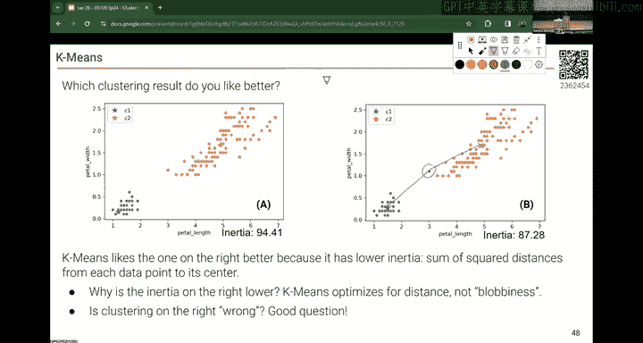
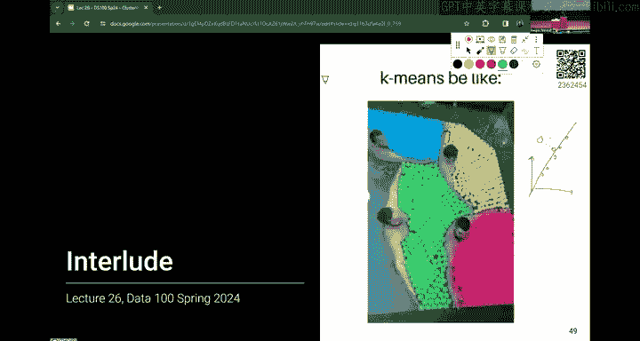
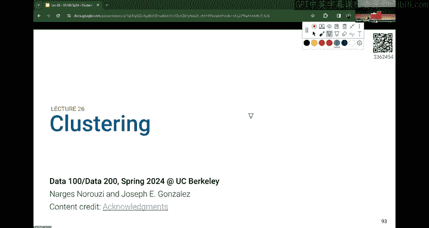

# UCB《数据100数据科学原理与技术｜Data 100 Principles and Techniques of Data Science 24SP》中英 - P26：-26-Data 100 Spring 2024 Lecture 26.zh_en - GPT中英字幕课程资源 - BV1Bc2dYCEbc

嗯。嗯。Allright， welcomelcome everyone。 welcomecom to the very last material lecture of data 100。

 This is exciting。 I feel like you all deserve some kind of a prize for like persisting every lecture coming into the lecture。

 we have I forgot how many people we have online。 it was around like 70 something lastly check。

 but this is like very exciting。 So before I jump into the content for today。

 I also want to make sure that you are all of this bonus opportunity。

 So it's that time of semester that we would like to get feedback from you So always in every semester of data 100。

 we keep improving a course and changing different elements that the course so that like the course is star you a little bit better and improves the students experiences and as such we're always interested in getting feedback。

 So we are offering as an incentive， we're offering an extra05% towards your final。Credit。

 this is a big deal because now the are set。 So you know that now this can actually change your。

 your final grade。 extra。5%。 If you fill out the campuses course evaluation。

 as well as our internal course evaluation， which is also anonymous once you fill out those and the instruction is also aned。

 you're going to get be guaranteed to get an extra 。5%。Additionally， if you're able to。

Kind of persuade your friends to also fill out the course evaluation。

 and the class reaches 90% response rate on those of the surveys。

 then the entire class is going to get an additional point5% extra credit。 So total。

 there is a chance for you to get an extra 1% towards your final credit。

 And also it would benefit us because we're gonna get good feedback and we'll keep improving your course because Professor Gonzalez and I are going to continue teaching in the fall So we would like to see what are the things that we can improve and what are the things that actually worked out well。

 And we should keep doing it as it。😊，So without additional kind of logistics。

 we're going to dive into the clustering lecture as I said。

 this is the last content lecture for data 100 and I also want to make sure that we again put it out there that the first half of data 100 was learning about the tools So you learn about pandas you learn about visualization you learned about the techniques of doing exploratory data analysis the second half I'd like to think about it as it being like different modules and different pieces of a puzzle that you can use in the entire kind of training or machine learning lifecycle that you will see and this is kind of the last piece of the puzzle that we're gonna to teach you in data 100 should you go and take additional courses102 data 102 CS189 CS188 or CS182 you're going to basically be learning additional tools in that toolkit。

That you have but clustering is really exciting and I want to introduce kind of very clustering setss in this entire taxonomy of machine learning we have all been seeing this kind of separation between two types of general types of learning that we have supervised learning categories and unsupervised learning categories and we have seen all of them except for this last piece that we're going see today so what was supervised learning supervised learning was everything that we had labels for we had the target variables in a vector of y that we were trying to use that in order to do some task or some estimation on a quantitative or category called variable so we had regression task that we learned through multiple linear regression lectures and then we had the classification task that we learned through logistic regression。

 two lectures of logistic regression a few weeks back。In the unsupervised learning task。

 what we said was that we're going to not look at the labels either because we don't want the labels to influence any decision that we're making or that we don't have the labels。

 This is mostly happening when the data is really high dimensional and when labels are not available or the labels are noisy and we have seen dimensionality reduction over the past week principal component analysis how can we get a high dimensional data and then reduce the dimensionality to the dimensions that are meaningful that are capturing the maximum variance in the data and we can use that today I'm going to talk about clustering。

 So the idea is for us to take a look at the data and learn from the data。

 So either we can basically cluster the data into different categories or different clusters that we can have or perform clustering so that we can use clustering as features that can then be used as in another pipeline of machine learning。

 So think about it as。I care。Module that can fit in different places。

 either either you can use it as like an unsupervised learning algorithm by itself or unsupervised learning algorithm that you're learning something from the data that then you can use that as part of extracting features that you can use later on to learn better from the characteristics of the data。

 Anything that we learning in unsupervised learning and just learning from the data， right。

 So we look at the intrinsic kind of information in the data and the distribution of the data in order to figure out like what's the distribution and what kind of information we can gather from it。

 And today we're gonna focus on clustering。Obviously。

 nolectking goes by without the picture or an example of my cat。

 So this is like a first example of how we can do clustering or like what clustering can be used for you can imagine that my photos is like four is full of like different pictures of my cat。

 her eyes and her pals and whatever。 and I don't want to label different regions It that I have different crops of her images and I want to perform clustering those who are doing a computer vision project in the grad project aspect graduate students they are processing images so you can imagine that these are images that you can extract some information from。

 you can reduce their dimensionality and then you can do classification should you have labels but if you don't have labels。

 you just need to operate on the feature space and use unsupervised learning algorithm in order to cluster them into different categories and we're gonna see how we can。

actually do clustering so that if features are good enough。

 things that are similar to each other are going to be in the same cluster and the same category that then we can assign kind of a pseudo label to those data points based based on the category or the cluster that they belong to。

I'm going go over multiple examples， Ki of to tell you that very clustering can fit in this entire pipeline。

 clustering， the first example that I have is from the fall 2019 midterm two example data set or this example that this data set was on is based on patrons visits at different eight zoo exhibits。

 So there is like the time that they spend in different8 zoo exhibits。

 So you can imagine that the data has originally eight dimensions So like the time that they spend in each one of the regions and then assume that we have done PC and the dimensionality is now reduced to two dimensions。

 So we have PC1 versus PC2 that's plotted there usually also if we have a high dimensional data and we want to visualize the data even if we don't want to do PC in order to reduce dimensionality。

 we would do it anyways to do to visualize the data to look at the trend。

 So let's assume that there is。PC1 and PC2 that we extracted。

 And then what we want to do is we want to basically cluster the data so that we can identify if there are any characteristics。

 depending on where users would fit in in these areas we that we can assign to the patrons and then be able to understand what's going on in the underlying data。

 As you can see there is no label assigned to any of these data points and technically this is an unsupervised learning task And what we're doing is we can basically perform our clustering algorithm and then later on be able to cluster them into different categories and then we can basically decide to assign kind of a pseudo label to each one of the categories。

 we can say that okay this is my category one or cluster one。

 this is cluster2 and this is cluster tree。Okay， I'm hearing that the volume is low。Is it low。

Let us know and a slido。 I feel like this should be the normal setting that we always had。 Allright。

 so moving on。 second example， you can imagine that with any kind of really online platforms that deals with any kind of recommender system or or kind of user preference data。

 you might want imagine that any recommendation that needs to be made looks at users characteristics。

 and then it looks at the inventory of anything that they have to recommend， right for example。

 in the example of Netflix， you have different users that are watching different movies and TV series。

 and then you have also different categories of movies。

 there are two different places that you can do clustering without labeling users because you cant go and label users that this user really likes to watch true crime movies and this user always wants to watch like。

 for example， drama movies。 you can't label users in any kind of meaningful way。 but what。

Can do is you can just look at the distribution of characteristics of all the users without labeling them。

 You can cluster them。 And then you can say that okay。

 there is this cluster of users that like 90% of the time they watch through crime movies。

 and then in 10% of the time， they watch drama， their characteristics is different when I'm going to make a recommendation to them。

 I'm going to make similar recommendations。 and then I'll take a look at what their preferences were in that specific cluster in the same way。

 you can also go ahead and cluster movies based different based on different characteristics based for example。

 the shots based on the length based on the category based based on the actors and actress in that movie and whatnot。

 And then you can create genres。 you can see like if Netflix or two or anywhere you scroll down。

 you see all of those genres a lot of the time those genres are going to be dynamically created based on the user preferences and based on the match。

Between user preference and also the categories of the movies。 Obviously。

 we don't know how this recommendation system works on Netflix。

 but it can imagine that anything that deals with some inventory of things that are going to be recommended to a set of users that do have different preferences。

 There's kind of this two tier clustering or modeling that is going to be done。

I'm gonna go also over another application。 I just want to move this so that you can see De are not in scope。

 I'm just putting it out there so that you can see PCA can also be not the end goal that we sorry clustering can be just not the end goal and sometimes like the end goal might change depending on the application that you have this is actually a paper or a research project that went on in my lab and it was basically on a data set that we collected from a course that I thought So what was the course that course was a machine learning course that I thought during COVID times the students were taking the course online and whatnot and we were trying to kind of make sure that the students have a community that they can study together creating a study groups and whatnot and the way that I was trying to enforce it was I broke down the entire class into groups of 1 students and then I told each one of the groups that they have to meet over Zoom or however they want to do。

and then go over the lecture materials and then create a one page kind of a summary of what I taught them that a specific week。

 So every two lectures kind that they were writing a summary。

 And then I was also asking groups to also submit a sample of problem sets。

 So these are the problem sets that they created so that they could also be used as part of the exam or the biweek quizzes that we had in the course。

 there is also research and education that says that if the students are creating the assessment materials that arere going to be assessed on。

 then they're going to be engaged more in their learning and theres like all improvement in in the。

In the educational outcomes of a student。 So that's why we had them to also write problem sets。

 So imagine that each group was submitting two documents weekly。

 but I didn't want to grade all of that。 Like imagine that there is a large class and like every group is submitting like large documents weekly two documents weekly that I didn't want to go over how did I process it。

 I just wanted to make sure that groups are performing reasonably well and they're basically doing the test that I told them that they're doing。

 So the way that we did this is and you're gonna to learn more about this in tomorrow's lecture。

 which is going be an LLm that every piece of text that we have。

 there are ways that we can embed them into a numerical space。

 So like you have a sentence you can transform that sentence into a vector。 you have a word。

 you can transform it into a vector you have like a paragraph you can get embedding of that paragraph so that like when in that embedding a space sentences are closer to。

Each other， that means that the meaning of those sentences are close to each other。

 So that's what it means。So that's the first piece of kind of feature extraction or analysis that we have done。

 So all of these documents were a week。 We passed it into a certain model that's called Bt。

 And this bird was giving us the embedding of each one of those sentences。

 What did we do with those sentences。 Imagine that， for example。

 there is one week that I was that I was teaching logistic aggression。 all of those sentences。

 all of those vectors。Are represented in some kind of an embedding a space。 These。

 each one of these points are like kind of representation of those sentences in this kind of embedding a space。

 And what we did was clustering。But the clustering was not the end goal。

 I was trying to do clustering。 and we'll show you an example of like what those clusters look like。

 But I was doing the clustering in order to figure out what is the normal behavior。

 What should be the density of each one of the clusters。

 And what should be the contribution of each group in each one of those clusters。

 right So it was part of my feature extractions step。

 So what I did was I extracted a bunch of features，8 features per group。

8 features per component using those clusters。What were those features， I was saying that okay。

 if I have a cluster and I have say， for example，10 groups in the class。

 the contribution of each group to each one of the clusters should be 10% of the entire kind of number of points that I have in that cluster。

 So let's see what the percentage of contribution is。

 right if the percentage of contribution is below 10% or above 10%。

 that is outside of like my expectation overall over the population。

The other type of feature that I extracted was like。

 what is the ratio of the number of sentences that each group had for each one of those clusters。

 I just wanted to make sure that if， for example， there is a group that they all their writing belongs to one cluster and they don't have any contribution to the rest of the clusters。

 I can also capture that， meaning that they didn't look at all the aspects of the things that we taught in the course。

So eight features for each one of them， we combined it together， so then each group。

 each submission for the group was represented by a 16 dimensional vector。

 16 different features and then what we did was we did something some kind of a regression text that did the great prediction which was not the angle but the more important part was to do anomaly detection to figure out which groups are outside of the distribution of the entire data of the entire population of the class so I can reach out to that group and then make sure that like either I can read their summary or I can meet with the students to see what's going on This is like one way of identifying underperforming or overperforming groups in the class。

How do you think that we did anomaly detection？You have seen that last week we did PC to two dimensions and then reconstruction back to 16 dimensions。

 and we calculated the reconstruction error here。 between the time that we reduce the dimensional and increase the dimensionality and the outlier groups are the ones that are going to basically have the highest reconstruction error。

 those are the ones that are outside of the distribution for the data。

 that's why when we did the PCA reduced the two dimension and then increased back to the or reconstructed back to the original dimension。

 they're going to lose more information than other groups。

 So those groups were kind of labeled as anomaly again overperforming or underperforming group。

 So you can see that PCA was the last step as opposed to being the kind of extraction piece。

 So this is like what I want to really make sure that you understand that everything that we taught to you like think about that as a tool and technique and it can be。

Used in different places。 And a machine learning pipeline is just a really modular pipeline that you can decide how you want to like select every piece of it。

 and it can be an iterative approach。 You can decide that， okay。

 I want to still do more feature engineering， Let's do clustering to see if I can get more features or not。

So these are authorized clusters that we got for the logistic Aion week。 So， for example。

 if you take a look at。Sa this gray cluster here， the center of this cluster is logistic function is the time that the students were like explaining logistic function and all of those representations are around the sentences that was describing the logistic function。

 Prety cool stuff like education research or educational data mining or AI education can be really fun and this is like one application that you can really now go ahead and do some similar project because like I didn't do anything fancyci or like out of the ordinary in the entire pipeline and you can do similar projects as well。

Next example is about gene expression and the conditions。 This is not my work obviously。

 but this is basically that if you have a bunch of conditions under ro and you have genes under columns and if you do in this high dimensional space that you have a lot of genes and you have a lot of conditions if you perform clustering you should be able to figure out which conditions are more associated with a certain gene versus not so for example here you can see that there is a cluster of activated conditions corresponding to specific genes that again。

 can be used here， as I said clustering and PC， sometimes they really go hand in hand and a lot of time when the data set is high dimensional or the data is large we will kind of mix them match and use them in different in different places this is an example that generally on genome data and astronomy data。

 there is a lot of these kinds of techniques that are being。

UseThis is also another example that you can see that is still the same thing。 We have conditions。

 We have genes。 And then if we cluster them together， then you would be able to figure out like。

 what is the association of different genes and conditions with each other。

If you want to read more about them， the links are there。

 I'm not going to spend the rest of the lecture explaining this biology kind of data to you。

But let's go into the actual content。 the actual fun part of things。

 Let's see what kind of clustering approaches exist and how we can actually do the task of clustering。

 So clustering generally is categorized into two types of algorithms。

 There's a lot of different types of clustering algorithms that you can use。

 they are divided into hierarchical approaches and partitional approaches。

 If you think about the partition approach as the approach that you're assuming that your entire data set is one cluster and you're trying to make clusters and partition clusters out。

 that is one way of thinking about partition approaches。

 hierarchical approaches on the other hand are that are the categories that you're assuming that each data point is its own cluster and you're going to merge them together and then keep creating larger and larger clusters up until the point that your entire data is one cluster。

 So we're going to take a look at。Hiererarchical approaches today and we're going to take a look at some partition approaches today。

 particularly we're only going to take a look at cameian clustering again。

 there is a whole different categories of partitional approaches that we're not going to go over it for the purpose of data 100 we're only going to see partitional approach of came means clustering。

So the algorithms that you'll see today are pretty fun and easy to understand。

 So what is Ka means clustering。😊，K comes from the fact that we need to decide ahead of time about what K we want to use。

 So K means means that I want to create K clusters。

 So the way that the algorithm works is that we will assume that we decided already about the K。

 right？ So I know how many clusters I gonna to have。And then we'll say that， okay。

 go ahead and randomly place case centers on your data in the feature space。

 So assume that this is like my feature space， X and y two dimensional space pretty simple。

 I can go ahead and place two centers randomly on this entire feature space。 right。

 These are randomly generated。Then the algorithm has two steps after this point and you repeat these two steps until convergence What is the first step。

 The first step says that color the points according to the closest center So how did we color these points here So here。

 for example， we said that okay for this is specific data point。

 the distance of this is specific data point to this cluster is this much and then the distance to this other center is this much。

 So the shorter distance is the orange one So we're going to give it a color orange。

 So that's how we color everything right。So the next step is kind of。Trivial after this。

 once you have all of your points colored center means that it has to be at the center。

 So you really need to now move your center to the actual center of these points， right。

 so if we are going back from this position that this was a random placement of the center。

 then this center really needs to go to the center and this center also needs to come to the actual center of blue points so that they are actual centers for us。

 So we'll do that。So obviously， because now I move the centers。

I might need to recolor some of the points。 Some of the points might now be closer to the orange center as opposed to the blue center。

 especially， for example， some of the points at the center here or at the middle here。

 they were closer to blue before because like the center was here and the orange one was right right here。

 And now theyre now closer to the blue center。 So we might have some recoloring as we go through this kind of loop of coloring and then moving center than whatnot。

So recoloring again。 So we're in the first step。 Now you're seeing that some of these points right here。

 they change color。 So I want you to pay close attention to these six points right here。

 as I go through， multiple different stage of this algorithm。

 And I keep moving the centers and keep recoloring the stuff。

 those are going to gradually be absorbed into the orange cluster。

 and they're going to lose the blue the blue color that they have which they should because they're closer to the。

It looks like that this is like a big cluster of orange。

 and it should be like a small cluster of blue for us。So moving the centers， recoloring again。

 moving the centers， recoling again。 Now you see that all of those like six points that I highlighted for you。

 neither theyre all orange。But what's gonna happen at this point。 So we' are in iteration 4。

 We have one blue point remaining， right， I'm at this step of reoring this stuff。

 So let's do reoring and then see where we would end。This is after recoverying。Now。

 we are at iteration 5。This is kind of the place that you would see convergence， right。

 because your centers hasn't moved because the centers hasn't moved。

 none of the colors were changed since colors aren't changing。

 the centers are not going to change because the centers are still going remain centered。

 So for two back to back iterations， if the colors are not changing or if if the centers are the same。

 then the algorithm is going to converge。 And this is the example or that this step that this is going to happen。

There's still this point right here that we're not satisfied with that we're going to like really try and try different kinds of approaches to make sure that they get this point gets the right color but this is the best that Cam's clustering algorithm is going is going to give us and we're done at this stage。

Any questions so far。Youve seen one algorithm stupid and easy。

 It's not like complicated linear regression or logistic regression that I was teaching to you before。

 Now， like every algorithm is like， quick， yes。Can I answer that after the class？ Thank you， yes。

That's a very good question。 As I was saying it， I wanted to correct myself。 but I didn't。

 So the centers， there is like the point that we were saying that with the centers move or would the colors change。

 right， So the center can still move a slightly， but your colors might not change。

 So between iteration 4 and 5， we might have had like a small like change in the in the center location。

 But as long as the colors aren't changing， the iteration 6。

 we're not going to see any center movement， because the colors are solid and the colors is the first step that we see。

 So that's where we would we would stop down for them。 Very good question。

Okay let me move on this is kind of a segue for those who are coming from data aid you have seen K nearest neighbors and they both have k in their name。

 but they're not the same thing they're not actually also sister algorithm K nearest neighbors was was a supervised learning algorithm and it was used for classification。

Pain means clustering is an unsupervised learning algorithm。

 and it is used for like just clustering and it's not used for for。Clasification， again。

 because we don't have the labels to fully classify things into different categories。

 The only thing that they have in common is K as a hyperparmeter that you have to decide ahead of time。

 So that's the only thing that's in common。 Again， for those who are coming from data。

 If you haven't heard about 1 years neighbors just ignore this like past minute。So obviously。

 the next thing that I want to talk about every time that I talk to you about an algorithm。

 what was the next thing right immediately after that I talked to you about。Lost function。

 so like every time that you remember me you remember me with my models and my last function because like loss functions。

 we always need to have a way of objectively thinking about how good the model is like just looking at it visually is not going do it right So I'm going to talk about like what is the last function for k means clustering and like how can we minimize it and if we actually in fact are able to minimize it or not。

So let me show you an example with k equal to4 and the same data set。Do you like this example。

 Is it a good clustering。Yes， no， sideways。This is not a good clustering。

 Like for one K is not like an appropriate K。 It looks like visually that this is two clusters for us to go and do K equal to 4 is kind of giving us clusters that are not natural。

 But my main question for you is， if I go ahead and randomly initialize my starting points for all of those K clusters into different from different areas。

 I might end up with different final solutions。 This is very my algorithm with Cumb words。

 say I've used the random seat of 25，29 and 40。Looking at these ones， which ones。

 Which one do you think is better。First is light of the day。Do you think we have 200 audience。

 I wait until 200。Let's see。Yes， we do。 Okay， let's see。 You all like A and then B and then C。

 which is kind of true。 So I'm gonna to tell you why。Objectively。

 we will arrive at the same answer that A is the best and is also close to B and B second。

 and then C is not ideal。 And again， if you take a look at this。

 C was not ideal because it had like a various sparse cluster， a sparse and a small cluster。

 So the size of the cluster here also matters for us。

So how do we find how do we define a loss function that can objectively distinguish between A versus B versus C。

And I wanted to think about， for example， this example。

 this cluster when you were deciding about it and specifically this point right here， that is like。

 although it is closer to this central cluster as opposed to this other central cluster。

 but it looks like that it is close to the blue cluster as opposed to the actual red cluster that it is creating and it looks like that that kind of cluster is1 as sparse。

So think about it。 What are some good evaluation metrics that we can use in order to distinguish between these three options。

And I'm gonna let this go so that we can see your those responses。 L 2。

 I like it that like every time that you see me， remember L  to L 1。This is。

 this time is close to L2， but it's like a different version of L2。Distance。

 how do I measure distance。Distance between cluster edges。 That's a good one。Mean distance。

Sation of distances。 I feel like we're kind of getting the point of how are we evaluating。

This kind of quality of the clusters and how kind of lolobby the clusters are。

So let's take a look at two metrics。 The first metric that we're introducing is inertia。

 inertia is going to basically calculate the squares of the distances of each one of the points to the center of the cluster that they're assigned to。

 So， for example， here in this example we're looking at all of these distances and we're squing all of these distances and we're summing them up and this is going to be our inertia right obviously what cameous clustering is doing is at every step it tries to minimize inertia every time it tries to assign the point to the center or the cluster that is that it is closer to that point and then it also moves the center to the center of all of the points to generally an aggregate minimize the that the sum of all of those square distances。

I think by this point， I can ask why am I squaring things and still I not leaving it as like the normal distance。

Why are we scoring， thanks， Can someone。Yes。Palize larger errors more。

 So that's the reason that we keep scoring stuff right here。

 I didn't have a concern of the sign that we did have the concern of the sign when we were looking at calculating losses for regression model。

 but here same story， we're always interested in scoring losses so that we're the distances so that we're penalizing larger deviations。

 proportionally more than a smaller deviations。There is this other nice metric that I want you to think about that is distortion。

 The way that I want you to think about it is that if I have a large cluster。

 I want to give it some break。 I can say that okay， if you are large cluster。

 it is expected that your data points are going to be more spreaded out。

 But if you are like a single point cluster or two point cluster。

 you should really be close to each other。 And that was the main issue with option C that we saw previously here。

 because it was this small cluster but it was various spreaded out if you were calculating the squares of the distances to the center and then dividing it by the size of that cluster。

 it would be hugely penalized compared to， for example。

 the orange cluster compared to the other clusters that we see。So think about that factor。

 the factor of the cluster size， also being something that we can consider。But in today's lecture。

 we're not going to think about distorttion because everything that we did with Ka means's clustering was minimizing inertia。

 Again， both are the two steps were minimizing inertia for us。 In fact。

 if I go ahead and calculate inertia for option A， B and C。

 you would be able to see that A has the smallest inertia， then the next one is B。

 And then divorce case was option C。 So kind of our intuition was also telling us the same thing。

Okay， so now let's talk about this inertia thing and then see why were we getting different end end results。

 because I said that when I randomly re initialitized the initial points。

 I might land into final solutions that are different from each other and I got option A， B and C。

So although Cammi's clustering is trying to minimize inertia， it fails to find the global minimum。

 This is an algorithm that is not guaranteed to reach to the global optimum for us。

So we would say that came means clustering， if you do random restart for sufficient enough。

 sufficient amount of time， you would be able to get the global optimum。

 but every time that you're running the algorithm by itself。

 every run of the algorithm is not optimal， but it is good enough for us that we're using。

 and we're gonna see why I say this is a good enough algorithm for us。So what we。

The reason that this algorithm is not optimum。And is not going to be guaranteed to give us the minimum inertia is that it has a two step process and none of these two steps are actually taking the full control。

 There is one time that the first optimizer is holding the centers constant and it's only reassigning the data points to different clusters。

 it is only the second piece that's moving in this case that the cluster assignment can change。

 but the centers will remain constant and the second optimizer acts in a different way would say that you're not allowed to change the colors or or the cluster assignment。

 you can just change the center And because none of them is going to take full control。

 although like each one of them is thinking about optimizing inertia in a way。

 it's not going to an aggregate， optimize inertia fully。Right。

 so this is what we call this is an algorithm that both of the steps that we're doing。

 there are local search， local optimization that we're doing that we're making things incrementally better。

 but not so much better is so that like we can directly get the final final global optimum if you're interested in learning more about like local search algorithms 188 is a really good course that you can take afterwards。

 So a lot of the things that we learn great in the and also this way of running K means they all rely on solving a hard problem that we can solve it directly。

 but we will incrementally make it better and we will run local search algorithms to actually do that for us。

How do we actually find the optimum optimum solution。

 because there should be an optimum solution for anything， right。

 but it might be just computationally expensive。This is kind of a complicated CS concept and for those who've taken CS70 or 170。

 you might have seen this before， but I'm just going to briefly explain how if you want to find the global optimum and you don't want to run this local search algorithm。

 how can you arrive at that。So I want to think about this clustering algorithm that we're running as the coloring problem。

 So I have a bunch of points， and I just want to color them， right。

 because that's what it is at the end of the day。 If you're thinking about each cluster as like a way of coloring different points that you have。

 you can assume that you have K colors， you have k clusters and you're just going color all of the data points。

So one way to solve this problem is actually going ahead and。

Consider all possible colorings that you can have for this entire data set because， for example。

 for data point1， you have K options for the color。

 It can be like any of the colors of any of the clusters for data point2。

 you have K options for data point3， you have K options。

 and then all the way to data point n And because you're considering all the options or all the coloring options for all of the n data points that you have。

 you have K to the power of N number of coloring options So one naive way of solving it is to just consider all of those possible colorings K K to the N。

Look at all of those individually calculate inertia right， because once you have the colors。

 you can calculate the center of that color Once you have the center of the color。

 it can calculate inertia right， and then you can basically calculate inertia for all possible combinations that you have right and then the K coloring or the coloring that had the minimum inertia obviously is going to be the optimum solution for us。

Why did I not do it and why did I go through this entire like two step cames clustering algorithm？

 What's wrong with this。It is computationally expensive。

 if you take a look at the dimensionality of your data being n。 so you have n samples。

 this is K to the n。 this is exponential。 So this is not a polynomial time algorithm and because it's exponential exponential runtime algorithm we call this and you can prove that this is an NP hard problem that we can solve in polynomial time and that's why for all of these hard problems in the category of problems that we can solve them in polynomial time。

 we try to find a pseudoop solution using local search algorithms。

 and this is the optimal way pseudoopmal way that we can arrive at reasonably good solution but like a few points misclassified or miscled that uses kind of these two step optimization that we talked about。

Alright， so now the kind of the entire came is clustering， like why is not optimal。

 What's the way that you can make it optimal， But know that it's computational expensive is done。

 Now， I want to move on to the next cap next kind of algorithm。Looking at these two plots。

Which one of them do you prefer？And the answer is。Hopefully， obvious。

So what we were getting from Ka's clustering was option B， right。

 What if there is an algorithm that gives us option A， Would you prefer that or not。And。

I'm hearing yes， so let's take a look at which algorithm is actually going to give us that and how can we arrive at that point so what we are basically going to think about is that what's the inertia and both of these graphs so you can take a look at the left graph or option A having the inertia of 94 and the option B has the inertia of 87。

 So obviously can clustering is going to consider like optimizing the algorithm and is going to give us option B because it has a lower inertia and that's the best case scenario for it but it's not going to consider kind of the concept of blobbin it in our entire cluster that we don't want this data point to hang basically right here which is kind of going to be different from all of the neighboring kind of data points that it has only because it is closed it is closer to the blue center as opposed to the。

IncentSo we're gonna to try to make sure that we use some neighborhood information that we're not using right now。

 we're only using the information of the distance to the center as opposed to the neighborhood information。

 And we'll see how we can change our local search algorithm that we can arrive at a solution that gives us option B。

 which is sorry， option A that is a better option。

We promise you a two minutes break， take a break。 You can stretch， and then we'll come back in two。

 three minutes。So imagine that I have a bunch of points This is two dimensional space and actually let me explain this better so I have all of these points right here that are on line right and I have one point right here right if I do PCA and I reduce the dimensionality of this data set into one this like that line is going to be my intrinsic dimension right and then technically I'm going to have a higher reconstruction loss for that point that's not on line because when I when I basically reduce the dimension to one and then bring it back this point。

Is going to be projected into here。 So it's gonna have that much loss versus like everyone else else that's gonna have a a low a low loss。

Right， so that's why like， if you're out of the trend。

 you reduce the dimensionality and you reconstruct。You're losing information。For outliers。

 for the ones that are outside of the trend， there is high reconstruction error。

Just the just the distance between the two6 and dimensional vectors， right。

 You have the original6 and dimension。 You have the reconstructive one。

 You can calculate L2 norm as the distance between two vectors。Yeah。

 and you can also threshold data bit to figure out like。

 what is the threshold that I'm going to say that this is an outlier。

 An outlier can be like overperforming or underperforming。 Those would be fine。Yeah。

How are you doing。是。嗯哼。Let me explain to that afterwards。 Let me restart that。Alright。

 so we are back。 So now we saw Ca's clustering。 I feel like we're ready to。😊。

Move on to the next algorithm that the next algorithm is actually going to use as that neighborhood information that I wanted。

 right， So I said that the fact that it is。It is like misclassifying or miscling that single data point is that like it doesn't look at the neighborhood。

 but it just uses the information about the center。 Like who cares about the center。

 if like the center is like a very big or if the cluster is a big cluster versus another cluster that is that is a small。

 So we're gonna in that case， take a look at the hierarchical approaches and the reason that hierarchical approaches are going to look at the neighborhood is because I said。

 but hierarchical approaches， we're thinking that each data point is its own cluster having end data points are assuming that you're starting with n different clusters and then you will keep merging clusters that are closer together into building bigger and bigger and bigger clusters up until the point that you have enough clusters that you want or like all the way you have only one big cluster right So that's why it uses that neighborhood information for us。

There are three different kinds of criteria that we're going to use in order to like how to merge clusters。

 What's our criteria to merge clusters together and make like a slightly bigger cluster for us。

The approach that we're going to talk about is。Herarchical， agglomerative clustering。

 So we're assuming that， again， all of our data points are in different clusters。

 So here we are saying that。Every data point is in a separate cluster。

 we're starting with n different clusters and well keep merging similar pairs of data points or clusters。

 similar clusters or similar data points that are in proximity of each other up until the point that we have one big cluster left or up until the point that like if you know like how many clusters you want and you reach those that many cluster because you will keep reducing the number of clusters by one at every step then you will stop there and those are the clusters that you will get at the end。

And because of this is， this algorithm is called a bottom up approach or alomerative approach that we're gonna to see how it looks like。

The criteria that we're going to use in order to measure the similarity of two clusters or similarity of the data points to each other is called linkage criteria。

And we have three different linkage criteria that I'm going to go over。

 So first thing is called single linkage in single linkage。

 the criteria that we're using is that we're saying that the distance between two clusters is that distance between their closest points right So it's as if that I have a cluster and then as soon as like one data point is close to one of the data points in that cluster。

 no matter like where the rest of the data points are。

 these two clusters are going to be merge or this point is going to be absorbed in that bigger cluster right。

 they're looking at the most similar points in order to say whether this point should be absorbed in the cluster or not。

So let's take a look at an example。 So this is an example that I have eight data points。

 I have Im starting this algorithm with eight different clusters。

 And then what's happening is I have to apply single linkage up until the point that I have one big cluster。

Right， so let's take a look at the single linkage。 S linkage should be pretty simple when we have like independent points。

 like the distance of points from each other or every cluster here is just looking at these raw distances that I have here。

 So this is the distance to this point。 This is the distance to this other point the distance here here and then you can basically see that these are all the distances right So visually looking the smallest distances are the distances between those pairs of points that are in the corners right at the top the top to to the left to the right and the bottom two to to the left and right。

So what we'll do in the first step is we know that the smallest distance is going locally and the entire kind of landscape is going to be that I need to merge two of those two of those points in one pair that I'm seeing on a graph。

 which is going to be merging into like getting this cluster。

 Now I have one cluster of two points and like seven clusters of single points right So now I'm gonna run basically single linkage again。

 So the single linkage between individual points is a straightforward because it's basically what I calculated before。

 the distance between， for example， that point and anything else is just looking at these distances right here。

 obviously the closest location or the closest cluster to that point is like its neighbor。

But what is the single linkage or whether what is the distance of my cluster of two points with respect to the resident。

It is the distance of the closest point in that cluster with respect to every other point。

So what's happening here is like if I'm calculating the distance between this cluster and this data point。

 I'm looking at the closest point because I'm looking for like really absorbing it as soon as it gets close to one of my points。

 which is going to be the distance here。The distance between like this cluster and， for example。

 this point at the bottom is going to be the closest points distance。

 which is going to be this vertical line as opposed to diagonal line right so it's going to be this line right here and then calculating the distance between the pair and also this other point at the bottom is going to be again。

 the same vertical line as opposed to the diagonal because this is a shorter distance。

But looking at all of the distances， I can go and like show you all of those distances。

 but it looks like that this still merging those pairs is a is a better option because they are the closests to each other just looking at the points locally。

 right？ So what I'll do is I will go ahead and。And merge them。Right。

 if you do the same kind of argument， you will see that there is no smaller distance than these distances between the pairs。

 So I'll keep merging these ones up until the point that I have four clusters left。Now I'm。

 my task is a little bit harder。 Now， I need to calculate what's the single linkage distance between。

 for example， this。This cluster right here。 and this cluster right here。

What do you think the distance is。Between the two points that are close to each other。

 which which are like the two middle points right here。

 So the distance here is this arrow right here。 And then like the two。

 if I'm looking at this cluster right here， what's this distance with the cluster at the top。Again。

 the vertical distances。 So either it can be this distance or it can be this distance。 They're。

 they're gonna be equal。 The distance between， I think these two。

 we all agree that this is the distance that we're gonna get。

 So I'm gonna erase this So that it's a little bit cleaner。

 the distance between this top one right here and this bottom one right here is again， like these。

 this vertical distance and looking at them diagonally。

The distance between like the two clusters on the diagonal is basically going to be the closest distance right here and the closest distance right here。

Visually， looking at those errors。Which one of those pairs are closer to each other。Horizontal one。

Right， so either I can merge the top two or the bottom two。

 so I'll merge the top two first with the same argument。

 you can see that it' still the bottom two are the closests to each other。

 And then you have only two clusters left that you will merge them into one big cluster。

 This is like the order that we're going to cluster all of the points up until the point that we have one big cluster。

 if we want to actually have three clusters， you just go back three steps or two steps。

 and then you'll get three three clusters that you want。

 And this is like hierarchical aglomerative clustering with single linkage criteria that we can use in order to like locally merge the points。

There is obviously， as I showed you average linkage， which you can kind of by the name。

 guess that it looks at the average similarity of all the points in one cluster versus all the other points in another cluster looks at the average on average。

 if you're in agreement that were close we' close if on average we're not in agreement we're not going to let the closest ones decide because otherwise。

 if you're letting the closest ones this， then your clusters are going to be basically white clusters right probably there might be a case that you'll have white clusters。

Then the next or the last criteria is complete linkage。

 Complete linkage says that let let the worst case scenarios decide。

 let the two extremes or the farthest points decide whether we're close or not。

 and therefore you're calculating complete linkage between all the pairs and in worst case scenario。

 if you have the shortest distance， then you're going to merge。

 So there is like worst case scenario looking at the the farthest points from each other if across all of those distances。

 this is the smallest these two clusters are going to be candidates that we're going to merge together。

So let's take a look at an example。still at the level of having eight different clusters and we want to keep merging them locally still those pairs are going to be closest to each other right so I'm going to basically go ahead and look at merging these two to each other and I want to show you that with complete linkage situation is even going to be worse than the single linkage because if I'm looking at the distance of for example。

 this point or this cluster versus this cluster as opposed to having this distance right here I'm now looking at the distance being this distance so the far points from each other are going to make a decision so that's the distance of this cluster versus that cluster the distance between this point and the this cluster and this data point is the distance of like the farthest point to that data point the distance between this data point is going to be the diagonal line the distance here is also going to be diagonal。

The distance here is going to be this guy。 The distance here is going to be this guy。

 So you can see that now my best case scenario is actually going to be calculating the distance between these two points。

 which obviously is larger than just looking at the distance between those two single singleton clusters。

 So that's why we will not merge。 that's a cluster of two at any point and will'll keep like combining all of those pairs up until the point that were done。

 But that like optimum， a small distance that we have。 So we'll do this。 We'll do this。

 We'll do this。And now we're at the step that we have to go from four clusters to three clusters。

Think about it for a。 Which one of the clusters are the next candidates for me to merge。

I'm going to label them with。1，2。3 and 4。Okay， how many say one and two？1 and two， how many say。

 one and three。1 and3。 How many say， one in4。I'm only keeping one because like。

 it's a symmetric kind of situations that I can only like do one versus letters。Alright。

 so it looks like that one and three has the maximum and I can show you why so if I'm calculating the complete linkage distances between one and three it's going to be this distance between one and two I'm going to look at the distance between these two points at the far extremes and one and four is even worse because I'm going to go diagonally right so that's why I'm going to merge one and three with the same reason the next candidate is going to be two and4。

 then I have only two clusters then I'll merge them and I'll get one big cluster So this is how the single linkage criteria is going to help you decide what is the shape of the cluster that you want to create and do you want to basically let the average decide。

 let the closest points decide or let the farthest points decide and based on that you can locally keep optimizing and keep combining or merging the data points or clusters together up until the point that you have。

It big cluster remaining at the end。So now let me show you another example。

 So we're going to iteratively run this bottom up approach in order to merge different points together and then to start reducing the number of clusters we have。

So I have 12 points here right Label is starting from zero all the way to 11。

 So those are my cluster labels。 Initially I'm starting with like 12 different clusters。

What do you think my first merge option is going to be assumed that I'm going to use complete linkage that's in the title。

Look at the distance。So my guess is that I feel like these two points are the closest to each other。

 Some of these like the the differences or the distances are hard to say visually。

 But like10 and 11 is kind of clear that therere the smallest distance。

 And I think the next candidate is going to be 5 on one。

 Then we're gonna move on and then see if like。0 and 4 are close to each other or not。

 But this is kind of the order of distances that I can visually see。Which we can do。

 we can combine 10 and 11。 We will label it with a cluster 10。 so both of them with 10。

 So we know that they belong to the same cluster。 Now I have one cluster of two points and then I believe I have 10 different singleton clusters remaining。

I said the next candidate is one and 5， but I feel like 0 and 4 based on the actual calculation is going to be closest。

 So we're gonna move on to merging0 and 4 with each other。 Now I have one cluster of zeros。

 So they're both belonging to this to the same cluster。What am I going to do next。

So the next thing that we are going to do again， in this case， I have two clusters of two points。

 and then I have eight different clusters with like single point or singleton clusters that I have on the plot。

So the next thing that we can do is we can take a look at what's happening in the proximity of the area that we were wondering what the distance is or whether they're close to each other or not So looking at the distance of the data point with label tree and the cluster of one if I want to calculate the distance what I can do is I can basically calculate the complete linkage I can say that the distance of tree to the cluster of one is the longest distance that it's going to have and that's the distance with with the bottom zero that we'll get we can also argue exactly the same thing with respect to the cluster of 10 and for example。

 cluster of5 or cluster of 10 versus the cluster of one So for example。

 the distance between this cluster of 10 and5 is going to be this longer distance right because we're working with the complete linkage but if you're looking at all of the distance is and calculate them what do you think the next candidate is going to be。

え？5 and1。 Yes， we visually kind of saw that5 and1 is going to be the next cluster。

 We're gonna merge them together。 now we have two clusters close together at the bottom。

 And then we have also a bunch of points and like one cluster right here。

 So looking at now the distance is。 Let's see what our next options are going to be。

 So now the distance between the cluster of one and cluster of 10 is what I think the distance is going to be this distance right here from the far points in the cluster  one and in the cluster 10。

The distance between cluster 10 and anything else is going to be larger。

 So I'm not going to calculate that because we're always looking for the most similar clusters with each other。

 Sam thing with cluster 1。 If I'm calculating the distance of cluster one to any other cluster is going to be larger than the distance that it has with cluster 10。

 That's why that's the only option， immediatete option that those two clusters are going to get。

 if they're going to get merged。Now looking at six and eight distances like the distance that they had。

 but again， cluster 6 is not going to be merged into any other cluster other than 8 because8 is the closest cluster if I sort them it has to be merged first with something that deals with8 or the cluster that8 is going to belong to and then is's going to be basically looking at everything else。

 I think same thing goes for88 is closer to6 as opposed to3 or0 So that's where that goes for the cluster3 and 0 this is the distance that we're dealing with but7 and 9。

 this is the distance that that we're going to have again。

9 is closer to 7 as opposed to zero or three or anything else that's why again I'm just I'm just showing that。

What is the closest cluster to 2，2 is closest to 7。Right。

 and then anything else is going to be larger。 So looking at all of these options。Now。

 what do you think the next option is going to be for us。

The next option for us is going to be 7 and9。 so we're going merge7 and 9。 I'm going to go back here。

 just take a look。 It's kind of a close tie and it's hard to distinguish between them。

 whether 6 and8 is closer or7 and 9， but 7 and9 is closer， so we're going merge them together。

Now we're basically dealing with this similar situation。 if。

 if I show you all of those complete linkage criteria， then you will see that okay。

 the next option is going to be this cluster of 6 and 8 that was our next candidate that we had to we had to combine again if I go back here。

 this is my drawing you could basically see that the order should have been7 and9 and then6 and 8。

 then we will see what happens in the dynamic at that center and whether like the linkage order is going to change or not So then we did 7 and 9 we did 6 and 8 now we're at this point。

So what are our complete linkage orders in this case for us。

 So what we are saying is that we can now go ahead and go to our third option and combine the cluster of3 and the cluster of 0。

 So we go ahead and combine them。 Now we have a cluster of 0， cluster of 7 and cluster of 6。

So what do you think I should do next。Obviously， two is far away。

 I have two clusters that are relatively close to each other in that corner。

 cluster of one and cluster of 10。 And there's all of those bunch of distances that I'm dealing with between0。

7 and 6。 In fact， if I take a look at the distance between0 and 6。

 the distance is actually the distance between these points right And if I'm looking at the distance between 7 and0。

 What are the four points from each other I think this is the distance right But what is the distance between one and 10。

 that's closer。 So our next option is going to be just merge1 and 10 now I have a big cluster right there。

Now， in this case， I'm going to move on to merging one of those three or two of those three clusters that I have at the center。

0，6 and 7。 And if you look at the differences， you would see that the blue line is a little bit shorter than the gold line again。

 it's hard to see visually。 But since blue line is shorter than the gold line。

 I'm gonna merge 0 and 7 to each other。So why am I not concerned with any other cluster。

Because their distances are larger， right， So the distance of cluster one with cluster 6 is this large line。

 which is this line， which is like way longer than the the blue line and also the gold line。

 So that's why I'm not concerned with anything else。

 And I was paying attention to what's happening at that center。 So we're gonna to combine them。

So what do we do next。Now we have three clusters right here， cluster of 1，1，6，0 and 2。

 and now I'm going to look at the distance there's one more time with you。

 so I think two has the longest distance here。Wed 0。

 It has an even a longer distance with anything else。 So I'm not going go through that route。

 The distance between 0 and 6 is probably going to be this distance right here。

And then the distance between one and 6 is going to be。This line right here。

So I think visually is kind of clear what the next option should be。

 The next option is going to merge is going to be merging 0 and6， which we're gonna do。

 And now we have three clusters。 we calculated again。

 now two is going to be absorbed into the cluster of0。 Now I have one big cluster of0。

 Now I have also another a small cluster of one， which is exactly what we wanted since the beginning since the beginning。

 we had issue with this like single point right here。

 but we changed our algorithms so that instead of looking at the centers。

 we're looking at the proximity of the points so that we can keep like merging points that are close to each other into one cluster up until the point that we have nicely kind of shaped and formatted clusters for us。

话是。 the question is， if you want K clusters， what would you do。

 either you can stop it at K or you can create all the way and then walk back which I'm gonna to show you what walking back is going to look like walking back looks like this on the dendrogram。

 So the tree that you see is called dendrogram that is going to be created together with the clusters that you're creating。

 So it shows the order in which all of the data points are merged together up until the point that there is one big cluster at the top。

 So all of the data points are here at the bottom here and then it will basically show you what was the order of merging those data points and then you will basically see the size of each one of like these larger clusters and all the way up until this point that you have a single cluster the only thing that you need to do is like once you build the dendrogram you just break it down and then go down k steps or K minus-1 steps up until the point that you have K clusters is。

Kind of another nice visual that will show you， like how the clustering is created and then how you can kind of understand this entire process and to end。

The code for you to be able to get the dendrogram is also in the lecture demo。

 but we're not going to be able we're not going to ask you to reproduce dendogram on the exam。

 This is just for you to understand it。Okay， second algorithm done。

 I just want to now talk a little bit about this picking K or what is the how do I pick this hyperparameter K so that I know how many clusters is enough and because that's still a concern that I had with cameians clustering and it is still a concern that I have with hierarchical approach because I still need to know like how many clusters do I need to have and when to stop the algorithm。

So there is like four different ways for us to decide how we want to do it。

 Theres one way that like you do EDA， you take a look at your data or you look at like what your data should represent kind of based on your intuition。

 and then you decide how many clusters you want to have。

 This is the map of the USA so you can kind of decide how you want to split it。

 how many regions you want to split it to like East Coast， West Coast， things like that。

 and then you basically run with that K based on your intuition from the EDA step that you have。

The second approach is going to be similar to what we had in PCA。 Remember is c plot in PC。

 This is kind of a similar plot。 What you can do is you can say that okay。

 I'm going go ahead and try a bunch of different case in PC you were trying different principal components and then you were looking at the variation and then like at what point do you see diminishing return。

 It's also the same thing here。 we're going to say that okay， we had a bunch of objective functions。

 we had like inertia， we had also distortion。 So what if I go ahead and run my best case scenario for different case and calculate my inertia or calculate my distortion and then look at like at what point if I increase k then I will see diminishing return that I should stop and I should not continue This is called elbow method Probably we didn't use the term elbow method in PC but it's exactly the same thing It's the elbow of this plot that we're going use as the。

As the optimum point for what is the optimum K in this case。

 probably like two or three either should be fine。 And based on the data。

 you know that two was the optimum because we had actual visual visually。

 like two different clusters that we could see。Now。

 the third approach is like a metric that we can calculate。

 And this metric is called Sillo at the score。 It's a score that we're assigning to each individual point about like。

 how happy that point is。 And I'll explain to you what like happiness of a point actually means。😊。

And what we're interested in is on average， we want to calculate all of these happiness scores or all of these sioid the scores。

 And then we would say that， okay， for different K values， what was the average sioid the score。

 And then we'll pick the K that has the optimal sioid the scores that we have so。😊。

When I refer to happiness， let's take a look at this point right here。This point right here。

 although visually， we can see that it is clustered into a reasonably good cluster or relevant cluster。

It's not happy because with different algorithms， it's going to be misclassified。

 part of the reason that it's going to be misclassified is that generally。

 it is far from the rest of the data points in its own cluster。

And it is close enough to the rest to the second cluster or the nearest cluster that is going to lead to sometimes having it miscolued or misclassified。

 right So this is kind of the thing that we want to calculate。

 We want each point to be to be in its own community in its own cluster。

 And we want that community or that cluster to be far away from the second cluster so that the kind of the confusion is going to be reduced。

 So there are two things that we're calculating。 And obviously。

 when I'm talking about same cluster and opposing cluster I'm looking at it on average。

So the soid the score for every point is calculated using two values。

The value A basically says that what's your average distance to the other points in the same cluster。

 So for this， like data point that I keep talking about is going to be the average of the data point to for example。

 the distance of this data point to this point， this point， this point。 and all of these points。

 I'm calculating all the distances。 And then I'll calculate the average。

So this is like how well you are within the cluster that you're in。

But then I also mentioned that we're interested in the point to be far from the confusing cluster or the closest cluster that might happen here。

 which in this case， I would say that okay， I'm going to calculate the average distance of this point with every other point that is in in the closest cluster to this point that I have right and then what I'll do is I'll say that okay。

 B is the average distance of the point to the closest cluster。

So how do I use this information so that that point is going to have a lowest score I want to penalize the distance to the I want to penalize having low distance to the to the neighboring cluster and I want to emphasize that I want to have a low distance to the data points in your own cluster so I can do it with this equation and it will make sense because the still score tells that let's。

Calculate B minus a。 What was B， B was the average distance to the other cluster。Right。

 so if the average distance of the other cluster is this small， B is going to be as small。

And that's where you're going to be penalizing。 You're going to have a lowest slo the score On top of that。

 you're going to say that， okay， whatever your a is。

 whatever your average distance to the data points in your own cluster is。

 I'm going subtract it so that you're incentivized to reduce a down to 0。

 So all of the points are on top of each other。 right。

 If you have a high average distance to the data points in your own category， I'm gonna penalize it。

And then you're dividing it by the maximum。 And then this is your slo the score。

So thinking about what selota score actually is because we're limited over time。

 we are close to time， not over time I'm just going to tell you that the highest value that the silota score can be is actually one that is going to happen when either a is equal to0 all of the data points in the same cluster are on top of each other or the data point that we have is really far away from the second cluster so in that case then this fraction is going to be equal to one。

This soid the score can also be negative。 It can be negative because in the case that this data point。

 for example， in this specific case， this data point is closer to this to on average to the upposing cluster as opposed to this cluster。

 than B minus a is going to be negative。 So sioid the score can be negative。

How to use this information， we can use this information using a silhouette plot silloette plot actually plots the distribution of what's happening with the sillo scores in each cluster。

 So what's happening here is that if you take a look at the blue cluster。

 it is going to tell you that okay， I'm going to take a look at all of the sillo scores for all of these data points。

 all of the data points here， right。I will sort them。

 and I will calculate for every given data point what the siloid score is。

 And I'm going to show it by this curve right here。

And the width of the curve is actually showing you how many data points you have。

 So we have like a wider blue cluster because we have more data points in the blue cluster as opposed to the orange cluster。

 You can also see that these are all of the sioidid dis scores for the orange cluster。

 you can see that on average， they are higher because they are better cluster with each other。

 and we can also calculate this vertical line right here。

 which is the average of all of the siyloidoid dis scores。So how do we make a decision Finally。

 we can just go ahead and try for different k values for k equal to 2 for k equal to 3。

 we can take a look at the silhouette plots。 we can take a look at the average siloid scores that we're getting and in this case。

 you're seeing that k equal to2 has a better average silhouoid score and like better performance on each one of those clusters individually as opposed to when we have three clusters and looking at the silhouette plot that way。

There's also one last final way of doing it， which is kind of using additional information of the application that you're working with say。

 for example， you have a production line for tshirts and you want to decide based on the profit and whatnot you want to have three t-shirt sizes or five t-shirt sizes right so based on that application。

 it doesn't make sense for you to go and take a look at K equal to4 because like you're not gonna have four different t-shirt sizes。

For the options that you have， what you can do is you can do clustering with K equal to 3。

 go by the small， medium large， or you can go with K equal to 5， go extra small， small， medium。

 large and extra large。 and then do the clustering。

 do the profit analysis and then figure out which type of clustering is going to give you maximum maximum profit。

 And you go with that option。So I'm going to skip this summary here or quickly kind of saying that we covered cameens's clustering。

 we have seen that came means's clustering is kind of a local search approach that that is kind of a partitional approach。

 we also saw hierarchical approach which is a bottom up a glloorative approach。

 we have seen different kinds of linkage criteria。And that was a wrap for clustering。

 We're gonna see you back on Thursday。 This was the last content lecture on Thursday。

 We're gonna basically do a conclusion of data 100。 What you've seen so far。

 what you're gonna see on final， What are the next course that you should take。

 What did we not cover and where you can find them。 And then we're gonna also have。

A short introduction on large language models and how you can understand large language models better with your current understanding in data 100。

So thank you everyone， we'll see you back on Thursday。

