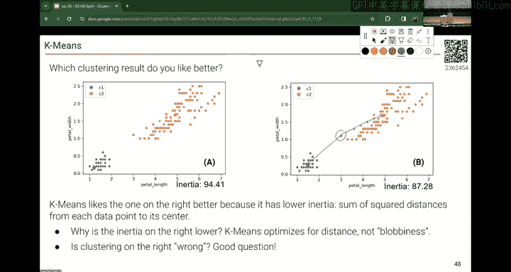
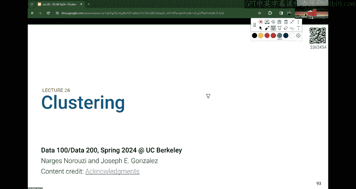

# 课程26：聚类分析 🧩


在本节课中，我们将学习数据科学中的最后一个核心模块：聚类分析。这是一种无监督学习方法，用于在没有标签的情况下，根据数据的内在结构将其分组。我们将探讨两种主要的聚类算法：K均值聚类和层次聚类，并学习如何评估聚类结果。

---

## 概述

在数据科学流程中，我们学习了多种工具和技术。前半部分侧重于工具，如pandas、可视化和探索性数据分析。后半部分则像是机器学习生命周期中的不同模块。今天，我们将学习最后一个模块——聚类分析。

机器学习通常分为**监督学习**和**无监督学习**。监督学习处理带有标签的数据，例如回归和分类任务。无监督学习则处理没有标签的数据，例如我们上周学习的**主成分分析**，以及今天要学习的**聚类分析**。

聚类分析的目标是发现数据中的内在结构，将相似的数据点分组。这些分组可以用于特征提取，也可以作为后续机器学习流程的输入。

---

## 聚类应用实例

以下是聚类分析在不同领域的应用实例：

*   **动物园访客分析**：分析访客在不同展区停留的时间，通过聚类识别不同类型的访客行为模式。
*   **推荐系统**：在Netflix等平台，可以对用户或电影进行聚类，以发现相似的用户群体或电影类型，从而进行个性化推荐。
*   **教育数据分析**：分析学生小组提交的学习总结，通过聚类识别讨论主题，并提取特征以检测表现异常的小组。
*   **基因表达分析**：在基因组学中，对基因或实验条件进行聚类，可以发现基因与特定条件之间的关联。

---

## K均值聚类算法

上一节我们介绍了聚类的概念和应用，本节中我们来看看第一种具体的算法：K均值聚类。这是一种**划分式**聚类方法。

K均值聚类需要预先指定聚类的数量 **K**。算法步骤如下：

1.  **随机初始化**：在特征空间中随机选择K个点作为初始聚类中心。
2.  **分配步骤**：将每个数据点分配给距离它最近的聚类中心。
3.  **更新步骤**：重新计算每个簇中所有数据点的均值，并将该均值设为新的聚类中心。
4.  **迭代**：重复步骤2和步骤3，直到聚类中心不再发生变化（即算法收敛）。

以下是算法步骤的伪代码描述：
```python
1. 随机初始化 K 个聚类中心
2. while 聚类中心发生变化：
3.     为每个数据点分配最近的聚类中心（着色）
4.     重新计算每个簇的均值，更新聚类中心
```

### 损失函数：惯量

为了客观评估聚类质量，我们引入**惯量**作为K均值聚类的损失函数。惯量定义为每个数据点到其所属聚类中心的距离平方和。

**公式**：
`惯量 = Σ (数据点 - 其聚类中心)^2`

K均值聚类的每一步（分配和更新）都在试图最小化总的惯量。

### 算法的局限性

需要注意的是，K均值聚类不能保证找到全局最优解（即全局最小的惯量）。由于初始中心点是随机选择的，不同的初始值可能导致不同的最终结果。算法执行的是**局部搜索**，每次迭代只能渐进地改进解。

理论上，可以通过枚举所有可能的聚类分配（K^N 种组合）来找到全局最优解，但这种方法在计算上是不可行的（**NP难问题**）。因此，实践中我们通常多次运行K均值算法（随机重启），并选择惯量最小的结果作为较优解。



---


## 层次聚类算法

K均值聚类只关注数据点到中心的距离，有时会产生不直观的结果（例如一个远离群体的点被单独归为一类）。为了解决这个问题，我们引入**层次聚类**算法，它考虑了数据点之间的邻近性。

层次聚类是一种**自底向上**的聚合方法。算法开始时，将每个数据点视为一个独立的簇，然后迭代地将最相似的两个簇合并，直到所有数据点合并成一个簇，或达到预设的簇数量。

合并簇时，我们需要一个标准来衡量两个簇之间的“距离”，这个标准称为**连接准则**。主要有三种：

1.  **单连接**：以两个簇中最近的两个数据点之间的距离作为簇间距离。倾向于产生“链状”簇。
2.  **全连接**：以两个簇中最远的两个数据点之间的距离作为簇间距离。倾向于产生紧凑的、大小相近的簇。
3.  **平均连接**：以两个簇中所有数据点对之间的平均距离作为簇间距离。是前两种方法的折中。

### 树状图

层次聚类的过程可以用**树状图**直观展示。树状图的底部是每个独立的数据点，越往上，分支代表合并的簇。通过水平切割树状图，我们可以得到任意数量的簇。

---

## 如何选择K值

无论是K均值还是层次聚类，我们都需要确定聚类的数量K。以下是几种常用方法：

*   **基于领域知识的EDA**：根据对数据的理解和业务目标预先设定K。
*   **肘部法则**：绘制不同K值对应的惯量曲线，寻找曲线的“拐点”（肘部），该点对应的K值通常是一个好的选择。
*   **轮廓系数**：为每个数据点计算轮廓系数，衡量其与自身簇的紧密度和与其他簇的分离度。轮廓系数介于-1到1之间，越接近1表示聚类越好。我们可以选择平均轮廓系数最大的K值。
*   **业务目标驱动**：在某些应用中，K值可能由外部因素决定（例如，产品尺寸只能分为S/M/L三种）。

### 轮廓系数计算

对于单个数据点 `i`：
*   `a(i)`：`i` 到同簇中所有其他点距离的平均值（凝聚度）。
*   `b(i)`：`i` 到其他所有簇中点的平均距离的最小值（分离度）。

**公式**：
`轮廓系数(i) = (b(i) - a(i)) / max{a(i), b(i)}`

---

## 总结

本节课中我们一起学习了聚类分析这一重要的无监督学习技术。

我们首先了解了聚类的核心思想及其广泛的应用场景。接着，我们深入探讨了两种主流的聚类算法：
1.  **K均值聚类**：一种划分式方法，通过迭代优化最小化惯量，但可能收敛到局部最优。
2.  **层次聚类**：一种聚合式方法，通过连接准则逐步合并簇，并可以用树状图可视化整个过程。

最后，我们讨论了如何评估聚类结果并选择最佳的聚类数量K，介绍了肘部法则和轮廓系数等实用方法。



聚类是数据科学家工具箱中的一个强大模块，它可以单独使用来探索数据，也可以作为特征工程的一部分，为更复杂的监督学习模型提供输入。希望你能将这些技术应用到实际的数据分析项目中。