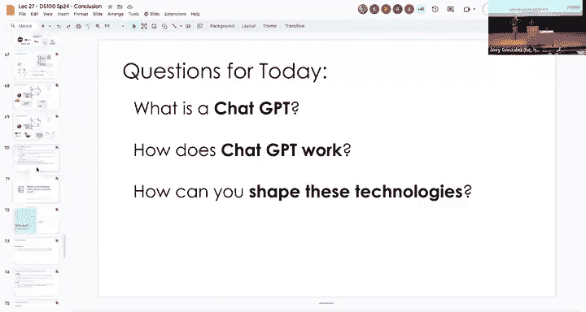
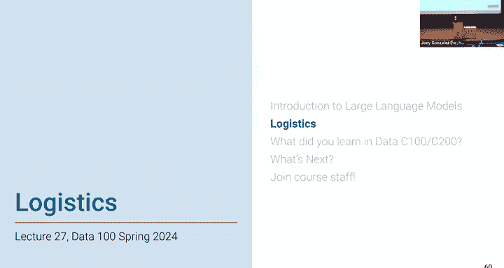
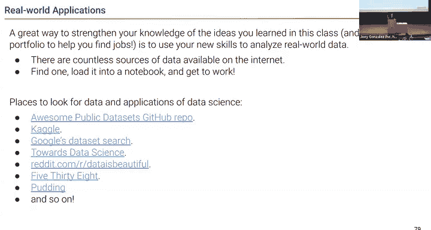
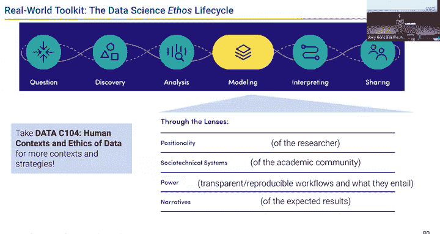
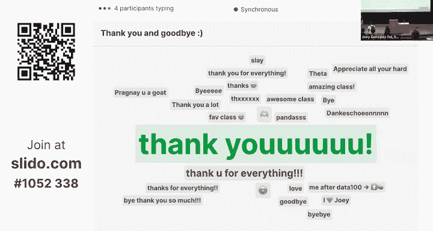

# UCB《数据100数据科学原理与技术｜Data 100 Principles and Techniques of Data Science 24SP》中英 - P27：-27-Data 100 Spring 2024 Lecture 27.zh_en - GPT中英字幕课程资源 - BV1Bc2dYCEbc

对。It's good。And we had 30 seconds。Soward。Who's used a large language model before？In the room。

And on Zoom。Wait， some of you didn't raise your hand， that's interesting。I'm said。

 you you got to check it out， we'll do it today for sure。Okay。It's almost time。Join on Slido。

We have photoss today。It's a fun lecture today， I don't think anything we're covering is officially on the exam。

 I that correct， nothing on the exam。We'll decide， okay。I don't think they' all have stuff with me。

 but let's go。All right。Join， join。Welcome to our last lecture of the year。

 so exciting for UN for me， today is a conclusion lecture。

 but also an introduction to large language models， LOMs。Which will be fun。So。Today's roadmap。

 introduction large language models for which there are many slides which we'll go through in a little bit they'll talk about logistics。

 a review what you did learn in data 100 so that likely be on the exam so you should pay attention there what's next some directions that you can pursue and hopefully we'll get to all this。

And at the very end， we'll join our course staff in thanking them for their help this semester。

All right， so that's a plan。Here comes the L stuff， okay？

I'm about to go deep and try to explain how LMs work what they are。

 the technology behind them i'm going to do that all in one lecture which is unreasonable so I'm going to give you some big ideas。

😡，This is not on the exam。So do not stress， you do not need to know this for the exam， however。😡。

You might want to pay attention anyways because you will probably need to know this stuff for life。

So this is for you， not for the final。It's a good thing。All right。

 I'm actually going to use PowerPoint。Confession， I do not like Google slides。

Other CS colleagues liking for Google sidess it is easier to build slides and share them so it's good I like animation so i'm going to use my old style PowerPoint I apologize the funds don't align with the semester。

 but it'll be fun anyways。😊，So join on So introduction to large language models， here we go。

So questions I'd like to get to for today。What is chat GT？How does Cha GT work？

And how can you shape these technologies？Now， how can you participate now？What is chat GT？

I'm actually curious， what do people think chat sheetPT is be as technical or non technical as you like？

Stay stuff。You have to click forward to see what happens。Can't remember。

As people type stuff I got hit， all right， we go before just to see what happens。 There we go。 Okay。

 well， as judging by the lecture title， you nailed it， it's an LM thing。

 it's an AI thing truth Sure about that very sophisticated autocomplete nailed it These are all very good descriptions。

😊，Perhaps you already know what ChaCPT is。But does anyone actually say what it stands for？Generative。

 we got some stuff here。Fel few minutes。A minute。Homework helper。Maybe。If you're asking chat GT。

 please explain to me PC I don't get it Professor Gonzles's lecture made no sense That's good If you're going chat GT。

 here's my homework question please answer it that's bad。Now that we're at the end of the semester。

 I'm glad we've cleared that up。How someone nailed the title。Jerry pretrain transformer， great。

We will explain all those words at the end of this lecture to go， yeah。

 I know what each of those means and I know how chatTT works。Hopefully。So what is Cha CPT？Chat。😡。

That is when you talk to someone， that one's easy， it is a natural language system focusing on text。

 though recently it's added support for images， so more than just text。😡，The G is generatively。

 so it's designed to model the creation of text。😡，We'll explain that in more detail。Retrain。Training。

 talk about this semester。Is a model trained on a watt of naturally occurring data？😡。

It is a transformer。Cool， what is that it is a kind of neural network。

The name is much cooler than what it actually is。 And I will explain what it is today using matrices。

 which everyone loves now。 So we will explain each of these concepts。

 how they work together and how that makes the AI that we use。😊，But most of us have already tried。

Okay， so explain these today。Before I go any further。

 I need to explain what a large language model or LLM is， who's heard the term LLM before。Yeah。

 that's crazy that this has become common knowledge large， I'm guessing you can't guess what that is。

 but language model， what is that？Well， you know what a model is and you know what a language is。

 so maybe it's a model of language， which is a pretty precise description。

 but actually there's a it's doing something very simple and yet very powerful。

 let me explain what that is。😊，First large and I've said this throughout the semester。

 we are building models that are ridiculously large today。

 billions or trillions of parameters in this class we've done 16 20， maybe 100。😡。

It's the same technology。Just more， some more compute more。More carbon emissions， so just very。

 very big models。Language modeling。Is predicting language words。

 and in a moment I'll clarify what I mean by words。

Here's a simple example of a language modeling task， the best class at UC Berkeley is。Critic。

 the next word， what's the next word？Correct is data 100。I would have also accepted date eight。

Have you taught any other classes？Okay， those a 186 is a good class， maybe lower the list for me。

 but yeah， so that is how I might complete the sentence。It is prediction。Is it not。

 I give you some text， I say predict the next thing， this is X， this is y。😡。

That is language modeling。Predicting words。Let's try some interesting language modeling and see what this tells us the capital of California is。

Everyone yelled out。San Francisco。Sacramento， very good。We are barrier。

But is that the correct answer？Now， could have been San Francisco 1862， wouldn fine。Venezia， 1853。

Blejo， 1852。more。So there are multiple completions of that text。😡，Predict the next word or words。

 sequence of words。Ebodies knowledge here， does it not。

 I mean predicting the next word I can finish the sentence。

 I must know something about the world if I can make those kinds of predictions。

I used Cha GPT to write stories for my daughter。 I once misspelled fery as in the ferry boat and it still wrote the story。

 It was hilarious。 Well let's take this。 This is a prop I've asked asked a model tell a short story about a fairy princess named Alice once。

😊，What's the next word， Han？Next word。😊，Uh next word， time， how are you doing this？

How are you predict what's on my slide？You understand language。

You have knowledge once upon a time there was a。Baairy princess would have worked too。

 but a fairy princess。We're going to go with it named。😡，Alice。

 so not only do you need to be able to know how things sound and how people normally write。

 but you also need to be able to read。What came before？

These are amazing skills and all I'm doing here is predicting the next word。All of these models。

Our prediction。What kind of prediction？You've already learned this class。Classification。

I'm trying to class my next word， if my language only had two words。

 it would make a lot of sense because we did binary prediction in this class。

 but you can take the same techniques we did in this class and just add extra vectorctors and extend that to predict。

Not one， not two， but tens of thousands of classes， each being a different word。

That's language modeling。Predicting next word is knowledge。

 predicticing next word allows us to answer questions， tell stories， and accomplish tasks。

So all this machinery is doing one simple thing， predicting the next word。

This is also what everyone's calling generative AI because what are we doing？

We're learning to generate the next word in the case of language。

People play vision models that generate images， video， what are they doing？

Taking noise and trying to predict what should be there。

Loing to generate the content and by understanding how to generate things。

 we understand the underlying ideas behind them in theory and allows us to do amazing stuff with these models。

So how do we model the next word？First， I have to say token。Language models don't deal in words。

 they deal in tokens， and now you'll probably come who's sort of price per token？😡。

Okay not yet soon we'll all be talking how many tokens is this assignment going to cost me to get the right answer。

 don't do that， but you know you're going to pay for words generated。

 not words tokens and you're going to pay how big is your thing you fit in。

 please don't feed in your homework assignment， but yeah you're going pay for tokens in that assignment。

So pricing per token， we do everything in tokens not words。Why。😡。

There are a lot of words and there are words that I haven't invented yet that I might want to write a story about my daughter makes up a funny princess name。

 I have to be to write a story about that funny princess name and it's not a word it's a weird mix of letters。

We need to be able to express things that haven't been thought of to use tokens。

Tokens represent words， word parts， and even special characters， emojis。Letters。

 the letter A is a tokenem。So's actually output of a tokener tokenizer。

 it's an algorithm that takes the string here， the smallest tokenizer and breaks it into little pieces。

 these are the tokens that we reason about so we predict the next word we're predicting the next token so these small S smaller those are different next tokens S or next token。

And these are constructed based on the frequency of characters。

 there's a whole field of study on how to build good tokenizations of language and a lot of it now is dealing with languages。

Multiple languages in one system， so can I make multilingual AIs I need to be able to bridge across languages that maybe don't use spaces or use different ways of separating the pieces of their language。

So allows for new words misspelling， even numbers can express arbitrary numbers。

 a number is not a token， but a sequence of tokens。So let's actually break this into a modeling task。

 we model things in terms of probabilities。😡，All right。Important terminology。

 the best class of UC Berkeley is。This blue part is called the context。

 this is a sequence of tokens that I already have。That the X， if you will。

 and this blank here is the thing I'm trying to predict that is the next token， that's the y。😡。

We build probability distributions over the next token， that's what all of these models do。😡。

Logistic regression built a probability distribution over two things， zero or1， true or false， spam。

 not spam。We can extend that to distributions over all the tokens in a language。

The organizers we use today often have on the order of 50，000。Hosital tokens。

 things that I could generate next。And I's capable of expressing any string。

So I am modeling the probability of the next token given the tokens I have。

 this is conditioned on the context and I'm going to model probability of the next token and sample or pick the most likely next token so if I can build this probability distribution that I could choose the most likely data 100 good choice。

 or I could sample another token and maybe I sample CS。Maybe a sample stat。

By a sample of different token， I'm going to then use that to make my next set of predictions。

 which I'll show in a moment。So I know how to break the next token？

How do I go from predicting a single token to writing an essay？Why do I do that？One token at a time。

Just as I was doing before telling the story about the fairy princess named Alice。

 I'm going to do that that process is how I'm going to generate。Answers to a homework question。

 for example， going one token at a time。So this is called autoaggressive because we're reing。

 we're using our past predictions to inform our future predictions。

It's called decoding because I'm decoding this model from my what you gave me as a context to finishing the essay。

So compute the probability over the next token， select the next token。

 either choose the most likely token， this is sometimes called temperature zero。

Or' sample over the next possible set of tokens。Why would I want a sample？I want funny stories。

 maybe I wanted to try something different， you at the temperature。

 the chance that you sample something weird， higher， GPT will give you nonsense。

Or something close to nonsense， it might be entertaining。

Using some noise allows us to explore new places in what we might produce。So for example。

 maybe it would sample。Stat and then it's forced to go， well。

 I got to pick a stat class 140 is maybe most likely and then it might go well stat 140。

 it's not a CS class but and then give you a further explanation。So sampling is important。Right。

 I take that next token and stick in the context。The blue part and repeat。

And I repeat until the model says stop。That's kind of cool The AI gets to decide when it's done writing。

 so it just keeps saying next token is a data hundred and then it goes stop or maybe it goes comma because and decides to write a whole explanation。

So let's try the best class at UC Berkeley is。I'd see what's probably of data 100 here it's highest so let's say take the most likely the best class UC Berkeley is data 100 I'm going to feed that into my context it's my new context and I'm going to find the next best token。

Right。So if I just choose the best token， I choose the period。Let's say I say period， okay。

 then I put period in my context and proceed， I could also have chosen if I sampled， you know。

 according to probabilities and maybe not the most likely thing I could have chosen stop the best classes of Berkeley is  100。

Stop when I say stop， the model doesn't get to predict any more tokens， it's done。And we go user。

 here is what the AI has said。Let's say we said period。

Let put period back in the context and we sample again， and now that we've said period。

 and know this model is being very concise about its sensor。The models decide to say stop。

A lot of models today because they're tuned to human preference， Mike go on to say。

There are other great classes at Berkeley， but data 100 is one of the best classes because it teaches you fundamental principles and techniques of data science。

 right？So the model goes to aside， does it want to keep writing the essay or is it just stop？

看 of cool。Okay， so quick recap， auto aggressive， predict one token at a time until we are done。

One thing that's kind of interesting about this process is it is slow to compute if you've ever chatted with an AI。

 you'll notice it's typing back at you and that's not a cool animation effect。😡。

Every single token is a huge prediction task。Billions of numbers that go into the calculation that the next word should be。

Is。Right。So every token we see coming back at us is an enormous amount of compute work to get to。

Gooding question。So I told you the process。It's so expensive to compute the next tokens。

 why not just protect the next hunter tokens in parallel boom， lots of computers can I do that？

I am going too slowly。No， yes， we're tied。Someone ask an AI。All right， so the answer is no。

I wish it was yes， that would make a big difference and maybe someday one of you will figure out how to make it yes。

 but right now as an auto aggressivegressive process。

 it's sort of like saying write the hundredth word after this blank。

 but I'm going to figure out what goes in this blank。😡。

It's hard to know what to write at the end of your essay unless you've written the beginning。Now。

 those of you who've written essays before， which is many of you might have written an outline。

Maybe in the future， we'll find ways to use things like outlines to allow a model to jump ahead and start writing the rest of the essay while you're writing the beginning。

But right now we have to do this one token at a time。How do we implement this model？

We can use the techniques from data 100， in fact， in this class。

 we've given you the fundamental building block of all of these systems。End the process for using it。

So I will show you that now。I'm going to try to give a high level intuition and I have a tendency to over explain so I'm going to explain a bit too much maybe of the basic parts of the model itself。

So how does it make these predictions？There's matrices， here we go。All right。

 so I'm trying to build a function that computes a probability over a token。Draw now。Okay。

 so I'm going to compute the probably over the next token。

 I'm going to define some model parameters and this is going to be obnoxious because I have to do it without telling you why。

I'm going to make some tables and matrices， and I'm going to use those matrices to build a model。

 The way we think about things in AI today is we often think about there is some process of going from the text I have。

To making a prediction。 and I can compute that process。 So I'm going to say there's some vector。

 I wish I knew what it was， but there's a vector attached to each word。 There's some magic matrix。

 Again， I wish I knew what it was。 But if I take that matrix and I apply it to each of the vectors。

 it's going to produce some other vector that I can use to answer the question。😊。

So we write this process of how we would get numbers that would get as something we like if only we knew the values of those numbers。

So let's talk about how I do that so we're going to make this thing called an embedding matrix that's not unlike we've thought about in PC in the past。

😡，In that I'm going to have a row vector， one row， one vector for each word or each token in my language。

 so if I have 50，000 tokens。Sa tokens。So 50，000 tokens， I have 50，000 rows， 50，000 vectors。

And I've chosen embedding dimension that is large 3000 dimensional vectors。

 I think that's actually on part of what's used。So these are big vectors。

And when I see a context that says once upon a， the first thing I'm going to do is I'm going to look up the vectors for once that's this vector in some row here。

 and then upon a time and upon I grab those vectors， and I make this little matrix that is 3000 by。对。

I just looked up these magic vectors don't worry about how they come to be we'll figure that out later I've got three vectors and there's this magic matrix that I wish I had。

That when I multiply by these vectors？We got some more vectors。This is 200 by 3000。

 you get these vectors here， one vector for each of the words in my context。One vector each。

 so this is three。Three things here。And then I'm going to take those vectors。

I'm going to average them。They you get one vector。'sAnother nice vector。

Don't worry about it too much。What do we do with it， I'm going to take this vector。

And then multiply it by each one of these original words， which are these tokens。嗯。

And now I have a number attached to every token in my language。Nice， what do I do with that？

Got a number of every token？It be nice if have a probability right that's what we want。

 So I've got a bunch of numbers attach chrry token we already saw this in logistic regression I have a number for true a number for false。

 but I want these to be。Probabilities， so we use this generalization of that sigmoid curve remember logistic regressionally had this sigmoid curve that looked like。

Exam review， something like that。We can generalize that to this is predicting you know zero or one I can make something that I apply to a collection numbers。

 so this I took just one number this is just this is my。Let me call it maybe call Z it gives me a。

 you know， y is either zero thats over z is small or z is big y is one， right？

That was a logistic regression。Soft Max is going me take a。

sequence of numbers and assign and convert them to probabilities。

 So now I gave you some crazy math that went from a set of words in a context to vectors multipied by some crazy matrix it gave me another set of vectors I averaged those vectors and I got back a vector that's got 50。

000 numbers in it， and I applied this calculation， I exponentiateiate all those numbers and I divide by this some of the exponents。

And now I have。Probabilities。We're done， that's it。Nts， right。

They got a way to compute probabilities。😡，And now if I want the probability of time。

 I just look at the time element， I go you know time is number 7，000 or yeah， 7。

000 by $50 and I go look at and it has a probability attached to it。

So now I just choose the most probable word。That is the basic building block of these models。😡。

How do I make these matrices？How do I estimate the value of these parameters？

We know how to do that too from this class， who are you？

Loss we need to know what what is our goal my goal is predict the next word so I've got out of text I can know try to maximize likelihood of the next word being time if I have text that says time so we have a loss。

And then I have an algorithm， what algorithm do I use？😡，Radian descent。

Stochastic gradient because these models are so big， it'd be too slow to do gradient descent。

So you now know the basic building blocks of these models。But there's more。sSome bugs in this model。

 does the order in which I put the words in the context matter？Once upon a time。Once upon。

 upon a once。Does that change my prediction？With that math， have a vector， vector。

 I multiply my matrix I averaged。What does that do。

Pas to know what's going on the math just a little bit。

Does the order of the words in the context affect at prediction， the answer is no。I wish it did。

 right？This class is awesome。Not。This class is not all that actually does work both ways。Yeah。

 often language is very sensitive to where I put my words， my negations， for example。

 so I do want order to matter， but when I just showed you， it doesn't。

This is how in modern AI we think we're like， well。

 I wanted the thing to capture this property of my language。

 but the model I built doesn't seem to have any preference。😡，And that's because I averaged here。

If I permed these vectors and put them in a different order， I'd get the same thing here。😡。

But what order I put those vectors in， I get the same outcome。

But language doesn't work that way if I change the order of things in my sentences。

It changes the meaning， so we want to preserved that。Okay。So we need to fix this issues。

Order position information， we would like to do something about order here， one problem。

We're looking at just all the words in my context make this a prediction for my next word。

 is that really true， does every word really matter equally no？And。😡。

As we would learn over the past decade。A billion parameters is not enough。

 we need to find a way to make these models even bigger to embody all of human knowledge。😡。

So how do we solve all three of these problems？The first one。

We actually use a technique from this class， we will change these vectors by augmenting them with some features。

So we're going to add some extra vectors， how these vectors come to be。

Out of scope for this out of scope conversation there are tricks to create vectors that encode position one can imagine one way to do this is the position one vector has a one here and the position two vector has a one here and zero otherwise position three and so on so I augment my meaning of a word with its positional information。

My vector representation of word is now augmented with where that word is。

 so its a slightly different embedding depending on where I place the word。

There's machinery for doing this， you could read papers about it or just。Trust the machinery。

It is often based on trade functions for those who want to get more into the math。

 this is pretty neat stuff， how they do this， but again out of scope for this out of scope lecture。😊。

Okay go away， all right， so now we've encoded position information。

 not all words are equally important。This turns out to be a big deal。So to illustrate this。

I say I give you this is my prompt to tell a short story about a fairy princess named Dallas Once upon a time。

 there was a fairy princess named。Alice， and how do you know that？

There is one word that mattered a lot， Alice。And probably some of this context told me that I should probably pay attention to Alice in some of this context here。

I don't care about short， the answer is not short， right， but's just not helpful。Right。

So I want to attend。Look at， pay attention to only certain parts of the word of the context based on what's going on around me。

 this part right here。This。Is what the transformer is all about。The neural net idea。

 this transform idea， which I'm going to。Batch in a few minutes， I'm going to try to explain it is。

So difficult to explain。That when we try to teach it， either look at the original paper。

 which is well written who we' was watching is it's a great paper。

 but it's very hard to understand what's going on and then there's blogs and blogs afterwards trying to explain what's going on so I'm going to do it again。

😊，If you don't get it， it's okay， I just want to give you a taste of what's going on to give this idea of attention and this is the T in GPT。

😡，So here is why we talk about GT with the T。So one thing that I want to do to simplify notation is carrying all these datas and these positions and stuff around。

 I'm going to just change these and say there's these vectors X that were built up somehow。

Just make it simpler。So my vectors x。And the magic is going to happen here when you build this out。😡。

Right here。Instead of taking an average over these Y's， I'm going to take a weighted average。

Makes sense if I say， you know， I don't care about u。Maybe I should put weight zero here once maybe。

Yeah， I don't know which wordss most important in this particular example。

 but maybe once upon this is 0。5 I care about the meaning of this word and this word those are the most predictive words for answering this question right so I'd like to wait my average。

That's the first enormous idea in the transformer。Architecture， this is called attention。

 I'm paying attention to words in a non uniform fashion。How do I get my office？

If you've learned anything today so far， I'm going to have some more matrices right。

 I'm just going to make some more equations that will give me alphas。

 I need these alphas to sum to one。😊，So I probably want to do this probability trick。

But I to come up with values to these alphas。The way I do that is I'm going to bring in another matrix。

 I'm going to call it a key matrix， its job is to figure out how each of these words should be representative like what what do they mean if I were to look them up。

 what would be a good way to key them。And it's going to give me back something that is 64 by3。

 so it's just a magic matrix that goes from 3000 to just a simpler kind of lookup space。

And then have this other crazy matrix again figure out how to make it later that looks at the very last word。

 the word I'm trying to make the prediction for the word after it says I'm going to use this as my query matrix or my query vector it's like my search in Google so thiss my search term I'm going to embed it again in this simpler dimension reduction simpler space so I have this vector here it's my search term and this is the lookup table。

 the index for each of my words that I want to attend to。

It's looking good because now I can take this vector here。And I can dot it with each of these rows。

 it's a matrix multiply。And I'll get three numbers that when I take the soft Mac of。

 I will call a probability。Confusing， yes。Big idea。

 I needed a way to go from the words I have to figure out how to attend to the words before me。

I made up two matrices。These are going to be learned somehow and they're going to assign。

Numbers to each of the words in my context。 So each these words in my original context。

 I going a number。 sorry the resulting output so get a number and that number has being 0 and one so I can take a weighted average。

And that is the last step I take this weighted average。

 so compute weighted average based on these alphas using these keys and query matrices that are derived。

From these extra matrices I've added down here。So I have this weight matrix。

 it does this transformation， I have these key and cr matrices。

Technically there's another matrix that reembed stuff we'll ignore that so these are the basic ideas but that's enough to give me my alphas and now I take a weighted average like this my words。

Transformer。Paying attention to words in a non uniform fashion。

This was a big breakthrough in what we can do with language modeling。All right， so now you know。

The architecture？We're this basic idea of language modeling。Things I didn't cover。呃。

On top of these blocks， we do other things like after we've computed these this new vector we pass it through actually more logistic regression like equations to allow us to express kind of nonlinear concepts that's actually less interesting than the stuff I've showed you it's also much easier so I'm not going to cover that here。

To build a large model， we don't do this once we actually stack it。

So I just told you how this last block predicting the next word looks back at all the words before it all their embeddings。

 does some attention， compute some weighted average， and it returns that single y。

 which I then said will dot product with our embedding matrix to get back the original word。I lied。

We just pass that in as a feature again as an input， a new x to the next layer。We just stacked these。

So if I build one building block that can take words in some vector embedding space and produce words in the vector embedding space。

 I can stack those。And that is how we make things large。

So how large so GPT3 where we have public numbers。Here。And here。

 these are the models that were likely being used on the order of 175 billion parameters。

There are 96 layers deep。So we do this transformer thing 96 times。Stat if that wasn't enough。

ForEvery single word， we do it 96 times two in each of the layers。😡，Large。Those laws are very large。

喂。Big representations。You have an idea of how the model works， all this computational cost。

 one more slido， and I'll try to go a little bit faster as we wrap it up。

Which token requires the most computation to predict？SoOn this slide。

 I'm going to go back to just for a second so you can see this picture。It's the last token。

first took。I can actually start from nothing if I have zero in my contact so you can just predict what's the most likely next word in all language？

Start generating for。Some funny stories， so which token requires the most competition to predict。Wow。

 you guys are getting it， okay， the last， the last token takes the most word to predict why because to figure out that last word。

 I have to figure out the meaning of every single word before me。

So when you write that really long essay， finishing that essay is the most work。For AI。You might say。

 Joe， but do I really need read the entire essay just to figure out the next word。

 and the answer is yes。Today， maybe as we innovate on these technologies， we'll find ways to say。

 you know what， I need to read like the last paragraph。

 I can pretty much guess the rest of the essay。We're not there yet。

So right now we look at the entire context， it's why when people go， oh。

 Google now has a million token contexts like， wow， that's a lot of work to finish that last token。

It's a big model。B of computation。All right， so we're left with。

We have a model and I didn't tell you how to fill those numbers in guess stochastic gradient。

 we're going to use the techniques from data 100 so we define the model which we've done exhaustively。

 we're going to define a loss function and here's where we use this generative loss。

So we take our text and just say， what is the next word I have the whole essay so I can go halfway through and say。

 I know what the next word is。Model， you better predict that。

We can use the negative of the log of the probability， that's just the number we can compute。

That's a thing we want to minimize that。We take all of the documents that we have。

And for each token in each document， we predicted based on all the tokens that came before it。

Take the gradient of that。Good luck， it's a lot of work。Humans don't do this now software does this。

 so we take the gradient of this thing。With respect to the billions of parameters。

Andd do stochastic gradient descent。And the cool part is， what data do we use？Everything。

All the texts that we can get our hands on。You get an idea， we use trillions of tokens。

 trillions of words and every single word and every single piece of text is a new prediction task is a single training data point that we can train our model on。

 so trillions of data points go into these models。The exact mix really does matter， for example。

 turns out Reddit was pretty useful。We're pray red in these models made a big step forward。Why。😡。

Why would read it be so useful。It answers questions， it's got some conversation to it it's kind of。

In my opinion sometimes beverage but it has great discussions about interesting topics it has something else to kind of neat it's curated people link to stuff that's good and those things get up voted so I can figure out what's good stuff or what do people think is good stuff so not only the Reddit conversation but everything Reddit touched is also included in that that web text。

😊，And that made a big difference because that prioritizes human knowledge。

 allows the model to not just regurgitate garbage spam websites， but actually meaningful text。

There are other sources of meaningful texts that are critical， like Wikipedia books。New York Times。

 so this comes to， you know， downside what data is it okay for the model to really learn to generate？

So we use as much data as we can。We minimize the loss。We use a variation of SGD called Adamom。

I can't explain right now again out of scope for the out of scope lecture。

 but it's basically stochastic gradients and few extra features。We run these things for weeks。

On thousands of very expensive GPUs I'm talking like 25 k per GPU is more than that right now so very expensive GPUs。

 thousands of them running for weeks， so it's expensive to build these because we are trying to bake all of human knowledge into predicting just the next word。

All right， so recap， you now know what GPT stands for。Perhaps more than you wanted to。

There's still one more thing。It turns out chat is part。Iusstrate that point。When we take。

 we got an example。So we train these models to finish the next word yeah here we go an example of where this might fail is I say hey right a program to compute pi that is my homework assignment and the AI goes no problem you should avoid using for loops and instead vectorize a program。

Because it read all of these homework questions and it goes， well。

 when someone says write a program to compute pi， the next thing to say in one of those questions is obviously you should avoid using four loops。

 we did that in this class， vectorize your program。Thank you。😊，And he was like， no。

 I wanted you to actually write the program， not finish the question for me， right。

 there's a behavior we want in these models and we have to teach them to be good， to be fun。

 to say the right thing。😡，And so we do this。Oh no， al right。

F minutes okay we're trying to get the end of a lecture two so we do this using a few really important techniques that you will likely see in life instruction fine tuning。

😊，And this acronym。Which is RL HF， I'm going to try to give a quick idea of what's going on here。

 but the punchline is I'm trying to tune my models not just to predict the next word。

 but to behave nicely。To be funny， to be kind， maybe to not tell you how to do a homework assignment question。

 so we're going to fine tune by running additional training iterations。With a specific task。

We haven't really changed much， we're going to use our same losses before。

But instead of trying to predict the instructions， I'm just going to predict what comes after the instructions。

so I'm not going to force the model to finish my instruction。

 I'm going to say finish the answer to my instruction。And I often pick a specific domain。

 perhaps data 100， say， look， I want you to speak like a data 100 TA。

 so take examples of data 100 TA responses and I want you to finish stuff like that。And we run SGD。

 same training process before。We set the learning rate， this little parameter we had to tune。

We said it small because we don't want to forget everything we've learned in that weeks and weeks of very expensive pre training。

All of human knowledge shall be there， it's just going to be a little bit suppressed with this kind of veneer of speak like a data 100 TA。

respondspon nicely right so I've read readit， I know how to respond badly。

 but now I've got all these nice examples of how to respond nicely and politely。

There's this other technique。Reinforcement learning from human feedback which is kind of a more advanced idea。

Quick summary of what's going on here is we teach another AI to judge the first AI and say， hey。

 that was a good response。That's not a good response how we do that we get a human to go hey so here's some really good responses here's some really bad responses logistic regression we got a logistic regression model we say okay now AI is going to make a million responses you go judge all of them。

And then that score you give good or bad， I'll use that as a loss。

So now the AI is just making up responses， thousands of responses， sampling random numbers。

 making all sorts of crazy answers to questions。No humans needed because there's an AI judging the AI's response。

It'sKd of cool this lets an AI sit there for weeks just you know practicing answering questions being funny telling jokes and then using this kind of human curated data set to tune on it what is good and what is bad。

And to do this right， you know take a few samples， the AI's got some funny stuff。

 you throw that funny stuff to a human judge and go no that's not funny anymore and then you beat that back in and you have a new AI judge like yeah。

 those aren't funny anymore。Right so repeat this process。

That's what it takes to make really good AIs。All right。

 so I have covered all I wanted to cover for the basics。

 I want to tell you how to get involved in research and then I will do a very short demo of how to use this stuff and then I'll hand it over the rest of lecture。

All right， so in my lab， we're doing a ton of this stuff already， you should join us。

I should say my credit students have said no more no more help right now as the semester finishes up。

 but in the summer into next semester please join us we're doing a lot of stuff to evaluate these technologies building new agent systems where the AI thinks it gets to say stop computer runs and the eye goes you know what I'd like to think again so letting them loop use tools call functions interact with the web building tool use of big focus right now can AIs go book plane tickets for you know turn in your homework assignments when they're done we've been looking at new tools to serve these it takes a lot of compute can we make that more efficient can make more scalable so this research is touching the whole spectrum from the AIs to the systems and today that's what's exciting about this there's so many places that people can participate。

And there's a big open source and research community here at Berkeley and abroad pushing the field forward。

All right。I want to show you how to use a large language model I'm going to just give you quick highlights of things to know about there are some commercial models and when you're starting in the space just use these they're pretty good you've probably already tried chatting with chat@ openAI free service。

I'm going to show you how to connect these to your Python environments you can actually use them to do fun things like data analysis So these are a good starting point because they work kind of out of the box and they're very good you can also use the open source models Lama 3 was just released earlier this week it's very exciting So state the art models come out Vikuya is my model from UC Berkeley it's good it's not as good as this but you know it's good So their open source models you can download and run on your computer and I will demonstrate that in a moment well but to do that you're going to be on the small side and probably even smaller than that because these things take a lot of compute if you want to work with them small models which means that the accuracy won't be as good and it'll run slower than these commercial models up here。

All right， so let's do a demo。So I'm going to work in Copiloot， who's used VS code with Copit。

 who's used VS code。Who's used Copilot？And then not for this class， right。

 but now I'm going to show you it so in the future。Not for classes。

 you can use it because when you're not in a class， you should be using these technologies。

Is my demo notebook？I think first， this is welcome to visual Studio code。

 it's a Jupyter like environment， but on your laptop and with like nice you know integrations。

 your file browses and that stuff， but critically you can link it to Github Copit。

 which you can learn how to do by searching on Google figure out yourself。

 It's not that hard once you've linked it to Google Copit。

 it will start to get stuff and help you finish your。😊，Not homeworks， whatever else you're doing。

All right for this demo and we do a few things that you cannot do sorry but you can you know figure out how to set up on your own first I need an open AI account I am not giving you my account because it costs money for you to run queries you know if you play with it for a little bit you're know a few dollars you know a few hundred tokens。

2 thousand tokens。10000 tokens you know a few dollars。

 but if the entire class uses my account it'll cost a lot of money so I'm not going to tell you my key but I've made some key file again if you learn if you Google how to use these technologies they'll have a very simple tutorial on how to create your own key file this one here if you get your key from open AI's website。

😊，Paste it here， this is not a key and then you run this it'll save a keeppa。

I'm also installing some tools， open AI's interface Lang chain。

 LCha is a pretty popular package for interacting with AI LM technology today。

Or install those for me， so let's just get get going connect to open AI it's this easy once you've got everything set up give my open AI key file connect open AI。

And I tell it I want to use GB35 turbostruct instruct， fine tuned， so this was tuned to speak nicely。

It's the first really nice ice speed chat model。Now I can say LLM invoke what is the capital of California provide a short answer？

Sacramento。New line， new line， Sacramento。You've encountered the first problem working with AI it does whatever it once。

 it felt like there should be some new lines in the answer probably because in all the instruction fine tuning the question was given and then there's like new line new line answer so you're going to do a lot of Regxs if you're going to work with this technology。

Suppose I didn't say provide a short answer。老板。they can get long。Playing with this， I got lucky。

 I didnt need a short answer。You will have to hack the prompt prompt engineering to get the result you want this is a simple question。

Oh， I got a different answer， why is that？You got longer annoying the capital of California Sacrament。

 I just wanted what was a capital， not an essay or a sentence。

Random sampling so when I connect to it I need to set a temperature， I didn't set a temperature here。

 which means it's going to use a default thing， which means it samples every single time we'll get a slightly different answer。

That's going to make data analysis of pain。So then you have to deal with when using AI technology。

V it a temperature， which I forget the argument， temperature？How about this oh。

 see open AI is trying to do it for me Coilt， let's do this again。Temperature says yeah。

 but I went zero。It'sConect again。Now。Now。Now。先定。Be concise。嗯是。会有。Why would please help？

Why is it nice to be nice fornyI？Maybe in the training data on Reddit， someone said， be concise。

 please。And so you're encouraging it to behave more like the nice conversations。So believe it or not。

 being nice works with AI too all right， so write a short song about data science and large language models。

Very， very fast， look at that。I'm not going to read it。 You can read later。With large angles。

 we'll all conquer all that's open AI shouldn't be saying stuff like that。Not good， okay， all right。

 so that's working with open AI， let's now work with Laununya。Go Berkeley， all right。

 so now I'm using another package， oh Lama。Names are crazy。 This is the thing I can my Mac。

 So sorry for non Mac users， but actually it's not true。 alum now works on on Windows as well。

 you need a GP or some kind of fast GP like silicon Apple has one。

 So Obama is tuned for the Apple M silicon series， but it also works with some。😊，Gamers out there。

 your GP has work for this too。All right， so I'm going to run launch a model here and now we'll use Berkeley's technology What is the capital of California answer with only one word。

嗯。哦。Okay， it might be connecting the the other there go， oh， come on。Maybe this is not good。

That's two words in it's defense it's actually answered one word。

 the llma thing prints out the message before it returns value。😊，So the variable is。includes。Oh。

 I thought I'd like to print it that's very nice thank you so that'd sayI finishing my assignment for me。

Good。So that was not what we wanted。So we're always going to get something productive because。No。

Yeah see buggy as you said temperature to zero again okay we won't write an essay I want to just wrap up with one last thought and maybe I won't even I'll write it okay one use case for these technologies is you have a lot of text in life you will work with lots of text so far we gave you really powerful tools like regular expression。

😊，Now you have a way more powerful tool you can just ask an AI to read the text and tell me what's going on so is applying text making a statement about minimum wage you should answer either yes or no。

Please。😔，And I put， maybe that's。Okay， and I put you know two new lines to say here's my text。

 it's pretty common pattern， and then I want my answer here。Butut two lines there as well。

 so I want to put the answer right there。The I thinks the answer is yes。All right。

 so now I've got my question， I've applied that to each of my tweets。

 so now I have a bunch of questions， which those look like。There's just a bunch of strings。

She strings has the setup and then the actual tweet。嗯。

Now I can ask Open AI to answer these questions。And I can read all those tweets， give me answers。

 so now I can do really interesting data analysis， comparative data analysis with complex text。

 auto summarization using these technologies I can do it from Python。嗯。

There's a lot you can do with this and so now you have the basic tools from this class with these technologies to actually use them in your daily lives。

For example， we could read student feedback with these and figure out how to improve data 100。Right。

I'm not going to show theunya because it's slow， go withunya。

It is working on an M1 Mac or M2 max cells。Not a giant data center right I think that is all I wanted to show so that is the end of AI technologies of Lm technologies I hope you have a chance to work with them in the future It this is an exciting time to work in this space there's a lot of opportunity to also shape where where the field is happening。

All right， with that， I'll Na is to finish up the lecture。Bonus material and oh。

 so I put my slides on Google slides。Now'm to just escapes we get out it。

You knew you can slide headway。

You're revealing my。Logistics， alright， so good to be back。 This is exciting。 very last lecture。

 So we're gonna wrap up with a couple of logistics and kind of overview what we have seen in data 100 so far and what could be the next plan for you after data 100 I'm sure that you're all over that there is a final exam coming up May 9。

8 a。 so be here on time， not here in the classroom that you'll be assigned to。

 we will be actually releasing your sitting assignment and other logistics of the exam for you probably during the reading week so make sure that you watch it and get those announcements as well we will be having review sessions。

 final review sessions here in this room during your regular lecture time during your reading week again。

 Tuesday and Thursday 11 to 1230 Each session is gonna have two of your wonderful Ts covering data 100 materials and kind of go and go over some。

😊。

exam questions with you on Tuesday， what we're going to do is kind of review everything after the midterm because those are the important pieces that you might w to focus on a little bit more once that's out of the way on Thursday we're going to come back and review preter materials because final is cumulative I'm sure that you also remember us sending multiple emails and announcements and also an announcement that I made here in the lecture about course evaluations now that the bins are set。

 there is this course evaluation that you can complete and get extra percentages so there is a bonus credit of 0。

5% if you complete the campuses survey and also our internal。😊，Our internal anonymous survey again。

 we always keep changing and keep improving a course so it's good to hear from you to see what has worked well so that we don't change it and then what didn't work well so that we can address it and please send those to us through both of the surveys that you have if 90% of the cost fill out the course evaluation then those who filled out that 90% or more is going to get an extra 。

5% towards their final course grade so this is potentially can change your grape pin if you are able to get it I think a percentage right now is around 50 ish percent I think we have like 600 is responses so lastly check that was the number that we were at far from 90% go ahead and fill out the course evaluation。

So let me now talk about what we've seen in data 100 and data 200 and then kind of wrap up this entire journey that we've seen together the goal of data 100 and hopefully we have accomplished it is to prepare you for more advanced courses so the job of data 100 is to give you kind of industry standard tools and techniques and also give you hands-on experience with real world data so if you're interested in any aspect of data 100 right now you should be able to go ahead and take those advanced courses that I'm going to cover in the next few slide what those courses are going to look like if there are certain aspects of data 100 that you were interested in it should also enable you for your careers data 100 is the last course for some of the students for some of the students or data science major there is also additional courses that you have to still complete but we also think that with the techniques that you learn in data 100 you should be able to complete。

Real world projects because you have dealt with real world scenarios and data sets in data 100 and obviously we want you to have the confidence to go out and do real world projects。

 whether that projects are going to be projects that you're going to do in your careers and your internships or during your research with any of the faculty that you find on campus here。

We went through this data science lifecycl I just want to kind of reflect one more time on this data science lifecycle because everything that we did I promised you in the first lecture that this is going to be where we' were going to live and we have actually visited all of these roughly all of these errors and all of these estates in different lectures of data 100 but let's see what we had done so in the data acquisition part we actually had had you work in actual Jupyter lab you were able to use pandas you learned a lot about pandas and then you also learned SQL and then these kinds of libraries are really helping you to just know what are the tools that are being used in industry and also in our research labs as well so the mascot that we had for data 100 pandas is from the fact that a great portion of data 100 is。

act build on top of pandas that's why we spent like the first four lectures talking about pandas there's going to be data 100 this speaker that we be giving out during the final exam so that's also another thing to look forward to coming to final exam that is kind of an indication that you completed data 100 successfully。

We also talked a little bit about not a little bit actually quite a bit about Exploratory data analysis or EDA we had learned a lot of visualization libraries。

 we have seen mapplodlib we had seen Cborn which was a wrapper on top of MApllib you had also seen plotly in some of the fancier plots that we were showing in the demos but we didn't actually teach you the syntax of it。

 but since you've seen it and the syntax should be pretty similar or the logistics of it and the outline should be pretty similar you should be able to learn it quickly if you want to you had also seen that a lot of the techniques that we're using there are like kind of modules that can fit in different stages of the data science lifecycle specifically last lecture I tried to talk to you about clustering being kind of a factor that we can use as part of the EDA and we also talked about PCA as a technique that we can use in order to visualize the data to。

😊，They are principal components to see how our data is laid out and what kind of modeling is appropriate for the data that we have at。

Obviously we also talked about this data acquisition and Exploratory data analysis be be a cycle so we went around this cycle。

 we did a lot of feature engineering， we had seen how we can do transformations we had seen how we can do regular expression and all of the fancy things in the feature engineering space that we had seen ultra throughout the semester so by now you should be kind of comfortable loading the data。

 getting the data visualize it， do exploratory data analysis and then do feature engineering on your own so that your modeling piece or the modeling that you will do in the downstream is going to show you a good result hopefully a result that can be generalizable to the data that your model has not observed before。

We also spend quite a bit of time in modeling so every time that I came here I was coming here with a new model I think it was a little bit of a pain to learn linear regression so we took you from like assuming that there is no modeling it you know from before and we actually derived everything about simple linear regression。

 constant model and ordinary lease scores it was a tough few lectures I think three lectures was pretty tough right before the midterm but you succeeded and then afterwards we came back and talked about a more complicated modeling so we said that okay now we're done with deter termministic modeling now we want to do probabilistic modeling and do a classification between two classes which now you're seeing that it is actually being used more than what you think it's beyond binary classification is multi-class classification and it's also a structured prediction and like all of the LLMs that we talked about today is kind of based on。

Similar technique under the hood we have also seen one example of unsupervised learning kind of task that we could do for kind of pseudo classification that was clustering that we saw in the previous lecture。

We also talked quite a bit about different loss functions again every time that I came here I had a new loss function and we rationalized why we had different loss functions。

 why MSC was making sense for linear regression and why we had to move onto crossenttropy so now you are comfortable with understanding the math behind the modeling and now you know that once you have the modeling framework you decide about the model you decide about your loss function。

 you have to just go ahead and optimize it and we spent some time talking about optimization。

 we talked about gradient understanding the normal kind of paths that we' will do in order to basically find the optimum and then we also talked a little bit about the models that do have unique solution versus the models that don't have unique solution and what are the things that we're doing to make sure that asmptically our model is going to achieve a reasonable solution that is good in。

without spending too much time we talked about like what are the things that you need to be aware of as you're doing the modeling we talked about cross validation we talked about generalization we said that you always need to be careful that you don't overfit to the training data and what is the model model risk and model bias variance tradeoff which we spent two lectures on。

What we didn't cover so what we didn't cover was most importantly causal inference I put it up there because we talked about linear regression and correlation so much that you might think that like now it has something to do with some feature causing the outcome that you have the causal inference is an entirely separate field of study there separate courses that I'm going to introduce you in the nextB slides that you can go and take and then be familiar with causal inference Unfortunately our course didn't have the capacity to cover deep learning I know a lot of you are excited about learning deep learning deep learning is not very complicated in the logistic regression lecture I was trying to kind of tell you that their logistic function is actually creating a linear decision boundaries remember that we had those linear decision boundaries that we had place between the two classes neural network is basically a combination of these linear decision boundaries that is making a nonlinearar。

ion boundary。So whatever complicated surface that you have in the feature space。

 you could throw enough neurons or enough logistic functions together and network it in a way that you can learn that that feature space basically and be able to make a classification between two two or more classes that you have。

 That's the whole idea behind neural network So we and then after you learn neural network。

 everything else is like how do you like optimize it。

 how do you extract different features or arrange different neurons in a way that they do a certain thing。

 We didn't cover it。 but again， it's not very complicated。 Hopefully the。😊。

A modeling process that you learn in Data 100 is going to make it easy for you to advance from here and learn about deep deep learning。

 and I'm going to again go over some of the courses that you can take in order to learn a little bit about deep learning。

We didn't talk about decision making under uncertainty and decision making in real work setting。

 theres a whole different research field on decision making and there are some courses that do cover that。

We also didn't do time series analysis every time that we were giving you an application in one of the homeworks。

 we had to like carefully decide about what data set that we want to use because we didn't want the data set to be a time series data set。

 but in real world scenarios， a lot of the the data sets that you're dealing with are going to be time series data points that like data points are happening kind of sequentially and there is relationship between them that you have to learn that relationship。

We also didn't cover like other types of machine learning we talked about like machine learning for in terms of linear regression。

 logistic regression， classification， sorry clustering and PCA。

 but we didn't talk about deep neural network， we didn't talk about reinforcement learning。

 so those are different flavors of machine learning that you can go and explore。😊。

All of the homeworks and projects that you did was kind of scaffolded。

 so you didn't have the experience of like open word research or open word dataset sets that you can deal with and actually work with very messy data and deciding about what kind of research questions you can ask so those are the things that are good research directions for you to explore and then be able to be more resilient in terms of dealing with the data sets that can be difficult to process and handle。

We also did not talk about noncaular data， everything that we gave you was in data frames right and we even when we were talking about SQL。

 everything was also in tables， everything was tableular format。

Graduate students in Data 200 had experience with processing images and also processing natural language or text。

 but we still preprocessed it for them so that the data was still in tableular format。

 but just know that there are other different types of data sources that you can use。

 and you should actually use for different kinds of learning tasks such as processing images， videos。

 sensor data， time series data and also natural language。

So let us know which one of these topics you enjoyed the most。

I'm curious to see if like I'm going to see the same trend as last semesters or not。

How is that going to show？If a topic is going to be unpopular， we can drop it。Dpan us。Yeah。

 pandas is always a top inner there。 And I think there's like a close。

Kind of second option for linear regression。Regression analysis go up。No。Okay。

I guess people like data， right， kind of sQL， that kind of makes sense。

Okay let me move on and talk about what courses you can take next This is kind of be a very kind of quick introduction to a bunch of courses and this is kind of be our personal opinion on like how these courses are situated within the data science learning that you're going through if you're interested in all of the anything data related such as like what we saw in the previous slide a question there are data management data management or database courses that are offered at Berkeley we have data 101 being offered in the fall Professor Yan is teaching it I heard so many good reviews about that is's basically the database applied kind of database course that you can take from the data science perspective we also have a very good database course and CS CS 186 is one of the best courses and database across the nation so that's also another option that you can also consider in terms of database。

skills that you can learn。If you're interested in probability and the statistics side of thing for the probability。

 there is data 140 and a Sta 1 134 some students take 140 concurrently with data 100 or take it afterwards。

 this is kind of a natural next probability course that you might want to take。😊。

EECS also has EECS 126 which is a probability course， students take 126， they take 127。

 I'm going to talk about what 127 is， but this is also a good course and probability is that 150 is also the second probability course that you might want to take after you take the first probability course。

😊，We also have some good sta courses so we have a stat 135 introduction to statistics if you love the woodstrping piece of data 100。

 this is kind of a course that you might want to take afterwards data 102 is kind of partly deep learning partly inference and causal inference and partly it's a bit of statistics so if you like that data 102 I might also be able to give you that and there is also a new course data 188 that you can check the details online。

😊，Linear models we heard so so much from you that linear regression part of data 100 was difficult and it is difficult because there is a whole different set of courses that are focusing in different types of linear models so if you like those lectures and the math behind those lectures and you want to learn more and go deeper there is a stat 151 a which talks about statistical significance test for model parameters and more advanced linear modeling there is one or two that does a little bit of that there is a stat 153 which is going over autoregressive models which we kind of talked about a little bit today and then moving average models so this is also another course that you can take and then 156 is causal inference it turns out that causal inference is in a category of like learning more and deeper about linear models as well。

😊，My favorite part， machine learning courses。 you should really go and take at least one good。

Additional ML course data 100 BC one more ML course Berkeley is known by its own AR group and data science group and you really want to maximize the benefit that you're getting from the programs that you're in and the university that you're in so take one of these courses at least I would say that 189 is a core M kind of more theoreticalical ML kind of thing it has 30% 40% overlap with data 100 but think about those topics that we taught it's going to be a little bit more math heavy in 189 but 189 also goes into neural network and it talks about some more advanced machine learning topics that you might want to take。

C182 is our deep neural network course， it is the course that usually is recommended for you to take it right after 189。

 but again， because you've taken data 100 and data 100 gave you like 40% of 189。

 you could probably directly get into 182， as long as you're like solid on the math and linear algebra piece of things。

I personally like 188 as well 188 is a good kind of survey course if you're interested in just getting kind of a flavor of different flavors of different subfield subfields of AI it talks a little bit about neural network it has a little bit of reinforcement learning it has some lectures and local search so it's kind of giving you an overall idea of what are different algorithms or sub areasas in the entire umbrella of AI so if you just want to take one course and a general course 188 is a really good course for you to take I said 102 is like a natural course also after data 100 it's a little bit math heavy because it goes over causal inference it has a statistics but it also has neural network as well so if that's the only thing that you want to get102 might also be a good option。

😊，EECS127 is also a great course it thinks about ML from the optimization perspective so different types of optimization。

 so for example here in data 100 you've seen that we're doing gradient descent in order to optimize the model。

 you'll see a whole lot of different types of optimization techniques and the math behind it in ES 127 if those are the things that you're interested in that's a good course。

😊，We also have some grad courses that you might be able to get in or audit。

 we have reinforceinment learning course， which is a great course。

 and then we have also 288 our natural languagegu processing course。We don't have， I think。

 an undergrad NLP course yet， but I've heard infofo 159 can also be a good option that you can take。

All right， if you want to learn more about the courses enrollment who's teaching。

 if there's going to be an additional sections being added if there's going to be like expansion to the wait list or the class or whatever ES not at data 001 is going to be your friend so the link is on the slides sign up and then all the faculty and also the advisors are there and then we should be able to respond to any enrollment related questions that you have about data science piece of things there as well。

So with that the next thing that you want to talk about or think about is like how do you do kind of self-le What do you do over summer if you have internships that's good if you don't have internships。

 you might want to prioritize what you're going to do in the summer and do a little bit of self study and do like personal projects if you want one thing that I said to all of the students in the office area for those we came to my office area is that one great thing about the way that courses at Berkeley are scheduled or structured is all of the great recordings and course notes and textbooks so you can self study and a lot of these courses that I listed and a lot of these ML courses do have online resources do a study them there is also great kind of online tutorials towards data science is also great feel free to read all of these online blogs there is a lot of good blogs online that you can learn that you can。

Read and the online videos that you can watch in order to learn neural network。

 deep neural network and different things that would excite you。

If you're looking for data sets theres some good data sets and GitHub。

 there's Cagel and there's also Google's data search data search engine that you can use in order to search for like what flavor of data set that you're interested in CaGal has its own competition so the task is defined or like when they release a data set they will also kind of have a task or objective tag to the data set so if you want more structured kind of project。

 you might want to go to Kagle and search some more on there。

We also have data 104 that we recommend that all of the students take is actually a requirement for data science major so this is where we are asking you to make sure that as you're working on these projects use your power wisely you might think that you're just the beginner in the data science field but you actually are not you learned so much in data 100 and throughout all of the courses so far in data science and this is a good time for you to think about your power and how you want to incorporate ethics and all of the projects that you're doing so last piece this course was one of the largest offerings of data 100 and it was not possible without the great work of all of your Ts so we have two of your head Ts here shiny and me great shout out to them that they manage our entire course stuff。

So this was the largest course of staff that we have had since the beginning of data 100 I think we had close to 70 courses staff in the on staff actually hired and it was a great work for them to basically manage this team we also had leads for different areas we had leads for logistics。

 content infrastructure data scholars anything that happened had a lead in data 100 Joy and I would not possibly be able to manage all of the aspects of the course so great shout out to all of them and I want to thank all of them again。

😊，We also had some great UCS2s that you had seen in discussions so you might see some familiar faces we got glowing reviews of our UCS2s so we're so happy that we were able to recruit them for the spring and we're hoping that we can also recruit them also for the fall this is so exciting。

 they contributed a lot to different aspects of the course。😊，We also had UCS1s in the team。

 so UCS1s responded to all of your questions on Ed before we had Edison and also now reviewing Edison's responses as well。

 they held office hours and they also graded your work and they were also integrated in part of the other teams that we had for testing your homeworks for resolving infrastructure issues that you also had they were also in training so that later on they can also become UCS2。

So we have their names and their pictures here and their pictures and names are also on the website so we can see that we had a very large staff and we're so excited about all of their contributions。

😊，The spring 2024 was the second largest offering of data 100 close to 1。

200 students across all of the sections we enrolled in a course and these large courses are not possible without the great TAs that we have so I would like to ask all of you to fill out the AACC application when it opens up if you're interested in joining a course the staff or data 100 or for any other course and contribute to the teaching mission of the data science department so that we can keep offering these courses at the quality that we do。

😊，With that it was a pleasure teaching this course thank you so much for being such a great set of a students in Data 100。

 we're so excited for what this course is going to take you in the future and we're so proud of how far you have come so far in the data science journey Thank you and goodbye。

😊。

