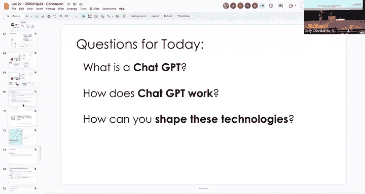
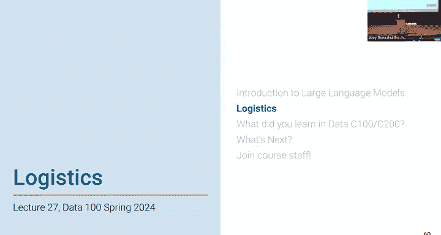
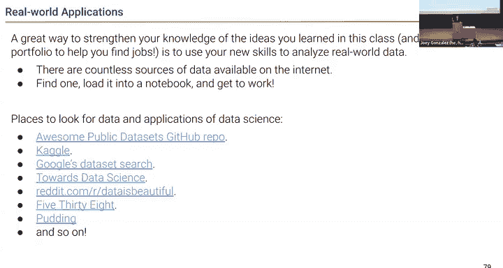
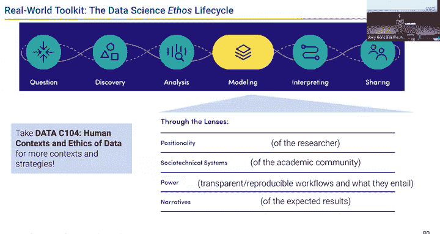

# 课程27：大语言模型入门 🧠


在本节课中，我们将学习大语言模型（LLMs）的基本概念和工作原理。我们将探讨ChatGPT是什么、它是如何工作的，以及如何利用这些技术。课程内容不涉及考试，但对于理解当今重要的AI技术非常有帮助。

---

## 什么是ChatGPT？ 🤔

ChatGPT是一个基于大语言模型的对话式AI系统。它的名字可以拆解为几个部分：
*   **Chat**：表示它是一个专注于文本（近期也支持图像）的自然语言对话系统。
*   **GPT**：代表“生成式预训练变换器”（Generative Pretrained Transformer）。
    *   **生成式**：旨在生成文本。
    *   **预训练**：模型在大量自然产生的数据上进行训练。
    *   **变换器**：一种神经网络架构的名称。

接下来，我们将逐一解释这些概念。

---

## 什么是大语言模型？ 📚

大语言模型的核心是一个看似简单但功能强大的任务：**语言建模**。具体来说，就是根据已有的文本（上下文）来**预测下一个词（或标记）**。

**例如**：
*   给定上下文 “The best class at UC Berkeley is”，模型需要预测下一个词，例如 “data 100”。
*   给定上下文 “The capital of California is”，模型需要预测下一个词，例如 “Sacramento”。

这种预测下一个词的能力，实际上体现了模型对世界的知识。为了完成这个任务，模型需要理解语言结构、常识，并能根据前文进行连贯的生成。

### 从词到标记

语言模型实际操作的单位不是“单词”，而是**标记**。标记可以代表完整的单词、词的一部分、特殊字符甚至单个字母。使用标记的好处是能处理新词、拼写错误，并能用多个标记的组合来表达任意数字或字符串。

---

## 语言模型如何工作？ ⚙️

上一节我们介绍了语言建模的核心任务是预测下一个标记。本节中我们来看看这个预测过程是如何具体实现的。

### 基本建模过程

我们将预测任务形式化：
*   **上下文**：已有的文本序列，例如 “The best class at UC Berkeley is”。这相当于特征 `X`。
*   **预测目标**：下一个标记，例如 “data 100”。这相当于目标 `y`。

模型的目标是构建一个**概率分布** `P(下一个标记 | 上下文)`，覆盖所有可能的标记（通常有数万个）。这类似于我们将逻辑回归从二分类（如垃圾邮件/非垃圾邮件）扩展到数万类的分类任务。

### 自回归生成

那么，如何从预测单个标记扩展到生成整篇文章或答案呢？答案是：**一次一个标记**。

这个过程称为**自回归生成**或**解码**。步骤如下：
1.  给定初始上下文，计算下一个标记的概率分布。
2.  **选择**下一个标记。有两种主要方式：
    *   **贪婪解码**：选择概率最高的标记（温度=0）。
    *   **采样**：根据概率分布随机采样一个标记。引入“温度”参数可以控制采样的随机性，温度越高，输出越多样（可能越不连贯）；温度越低，输出越确定。
3.  将选中的标记**添加**到上下文的末尾。
4.  **重复**步骤1-3，直到模型生成一个特殊的“停止”标记，或者达到预设长度。

**重要提示**：这个过程是顺序的，无法并行。因为要生成第100个词，必须先确定前99个词是什么。这就是为什么与AI对话时，你会看到它逐字输出，这反映了背后巨大的计算量。

---

## 模型如何做出预测？ 🧮

上一节我们描述了自回归生成的流程。本节中我们深入模型内部，看看它是如何计算 `P(下一个标记 | 上下文)` 的。我们将使用**矩阵**和**向量**来描述，这是本课程中学过的基本工具。

### 基础构建块

想象一个函数，它接收上下文标记的向量表示，并输出下一个标记的概率。我们可以用以下组件构建它：

1.  **嵌入矩阵**：一个巨大的矩阵，每一行对应词汇表中的一个标记的向量表示（例如3000维）。当看到标记“once”，我们就查找其对应的行向量。
2.  **变换矩阵**：一个可学习的矩阵（例如200×3000）。我们将上下文每个标记的向量与这个矩阵相乘，得到一组新的向量。
3.  **聚合与映射**：对这些新向量进行平均（或其他操作），得到一个汇总向量。然后将这个汇总向量与嵌入矩阵中的所有标记向量进行点积，为每个标记产生一个“得分”。
4.  **Softmax函数**：使用 **Softmax** 函数将这些得分转换为概率分布。Softmax是Sigmoid函数在多分类上的推广，公式如下：

    ```
    P(标记_i) = exp(得分_i) / sum(exp(得分_j) for j in 所有标记)
    ```

至此，我们就得到了下一个标记的概率分布。选择概率最高的标记，任务就完成了。

### 训练模型

我们如何获得嵌入矩阵和变换矩阵中的数值呢？使用**随机梯度下降**。
*   **损失函数**：使用**负对数似然**。对于训练文本中的每个位置，我们让模型基于前面的标记预测当前标记，并惩罚预测错误的概率。
*   **数据**：使用海量文本数据（数万亿标记）。互联网上的每一个句子、段落、文档都提供了大量的训练样本。
*   **优化**：在数千个昂贵GPU上运行数周，通过反向传播和优化算法（如Adam）更新数十亿甚至数万亿的参数。

---

## 从基础模型到变换器 🏗️

上一节描述的基础模型存在几个问题，本节我们来看看如何解决它们，并引出强大的**变换器**架构。

基础模型的三个主要问题是：
1.  **忽略词序**：简单的平均操作使得“This class is awesome”和“This class is not awesome”可能产生相似的表示，但含义相反。
2.  **平等对待所有词**：在上下文“Tell a story about a fairy princess named Alice”中，词“Alice”远比“short”重要，但基础模型给所有词相同的权重。
3.  **需要更大容量**：为了编码更多知识，我们需要更强大的模型。

### 解决方案：注意力机制

变换器架构的核心创新是**注意力机制**。它允许模型在生成下一个词时，**有选择地、以不同权重关注上下文中的不同部分**。

其核心思想是：
*   不再简单平均所有上下文词的向量。
*   而是计算一个**加权平均**，权重（称为注意力权重 `α`）由模型动态学习。
*   权重通过“查询”、“键”、“值”矩阵计算得出。简单来说，“查询”代表当前想要生成的内容，“键”代表上下文中每个词的信息，通过比较查询和键的相似度来决定注意力权重 `α`。

**公式示意**：
```
注意力输出 = sum(α_i * 值向量_i) for i in 所有上下文词
```
其中 `α_i` 由查询向量与第 `i` 个键向量的点积经过Softmax得到。

这使得模型可以聚焦于最相关的信息，例如在预测“Alice”时，更关注上下文中的“fairy princess named”。

### 构建大型模型：堆叠

一个注意力层是一个构建块。我们可以将多个这样的块**堆叠**起来，形成深度网络。例如，GPT-3有96层。每一层的输出都作为下一层的输入，让模型能够学习越来越抽象和复杂的特征表示。

---




## 让模型“行为得体”：指令微调与RLHF 🎭



上一节我们介绍了变换器如何通过预训练学习预测下一个词。但一个仅会续写的模型可能并不实用。本节我们来看看如何让模型遵循指令、提供有帮助且安全的回答。


预训练模型可能产生不符合期望的行为。例如，对于指令“写一个计算圆周率的程序”，它可能续写“你应该避免使用for循环…”，而不是实际写出程序。

### 指令微调

为了解决这个问题，我们进行**指令微调**：
*   **方法**：使用人类编写的“指令-回答”对数据集进行额外的训练。
*   **过程**：保持模型架构不变，但调整损失函数，让模型学习在给定指令后生成合适的回答，而不是续写指令本身。
*   **效果**：这给模型披上了一层“礼貌、有帮助”的外衣，使其行为更符合人类期望。

### 基于人类反馈的强化学习

为了进一步细化模型行为，可以使用**基于人类反馈的强化学习**：
1.  收集人类对模型不同回答的偏好数据（哪个回答更好）。
2.  训练一个**奖励模型**（通常是一个小型分类器）来预测人类会喜欢哪个回答。
3.  使用这个奖励模型作为目标，通过强化学习算法（如PPO）微调原始语言模型。模型生成大量回答，由奖励模型打分，模型学习生成能获得高分的回答。
4.  可以多次迭代此过程，让模型行为不断优化。

通过这两种技术，我们才能得到像ChatGPT这样既知识渊博又“行为得体”的AI助手。

---

## 实践：如何使用大语言模型？ 💻

理论介绍完毕，本节我们来看看如何在实际中调用和使用大语言模型。

主要有两种途径：
1.  **商用API**：如OpenAI的ChatGPT API、Anthropic的Claude API等。它们开箱即用，性能强大，但按使用量收费。
2.  **开源模型**：如Meta的Llama系列、UC Berkeley的Vicuna等。可以下载并在本地或自有服务器上运行，更可控，但需要计算资源，且小规模模型的性能通常不及顶级商用模型。

### 演示要点

在Python环境中，你可以使用`openai`库或`langchain`等框架轻松调用API。关键步骤包括：
*   设置API密钥。
*   选择模型（如`gpt-3.5-turbo`）。
*   构建提示（Prompt）并发送请求。
*   处理返回结果。

**提示工程**很重要：你提问的方式会极大影响回答的质量。例如，要求“提供简短答案”或设置`temperature=0`（降低随机性）可以得到更可控的输出。

大语言模型可以成为强大的数据分析工具。例如，你可以让它批量阅读大量文本（如推文），并提取特定信息（如“这条推文是否在谈论最低工资？”），从而完成复杂的文本分析任务。

---

## 课程总结与未来方向 🚀

本节课中，我们一起探索了大语言模型的奇妙世界。



我们首先了解了ChatGPT和大语言模型的基本定义。然后，深入探讨了其核心工作原理：**语言建模**，即预测下一个标记。我们看到了这是如何通过**自回归生成**一步步创造出连贯文本的。



在模型内部，我们揭示了其基于**矩阵运算**和**Softmax**函数的基础预测机制，以及如何通过**海量数据**和**随机梯度下降**进行训练。接着，我们介绍了革命性的**变换器架构**及其核心——**注意力机制**，它让模型能够智能地关注上下文的相关部分。最后，我们了解了**指令微调**和**RLHF**如何塑造模型的行为，使其变得有用、可靠，并初步尝试了如何在实际中调用这些模型。

希望这节课为你打开了通往现代AI技术的大门。这是一个充满机遇的领域，鼓励你继续探索、学习，并思考如何负责任地运用这些强大的工具。


---
**总结**：本节课我们一起学习了大型语言模型的基本原理，包括其定义、核心的预测任务（语言建模）、自回归生成过程、基于矩阵和注意力的内部工作机制、训练方法以及如何通过微调优化模型行为。理解这些概念是理解和参与当前AI革命的重要一步。