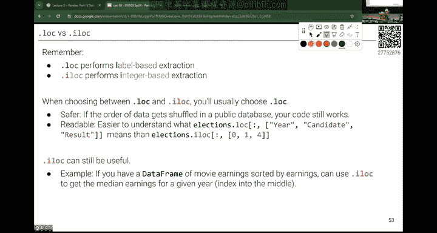

# UCB《数据100数据科学原理与技术｜Data 100 Principles and Techniques of Data Science 24SP》中英 - P2：-02-Data 100 Spring 2024 Lecture 2.zh_en - GPT中英字幕课程资源 - BV1Bc2dYCEbc

Yeah。Alright。Good morning folkss， welcome back to another day of Data 100 lecture。

So let's start talking about the first piece of the content that you're going to learn in datata 100 so this is the panndas one lecture。

 the first again content lecture that you're going to see I'm going to talk a little bit about situating this lecture and then what's going to come your way in the next couple of lectures and in the next couple of weeks actually so today and in the next couple of other next lectures we're going to actually immerse you in everything and everything about Padas so we're going to start with today covering some basics about Padas programming library in the next lecture on Tuesday we're going to talk a little bit more about advanced topics and concepts in pandas and and then in the third lecture next week on Thursday we're going to talk a little bit more about advanced pandas topics why do we need pandas because as you saw in in the demo that we had in the。

This lecture in the data science lifecycle， we really need to understand how this data is stored and then how we can manipulate the data and how we can understand the data and do exploratory data analysis using industry standard tools that we have at hand。

I'm going to also mention that obviously with the new programming kind of paradigm that you're learning in the next couple of lectures。

 you're expecting that there is a whole lot of code coming your way it might sound overwhelming at first。

 but the way to think about how to learn all of the topics that we're covering ins kind of concept generally is that think about the lecture to give you kind of a guidance and big picture idea of this programming library and then in the labs and homeworks is the time that you're going to gain more hands-on experience with how to use all of the concepts that we mentioned and then be able to practice and experiment and debug your code and learn a lot more detail about this programming library that we're introducing in data 100。

Also I want to mention that we're not expecting you to be able to master all of the things that we're mentioning in the lecture right off the bat or memorize anything or all of the details that we're mentioning in the midterm and in the final exam are going to give you a reference sheet that that reference sheet has the details of the functionalities that are available in this programming library but the skills that you're going to learn in data 100 is to to understand what you need what kind of operation you need and be able to read the documentation the API documentation for pandas in order to learn more details and just be able to do whatever it is that you're interested in doing if you're standing in the back there are some seats available here and also in the center here feel free to grab a seat。

So what is it exactly that we're going to talk about today there are three main things that I want to talk about today the first thing is I want to talk about what do we mean by data so we talked about data a lot in the previous lecture and I also kept saying that there is data and then we're processing the data but what do we actually mean by that and how the data how is the data represented we're going to also talk about the data structures that are available to us through panda's library specifically we're going to talk about data data frame series and indices and then we're also going to start processing the data taking a look at how we can filter what we're given in one data set and how we can basically pick the data apart filter it process it using different extraction methods these are some of the basic topics that we need to cover for pandas and then we're going to go more in depth about other functionalities of pandas。

The next two lectures as well。So what do I mean by data or by tableular data I want to iterate over this data science lifecycl that we started seeing in the first lecture we said that this data science lifecycle is the cyclical process that has two entry points。

 the two entry points are were starting a research at the point that either we have a question or we were formulating a problem that we were trying to answer or we are given a data set so this is the second entry point that we have so we are given a data set and we're going to start this kind of data science lifecycl obviously going around this entire data science lifecycle and then be able to process the data the way that we did it in the demo in the previous lecture we basically looked at the frequency of the names we looked at the frequency of different majors we compared how many undergrads we had in the course versus how many gra students we have in the course if you looked at the rest of the demo that we actually didn't cover in the lecture。

But it was in the notebook we also compared it with the historical trend on campus and then kind of compared in contrast the major trends and also undergrad versus grad trend at UC Berkeley campus and also in data 100 so those were the pieces that as we were exploring the data we were performing exploratory data analysis or EDA we had new questions we we went back we gathered additional data we processed the data we came back。

 we understood the data we didn't do any kind of modeling in the demo that you saw in the previous lecture。

 but then the next step after you understand the data is obviously that you can perform different kinds of modeling。

 prediction and inference tasks that you're going to learn in data 100 in the second half。

So kind of motivating what is going to come your way this week next week and in a couple of weeks after is that we're going to learn more about this programming paradigm or this API of pandas we're going to be able to learn that okay you have a data。

 how is your data structured， how do you process the data and store it in a data structure that you can actually do exploratory data analysis and modeling on so this is the part that we're going to focus on in this week and next week and then afterwards we're going to spend quite a bit of time I would say around two weeks on what are the techniques or what are different avenues of exploring the data we're going to talk about visualization。

 we're going to talk about how to do text processing and such and things are going to be very interesting there in order to understand how do we transform the data in a way that it's ready for modeling because this is the part that we also mentioned？

In the previous lecture that more than 60% of the time of a data scientist is going to be around obtaining the data。

 processing the data， exploring the data and make sure that the data is ready for the modeling。

 the actual active modeling is not going to be a major part of the time that the data scientist is going to spend on any kind of data analysis test。

 but it's more like going around the cycle is spending more time to make sure that this entire pipeline is as solid as possible。

So by kept saying data you're going to be given the data or you're going to collect the data。

 but I haven't actually talked about what this data is other than this abstract idea of me throwing a box of data at you so what data actually is generally in a data science kind of word is that mostly the data that we're going to be concerned with is going to be in tableular format。

 what do I mean by tableular format， anything that is in a table like kind of structure you're going to see in the ETA lectures that there are other different types of data formats that we might deal with。

 but majority of the time in data 100 we're going to work with the tableular data when we're working with a tableular data generally there is a convention that we're going to refer to rows as each individual observation because we're going to go out there collect the data sample the data from a population。

You're receiving a data from some stakeholder there is a convention that each one of the rows in this table is going to be one observation or a single sample that you extracted this sample table that I showed you that I presented here is going to be a data so that we're going to work on today and also in the next couple of lectures this is the data from all of the U elections and all candidates who ran for the presidency of the US and their party affiliation and the result of the result that they got in the election that they ran so for example。

 the row that I highlighted here basically shows that there was a candidate John Adams in 1824 and then you can see the party affiliation of the candidate。

 the popular vote that they got the result whether they won the election or they lost and then the percentage of the vote they received so notice that I was going over all of these columns。

Second dimension that we have General， there is also an assumption and the convention that the columns are going to be attributes that are collected in your data so you have rows as being samples and observations and you have columns being different attributes in the data。

 So for example， this highlighted column shows the party affiliation of all of the rows and all of the candidates and all of the samples that we had in the data。

 So this is the convention that we're going to。😊，Run on in the data 100 and every data that we're going to give you。

 you will need to process it under the same assumption that we said。

This data structure sounds familiar to you for those who are coming from data A。

 this is essentially the tables that you had in the data science library。

 but what we didn't tell you in data A is that therere very great number of functionalities that are available using this tables library that you could process the data you could understand the data but there are a whole lot of other functionalities that you didn't have in the data science library and using tables。

 what you're going to see in data 100 is mostly translation of what you've seen in data aid into the industry and Standard library which is pandas。

 what we are also including I'll show you in one of the next slides that in terms of the translation of data aid language to the PAdas there's a notebook that we also posted on the website that has the translation of all these syntaxs that you've seen to what you're going to learn in data 100 using pandas。

So for those who are curious about what PAs stands for。

 pandas stands for panel data because it comes from this idea comes from economics and every panels of data that they had to process and that's why they called this API pandas library you might have seen that we're using the panda bear as a logo for data 100。

 we call this panda bear PD this is because we just like this cute animals in data 100 you'll keep seeing different pets that the staff have in the homeworks and also in the labs but generally speaking the whole idea of data 100 and the underlying tool that you need throughout this course is basically based on pandas we'll spend enough time on making sure that you have enough programming expertise going into the rest of the rest of the semester。

 going into the modeling because this is the。Programming kind of tool that you need to succeed in data 100。

So what can we do using pandas we can do a lot of different things We basically use the data structures that are available in pandas I said data data frame series and index in order to arrange the data in a tableular format once we arrange the data in a tableular format then we can extract information from the data so you will see that there are different functionalities that we can say for example。

 give me some stats or provide some kind of a summary of information in a specific columns or a specific set of columns we're able to apply some numerical functions using NI so we should be able to apply vectorized operation calculating something on a subset of data points that you have in a data frame or in this tableular format data that you have so you will see a lot of examples like that we can for example calculate the average of percentage of popular route that the candidates got and things like that in。

I keep saying vectorized computation， this is because in data 100 you will see in the first few labs and homework we'll keep telling you that if we are asking you to apply something on a data frame or in a data set that we're giving you。

 you should not iterate over all of those entries There is no looping that we do in data 100 All of the operations that we're going to do is going to be applied all at once in a vectorized way to all of the data points that we have in our data structures。

So again， I mentioned this few times that one last time that think about the first few weeks as kind of a boot camp of getting into getting comfortable witha so that later on you can use those skills going into the modeling pieces I said that there is the translation syntax here is where you can find the translation syntax if you go to our website go to the lecture too you will see the code you will see the slide you will see the code that we use for the demo today and then you will also see this translation document or else a notebook and also the HTML version of that so that you can kind of see that。

There is not much new things that we're introducing。

 but we're just introducing a little bit more functionality。

 but mostly translation of data data to Panda's library。So with that out of the way。

 let's now talk about data structures that Padas is offering and then how can we store data and load data and create these data structures ourselves I said that the main data structure that pandas has is data frame because data frame is this table like data structure that we have so this right here is an example of a data frame object so think about data frame as a 2D object that has rows that has columns one thing that I want you to notice that all of the rows do have label here we are referring to these labels as index these are row indices all of the columns are also indexed so you see all of these values here that are highlighted I don't know why my pen is not working。

That are highlighted also in bold these are also labels for the columns that we have Everything is labeled Why do we need to have these labels and these indices This is because we need to make sure that when we are referring to a column when we are referring to a row or a collection of rows and columns there is a way that we can kind of label them and get access to them using these labels what you what I want you to think about as the data frame is that under the hood data frame is a collection of series objects so each series object is a column in the data frame so for example。

 think about here that there is one column candidate and this column candidate is a series object labeled with the name candidate which has all of the entries or all of the values in that column so the building block of any data structure in pandas is series a collection of series objects together is going to give us。

To this structure that we're calling it a data frame。

If I go ahead and print the value of one series object， for example here。

 this candidate column I'm going to be able to get this output what is that output there are two columns or two pieces of information there the first piece of information or the first column that's there is those labels that are associated with each one of the entries in each one of the rows remember here that we had Andrew Jackson at row with the label zero which is what we're observing here so those labels are going to be preserved the label the label column is in this case is called index so those labels are going to be preserved because there is some kind of sense of ordering in the values that the series object is has stored so it can see that all of these values are stored here it says that the name of this series object is candidate it has 182 samples or 182 labels what we are all。

seeinging is that the labels of these entries do start from 0 all the way to 181。

 which is the zero indexing convention of Python that you're expecting。

 Each series object also has a data type here， it says that the data type is object because the values are a string values。

 So that's why the data type is objects。 So depending on the value that we're storing in these series objects Each one of them do have a name do have a length。

 They have the combat values。 Each value is indexed using those labels。

 and then there is type associated with all of the values in one series object。

I also want to remind you that if there are questions。

 you can scan this QR code or you can go to slidedo。cominter。code and then ask questions。

 then I'll get the questions here and your wonderful Ts are also responding to questionstion live。

Okay。😊，So now let's talk about this building block， this series object。

 How can we create a series object， A series object， as I said before， is going to have two parts。

 What are those two parts， that the the first part is。嗯。The first part is， why isn't it not working。

Sorry， let me fix this。Okay never mind the first part is this index or the labels that are associated with each one of with each one of the entries that we have and we also have the actual values right here so values are labeled with with those labels in the index object so I can directly go ahead after creating each one series object I can go ahead and get access to the values that I have stored in the series object and I can also go ahead and get access to the index part of the series object so how do I create the series object so first of all and more importantly is that we need to import pandas so here I said pandas import pandas as PD and PD is the alias that we're using as convention for pandas so that we don't keep typing pandas pandas all over in our code and what we're doing is we're using PD and then we're calling the constructor series。

😊，And we pass the values in an array like object or any array like object in this case we're passing a list so we pass all of those values and then those values are going to be stored in a series object notice here that I didn't give any direct labels for the values that I had so Python is going to go ahead and automatically assigned labels。

 these numerical labels is starting from zero all the way to however many values or however many entries that I have in the series object sequentially when I call St values I'm expecting that it's going to return to me an array with the values that are stored in the in the series object when I call St index here it tells me that it is it has automatically index all of the values using a range index object starting from zero all the way to tree not inclusive of three again。

Of pandas combination of Python with this step of one。

 so this is automatic index and using the range index object。

So I said that we didn't provide custom indexing as if we can provide custom indexing and we can so in this constructor you can pass values using a list。

 you can also pass a second argument that the second argument index and then you pass the labels that or the index values that you want to be associated with each one of those values so here I'm saying that my index values are A B and C。

 so this is the index that you have A B and C and then the actual values are going to be the values in the same order that are provided in the first argument negative 110 and then also two and you see notice here that the data type here is it says in 64 because all of those values are integer so by default it will infer that and it will set the data type to be integer 64。

So if we go ahead and obtain the index， it's going to give us an index object。

 it tells us what those index values are， we can also go ahead and change the index object or the index value of a series object say for example you change your mind and now you want to refer to your values in a different way you can just go ahead and reassign the index and then provide a list of values that now you want to that now you want to use as labels here so here we're saying that S that index is equal to this new list of which is first。

 second and third and now you can see that first second and third is going to be the new labels that we're using and obviously as that index right now is going to be is going to give me a new index object with the new values that we have。

So let's go into the code and investigate this a little bit more just to see it one more time so here in the code I'm going to I've basically imported pandas as PDD simple and then here I'm going to go ahead and create one index one one series object without an index so what I can go ahead and do it I can say that PD got series。

And then I'll pass the values that I want to store in my series object so I can just choose any type that I want right so I can say one。

2， three， I can say first second and third， I can say ABC， so I'll go ahead and go with A B。

And see and then we'll see what the output is going to look like remember how it's printed right here how when we're printing a serious object how it looks like it has those two columns the first column is index a second column is our values and then it tells us the type of the values that are restored here you're going to see a slightly different format when you're printing a data frame that we're going to see next if I go ahead and print the values it tells me that the values are ABC if I go ahead and print the index it says that it has automatically index all of the values with the range with the range index object is starting from zero all the way to tree and not inclusive of tree with the step of one。

What if I go ahead and I decide on assigning values to to my to values to the index object instead of automatically using range index。

 so I'll go ahead and say PDd do series。And I'll pass a bunch of values here， I would say。

 for example， same， let's use the same values， A， B and C。

And then I'll go ahead and say that now use the index to this new index that I want。

 So what if I go ahead and say that my new index is going to be 1000。And 1000。

And then run it you'll see that like I can just choose any kind of labeling that I want the first column again index object。

 the second column values in the series， the entire thing is a series object if I go ahead and again print values you'll see those values if I go ahead and print index you will see the index。

I can again I mentioned this I can go ahead and say that I want to change the index so for example。

 1000 and000 might I might have decided it my mistake。

 so I will go ahead and say that S that index is equal to I'll go ahead and say for example， one，2。

3 and then I'll go ahead and。Take a look at the result。Okay。😊，What we want to do。 Okay， let's go by。

 let's see。 there is a question here。Oh， it says that it's hard to see the code。 Okay。

 I'll try to keep this zoomed in。 Sorry about that。Okay moving on once we created a series object。

 what do we want to do with it， we want to do selection how do we do selection we can do selection based on these labels that we have or based on a filtering condition that we can define so think about all of these labels that we have as kind of a pointers different pointers named pointers to these values that we have if I create for example。

 a series object here with the values being four four negative to6 four negative to0 and6 with the index index values being a and ABC and D I can go ahead and use one single label in order to retrieve one single value so think about like just you're interested in getting one of those values in one of those rows so in that case I can just use a square bracket accessor here and I can just say that S square bracket passing a label that youve。

😊，In this case， a is going to be looked up and the value or the corresponding value is going to be returned。

 so in this case the output is going to be4 so you just use one label。

 the output is going to directly be returned， the type of the return value here is going to be whatever the type of of the data of the series object was so in this case it's going to be an integer value that's going to be returned。

What if you want multiple values so you have multiple rows that you want to extract you don't want to extract them individually one at a time in that case what we can do is we can use a list of labels so how do we do that we can use the same accessor but instead instead of passing only one value we will pass a list of all of these labels or all of these index values that should be used to retrieve the values for us so in this case I have A and C in a list so it will go ahead and retrieve the row for corresponding to corresponding to label A and the row corresponding to label C and how would it return the result so I want to start。

Kind of situating the way that you think about all of these operations as like think about what should be the output return type so I have two labels I'm returning two values but when you're returning those two values they should come with corresponding labels so that you know which row is which right so in this case in order to make sure that you still have those labels the return type is still is going to be a series object so now contrasted with the case that there was only one label one label has no confusion so you just return that value if you are using multiple labels in a list and you want to return all of those values all of those values should come with the accompanying index index associated with them so the return type makes sense to be a serious object。

So now moving on a filtering condition， this is what you're going to use very frequently in this course what do I mean by a filtering condition let's say that you want to select some rows。

 but you don't necessarily know which rows you want to select in terms of you don't know the labels that you want to extract say。

 for example you have a condition that you want to extract rows with the values that are even or odd or the rows that their values are greater than or equal to zero right so in those cases。

If you don't have a way of using a filtering condition to just apply it to the entire series object and return and get the returned result。

 then you have to first identify the rows that do qualify and then be able to find the labels and then use those labels in a list to be able to get all of those filtered values but with the filtering condition what we can do is we can apply a two step operation the first step operation is just to apply the Boolean expression that you have or the condition that you want to imposed so that you know which row is qualified to be filtered or be returned and which row is not qualified to be returned so what we do is we will basically apply this Boolean expression and the result is going to be a new series object。

A new series object with all of the values being boolean values。 What do we do next。

 we will use those boolean values to index into the original series object in order to retrieve the row that do qualify That was too much word Let's say an example what do I mean by a boolean expression。

 So here I have。One series object named S I have a Boolean expression here S greater than zero。

 so the result is going to be a vectorized operation that you're applying to all of the rows all at once the result is going to be the result of this operation on each one of these rows so here we know that for example。

 the first row， the result should be true because the value was four for the second row。

 the S greater than0 is false because the value was negative to and so on and so forth and notice that the type here is Boolean and what we are applying here。

 we're applying a boolean expression in a vectorized way and we're getting a series object of type Boolean。

Why is it going to be useful， it's useful because if we pass this Boolean type series to the original series。

 the way that it's going to operate is that it's going to just row by row take a look at the Boolean Boolean type series in the rows that the corresponding values true。

 those rows are going to be preserved and they're going to be put in the output。

 the rows with the value of false are not going to be put in the output so in this case you're seeing that this is this has a value true and this last one has a value true So only those two rows are going to be retrieved and in the output for us okay and the return type is still is going to be the same return type。

Why is the output type here a serious object and not something else？

Same rationale you might retrieve multiple rows each row needs to have a label or an index。

 so because of that the output type is going to be a serious object with those index values with the values themselves and then youll get the result or the filtered version of your series object in the output。

So let's do a quick exercise here so I want to so here I created the series object to see what the series object is a bunch of different values for negative 31 and6 labels are ABC and D we basically take took a look at what happens when we're extracting only one label so only one label if we say I want D the alpha is going to be6 so the corresponding value is going to be returned if we want multiple of them then I pass it as a list so I pass C and D as a list and then be able I'll be able to extract all of those rows that that I actually mention that I want one thing else that I want to show you here so you can always be creative and just try out the stuff on your own because you have a copy of all of the code that I'm testing today what happens if I。

I just use one label， but instead of passing that label to this selector operator。

 I pass it as a list， so say for example， I go ahead and sayS selecting only one row with the label D。

 but I'm passing it as a list， What do you think is going to happen？Yes。

So the answer was it will output a series object。 So Python is just going to compile this right or run this。

 It will see that you have passed the list。 It doesn't matter how many elements you're passing in the list。

 It just assumes that you want the output to be labeled and you might have more than one entry。

 So it's going to give you that single entry that you have in a series like format。 Okay。

 so try these stuff， and then you will get used to like predicting what's going to be the output of whatever operation that you're applying。

Now I want to try a little bit of a more complex version of doing a filtering condition。

 So in this case， remember what our data frame was。

 our data frame was four negative sorry series was four negative tree one and6 and what I want to do is I want to extract all the rows with even values so I want to extract only this row with the value of four and only also this row with the value of6 So how do I do that first we said that we need to create this Boolean type series object So we have a corresponding true false values for all of the rows the first and last rows we're expecting it to be true the middle rows we expect the values to be false and then we pass it as an indexer to the original series object and then it will automatically only filter or only provide us the rows with the value of true。

😊，So let's explore that。So I'm defining a new series object。

 you can also do both of the steps together in Vogo。

 but just to make sure that it's a little bit more clear。

 I'm going to create this new Boolean series object and I'll say that the operation that I want is that the remainder of each value by two has to be equal to zero。

Okay， and the result I'm storing it into an object。

 even which I'm expecting the output should be a serious object。

 so see now I have my serious object here。The next step is just passing the series object as an indexing or as a filtering kind of condition to my series to my original series object。

 so I'll say apply the even condition。Or this Boolean series type that I have to all of the entries that you have in the series object S and let's take a look at the result so now I have this filterford version。

It seems like you use both the series and the list。

 so does the list get converted to a series first when you pass it later that。So the question is。

 I am using。So first of all， the values that we're storing in a series object is like like the data type think about this as an array like data type so under the hood it can be considered as a list right what I'm passing here or what this selection operator is is just that we're using it in order to identify which labels or what is the condition that we want to apply in order to filter the values in the original array or in the original series object right so what I'm using here is that this even is going to give me a series object that the series object is passed and is used to filter the other series object that I have。

😊，I hope I answered your question。Great， other questions。Yes。😊，Okay， so the question is。

They tried to put this condition directly into a square bracket and it didn't work。

 so let's give it a try。So any Boolean expression that you have。

 it has the highest priority in terms of like the order of operation is going to be run and then the rest is going to be executed。

All right， cool， moving on， we have a fun exercise here for you。So you can。Answer it here。

 or if you want to see the code a little bit more closely， the code is actually this code right here。

Yes。B it cure code。Yes。Where is stya。Tya， where are you。Yeah， no。Oh you're di。

 we have to hide these results it's going to be more fun。さ。All right， cool。

 so is there any volunteer who wants to explain to the class how we arrived at that 95% magic。

 correct answer。😊，Yes， go ahead。对表。对。It takes the bound again sort of be in them so the with a rail of。

Exactly， so the response was that here we're creating a series object with the values4。

 five and6 the labels are one，2 and three what we are doing is we're applying a filtering condition that selects only the rows with the values greater than four the result is actually going to be a serious object which has the last two rows right the last two entries but since we are also testing one more thing on top of that and we're just calling dot values then you know that the values are going to be returned as a list or as an array and then the values are five and6 so Harvey feeling so far good。

😊，Sideways up sideways down up good hopefully i'm not going too fast and feel free to ask questions on a slido and then shya is going to highlight those questions for me we won't be able to take questions on zoom so please ask questions on the slide up。

So what did I talk about I said originally before getting into the details of series that think about series as the building block and think about the main thing that we're going to work with as a data frame that is a collection of series object what do I mean by that a data frame think about this a data frame as a bunch of different series objects that do share the same index object right so for example here I have one series object that is labeled as a year so let me highlight it here。

😊，Okay， this one doesn't like me today with with the label of year and then with the index values being starting from zero all the way to 181 then I if I have another series with the same length sharing the same index and with the name candidate I combine it with the previous one and I keep combining these series objects together then obviously they'll have a 2D structure with one index。

 a bunch of different columns， each one of those columns are labeled with the name of that series object that we have and this way we're getting this data frame or this table or format that will work with throughout data data 100 and this is kind of the core part of how to process the data into the right format so that it's ready for for visualization for modeling and for any other task that will do later in data 100 so exciting stuff we've seen how we can create series object it's going to be a little bit more complicated。

😊，ated with a data frame you don't need to remember all of the details of creating how we create a data frame most of the time we will create a data frame from a data set that we're giving you so there is a CSF file that will you will just load that CSV file and you'll work with with the data frame。

 but it's always important for you to just understand the basics as well。😊，Creating a data frame。

 you just call panndas or PD or whatever you imported the pandas library do data frame。

 you pass the data first， What are you storing in all of the ruless and all of the columns we're going to talk about in what format and in what kind of objects we can pass so that it understands that this is the core part of your data and how it's situated in terms of which one of them are rows and which one of them are columns you're also passing index that first column or that first index that was highlighted in bold text and then you're also passing columns which is the labels for different columns that you have or the names that you're assigning to each one of the columns that you have there are different ways that we can create a data frame I said the easiest part is just still loaded from a CSV file we generally give you a CSV file or an Excel file and there are easy functions that we can just use in pandas is。

I'll read underscore CSV or read underscore Excel and then we should be able to give the path to the data and then it will be able to read the data notice here that this is a full path so if there is elections that CSV file that is in my data folder which is what you also have on your end and we can directly go ahead and load it and get the elections data set kind of ready to go there。

So let me go ahead and try that here。So I can say PD that read underscores CSv and kind of to show you that the data is actually there is that you can go。

啊。This is not directly what you will see but you will see something similar you will see that there is a data folder and there's elections that CSV can actually open it inspected and then see like what those values are the original data set but when I go ahead and say okay read let me move this away read underscore CSV and I pass that path as。

As a string elections do CSV then I'll be able to get this to this structure you see that the format is is slightly different than the format that you saw in series so here I have labels for rows I have labels for columns and then you're also seeing that because it's a lengthy list of rows it just uses these tree dots here to just show that there are more rows that are not being shown here only the first few rows and the last view rows are being displayed here。

What we can do is notice here that the index is automatically signed so index here is like from0 up to 181 I can go ahead and say that let's use one of these columns as the index one of the columns that are in the CSV as the index and kind of a structure this this this data frame that way so I can go ahead and say。

😊，I can go ahead and here and say PD dot read underscore CSV。I'll say data。Elects dot Cs V。

 And then here， I would say index column。Let's assign it to be what you want to use， say here。

And then let's see how it's going to look like。So how it's looking like right now is that now I have year as my index。

 so that's the bold column there and then I have one less column in my entire data frame like as columns。

 it exists as an index， but it's not one of the columns that I can use。😊。

What I can do is I can go ahead and say reset index and just put that year back to the data frame and just have that automatic indexing so you're not going to use anything and the year is going to go and situate in the same place that it was before so here we would say。

Elections that reset。Index。And then the result is。Is going to be this。

There is also another option that let me actually load this one more time so that now year is my index I can also go ahead and say elections that reset index and just say。

in place equal to true this basically means that don't create a new copy and assign that copy back to the variable that I'm assigning just apply that function to the elections and store it same in the same object because otherwise pandas is going to create a new copy of the object and then apply modification there so you see here now I have reseted the index in place through now when I look at it then I have the changes made。

If afterwards， after you set the index and you loaded the data。

 you change your mind and you want to set the index to be something other than what you have。

 you can also go ahead and say elections that set index。And then you can pass the。

Label of the column that you wanted to be indexed。 So here I would say candidate。

And then we'll take a look and see that candidate is now the index column right here。

So this is just some of the functionalities that are available to you and generally resetting setting index and just deciding about the index is something that's available to you in the data frame in the data frame kind of landscape regardless of how you're creating the data frame object so here was how we're creating data frame using a CSV file which is the easiest of all but we talked about using index column now there is another way and the other ways that I'm going to talk about theyre going to be a little bit more complicated than just simply using the CSV file and that's why using a of a list and a column name so how would it look like。

😊，The values that you want to store。 you pass those values as a list and then you provide the name and the label of the column that you want to store in right so here I have only one column in the data frame。

 So I'm passing only a one dimensional one dimensionmenal list here。

 And then I'll say that this one dimensional list is going to be one column and the label of that column is going to be numbers So which is what you're seeing in the output。

 But we know that the power of data frame is that it needs to it can have multiple different columns right so in order to have multiple different columns。

 I can just go ahead and pass a two dimensional list with the second dimension or the inner list representing each one of the rows。

 So here I have two columns， the column number and the column description。 And as you can see。

 the first row right here has。The values being one and one as a string and that's what we're passing as the first inner list inside this bigger list that we have if you keep adding columns then you just need to keep adding values to those in your list and then the lengths of each one of those inner list has to be the same as the number of columns that you have after you pass all of those values you'll just need to say what are the column labels here because the size or the lengths of each one of those inner list was two then technically you have two columns then naming them you're naming them as number and description in this case。

So this is the second way of creating a data frame。

Creating a data frame using a dictionary is the next way so think about what a dictionary is dictionary is just key value pairs right so now think about keys as being the label to the columns and then values be whatever you're restoring in each one of those columns so if you can create our dictionary that way then pandas can understand the structure and then loaded into a data frame so here is how we can do it you're saying that I have two columns fruit and the price and then we're saying that the key for the first column is fruit that's the label for the fruit column and then the values that are restored in the fruit column you're passing it as a list so however many rows that you have's that's the length of that list that you're providing then there is also a second column the second column is labeled with price and then you're passing all of the values that are going to go into that second column that is priced。

There's also a length to your version of that that I don't think that you're going to use。

 but it's just that you're going to pass a list of all of the rows。

 but when you're passing a list of all of the rows each row needs to have key value pair of like in the first column fruit。

 what was the entry in the first row and in the column price。

 what was the first entry in the first row and so on and so forth and then the result is going to be this two column structure with fruit and price。

Okay， the third rate that we did it。The elevator simpler version of this that uses a similar idea of a dictionary is using a series object or a multiple series object。

 So notice that I said that each column is a series objects。

 So what if when you have those series object， you should be able to just name them and then pass those values and then they'll be combined into a data frame So here is exactly what we're doing。

 we're saying that we have two series object S underscore A and then S S underscore B So these are series objects you're seeing that the index value for these series objects is R1 r2 R3。

 they share the same index。 What do we do we will say that okay， let's create a data frame object。😊。

And the data frame object has two columns， the first column is labeled by a underscore column and the second column is labeled by B underscore column and then you're just passing those through objects as values。

 so it's kind of a similar notion that we had in a dictionary。Okay。

 there are also easier ways of doing it if you just have one series and you just want to change the type of that one column series object into a data frame。

 so you can just call data frame past the series object it will automatically label it label the column with the label zero and then it will turn it into a data frame format or you can just call two frame on the series object and then the output is going to be a data frame。

Okay you don't need to memorize all of these details。

 I realize that this is very complicated but just know that there are different ways that you can do it if I give you a file you can load it there are different functionalities that are available to you to read CSE file JSON file Excel file that we're going to play with some of them in the labs and homeworks and also in the EDA lectures if you have a series objects somehow you have another data frame you just go ahead and grab two of the columns and you want to combine them into one new data frame you can do that because you can get those series objects combine and name them label them now you go you have a data frame if you just have those values and you want to create a data frame but just imaginary value that you're coming up with then there are there are ways that you can use it using list and dictionary but they're going to be less popular。

All right， wonderful so we talked about the index， I kept saying that series has index data frame has index and data frame is a bunch of series objects who share one index。

 but we never talked about index as a data structure this is the third data structure that Ts has index can be numeric can be nonnumeric it might have it can have a name and then we can also assign a data frame to have to use a specific column as the index。

 which is what you saw in the examples that I showed you you can just assign for example here index column to go ahead and use the candidate to be its column as opposed to just automatically labeling it with numerical values what we said is we can also have repeated values in the index the index doesn't need to be unique value with the automatic index and indexing it starts from zero and then it goes all the way。

😊，To however many entries that we have and obviously they're going to be unique。

 but when I went ahead and created the data frame and I set the year to be the index。

 as you can imagine with the presidential election。

 there are multiple candidates running for president of United States in every given in all of those election years。

 so we had repeated values here， we had repeated values and that's fine。

We said that rows do have labels and rows do have labels using the index。

 we can also modify these index values， we can set the index。

 we can also reset the index so that automatically you will move back the column to one of the index column to one of the columns that you have and then bring back range index as the automatic indexing that you will get。

😊，I also want to draw your attention that I said index values can be repeated such as year in the elections data frame。

 but the labels of the columns they have to be unique because think about what the data frame is each one of the columns we said that it's a characteristic or it's an attribute or a feature of samples in our data we don't want to have repeated samples with different values in those columns so that's why there is also a requirement that the column labels has to be unique but rule labels they do not need to be unique in our case。

So here is an example that we set the index to be party。

 we just checked the index using dot index you've seen this before in in the series object same functionality is available here we can just call dot index be able to see all of the values in an array we can also call dot columns here in the series object we only have one column and it just had a name but here we can just say dot columns and all the labels and the names of those series objects under the hood and in the data frame is going to be returned。

 so here is's going to tell me that the column indices are going to be candidate year popular but such and such that you can kind of understand what kind of attributes you have in your data and then be able to utilize them efficiently。

One thing that you're going to utilize a lot is dot shape dot shape is going to give you a two piece of information the first piece is going to be the number of rows in the data frame the second one is the number of columns because a lot of time we might want to index into our data frame using row integers or like the order of the rows and then we might want to know how many intros do we have and we might want to know how many columns do we have and this gives us a general sense of what's the size of our data set so in the elections example I have 182 rows and then six columns this is going to be very useful to you later。

😊，Okay。So putting everything together。The data structures in pandas three data structures the most important one that you're going to use a lot is a data frame data frame has index for the rows it also has index for the columns or those labels for the columns each one of the columns in a data frame by itself is a series objects so it's a bunch of different series object so the tree data structures are data frame series and index and that's kind of a takeaway about all the data structures in pandas that we want you to know。

So let's answer this question and then we'll take a two minute break we're going to come back with the next piece。

Yes， this is an example of hidden pull。So what are we doing here creating a data frame， right。

 how did we create a data frame？Using a dictionary。Right， what are our column names。One to three。

 what are our column names？C1， C2， what are the values in column C1？

1234 and then the value is in column2 we see 2468 so therefore we have a data frame after calling this constructor we have columns and we have the values in each one of those columns but when I go ahead and get dot columns so that I get the column index not the row index。

 this is going to give me both the those labels which is going to give me C1 and C2 762 votes I like it。

😊，Keep the attendance like this going forward， you're going to enjoy it and you're going to need it just to stay on top of all of the lectures that we're giving you All right wonderful so we talked a lot about all of these data structures we said that this data frame and this pandas is a very huge API what is API API is application programming interface it is an interface or a lot of functions and a lot of attributes that are available together in one package into one library that you can utilize them in order to do the functionalities that you want again compare in contrast what you're seeing in data frame here versus what you've seen with tables and data aid and we are not again expecting you to be able to memorize all of these details we're going to give most of the functions that will introduce to you in the reference sheet for meter for final example but what we want you to gain from。

This course is to be able to read documentation and Google properly and then be able to use stack Overflow different resources so that you can do the thing that you want in a very efficient way so that if you keep doing it。

 then you'll memorize it and then you'll be able to do them in your daily life hopefully you'll go out to be a data scientist in future。

So the more exciting part now with all of that out of the way is to just take a look at how can we work with the data and how can we pick the data apart take a look at what values we have in columns。

 what values we have in rows and then be able to be a little bit selective and then filter the entire data frame or series into a smaller pieces so I'm going to talk about three different ways and I don't think that I'll get to talk about all three different ways but hopefully I'll get to talk about two of them two different ways today and one way in the lecture on Tuesday about how we can select a number of rows and a number of columns using lock and IL operator and then later on using the square bracket selection operator so how we can do it is basically that there are different common ways of us understanding what's happening in our data if we have a data frame。

lot of the time and you also saw it in the demo in the previous lecture is that okay let's take a look at the first five rows let's take a look at the top 10 rows or the last five rows or the last 10 rows。

 we can simply do that by just getting the head and the tail of the data frame。

 we can also get access to to a piece of our data frame or a number of rows and a number of columns using the label remember that we said that rows have label and columns have label so we can use those labels to access to a piece of data or we can use their position。

 we would say that the third row or the force row and the first column I want to get the data at that intersection so we can use their position in order to be able to get them and these methods are really useful in order to filter the data only concentrate your focus on one area and then process that subset of your data。

So for the easiest piece every time that we give you a data you have to take a look at the data right if you just call dot head and dot tail dot head is going to give you the first few rows and dottail is going to give you the last few rows if you pass an argument N is going to give you the n first few rows or the last n few rows if you don't provide this argument the default value for n is5 so it will give you the top five or the bottom five and that simple as that assuming that this is my data set if I just call dot head it will just directly give me a data frame with the top five rows why is it helpful because you just want to take a peek at the data you might want to take a look at what values are stored there you might want to take a look at the column label is to see what features you have if you have enough data with all the attributes that you want or that you need to go ahead and collect more data so all of these things you will be able to have this sense。

😊，Once you're taking a look at the top few rows， or again you can take a look at the or take a look at the last few rows。

 why last versus first， there is no particular preference。

 but assuming that for example your data that is sorted in some way。

 say it's sorted by year and you want to see for example how updated your data is you can just take a look at the last few rows。

 take a look at for example， the year column and then see。

 whether it has the information about the election in a particular year or no。

 so that's kind of part of the reason that we might want to take a look at the end of the data as well as to the head of the data。

We said that we can also do extraction based on label， we have row labels column labels。

 how do we do that， we can just locate it using the dot lock operator so the dot lock operator is going to get two pieces of information comma separated it's going to get a set of row labels and also is's going to get a set of column labels in the second argument and then it's going to basically go ahead and filter the data frame with those row labels and those column labels at the intersection it's going to give you that subset。

So how is it being done， so say for example， this is my data frame， the rule labels。

 you already know that the row labels are all of these bold values in the left part of the data frame and the column labels are all of these bold values at the top of the data frame。

😊，In order to pass these two values， row labels and column labels。

 there are three different ways that we can pass them。

The first way is to just pass them as a list right so I have a list of different row labels column labels I want I'll just go ahead and say that okay。

 I want you to give me the row label with the label 87 with the label 25 with the label 179。

 which is what I'm passing as a list， it will give me those rows in the same order in the same and only those rows。

😊，If I want to say that I don't want to see all of the columns all I am interested in is only year candidate and the result。

 so in this case I can pass all of those columns that I'm interested as a list as well。

 so all of the row labels passed as a list and all of the column labels also passed as a list in this case and then you can see that the result here is just the intersection of all of those labels that I just provided。

If I'm a little bit lazy and I want to say that okay I don't want to enummerate over all of these columns or all of these rows。

 but give me the column from here up to here inclusive I can go ahead and use the slice syntax so the slice syntax in this example as you're seeing it's telling me that there is the popular wood as the starting point of the column that I want and then the endpoint of the column that I want it going to be percentage so start from popular wood include all of the columns in between all the way to the percentage and inclusive of the percentage this is kind of an exception in Python and also in everywhere that you also see Python that this is inclusive of the right hand side just right at somewhere highlighted make it bold red so that you remember only in the lock operation with using a slice it's inclusive of the right hand side we can use the slice for passing the rows。

Raw labels or we can use the slice to past the column labels。

 so say for example I want to say that okay for columns popular wood all the way to the percentage。

 only for， for example row from 10 to 20 inclusive of 20。

 give me this subset I can just say 10 column 20 and then popular word comma popular wood column percentage and then be able to get the result。

Okay， so。Now we've seen two wayss using list than labels using a slice and labels。

 or we can also have a single value sorry before I go to the single value。

 if you don't provide the starting point of the range or the end point of the range by default。

 the start point is going to be from the first instance from the first row or from the first column by default。

 if you don't specify the end of the range by default is going to be the last row or the last column。

 if you don't provide any of them that means that give me all of the rows or all of the columns in this case。

 I'm saying column meaning that give me all of the rows for only these columns that I'm providing。

Here as with the second argument so the result is going to be this and you know that eopes and on these three dots technically means that there are more rows but we are not showing all of them for simplicity so in this other case i'm passing a list of row labels but I'm specifying columns to be colon it means that give me all of the columns all of the columns possible for only those three rows that I specified so this is going to be interesting。

S value obviously we can go ahead and retrieve only a single value or single value or single label for a column or a single label for the row so in this example what you're seeing is i'm passing only a single label for a column and I'm also selecting some rows here it really doesn't matter but what should be the return type in this case I'm only retrieving one column right because I only gave the label for one column。

What are you expecting their return time？Series so that's what I liked so I wanted you to build this intuition about what should you expect as the output so I'm getting only the popular vote column and when I get that popular vote column I'm additionally filtering for only those row labels 87 25 and 179 so it's a series object which is the filtered version of the series object for the popular vote that I had。

😊，Obviously， if I just go ahead and give a single label for the column and a single label for the row。

 I'm just looking at one entry， so a single value is going to be returned。

 the data type is going to be the data type of whatever that value is。

 so in this case it's an object because it's a string object here。😊，Okay。

 so I want to also start kind of showing you that there is also another way of doing the selection so we have done selection using label but we can also do selection based on the position of these of these rows and these columns and what the operation looks like is that it says the operation is called IL or integer based location or integer based locating of elements so instead of saying that row with label zero and row with label5 etc cea et cea we would say that give me the fifth row and give me the fourth row and give me the first column for example so everything is going to be referred to as with their position as opposed to with their label because a lot of time the integer position is going to be more accessible to us again say for example you have a sortded list of things and you want to for example。

Say for example， you have the earning outcomes and the earning outcomes is sorted and you want to find the median of earning outcomes so you can just directly index in the middle of your data frame and then be able to get that single row so that's why integer indexing makes our life a little bit easier in some of the scenarios。

😊，So with the integer indexing indexing it starts from zero so columns integer position starts from zero and then row indexing also starts from zero and so on。

 so regardless of whatever label we have then we have these row integers so notice here that because I have automatic indexing the index for the column is the same as their integer position but's that's not the case always because we might have different kinds of index values。

 also the same for the columns again irrespective of what labels we have their integer position starts from zero and then goes all the way to however many columns that we get。

We do have the same number of ways of getting access to the elements in a data frame。

 we can pass a list of integer positions， we can pass a slice of integer positions。

 but this time it's not going to be inclusive and it's exclusive， just normal Python。

 or we can pass a single value。So let me quickly show you how they look like。

Passing a list so in this case i'm passing a list by integer positions notice this is integer position because there is I like right here there is no lock there is integer locating of elements so I'm looking at the row at at the integer position one。

 two and three so passed as a list and then columns be the first column the second column in the third column integer position0 one and two and this is the result that we'll get and then we can also confirm that these values are exactly in the same position in the data frame that we have。

😊，A slice works exactly in the same ba we just need to provide a range that we're interested in so here for example。

 if I say that okay for the row at integer position one23 give me all the columns the starting from zero all the way to three and not inclusive of three right so this is exclusive here so in this case I'll get row row at integer position one23 and then the columns at integer position01 and two。

So obviously again， if I don't provide the starting point at range or the endpoint of range or none of them。

 you know what's the deal if I don't provide any of them。

 this technically means that give me all the rows when I'm providing the starting point and the end point in this case it starts from zero and then it goes all the way to three and not inclusive of three and this is the result it we'll get but the single value it' the same deal so with a single value when I say that okay these are the integer positions for the rows but go ahead and grab the column at integer position one this means the second column right the output is going to be just the return type of whatever type of a single column is which is a serious object right a series object filtered only for those of specific rows。

Obviously， if I just go ahead and narrow down my search and my filter and just provide a single value for the row single integer value for the row in the column。

 I'll only get one single output， the data type is going to be the data type of that value。

So I'll leave you with this， we talked about what are the use cases of lock versus IL lock is going to be generally your go to place IL also is going to be useful in cases that at the integer positioning is accessible to you or the data is sorted in some way so we might want to go ahead and use IL in the next lecture we're going to see the next selection operator and then we're going to dive into more advanced topics thank you。

😊。

