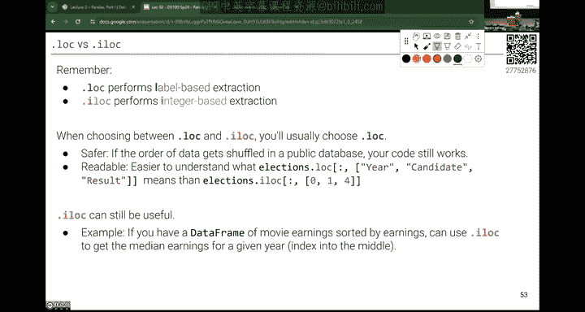

# 课程2：Pandas入门与数据操作 🐼


在本节课中，我们将学习数据科学中的核心工具——Pandas库的基础知识。我们将探讨什么是数据、Pandas的核心数据结构，并学习如何加载、查看和筛选数据。

---

## 概述：什么是数据与Pandas？

在上一讲中，我们介绍了数据科学生命周期。我们看到，数据科学家的大部分时间都花在获取、处理和探索数据上，而不是建模本身。为了高效地处理数据，我们需要强大的工具。

Pandas就是这样一个行业标准的Python库。它专门用于处理**表格数据**。表格数据通常以行和列的形式组织，其中每一行代表一个**观测样本**，每一列代表一个**属性或特征**。

例如，一个关于美国总统选举的数据集可能包含候选人、年份、党派、得票数等列。Pandas能帮助我们轻松地加载、查看、筛选和分析这类数据。

---

## Pandas核心数据结构

在深入操作之前，我们需要理解Pandas的三个核心数据结构：**Series**、**DataFrame**和**Index**。

### 1. Series：一维数据序列

Series是Pandas的构建块，可以看作是一个带标签的一维数组。每个Series由两部分组成：
*   **索引 (Index)**：数据的标签。
*   **值 (Values)**：实际的数据。

**创建Series的代码示例：**
```python
import pandas as pd

# 创建Series，不指定索引（自动生成0,1,2...）
s1 = pd.Series([1, 2, 3])
print(s1)
# 输出：
# 0    1
# 1    2
# 2    3
# dtype: int64

# 创建Series，并指定自定义索引
s2 = pd.Series([-1, 10, 2], index=['a', 'b', 'c'])
print(s2)
# 输出：
# a    -1
# b    10
# c     2
# dtype: int64
```

我们可以访问Series的索引和值：
```python
print(s2.index)   # 输出索引: Index(['a', 'b', 'c'], dtype='object')
print(s2.values)  # 输出值: array([-1, 10, 2])
```

### 2. DataFrame：二维表格

DataFrame是Pandas中最重要的数据结构，它是一个二维表格。你可以把它想象成多个**共享相同索引**的Series对象的集合。

**创建DataFrame的几种方式：**

最常见的方式是从文件（如CSV）加载：
```python
# 从CSV文件加载数据
elections_df = pd.read_csv('data/elections.csv')
print(elections_df.head()) # 查看前5行
```

也可以从字典创建：
```python
# 使用字典创建DataFrame，键是列名，值是列数据
data = {
    'fruit': ['apple', 'banana', 'orange'],
    'price': [1.2, 0.8, 1.5]
}
df = pd.DataFrame(data)
print(df)
```

或者从列表创建：
```python
# 使用二维列表创建，需指定列名
data_list = [[1, 'one'], [2, 'two'], [3, 'three']]
df2 = pd.DataFrame(data_list, columns=['number', 'description'])
print(df2)
```

### 3. Index：索引对象

索引为DataFrame的行和Series的每个值提供了标签。行索引不一定唯一（例如，不同候选人可能在同一年参选），但列索引（列名）必须是唯一的。

我们可以查看和操作索引：
```python
print(elections_df.index)    # 查看行索引
print(elections_df.columns)  # 查看列索引（列名）
print(elections_df.shape)    # 查看数据形状：(行数, 列数)

# 设置某一列为索引
elections_df.set_index('candidate', inplace=True)
# 重置索引
elections_df.reset_index(inplace=True)
```

---

## 数据选择与筛选

理解了数据结构后，我们来看看如何从DataFrame中提取我们感兴趣的部分数据。

### 查看数据概览

在开始分析前，快速查看数据头部和尾部是很好的习惯：
```python
df.head()   # 默认查看前5行
df.tail(3)  # 查看后3行
```

### 基于标签选择 (.loc)

`.loc` 操作符通过**行标签和列标签**来选择数据。

以下是使用`.loc`的几种方式：

*   **使用列表选择多个标签**：
    ```python
    # 选择行标签为0, 2, 4的行，以及列名为‘candidate’和‘year’的列
    subset = df.loc[[0, 2, 4], ['candidate', 'year']]
    ```

*   **使用切片选择范围（注意：.loc切片包含终点）**：
    ```python
    # 选择行标签从10到20（包含20），列从‘popular_vote’到‘percentage’（包含‘percentage’）
    subset = df.loc[10:20, 'popular_vote':'percentage']
    ```

*   **选择单个值**：
    ```python
    # 选择行标签为5，列名为‘candidate’的单个值
    value = df.loc[5, 'candidate']
    ```

*   **选择所有行或所有列**：
    ```python
    all_rows_specific_cols = df.loc[:, ['year', 'result']] # 所有行，特定列
    specific_rows_all_cols = df.loc[[1,3,5], :] # 特定行，所有列
    ```

**返回类型规则**：如果只选择一列（无论多少行），返回一个Series。如果选择多行多列，返回一个DataFrame。如果选择单个单元格，返回该单元格的原始值（如字符串、整数）。

### 基于位置选择 (.iloc)

`.iloc` 操作符通过**行和列的整数位置（从0开始）**来选择数据。其语法与`.loc`类似，但切片是标准的Python切片（不包含终点）。

以下是使用`.iloc`的示例：

*   **使用列表选择多个位置**：
    ```python
    # 选择第1, 2, 3行（位置），第0, 1, 2列（位置）
    subset = df.iloc[[1, 2, 3], [0, 1, 2]]
    ```

*   **使用切片选择范围**：
    ```python
    # 选择第1到第3行（位置1:4，不包含4），第0到第2列（位置0:3，不包含3）
    subset = df.iloc[1:4, 0:3]
    ```

### 基于条件筛选

我们经常需要根据数据的值来筛选行，例如“找出所有得票率超过50%的候选人”。这需要两个步骤：

1.  创建一个布尔Series（True/False序列），表示每行是否满足条件。
2.  将这个布尔Series作为索引传入，筛选出值为True的行。

**代码示例：**
```python
# 步骤1：创建布尔条件（向量化操作，无需循环）
condition = df['percentage'] > 50
print(condition.head()) # 输出一列布尔值

# 步骤2：使用布尔条件筛选DataFrame
winners = df[condition]
print(winners.head())

# 也可以将两步合并
winners = df[df['percentage'] > 50]

# 更复杂的条件可以使用 & (与), | (或), ~ (非)
democratic_winners = df[(df['party'] == 'Democratic') & (df['result'] == 'win')]
```

---

## 总结

本节课我们一起学习了Pandas库的基础知识：

1.  **数据与Pandas**：我们了解到表格数据是数据科学中的常见格式，Pandas是处理此类数据的强大工具。
2.  **核心数据结构**：我们认识了Pandas的三大支柱——**Series**（一维带标签数组）、**DataFrame**（二维表格，由Series组成）和**Index**（索引对象）。
3.  **数据操作基础**：我们学习了如何创建和加载DataFrame，以及使用`.head()`/`.tail()`查看数据。更重要的是，我们掌握了筛选数据的核心方法：
    *   使用 **`.loc`** 基于标签进行选择。
    *   使用 **`.iloc`** 基于整数位置进行选择。
    *   使用 **布尔条件** 根据数值进行筛选。



这些是进行数据探索性分析（EDA）的基础。在接下来的课程中，我们将学习更高级的Pandas操作，包括数据清洗、转换和聚合。请务必在实验和作业中练习这些操作，这是掌握Pandas的关键。记住，本课程的目标不是记忆所有函数，而是培养你通过查阅文档来解决实际问题的能力。