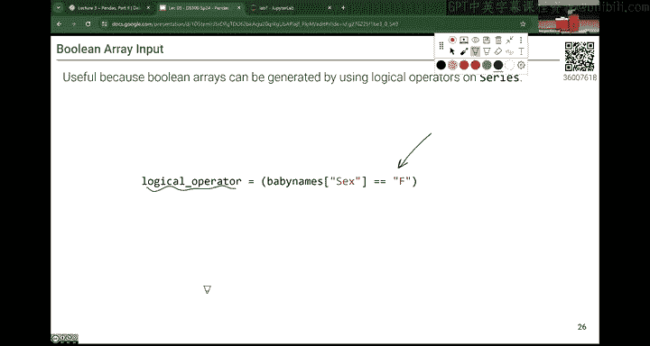
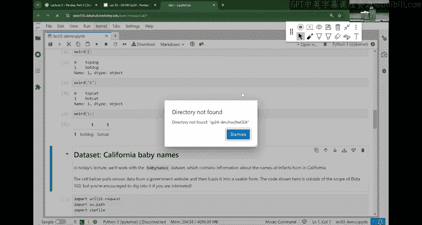
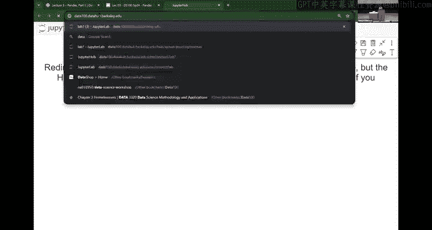
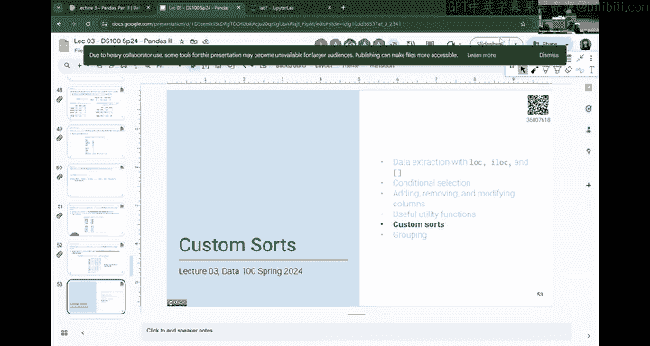

# UCB《数据100数据科学原理与技术｜Data 100 Principles and Techniques of Data Science 24SP》中英 - P3：-03-Data 100 Spring 2024 Lecture 3.zh_en - GPT中英字幕课程资源 - BV1Bc2dYCEbc

Alright。Hide flood meeting control Allright welcome team welcome to another data 100 lecture。

 let's go ahead and get started。 so today we have our second pandas lecture as we talked about our plan for this three lecture sequence of pandas today we're going to get a little bit deeper into different functionalities and pandas in the previous lecture we talked about different data structures。

 we kind of saw tools that are available to you in pandas data structure series data frame and also index object today we're going to do a little bit more digging into data frame specifically and then we're going to see how we can do extraction a little bit more because we went over extraction using IL quickly at the end of previous lecture so we're going to go and review that one more time we're going to spend some time on。

😊，Additionalitional selection。 so we'll see how we can do conditional filtering and data frames and then how we can do that more efficiently with different compound logical expressions。

 We're going to get actually a little bit deeper and actually do things。

 So we're going to spend time on modifying columns。 We're going to create columns。

 We're going to remove columns and then we'll be able to apply some functions to gain some insights from different columns and different features that do exist on our。

😊，On our data frame and then quickly we're going to see aggregation of data or applying different aggregation functions on data frames。

 which is kind of the main topic that we'll touch on again in the next lecture in Ins tree lecture so let's dive into things by talking about luck IL and this context dependence selection operator to see how we can filter our data frame or series for that purpose in order to extract a piece of rows and a piece of columns we also want you to know that all of these functionalities that we're telling you you won to appreciate the usefulness of them until a little bit later especially when we're talking about Exploratory data analysis and also a little bit more about them in the modeling part so bear with us just learn all of these mechanics that you need and then you'll appreciate them more towards kind of victory of。

😊，Of data 100。So this is the structure that we've seen for selecting or filtering or selecting a number of rows and a number of columns we said that with a data frame we have column labels and then we also have row labels all of these bold values that are at the top of the columns and also in the first kind of column in the rows all of those are called labels or indices for the column and for the rows we can do selection based on the labels using the lock operator so this is where using dot lock we pass two operants to dot lock and then we will be able to specify with the first opera what are the rows that we want to extract with the second opera will say what are the columns that we want to extract in order to pass the labels for the rows and the columns that we want to extract there are three different ways that we can pass those values we talked about passing a list so a list of labels for the rows and for the column。

😊，We talked about the slice remember that there was a specific kind of anomaly in theython python contract that here with the slice were saying that the syntax is inclusive of the right hand side so if you want to get for example rows from integer from the label for example zero all the way to tree know that this is inclusive of the tree so you can say zero column tree instead of saying zero column4 and then assume that4 is not inclusive in this case with the labelbased extraction using lock it is inclusive of the right hand side which you have to remember that the specificspec case or a single value we can always pass a single value and then extract one row or one column and then we talked about the data structure for extracting one column which is always a serious for extracting one row depending on how。

😊，How many columns you're extracting， you might get a sub datata frame or a data frame object。

 or you might get a single value。Again， at the end of the lecture I talked about another way of extraction I said that sometimes we don't want to do extraction based on labels based on those index values。

 but we want to do extraction based on the integer position so I like I stands for integer integer based extraction so you can remember it with that the mechanics is exactly the same we can pass the list we can pass this slice or we can pass a single value and then we will be able to extract the data set that we or the subpart of a data frame that we want so' still working with the elections data frame that we had from before the elections data frame is the elections kind of data set from historical US elections。

 the candidates who ran the year that they ran for presidency the popular vote percentage that they got and the result whether they won or lost that election so this is the data frame if I go ahead and do。

Integerbased selection or extraction using a list I'll just pass two list of integer positions notice here that I have one list here for the list of integer positions for rows rows always comes first and then one list for the columns So what you're seeing in those cases like all of the values in those list in those lists are integer values again because it's the integerbased extraction What you're seeing for the columns is that for the columns I'm extracting the first columns second column and third column these they're at integer positions012 and that's why I'm extracting column with label year with the label candidate and with the label party so that's how integer positions do correspond with the sequence of columns that we have with the sequence of rows be for the rows notice that I'm saying that integer position one2。

😊，3 and it looks like that the label is also the same。

 La is one to3 as opposed to like what you're seeing for the columns。

 that the labels do differ with the integer position。

 This is mainly because we just assign labels automatically and with automatic assigning of labels or index for the rows automatically label start with assigning the first row label as zero and then the second row label as one and so on and so forth。

 So integer position in this case as exactly the same as the label。

 but note that this is not always the case。 we could go back and reinex this data frame and have different kinds of indexing is starting from one or having different categorical or like different string values for those labels So it's not always the same。

 So this is the way that I like is going to take two list opera in order to do extraction we can also have。

The slice so with this slice mechanics is the same we just pass this slice range is starting from some integer position all the way to another integer position and note here that this is exclusive of the righthand side which is the normal python syntax so in this example instead of me providing the list012 for the columns here i'm providing a range or a slice and this slice says0 all the way to three and not inclusive of the tree and then i'll be able to extract exactly the same thing so notice that the row integer positions are at position 1 to3 and the column integer positions are012 and not inclusive of three so we get only three columns as a result okay so what we also learned last time was that with again normal python syntax if we don't provide the starting point of the range or a slice it will start。

From the beginning， if we don't provide the righthand side of the range。

 it will go all the way to the end of possible values that we have if we don't provide any of them it will extract everything that we have in the rows or in the columns depending on what what it is that we're extracting what are we extracting here so I'm using IL the first opera and says column which means everything all of the rows and then the second opera and says column at integer position zero all the way to tree and not inclusive of the tree。

 which means that I'm going to get a sub datata frame。

With only the first three columns in this example。Okay。

What we also learn is that the third way of doing extraction is using single value so I can provide a single value or a single integer position for the row or for the column and then be able to get a single row or a single column if I get a single row the data type of the output is going to be a data frame if I get a single column here I'm providing the integer position one this means that get the second column for me right and the return type is going to be the return type of a single column which is what。

What is the type of a single column？A series so remember that data frame was the collection of different series objects so in this case when we're extracting one exact column it is going to be returned as the object it is so the object that it is under the hood is going to be a series object so that's why you're seeing this series object obviously this is a filtered version of that series object because we also filtered for the rows so we're only getting row integer position 1。

234 that the specific column but the data type is going to be series one way to tell apart whether the result is series or a data frame is the way that they're being printed。

 this is the way that the series is being printed versus if you print a data frame it has the proper labeling of rows and columns and you will be able to see this table like a structure versus what the series what you're seeing is the index you're seeing the values it will tell you what the column what that column label is and what。

😊，The object types of the objects that are restored or the values that are restored in that serious object。

Obviously I can go ahead and provide a single value for the row and for the column that isolates my vision into only one cell or one row or one attribute。

 and then the return type is going to be whatever the type of that underlying data point is in this case is going to be an object or a string that we're seeing at integer position zero。

 the first row and for the first column or the second column because it's at integer position one。

 and then it's the name of a candidate， Andrew Jackson that we're getting as a result。Okay。

So moving on talking about why we are learning lock versus IL I briefly mentioned this lock is labelbased extraction IL is integer-based extraction most of the time you will use lock for two main reasons first of all a lot of time we might want to shuffle the data we might want to like restructure the data that we have and we don't want our code to be dependent on position positionality of the rows and the columns and because of that what we're doing is we're using labels so that even if we move columns and we move rows labels do not change and then we can still use the same code as is this is one main reason the other reason that we might want to use it as for readability so imagine that if I want to get for example a number of columns and I give you a code that says that I'm extracting columns candidate here and result and then youll be able to read it you'll be able to see what features I'm using for model。

😊，LiV the case that I just say that oh go ahead and get the columns at integer position 1014 so someone who is reading the code is going to have a hard time figuring out oh what was the original data structure。

 how does it change， how is the data frame change along the way to be able to make sense of what the shape of the data frame or what is the data frame exactly that and then what does it mean for us to extract the column01 and 4。

😊，So this is also another reason IL on the other hand can be useful in the cases that position has a meaning for us so take into account an example that I have a sorted for example a data frame say for example the example that we have here is movie earnings or something like that that you're sorting different values and then the order has a meaning so for example if you're sorting in ascending order。

 the values will increase so the maximum earning is going to be at the end and the minimum value is going to be in the beginning and then if you're interested in median the median at integer position in the middle of the data frame so instead of writing a separate function to do that for you you can just directly say IL give me the row zero give me the last row or give me the middle row of the data frame and then you'll be able to get min Max or median so this is going to be helpful in Do a specific case。

😊，で。So while it was all making sense， there is another shorter more handy version of doing extraction which we are referring to that as context dependent extraction you will use it more frequently than you think but as you can see with the name it's context dependent extraction what it does is it is a kind of a combination of lock and I like in a sense that it only takes one argument and depending on the type of the argument it will decide whether it is extracting rows and the argument that is passed as integer values or if it's extracting columns and the argument that is that it has received is column labels column labels or not so having said that it can take again only one argument。

And then what happens is that if a slice is passed to this context dependent extraction operator is going to assume that you passed row numbers so if you for example have the slice and your slice is not a slice over integer values or the integer values are not within the range of the row numbers that you have you're going to get an error so in this case passing a slice it will assume that they are row numbers it will go ahead and extract row numbers and then it will give you all of the columns so notice that there is only one argument that this takes this means that it will either do filtering under rows or will do filtering on the columns not both of them at the same time if you want to do both filtering under the rows and columns this is not the operator that you want and you'll have to go with lock and I like so。

Passing a slice row integers， we're going to filter for rows。

 we're going to get those rows with those specific row integers。

 and then all of the columns are going to be passed。If we get a list or we get a single value。

 it will assume that the value that you pass in that single value or in that list are all labels for the columns so if the values that you're passing in a list or that single value is not a column label you're going to get key error saying that there is no column with this specific label that you told me okay that's how it's going to compile and under the hood execute all of these instructions that we're getting it will take time for you to remember all of these and then use them we imagine that you might use like and I like more frequently because they make more sense and then as you're working through your code and you're writing more code then it will be faster for you to just directly still like row like columns and then you will use context dependent extraction in those cases。

😊，So let's see how that works in an example so say I'm passing a slice obviously slice is a slice of integers and what are those integers those are integer positions for the rows so I'm saying that is starting from three all the way to seven and then not inclusive of seven right because that's the default how a slice is going to be executed with the IL operation because this is an integer position so you see row at integer position3 four。

 five six is returned and all of the columns are being returned in this case。😊。

Now moving on to a list so i'm passing a list notice that this is a list i'm passing labels for the columns I have to pass labels for the columns if I pass something else that is not a label for a column say I say I pass a value of zero I'll get a key error so you have to make sure that the columns do exist and this is kind of an easy way for you to debug your code if you're getting an error in your homework 2 a or also in the next homework that will release on Friday so。

We are selecting columns， so all of the rows are going to be returned so again this is only one dimension filtering that I want you to think about what are the columns that are being returned year candidate and result so all of the rows are being are there from row zero all the way to 181 and then only these columns are in the output。

If a single value is past that single value has to be a column label and in this case I'm saying that this is a single value candidate。

 let's go ahead and get that single column which we know is a series object that's why the output type is a series okay so in this case I'm getting the series corresponding to candidate all of those rows are being returned because I cannot do any kind of filtering in addition to this on on roads。

😊，Okay so now is your time take some time to think about this example。

 this is a data frame you can see how the data frame is created， it's kind of a tricky example。

 the name of the data frame is weird which has two columns one column with the integer label one。

 one column with the string label one right and then we also put different values in those columns so for example the first column with the integer integer label one has the values top doc and bottom dock and then the other one has topca and bottomca there is a series of tree questions that we have and starting with tell us what is the output of weirdd one by just passing integer one into the context dependent selection operator。

😊，Take a minute to respond。Okay。Let me go through the code to show you what's happening there。

I'll scroll down to this one so this is my data frame right PD pandas that data frame calling this constructor to create a data frame object the way that I'm creating the data frame object is using a dictionary like a structure so the dictionary the keys to the dictionary are going to be column labels so one column with the label one integer one one column with the label one as a string one and then the values that are stored in each one of those columns are passed as a list so the first value in the first column is going to be top doc and then the second value in the first column which is at location two and one is going to be bottom do and then topca and bottom cat so if I go ahead and run it you'll see that this is how it looks like visually you can tell apart like what's happening between this one and this other one we mention in the previous lecture that we can't have duplicate column label。

But these are not duplicate one is integer one is a strings so pandas has a way of distinguishing between these two features for us automatic labeling for the rows row at integer position zero and1 label zero and1 correspondingly and then here we're using context dependent extraction right i'm passing only one value right and that only one value is integer1 right so let's go back to this example if you look at this plot on the right-hand side you'll see that we say if it is a slice it's a row number this is not a slice it's a single value if it is a list it's a list of column labels it's not a list again it's a single value and then if it is a single value it should be a single column label so the result is going to be that column so it's going to be a series object corresponding to that column so let's see what you all respond top do button dock is。

The correct response so let's run it and see top do bottom doc you can see that this is actually the name or the label for the series is one。

 which is what we were expecting because that's what we extracted the data type is object because the values are a string so that's all you need to know and obviously with the way that it's printed it's a series object。

So let's do one more practice， what happens if I change that one to like one in a string？Okay。

 moving on， let's see。What you responded， topca bottom cat because we're extracting just the second column so if I run it for you to see we're extracting second column with the label one this time it's the string。

 but we're extracting the second column obviously the second column has cat attribute topca bottomca which is what we have Now this one what do you respond to this other question。

So this time I'm passing a slice。And you volunteer to explain what's going on here？

I'll take from this section any volunteer from this section， Yes， go ahead。嗯哼。😊，Exactly。

 so the response was that because we're using a slice or we're passing a slice to this context dependent extractor it's integer position for the row so assume that this is dot eye lock and then you're passing you're passing the slice one column and then you're also extracting all of the columns that we have so in this case the slice of one all the way to the end here is basically the last row that we get so this is the bottom bottom do and bottom cat is what we get which is one row the output type is a data frame because that's how it should be structured。

😊，So great work on this exercise moving on and just talking about。😊。

I briefly mention why do we prefer this context of extraction versus lock and IL a lot of times the main reason is because it's faster and just hypping a lot of times dot lock dot IL is going to add up and it would be easier for us to just if you want to extract for example the column candidate we just directly say give me the column candidate instead of saying dot lock give me all the rows comma than the candidate column to be able to extract it so it's going to be a little bit easier but it's going to take you some time to get used to using this context dependent extraction but again you'll use it more frequently than you think right now。

So now let's change gears and talk a little bit about conditional selection so here we were just directly saying what labels we want and what integer positions we want but what if we have a condition that based on that condition we want to do extraction we can do conditional extraction using a Boolean series by passing a boolean series to deadlock operator or to this context dependent a square bracket operator so the way that it works is that what we can do is we can create a boolean array or a boolean series that is going to define the condition that we have so whatever condition that you have you're going to apply it to all of the rows independently and then each one of the rows is going to have an associated Boolean value what we will do later is we'll pass this boolean series object or this array to。

Data frame and all of the rows that has a corresponding true value are going to be selected in the output。

 anything else is going to be filtered out for that purpose so for the rest of today's lecture we're going to work with a baby names data frame this baby names data frame is a data frame of the social security registration of babies who are born in different years with different names and the counts of each one of them and the sex that was associated to that baby at birth so this is an example of how we're extracting the top 10 rows of this data frame and is' ordered I believe by year so you can see that the top 10 rows are from 1910 and I think the most recent data and this data frame is from 2020 or 2021 we'll see later so notice timem getting the top 10 rows here i'm saying that dot lock so give me the slice of this data。

Frain that has the row labels starting from the beginning all the way and including nine because lock was inclusive of the right hand side so that's what I'm getting is starting from zero all the way to nine and then I'm saying give me all of the columns that's why all of the columns that exist in the data frame you're seeing them in this output。

If I want to perform any conditional selection or conditional filtering on this data frame。

 what I can do is I can have a boolean array a boolean list or a boolean series that the size or the lengths of this boolean list is the same as the length of my data frame so here the data frame that I created has only 10 rows I'll pass a list with 10 different values and these values are boolean because this is a boolean list and it has true and false values and what happens is that when we're passing this list into this context dependent extraction all of the rows that correspond to a true value those integer position rows are going to be selected to be retrieved and the output anything else is going to be filtered out so here the first element is true the first row is going to be preserved and then so on and so forth all of all of the false rows are not going to be selected and then this label。

Apply this Boolean condition or this Boolean list to the entire data frame that we have what do we get as a result。

 we get all of those rows that correspond to a true value so you can see the correspondence between this row。

 this row and you can double check them with the row labels that we have。快出。

the index has changed now that be very good question。

 The question is when we're doing this selection would the index change， so would we have0，1，2，3。

4 instead of 0，2，4，6 and so on the index wouldn't change so think about。

Any row as a dictionary item that the key is the label and the value is the value to the row so you're moving the entire dictionary item over including the key is going to be transferred if you want the labels to be like0。

 one two all the way you need to reindex it and we talked about how we can do reinexing in a previous lecture good question。

So this is how we can just directly decide which rows we want to select and then be able to select those rows based on this boolean kind of array or list and then be able to kind of perform the selection if you are a lock person we can do exactly the same thing with lock so instead of just doing a score bracket and past the context dependent selection we can say dot lock and then pass the list in both of the cases what it does is it will get that list it will treat that list as an indicator for which one of the rows should be selected which one of them should be filtered out so either what I have before is that we can use dot lock or we can use a score brackets context dependent extraction either would be fine in this case but as you can imagine if we have tens and thousands of rows we don't want to go ahead and create manually true false values for tens and thousands of rows and that would be。

😊，Very repetitive and like very inefficient to do instead what we learned in the previous lecture was that we can use boolean expressions in order to define a condition for whether the rows are going to be preserved or whether the rows are going to be filtered out so in this case what you're seeing here is that I created a logical operator series object and this series object is going to be a boolean series object that is the result of applying this Boolean expression to each individual row So what happens is that we're going to select the sex column we're checking it against the value a string value F if the value was equal。

 then the result for that row is going to be true， otherwise the result is going to be false that's why it is a series that has a corresponding value to each one of the rows and it's a boolean because the result of this boolean expression is either true or false。

So let me go ahead and show you how this can be done。Okay， let me restart。

嗯。

Okay， so loading it again and then all the way to this new dataset so you can see the head of this dataset meaning that the top five rows and all of these columns that we get and what I want to do is I want to go ahead and create this logical operator for you so that you can kind of inspect and see what I mean when I say that we're creating a Boolean series object so I'll create a logical operator this is very similar to what we did with the series object last time I'll say that go ahead and get baby names data frame remember that the data frame that I created is called baby names so go ahead inspect the baby names data frame go ahead and grab the sex column right what do we get as a result we get a series object so I'm looking at only one column and notice that this is a context dependent extraction I'm passing only single value and that single。

Value is going to extract only a single column so I have that and then I'll say that go ahead and apply this bitwise operation to all of the rows and then go ahead and tell me whether not the bitwise operation this vectorized operation to this entire series object and check if the value is equal to a string F and what I'll do is I'll show you what the result。

Look like。Log。😔，Operator here， so this is a boolean series。 What can I do with it。

 I'll do exactly the same thing that we did with a series object previously iss just that this time now this series can be used to filter out the entire data frame as opposed to filtering only for one series object so I can go ahead and say baby names。

😊，Sorry， I realized this is a small baby names logical。Operator。

And then be able to see the filtered version of the data frame。

 but all of the X values be equal to f as opposed to。

I guarantee you that there are male babies there too。

 but this is kind of a filter version of our data frame notice that I can also do exactly the same thing with lock so I'll just copy this over。

😊，And then with lock， it will basically be that dot lock passing the logical operator as the locator for the rows and for the columns I'll say I want all of the columns okay and then what I'll get is exactly the same or I can just say that go ahead and just give me name names。

 and then I'll give me only the values for that name。

 but this is only like female baby names that we're getting in the output。Okay。

 notice that with the lot。The initial case that I showed you was。

But by selecting all of the columns with the lock operator passing the second opera is not necessary。

 so if you don't pass the second opera， it will by default， assume that you want all of the columns。

 but the first opera is necessary you have the index true rows and then with the second opera。

 if you want to make a selection， you provide that if you want all of the columns either say column or don't provide anything and it will give you all of the columns that you want。

So this is all we talked about we're creating this series object we know that this series object has boolean values and this is what the output of that series object was we're using this to index into the rows of the baby name notice this kind of a inner expression that we're adding to this context dependent penant operator this is going to be used in order to do filtering for us this is the output data frame again I said that we can do exactly the same thing with lock so here I'm passing the boolean series object to index for the rows and the columns I'm specifying that with Col or I could have just removed it and not have that and I'll end up with getting exactly the same output as you can imagine bo the logical expression that I had was simple I was just checking for one condition What if I want to combine multiple condition so that I have a compound logical。

😊，that I can evaluate。 we can basically use a lot of bitvised operators in order to do that so we can do and。

 we can do or， we can negate a logical expression and we can take x or so a lot of those variations are available to us。

 So let's take into account the example of or。 So the end operator this here is the or operator。

 So this vertical bar if I have two logical expressions。 and I use or in between them。

 this means that if any of them were true the output there is the output is going to be true and then that row is going to be returned。

 specifically in this example I'm checking for the sex to be F。

 and then I'm checking for the year to be before the year 2000 So in this case I'm getting this output where you can see that there are some male baby names that are in the data frame because the year is before the year 2000 So that's why they're included in this output。

I talked about this bitvis operators theres a lot of these bitvis operators there is the negation so tilda is the negation so if you have a logical expression and you want to calculate the negation of that for whatever reason you can use Tilde or an end we talked about it and then there is X or the carrot kind of operator here which is basically。

😊，When applied to P and Q opera， it will tell you it will give you true if only one of those opera is true。

 so if both of them are true， the output is going to be false， if both of them are false。

 the output is going to be false， only if one of them is true。

 the output is going to be equal to true。So let's do another fun。A slido exercise。

There is a question about what does negation mean on a slido。

 negation means that whatever value that you have you negated， if it was true。

 the negation of truth is false， if it was false， negation is true。So let me read the question。

 the question is， write aendda a statement， which one of the following panda's statements returns a data frame？

With the first three baby names with the count greater than 2，50。 So you can imagine that。

There is an end going on somewhere。And then theres counts that has to be part of this logical expression。

 and there's also filtering that you have to do on the rows so that you get the top three rows。

 but there are different ways that you can do it， we can do it with logical expression or we can do it with just directly doing lock and IL into the data set because we know how the dataset set is is structured。

Okay， let me go to the code to show you how it looks like okay so I said that the output。

 just the hint in this liddo exercise was that the output should be exactly this。

 the top three rows with the values greater than 250 are associated with and we only one name name and count column they're associated with row at index or at index 0 at index 233 and then 484 and then what's happening here is that I can use IL and just go ahead and get those integer positions right so in the original data frame notice that name and count are at what position position integer position 0123 and 4 you're at integer position 3 and 4 that's why this is the column integer position selection that we're doing for the rows we already have those row integer positions the integer positions where the rows is equal to the labels。

😊，Thoseose rows because they were automatically created。

 so that's why0 233 and 484 are the labels for the rows， so if I do run it。

 then you will see that the result is exactly the same。😊，We could do the same thing with the lock。

 but there is an issue with this second option with the lock。Can someone tell me what the issue is。

So the gross selection seems to be correct。Yeah。You are in the right direction。

 The answer is that we're only selecting on the rows。 remember that I said that with lock。

 you don't necessarily need to pass the second opera for the columns and if you don't pass the second opera it will give you all of the columns that's exactly what it's doing It's giving you too many columns that you want but what you're interested in is only this portion of the data frame so you're not doing proper selection on the columns the other operations that we have there are a little bit more logical So here we're saying that apply this condition so that youre only select you only have a number of rows with their count being greater than 250。

And then go ahead and select the columns with the label name and count。 So far so good。

 This is going to be essentially name and count for all of the rows that are that that have count greater than 250。

 But then we're saying that head3， Give me the top3。

 and this compound version is going to give us exactly what we want。

 If I remove the head tree to show you what this alpha is， this is going to be this filtered version。

 But since we want only the top3， I'll just add this。

Haad three to get the top three kind of instances What about this one dot lock we have the same condition so we're filtering and now we're getting this big all of the number of rows that are that the count is greater than 250。

 we're getting name and count so far it's equal to what we had in the previous option。

 but we're doing I like so we're feeling fancy and we're doing I like What's the issue there。

Exactly the answer was a slices exclusive with the I lock。

 meaning that it's going to give you row at integer position0 and 1 not including three right so this is going to give you only the first two instances as opposed to three instances this was a little bit tricky。

😊，Okay。So far so good moving on， the correct responses， majority of you selected that wonderful。

 So moving on to a little bit of a more fancy stuff because。😊。

We started from just passing this Boolean list we said that oh giving this boolean list for tens of thousands of rows is going to be very difficult then let's go ahead and define this logical expressions that we can use them to index and select for the rows but what if I have multiple different values and if I want to for example say that I want to check if the name is Ba or Naras or Alex or Lisa I have to just enummerate over all of them and then be able to like make this complicated compound logical expression but what pandas is going to provide is that pandas has a lot of different utility functions that in today's lecture I'm just going to go over some of them so that you see what functionalities are available again we don't want you to remember all of them we just want you to have heard about them and then see that with pandas all of the function names are really kind of meaningful and easy to understand when I say is in it looks like that were research。

For something inside another thing or another list。

 which is exactly what we're going to use for doing the search of the names from a list of names that we have。

😊，So let's get into that the same example that I had， which here was。

Checking whether the baby name is equal to。The baby name is equal to Ba in this case or the baby name is equal to Alex。

 Naras and Lisa and we're taking or between each one of these expressions what I'm going to do next is I'm going to put all of those names in a list it's very easy to do that and then it's also easy to create that list from different external sources or from your data frame itself say I'm creating that list and then I'll say that okay my Boolean condition is going to be that let's get the names column and let's check if the value that you have in each one of those rows is in the list of names that I have in this list just read that as that okay what is the result of this inner expression。

 the result of this inner expression is true or false for each one of those rows will go ahead and check whether the value in the column name for that row is in the list that we have then the result is going to be true or。

And obviously the rest is simple， that bullolean kind of series is passed to be index to be used as the index of the baby names and the result is going to be filtered accordingly。

One other little of fancier function that will go over this I think about three lectures from now is using a stir functions。

 the stir functions are a set of functions that are applied to a string values if you have a column with the string values。

 all of the string functionalities are available to you through this ST library so we say dot is there and then there is a bunch of functionalities that are available again if your column is of a string type so for example in this case I'm saying that go ahead and get the names column in the baby names。

😊，Assume that this is the string and use this function starts with n in order to figure out whether this expression is true or false If a name is starts with n the value is going to be true if the name doesn't start with n the values is going to be false and then so on and so forth and then this is going to be able to be used in order to index into the data frame so you can see that the output data frame only has names that are starting with n So these are nice functions again I just use two examples to show you that the values we can make used of the values that are stored in the data frame in order to filter a data frame and there are a lot of utility functions that we have that we we can do that we'll see more of these is star functions again in one big lecture that we'll talk about textual data we'll see them we'll see them there but this is kind of a teaser for you to see we can make use of these string values as well。

So now we have seen how we can filter the data， we have seen how we can do filtering by like constant kind of indexing by conditional filtering and then also with utility functions to do conditional filtering but what if we want to modify a data frame because so far we have not been modifying the data frame we have just been filtering the data frame so that we focus on a small piece of the data frame what if we want to add a column what if we want to modify a column what if we want to drop a column so all of those things we're going to talk about them in the next few slides。

So adding a column we can just pass create a column to a data frame by directly using a square bracket operation here and this is square bracket operation here。

 when we're passing the label for the column it will automatically go ahead and create a column with a specific label that you pass to a square bracket operator so this is the first time that you're going to use that label as soon as a new label is going to be used in reference to a data frame。

 that column is going to be created how do you assign a value to this newly created column what is the underlying data type it has to be a series object so if you have a series object or some kind of an array with the same length as the data frame then you can directly assign that series object to be stored in your data frame so this way you can think about your data frame as a collection or a dictionary of different columns the label。

For those dictionaries are basically column labels and the values are the values that are storedd in each one of them and it works exactly in the same way that the dictionary works so in dictionary as soon as you reference to a new key that new key is going to be created in the dictionary right and then it will wait for you to assign a value to it it works exactly in the same way so in this example I'm also creating another fancy example for you because I use the stir function I just want to create values that I want to store in the new column so I'll say that go ahead get the name column。

😊，ne that the values are string values and go ahead and get the length of each one of those name values right so here the result is going to be a bunch of different numerical values that are stored into a series object and then what I'm going to do next is I'm going to reference to a column label that I want to store the series object and then I'll go ahead and pass the series object itself for it to be stored in the data frame so let's go ahead and give it a try。

So I'll go ahead and say。Name lengthes here is going to be a serious object。

 So I'll go ahead and say baby names。Go ahead and grab the name column and。

I'm going to just get the length of each one of these entries in the name column。

 so let's see how it looks like。So you'll see that the length is exactly the same as the length of my data frame。

 but I have values that these values correspond to the actual name lengthes that I have in the data frame so what I'll do next is I'll just in exactly the same way that we are adding another another key value pair to a dictionary I'll go ahead and say baby names。

I want to create。A new column that I'm calling name lengthes。

And I'll say that the value should be this name length's object。

Which is a serious object right this is the first time that I'm using it name length underscore lengthes doesn't exist in my data frame。

 but if I go ahead and。Let me change this to display and also。Change this to display。😔。

Baby names you'll be able to see them side by side this was my the series object that I created now this is the data frame that I have and notice that this last column is appended to the end of the data frame that I have。

Okay， one more thing that I want to show you is I can。

I can modify this data frame that I created or this column that I created。

 so I can directly go ahead exactly the same way that you can modify a value that's associated to a key in your dictionary。

 I can go ahead and say baby names for the column name lenses。

Should be equal to say exactly the same column， but I just want to reduce the value by one。

For whatever reason， like I have first name last name hypothetically and then I have this space in between so I just want to remove that the space or any kind of modification that you want to do as long as the righthand side is a series。

 you can just reassign it so that series can be an existing series object that you have in a data frame。

 it can be a modified version of that series or an entirely new series that you want to replace we can do that。

😊，Baby names。And you can see that the values are reduced， so previously I had four， five， seven。

 now I have three， four and six。Okay one more thing is sometimes you might want to add a column you'll do some operation based on that and you want to remove it or for whatever reason you just want to remove a column right we can also remove a column and then we can say let's go back to this slide so I can show you so this was the syntax for adding this was a syntax for modifying that we just saw okay before moving on to to the removing we can rename a column if you just want to rename it you can you can call dot rename and pass a dictionary the dictionary is going have key and value pairs for every previous column labels that you have and any new column labels that you want to give this is a previous column label this is a new column label that I want to give and then you can keep adding dictionary items to this dictionary and then you can do renaming of a lot of different columns all at once so in this case。

You're seeing that now name lengthes has turned into length column as the label and this is useful because a lot of time we're getting external data sets and the column names might not exist or you might create。

 for example features and you change your mind and you want to refer to features with a different label so that like it's more readable and it makes more sense so we will use renaming a lot in data 100。

We can drop a column or drop a row， if we're not interested in a column anymore。

 we can just say baby names dotdrop， we will provide the column that we want to drop。

 but there is a caveat here that by default if you call drop a row is going to be dropped if you want a column to be dropped you have to specifically say access equal to columns and then a column is going to be dropped。

What happens if I don't have that， it's going to go ahead and search through the row labels。

 it's not going to find a row label with the length and it's going to give me key error。

So always be careful about that， or if you pass a column label that doesn't exist again its going to give you a key error。

 think about everything as he value pairs in a dictionary。So let me show you directly that here。

 so I'll say。Baby names。Was the baby names yes， baby names dot。

Drop I'll say so here I didn't change the name to the length， so I'm just going to use name lengthes。

 which is what I what I had before or let's actually drop a state。So let's go ahead and drop a state。

 and then let's not pass the axis to see that we're going to get an error。So， here。It says that。

A scrolling down。The state is not fun in access， so this is this does not exist in the in the in the real labels that we have so what i'll do is i'll say here that。

Aes equal， was it axis， yes， axis equal columns。And then in this case。

 you're seeing that the estate does not exist anymore in my data frame so one。

Interesting fact here is that if I go ahead and print baby names。What's happening is that。

I will still see the state。 So what happened to me dropping that column？It creates a copy。

 So every time that you're modifying a data frame。Panda is going to assume that you don't want to override the original data that you have so imagine that if you're doing a bunch of exploratory stuff and you keep overriding the original data set and you will lose your data set by default it will create a copy and unless you say that you want to overwride the previous data frame it won't override it for you so in this case it does drop the data frame the state frame my columns but it't it doesn't override it in the baby names its stored in some other local copy of a data frame If I want to keep the changes permanent I need to specifically say baby names equal to。

This copy， this new copy， and then when I run it this time。

 you'll see that now California does not exist anymore。Okay， this is very important。

 There is another way that I can do it。 Sa， for example， I would say that， okay。

 I want to drop one more thing here。 I will say that I want to drop， say column。Say sex from here。

 I'll say let's drop sex and then axes。Equal to。Columns。And then let's see if that happens， oh sorry。

 it won't do that because I already drop this state once， so control X。

 I'm going to go to and use cell。So here， so I'll go ahead and just say that drop this new column and then what I'm getting as a result is that the column is drop。

 but again when I go ahead and say baby names as we all know and we just learn。

The changes are not permanent sex column is still in in the baby names data frame The other way that I can do it。

 there is one way that I could just directly assign the overrite the value of the data frame with this new copy of the data frame There is another way that I can do it and that's called in place I'll say that make the changes in place so when you drop it I know what I'm doing just go ahead and make it in place don't create a new copy so this is also another way so this time when I call it now you can see that the sex column is also gone so two ways reassigning or explicitly telling it that you want the changes to be in place and permanent。

So I covered a lot of these slides just quickly seeing what we did。

 we did drop a column here you now see and you know why I'm reassigning the value。

 but then we also learned that if I don't reassign it。

 a new copy is going to be created and the changes are not going to be permanent。

 so if I just say drop without in place without reassigning the baby names it is still going to have that column or that changes't that we haven't made。

So given the timing I'm going to keep going and not give you a break because I want to cover some utility functions it's gonna be fun I guarantee you when you keep learning all of these functionalities you will see how much tools you have in order to play with data frames and then you will get closer to being able to do Home2 a and Home 2B which is very exciting so utility functions all of the nu functionalities are you can apply them on numerical columns so for example in this case I'm saying that go ahead and filter out the data set so here I'm filling fancy I'm filtering out the data set for all of the rows that has the baby name being equal tosh Yosh actually is in your content team and then I'm going to say that now kind of cascading all of these selections right one time I'm filter。

Now it gives me all of the yash rows with all of the columns。 Now I'm saying that， okay。

 only give me the count column。 So this is what I'll get as a result。😊。

And then what I can do is I can just apply any of these NI functions that you' learn from data 8 and then also in La 2 a you'll play with a lot of these NI functions I can say to calculate the average number of babies born with the name Yosh over the years starting from like 1910 all the way to 2020 it looks like thats 17 on average 17 babies were born with the name Yosh give me maximum what is the maximum number of yash babies were born in a given year that's 29 so a lot of these functionalities are really available on pandas theres nuI that's available there's a lot of these utility functions that are also available that we're going to go over just a selected number of them and we'll leave it to you to explore the pandas API documentation more to learn more about them Every time in homeworks in assignments and projects that we need。

New function will give you a link to the API documentation so that you can go and read and learn and then be able to apply it。

 but most of the time everything that we need from you is going to be covered in the at the high level at least it will be covered in either the lecture or in the discussion。

So what are the other utility functions we can get this shape， we can get this size。

 we previously saw it in the previous lecture， what is shape when you call shape on a data frame。

 it will give you how many rows you have and how many columns you have this is very important like the first time that someone gives me a data set。

😊，I'll do two things I'll first get the head of the dataset to see like what I have and then I'll get the shape of the dataset to see how many rows I have and how many columns I have generally if you get a sense of what that data looks like those are the general top two to go things to go functions that I'll use when I have a new dataset what is size size tells you the general capacity of your dataset it's just the number of rows multiplied by the number of columns if you're interested in just estimating what the size of the data would be in terms of like memory and things like that then you will take you will just call dot size。

Describe function which we use in the lecture one demo is very interesting you'll use it very frequently。

 it will give you some summary statistic about the numerical columns that you have so in the baby names data set。

What were the numerical columns there was year that was numerical and there was count that was numerical Everything else was categorical it was the string object type so what it gives me is some summary statistic it will tell me the count of the number of elements that are restore storedd in each column mean in a standard deviation minimum maximum and then also it will give me quartiles generally it will give you a sense of the distribution in your data why is it useful it's useful to just get a sense of what's in your data and better your data has enough kind of information that you need for modeling for example for year I now know what the minimum being 1910 that that's the earliest year that I have and then the maximum is 2022 so looks like that we updated the data so it's better than 2020 but the count for example the maximum is interesting will tell you that in one year there was one baby name that was very popular。

More than 8，000 babies were named， but that a specific name。Minimum tells you five。

 so that tells you that there was one very unique name that on a given year。

 only five babies were named with that name and so on and so forth。

When we call describescribe on a series object it's going to give you a different insight so for example I'm going to just apply it on the sex column what it tells me is it tells me a notice here that I can apply it on any column what any kind of value not necessarily numerical value so in this case but I'm applying it to the sex column it will tell me how many unique values we have here we have female babies and male babies so the number of unique instances is two it will tell me that the most frequent of the two is female and then it will tell me the frequency of female babies in the entire data set across all of the years okay so this is how you can just also get a sense of how how the data in one of the columns or for one of the attributes look like。

We can do also more fun things towards the middle of data 100 we're going to talk about sampling and then figuring out the distinction between a population and a sample and then how to use a proper sample for modeling so we can treat our data frame as a population and then sample instances from that population we can do that with dot sample dot sample is going to give you one instance if you just call it without any argument it will give you one instance and it will do that without replacement if you want to do sampling with replacement you'll pass the argument of replacement equal to true so some examples I just say baby names dot sample it will give me one random sample and it depends on how you're setting the seed for your randomness if you set a seat every time that you sample you're going to get the same row but if you don't have a see it will every time random。

It will give you a new sample， you'll learn more about what that seed thing is。

 I think later in one of the homeworks or one of the labs。We can select more than one sample。

 I'll say I want five samples passing an argument to sample is going to give me five instances all of these instances are without replacement again if I want with replacement and I can kind of tolerate having duplicate rows I can just say replace equal to true and then get with replacement samples。

Now again I'm feeling a little bit fancier， I'll say dot I lock and I'm passing two arguments I'm saying column meaning that give me all the rows that's the slice for the rows and then for the columns I'm saying that give me the integer position is starting from two all the way to the end starting from two is where this is integer position zero。

 one2 so it starts from here all the way to the end it's going to give me all of the rows that I sample so you can see that we can really chain all of these functions and all of these functionalities together to do the things that we want we don't need to have multiple different lines for them and this is what you'll get used to in homework2 and homework3。

😊，This is a little bit more chain what are we doing there so we are doing conditional filtering first because there is a criteria for our sampling I'm saying that I want to sample from a population of all of the babies who are born in the year in the year 2000 so this is the conditional filtering look how far we've come so now we do filtering with the sampling and conditional filtering this is really good baby names for the year column equal to 2000 now you'll get a selection of all of the entries with the year 2000 what do you do next I'm sampling how many instances am I sampling I'm sampling for now I'm saying that I can get samples with replacement so replace equal to true that's the other argument that I'm passing and then I'll do exactly the same thing that I did before I'm saying that okay give me all of these samples but only give me these features because I'm not interested in for example。

The state and sex information， I just want to get year name and count and we'll do that。Okay。

One more thing value count it is very useful to use un seriesious and also on data frame so when we say value count on a serious object so notice that here i'm getting name I'm getting one column that's a serious object and i'm saying value counts what does that mean it says that go ahead and look for unique values and count those unique values so for the name it's going to give me all of these unique instances and then it will count how many of babies with each one of those names that we have so there are 223。

😊，Names names of babies gene and then so on and so forth and these are the more unique names that we have at the bottom the value count is going to sort values in the sendinging order that's why you see the most frequent name at the top and then the least frequent name at the bottom in this case。

When we， if we want to only get the list of unique values instead of also getting unique values along with the counts。

 we can just directly call unique， I'll say go ahead and grab the name series。

 go ahead and get the unique names that are appearing in this entire data set and it'll give me an array with all of those names and you can also go ahead and double check that the values are exactly the same in this unique option and also in the list of values that I had in the value count that I got。

What I can do is I can also sort values so why do we want to sort values because again a lot of times we might want to sort by year。

 we might want to have some structure if there is earning we might want to sort by the earnings that we have in our data set we can call sort values on series or on data frame and by default sort values are going to sort values in descending order in the same way that value count sort frequencies in descending order so again getting names sorting values what does that mean actually is this is ascending order by default it's ascending so getting name sort values。

So the names are going to be sorted in ascending order。

 this is ascending as sorting string values is going to be alphabetical ordering sorting so it starts with all of the names is starting with A all the way to the names that are starting with Z。

If I call it on a data frame， it's going to be slightly different because I have to say。

 which column should you use for for sorting。 So sort based on the name， sort based on the count。

 sort based on the combination of name first and count second， so on and so forth。 So in this case。

 I'm saying that sort by the count column。And ascending is false because the default is ascending if you want it to be descendending。

 then you can say ascending is equal to false， so now here you're seeing that the data frame is sorted by the count。

 so we have the most frequent ones at the top and then it's in thiscending order。Okay。

 interesting stuff will it will take time for you to kind of memorize what kind of functionalities exist and then use them hundreds times to kind of remember how to use them and how to chain all of these functionalities together in the next lecture I'm going to start from here I'm going to talk about how we can do custom sort custom sort are very interesting then we're going to talk about how we can do grouping emergingrg and then more advanced pandas and stuff so I'll see you back on Thursday。

😊。

