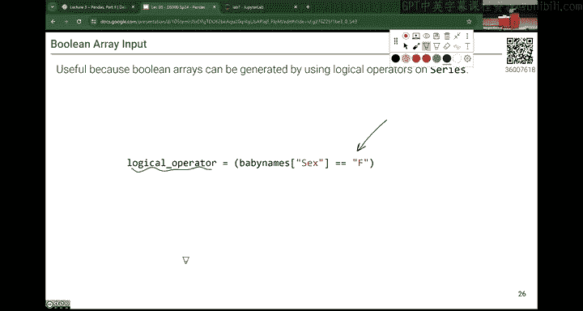
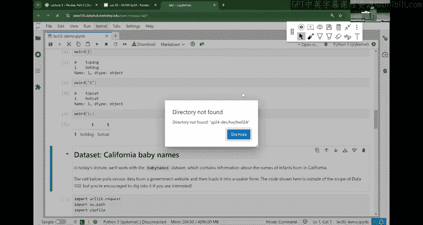
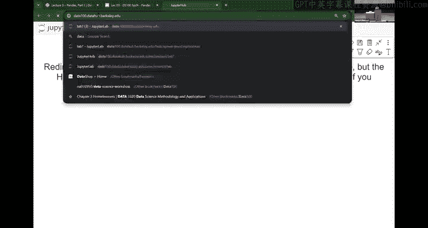
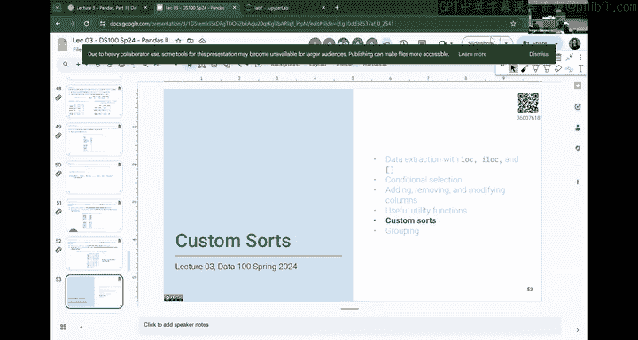

# 课程名称：UCB《数据100数据科学原理与技术》第3讲 🐼

## 概述

在本节课中，我们将深入学习Pandas库的更多功能。上一讲我们介绍了Pandas的基本数据结构，如Series、DataFrame和索引对象。本节我们将更深入地探讨DataFrame，特别是如何进行数据提取、条件筛选、列操作以及应用聚合函数。这些技能对于后续的数据探索性分析和建模至关重要。

---

## 数据提取：`.loc` 与 `.iloc` 回顾

上一节我们介绍了如何使用`.loc`（基于标签）和`.iloc`（基于整数位置）进行数据提取。本节中，我们来看看这两种方法的细节和区别。

### `.loc` 操作符

`.loc`操作符用于基于行和列的标签进行数据提取。其基本语法是`df.loc[行选择器, 列选择器]`。选择器可以是以下三种形式之一：
*   **列表**：一个标签列表。
*   **切片**：一个标签切片。**注意**：在`.loc`中，切片是**包含**右端点的（例如，`0:3` 包含标签0, 1, 2, 3）。
*   **单个值**：一个单独的标签。

### `.iloc` 操作符

`.iloc`操作符用于基于行和列的整数位置进行数据提取。其语法与`.loc`类似：`df.iloc[行选择器, 列选择器]`。选择器同样可以是列表、切片或单个值。
*   **重要区别**：在`.iloc`中，切片遵循标准的Python语法，即**不包含**右端点（例如，`0:3` 包含位置0, 1, 2）。

### 选择 `.loc` 还是 `.iloc`？

大多数情况下，我们更倾向于使用`.loc`，主要有两个原因：
1.  **代码健壮性**：数据可能被重新排序或打乱。使用标签可以确保代码不依赖于行和列的具体位置。
2.  **代码可读性**：`df.loc[:, [‘年份’, ‘候选人’]]` 比 `df.iloc[:, [0, 1]]` 更清晰地表达了我们想要提取哪些特征。

`.iloc`在位置本身具有意义时非常有用。例如，当你对数据按某个数值列排序后，最小值在开头，最大值在末尾，中位数在中间。此时，使用`.iloc`可以直接通过位置获取这些值（如`df.iloc[0]`获取最小值）。

---

## 上下文相关的提取操作

除了`.loc`和`.iloc`，Pandas还提供了一种更简洁但需要理解上下文的提取方式：直接在DataFrame上使用方括号`df[...]`。它只接受一个参数，并根据参数类型决定是提取行还是列。

以下是其工作规则：
*   如果传入一个**切片**，则将其解释为**行的整数位置**，并返回这些行对应的所有列。
*   如果传入一个**列表**或**单个值**，则将其解释为**列的标签**，并返回这些列对应的所有行。

**注意**：此方法**不能同时**筛选行和列。如果需要同时筛选，必须使用`.loc`或`.iloc`。

### 示例解析

考虑一个名为`weird`的DataFrame，它有两列，标签分别是整数`1`和字符串`'1'`。
*   `weird[1]`：传入单个值`1`（整数）。根据规则，它被视为列标签。因此，返回标签为`1`（整数）的那一列（一个Series）。
*   `weird[‘1’]`：传入单个值`'1'`（字符串）。根据规则，它被视为列标签。因此，返回标签为`'1'`（字符串）的那一列。
*   `weird[1:]`：传入一个切片`1:`。根据规则，它被视为行的整数位置切片。因此，返回从第1行开始到末尾的所有行（一个DataFrame）。

这种上下文相关的提取方式书写更快捷，在实际代码中会频繁使用。

---

## 条件筛选

我们之前是通过指定具体的标签或位置来提取数据。但更多时候，我们希望根据某些条件来筛选行。这可以通过向`.loc`或方括号操作符传递一个**布尔序列**来实现。

### 使用布尔序列

布尔序列是一个由`True`和`False`值组成的Series或列表，其长度必须与DataFrame的行数相同。当我们将这个布尔序列传递给提取操作时，只有对应位置为`True`的行会被选中。

例如，我们可以手动创建一个布尔列表来筛选行。但更常见和强大的方法是，通过对DataFrame的某一列应用比较操作来生成布尔序列。

### 创建布尔序列

假设我们有一个婴儿名字数据集`baby_names`，其中包含`sex`（性别）列。我们可以通过以下方式创建一个布尔序列，标识出所有女性婴儿的记录：
`is_female = baby_names[‘sex’] == ‘F’`
这行代码会逐行检查`sex`列的值是否等于`'F'`，并返回一个相应的布尔Series。

### 应用条件筛选

生成布尔序列后，我们可以用它来筛选DataFrame：
`female_babies = baby_names[is_female]`
或者等价的：
`female_babies = baby_names.loc[is_female, :]`
这两种方式都会返回一个只包含女性婴儿记录的新DataFrame。

---

## 复合逻辑表达式

我们经常需要基于多个条件进行筛选。Pandas支持使用位运算符来组合多个布尔序列。

以下是主要的逻辑运算符：
*   **与 (`&`)**：两个条件都需满足。
*   **或 (`|`)**：至少一个条件满足。
*   **非 (`~`)**：取反一个条件。
*   **异或 (`^`)**：仅一个条件满足（不能两个同时满足）。

**重要提示**：在组合条件时，每个条件必须用括号`()`括起来。

### 示例

筛选出女性婴儿**或**出生年份在2000年之前的记录：
`condition = (baby_names[‘sex’] == ‘F’) | (baby_names[‘year’] < 2000)`
`filtered_df = baby_names[condition]`

---

## 实用函数简化条件

有时条件可能涉及检查一个值是否在一组值中。手动用`|`连接多个等式会很繁琐。Pandas提供了`.isin()`函数来简化这个过程。

### 使用 `.isin()` 函数

例如，我们想筛选出名字为`[‘Ba’, ‘Alex’, ‘Naras’, ‘Lisa’]`中任意一个的记录：
`name_list = [‘Ba’, ‘Alex’, ‘Naras’, ‘Lisa’]`
`condition = baby_names[‘name’].isin(name_list)`
`filtered_df = baby_names[condition]`

### 使用字符串方法 `.str`

如果列中的数据是字符串类型，我们可以使用`.str`访问器来调用字符串方法。例如，筛选出所有以字母`’N’`开头的名字：
`condition = baby_names[‘name’].str.startswith(‘N’)`
`filtered_df = baby_names[condition]`

---

## 修改DataFrame：增、删、改列

到目前为止，我们主要是在查看和筛选数据。现在，我们来看看如何修改DataFrame的结构。

### 添加新列

添加新列就像给字典添加新的键值对一样简单。只需使用方括号赋值即可。
`baby_names[‘name_length’] = baby_names[‘name’].str.len()`
这行代码创建了一个名为`name_length`的新列，其值是每个名字的长度。

### 修改现有列

修改现有列的方法与添加列完全相同。只需引用已存在的列名并赋予新的Series即可。
`baby_names[‘name_length’] = baby_names[‘name_length’] - 1`

### 删除列

使用`.drop()`方法可以删除行或列。默认情况下，`.drop()`删除行。要删除列，必须指定`axis=‘columns’`或`axis=1`。
`baby_names_dropped = baby_names.drop(‘state’, axis=‘columns’)`
**重要提示**：默认情况下，`.drop()`等操作会返回一个新的DataFrame副本，而**不会**修改原始DataFrame。有两种方法可以保留修改：
1.  **重新赋值**：`baby_names = baby_names.drop(‘state’, axis=‘columns’)`
2.  **使用`inplace=True`参数**：`baby_names.drop(‘state’, axis=‘columns’, inplace=True)`

### 重命名列

使用`.rename()`方法并传递一个映射字典来重命名列。
`baby_names.rename(columns={‘name_length’: ‘length’}, inplace=True)`

---

## 实用函数与数据洞察

Pandas提供了许多快速了解数据的实用函数。

### 基础信息
*   `.shape`：返回一个元组 `(行数, 列数)`。
*   `.size`：返回元素总数（行数 × 列数）。

### 描述性统计
*   `.describe()`：为数值型列生成描述性统计摘要（计数、均值、标准差、最小值、四分位数、最大值）。
*   对Series使用`.describe()`：对于非数值型Series（如字符串），它会显示唯一值数量、最频繁的值及其出现次数。

### 抽样
*   `.sample(n)`：从DataFrame中随机抽取`n`行（默认无放回）。
*   `.sample(n, replace=True)`：进行有放回抽样。

### 唯一值与计数
*   `.value_counts()`：返回一个Series，显示每个唯一值及其出现次数，并按次数降序排列。
*   `.unique()`：返回一个包含所有唯一值的数组。

### 排序
*   `.sort_values(by=‘column_name’)`：按指定列的值对DataFrame进行排序。默认是升序。
*   `.sort_values(by=‘column_name’, ascending=False)`：按降序排序。

这些函数可以方便地链式调用，让你能够用简洁的代码完成复杂的数据操作流程。

---

## 总结

本节课我们一起深入学习了Pandas的核心操作。我们回顾并比较了`.loc`和`.iloc`提取方法，介绍了更简洁的上下文相关提取。我们重点掌握了如何使用布尔序列和复合逻辑表达式进行灵活的条件筛选。接着，我们学习了如何对DataFrame进行结构修改，包括增加、修改、删除和重命名列。最后，我们探索了一系列实用函数，用于快速获取数据形状、统计摘要、抽样、计算唯一值以及排序，这些是进行数据探索性分析的基础工具。掌握这些技能将使你能够有效地操作和洞察数据集，为后续更复杂的数据处理和分析任务做好准备。