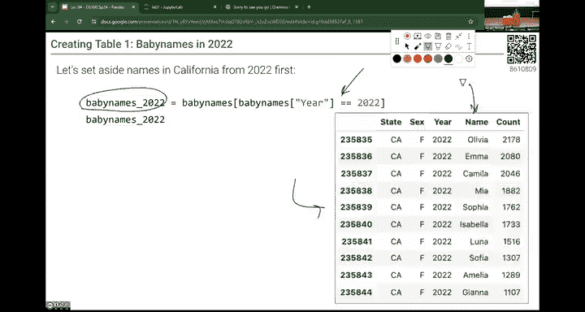

# UCB《数据100数据科学原理与技术｜Data 100 Principles and Techniques of Data Science 24SP》中英 - P4：-04-Data 100 Spring 2024 Lecture 4.zh_en - GPT中英字幕课程资源 - BV1Bc2dYCEbc

Let's get this started my favorite people welcome to another data 100 lecture。

 we guarantee you that this is the final Cans lecture that you're going to see and then we're going to move on to more fun stuff is starting from next week and things are going to get even more fun the week after which is the time that we're going to talk about visualization and how can we visualize data frames and any data that you have so things are going to get interesting from here。

For。Kind of a note before we start， this is a lecture that's going to be a little bit heavier in terms of content than usual lectures so kind of know that you might need to rewatch this lecture I'm going to go over a bunch of different advanced topics and pandas so we're going to start from very left off last time specifically we're going to talk about。

Sorry custom sorts we're gonna to talk about grouping so you' have seen grouping a little bit in day for those who are coming from day aid if you're not coming from day I'm going to review that so don't worry about not knowing and stuff today and then we're going talk about pivot table and then also a little bit about joining of tables this is going to be very basic and joining of tables you're going to see more about tables and SQL and all of those fantasy stuff in the second half of the semester but this is just to get started so let's assume that now going back to the previous data that we had in the previous lecture it was baby names you remember it was a name of babies who are registered in the Social Security database who were born in different years and we have your names we have the count of babies with each one of the names and we have also the sex sex of the baby let's assume that were going to do some customs。

as opposed to just doing these like alphabetical sorting or sort based on the accounts and things like that。

 let's say that I want to sort based on the length of the names of these babies and then do some kind of a custom sort so the plan for today is generally everything that I'm teaching I'm just going show you multiple different ways so that you see that in pandas there are really multiple different ways to do a stuff and every time that we give you app pandas problem you just need to think about it as a kind of a problem that we need to use your problem solving skills and then use the tools that we taught you in order to solve them So first off。

 the first thing is we want to go ahead and sort these names based on。

Based on their length and sorry that the caption is going over some of the content。

 but you can kind of guess what's in those rows， but anyhow。

The first basic thing that we can do is we create the priority that we want to sort on and then store it in a data frame and then be able to sort based on that priority value that we created so specifically what I'm doing here is I'm saying that let's go ahead and grab the name column remember that we could do processing on the string values that are stored in different columns using the dot STR accessor that we had so I would say dot STR and then dot L is going to give me the lengths of all of the names that I have in the column lengths so what do I do the result is a bunch of different values。

 the numerical values that are equal to the lengths of each one of those names I'm going to store them into this temporary variable here that I'm creating as baby name under score lengthes what do I do with that I can just go ahead and append it to my data frame and store it as a new column in my data。

FraRemember that we learn how to add a column to a data frame last time so how we can add it is by just starting to reference to the column with the label that you that we want and then it will go ahead and create that column for us then we tag the value that we want to store in that column which should be a series type so we pass the series object and that object is going to be stored in that column so specifically here I'm creating this new column name under score lengthes doesn't exist the first time that I make a reference to it that column is going to be created the content I'm going to reuse the content from the series object that I created before so then it's going to give me this name lengths column that we have then everything from here is going to be easy we created the ordering that we wanted or the values that we want to sort on that's our priority and that's our order so the only thing that we need to do afterwards is you learn about sort values last time which is called that sort values we say。

B name lengthes。 This is the column that we want that we want to use in order to define order。

 And then we would say that a sending is equal to false， meaning that the。

The order is ascending is equal to false meaning that the order is descending is starting from the lengthierer names in our data frame。

 so this is approach one super easy you're going to use it a lot of time。

 but I'm going to show you two more different ways that we can do exactly kind of the same and you'll need to use you need to remember all of those different ways that I'm teaching you because in specific applications one of them might be easier to implement and use specifically in homeworks and you'll be able to remember these and then make use at them later in the homework。

So the second way， instead of me going ahead and creating this new column and storing this new column what I can do is I can say that I want to order by some property of the name。

 but instead of using the name values themselves temporarily I'm going to create some key or some ordering that will be kind of be replaced if you will in that column and then be used in order to do the sorting for us So this key argument is going to be that ordering that I'm defining for for the values in the names column So how do I define my ordering。

 my ordering was based on the length so I need to give a length tag to each one of those name values that I had so how can I do it I need to have a function either you define a function separately and just call it here or here I would say that I'm creating a function under the fly with the lambda function I'll say that for all of these values of names。

I have just go ahead and calculate their lengths。 and those are the tags or priorities on the name so that later on when we're creating。

 when we're sorting values by name， then those priorities are going to be considered。

 This is kind of similar to any sort function that you're using in in Python and there is the key argument。

 which is going to tell you what should be the order or what should be the priority。

 This works is exactly in the same way。 As sendingending equal to filess。 we've seen it。

 we're getting the same。Data frame as a result， and we don't need to be worried about that extra column。

 by the way， in approach one， when you have that extra column， if you don't need it afterwards。

 you know how to drop it， you can just drop column。

 specify which column that you want to drop specifically specify that you're dropping a column because drop by default is going to drop or row so specify that this is a label for the column you're dropping a column and that column is going to be dropped and then you're going to get this final data frame that you're seeing here。

So far， so good。Moving on to the third way of doing it。

 So the third way of doing is doing it is a little bit fancier。 It does exactly the same thing。

 obviously， because we want to sort by name。 but you will figure out later on in I think the next homework。

Not the one that we're releasing tomorrow but the one after is that you might need to actually apply a function to all of the elements of a column of a data frame so in this case I'm saying that okay instead of me going ahead and sorting by the name lengths let me go ahead and calculate some arbitrary property that I want to sort on I'll go ahead and say that my property is going to be counting the number of occurrences of D R and EAs and I want to use that as my priority。

So the first thing that I can do is I can define a function that does that for me counting DRs and Es so here this is a function that takes in a string notice that here we're taking one is string value right and then we're calculating the number of DRs and the number of Es and we are returning the sum of the two Okay so we have a function that if you give this function a string it can just do the calculation for you。

What we can do is we can go ahead and say that I want to apply this function to this specific column so that it goes ahead and calculates this VREA count for all of these values。

 I'll restore these new values in a new column， I'll sort by this new column。

 which we know that we could do。The notation for that or the syntax for that for applying a function to a column and this is going to be very useful because you might want to create really fancy functions and apply fancy functions to a content of a column a content of a column so that's why this is very important so I'll go ahead and say that I'm creating this new column now you're used to this syntax the name of this new column as the R underscore EA underscore count and then I'm going to say that go ahead and grab the values in the name column map this function to these values。

 retrieve those values one at a time is store it into into this new column that we created the rest is a straightforward。

 go ahead and sort values based on this new column that we have if you want to drop the REA count column afterwards you can do that as well。

Okay， so we investigated three different ways just directly using Lambda function in order to create a new column and then use that column in order to sort it or you can define the function as like a separate function if the function is more complex and you don't want to you don't want to create it on the slide then in that case you define your own function then you will be able to instead of using the key argument to map the function you use just directly dot map called the function it will be applied and then you will have a new column you sort on that the third way that we saw it which was the second way in this ordering was。

What did we use？Yes。Use the key。 We use the key。 We didn't create a new column。

 We just directly use the key。 defined that lambda function under fly。

 and then the function value the function will apply。

So suing gears hopefully this few slides reminded you of the things that you learned and how to modify a data frame Suing gears and talking about group by why do we want to what is group by。

 why do we want to do grouping and what's the purpose of that and what's the syntax let's take a look at that why do we want to do grouping a lot of times we want to group rows based on a certain property and then we want to see them in different categories。

 say for example， the example could be that in the baby names data frame that I had。

 I might want to group by the rows based on the year I just want to look at for example。

 the year 1910 and I just want to see what happened in that year like what was the unique names in that year。

 what is the total number of babies born in that year so if you want to categorize your rows into different categories you will need to do grouping the other reason that we might want to do？

sometimes as I said， we might want to get a summary of what's happening in each one of those groups so we want to kind of have a report or some kind of a notion of generally what's the trend in each one of those groups I give you an example like if I'm grouping by year I might want to go ahead and calculate the total counts of babies who are born in a given year or in a given category then basically I'll have total babies born in each year so these are going to be the operations that are going to be very useful the syntax that you will learn with the grouping in data 100 is going to help you to perform tasks at the larger scale and then all at once and then be able to summarize some trends in your data to get a sense of what' what's the general underlying information that you have per category in。

In the original data frame。For those who are coming from data aid。

 this is a familiar slide for you from data aid， but we're going to take a look at how this translates into data 100 and what is it。

 what are these different parts and these different sub tables that you're seeing from the language of data 100 so。

When we want to create these groups， we would call dot group by directly calling dot group by on on a data frame object what a group by is going to do along with some other operations that we have is that it's going to split the object that you have initially the data frame into a smaller objects then later on you can go ahead and apply some aggregation function and then be able to combine some of those results that you have so that you have a summary of the trends per category and obviously when I say summary of the trends per category。

 the index of the result is going to be your category items so the index here is going to be different after we perform a group by operation。

When we call do group by an object is going to be created。

 which is called data frame group by object。 So the result is not going to be a data frame。

 It's going to be a data frame group by object， which if you can think about it。

 is that it's a collection of many data frames for us。

And then what we can do is we can take a look at each one of these sub datata frames and then gain some information from each one of those individual groups so this is kind of how it would look like so this is kind of a summary of the baby names data frame that we had initially the state sex and then name and so on and so forth if I go ahead and say dot group by and I specify the column that I want to group by on what is what are my categories。

 my categories are going to be years then the result is going to be a data frame group by object which is a collection of those groups and what are those groups there is one group associated with 1910 there is one group associated with 2005 one group associated with 2015 and so on and so forth。

So let's take a look at what's happening here in the code。Let me move this， zooming in。Okay。loading。

Actually， let me go ahead and。Okay， one more time， so loading the data frame so remember this was our data frame that we had initially I'm getting the tail that's why I'm seeing all of these names from 2022。

These are sorting examples that I'm gonna bypass and getting into the group by by year。 say say here。

 So I'm saying baby names dog group by year。 And let's see what the result is。

 The result is going to give me like some weird format output that it looks like that it doesn't want to give me more information from here。

 It just gives me that。Okay， you did the group by， you're welcome。

 This is your data frame group by object， but you cant do anything with this at this point。

So what we'll do later is that we know that the data frame group by object is not that useful。

 What we need to do is we need to tell pandas that go ahead。

 take a look at each one of these categories， each one of these sub datata frames that exists under this data frame group by object and aggregate information somehow for me retrieve information somehow for me from each one of those sub datata frames separately and we do that by the ag function。

 So this ag function when you're calling it on the data frame group by object is going to apply some kind of aggregation function that we're passing to this ag method。

 so this ag method is going to have some function that's going to tell pandas what is the operation that you want to do and then it will perform that operation and then it will give us the result so you can imagine that all of these three steps that I said splitting applying combining is happening here splitting is。

Going to be done by the first step that group by year。 It just does the split。

 and then the result is going to be all of those sub datata frames in a data frame group by object。

 then what we need to do is we need to apply sum function What is that function that we're applying we're saying that to the aggregation function that we want to apply sum go ahead and do the summation So it'll go ahead and do the summation if you。

 for example， imagine for the count column。 it will just go ahead and do the summation it will say that okay for 1910 the count column is going to be the summation of these to which I'm going to cheat from the result is going to be 342 and so on and so forth。

 So for each one of these sub datata frames it's going to have a summary of the function that it apply so that's the applying piece the second piece and then the last piece is going to be just actually combining all of these results it will go ahead combining all of those information together and then I'll get this nice。

A frame as a result。So I kept highlighting the year because I want you to notice that those categories are now going to be the index of the data frame that I have as a result。

 so every time that you get an output， you can just take a look look at the index and that index was the column that you group by on initially。

 so in this case， 1910 2005 2015， I have these count summations that are given to me。So the syntax。

 if you're wondering about this syntax， the syntax is going to be something like this。 The first row。

 you have a data frame， you just call dot group and then you call dot a。

 This is the place that you need to pass the function that you want to apply to each one of those sub data frames So that's an aggregation function。

 and then the job of ag is to apply that function， aggregate the result and give you a data frame at the end。

What am I doing here with the baby names。 So see here。

I'm doing something that I'm gonna explain next。 I'm saying that baby names go ahead and only select the columns year and count。

 right， we learn this。 This is context dependent extraction， right， So I'm now doing that。

 Now I have only columns year and count。 I'll say go ahead and group by by the year column。

 So now year is the index。 and I have a bunch of those groups based on the year。

 And then I'll say that go ahead and do aggregation based on sum。

 What do I have left initially I had year and count。

 So when I say that okay year is my category aggregation function is not going to be applied to the categories。

 it's going to be applied to whatever is remaining。 whatever is remaining is count here。

 So I'll just go ahead and do the summation on those counts and the result is going to be what you saw before。

 Okay， let's take a look at that in practice。So here I'm saying that。This is exactly the same code。

 So baby names selecting year and count。 And then I'll say dot group by by year。 And then I say。

What I want to do is just do the summation and then the result is you can kind of verify that year is the index because it's in bold and then there is that additional column of count again because initially I said I want to have only year and count to be selected so initially I only had that。

So what if I go ahead and do this， I say。Okay， I wan to see what you're doing now。

 I guess with this weird selection of your columns。 What if I don't do the selection。

 What if I just say that， okay， just go ahead and do exactly the same thing that you were doing。

On the entire data frame， baby names do groupier aum， so let's see what the result is going to be。

Okay， you get the point， right， what's happening there？Anyone wants to explain from this portion？

What's happening with the result。 when I'm doing。Act some on everything。Deev， yes。

Stuming up every single column right， everything is there except for the index that you like or the or the thing that you're grouping by on is going to basically is going to have that function be applied on them。

 So what's happening is that we're doing summation and a bunch bunch of the strings。

 So all of those Californias are going to be added。 All of those six values are going to be added。

 All of these names are being added， which doesn't make sense。

 That's why I initially filtered to only look at what's relevant to what we're doing here。Okay。

 alternative ways of doing it。 I could actually go ahead and say。That。So。

Go ahead and do this without。Any selection， after you did the group I。

 I'm assuming that under the hood， there is these sub data frames that now these sub data frames do have all of those columns。

 right。But what column are we interested in So index is separate Now I have like a state text and so on and so forth and the name。

 So what I can do is I can say that I'm just going to go ahead from these sub data frames。

 I'll say that I'm only interested in count so that when you're when Python is going to go ahead and do the aggregation。

 it will only do the aggregation and that column that's relevant so you can do like before filtering or after aggregation filtering either way would be fine。

So I'll say that act sum， and then I'll do exactly the same thing that we thought it would do。Okay。

 one more thing， let's see another example， oops， why did it go there？Alright， so let me get。

The syntax that we just came up with together。And here I want to also show you that we could instead of act sum some of these functions are there is a handier way of calling them instead of act sum。

 you can also directly call sum as a function and it knows that what you mean is just act sum so what we can do is I can say go ahead and do the summation and it will do that for me。

O。gettingt a little bit fancier。 But if I don't want to do selection。

 I just want to do the summation and anything that's numerical， right， Anything that's numerical。

 What I can do。Is I'm just gonna get exactly the same。Except for here。

 I would say that I'm not going to be concerned with column selection。

 I don't remember the list of numeric columns and nonnumeric columns。 So here in the sum。

 I would say numeric only is equal to true。 So by default。

 it will just go ahead and do the summation and anything that's numeric。

 Everything else is going to be ignored。Yeah， multiple different ways of doing it。Just see it。

 just sit with it after like doing two or three homework all makes sense。So running it， it works。

 so numerical only works， I didn't do any selection and as far as I was fine with applying it to any numeric column。

 then it does the job， right？So far so good。 So let's move on。 What we saw was。

Different ways of applying aggregation function。 Let's see what are different。

Kind of functions that we can pass to the act function。

 There are three different categories of functions that we can pass。

 There are obviously built in pandas functions there is a set of nupy functions that we can pass and there are built in pandas versions that we can pass So for example。

 for some we set that act sum that was the pythonic version of doing it so there was some function in Python we could just directly use it with the nu we could say if nuy was imported as NP we could say NP do sum with the built in pandas。

 we would pass sum as a straight and it would just basically do the same thing all of them will perform exactly the same thing it's just different notations and different implementations we can do summation we can do we can take maximum imagine that if you want to figure out what's the most recent year that the name was appeared in the database you can just take max different ways of doing max different ways of doing minimum taking the minimum。

We can take mean or average， so there's nu high version of it and versus a pandas version of doing that pandas also have other fancy kind of functions。

 which we're going to use quite a bit。Ag first， Ag last。 It says that get the data frame。

And get that sub data frame based on the group I that you're doing and give me the first row or give me the last row。

 we'll see why that's going to be useful。It's basically these are the only functions that are going to give you the entire first row as opposed to performing column wise operations。

 so that's why it's kind of very important and also a little bit different。

We also talked about having this kind of shorthand versions that we could just call dot mean dots sum and all of that so those are also available and we use them quite a bit bit these are different versions that we did exactly the same kind of year calculation。

 we said group by year we just selected that numeric column， we just said act sum。

We also just directly called some， we also said that what if I don't want to select those numeric columns and just say numeric equal to true。

 which we have taken a lot。So a lot of times when we do some processing we might want to take a look at the result and kind of make sense of what's happening in the result so in this case every plotting that I'm doing in this lecture is going to be beyond this scope of today's lecture we're going to see them two weeks from now。

 but I'm just going to go ahead and plot the result of this aggregation that we just saw。

Fancy so see on the if you want to read it a little bit。

 you can see that here I'm saying that go ahead， get the babies by year。

 which is that data frame that we created with the index being year and then the value or the first column being the sum of the count and I'll say that the y column of this plot is going to be the sum of the count that we calculated So you see this fancy plot that if I hover over it it will tell me that oh and the year 1956 what was the total account and so so on and so forth this is the total kind of a trend of the number of babies born in California over the years is starting from 1910。

So what's interesting here is that if we take a look and you need to do that for every kind of data that is giving to you is to double check what has happened just to make sure that your operation is right first of all。

 or there is no kind of bias inherently in the data that you have and if there is you have to kind of think about that and disclose that and think about that you can remedy it in this is specific case。

 what's happening is that if you take a look at， for example。

 the year 2020 you will see that for example， it is reported in the California database that the total number of babies born is around for 420K versus in our data we're reporting at 362K。

So the reason is the inherent bias in our data that not everyone is registered in the Social Security database right that's why these are only the babies who are registered in the Social Security database not generally the total baby born in California then you can sit with it。

 think about like who are you excluding and what does this mean and is there any way that you can combine additional sources in order to make sure that that kind of bias does not exist in your data just putting it out there as a site。

Concncluding remarks what we saw was group I， what we did in the group I was three operations is splitting applying combining so splitting was group by applying with any function that we were selecting we saw a bunch of different functions and then also aggregation is by default act function is going to do that after it applies the function that you have。

So now this is gonna be a slider question fun first is slide a question。

 So assume that I have that data frame and assume that I am going to use the first column that's highlighted in blue in order to perform act in order to perform group I And then later on。

 I want to perform act based on a function F that assume that that function F is going to be a function that takes maximum slide question for you is going to be what goes into the question mark question mark for row A go。

Okay， I'm going to move on the response， we were looking for row a， what should be the answer？Okay。

 let me run this。 This is my data frame that I'm creating。 So this is just the data frame。

 Now I'm using， for example， that column thing as my index。 So then I'll say that， okay。

 do the group by。Okay， let's collect， do the group I。

 use the index as the grouping kind of function and then do the aggregation and max。

 which what we're expecting is for a， we want to get high。Oh， suddenly。

 high is the one shows that should show up in the first row。Okay。

 how are we doing on group by thumb up， sideways， times down。Show me your hands， thumbs up， sideways。

 thumbs down， we'll get a lot more practice in the lab homework and discussions。Sorry was that。

Is there an explanation， Yes， so let me explain when we're taking the maximum over。

All of these values in this column what happens when you take the maximum between a bunch of its string values they're going to be ordered in alphabetical ordering and the one that is last in alphabetical ordering is going to have the highest priority and the highest order and that's going to be the maximum so here we have a string is starting with A is string is starting with C a string is starting with H H will have the highest priority so that's the maximum so。

That's why。High is the maximum。Thanks for asking allright。

 wonderful moving on I want to now use the time to show you a case study this is a case study that kind of is going to combine everything that you learned so that you see that now with this knowledge that we gained so far in two lectures in half we can actually do fun stuff so the task or the case study that I'm going to create or I'm proposing today is that we want to look at the female baby names and we want to figure out the ones that have drop the most in popularity。

And then we will take a look at what that looks like and what are the functions that we can define in order to identify the ones that have dropped most in popularity and also defining what popularity means。

So。😊，Make sure that you follow all of these steps and then you can also go through it after the lecture yourself first。

Bn。To make things simpler， because I said that we're going to only be concerned with female baby names。

 I'm just going to go ahead and filter it for that。 so I'll say that baby names。

Do conditional filtering remember lecture one or lecture pandas one where the sex is equal to F I'm going to have condition to be true if conditions are true those rows are going to be passed on to the output and then what I'm having at the end is F underscore baby names so we can double check all of these rows should have the sex to be equal to F。

Then what I'm going to do in addition is I'm going to just double double check and make sure that this data set is sorted by year because we want to take a look at the trends right。

 we want to say for example， when was the first time that this name appeared and then how did the popularity of the name increase or decrease over time and where we stand today？

So what we can do is we can also do a small version of what we want to do with the name Jennifer so what I can say is I can say that okay let's go ahead and plot what's happening with Jennifer to see like how the trend looks like and then how can we define popularity base on this trend that we're seeing so again the plotting portion is beyond the scope of today's lecture but just know that the data that I'm plotting is female baby names from the female baby names data frame or if underscore baby names and I'm selecting only for the rows where the name is equal to Jennifer right so that's my kind of filled of view right now what I'm going do next is I'm going to say that for all of these rows go ahead and grab the year and then go ahead and also grab the value count so I want to figure out that for every given year that Jennifer there was one baby at least one baby Jen。

Or like for yeah what is the count of the number of babies with that name and then we're going to go ahead and plot this value So Steve。

 we're also kind of getting the trend So when was the first time that the name appeared and then what the trend looks like。

 what is the maximum value and where and currently in 2022。

It looks like that the maximum happened in 1972， the maximum number of those babies is 6065。

Okay so now let's take a look at a few more things so what I'm interested in is figuring out what is the maximum value or the maximum number of babies born with the name Jennifer across all of the years that we had and also what happened in 2022 because we want to figure out the trend and how the trend or the popularity of the name dropped or not dropped over the years。

 so that's why the2 the year 2022 or the last one is important and also the maximum one is also important。

So this part should be now straightforward。 It's long。 General， when you see pandas lines。

 they're long。 but like， they're not this scary because they can debug them and like。

Have a mental model of what's happening there There is female baby names data frame that I'm indexing on。

 I'm indexing on and selecting only names Jennifer and then on top of that I'm saying that I'm only interested with the name with the column count。

 So this is the context the pen and extraction that we had only looking at the count is going to give me a series object。

 So this series object I can pass it to the nu function max and get the maximum value。

 which if I run it it will tell me that 6065 which is what we visually kind of inspected。

 but now here we're directly also checking that that was actually in fact the maximuma。

I can also do a similar thing and check for the last year， not the last year。

 the last year in the database， that I can check what happens with the what is the number current number of babies with the name Jennifer。

 which is what happened in year 2022。Take a look at this for like。20 seconds。

And it makes sense of why this is giving me the。Number of babies in year 2022。

I'll get someone from this portion to explain to the class。Yes， go for it。Exactly。

 so what's happening here is that we're using i like。

 Remember that I promise you that I like is going to be useful summer when the order matters and where the first and last has some kind of meaning for us。

 So in this case， if you remember， I was sorting the data frame by year。

 right So what I'm expecting is that the most recent year should be at the bottom right。

 And then what I'm doing is I'm saying that go ahead and do I like integer based selection and giving the integer position of the year to be negative one with Python indexing that would be the last row。

 And this is going to give me。The last row of this count series， so this was a bunch of counts。

 so now I'm getting that count in this series and the last entry。

 which is going to give me 114 Jennifer's baby name Jennifer in year 2022。

So remember that we were saying that we're concerned with this concept of popularity。

 we want to figure out what does it mean for popularity to drop So the notion that we're going to define here and this is kind of arbitrary for this case is study this is nothing fancy is that I'm going to define a concept called ratio to peak right so what does that mean calculate the peak。

 calculate where you are in year 2022 calculate the ratio and then I'll be able to figure out whether this ratio is less than one and if it's less than one what's that value and how much it has drop so it has a notion notion of the drop for us for Jennifer it's 0。

018 right so because we're expecting it was 114 and it was like a 6000 something in the maximum so the drop was significant。

This is good， we have done it for Jennifer， but was it useful。

 we need to do it for all of the names right we need to calculate ratio to pick for all of the names。

 be able to sort names based on that ratio to pick and figure out the ones that had the most drop and then be able to say that okay。

 these are the names that had the most drops and we've done something that we wanted to do。😊。

So in order to do that I'm going to modularize everything trying to do that in your codes in your homeworks as well。

 so I'm going to say that if you give me a series object I'm just going to go ahead and calculate ratio to peak based on those two functions that weve seen we wanted to calculate the latest entry right this is what' what happens in 2022 and this is also assuming that the series is going to come sorted by year。

And then divided by the maximum。 So I'm going to run this。

And we're going to try to just use this function to do exactly the same thing that we did with the baby Jennifer。

 which is， again， I'm going to get the Jennifer count series by just looking at Jennifer's and looking at only the counts。

 and then I'm just going to go ahead and say ratio to peak and passing this series object and then see if we can get the exactly the same result。

 which we did。Okay， so we have a function that if you pass this series。

 it'll be able to calculate ratio to peak we've tested it and Jennifer it works。

 we know that the ratio to pick for Jennifer is 0018。

 Now the task is to go ahead and apply it to all of the names that we have。

What did we learn so far in Group I？In group I， we learn that I can just group objects based on a certain property。

 and I can apply some function。 So this is that function， right， if you group。

The entire data frame that you have and segmented based on different names then for each one of those names you have a sub datata frame what do you do with that sub datata frame you get basically the columns that you want to calculate ratio to pick your act function is going to now have ratio to pick function as an aggregate as a function that you're going to apply in the second phase of the aggregation so we're going to do exactly the same thing。

Grouping by by name those sub data frames are now categorized by name I'm going to say that I'm only interested in year and count right so I'll have year and count because these are the only numer columns that I have you have seen alternatives that we could do it also in other ways and I'll say dot act you have to apply some functions to these data frames to bring them back to data frame format and the function that I is ratio to peak。

So let's take a look at what's going to happen here， it's going to take time。

 but the result is going to give me names as index values because we just said that anything that you group by is going to be the index of your output data frame year and count now you see that the error and count they have we have applied ratio to pick to both of them。

Okay。😊，Let me go back and just go ahead in advance。

 So these are all the things that we just explained。To this is slide question。So with this result。

 I we just saw with the names that index and the count and the year。

Are there any rows for which year is not equal to one。Think about it。

 Think about the fact that we applied ratio to peak。 What does that mean， What is peak。我 was。

The ratio that we were calculating。What does that mean for the year column。

I'm going to move on in 30 seconds and show you the response。5，4，3，2。1。

 okay now every row has the year value equal to one。 So let's see why that's the case。

 technically if I go here and I take a look at the unique called the unique function on this year thing the result you're going see is that like there is the unique values is there's only one value with the value of one and the reason being is that the max value let me show you here。

The max value， I don't know if I have it here。 No， the max value is the most recent year and the most recent year that you're calculating ratio versus the max is the same。

 So it's the same year over the same year So the result is going to be one for all of the rows that you have。

So one thing that I skip that I want to go back is。What happens。

 remember this aggregation that I did， I specifically said go ahead and get year and count and then do the aggregation on the year and count we've seen that like in the previous example。

 but the names if I wasn't doing that it was just doing a strain concatenation which was fine not so good but fine in that case it was not throwing any error。

 but if I don't do it here and I just go ahead。And。Stay。That。Go ahead and group by by name。

And then act by ratio to pick and without any selection。

 what I'm going to get is I'm going to get an error that this error basically says that you have a bunch of string values and you're expecting me to do a division between who is string values it was fine with getting max it was fine with getting the last row but when it was calculating the ratio then it can' do that so it is going to throw an error so watch out for those issues sometimes panndadas is going to be accommodating but sometimes it's not going to be that forgiving in these cases so that's why I basically did those selection the way that I did。

So moving on we know that all of those year values they're all going to be equal to one so there is no point in keeping them right I might as well need to drop that column initially but now after the fact I can also drop it remember the syntax that we had drop the year column access is equal to columns you have to specify that access is equal to columns otherwise it thinks that it's a row that you're dropping the result is name and count side don't have the year anymore。

The one more thing that you're seeing is if I scroll all the way up when we were performing all of these aggregation functions。

 it was performing aggregation， but under the hood it was also keeping these column labels as is so year was not year anymore count was not count anymore it was they were ratio to peak values that we had so it won't do that re naming for use So after aggregation those values though those column names might not make sense so you might need to go。

And rename what you had， which in this case， I'm going go ahead and say that oh I had a column with a label of count。

 I'm not interested in that anymore， change it to count RTP and then it will change that to count RTP and so far so good what I needed to do at the end was to figuring out the names that had the most drop in popularity So that's why I'm going to use this count RTP column in order to sort for finding out like which one of them had the most Paul and then what you're seeing is the sorted version of count RTP What you're seeing is like the names that is still are at their peak at the bottom and then the names that had the most Paul in the beginning which is Deborah debbie Carol and then you can see those the small ratio to peaks that they have right now。

I can just go ahead， be a little bit fancy and plot what's happening with Deborah。 You see。

 this is what's happening with Deborah。 There was a peak at the run this year with around 4000 babies named Deborah in 1955 and recently fiveish babies are named Deborah I can go ahead and say that okay。

 I was interested in top 10， not the one that had the most fall So how do I do that Remember that we could get the head of a data frame。

 right， I'm getting the head， I'm saying that give me the top 10， the beginning 10。

 but I'm not interested in the values themselves。 I know that like whatever value the ratio to pick is gonna be be it。

 what I'm interested in what is what are those actual names So that names are in the index column because now name was index It was bolded right So I'll go ahead and get the index。

And you're seeing the top 10 names with the most drops。 And then what I'll do is， I'll just。

To again show the fence plot I'll show you all of those names。

 you see the legend on the right hand side， don't see it， you'll see it now。

 you see all of those legends with all of those different names and then you can see the trends over time and we have achieved exactly what we wanted to do。

O。Very good， very good。 So moving on， we talked about all of these things。

 They're all documented documented in the slides。 If you want to go over them afterwards。

 feel free to do so。😊，So other group group other methods that are available on group by object we just talked about the type of the result of the group by to be data frame group by object we just took a look at a bunch of different shorthand methods and different ways that we can perform all of these numeric things or be able to get for example the first and last right we have seen that before there are other functions that we're going to take a look quickly and then see them in different examples and demos the two important ones are size and count we'll see what the differences are between size and count and why they are going to be helpful later on and then we're also going to see filter what does filter do as a function instead of just calling ag and then using a bunch of functions we can use all of these functions that you see on this slide so let's first get into。

The size and counting size is going to when you call size on the group by data frame object。

 the result is going to give you a series the index of the series is going to be the index or or the column that you group by on initially so we group by year so this is now the index the values here is going to give you how many rows do you have how many instances that you have in each one of the categories if you want to do a count per category this will do that so 1992 two rows。

 two rows and then also four rows here it's hidden under under that guarantee you there are four rows there。

The count is going to be different count is going to count how many elements actually are there because we might have nonvalue or missing values in our data frame so the result of calling count on a data frame group by object is going to be a data frame this time not a series because it will go ahead and do the count per column and per feature so the indexes is still going to be the same index that we're expecting but it's going to perform counts per columns in independently and it will tell you that okay for this column how many non null values did you have for that column how many non null values did you have for this is specific index so looking at 1992 you're seeing that for this first column there' is only one non null value or non- missing value here so that's why the result is going to be one counting how many values we have and then for this other one two non- null values。

Then the result is going to be two and so on and so forth。

 that's the difference between size and count。There is another fancier function that's available。

Whi is called filter filter is going to filter out the entire group so for example。

 if you want to define a certain a certain criteria that you say that okay group items into different sub data frames and then these sub data frames can exist in the output data frame if and only if this condition is met or not what is that condition。

 how can you define that condition and how do we apply it on a data frame we'll just go ahead call group by will call filter and filter is going to take a function。

What does this function do， This function is going to be。

 Let's just assume that this is the function that I have。

 This function is going to get a data frame as the input。 This is just a pseudo code。

And then it's going to return true or false value。So what does that mean。

 that means that it's going to get each one of those sub data frames。

And it will perform some kind of check， and then it will tell true or false if the result was true。

 the entire category， the entire data frame， sub data frame is going to be preserved。

 otherwise it will be filtered out。It's very interesting some note about filter is that filter is not going to change the index filter is just going to do the filtering the result is going to be exactly in the same order with the exact same index that you had before so it will just do the filtering it will not do the aggregation or categorization of the downstream data frame。

How would it work here So say i'm doing group by and then I'm saying that I'm filtering by passing a function F this function F what it does is that it is going to get a data frame and return true or false so here I'm going to say that this function F I'm creating it under fly with the lambda function it's going to get a sub datata frame and it's going to evaluate this Boolean expression and the result of this boolean expression as we know is always true or false。

What is that bullolean expression， it says， go ahead， look at the numb column。

 you see that I have a numb column as a second column。

 take the sum over numb column for each one of those categories if it was greater than 10 pass through otherwise pass false。

So what do we do there， So we say that， okay， we grouped by by the first column。

 So now I have all of these categories， ABC， and there is a D under this。And then we'll say that。

 okay， we're going to go and calculate some on the nu column。

And then we'll perform the check to see if all of the values。

 all of the rows in a sub data frame are going to be passed or not。

 So that means that I'm going to sum of all of these values。 the values is 6，6 is less than 10。

 So the result of this Boolean expression is going to be false。

 That's why the entire data frame is going to be eliminated from the output。

Other ones for the category B， the summation is 12 for category Cs 13 for category D。

 there is only one value of5 so it's not going to make the cut and then the output data frame is going to be exactly the same as the input even the same order but it's just that those rows that that correspond to the category A and category D are removed。

 so it's as if I'm removing this， this， this and this and the rest is exactly in the same order that you're seeing here index is also the same。

Yes。In this case， it's just another column that I have。 Yeah。

 the question was was BC and such or index or another column they're all just。Value is in a column。

 okay。Now， I wna show you a bunch of fancy stuff with filter and then show you how we can be misled by how these operations can be done。

So first of all， I think the first one is not that tricky The first one is this example says that' I'm going to look at the elections data data frame and I want to only keep the presidential races that the maximum result that any candidate got that year was less than 45% so less than 45% of popular vote so what I'm doing is i'm saying that go ahead grouped by by year。

Do apply filter。The function is going to be this lambda function that I'm applying it takes one of the sub data frames what is each one of those sub data frames it's one presidential race because we categorized it by year right for each subd data frame let's take a look at the column percentage that's the percentage of votes take the maximum and see if the maximum is less than 45% in that case return true in that case preserved the result and then we see the output you see all of these outputs the percentages are less than 45% and then everything here is preserved as in the as it was in the original data frame that we had。

Now this is a puzzle， this is a tricky part now let's say that I make it a little bit complicated and I say that go ahead and give me the best election by a party what does it mean what do I mean by a best election by a party for example。

 if you look at the Democratic party， you know that the best election that the Democratic Party had was in 1964 with Lyndon Johnson and then the popular vote result was been and the percentage was 61%？

And this is basically the best presidential election that the Democratic Party had。

 what we want is we want to have an output data frame index B the parties and the values be the best result by that party。

 the best result meaning like collectively what was that candidate。

 what was the result and so on and so forth。We might think that the simplest way to do it is just to go ahead and say doug group by year。

 sorry， doug group by party， because we just want to look at the parties， parties was indexed。

 that's a hint， then we have to group by by party， then take the maximum and if we take a look at the top 10。

 these are the results that we see。What's wrong here。Yes。Exactly。

 it's just going to perform this operation column wise so it will give me the maximum of the candidate。

 which we know how to take the max of a string iss going to give us Woodrow Wilson it's going to give us the max of the year we know that Biden didn't get that percentage in 2020 and then its it' still giving us that percentage of 61% but again。

 we know that that's not for Woodrow Wilsonson and the year was in 2020 So this is the issue what we are creating is because we're applying it column wise the result is incorrect。

Now I want to give you a bunch of different alternatives to keep you thinking about。

What are different fancy ways that we can do it with the tools that we have。First thing。

 looking at what is available to us， we know that we have to do group by regardless or like that's an easiest way that we can do it but looking at all of the functions that are available。

 then we can seem to use。Any of these ones， but count and size is not going to be useful filter could be useful。

 but also easier than that is going to be first and last。 If we were to preserve an entire row。

 this seems to be the only kind of function here that is going to have the index to be changed and it' only going to get one single row and it's not going to apply any function。

 any function kind of columnwise。So how do we do that。

 how do we order it in a way that first or last has some kind of meaning in terms of what is the best presidential race？

Sorting sorting by percentage we'll sort by percentage obviously if we sort by percentage we say as sending is equal to false is going to be descending So the top values are the best presidential results are going to be at the top what we can do is we can we can do a group by by party now we have each one of these updated frames group by by those parties again they'll keep the same ordering so meaning that in each one of those categories for each one of the parties the best result is going to be at the top so our job is really easy we just call first and then we'll get the best result。

Very fancy。 We just need to be a little bit creative。

 Think about it before you start coding solution too kind of sorry。

 this is the same thing there are other approaches。

 I could also implement exactly the same thing with the lambda function Anything that you can seem to find a function for you can just directly say go ahead and group by by the by the thing that you want to group by And then here with the act function you say on the fly create this Lada function。

 this Lada function is going to get one sub frame and it's going to give me I like add position zero and we know what that means that means the first row。

And obviously， assuming that the data frame was already sorted beforehand before we do the group by。

ID X Max is also another interesting way。 Let's take a look at only this part for now。

What does this part do， This part says that， okay， do a group by on the party。

Just look at the percentage column。And give me the I D where the maximum is happening in this column。

So assume that this is going to give you a bunch of different labels so it's going to look at。

 for example， the Democratic Party， it will look at the maximum in in the column percentage。

 it will look at the label for that percentage it will preserve that so for every group you have a label that that label refers to the row label that that maximum is happening what you do next is you do luck you pass all of those labels and all of those are going to be returned。

So kind of thinking about nesting versus like。Kind of applying functions back to back This doesn't this last way doesn't use any group I what it does is it uses it uses sorting and then it uses drop duplicate so it does the sorting and the percentage which we know that we should do so what it does is it sorts in ascending order So the better rows are at the end and then it says that for the column party I just want to keep one instance of the party I just don't want to have a bunch of different democratic kind of rows。

And then drop all of those duplicates， except for the last one。 Keep last， see the keep last thing。

 Keep the last one， D everything else。 Very simple。Very are creative。

 but it won't come to your mind instantly。 It will take time。And that's fine。All right， so。

We talked about having more than one way of doing it。

 we also said that there are no direct ways that we interact with data frame group by object。

 but there are also like some ways that we can take a peek we can say data frame group by object that I have here I can say dot groups what it's going to give me is it's going to give me a dictionary the keys in the dictionary are going to be all of those category names that I have which in this case is party and then it's going to have the value be a list of different role labels that are going to go into that category。

I can also go ahead and say that okay， get group， get group socialist and then it will give you the result as a data frame so all of those rows are going to be given to you as the output and then that's going to be how it's going to look like。

Quickly talking about pivot table， you've seen that in data8。

 the pivot table is kind of the same way of doing group by on two columns。

 If I do go ahead and group by on year and sex together you see that two columns are going to be my index this is called multiindexing which is going to be a little bit difficult when you want to index into a data frame and select rows and columns instead what we can do with pivot table and this kind of similar syntax exists in data8 is that you'll say that I'm going to use one of those one of those columns that I wanted to group I as my index I want to use the other one as my columns so instead of having multiinexing in the right-hand side and the left hand side of the data frame I'm going to just create a table that shows the association between these two columns that I wanted to group by on。

And then we will say that okay what are the values that are going that are going to be considered in an aggregation function and what is the aggregation function so here values is going to be a list that includes the count column and then here I'm saying that the aggregation function is going to be some so what's happening is that instead of that nasty multiindex thing that I was getting with with grouping by two columns now I have one of them showing oh now my pen isn't working one of them showing here and one of them showing here。

All right， so let's see them side by side let's see why you would prefer one versus the other because one of them with one of them is really easy you label you indexing two their result by the row label and the column label。

 but the other one multilevel multilevel indexing is a little bit complicated it's also a little bit beyond the scope of data 100 this semester。

The mechanics of that， when we say that we want to group by by two elements。

 that means that for every pair of possible values in those two categories I'm creating a category right every every pair of values is going to create a category as opposed to only a single value creating a category meaning that this A and F is going to create a category A and M is going to create a category B and F so on and so forth。

 so these are going to be my category。When I'm going to go ahead and apply the aggregation function。

 I'll apply the aggregation function or like the function that I have on each one of those categories。

 So I'll do the summation， which is the goal that we have。

 So per category there is a value that is being calculated。

 So this is the value that we have that we said that we're going to take a look at the count And then here we said that the aggregation function is sum。

 That's what's happening there。But the way that what's happening as a result in terms of the presentation is that the first column is going to go into the row。

 the second column is going to go into the columns and then those values are going to be situated in the corresponding places if there is a missing value for a pair of combination for a combination of values for those rows and columns then we'll put none there are different ways you will learn how you can replace these non values with other values。

 you can say replace it with like zero or replace it with one or whatever that you want you can just choose not to have non values。

In the output。You can also have multiple different columns that you want to perform some kind of aggregation on you can say that okay I want to do I want to calculate maximum for every combination of year and6。

 but I want to perform maximum on the count and also on name。

 but's going to change is that the year the index is going to remain the same also your column labels are going to also remain the same。

 but now you'll have one category for count one category for name。

 but still everything is going to be structured in a similar way so this is how we can also have multiple columns of values there。

Joining of tables。 This is gonna take me。Two minutes to show you what joining of tables looks like because what I want you to see is that as we have these data frames and this is really the last piece that we can modify each individual data frame。

 we can add column we can change it， we can do group I we can do filtering。

 we can do all sorts of fantasy stuff， but also that there are cases that are data sets are in two separate data frames。

 What if you want to connect them。 So in terms of connecting I have a nice example that looking at the elections data frame with all of the names of presidential candidates。

 I want to look at the frequency or the popularity of their names in 2022 So for example。

 if you're looking at Dwight Eisenhower the popularity of their name right now in 2022 S5 not that much。

 but we want to combine all of these information in a kind of a vectorized way using merge。

So how would I do that？The first piece is gather information that you want to combine in a proper way remember with females baby names kind of example that I was filtering everything and I was only keeping F underscore baby name with all of the babies who who with with the sex F so and then I did that I'm going to do the same preparation here here I'm going to say that I'm going to define this baby names 2022 by selecting only baby names。

With the year equal to 2022。 So this is a subset of my my previous data frame that I had。

Then what I'm going to use is I'm going to say that I'm going to take a look at the name。

 I will extract the name of the candidates that we had before and then using the name information as the key or as the reference between these two data frames。

 I'm going to combine them so every row is going to have all the information from the from the elections along but all the information from the baby names but all in one place in one data frame。

So obviously with the election data set I need to have a first name because I had the full name this is another string function that you see we're gradually throwing these string functions at you we're looking at the elections candidate column I'll say this is the string and I'll say go ahead and split it by space and just look at the first instance before the first space so SD are at zero is going to give me the first instance we could I could also do get zero and get the first first instance there so storing the results in the first name column this is new so my data frame right now has everything from before along with this new column first name now my baby names has a name column here I have a first name column I can use them as reference in order to merge columns which I'll do。

There are two lines they do exactly the same the first line says that I'm going to store the result of the merge operation into a merge data frame。

 but what it is is that I'm going to call pandas I'll say do go ahead and do emerge on two tables the left table that I have is elections。

The order really doesn't matter。 Only thing is that the parameters should align。

 The left one is election。 The right one is baby names 2022。

I'll say that your reference point and your key on the left one is the first name。

 because remember that we just created first name in the elections。

Your reference point for the right data frame is going to be the name so on all of the rows that you see this kind of a similar key value go ahead and merge them into one column into one row which is what you're seeing as a result here I have year underscore score X I'm going to come back to that I have candidate all the way to first name which was all of the all of the columns that I had in the elections that was the first data frame or the left data frame that I had。

Everything here is going to be from the baby names so all of those are now going to be combined so what you're seeing is that Andrew Jackson all of this information the first name is Andrew but then it is merged with the row in the baby names in the year 2022 with the name Andrew the year is 2022 the count as 741。

What was this underscore Y underscore x？I had two columns with the same name it tried to preserve both of them because it's not sure if I want to keep the second one or the first one it's going to refer to the first one with underscore x。

 the second one with underscore y probably in this case it would make sense for me to drop the year underscore y and only keep year underscore x and rename it to proper year because what I was wondering is just what's happening with with the election situation alternatively I could have used the left one and just say that okay this is elections called dot merge and then these are the information about the right data frame and then all of those references that you have that the left reference is first name right reference is name。

All right， wonderful right on time， this was all about Ts we'll see you back next week on exploratory data analysis。

😊。