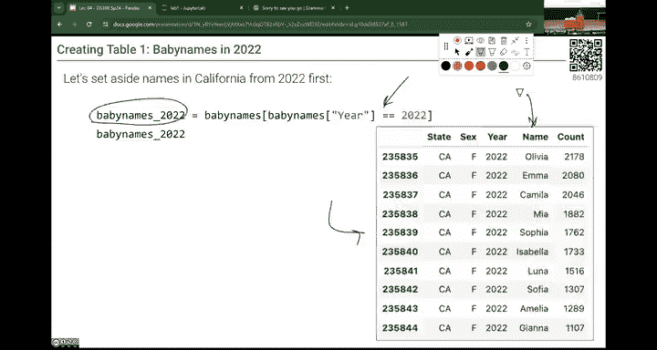

# 课程4：Pandas进阶操作与数据整合 🐼


在本节课中，我们将深入学习Pandas库的进阶功能，包括自定义排序、数据分组、透视表以及表格合并。这些技能对于高效地处理和分析结构化数据至关重要。

---

## 自定义排序 🔄

上一节我们介绍了Pandas的基础操作，本节中我们来看看如何实现自定义排序。有时，我们不仅需要按字母或数值排序，还需要根据数据的某些衍生属性进行排序。

例如，我们有一个包含婴儿姓名、出生年份和数量的数据集。如果我们想根据姓名的长度进行排序，而不是按字母顺序，可以采取以下几种方法。

以下是实现自定义排序的三种方法：

1.  **创建新列法**：首先计算姓名的长度，将其作为新列添加到数据框中，然后根据该列排序。
    ```python
    baby_names['name_length'] = baby_names['name'].str.len()
    baby_names_sorted = baby_names.sort_values(by='name_length', ascending=False)
    ```

2.  **使用`key`参数法**：在`sort_values`方法中直接使用`key`参数指定排序依据，无需创建新列。
    ```python
    baby_names_sorted = baby_names.sort_values(by='name', key=lambda col: col.str.len(), ascending=False)
    ```

3.  **应用复杂函数法**：定义一个更复杂的函数（例如计算姓名中特定字母的数量），应用该函数创建新列，然后排序。
    ```python
    def count_dr_and_e(name):
        return name.count('dr') + name.count('e')
    baby_names['dr_e_count'] = baby_names['name'].map(count_dr_and_e)
    baby_names_sorted = baby_names.sort_values(by='dr_e_count', ascending=False)
    ```

每种方法各有优劣，具体使用哪种取决于任务的复杂度和对中间数据的需求。

---

## 数据分组与聚合 📊

理解了排序后，我们进入数据分组。分组允许我们根据某一列或多列的值将数据分割成不同的子集，然后对每个子集进行聚合分析（如求和、求平均）。

分组操作通常遵循“分割-应用-合并”的模式。

以下是分组操作的基本语法和步骤：

1.  **分割**：使用`groupby()`方法根据指定列（如`year`）将数据框分割成多个组。
    ```python
    grouped = baby_names.groupby('year')
    ```

2.  **应用**：对每个分组应用聚合函数，如`sum()`、`mean()`、`max()`等。可以使用`agg()`方法或直接调用聚合函数。
    ```python
    # 方法1：使用agg()
    total_babies_per_year = baby_names[['year', 'count']].groupby('year').agg('sum')
    # 方法2：直接调用聚合函数
    total_babies_per_year = baby_names.groupby('year')['count'].sum()
    # 方法3：仅对数值列聚合
    total_babies_per_year = baby_names.groupby('year').sum(numeric_only=True)
    ```

3.  **合并**：Pandas会自动将每个分组的聚合结果合并成一个新的数据框，其中分组列成为索引。

分组后，我们可以方便地分析每个类别的趋势，例如绘制每年婴儿出生总数的折线图。

---

## 分组对象的高级方法 🛠️

除了基本的聚合，分组对象还提供了其他有用的方法。

以下是几个关键的高级分组方法：

*   **`size()` 与 `count()`**：
    *   `size()`：返回每个分组中的**总行数**（包括缺失值），结果是一个Series。
    *   `count()`：返回每个分组中**每个列的非空值数量**，结果是一个DataFrame。
*   **`filter()`**：根据自定义条件过滤整个分组。它接收一个函数，该函数对每个分组子数据框进行评估，返回`True`则保留该分组所有行。
    ```python
    # 保留总票数超过10的年份分组
    filtered_df = elections.groupby('year').filter(lambda sub_df: sub_df['votes'].sum() > 10)
    ```
*   **`first()` 与 `last()`**：在分组内排序后，返回每个分组的**第一行**或**最后一行**。这在需要获取每个类别中的“最佳”或“最新”记录时非常有用。
*   **`idxmax()`**：返回指定列中最大值所在的**索引标签**。结合`.loc[]`可以提取出完整的行信息。

掌握这些方法能让你更灵活地操控分组数据。

---

## 透视表 📈

当我们需要基于两个维度进行分组和聚合，并希望结果以表格形式清晰展示时，透视表比多层索引的分组结果更直观。

创建透视表使用`pivot_table`函数。

以下是创建透视表的参数说明：

*   `index`：指定作为行索引的列。
*   `columns`：指定作为列标签的列。
*   `values`：指定要进行聚合计算的列。
*   `aggfunc`：指定聚合函数，默认为`‘mean’`。
*   `fill_value`：用于替换结果中缺失值的值。

例如，我们想查看每年(`year`)每种性别(`sex`)的婴儿总数(`count`)：
```python
pivot = baby_names.pivot_table(index='year', columns='sex', values='count', aggfunc='sum', fill_value=0)
```
这将生成一个表格，行是年份，列是性别，单元格的值是对应年份和性别的婴儿总数，比多层索引的`groupby`结果更易读。

---

## 表格合并 🤝

最后，我们学习如何将来自不同数据源的信息合并到一起。Pandas提供了`merge()`函数来实现类似数据库的`JOIN`操作。

合并操作的核心是找到两个表格中能够相互匹配的键。

以下是使用`merge`函数的基本步骤：

1.  **准备数据**：确保两个待合并的数据框有可以关联的列。如果列名不同，可能需要先进行重命名或提取。
    ```python
    # 从选举数据中提取候选人名
    elections['first_name'] = elections['candidate'].str.split().str[0]
    # 筛选2022年的婴儿姓名数据
    baby_names_2022 = baby_names[baby_names['year'] == 2022]
    ```

2.  **执行合并**：使用`pd.merge()`或DataFrame的`.merge()`方法。
    ```python
    # 方法1：使用pandas顶级函数
    merged_df = pd.merge(left=elections, right=baby_names_2022, left_on='first_name', right_on='name')
    # 方法2：使用DataFrame方法
    merged_df = elections.merge(baby_names_2022, left_on='first_name', right_on='name')
    ```



合并后，新的数据框将包含两个原始数据框的所有列。如果存在同名列，Pandas会自动添加`_x`、`_y`后缀加以区分。

---

本节课中我们一起学习了Pandas的进阶数据处理技术。我们掌握了如何根据自定义规则对数据进行排序，如何使用分组和聚合来总结数据特征，如何利用透视表从两个维度展示数据，以及如何通过合并操作整合不同来源的信息。这些工具将极大地增强你探索和分析复杂数据集的能力。