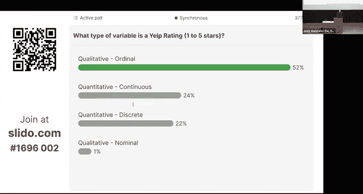

# UCB《数据100数据科学原理与技术｜Data 100 Principles and Techniques of Data Science 24SP》中英 - P5：-05-Data 100 Spring 2024 Lecture 5.zh_en - GPT中英字幕课程资源 - BV1Bc2dYCEbc

Check。All right， put this down here， maybe。With this guy to hide。

Good morning everyone or afternoon morning， it's still morning， okay。So this is an exciting lecture。

 this is the unboxing lecture which I enjoy doing， so we'll talk about unboxing data。

 there's a slido， please go to the slido。If not done so already， we'll have a poll pretty soon。

Before I jump into the lecture， we get to look at some of the results from the pre semester survey。

So we do a pre semester survey side note， we do these surveys often， please fill them out。

 we do look at them and we even adjust the course based on what you tell us， so fill it out。

And what did you tell us？All right， so maybe I think the punchline is that you're not alone。

 the data is actually pretty clustered， people have mathematics background。

 some people have some familiarity with calculus， this is the bimodal distribution。

 some people had significant exposure， but if you're not that familiar of calculus， you're not alone。

If you had limited exposure， I guess you're kind of alone。

 but you know you could group yourself in any one of these other categories。So if linear algebra。

 we'll come back to linear algebra， it seems to be a concern for a lot of people。And probability。

Same kind of thing。So if you have some familiarity familiarity， you're not alone。

 if you had significant exposure， you're not alone。All right， we had no prior experience。

Little bit alone， maybe take a look at the data8 material that that's kind of the probability background that we're building on for this class。

Okay， python。All right， most people have some familiar familiarity or significant exposure we've had limited exposure again one of these two no prior experience Okay。

 so now you should start to realize you need to know Python by how you've done some homework with some Python in it。

How are you feeling？We'll see in a second actually so if you have if you find yourself struggling with Python。

 come to office hours， get help， there are a lot of online tutorials you can teach yourself Python on your own in a few hours if you need it。

 the basics to get get going。嗯。You to care spotlight me。去。OK啊。南派。Some familiarity。

 we're gonna do lots of dumb pie， you'll get more experience with that。 SQL， we'll cover it。

 It's interesting to see how the SQL distribution has changed over the years in the past， everyone。

 I know SQL。 And everyone's like， I， Maybe I know SQL。 So we'll， we'll cover that in coming weeks。😊。

Okay。Inference and data visualization。So again， some basic familiarity of inference where we'll talk more about some concepts inference in this class。

 date8， sort of the first crash course in inference， so if you want more。

 go back and look over the date8 material。Data visualization will do a lot of in this class。😡。

Everyone has some familiarity。 I hope after this class， you'll have significant exposure。Inness。

Right right， this's kind of cool。So what potential challenges do you anticipate in this class。

 people said？We near algebra。Yeah， that is challenging。

Every time I looked at this class we thought about maybe we should drop the whole linear algebra thing。

 but the reality is it's an important part of this class， it's challenging。

 but this class is a good chance to actually learn linear algebra when I did linear algebra。

 I didn't get it and then when I started using it in an actual thing。

 it started to make sense so if you're not comfortable linear algebra now is your chance to become comfortable with linear algebra。

Other issues， time。Yeah， that's a problem for me too， so we need more time， make time for the class。

 don't try to do everything last minute。Coding， work on that， people have no impediments。

You were lucky， none， okay。Office hours should not be an impediment。

 it should help you if it is an impediment， let us know。All right。

 and what topic in data one how are you most excited about？Panda is not even a topic， it's pandas。

And why pandas， I don't get that。 It's， it's a terrible library， but it's the standard libraries。

 You have to learn it。 Padas and SQL。 That's new When we started this class。

 everyone wanted to do machine learning。Ct learning is down here。Machine learning。

 oh I can write that， yes， machinech learning is down here。嗯。S， okay。

 so pandas will definitely cover a lot of pandas you get practiced with that。All right， and in fact。

 now that we had that survey at the beginning of this semester， we get a new survey。Right now。

 so how comfortable are you with pandas？Please vote how do I look at this， I click on it。食死。哦， okay。

Everyone's。This fish， which I assume means neutral。 That's great。 People are smiling。 Good for you。

 And people are in love with pandas。😊，Really well do lots more pandas Basically throughout this class。

 you will learn more pandas And as you learn more pandas you'll realize you do not know enough pandas so I imagine you go oh wow I think I get it and then there's all this new stuff have to learn and then you'll get that and so on So take your time with pandas it's it's a thing you learn over time in fact。

In Professor Missouriouri's last lecture， I learned something new about Padas。So。

 and I've been using pandas for too long。Co。So today's lecture is about data wgling and。EDA。

 which is exploratory data analysis this is probably what most of you will do much of the time as data scientists。

😡，Take data， really try to understand that data。Transform it and then。

pottenentialally build models do statistical inference。

 but a lot of it will go back to understanding your data and being really able to explain what's going on。

 both the good and the bad about your data。So we're here in our data science lifecycle。

 we built this lifecycl when designing this class to provide some structure for this process。

 so exploratory analysis right here， a lot of what we talk about today is again transforming trying to make sense of our data。

 understand what's wrong with it， what's right about it。

 we'll talk about kind of connecting back to getting more data。

 a lot of you will enter this step right here。By having someone give you some messy data and go。

 great， now go straight to here and try to figure out what's going on。And in some sense。

 I think that's one of the most fun parts of data science you're given this crazy new data set and you have to try to understand what's good。

 what's what's going off the data， what's wrong， so we're going to try to teach how to do that。

RightSo I said at the beginning lecture， for me， EDA is unboxing， it's unboxing for your data。

You get a new toy， a new gadget， and you take it out of the box， what do you do？

Do you read the instructions？Probably not EDA， there are instructions， there are documentation。

 you might pull the data， start looking at it， go okay you pull your new toy out and go this is a cool feature I like that。

This is me a problem。 I have to fix it。Sometimes I need to get batteries。

 there's more things I need to get。That's it啲。One of the people who created EDR to find this process was John Tki。

's a famous statistician， mathematician， he said something interesting which is why this is a hard topic to teach。

 it's an attitude and a state of flexibility to find out what's not there and what we believe to be there。

So it's a process。And so it's hard to give you an equation for EDA。

 It's also hard to ask exam questions on EDA， but it is also a central part of data science。

 So to try to organize that process。We created。An outline。

 So here are five things to think about when you're looking at your data。

 and we're going to go through these in great detail today。Structure， barley， the shape of your data。

 how was it organized， How might I like it to be organized？Spend a lot of time on that。Grranularity。

What does a row of data mean， what does a single piece of my data represent？😡，Scope。

 does the data reflect the thing I'm trying to study， I'm interested in a specific class。

 but I have data for all of UC Berkeley， maybe it's aggregated at a granular that won't let me understand that thing。

Often again， you're given data and you're asked a question， answer this question， and you're like。

 well。I can sort of infer something about that question， but I don't have the right scope。

 we'll talk about that。Temporality。How was the data positioned in type？

This one's interesting because when you see a date。

Or a timestamp in your data does it reflect you know when the data was created。

 when the event happened， when it was transmitted to a database， we'll talk to this as well。

 and then faithfulness。 And this is a lot to do with cleaning as I look through my data。

 Can I find places where there are flaws and flaws could be things like that's a misspelled address。

 Maybe a lot of these people have the same address。 I just couldn't spell it consistently。

 it could be people put in fake data and you detect these things and deal with them。と不得。

In data science， we try to move our data to be more rectangular。

 Everyone likes pandas and SQLs it's because pandas and SQL give me a rectangular form of my data that I can work with not all data starts in a nice big table in a nice rectangular form and will work through the process of getting there that process of moving my data to something I can actually work with is data cleaning。

We talk about rectangular data。 there's sort of two flavors of rectangular data that you probably already are familiar with。

 tables and matrices。Potas， data frames， spreadsheets。

Were characterized by having columns with names。 Everything in that column is supposed to be the same kind of thing。

 So those columns correspond to a field of variable and attribute with a type which we'll talk about。

And they're manipulated using pandas or SQL。Fundamentally。

 under all of that is some basic algebra of transformations on common data。呃。In back。

 there's research on connecting all these technologies， so if you like tables。

 you can transform it to SQL and you like SQL， you can transform that to table operations。Sts。

Marices。Different I was a grad student， I didn't have pandas when I was doing my research。

 so I worked with everything in matrices and it was a pain I'd try to convert all my data using ugly Python code MatLb code into just giant matrices full of numbers。

I did that because I was doing modeling and in data science as we go from our EDA process。

 we're probably actually going to move in this direction as we try to build models。

 so moving our data from tables which have strings。

 all different flavors of data into giant matrices that we can build models around。But not always。

 often we can answer our questions just by thinking about the data in this domain。Start focus。

 we'll talk about some other shapes of data in a moment。All right， so for today's lecture。

 we have three demos and I hope to get to all three。 The first looks at tuberculosis。

 an interesting observation was during the pandemic。Tuberulosis cases went down。Your thing， so 2020。

There's a sharp decrease in tuberculosis incidence。A lot of speculation why， simple things could be。

 people wearing masks， maybe they didn't get tuberculosis。 they weren't out in public。

 so it couldn't spread。Or maybe people got tuberculosis。 and they just didn't get tested。

 They didn go see a doctor。So there's a study of this。

 and we're going to look through this calculation this process of computing incidents using a data set that I'll pull down and I'll walk through the various parts of the Jupiter ecosystem for EDA。

Right， so we're going to try to reproduce this calculation。

So the first flavor of data we're going to look at is comma separated values， CSV files。

Raise your hand if you've used a CSP file in your life。Wow。

 I'm going to say most people have probably seen or touch a CSP file， so it's pretty easy to explain。

The title is right there。 So it's comma separated values。 So we have comma separating our fields。

 and then records， are rows are separated by a new line character。 Or if you use M S Dos。

 Microsoft Windows， a character to a new line character， just defining end of a line。

So you open in a text editorer kind of makes sense And then typically we're lucky and there's a row 0 or something that has some header information。

 And then again， these are our problems of information here that we're going to map directly into a data frame to work with。

😊，SoLis to a demo。OK。So tuberculosis。This is the demo part 1。 So I broke the demo into three parts。

 We're gonna do our standard imports。 You'll notice in all our lectures were importing a bunch of things。

 When I do work on my own， I have like a template notebook that I'll pull from that I have these basic imports and some tools for visualization。

You'll see that in this class， I'll mix different visualization tools and in coming lectures we'll talk about those tools。

 but I'm not going to spend a lot of time on that now。

So the first thing I actually want to show you is a piece of bonus material。

The data we want to look at is here， so this original CDC article。

And there's a table right here on a website。So I want to do analysis on this table。

rightI've downloaded the table so we can do this analysis quickly。

 but you can actually use pandas to pull data directly from the web。Unfortunately。

 in the current incarnation of the Jupyter Hub， we haven't installed a package for doing this。

 so here's a line to do this you can uncomment it if you want to install this package I'm going to run this on my computer where I have this package and the cool thing is I can do read HTML and point pandas at any website that has a table on it maybe it's your favorite football stats or things that you're tracking for a house that you're possibly trying to buy you can pull the data directly into your environment so I'm going to get all the tables on that page and the first table table number one is the one I want that's my data frame。

So you can write code right now to pull data from anywhere on the web， you see a cool website。

 see a Wikipedia article， you want to analyze the data， build a new plot。Onelan code。

So that's pulling from HTML bonus material。When you're doing data science。

 good idea to keep a snapshot。😡，Professor Nazuri has already downloaded a snapshot this file in previous semesters。

 so we're going to use that snapshot。So it's a CSV file。哎。

I'm going to show you some cool tricks withs the Jupiter environments。 we're using Jupyter La。

This is an IDE， it's a an environment we can do pretty deep analysis and we can bring and move things around This over here is my explorer。

I'm going to look at this tuberculosis CDC or CDC tuberculosis file， it's says dot cV file。

 This extension is purely optional it's an naming convention just because it's a dot CSV doesn't mean it's a comma separated values file。

 let's take a look at it。 I can open it with an editor。I get an editor over here。

 This is just the raw text if I felt like this should be 36， I could change it。

 don't do that don't edit your files， work with your data as is if you want to transform it。

 put your transformations in code and explain why you're transforming your data You want reproducible science。

Cool thing about the setup， and if you know this， you can drag tabs around so you can rearrange your work environment to actually have mobile files open。

The other thing we can do with this environment is I can open this up directly as a table。

What had this guy。Right， so now I can see the raw data that's been downloadted in CSV for。

If you look up here， the environment's guess that it's a comma separated file so it's used comma to separate。

 I could say， well， no， it should use semicoons， it's not so that doesn't work。This is my data。

You look at this， you see some problems already， right？You got some new data。嗯。I look at my columns。

It should be a column labels， missing column labels， column labels seem to be here， maybe on row 1。

So there's some translations we're going to need to do。

 let's bring this into Pans and start working with it。So I't close the two section space。

All right right before I do that I want to show you something that's useful in your Python environment you can use Python tools to look at parts of a file directly without opening it an editor why might I want to do that？

Any thoughts。Tell you a story。 You have a one gigte file and you just double click on it。

 Your editor might take a while to load。 It might even freeze。

 A lot of editors will say you know what， no pro I'll just open the whole file。

 put it in memory and take a look at it。 you have a large file and you try to load that in your browser。

 your browser might crash。 So don't do that。 And in fact， actually。

 if you do that in a Jupiter environment， it might not be possible to open up your notebook again easily in the browser。

 So you have to use tools to fix your notebook。 So if you have giant files， this one is not。

 But if you did， you could walk through it using something like the open function in Python。

 And then I can iterate over a few of the rows reading the row。

 So this is reading one row at time and printing it and maybe stopping early。

 take a look at the top list file。嗯。You look at this and go， huh， why are there these extra spaces？

So print puts a new new line character， but each row also has a new line character at the end of it。

 So we have two new lines。 There's another really useful function Python called Reper。

 This preserves the underlying representation of the string。So lets me get to see what is going on。

 so now I can see these special characters directly in my file。

So if you're trying to diagnose the problem of the file。

 using these Python tools can be really helpful。You'll notice in these notebooks that we have tangents in lecture I'm tempted to follow those tangents I won't today because we have a lot to cover。

 but if you want to learn more about different ways to play with files。

 you can take a look at the notebook。All right， so let's load this in。

So I'm going to use the panndas Read CSV function as one of my colleagues noted in previous semesters。

 read CSV is one of the great contributions to humankind because it figures a lot of stuff out for you and it can handle lots of variations in the underlying data layout data formatting and so on so let's try it so we're going to read CSV this file。

It a day Frank。All right， so what do we get？We still just see the same problems we solve before。

 we have all these unnamed columns。Probably because there was a row。

 a single row which had like the groups of column labels and then below it were the actual column labels for the corresponding years。

So I need to do something about this data so I can process it。So what should I do？All。

 so this is the process of I got data， now'll do some data cleaning。

 manipulation to be in the right format for my analysis。

So I want to show you something again this is a very powerful function it has a a lot of options you can set for it you may not know this in your Jupyter lab environment。

 but if you hit the shift tab key， you can see the documentation for the function you're currently at。

Can scroll through it。 can see all the the many arguments you can set。

 It's a great way if you're like， I don't use this crazy penis function。 What does it do。

 Shift tab and you can， you can learn more。😊，Another thing I want to show is if you're on a Mac。

 you can hit command I， and if you're on a PC， I think it's control I。

And they'll also show you the documentation in a side pane。

And this is kind of neat because if I go somewhere else， like open。

You'll show me the documentation for that function， as well。So if you're trying to figure stuff out。

 this will hopefully make it easier to understand what the function is and how to use it。All right。

 so we're back to trying to make sense of this data。We want the header to be not row zero but row1。

 so we go over here I's just actually used documentation， so among this guy shift1。So the header。

Scroll down。Soup it's the you know zero indexed location of the row that I want to use the actual header the column names。

 so I want the first row not the I want the second row or row number one so we're making some progress so now I have row row a column label that corresponds to each the columns。

Okay， other issues with this file。Well， so I pulled these in and again。

 let's go back to the original data over here。So in the original website。这。Is your article。

So I want TB cases and I want TB incidents， which I'm going try to recompute。

 So these were these were group labels and these react actual column labels。

 So I'm going to rename these columns to include this T incidence information。

 So renaming columns so you can work with your data is a pretty standard practice。

 So let me show you how to do that。 I think you've already seen this section in previous lectures。

 we'll demonstrate it again。So we're back here， we've got the headers。

 we want to make make sense of these columns So we're going to create a dictionary。

 This is this mapping from a previous column name to the new column name that I want to use for that column so I'm going to take 2019。

 2020 and 2021 call it this and then pandas saw well 2019 is already a column so it added a dot1 to extend the column names so I have different column names which my columns。

But that's hard to understand names， so I'm going to again map these to the incidence columns。

And this again。Looking better。Do you see other problems with this？No problems in mind。

 we're going to come back to it， so we return to our slides。2。All right。So。

I said this is a guideline for things to go through。

 you'll go through these not necessarily in a linear order。

 so in this demo I talked a little about structure we're going to come back to it now we're to talk about granularity so how coarse or fine is my data。

This might come as a surprise to you， but it's very common for tables to have rows that correspond to the things you're trying to study and then someone felt it would be nice to have a row with totals in it。

 maybe totals for a region， totals for a user or for a category。

 and I'll just go and put those as a row in the table as well So we often have data at different granularity。

So typically， data in the form of the finest grain is most ideal because we can aggregate that data and do stuff with it to compute more coarse grain analyses。

 but often we'll have data that's kind of partially aggregated。

Or we'll have large aggregate totals in our table。 So understanding the granularity of my data is important。

 First， is it all the same granularity， If not， I might want to separate the different granularities and then for these course or things how were they built So what does each record represent and actually to give a concrete example。

 you might be looking at shopping and you might see a record for a person multiple times that could correspond to a person making a purchase or you might see just one record for each person or it could aggregate all of their purchase history So what does each record represent。

And are there records of different granularity， which is often called rollup。For aggregation。Right。

We will get a little bit to this， but when people aggregate data。

 you should be suspicious how do they aggregate that data that they average， they sum。

 maybe they just sampled， maybe they just took one and said that's the representative purchase for that person it was most recent so understanding how it is aggregate is pretty important。

嗯。Throughout this process， I keep saying you're going to figure this out。

 part of figuring it out is just looking at the data， trying to understand patterns。

 another important part of figuring this out is looking at the documentation。

Should you trust the documentation？No， don't trust documentation， why。

 because data documentation is actually often bad， why is it bad data changes who wants to update the documentation when the data changes。

😡，Yeah， so data will often change faster than the documentation。

 You should look at the documentation， but you can't say， oh， that comm is is， you know。

 it's described as this in the documentation。 So it must be this。

 You should be suspicious and check to see how it actually computed。All right。

 so we're back to computing TB instances， we looked at granularity。

In order to complete the incidence calculation actually it's good one thing in back to my demo here。

 so I did say there was a problem， let's take a look at this data here。

 if you look at row zero I have a total so there was a roll up in this data set。

We' going do some detective work in looking at this roll。

 so we think this is a total of all the columns， right？So we could drop this row and move on。

But you're a suspicious person。 You want to check that。 Also，2。17 seems to be smaller than 1。

77 and 7。91。So it's an odd choice for a total。More suspicious I am okay。So let's look at the data。

 So I haven't copied one point here。 So I want to understand this row。

So one thing is I could just drop the row。It's pretty reasonable， no more total。

 I can go on with my analysis， but you know， again， a suspicious person will double check that。

So if I drop that row， so just drop row zero and take the s thing else which I C。Kttle。What do I get。

Is this the total？What happened here。Okay， what was the total before， it was 890，0， or so it had 87。

We had 5，8。 we have 8，7，5，8。 So it didn't add the numbers。It added the strings。

 So it's all the numbers here。 These are These are numbers or strings。

 how you take the sum of two strings。 You just stick them together。 That's the sum of two strings。

So it didn't do the right thing。What's wrong？This is a really common problem。

What type of data do I have？What Python type of data do I have， I have objects， what are objects。

Well， this is a catch all category for things that are not numbers， floats， integers， bulloles。

 they're objects， so strings are a kind of object。Why did that happen？Python's CSV。

 it readCSV functions， magic， usually it figures stuff out， but it got it wrong。

It skies on a little bit of a tangent that we need to actually explore。

 so let's go back to this data。What's going on this data？Look at this row。89。8900 this total。

hass a comma in it。 Why does it have a comma in it。In some regions。

 the world putting a comma between groups of three numbers makes it easier to read。

 This table is designed to be read。 So it has a comm in it。

 But what's the problem with a comma and a comma separated values。File。Well， it's a separate row。

So this brings us to another aspect of this structure of data if I have。Coma separated values。

 and I want to write a comma as one of my values and you do something called quoting。

 so I place quotes around the field and that lets me put lots of commas in this file。

 These commas aren't treated as comma separators but as part of that value。And Peris goes， well。

 that's a funny looking string。So it sees a string。

So it infers this must be a string column because why else would you have commas in it？喂。Now。

 people put commas in the numbers all the time。And as I said， this function is kind of magical。

So we want to fix that， so we go to read CSV。And this time we'll break it up， we say header equals 1。

And we can specify a thousands uses commas。I'm doing another trick here。

 I put parentheses around a multiline expression。What's going on？What if I didn't do that？

Let me just break this apart real quick， is it。Every before I'm going to highlight it again。

 when we're writing lots of data transformations， it's nice to put them on multiple lines so we can read what's going on。

 Python will say well， this doesn't make any sense to me。

 I want this to be attached to the previous line。It'll be okay with that。In fact。

 no I need this in the previous line too okay at that right but that's harder to read so a common pattern you'll see in data analysis code is to break stuff up and use parentheses Once I put parentheses I'm free to do whatever I want between those parenthees and put lots of new line characters so and now I can explain。

There were commas。But thousand。And I can also explain what's going on， rename。

Some some documentation will be less helpful I'm gonna to leave that alone so I'm clearly renaming the columns。

 Okay so that lets me take my data and now I've transformed it。

 you no longer see a comma in this field because it is， in fact， an integer。

 We can check the types really quickly I didn't show this before。

 so let's do it again So T Df says my data frame I can do D types and it returns the types of each of the columns Now I have integers and floats in my data。

This is the data type that's used to store the data。Okay， so now if I compute the sums。

you can see everything。 apologize。Okay， so now I get 8900。 So now my sums work out。

 You'll also note that these sums do not work out 107 is not what's actually in the current total column of 2。

71。So we won't go through how that was aggregated here。

 but you can take a look at the rest notebook to try to understand how they computed the total of an instance。

So turn a lecture。Pularity compute incidence right so the remaining step here is we want to actually work through this exercise。

 and this will highlight one more big part of the EDA process。 if I want to compute incident。

 what do I need。And this depends really on how I'm computing it since or how it's defined。

 and this is cases per 100 up， you can't see that。Cases per 100000 persons。

Okay so I have cases total for each of these regions so I I have the number of cases in Alabama。

 number of cases in Alaska， but if I want incidents。

 I need to compute something as a function of population。Right， so the compute incidence here。

 I'm going to work through some basic math。In some sense。

 when we are defining instance in terms of groups， we want number of cases per group of 100，000。

 you could write this as number of cases here。this is my group population of 100 about 100000 I actually sometimes find easier to think about instance as I'm computing the proportion and then rewriting it in terms of groups of 100000 it's easier to think about these numbers and of these tiny fractionions but you know number of individuals in a group of 100000 that we have tuberculosis which is the way that we report this number so what do we need to finish this analysis。

We got this。I don't have this， right， so this is missing。

So I need to be able to compute the population。 This is， again。

 big part of doing a expatory data analysis is finding what data I don't have and then going and getting that data。

You'd be amazed at how much data you can find on the web in the world so we can actually get population information。

哎。So before I do that I want to point this out so we drew this lifecycl or this like data science lifecycle is kind of a process it roughly goes like that。

 but the reality is when you're doing your exploratory analysis it is very common to have to pull external data you might also reframe the questions we're not going to do that presently we're going to focus just on pulling external data so this is data acquisition。

So let's go you that。So I'm going to pull geographic information from the US。 census。

Show you how this works。 and this is data that was already downloaded。

 but you can also get it from the various sources。 so I have the links to the sources themselves。嗯。

Thank you。We'll just go straight to the file， so let's start with the file， so before we jump in。

 I'm going to look at this file first。get an idea what's in here start with the editor。Alright。

 so this is my file。What kind of file is this？It said CSV， we see lots of commas。

 so that's a pretty good sign， we see this too。What is going on here， This is a very common trend。

 too， You know， someone took us an Excel spreadsheet and just put important information on the very first row in the very first column that will help you understand this Excel spreadsheet and then saved it as a CSV file。

 So now we have to work with that。诶。Let's do one more thing。 I will open this in the。

And a table explorer。Again， so we see there's some useful information that was put in the very first thing here。

 some more descriptive information， and then it looks like the things that I care about。

 the years and stuff will be the final comm labels are here on the fourth row or row number three。

Okay， let's see how we're going to import this。Right， so I want。

The fourth row or row number three from this file to be the header。

 and I'm going to do the same thing as before where I'm going to separate by thousands。

So was my data trip。It's not bad， I got the thousand things taken care of if we look at the bottom of the data frame。

More notes in the file。 Again， very common trend that you're gonna get data with these weird， extra。

 extra fields。Question。Great question。Yeah， so let me do one thing some context I failed to give you all。

 So let's go back to it。 So in this original calculation。

 it's like the cleanest version this table here， sorry。

There we go so I'm trying to compute the TB incidence in 2019 right so I need the population for Alabama in 2019 and I'm gonna and I have the number of counts so I'm going take the number of counts divide it by the population for that year and then multiply that by 100。

000 That was the equation on the previous slide so I need the populations for the corresponding years and I can get that from the US census so I'm going through the process of taking the census data file and transforming it so I can use it with this data file。

There are census data imported。 This is more crazy stuff going on。 data cleaning。

 we'll be removing this。 And we're gonna to use more pandas functions。 So like I said。

 you're gonna learn more and more pandas。 Here's a more representative example of a data cleaning process So I'm going to take my data frame from before I'm going rename the comms actually let me do something as a general principle I like to if I'm going do data cleaning maybe I'll pull the whole whole file in again just in case I run this twice So I'm going to load the data so that step one and then step two is to take the data I'm going rename this unname  zero and geographic unname  zero comm to the geographic area and I got that by looking at the actual file。

So right here。This is my geographic area。 I need this。And it pulled this blank here is the name。

 so I going of copy this down。So I named my geographic area， and I want to drop the census column。

 which is the original census estimate it's done not every year。 And then the estimate base。

 I don't need either of those columns of my analysis so I can drop columns。 It's cleaning up my data。

 And then I'm going to call this magic function called convert types。

 and this is going to convert floating point numbers that aren't floats。

 So it might have assumed that all these counts for floats。

 this will try to infer if it could be simplified to ins。 it's not strictly necessary。

 but it's going make my data easier to look at。 And then I'm going to drop all these rows that have missing values。

 we'll come more we'll come back to when we'd want to drop missing values or what else we might want to do。

 but for this purpose， this is just data I don't want。 So I want to drop these rows altogether。

So this is my pipeline now so load the data， do a sequence of transformations。

 and save it back to the original data frame name， and that is my final data frame output here。

All right， so what do we see？Are there issues with this？What's the granularity？

Without got granularity， we have the United States。One granular area， that's the courses。

 we have regions， and then we have。Dot states。That's weird。And Puerto Rico didn't get a dot。So。

What's going on。So a different granularity we can fix that。

 and then we have additional data encodings that were used here to represent things that weren't regions that were were indicated with a dot to indicate a state。

 If I want to work with this data and combine with other data sources。

 I need to remove these dots from these strings。Thursday。

 we're going to spend the entire lecture playing with strings and ways to transform them here we're going to do something pretty simple。

So I want to take the geographic area and I'm going take the string accessor and this lets me access that column using string functions。

 So it's a column full of strings。 So I'm going to apply the string accessor。

 and I want to strip away the dot so there's a dot at the beginning or the end of the string。

 get rid of it。 I don't want it。不要。So we've clean up the states， we have different granularity data。

That's going to be okay。But we could drop the different granular data if we wanted to。

We we can do this again for 2020s。So I had to pull two files in。Why do I have to do that？Well。

 the census reports a separate file for every decade。Same transformation as before。Please stop here。

 Any questions。Are any questions on Sr。Pions in the audience， yeah。Yeah。

 so drop in A is removing the missing values， the NANs， the NNs in my file。

So this is the way we're moving missing values， which we'll talk about at the end of the lecture。

Hopefully we get there， okay， let's go back to our slides。Alright， so we got the data。

 We're going to come back to another big part of structure。

 which is working with multiple files because we have multiple files now。

 we have the TV data file and then we have the population data files。What do you think we need to do？

W I jump to doing it。What pandas function since everyone is excited about pandas。

 Should we call next。Just yelling out。One more time。Ching。Shape。Oh， no， that's not correct。

 we're going to talk about multiple files what do you do with multiple tables？

You join them and in is that's called。Join and merge， but for our purposes， it'll be called merge。

 so pen is confusing there's more than one function most of will do in this class with merge so we'll talk about that now。

All right， so we're going to again spend more on this concept of working with multiple multiple tables when we get to SQL。

 why would I have multiple tables in general？Why didn't the world just one big table。

 why do people insist on breaking things into lots of little tables。

 even when they're in the same organization？It's actually pretty standard practice。

 it's good practice to break your data into lots of little tables because you don't want redundant data。

It's expensive to store， but that's actually not important。Aeroprone。

 so if I have lots of customers information copied multiple times and I update the customer and I have to update all those copies。

 so it's very common to have my data spread out， but to do anything with it。

 I have to put it back together。Join or impendus merge。

How do I choose to merge So this is a big part of structures identifying these relationships between rows across tables。

And there are two big concepts to understand how to do that。First， is the primary key。

Let me state the definition， it's a good definition， the column or set。

 it's going to be more than one set of columns in a table that uniquely determine the values in the remaining columns。

So it could be a set， so more than one。So let's go to these。Products， okay。

 so this is the primary key。 The product has one cost。

 so it's a functional relationship between the primary key and everything else。

So if the product had more than one cost， we'd have a problem， right。

 so it'd have more than one copy so it would not be unique。So it wouldn't be a primary key。

 I might need a product and region Id， for example， to make a primary key， but in this case。

 product determines cost。Customers，Custom I D determines the address of the customer。

 The customer wanted more than one address。 we'd have a problem。

We can't handle that in the way we've designed our data。Change it。

 we might have customer and then addresses for a customer。

 but then we have a separate file for the address or a separate table。Here， in this case。

 order number references a custom ID D。 So order number here is a primary column。

 So there's an order and has a corresponding customer and a date。So primary key。

 let me actually give one example， a multicom primary key here。So we have purchases。

In order to determine a purchase， I need an order number and a product。

 and that determines the quantity。 So if I make a purchase。

 I have to have two columns to determine the quantity， the order number and the product。

Which means that if you tried to buy for the same purchase， the same product twice。

 you'd have to increase the order number you can't have more than one row for that。So primary keys。

You might have heard that before。The more important thing to learn about is foreign keys。

 and this is a reference back to a primary key somewhere else。

So customer ID here references back to the customer ID up here。

So this tells us how we're going to join， we're going to take our foreign keys。

 well look up primary key data and attach it to that rowm。

And a foreign key again could be a column or set of columns that reference Premier keys and other tables。

Let's do it。All，So we're going to merge multiple tables。

I'm using a little a trick and Python and Jupyter， in fact， so I'm gonna show you three tables。

 three data frames at once with this cell。 So you see all three data frames。

 I'm going at the tail the last two rows in this each of these data frames。 So these data frames。

 I want to stick them together。Which is called。Join， except in pandas where it's called mergech。

A little bit of background on that， PAN is also based on existing data frame libraries when it was built。

 there were libraries like the Data frame Libraryr and R， and they called it mergeG。

I don't know why they can' me。Ps also has a join function， which does roughly the same thing。

 but it only lets you join on an index， and it doesn't let you to join on arbitrary columns。

So we'll use merge because it's the closest to the join and SQL which we'll cover later。

 and I want to join each of these， what's the primary key， what's the key relationship here？

So in a sense， these are actually primary keys for all of these tables。

So it's a primary the US jurisdiction determines the rows here in my TB， my tuberculs is data frame。

 and then my census data frames is my two census data frames again。

 the region here now called geographic area， determines the census data。H。All right。

 so let's do merge， we've covered this in previous lecture， we'll get to do it again。

So I'm going to do threeway merge， so I have my tubeuls data frame。

 I want to merge that first with my census 2010s data frame that's going to be the right table TBbDF is going to be the left table and then I'm going to use the left key is US jurisdiction that's this comm here so I want to join on this equals the right key geographic area in this table。

So when they're equal， I want to connect the two rows， so I get a much longer row。好的。

We're not done because I also want the 2020s data， so'll do another merge。 again。

 my rights data will be the 2020s census sten。Left on US jurisdiction again。

 right on geographic region。So two merges。And you see how this is nice and easy to read。

 I've chained these into， separate lines。Let's take a look。W okay， here's our results。What happened？

 so here's my tuberculosis， that was the first table。The right table was the 2010s data。

 no geographic area here has an X， it was the first one。

 it's going to start to try to enumerate these since that has the same call name again over here。

 geographic area again， Y。Right。I've essentially stuck all three tables together。

 and I've done this which's by default an inner join。

Which means that I preserved only the rows that have a match on both tables。 So unfortunately。

 I think Puerto Rico didn't make the cut。 is disappointing。嗯。When you do these joins。

 it's something to think about， when you choose a kind of join， which we're not going to cover now。

 we will cover this when we get to SQL。 you'll have some rows will get dropped if they don't have a match。

 So there wasn't a match on on the left and the right。 that row is gone。

Sometimes you want to preserve it and you can say I want to do a left join。

 which says whatever is on the left table， it has to be an the answer， there wasn't a match。

 just put missing values the whole way across。And that would be a good way to preserve data in one of these joints。

对。We might finish on time All right， so one problem with this table is it's starting to get big。

When you're doing EDA it's okay your table to get big sometimes you get so big that it's hard to look at and it's hard to work with so we might want to project away or select just a few of the columns we actually care about so let's try that one more time so I have my tuberculosis data frame I only look I'm only interested in 2019 and 2020 in 2021 so its the only years I need so I'm going to take the right table。

They're doing something here。I'm using my context specific selector to pull out just the columns that are relevant from that table。

 so just the geographic area， I need that for the join and 2019。

That's the one column from that giant table that I actually wanted。Same left and right on conditions。

 Now， when I'm done， I don't actually need the geographic area anymore because， well。

 that's the US jurisdictionary contains that information。 So I'm go ahead and drop that column。

 so I don't need it。Now I'm going to do a join again。

This time from the 2020s and I want 2020 and 2021， I'm using geographic area from this table right here。

 and I'm going to join that against the US jurisdiction and the table that I'm building up。And again。

 geographic areas have done it， so Ill drop it。So now you got a nice， clean table。

What are we want to do？The exercise is to try to recompute these incidence numbers。

 so let's try to compute the TB incidence for 2019。

 we have the number of cases and we now have the population for 2019。So let's do math。

All right so again， this was the calculations we had on the slide。

 so TBB incidence is equal to the population number of cases in the population divided by the population。

 sorry。Times 100，000。Because I want number of cases per 100，000 individuals。

So this is one of the reasons that we use these tools is that now it's easy to express these calculations by just saying I want the census cases in 2019。

呃。By the way I say back， this new table I've called TB census DF， that says all my data in it。

So I take TBB census DF， I have the cases in 2019， divided by the census population for 2019 times 100。

000。You'll notice that I put an underscore here。 I don't have to do that。

 It just makes it easier to read and Python will tolerate that。

 It'll just treat that as a like a comma。F， let's calculate it。

And so we're going to do something here， we've calculated this column and we're going to ahead and stick it back in to be the column called recompute incidence in 2019。

So let's go recompute incidents， we get 1。77， and then 1。77 was what was calculated here。

It's not an exact match。So they might have used a slightly different population estimate when they did this original calculation。

It's close。嗯。Bonus feature I want to show you so you can do more advanced stuff I want to do that for all of these columns I'm going to use a four loop instead of having to write this this thing four times or three times in a row。

Do have for loop， so I'm going to loop through the years for year in this list。

And I'm going to do this assignment， which is using something pretty cool， so taking my data frame。

And I'm filling in the column。Recompute instances。With these squiggly brackets year。

 so I put this F at the beginning of the string， this lets me put code inside a squiggly brackets。

 So here the code is just the variable year。 So this will as I loop through this or loop。

 this string will take on different values with 2019，2020 and 2021 filled in for the year。

So now I can loop over columns。Quick important aside， don't loop over rows in this class。

 you should use the operations and pans to do work on rows that will make your code far more efficient so you can work with larger data sets and it'll teach you poor techniques。

 It will be important no matter what data to'll use in the future。However。

 it is okay to loop over columns when you have just a few columns doing so is actually maybe the most natural way to do this calculation。

We did that and we added all of the cus the instance calculations for our census table。O。Going fast。

 I'm gonna stop here。 Are there any other questions。 How is Sdo looking。So I was looking， okay。

 so that's not good。If you do have questions， ask questions， I am going intentionally very fast。

Because we're trying to get to everything so we can get you prepared for your homework。

But if there's stuff that's unclear， let me know。All right， so we finished our study of tuberculosis。

 we haven't finished our study of structure。Other file formats that you might encounter。

Go through TSV just build it in TSV is a lot like its cousin the CSV except instead of C it's T T is for tab so we get a character that looks like this this is a back slash T means tab it's a tab character it's a special character it's not a space but a tab。

That's it， that's what we've changed why might I use a tab separated values file over a CSV？

Liipal reason because maybe I have commas in my data that I don't want to quote my strings。

 There's really no good explanation for which file you should use。

 It's often what someone will give to you。 if you wanted to choose a good way to represent your data there are other formats that might actually be better pandas can read everything from Excel files to J files and we'll get into some of these in a but often you'll see data formatted like this tab separate values file I'm actually gonna skip the demo of T separate values。

 you can open them up in the same way we open up the CSV file and you can see the tabs and you can also view them in the table viewer。

Right。There's more to the world than rectangular data。

Sometimes there's cubic data if you're working in the sciences。

 this is what your table might look like， you have a column temperature which has a giant cube or tensor of data this could be time。

 space Latin lawn， so time Latin lawn work could be height， Latin law。

So it's common that you work with data that doesn't fit at least intuitively in a nice， pretty table。

So this's just right， this this could be lats。Law and elevation。

it is possible to transform this data data back into this form in fact。

 a lot of what you will do in basic data science will be even taking this kind of data and maybe taking a slice of it。

 maybe just this entire。Peace， and then you could say I have a lot。 Well。

 that's unfortunate a lot along。 And then I have maybe a temperature here right And so I can make those columns on my table so we can work with this data if you want to get fancy and we're not gonna cover in this class。

 there's a project called X array which lets you work with data in this native tensor form。

 So if you are doing work in science， check out X array， guess what it's built to look like pandas。

 So what you learn in this class will still be useful。 It just extends this other data。

So there's other families of data。I did my PhD on graphs。They're different。

 you can transform graphs into tables， Ill show you how you put the source。

 the destination and the know the edge value and your table。

 you can store your edges so you can make graphs look like tables。

 but often the algorithms of things we use to operate on them work better when you think of them as a graph and there are whole sets of tools for working with graph structure data。

The last category is this thing。呃Jason。You will see lots of this in the world。

It is a pretty standard way to represent data and has some pretty cool features。

 so let's talk through it now。So JSON is JavaScript， object nottation。Anyone ever used the web app。

 well most of the web is built using JavaScript and if you have any data on the web。

 you're probably storing it in JavaScript in objects and you can dump those objects into a file in a very standard format。

 JSON so a lot of the data that you pull from the world will have JSON andcodings。

The neat thing is Json's a lot like a Python dictionary。

 So if you're familiar with Python dictionaries， working with this data。

 it will be pretty straightforward。Another neat thing is it is self documenting。

So columns have names。 You can even have metadata in these JO objects。

 describe what the data is doing。 So metadata is， you know， this column should be population。

 This column encodes the incidence calculated in this way。

 All that documentation can be in the data itself without having some weird floating cell in your spreadsheet。

It has rules for how data should be quoted， so all these problems with like comms and tabs disappear because there's a format for how you encode your data。

 so ways to ensure that there are less issues with data formatting。

But it can also be hard to work with， so let me go through a demo。ItllMaybe talk to you why。

So we're switching to our next notebook。I imports again。

We was skipping the TSV work and going straight to JSO。

Excuse me so we have built a function this DSpenhar U。

 which was one of the first piece of code I wrote for this class when it started long ago and it's gotten much better over a time。

 people improved my code， but this is a function let you download data from the web and save it locally again。

 important theme when working with data make a snapshot because data may change you might draw some conclusions and they go well those are no longer valid when I run the script tomorrow In fact。

 when we teach this class if we didn't do that a lot of our homeworks would break because the data changes and our graders break。

So we built this function that you're free to look at， you don't have to know how it works。

 but it's a nice function that will download from the web， save it with a local file。

 and then make that cache so if you run this function twice， it won't download it again。

 it'll continue to use the previous cache。It also tells you when this was last downloadd。

 So you have a good idea of when your data came from， so addressing temporality。Right。

Another thing that's good practice if you're downloading or working with big files is to figure out how big it is because if it is too big。

 meaning many gigabytes， that could be a problem and it could be a problem once you pull it into your notebook and it crashes your Jupyter hub So having an idea of file size is important there are many ways to check file sizing of the Expr over here gives me information about file size you can also directly from Python using tools in the coding environment。

 get information about the size of a file so this gets the sizeizing bytes。The size of megabytes。

It's small file。 It's not a big deal。All right， I'm going to skip some of this command line tools。

 It is just as a high level， important thing to know。

 Jupiter lets you run things against your local compute environment。

 So when you say exclamation point or bang。Whatever this thing that follows it is code that I want you to run in the UniX environment that I'm in。

This is not portable。 So if you do this on a Windows machine， this will not work。Capyats。

 will ignore those。right， So in general， I don't actually advocate for doing this。

 but it's worth knowing about because you will often see this in people's code。 In fact。

 I already did it earlier to install a package in the machine before then running some code。Okay。

 we'll skip this I'm go straight to JSON All right Python has tools。

 really good tools for importing and even saving JSON data so I can take my COVID file let's actually go look it over here so I have confirmed cases and this was downloaded from the city of Berkeley。

You go back and show you this is kind of cool。City of Berkeley website so City of Berkeley is great yeah they have a social media website kind of place to check out data you can see how many views I don't see likes and subscribes we have views you can look at downloads and you can get all sorts of fun data about everything from police policing to public health I think even like garbage collection all this is on the city of Berkeley website for you to analyze and many cases you will be able to download the data in JSON form so they have tools to download it automatically in JSON。

😊，So we're going to look at one of these these data， the COviID 19 confirmed cases data set。

So in the browser here， I can actually look at this JSO， let's actually open it first with an editor。

So this is what Json looks like。So we have squiggly brackets denoting the beginning of a thing。

 an object， and then that has fields like meta which has a thing inside of it。

 which is an object called View which has a thing inside of it。

 which is an object which has ID name all this information so you can see it's a nested data type I can have things inside of things you know I can build a table where one row contains an entire entire table is one cell not amazing。

It a pain to work with， but you can build really rich representations of data with Chason。

This is what it looks like in raw text。No one wants to look at that you can also view it in a browser here that lets me see it as a tree so I start the root that's the base object it has two objects met view this is all the metadata about my table descriptions publication date so give me information about temporality it's full that and it has my data which is a list of 1297 items item number0 is an object with the following fields and it's actually just a list so should row is just a list of fields。

So complex nested data types really common， let me just briefly try to show you what we can do with them。

And I want to try to get to the last demo。so I can pull stuff into Python with the JN object it's this easy。

 so I'm opening my COVID file， you might be wondering this is read as binary。

 so I'm reading the binary form and I'm going to load this file into the COVID J thing。

 let's run this。So what is the COVID J variable that I've populated with the output of this magic function？

So it is a dictionary in Python。So you should be familiar with dictionaries。 actually。

 maybe should ask question， who is really familiar with dictionaries in Python。Okay， who is？

Not at all familiar with fictionizing and Python， no one's going to raise their hand， that's fine。

Thank you Okay， dictionaries and Python actually aren't that hard to work with， so it's not so bad。

 maybe even easier than data frames so I have a dictionary， what does that mean。😊。

So I can take Covid right right here。 so I can get the keys。

 There's the things I can use the access dictionary。 Let's try accessing it。 So I can say Covid Json。

 I can take any of these keys thats say， say meta。And this is going to turn。Another dictionary。

And if I think this dictionary has a key calledbu， let mes take a look at our keys。Yeah。

 it has one key。 That's kind of useless。 So metata has a view inside of it。

So guess what that's gonna be。 Another the dictionary。 Im keep walking。 So maybe I wantt name。Okay I。

There you go， so I the name right so I can use these square bracket accessors。

 the get item method to pull out the things inside of things until I get to a thing that I wanted like the name of the data。

All right， let's do one more thing。Actually， so we said there's meta。

 What was the other thing in the the table or in this dictionary， It has a data。 Let's just。

Let's try data。 What happens。What's gonna happen here。So I get a list？A lists。These are my rose。对。

What' does this mean？Probably there was a dictionary inside of here or could have been a dictionary inside。

 but they just slept as a quoted。All right， so this is my data， how will I import this。

 so notice don't have to scroll a lot。系。Be careful when you do this。

 So I've now asked Python to show this entire piece of data。 This is gonna fill up my notebook。

 So I don't want to do that。I could fold this， but I'm not going do that instead I'm going to do。

Somecolon， semicolons is going to suppress the output， so nothing happens now。Okay。

 so let's do one more thing， let's show you how to pull this into independence。Okay。

PN is actually has a read JSN function， just like read CSV。

 you can just say read JSUN and if the JSUN is well organized。Which this file is not。

 but if it were well organized as a list of just dictionaries each dictionary corresponds to a row。

 panels will just read it for you and figure it out。

Come with the correct column names and you're ready to start working This one。

 because it had this meta and this view and data and all this interesting structure。

 we have to build the data frame ourselves。 So I have the Python dictionary and I want my data to be the data。

Value in this dictionary。 So I look up the key data and I get the value。

 which which is that long list of lists。 and then the columns。

 I'm going use a list comprehension here。 Let's walk this quickly。 So I take my dictionary。

 I get the meta。View， and then there was an object called columns。Just look at this really quickly。

And this itself is a list of dictionaries and what do I want from the dictionary I want name that's the actual column name it has all this other information。

Which I don't understand， I could read the documentation， but I won't。

Im want to pull that out directly， so I'm going to just pull out the name for each of the columns in this column。

List here， list of dictionaries。And that will give me a data frame with the corresponding rows from that J object now converted to a rectangular table I can work with。

We went fast， are there questions？Questions on Slio。Those questions is never a good sign， okay。

Let's go back。嗯Yeah。so I explained， Jason。Let's talk about the issues， so one， not rectangular。

Can be made rectangular， sometimes they're organized in a way where it's just a list of the corresponding rows that's almost there。

 so it can be a little bit tricky to transform into a table you can work with。

Each record can have different fields， this is a real issue and why does this happen because websites change you add a new button a new property for a user so some users have an extra key and some users don't Padas will actually often resolve this by just saying there's a missing field for those that don't have it。

 but it's something to be aware of as you're trying to work with this kind of data。And then。

 of course， nesting means that sometimes a record has a record inside of it。

 So each user might have their entire photo album inside their， their record。

 which itself is a bunch of records。 And you'll have to maybe filter some of those out。

 transform the data。 So again， it's in a table you can easily work with。We're almost done structure。

There's one more thing。 And I really need to make sure we get to this today。 What is a variable。

When we work with tables， we think of columns as representing something like a variable like US jurisdiction here。

 this is a column it represents a variable each row has a corresponding value for this variable。

So each column represents variable， it's often a measurement of some concept。

It has two important properties。 The first is its data type， its storage type， this is what is this。

Storage type of this is。Price string right， so this is string。 What's the storage type of this？

The number。Could be an integer。Could be a floatat。It's the storage type。There's a function。

You can pull the D type and just tells you what it is。All rightThis is the easy one。

Let's talk about the hard type， which is actually pretty important。The variable type。

 So in this class， we'll actually be more interested in this type so I can install often。

Data and more than one encoding so I could have stored these as strings as well。

 What matters more not is not how it's encoded， but how we interpret it。

 So this is a conceptual type of data。 This requires understanding the the source of that variable is this variable supposed to be a string is it supposed to be a number。

 What kind of string or what kind of number is it。And this is something youll have to explore through the data itself。

There's something called a codebook or just documentation。

 these codebook is the word for documentation for your data。

 it's often intended to describe this information so it'll say date is stored as a Python date type object。

 so it gives you my storage format and it represents the date when object when the record was entered in the database so explains the details of that data。

Al right， so let's go through this when we think of the conceptual types of a variable we built this taxonomy to help organize these conceptual types。

 it's important to note that often variables might actually fall in more than one place in this taxonomy。

 but having an idea of roughly where the variable lives in this taxonomy affects how you visualize it and what kinds of analysis you might want to do。

So there's two broad categories， quantitative variables。Numbers。Quallitative variables。

 kind of categories。Quantitary variables can be continuous。

 So things that I would measure as a floating point number as a real number。

 mean they can also be discrete things I'd measure as an integer。 So let's talk about continuous。

 Your price is a floating point number。 The cost of something temperature。

 scientific observations are often continuous when measured。There's also things here discrete。

How many years of education have you had， I might measure that as 1，2，3，4。

 How many siblings do you have？1，2，3， or0，1，2，3，4。 You don't have fractional siblings， right。

So these are discrete， these are generally the easier categories to think through。Quallitative。

Its a little harder。So qualitative， on the right here。These are more categorical。

 let's start that maybe the easiest one are things that are nominal that are names right so what state was the census data from？

😡，The state itself is a nominal variable。Whytical affiliation could be a nominal variable。

Com back to that in a second， what's the other nominal variable？什么要问。Come on。Hair color。

That's a nominal variable。 I like it unless you measure it in frequency。

 And then maybe it's continuous。 But in general， we'd say hair color is a nominal variable。 right。

 The trickiest category here for most people is ordinal。All， so these are things that are。Namings。

But they have an order。So small， medium， large， right is an ordering to those names。

What year of school you are a freshman sophomore， if I use that nomenclature。

 that's assigning a name to a a specific。Variable， there's an ordering to those names right How well do you know this material a little bit really well。

 I an expert， there aret ordinal variables， theres strings there are names So a levels of education preference is common one。

 something like political affiliation could be placed on a spectrum So there might be some ordinal structure to that right so I could say right neutral left right So that would place an ordering and then I'd want to know that there's ordering And when I present that data I want to think about that ordering。

Now what separates these things this category here is things on the left here I can do computation on I can compute means I compute differences those all make sense things in the right that's generally harder to do it makes less sense so what's the mean short size small medium large you do a calculations find the most likely short size。

 but the notion of a mean as would be normally calculated doesn't apply now one thing that's worth noting is that things like a Cal ID is a number right so CalI down here but it's still nominal why。

Because I don't do math on Callyides they shouldn't represent something about the person other than just a random number Now the reality is that Calides might be assigned sequentially in fact。

 often record numbers are assigned with some sequential structure。

 and so they start to give you more information that could be an ordinal and maybe even discrete depending on what you do with that number。

Right，So this is a confusing taxonomy， but it's important to think to when I get a variable。

 roughly what is the most natural way to think about it， Is it a continuous thing。

 It was measured as a floating point number， I it measured as a discrete thing。

 I should trace a discrete number。 Is it a name for something that should be ordered or is it just a name。

 And I don't care about the order's differences， means and so on。Oh， we're almost out of time。

 that's great。 we have one more thing we'll get to Okay。

 so what is the type of each of these features？I have this tax on me on the left。

 we'll do with a hand raising game， so CO2 level and parts per million。Quantitative continuous。

 raise your hand。Come on， people。 Okay， yeah， that was good。 That one's easy。 We't even go further。

 numberumb of siblings。Quantitative， continuous。No， quantitative discrete， yes， okay。

 good so you got that one。哦GPAGPA。Quantitative continuous。Quantitative discrete。What in all。

 So if GP is your floating point GP， we're going to go quantitative continuous income bracket。

 low medium high。It's not quantitative， I gave it a name， is it qualitative ordinal？😡。

Or qualitative nominal。So I'm going to go ordinal because there's an order to those things and how I present it question。

Everyone have questions。 having people raise hands。 So it's confusing me。 Okay， no one has questions。

 Great。Build these in。 How about race or ethnicity。So qualitative is it？Bitive ordinal。

Balitive nominal。Good。We'll get to the fun one in a second， short size。

 qualitative ordarrity gave that as an example， yelp star rating。Oh。I hope this is open。

Topic of intense debate。Okay， so people seem to be converging on qualitative ordinal。

But people are close close by。 Okay， I like this because this's what I would said too。

Yelp star rating。Probably should be thought of as qualitative ordinal why well they're seeing a four and a five star。

You similar， did it between a two and a three star？Start to be bigger， right。

 the differences between category between these these numbers isn't the same。 So one to two，2 to3。

 if those were all the same， then I could start to think of this as quantitative， discrete。But。😡。

People do this crazy business where they compute an average operating。4。7 scars。

You shouldn't do that if it was you know what's the average shirt size， you can't give it a number。

 one， two， three。Computing these numbers is 4。7 is interpreting the data as quantitative discrete。

And if I look at this number here， and I look at the averageaging。

 that starts to be a quant of continuous variable itself。When we build models。

 we'll often bend our interpretations of this data。Again， as a qualitative ordinal piece of data。

 the best way to look at it is something like this。

So when you look at yp ratings you should be looking at this distribution ordered by the ordering of these stars。

 that is the right way to look at that data， but often when I do predictive modeling。

 I might go ahead and treat that as a number that I'm going to predict using something like regression and then I'm treating it as something either quantitative discrete or even quantitative continuous。

One question， yeah。Yep。Yes， so why shouldn't we take the average operating？

You can take the average operating and if you had to pick one number。

 it's not a bad way to summarize it， the problem is that because the four and a5 have a different meaning。

 the difference between a4 and a5 between a3 and a4 and a one and a two because people tend to cluster around the3。

4，5 range so those are closer than let's say the one and the two range is pretty bad if you're in that spectrum the computing directly the average is not the best estimate you might actually want to reweight those numbers based on how the actual distribution of people are across theelps theelp scores。

这人。numericalummerco insist in just the interpretation of data。

 we have time for one more very quick question。Yeah。

 so could I tell if there's a difference through data and we could start to look at that by looking at the distribution of data and how people respond to it by giving it a number one。

 two， three， four， we've pushed it more to being consistent but it won't in general be all right so next Thursday we'll finish up EA and jump to regular expressions See you all then。

嗯。