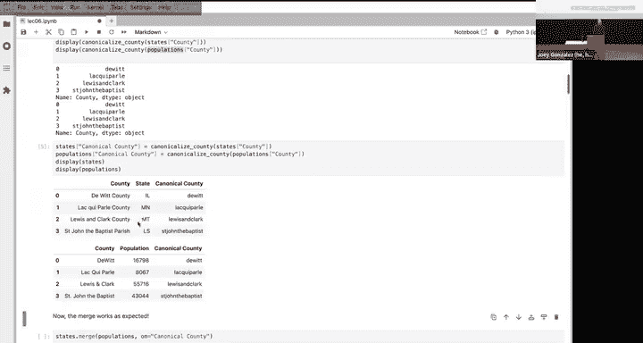
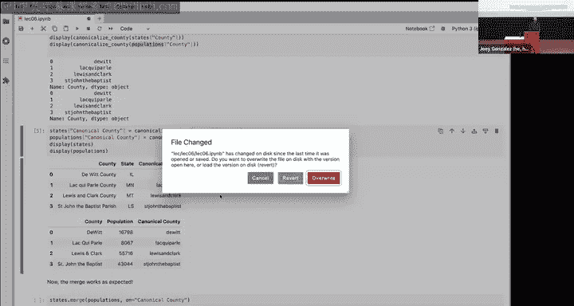
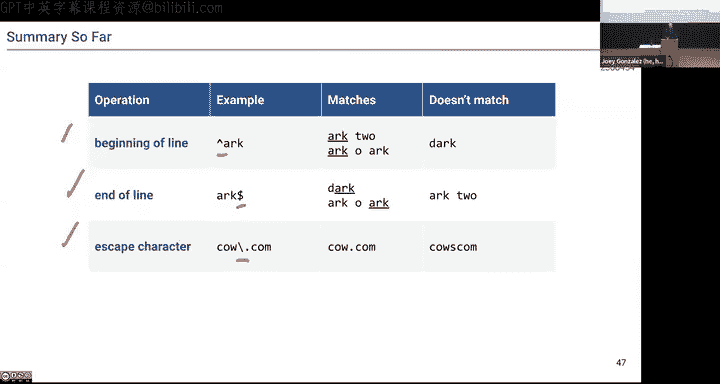
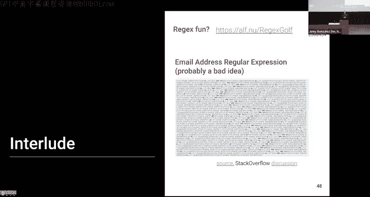
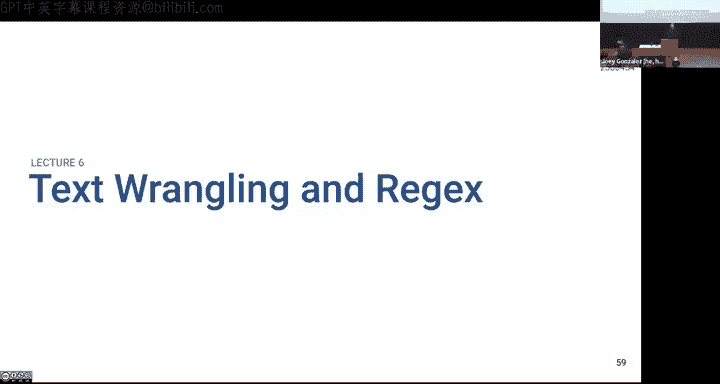

# UCB《数据100数据科学原理与技术｜Data 100 Principles and Techniques of Data Science 24SP》中英 - P6：-06-Data 100 Spring 2024 Lecture 6.zh_en - GPT中英字幕课程资源 - BV1Bc2dYCEbc

Good morning， everyone。Who likes K popop？No， yeah， my daughter is a big fan of new genes and today's song and first song was ASAP。

 which deals with two topics from today's lecture。T priorityity。And regular expressions。

So we get to go to both of those today。All right， so last lecture I had the overly ambitious goal of trying to cover all of EDA in one lecture I did not succeed EDA is something we're going to cover throughout this class。

 so I'm going to try to wrap up quickly to the remaining key parts of EDA and then switch to this discussion about regular expressions and working with streams like ASAP。

So。We spent most of the last lecture thinking about structure， this is how is the data formatted？😊。

This is。We talked about different data formats， so tabular data， this is an easy place to start CSV。

 TSV spreadsheets pulling from SQL we talked about nested data and JUN。

We looked at how data is organized。😡，The records。Can we define a record。

 What's the granularity of them， Do we need to unn or expand records if they're Jsonung。

We talked about differences。You guess these are here So we talked about pulling data from different sources So joining and merg external data sources is a key part of ED when you realize you don't have all the data you need。

 how do you bring data in and how do you work with it we talked a lot about fields at the end。

 So what is the type of data that we're working we talked about the storage type like integer float。

 and then we also talked about the conceptual type and this is we had quantitative continuous。

 we had quantitative discrete and then on this other side we had these categorical things like qualitative ordinal and qualitative nominal and those make for great questions you should review that material make sure you're comfortable at that definition and that'll also be very important as we get to data visualization understanding the data you have defines how you should visualize it。

Okay， see this。Now。We talked a little about structure， we talked a lot about structure。

 we talked a little bit about granularity， I'm going to move on to scope and temporality。

 we'll talk about scope first， then temporality， and then there's a demo for faithfulness that I won't get to。

 but I'll just quickly highlight the key takeaways that you'll need for your homework。So scope。

This is。😊，What is my day to represent relative to the problem I'm trying to study。

 What is the population I'm interested in， This could be the circle up here。

 So maybe this population is。诶。Not where my know， there's some overlap with my data。

 but there's some stuff that I didn't get sampled。 and there's parts of my data that maybe I need to remove right。

 so this is a pretty standard situation where you have to understand the thing you're trying to study。

What your data reflects about it and where your data might be extraneous。

 unnecessary outside of this scope of the population。

 and then the consequences of missing this part this whole space over here of the population。

Sometimes you're lucky and you're in a situation like this where you get data that just covers everything and you're interested in a little group inside of your data。

It's a good situation to be in， you might have to do some filtering ti rid of all this stuff over here。

But of course， the problem with filtering is， you this could have been a sample from your population so that filtering process might actually be you know reducing your data significantly。

 so you filter it down and you find that you have one piece of data from your population inside of it。

So be careful for the filtering process。Right， the other big part about scope is not just。

Does it have the right group of students or does it have the right customers。

 but also does it have the right time？This is often overlooked because you get new data。

 it must be the right time， but the temporality of data actually matters quite a bit and what does it mean to be time in data matters a lot。

😡，Can you explain that， so it gets to temporality。So data is a changing thing I said this last time data is often documented。

 you should read the manual but you shouldn't trust it because as data changes the manual becomes inaccurate likewise the data itself it might have said you know this was student grades but from what semester was it collected at the end of the semester at the beginning of the semester so understanding how the data was collected in time is important。

😡，We'll talk about space， but if we get there。Periodicity， So when we think about time。

Time is kind of like a cycle。 if we just look at you know a day it goes around。

 you you wake up in the morning， you do lots of stuff and then you go go to sleep。

 maybe you're not active and then you pop back up again in the next day right So we have this this ironnal structure of time。

 which is like maybe day night。And this was， let's say， activity。It could be activity。T。😔。

So you have to deal with these changes in time and it matters because if you take data from the West Coast and data from the East Coast and you put them together。

 they're not actually all at the same time。So understanding the time an event or piece of information in your data lives and how that reflects where the sun is during the day。

 so diurnal patterns， that of course depends on where。

 so let's talk about the meaning of a time or date field。So you see a timestamp or a date in a row。

What does that reflect？We often like to think that's when the purchase was made or when the transaction happened or when the patient arrived at the hospital。

But it could have been when the nurse decided to enter it into the system， right。

 so it might have been a different time from the time you're actually trying to study。

And then sometimes annoyingly， it's when the database admin copied the data into their system that they then dumped and handed you a nice CSV file from。

So what does a timestamp mean we're thinking about？How would you know？Do read the documentation？

One thing to look for here in this category and sometimes in this category too。

 but certainly here is。Are all the timetamps the same so everyone has exactly the same time that ever happens。

 not all the patients arrive at the same time right so look at the time stamps that there's a lot of clustering in it might mean that they were you know timestamps were created when the data was important。

This one's a little trickier understanding your documentation is important。

 like know they say this is the nurse center's patient information once the patient has been checked in okay。

 so the actual entry time isn't when the patient arrived。So understanding the context， sometimes。

 sometimes you have to talk to people so you have to actually ask questions。

 can't write ask questions。 Yeah， so a lot of what we do in data science will involve talking to other people So we get good at that All right。

 so how do we work with this data。All right one of the really useful tools is the date time library。

 which allows us to deal with things like time zones and transforming date dates pulling out fields like the month。

 the day， the year， the day of the week， time of day and so on so figuring out how deal with time zone is important and there are tools for doing that this is tricky and then of course normalizing your data that they're in some consistent time so you can do analysis。

Okay， one other thing that it's funny when I taught this class internationally and people use different times stampamps。

 so what day is that？Yeah。That。jo外。Or August？Depends on where you are and actually the way that the Python libraries will run depends on the region for' running it。

 so if you run your notebook with a different regional code and a different system。

 it'll interpret this differently。In the US， we typically treat this as the month。This is the day。

 and this is the year。嗯。We'll get more to unfaithful data。

 but another thing to look out for is dates like January 1st， 1970。January 1。

 1970 is a very important day。It's day zero in UniX time， so computers all count time from that date。

 so if you have a zero in a field and you say make this into a date。😡。

That is the date you get right there。哎。This slide used to say 1900 because I'm old。

 and so when I see zero is0， I assume that means 1900 but。Not that yeah， you guys are are post 2000。

 So if you see another date， maybe it's 0，0 in the year means that they didn't incorporate the year。

 And so the date is sometime in 2000。 So watch up for these kinds of misleading dates。Okay。

Faithfulness， last big topic。When you're looking at your data。

 you should be suspect that someone has messed with the data or it wasn't collected correctly。

Coming things to look for if you have exactly 65，536 rows。Something possibly is wrong。

 Very likely this was export from Microsoft Excel， which only export that number of rows。

 so there could have been more data， but someone passed it through a Excel spreadsheet and you lost some data。

Same thing to 355 columns is a special number if you see that number of columns maybe you have a problem。

Is this just one example of sort of things to look for？

I would say in general when you see round numbers of anything， that's not that common。

 so investigate， so you see exactly 100 rows in your table。Maybe you have 100 students in your class。

 but it's worth checking that it wasn't some export air。

Right duplicate entries so you often see duplicate columns will come to regression why this could be a problem you might see duplicate rows trying to figure out if you know a student signed up for a section twice these are the processing steps you want to work through having an idea how the data is organized and what you should see important and you'll use panda's operations to do these kinds of things。

Spelling errors and we'll talk more about that in a moment are pretty big common or pretty big problem。

 very common So with spelling errors， people filling in forms like what's your address。

 what's your state you can go type California or' just CA or maybe I'll use lowercase California or maybe I'll just misspell it It makes it hard to cluster and analyze your data and you need to deal with that before you go on to further analysis steps。

So you can apply dictionaries and we'll talk about。

Process of simplifying your strings so that you can address some of the challenge around spelling errors。

Units。How much does this product cost。14000。Is that Korean one， US dollars。

 understanding the currencies， understanding temperature， it is often localized。

 again as data scientists， you will often have people at enterprises sending you data from all over the world not thinking about their unit system is different than the other unit systems that you'll be joining the data with。

And then time zones， we already touched on this。 So when you have time in your data。

 when you have dates in your data， you need to think about where that date came from because it affects how it relates to the other dates in your data。

Missing data， very creative people have very creative ways of encoding something missing sometimes it's just a nice zero。

 sometimes they'll put 9999。This is a crazy version of missing data。

 but you if you can have this dates like 1970， 2000。

 you're lucky when you get things like Nan or null。

 people actually think through and try to encode that the data is missing and not put kind of false data。

Right。Last topic and this would have been something we if we had more time we'd actually go through a demo。

 there is a demo in the previous lecture and I encourage you to check it out it's a fun one is what to do with missing values。

Probably the most common method for dealing with missing values is to ignore the data that has missing values。

Why because it's easy， in fact， there's built in functions in pandas to just drop all the rows。

 which there's a missing value in any of the columns。That's pretty easy。Excuse me。

 but it has some big consequences。嗯。Sometimes when something's missing。

 that's actually information in itself。Maybe it's missing because it didn't happen at an address。

 it happened at a place that's not an address it maybe it has Latin lawn。

 the absence of a field like a address could indicate a certain kind of data and just dropping that kind of data could be problematic。

 right？So think through when you drop stuff if the absence of data is an important signal。

Sometimes a better solution。Is to keep the data and market is missing。

 So make sure you've encode it as a missing value。 You might even create an additional column encoding the fact that this previous column was missing。

Third option。 And by the way， I will say this is something that I actually recommend most。

 if you can keep your missing data and work through it。

 it's a good idea by keeping it as a not a number。 things like means and standard deviations will be。

 you know， you can still run them， but you'll have information about that absence of information。

RightThe last technique， which is also pretty common now。

 is to do some form of imputation or interpolation。

The simplest way to impute something missing you know what's the student's GP I don't have it okay well I don'tna drop the student for my records。

 I could take the average GPA for similar students students who are in that major or that program and just substitute that for now I should mark that it was missing so I know that I made a substitution here but I might use that to do my further clustering and it won't affect my clustering analysis because it won't have these kind of missing values。

Right。Averaging。A pretty trendy technique is actually hot deck imputation and this is where you take a sample of a similar record so you're looking for again we'll use a student as an example I'm going to find a student that had similar grades on everything else and if you know I didn't have a midterm grade I could take the midterm grade for that similar student and put it in。

Again， I shouldn't do that to make a prediction about that student's grade itself。

 but if I was trying to analyze the entire class as a whole。

 that might be a good way to do it rather than just leaving that student missing because perhaps their other grades are important to my analysis and I don't want to lose that information。

There's a variation of this where you can repeatedly resample and then look at how your data changes and we get this sampling and inference we'll talk a little bit about that as well using bootsottrap right and then the last technique which is actually increasingly popular as well is regression so I can use machine learning。

 predictive modeling to fill in the missing value。Again。

 this is useful if I want to do downstream analysis to my entire data set。

 having that missing value can be very helpful。Good， so multiple imputation。

 is what I just mentioned earlier， so I can resample multiple times from up here， so resample。

And get a better estimate。What's going on。O呃。Your choice in how you impute the data will affect the downstream statistics and the biases that they present so imputations will often kind of concentrate towards the mean certainly if you're replacing things with the mean。

 you again should always be thinking is the data missing for a reason。

 is that absence of data something that I should actually be studying？

I think you get to do that in the homework actually， So that'll be good。

 All so here's a demo that I didn't have time to do。 and we're moving along quickly。

 So this is the monoa CO2 modeling demo。 It's actually a really fun demo。

 but I'm going to just tell you the punchline。 There's this sensor。

 there was tracking CO2 levels on monoa and is's tracking them every month。

 So competing a monthly average and you can see these kind of little bumps。

 which I'll dive into it a second。 And then you get this pretty standard plot for missing values you have these like big dips。

😊，And so what ended up happening is they encoded the missing values as negative 99。9。

So that is not the level of CO2 in parts per million champion negative， that is a missing value。

So I could take one of three strategies here， I could drop those records。

 so the records are like right here。And right here。

So I could drop them all together so I don't have the records in this plot and when I draw regression。

 it kind of looks the same。诶。I could leave them marked as missing and when I use regression tools。

 notice how it shows them missing right， I should not have done that。Yeah。

 so so we don't have missing values here or so we don't have values here。

 So when you're looking at the plot， you know that something is missing。

 which is why if I'm building a visualization， this is not a bad place to be because it communicates that I didn't have data there。

The last strategy is to interpolation and here you see we get a better estimate of what happened between these points and the interpolation method used by the scientists is here is actually pretty good。

 it's in fact so good that they no longer have missing data when they release the data set itself they actually fill in the missing values with interpolated predictions。

So once you've cleaned your data and remove missing values， you get a trend。

 you can actually see the kind of monthly patterns， I guess the yeah。

 the monthly patterns of the CO2 levels they rise and fall。

 And then you can see the the overall trend of CO2 rising on the planet。So fun data set。

 check out the demo it's pretty short and you can work with data and do other analyses as well。

All right， so wrapping up EDA。还有个ID。Examine your data and the metadata。 that means documentation。

What is the date what is the date size organization structure data so we talk through these those five categories of things to think through how I do this is I walk from one field at a time。

 just go through each of the columns， if I have 10 columns I'll just check each and make sure I understand the types of those columns and any issues there might be。

As you get further along， you'll go okay， so I understand my columns or the relationships between pairs of columns。

 here you'll use visualization， which we'll cover next week。

So along the way you'll do lots of visualization which we haven't presented yet。

 so we'll do it next week， you're wanting to continually evaluate assumptions you might have about the data。

 certainly addressing anomalies。And applying transformations and corrections along the way。

One last very important point is you should record everything you do。Do not edit the underlying beta。

Ply transformations is and notebook write down why you did those transformations Someday someone might ask you。

 perhaps you yourself， how did you come to these conclusions and you want to be able to explain it。

Let's stop here。 there are any questions。A questionsestions， okay。That is the end of E。

Now we get to switch to wrangling text， which is often a part of theDA process so we haven't entirely left EDA this lecture will be dedicated to understanding how to work with strings and this is a topic that's not typically covered in CS curriculum these days。

 but is very worth knowing when working with real data。Right， so just a snapshot of where we were。

 we theoretically finished EDA last lecture， just finished it now。

ll look at text today and then next week we're going to jump into visualization。

 which will pull all these pieces together。Allright。

 so the goals for today's lecture is we're going to understand the string kind of methods。

 the operations we can apply on strings， and we're going to learn about regular expressions or rex expressions and how to write them to operate on strings。

So we'll start with standard text manipulation tasks， why am I manipulating text？

One common use of text manipulation is to canonicalize your data in particular。

 suppose I had these two tables。And I want to join them to get the population for each state。

Or for each county in each state。What would I join on？What are the primary keys of these tables Well。

 I want to join on County。County， that seems pretty obvious。

 but the problem is these counties don't match， right， So look at these county columns。嗯。

If I try to join Dewit with Dewit County， well， there's a space here in the word county here right so the joins are going to fail and I need a way to make it so that I can successfully join this data by removing these kind of anomalies and how the strings are encoded are written。

So that's one reason， canonicalization of your strings。

Another reason to work with strings pretty common is to extract information or a new column。

So here's an example。It's very common that sorry， that log files be a little bit disorganized or just a long strings。

 This is one very long string right here。 And if I just want the day， month and year。

How do I get that from that string， How do we pull out piece of information， You could also imagine。

 you know， reading through notes and trying to pull out email addresses or trying to pull out particular mentions of something。

 So I want to be able to take information out of extreme。 So out of a string。 So that's extraction。

 Thats the two main reasons canonization extraction。 Let's go through how to do those today。

Confession when I first started teaching this， I didn't use regular expressions very often I did most of my work with the panda string method。

 it's a really powerful tool that lets you hack away at strings and I'll demonstrate that in a few minutes。

 This is probably your first starting point with how you'll work with strings。Regular expressions。

 which will again， get in more detail， are a much more powerful way to work with strings。

We'll start with the string methods。Right。As you may recall from previous Python experience in Python oriented classes or not。

 and I'm going to review it here now， there are operations you can apply to with string so you take a string。

 make it lower。Make it upper changing the case。I can replace parts of a string。

So I say what I'm looking for， I want to replace。I can split strings very useful。

'll split on a comma， for example。Pull a string into a bunch of substrs。

I can pull a substr out by just slicing my strings， so this is character one through four。

 so the second character in the fifth character in the file in this string。

I can do things like is this string inside of this other string， so in membership。

 I can compute the lengths of strings。嗯。All of these are really useful。

 but all of them assume I'm working with strings。But I have a table。

 and I want to apply these operations to an entire column at once。

So Pandas has a vectorized version of these operations。

A theme in pandas is that I want to try out to apply my operation not to elements of a column。

 but to the entire column at once， so that the system itself。

 the computer can very efficiently apply that same operation repeatedly to all the entries in that column。

Vectorizing。So we have this string operator， a string accessor， so I can take any series so this is。

 you know this could be a data frame。哪。Land。So that's my that's now a series and I could do something like string and then some accessor or some method here。

 a string operation on all the strings in that column。

So here's an example so I'm out of the pulling out the county column here。

 so that's a series applying the lower operation to make a lowercase。And likewise。

 I can do something like replace all the ans within and to make a canononic representation of ant。

Right， so here are the correspondence， so you have things like lower or upper replace。

 they basically directly match the only difference here is the in becomes contains so pretty straightforward。

 you do not need to memorize these。 you will look them up as you go through the class。

 but you should start to be familiar with this idea using the string accessor to get additional string operations。

de冇 train。All right， let me zoom in a little bit。See that okay， all right。

 so let's do some string manipulation。So here's my two data frames and remember in the earlier example。

I want to canono clsia string so I can join these two tables。But I don't canonicalize them。

 and I join the tables， I get nothing。Nothing matches， So the merge produces no results。

Here is a very long expression to canonicalize the strings。 So I've defined this function。

 canocicalized county， which takes a county series， This is via series。

 And then here's a sequence of operations。 And I'm taking taking advantage of the fact that I can break these on separate lines。

 So I'm going to convert the counties to all lowercase。 I'm going to replace all spaces with nothing。

 So remove all the spaces。 I'm going to replace all ands with and。

I'm going to replace all periods with nothing sorry right here， remove all the periods。

 I'm going to replace county with nothing， I don't want to have county。

 and I'm going to replace parish with nothing。So I've chained a bunch of operations together。Fire。

 and there we go。 So I applied this function， canonized county to the states counties column and to the population county column。

 and I get two nearly， in fact， identical strings。 So I've canonized my strings。

 If I now do emerge merge these two tables together。 So I've added my canonical county column。

 Good practice to add an additional column when I keep the original county。

keep goingI want to keep the original county as is， but I've made a canonized version。

 and now I can join those。And I can join the two tables， right。嗯。Okay， conization。go back。😊，去。

Reconlyization done。Let's do very quickly what I would have done before I was I started teaching this class to extract this information。

 So data extraction using just these string operations is kind of almost a game， so。

Walk through this。 So I have this log file。 this log file contains three lines。 Each one is a record。

 It's my structure。 What format is this。Garbage， this is a standard format when people write logs。

 they often don't think about you， the poor data scientist， they think about them。

 the person debugging some piece of code so they put information that they could read quickly and make sense to them。

 You have to now extract information from that。I want this information from each of these entries。

You could just do something like slicing， so I took the first line， line zero。

 and then I took characters 20 through 31 to get the date。

That works great for the first line and I came up with that by hacking at it。

 I just tried numbers until I got what I roughly needed。But if I applied the second line。

 it doesn't work。Very robust。B way to do this， let's pull the first line out and take a look and more carefully。

I'm going to take this line and start splitting it by split off this piece。

And then I split off this piece。I'll have just the date。And I can keep splitting the date。

 let's do that， so I'm going to split off the first parts。

 so I'm going to drop everything before this square bracket and just take this half。

 I'm going to split off split it again on this character right here and drop everything on this side。

 So two splits right here。And everything that's pertinent is stored into the string pertinent。

 And that's just this piece here。So we keep packing。 what would I split on next？I have it here。

 that's a about my。 Okay， so I want to pull out the date So if I split。

 this is kind of cool I let's just put on separate lines so I split like this。😊，Okay。

 so that returns a list， right， I took this thing and split it on commas or on back slashes。

 I got 26， Jan and then the date the time right so I can keep this process going and going and splitting and splitting until I get all the fields out that I need。

You mean plot the times啊。Cool cool trick one thing you hopefully maybe noticed is that this returned three things when I ran it here。

 I can have multi assignments on the left of my equal sign here so I say the first thing in the issue should be day month and then everything else is rest。

Use way to write code。We could do this all of panda's operations。

 and I'm actually not going to do it， but I've put a solution here。

 so if you actually want to track yourself， you can try to do what I just did using panda as as short as possible。

Questions。I think it'll air。 So if you ask the split and you so the question is， if I say split。

 and I want， I assume I have A， B and C， So I do A come a B， come a C。 and then the split finds one。

 two things， not three things。 it'll generate an error。And try it。Yeah， what's the slider question？

We use STR methods in the dot apply function。Yes。😊，If you get a series， so STR methods。

 the STR accessor is applied to any time you have a series。Actually。

 you may clarify that a series that is either strings。Or lists。

 So you can also use the STR method to operate on lists a little more out of scope of this lecture。

 but we'll see more of that later。Actually， I might have used that trick in my demo I did here。

Maybe I'll show just that piece， so logs was my list of strings。If I take your Ill show right here。

 this is my data frame， so I have just this one column， which is my list of strings。

 if I split on the square brackets， I get a list back right and it's actually going to be a series of lists。

And then if I use a string accessor again， and I pull the second element in that series。

 that's the same as taking the second element in the list。Up here。It same as this。

I might have confused people。 Are there more questions。If this is confusing， that's。It is confusing。

 when I started doing this stuff， I had to just play it for a little bit。

 I really encourage you to go through these notebooks if something， hey， what if I put in an extra。

 you know， thing here， Will it break。😊，Yes， it'll break， so you should try it。

That is how I learned most of this stuff， try it。East way to do it。O。

So I had a demo you can try to do it， don't look at my solution yet。

 try it yourselves and see if you can do the same thing using string operations。

We're going to keep going so I want to make sure we get everything for your homework。All right。

 and now for the exciting part of the class。Regular expressions。Wice is exciting。

We're going learn a whole new language。Why do we need to learn a whole new language well。

 because doing all this replace and splitting stuff kind of a hack。It can be very confusing。

 can be a little bit brittle， and there's situations where it's not enough。

I want to find all the examples of moon with as many O's as possible or as as few O's as possible。

 any number of Os is fine。That's hard to do with split and replace。

So an alternative approach is to use this。Machinery or regular expressions。

 and this is implemented in the Python Library RE。Here you can access it through string accessoriesors。

The challenging part of this whole thing is going to be learning this new programming language。

 which we're going to cover in this lecture。This is a program in a tiny programming language。

 which you will now learn。Alright， so regular expression basics。

 So a regular expression or Reg X is a sequence of characters。Here's an example of ax。

 this defines a search pattern， so it's way of searching for something in a strain。Fs。

It is a embedded domain specific language， which is jargon for a tiny programming language they use inside of another programming language。

 by writing a little string。So what's。Do our first program。This is the string。

That matches social Security numbers for those who are familiar with Social security numbers is a sequence of numbers that's used often in the United States to track various parts of employment。

 all sorts of things provided by the Social Security office。 And it is a sequence of。

Three digits followed by two digit or followed by a little hyphen。

 followed byit two digit two digits， and then another hyphen， and then four more digits。

And to encode that， I use this stream that says a number between 0，9 three times then between 0，9。

 two times between 0，9， four times。That shouldn't make sense to you because I haven't explained it。

 but that is an example。In the remainder of this lecture。

 this will become very obvious what I'm doing here。Right， one important note， how do you pronounce？

Red。GX red XX this is actually still debated red Xx should be pronounced Reg X the G is in regular and if you would like to pronounce it red XX。

 then it's the G is in red jewelular。So red Xs。Should be a soft， soft G。

 It's a port Manoa regular expression。Okay。不。One video all right， let's do one important thing again。

 this is about to get a little confusing because regular expressions are there's。

They're hard to read your goals for today is not to memorize everything I've about to tell you。

 but to understand the big ideas， how I would write a regular expression with a reference table。😡。

I need a reference table， I do a lot with regular expressions。

 I still go find a reference table before I do anything。

 so it's okay to have to look stuff up even when you do this in the exam we're going to give you a reference table。

It's knowing how these pieces work together。就还了。All these weird things we're going to go through today。

 you will learn in practice in time。When learning regular expressions。

 it is helpful to use this tool， I actually use this tool when I'm building new regular expressions。

 it's a nice website， it's very easy to use， you can write a regular expression here。

 you can write some practice strings down here and it'll tell you did it match and it'll even give you an explanation over here what's going on。

But if you use this， it's very important that you turn on the Python flavor， because guess what。

 there is more than one version of regular expressions。

We're going to focus on the Python in this class。 It is pretty standard。

If you want to learn a lot more， you can go here， this is a long description of regular expressions that comes with Python。

It will tell you much more than you need to know for this class。

 but if you want to become an expert and these kinds of transformation techniques。

 this is worth looking at。B now made an important note here， so when you see this on websites。

 this little thing here， it allows you to suppress this stuff so you can easily copy and paste just this part and then try it in a yourself。

So again， repeated guidance， the best way to learn a lot of this stuff in this class is go try it。

 open up a notebook， play with it， it'll become way more obvious when you play with stuff。All right。

 here we go， the basics。This is the first and easiest part of regular expressions。

The consecutive sequence of characters here， A， A， B A A， or let's start this。

 this sequence of characters matches this。And only this。So so if you do controlr F in your， you know。

 pick your favorite program， you're doing this concatenation， you put a sequence of characters。

 you find exact matches of that sequence of characters。Do syntax。The or， that's an or。

 So this expression here， this string， A， A， or B， A， A， B matches， get this A， A or B， A A， B。

Everyone's with me so far。This one's not so bad， so I can match this or that with the or。

And now we get to something more interesting。This is the star。

This A B star A matches zero more instances of the thing immediately to the left of this guy。

So that matches AA because there's an A and then zero B's and then an A。

 it matches A B A because there's an A and 1 B， it matches A B B。

 it matches any number of B's as long as it's followed n by a so a。

 as many Bs as you like and then an A。AndWell one more piece of syntax。Prenheses。

Just like the parentheses you know already。So see how this immediately applied just to the be。

I can now write this， a parentheses， A B， close parenthees star A will match。

Just a which means zero of this thing in parentheses or A BA or A B， A BA and so on。Yes。

So this star applies to what's ever to its left and there's an order of operations which I'll explain on another slide in this case the precede is for this concatenation and so this B is all that it's going to replicate so the star says B zero or more times so it can take an A followed by zero or more B's followed by an A so an A with zero B's and a with1 B。

A zero Bs， A with1 B， A with two Bs， and so on。These things are called meta charactersact。

 They are a core part of our new programming language。

 and these things here are just called characters。 They are the things we're expressing in our strings。

Yes。It'll work with lowercase， uppercase， we're going to get into a whole lot more。

 we're just starting。Okay， so I said something about order operations。

 so there's an ordering of operations grouping。Has the highest priority。

 so the group creates essentially a thing， but before anything else applied。

 I group' applied the grouping。The next thing that applies is the star。

 the star then applies immediately to its thing， to its left。And then concatenation， right。

 And that's why when I did a。B star。嗯。A， this star applies here because it's higher precedence and concatenation。

So if I want it to be the whole thing， I have to put parentheses around it。要作废。Okay。

And then or is last。Oror。So I get the whole expression here and then or the whole expression here。

 it's not the or of these two things， for example。Okay， I think。There's a great， there's a slido。

 so let's do some practice。So which rex pattern will match the string ABBA？

We should change this slide up。It's on the table。I apologize last time I didn't leave the side up long enough for people to fill it out。

 Flavvers had a chance to fill it out。对的。We did that a lot， so you're getting it。

 let's walk through it so a。BBA is matched by。This is the correct answer a and then zero or more bs。

 so this is two b's followed by a this is just a string it'll only match A A B B A AB。A， A B， A， A B。

 this， remember that what of operations， this means I have to have A， B， A B。

 It has to match that group。 that A B group has to be repeated so it can be。到。

And then this last one is either AA or BAA B。So that also does not match ABBA。

Ho everyone's had a chance to fill this out。5，38，5，41， go， go， go， submit something questions。

All right。More practice the star I think is' one more slido， let's do the other slido。

 and then we we'll do some more star again， if this is confusing， that's okay。

 it is confusing you' will need to practice it。 we're just getting the intuition。All right。

 so more star practice。Which pattern matches？冇冇。An even number of O's。

even number of those except zero。Don't match M N。All right， let's see what people said。Okay。

 let's walk to it。So the first one here， again， is the right answer。Wai。So here's how I read it。

The string has to begin with a M。Or the thing that matches begins with M followed by  two O's。

Followed by， there's a group。Zero or more copies， Oh no。But sorry。

 zero or more copies of this O hair。Follled by。 and end。So the star says whatever is the left of it。

And if it was just a character， it would be that character， but here it's a parentheses。

 it's the whole group。Can appear zero or more times， and then that string will match。

we're going to get more practice because we're going to add more symbols and we'll see how they start to interact。

对。Let's actually。诶。I'm doing on time。Let's try one of these， maybe have time for one of them。

We got this guy here。And for second。All right。So， I want to match。Moon。

Or I want to match and even basically the same thing as before， but either O's or use's。

 how would I do that？So we want an M。And then I went what。Doubo。

And then maybe I'll put apprenhees for another oops， sorry。Double O star。It's one thing。Or。

Should I get this right or wrong， I want a you you。I will buy0 more copies of my new you。

That didn't work。Why did that work？Its thing I want。This。Or this。You guys can't see that。The saying。

Remember the order of operations is this whole expression on the left or this whole expression on the right。

So if I want to change that order of operations， I put apprenheses here。And here。You get it。

So let's let's try to parse this one more so that I want。O0， followed by zero more copies of OO。Or。

UU if I'll buy zero more copies of UU， and I went this whole expression。Between an M and an N。Now。

 if again， if I remove these parentheses， I'm going to match mu and un but not moon or Mu。哎。

But just play with these things， the easiest way to learn this stuff。

I wish I was it was better to I could just teach it， but yeah， this one you have to just try。Okay。

All right， so new characters。Period。Look for any character。 That's what period means。

 it matches any character。 So dot U dot U dot U could be cumulus or juguum。Where are brackets。

This creates a character class。So this expression here means。

Any character that is between capital A and capital Z？Or little A and little Z。

So this is a range right here。This is another range right here。So this match is a。A， B， B。

 it only matches one character。Go away again， so this is matching。This defines a character。

Is anything in that range。I could also add， let's just do this， I could say a。Z。

 and maybe I do a Z and then 0。9。That's all little and lower all little letters。

 big letters and numbers between zero and9。What。Plus is star's cousin plus matches one or more。

 it's just like star， but one or more， which would have made our earlier examples much easier right so star star is zero more copies of the thing to the left of it。

Plus is one or more copies， depending left of it。 so this here will not match a。

Oras if this was a star， A B star， it would match a。

One more close cousin of the star on the plus or the star in the plus is the question mark。

 so this matches01。So it's saying A and B is optional。Right。

Last almost last set of syntax squiggly brackets means repeated two times so repeated x times。

 So if I have a B and then sggly brackets， again， it applies directly to the B so B cannot。

B must occur twice。And I can actually do a range， so squeeze your bracket with the range。

 so A and then B can occur anything between zero and two times。Rangs are inclusive here。

I feel like I'm just telling you syntax， which is never fun。

 but you have to have an intuition for this， you'll get a big table that explains the syntax。

 but you should be able to think through what I'm saying here and sort of having this in front of you be able to apply it。

I'm not going to at these details， but you can use these ranges with slicing。

 so you say zero to forever one to forever corresponds to these same operations。Yeah。

 we'll explain that more。Okay， so。We've talked about the basic sets let me dive into character class a little bit more。

 so this defines again all the letters all the capital letters。

 this would say all the the number zero to9 and this is。All letters， capital and lowercase。

 as well as numbers。But because we do these things so often， there's built in syntax for those。

 so slash W。This guy here is equivalent to this thing here。

And then here slash D is equivalent to the digits here。

And then this here is matching any kind of white space that could be a tab， a space。

W space characters。Some more syntax。One last little bit of syntax here， if I put this carrot。

 so if I do this right here， this is saying any character that's not a capitala letter between A and Z。

So it's negation of whatever comes to the right， whatever is inside this box。All right。

 so summary so far， so we've talked about the any character， we've talked about character classes。

We've talked about using the scie brackets for repeated and repeated ranges that。

 and then we talked about the at least one the plus character。We get one more demo。One more slideo。

Well， this slide is going questions。Yeah。I think war has the lowest priority。

 I can't think of any other characters at lower priority， but I could be wrong。

 the regular expression pull and taxax is pretty big。

What we cover in this class or I think has the lowest priority， all of stuff。All right。

 so choose a cleaner solution to the example from before， which pattern matches moon or moon。s。

 command， build up。And I think I want to match any number of O's that are even。Examp。

What would this match？That's who we got。Okay， you're forgetting it。

So M00 plus means one or more copies， so moon moon and then moon。

 as long as it's a even number of those， this matches moon。She is good， but not all number of os。

 all even numbers of os。 What does this match。Wite a bit， right， well。

 I guess and then any character you want right here， you fine。对。换木耳。Alright。

 what pattern matches any lowercase alphabetic string that has a repeated bowel。 So noon， heel。

 festoon， loop， oodles。hi one。All， so I want to think through this。Let's start the first one。

So dot means anything， star means zero more times。Square brackets is a character class。

It says any vow， so that character classes all the vowels。Hasper。Occur once or more。

Followed by any number of characters afterwards，0 more of anything。系。I have one here。All right。

If you trying to get it。So the first one is correct and we'll come back to why the second one is incorrect。

 but the first one is correct because it' saying I want any lowercase character。

I guess I should have said that， oh no， is it any Loricase character？Repeated zero more times。宝闭。

InThis group。And this group， oh can't click。Sorry， it should be reopened。 I think this group。

Says A A， remember， order of operations or is last。 So it's A， A， or E， E， or， I， I， or， O， O。

 or U U。So something from one element in this or。Followed by a lowercase letter repeated。

0 more types。That's what we're looking for it's lowercase alpha extreme。

 so noon works so n it's here and then00 would match here and then n matches here our stone same thing oodles。

 there's zero here so just goes straight to O0 and then repeated characters here so。De yes。

 so this didn't work because we said any character。It could be uppercase too， so that's a problem。

 repeated zero more times followed by a vow。Repeated one or more times。So a vow once or more。

 So A would have been a valid match， and we needed repeated patterns。So it need to be at least two。

 and I think we wanted an even number。No， need to be at least two， so this was at least one。

 and then any character at yet end。Questions。Yeah。How do you get brackets andhees。

 That's a great question， I think that might be my next slide。 No， okay。

 we're going come back to that soon。 Suppose I want to match a brackets parentheses There's way to do it Before I get there。

 I want to talk about readiness。So reading this in the context of regular expressions and maybe actually this one is best done with an example。

 so if I have this regular expression here， so I have div。

Foled by any character repeated zero more times， followed by div。

These are these are all valid characters。What would that match in this string here of this string here？

Where you go。I think my goal might be I suppose I want to pull out all of these things I want to match this and this。

What will this expression match？So let's try it。Have you got this expression？

I've got the text down here。So I put this expression in， it's greedy， so it goes， okay。

 so I'm looking for a div， I got div right here。And now I'm going try to match。

0 more characters as long as I can。 So match match， match， match， match， match。 still matching。

 still matching。 we keep going till I get to the very end。

And then if I say now I can match this closed div， that's the end of my expression。It's greedy。

 It just keeps going until it can't go。We went to sort of look ahead and say， okay。

 can I close it here？Stop going。So we can put a question mark here。

 and all of a sudden it's not greedy as well。I'm going to go into I get something that matches the rest of my expression。

A confusing， let's get rid of it again。So， this is saying。I see div。And I just keep going everything。

 this is a dots， this is dot， this is a dot， all these are valid dots they just any character and it says。

 sorry， match any character zero more times。Till you can't， but in this case。

 it means until I can't finish this expression。So I want to end on a div。

But this will eat this div in the middle。This dot star just keeps going。Very confusing。Yeah。

Great question。 So when I add the question mark， isn't it redundant？That's all right。

 so when designing this programming language， which many of you might be saying this is the weirdest programming language I've ever seen。

 you are correct。There would be no reason to have a question mark after a star。

And so they use the question mark after a star。Character to indicate， don't be greedy。

So that's a special syntax in language。 So when you follow a star and only a star with the question mark。

 it makes the star not greedy。Sarno plus， so any of these repeated matching characters？

 repeatedated matching operators。 that's an operator， and this is an operator on that operator。

So question mark is operating on the stock here。Sorry， this is confusing。

 I I wish regular expressions were easier， what it is， you got to practice it。Right。

 let me see if I can give more explanation， so the idea here is in English the expression is going to look forgive give。

 which it finds， you know it finds zips。That background。An。Yeah。

 it's going to look for the character or div this expression here so it's looking for div and then it's look for any characters zero or more times it goes oh these are all matching technically this matches。

 but then it can't terminate the expression， so it'll never get to match div so then backtracks and goes okay。

嗯，There goes here and then stops here。 and if I want it to stop here， I needed this question mark。

To make it not greedy。All right， the last set of rules。

 and then I would do some code and we'll be done。あのして。Read the next character literally。

 someone asked before， how do I write slash？Or sorry。

 let me slash willll come back in a second how would I write parentheses。

 I want the parentheses character while you do a slash parentheses。

So treat that character not as an operator， a meta character in my language。

 but as just a vanilla character。You want to plus do slash plus， that's right here。给。

We just told you carrot was not。Well， that's not true。 Sometimes carrots not not。

 So when you put carrot like this in a character class with defining a character。

 this means not not A or B， right， can't be the character A or B。

 But when you put it at the beginning of an expression like this， not inside of square brackets。

 that's saying， I want to match from the very beginning of the string。

I want to start at the beginning of the line， but I can only find things that match starting at the beginning of the line。

With this character。It' stuck in the beginning of the one。So this will match。

ABC said this would would match ABC。One，2，3， but it will not match 1，2，3， ABC。It would match here。

 but will not match here。我 not去。对。Be careful， as I said before different meaning when this is inside of square brackets。

RightAnd then the last goofy character， the dollar sign， the dollar sign is just like the carrot。

 but for the end of the string， so this says that the string has to end on the dollar side。

So this only match ABC if it's at the very end of a life。Right end of the string， sorry。

So I think we've covered all this syntax， you will get practice with this on the exams and when you do assignments you should look at tables because it's hard to remember all this stuff I have to look it up each time too so we talked about beginning of line。

Prots， we've talked about end of line， Bellar sign。

 and then the escape character here willll let you turn any of the special characters into just regular characters in your expression。

Right。Brief interlude， which I'm going to do really briefly because I want to get to the how to use the code。

 regular expressions can be， as you've already seen painful。

 Here is the regular expression to match an email。So writing these things and reading these things is very hard。

 there's a joke that these are right once expressions because after you've written your own regular expressions。

 it's often hard to figure out what you were trying to do with that expression。

So it is a little bit painful， but they are very fast for processing strings and they can do pretty sophisticated things with strings。

Al right， so now I need to cover the functions to actually use these in code so you can do your homework so the first thing you know about is raw strings。

 So this is you basically put an R at the beginning of your string in Python you can use your choose your favorite quote character and that means I interpret the string as is what does that mean。

So呃。If I put a slash N in a no， sorry。Put a slash and in a string， Python means sees this and goes。

 you mean a new line character and it replaces that with an actual new line character。

 which is not on your keyboard or not easy to put in a string。If you make it a raw string。

 it doesn't do anything to your string， it just leaves it as is you can put funny characters in your string and it will not try to modify them。

 that's important when you're writing regular expressions， which is full of funny characters。嗯。

Let's see if theres an example yeah， so we'll do some examples in code。

 but if I didn't use this R in order to put a slash in my string。

 I'd have to put a slash followed by slash because I get to tell Python that this slash is not a Python slash but a slash slash so you end up with these huge numbers of slashes in your strings so are at the beginning of all your strings first thing to know。

All right， so now regular expression library。RE has a simple string operation。

 find all which takes a pattern and some text， you'll find all the occurrence of that pattern。

So if I take this is my text here， this says long string。And this is my pattern。

And we already see all this pattern before， so it's a number repeated three times and not a dash number repeated two times and so on I will find this pattern in this text when I say find all who returns all the substrs that match this pattern as a list so these are all the sub strings that match the pattern。

对。This operation here was on a string， you can do the same thing with the series。

 so if I have a series of strings。I can take whatever my series is。

 so let's say my Social security number strings and I can say string。Thatt find all。

 and then give it this pattern right here。Sticker right here and that will find all the social security numbers in my string so return for this。

 this is my table right here。We would return this table or this row this series where in the first row I found one in the next row I found none in the third row here。

 row number two， I found two and so on， so lets me extract stuff in each my rows。Seectctorized。Demo。

Let's do it really quickly。Weing going to make it。你个さ。Regular expressions。We just described。

 here's my text， this is exactly the thing on the slide， so I won't explain it again。

He point here is I employed the regular expression library， RE。

Same thing on a data frame this time I don't need to import the library so I have my data frame of Social Security numbers。

I don't know who such degree numbers these are probably some faculty at some point and I'm going to apply this pattern notice I said R it's a raw string so I'm going to apply this as is to the social security number column so I'll take this string accessor。

 apply the string method find all。With this pattern， what do I get？Analists。We had a series of lists。

Just as I should on the slide。Suppose I wanted to get the last element from this series。

 so I just want the last social secure number from each line。I could take this string。

 I do find all again and now use a string accessor again。

 remember it works on lists so I can get the last element from each of those。

 which would look like this。Me good one gives me the last thing in the list。Right。

Play with this code。It probably doesn't make sense。 That's okay。 Work with it， try changing it。

 see what happens。 maybe put a zero in here。 What does that due。And2。Fs。The play of the code。

 try to understand what's going on， that's the easiest way to learn this。Let we do these demos。Okay。

 almost there capture groups last big idea， so remember I told you parent sees a group stuff。

Just organize your regular expression。 They do a little bit more。 when you put prehes around stuff。

 it defines a capture group， which means you pull out not just the whole string。

 but also that little piece， and you can use these regular expressions to actually match multiple things at once。

So' very useful for extraction。 So here's an example。 supposeuppose I want to pull out the hour。

 the minute and the second from this string。 So these parentheses here aren't necessary。

 I could I don't need this parentheses， but I've added it。If I' had removed it。

 it would match this regular expression would still match the whole string， in fact。

 I delete this here。See， this regular expression would match this thing。

 so it would extract that thing， but I actually want to extract it in three separate parts。

 So by putting parentheses around the pairs of digits， this says digit， digit。 So I want。

This pattern will match anything followed by digit， digit， colon digit， digit， colon digit digit。

 and these parentheses say pull out these three pieces from that regular expression。

So that will extract a little tuple， which has the three strings pulled out as separate parts。

That's how you pull out little pieces of a string， very useful when you're trying to pull out parts of a date。

 for example。So theses capture groups。Let's try this， actually。

So I'm going to use the capture groups system to extract multiple columns from each of these examples。

So extract capture groups， so just demonstrate this again。啊， we是不 R here。

That's wrong Okay so this string is my the string that my pattern I showed you earlier。

 applied to this string here will pull out these three fields。We can apply that to a series。

St out here。So now I have this Social Security number table with one column in it。

 and this column contains strings and I want to pull out each of the parts of the social Security number as separate columns so I can work with them separately。

So now I'm going to go back to my earlier social screen number example and I've added these seemingly unnecessary parentheses。

Biger I didn't need these parentheses， but I'm defining capture groups by creating them。

And then when I extract from that social number column， I use a string extract method。

 it's going to pull out separate columns for reach each of them。

It's very convenient for pulling out piece of data from a long stream。But one thing I wanted to show。

 So when I'm working with this and I can't figure stuff out。

 I like to use the shift tab way of getting documentation。 The problem is， if I do that here。

It doesn't work。Doesn't work， because。This thing is not evaluated yet。

 so it doesn't know what method this is going to be。

ICan't read that just from looking at the code because I have to actually run this piece of code because that produces something that I then take the string accessor for。

 So a little trick if you want to work with series is save the series to a variable。

 So I save this series。 This is this is a series。 this variable here。 This variable now has a type。

 I know what it is。 and the string accessor can be used to access that string。 Now。

 when I go over here and I say extract I hit shift tab， it shows me the documentation for it。

So when you're debugging stuff you're like， why is this not working， this is a standard trick。

 just save your series call to a single variable and then start playing with it as a single variable。

We're almost there。Sttract all。So this will allow me to find multiple occurrences in the same row。

 so remember one of these rows had two social security numbers。When I say extract all。

 it creates two rows， so row two has match0 and match one broken out into separate rows。

This stuff is super useful when you're trying to pull out lots of information。

 let's say you have a correspondence from people or slackck message and you're trying to find all the email addresses。

 some message might have more than one， you want to be able to pull them out into separate separate pieces。

We were talking about extraction when we talked about canonicalization the key trick and canonicalization is often just finding parts of a string and deleting them and you can use regular expressions for this as well。

 deleting or transforming so here I can take the regular expression library I give you a pattern and I say wherever something matches that pattern。

 replace it with that other piece of text。So。How use I've actually used this before is that Im to remove all of the HTML tags from a string。

 and I just want the text。We can do that。So this defines regular expression。

Which is going to move all the HTML tags this matches an HTML tag and I say take that pattern and replace anything and match the HTML tag with a single character with sorry with no character with a blank delete it。

Once more， actually， let's look at this expression。What is this saying？This is saying。

 I want to match。Is bracket followed by。A character class， this is a character class。

 which is not a closed bracket。One or more times， so I need one or more characters that are not a closed bracket。

Followed by a closed bracket。This is。You should play with this particular piece of synt。

This is a way of getting around the greediness problem。

 so this is matching everything that's not this once it hits a closing bracket。

 it'll end this regular expression。And that will be a match。Anything that it matches like div。

 it will convert to nothing， so it'll delete div。AndTD and so on。please all of my my， my。Htl text。

 so I get back just a very clean strain， which is a all text。Right。

 what I told you how to do this for the single string， this takes a single string。

 just the Python string as recurring theme in this class， if I have a series。

 I take the string accessor， I run the same function。He'll do the same thing Here。

 I think you need to say redx equals true that gets equals true。Otherwise。

 it'll just assume you mean a vanilla string matching。So this does exactly the same thing。

 so this is the same as this。But on a data frame， on our series。So I can take a series of HTML。

 so each of these things， a piece of HTML， and I can just delete everything that's HTML about this string。

 so bleeding all of this stuff。By replacing it with nothing。All right， so quick summary。

 we cover all of these functions now， these are the base Python functions。

 these are the regular expression functions in the regular expression library here and then here the thing you'll use most in this class is a stuff over here。

And in general， for your assignments， focus on using these pieces here。Lets we otherwise。Okay。

This slide has a star on it which I didn't add there。

 so I assume a society should memorize or maybe it's something you should study for the exam。

 but this is the basic piece of Python syntax you need to use regular expressions。对。

We are almost out of time， which is great because I am almost done。

 I apologize regular expressions aren't the most exciting topic。

 but you should practice them they're fun to use and I think there's some links actually to some games where you can try writing regular expressions to hit certain targets。

 so it can be fun if you start playing with it I said this earlier regular expressions are a little hard to use they right only language in some sense it's hard to read regular expression you have to kind of think through it。

😊，They're still very powerful the other thing that is' worth knowing is they're also very fast so if you're processing large amounts of data。

 regular expressions are often the best way to pull out key piece of information from that data。

But of course， they can be difficult to bug， difficult to read。

 and you have to learn a syntax in order to use them or at least have a table right beside you。

Worth noting there are situations where you should not use regular expressions。

 there's Python libraries for working with HTML， you can delete HTML using regular expressions that's fine。

 but if you're actually trying to find important piece of information from an HTML document an X document。

 JON， don't write your own regular expressions， use the Python libraries for working with that kind of data。

If you don't know what those libraries are， you can Google them。

 We've already covered a few like the JsonN Library， you York at HTMLt。

 there's things like beautiful soup that make working with these things much easier so you don't need to write regular expressions。

So it's still a limited language。Right， so that is it we actually finished on time。

 that is text wrangling， you'll have plenty of practice next week we'll have much more fun with data visualization。

